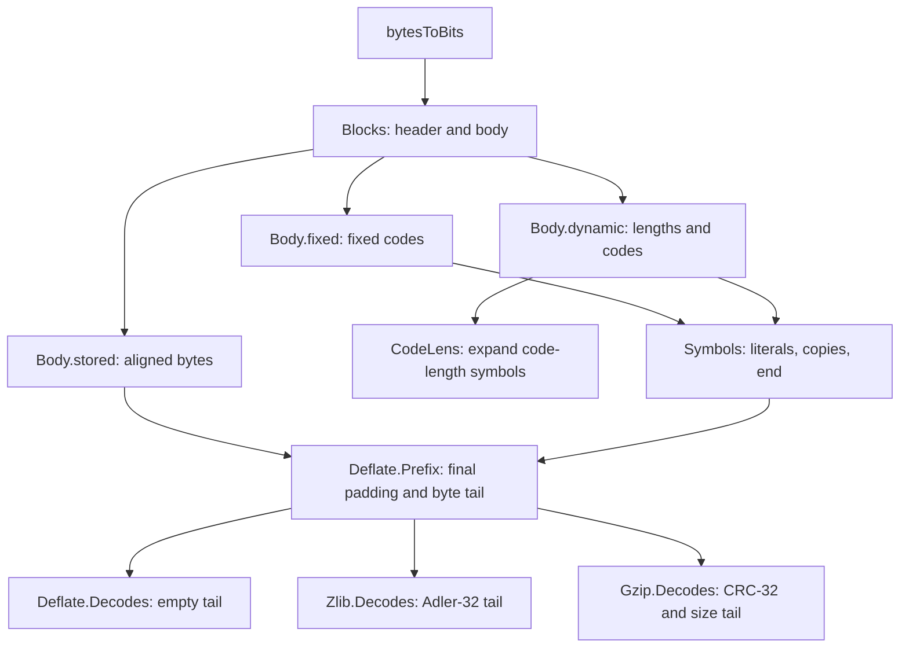

# Format model in Lean

[Documentation home](../../README.md) · [Data format](README.md) · [API guide](../api/README.md)

The format model describes how compressed bytes determine uncompressed bytes. It has no
heap or pointers. It is a specification to refine, not an implementation of the streaming
API. Read [the format guide](README.md) for the rules and [the API model](../../design/api-model.md)
for calls, buffers and return values. Accepted results and remaining work live in
[progress](../../progress.md).

The umbrella module is [`ZlibF/Spec/Format.lean`](../../../ZlibF/Spec/Format.lean). The token
extension is imported separately. Definitions below are in namespace `ZlibF.Spec`, except
the local token relations in `ZlibF.Spec.Token`.

## Module map

| Module | Vocabulary |
| --- | --- |
| [`Bits.lean`](../../../ZlibF/Spec/Format/Bits.lean) | Byte-to-bit order, numeric readers, big- and little-endian byte encodings |
| [`Checksum.lean`](../../../ZlibF/Spec/Format/Checksum.lean) | Bytewise Adler-32 and CRC-32, update functions and append laws |
| [`Huffman.lean`](../../../ZlibF/Spec/Format/Huffman.lean) | Canonical codes, accepted length sets, fixed codes, length and distance tables |
| [`Deflate.lean`](../../../ZlibF/Spec/Format/Deflate.lean) | Symbol and block relations, raw prefix and exact-stream relations |
| [`Wrapper.lean`](../../../ZlibF/Spec/Format/Wrapper.lean) | Zlib and gzip headers, trailers and exact-stream relations |
| [`Token.lean`](../../../ZlibF/Spec/Format/Token.lean) | One-token decoding and rejection, with obligations connecting them to the block grammar |
| [`Examples.lean`](../../../ZlibF/Spec/Format/Examples.lean) | Concrete acceptance and rejection examples |

## From bytes to output

Readers such as `readBits`, `readBytes` and `decodeSym` return either `none` or a value paired
with the remaining bits. Relation constructors require the appropriate reader equations.
There is no constructor for an invalid block type or reserved length/distance symbol.

`Symbols L D dict h inp rest out` starts with history `h`, uses literal/length lengths `L`
and distance lengths `D`, and ends at an end-of-block symbol. It consumes `inp` down to `rest`
and leaves output `out`. `copyBack` appends each copied byte before reading the next one,
so overlapping matches have their ordinary bytewise meaning.

`Blocks dict h inp rest out` composes bodies until a block with `BFINAL = 1`. The block grammar
uses bits derived from whole input bytes. Under that entry condition, `inp.length % 8` is
the number of bits left before the next byte boundary; stored bodies drop that many bits.

The public format relations differ in what they require after the final block:

| Relation | Meaning |
| --- | --- |
| `Deflate.Prefix dict stream tail out` | Decode blocks from the beginning of `stream`; ignore final byte padding; require the remaining bytes to equal `tail` |
| `Deflate.Decodes dict stream out` | The same relation with `tail = []` |
| `Zlib.Decodes dict stream out` | Exactly one zlib stream, with a checked header, optional dictionary ID and Adler-32 trailer |
| `Gzip.Decodes stream out` | Exactly one gzip member, with its optional header CRC and CRC-32/size trailer |

The wrappers use `Deflate.Prefix` with the required trailer bytes as its tail. They still
describe exact streams: bytes after the trailer are excluded. An API theorem about input
left after `Z_STREAM_END` needs a separate consumed-prefix statement.

## Rule map

The `F-*` rules are defined in [the format guide](README.md). This table locates their formal
counterparts without making an implementation-correctness claim.

| Rule | Definition or obligation |
| --- | --- |
| `F-bit-order` | `byteBits`, `bytesToBits`, `readBits`, `natToBitsMSB` |
| `F-block-type-3` | `Body` has no constructor for type 3 |
| `F-stored-complement` | `Body.stored`: `nlen = 65535 - len` |
| `F-code-fits` | `count`, `codeStart`, `codeOf`, `Fits` |
| `F-code-complete` | `Complete`, `CodeKind`, `Acceptable` |
| `F-fixed-lengths` | `fixedLitLens`, `fixedDistLens`, `Body.fixed`; `Symbols.copy` restricts length and distance symbols |
| `F-dynamic-limits` | `DynamicCountsOK`, required by `Body.dynamic` |
| `F-dynamic-repeat` | `CodeLens.rep16`, `.rep17`, `.rep18`; previous-entry and total-count premises |
| `F-dynamic-eob` | `HasEndOfBlock`, required by `Body.dynamic` |
| `F-dynamic-valid` | `Acceptable .codeLength`, `.litLen`, `.dist`, required by `Body.dynamic` |
| Dynamic header order | `Body.dynamic`, `clOrder`, `readCodeLenLens` |
| `F-length-table`, `F-length-284` | `lengthBases`, `lengthExtras`, `Symbols.copy`; base 227 plus extra value 31 remains 258 |
| `F-distance-table` | `distBases`, `distExtras`, `Symbols.copy` |
| `F-match-copy` | `copyBack` |
| `F-distance-bound` | `Symbols.copy` requires distance at most `(dict ++ h).length` |
| Block order and finality | `Blocks.more`, `Blocks.last` |
| `F-zlib-header` | `Zlib.HeaderOK`, `Zlib.windowSize`, `Zlib.Decodes` |
| `F-zlib-check` | `Zlib.Decodes` requires tail `be32 (adler32 out).toNat` |
| Gzip header | `Gzip.header`, header constraints in `Gzip.Decodes` |
| `F-gzip-check` | `Gzip.Decodes` requires tail `le32 (crc32 out).toNat ++ le32 (out.length % 2^32)` |
| `F-adler-incremental` | `adler32Update`, `adler32Update_append` |
| `F-crc-incremental` | `crc32Update`, `crc32Update_append` |
| `F-deflate-valid` | `Deflate.Valid`, `Zlib.Valid`, `Zlib.ValidWith`, `Gzip.Valid` |
| `F-deflate-matches` | Compressor obligation; no extra restriction in the format grammar |
| `F-deflate-flush` | Stream-sequence obligation; a completed flush is not a complete final stream |

The `Valid` predicates reverse the emphasis of `Decodes`: the compressed argument must decode
to the supplied input. They do not select one encoding. `Zlib.ValidWith` supplies the preset
dictionary; the other listed `Valid` predicates use no dictionary.

## Model choices and boundaries

**History and small windows.** `Symbols.copy` uses the full `dict ++ h` history, not an
explicit saved-window state. The distance table caps a reference at 32768. The zlib header's
window field limits the initial dictionary suffix, but does not add a distance premise to
`Symbols.copy`. This keeps the existing model choice explicit: default decoding can use
current-call output beyond a small saved window, while a later call may lack those bytes.
The C also has a separate `INFLATE_STRICT` check. Refinement for all configured windows and
output-buffer boundaries is **to confirm**. The declarative relation alone does not establish
operational acceptance for every split.

**Dictionaries.** With `FDICT`, `Zlib.Decodes dict` checks the Adler-32 of the entire supplied
dictionary but passes only its last `Zlib.windowSize cmf` bytes to the DEFLATE relation.
Without `FDICT`, it passes `[]` and ignores `dict`. A dictionary with Adler-32 1 may be empty.
Raw `Deflate.Decodes` takes its dictionary history directly. Gzip starts with empty history.

**Table acceptance.** `Acceptable` permits all-zero length sets for all three code kinds.
Such a set gives no decodable symbol. The single used symbol of length 1 is allowed only
for literal/length and distance kinds. `HasEndOfBlock` separately rules out an empty dynamic
literal/length code. Neither table acceptance nor a local successful token implies a whole
valid block.

**Padding.** Stored-block alignment and final-byte padding discard bits without requiring
them to be zero. Extra complete bytes are handled by the explicit tail, rather than padding.

**Gzip metadata.** `Gzip.Decodes` requires four `MTIME` bytes, zero reserved flag bits,
an extra-field length below `2^16`, and no embedded zero in the chosen name or comment.
`FTEXT`, `MTIME`, `XFL` and `OS` otherwise remain unconstrained. Witnesses for optional fields
whose flags are clear do not contribute bytes; empty witnesses can satisfy their constraints.
One relation covers one member, not a whole concatenated gzip file.

**Local decoding.** `Token.Step` describes one literal, match or end-of-block without
assuming that later input is valid. `Token.Rejected` describes irreversible invalid-code
or unavailable-history cases. The goals `step_composes_symbols`, `symbols_exposes_step` and
`rejected_has_no_symbols` connect these local relations to the original `Symbols` grammar.
This boundary prevents a valid future completion from serving as an assumption for output
already returned by an API call.

## What belongs outside the format relation

| Concern | Specification boundary |
| --- | --- |
| Error codes, diagnostic strings, `Z_NEED_DICT` and dictionary-call order | [Inflate API](../api/inflate-stream.md) |
| Buffer sizes, partial input, automatic wrapper detection, priming and recovery | [Stream API](../api/streams.md) and [API model](../../design/api-model.md) |
| Compression match choices, flush completion and output bounds | [Deflate API](../api/deflate-stream.md) |
| Concatenated members, transparent reads and file errors | [Gzip file API](../api/gz-file.md) |
| Checksum combination entry points | [Checksum API](../api/checksums.md) |
| Decode-table allocation and `ENOUGH` capacity bounds | [Table proof guide](../../proof/inftrees.md) |
| Memory safety, ownership and termination of the translated implementation | [Safety](../safety.md) and [proof method](../../proof/method.md) |

`Examples.lean` supplies concrete positive and negative checks of the specification. Its
proofs use kernel evaluation and relation constructors or inversion. Such examples help
review the definitions; they do not establish their correspondence to every RFC case or to
the translated implementation. Differential tests likewise provide evidence of fidelity,
not proof. See [progress](../../progress.md) for the acceptance status of implementation
refinements.
