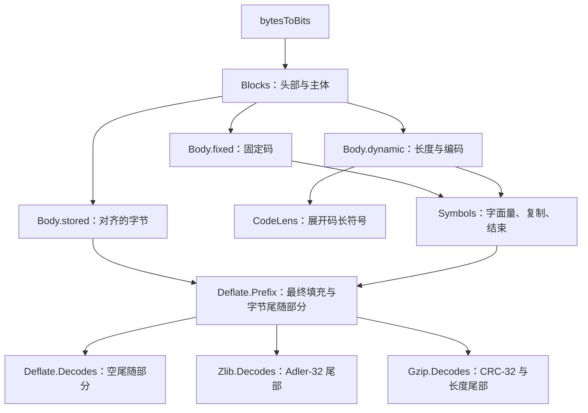

# Lean 中的格式模型

[文档首页](../../README.md) · [数据格式](README.md) · [API 指南](../api/README.md)

格式模型描述压缩字节如何决定未压缩字节，没有堆或指针。
它是需要被实现细化的规范，不是流式 API 的实现。
规则见[格式指南](README.md)，调用、缓冲区和返回值见 [API 模型](../../design/api-model.md)。
已接受结果与剩余工作记录于[进度](../../progress.md)。

总入口模块是 [`ZlibF/Spec/Format.lean`](../../../ZlibF/Spec/Format.lean)。
单 token 扩展单独导入。下列定义位于 `ZlibF.Spec` 命名空间，
局部 token 关系则位于 `ZlibF.Spec.Token`。

## 模块映射

| 模块 | 内容 |
| --- | --- |
| [`Bits.lean`](../../../ZlibF/Spec/Format/Bits.lean) | 字节到位的顺序、数值读取器、大端和小端字节编码 |
| [`Checksum.lean`](../../../ZlibF/Spec/Format/Checksum.lean) | 逐字节 Adler-32 和 CRC-32、更新函数与追加定律 |
| [`Huffman.lean`](../../../ZlibF/Spec/Format/Huffman.lean) | 规范码、可接受长度集合、固定码、长度和距离表 |
| [`Deflate.lean`](../../../ZlibF/Spec/Format/Deflate.lean) | 符号和块关系、raw 前缀及精确流关系 |
| [`Wrapper.lean`](../../../ZlibF/Spec/Format/Wrapper.lean) | zlib 和 gzip 头部、尾部与精确流关系 |
| [`Token.lean`](../../../ZlibF/Spec/Format/Token.lean) | 单 token 解码和拒绝，以及将它们连接到块语法的义务 |
| [`Examples.lean`](../../../ZlibF/Spec/Format/Examples.lean) | 具体接受与拒绝示例 |

## 从字节到输出

`readBits`、`readBytes` 和 `decodeSym` 等读取器返回 `none`，或返回一个值与剩余位组成的二元组。
关系构造器要求相应的读取器等式。无效块类型或保留的长度／距离符号没有对应构造器。

`Symbols L D dict h inp rest out` 从历史 `h` 开始，使用字面量／长度码长 `L` 和距离码长 `D`，
并在块结束符号处结束。它将 `inp` 消费到 `rest`，留下输出 `out`。
`copyBack` 每复制一个字节，就先追加它，再读取下一个，因此重叠匹配具有通常的逐字节含义。

`Blocks dict h inp rest out` 组合各主体，直到遇到 `BFINAL = 1` 的块。
块语法使用从完整输入字节得到的位。在该入口条件下，`inp.length % 8` 是到下一个字节边界前的剩余位数；
stored 主体丢弃相应数量的位。

公开格式关系对于最后一个块之后的要求不同：

| 关系 | 含义 |
| --- | --- |
| `Deflate.Prefix dict stream tail out` | 从 `stream` 开始解码块，忽略最后字节的填充，要求剩余字节等于 `tail` |
| `Deflate.Decodes dict stream out` | 同一关系，且 `tail = []` |
| `Zlib.Decodes dict stream out` | 恰好一个 zlib 流，包含已检查头部、可选字典 ID 和 Adler-32 尾部 |
| `Gzip.Decodes stream out` | 恰好一个 gzip 成员，包含其可选头部 CRC 以及 CRC-32／长度尾部 |

包装关系使用 `Deflate.Prefix`，将所需尾部字节作为其 tail。
它们仍描述精确流：排除尾部之后的字节。
关于 `Z_STREAM_END` 后剩余输入的 API 定理，需要独立的已消费前缀陈述。

## 规则映射

`F-*` 规则定义在[格式指南](README.md)中。本表定位相应形式化定义，不宣称实现正确。

| 规则 | 定义或义务 |
| --- | --- |
| `F-bit-order` | `byteBits`、`bytesToBits`、`readBits`、`natToBitsMSB` |
| `F-block-type-3` | `Body` 没有类型 3 的构造器 |
| `F-stored-complement` | `Body.stored`：`nlen = 65535 - len` |
| `F-code-fits` | `count`、`codeStart`、`codeOf`、`Fits` |
| `F-code-complete` | `Complete`、`CodeKind`、`Acceptable` |
| `F-fixed-lengths` | `fixedLitLens`、`fixedDistLens`、`Body.fixed`；`Symbols.copy` 限制长度和距离符号 |
| `F-dynamic-limits` | `DynamicCountsOK`，由 `Body.dynamic` 要求 |
| `F-dynamic-repeat` | `CodeLens.rep16`、`.rep17`、`.rep18`；前一项与总项数前提 |
| `F-dynamic-eob` | `HasEndOfBlock`，由 `Body.dynamic` 要求 |
| `F-dynamic-valid` | `Acceptable .codeLength`、`.litLen`、`.dist`，由 `Body.dynamic` 要求 |
| 动态头部顺序 | `Body.dynamic`、`clOrder`、`readCodeLenLens` |
| `F-length-table`、`F-length-284` | `lengthBases`、`lengthExtras`、`Symbols.copy`；基值 227 加额外值 31 仍为 258 |
| `F-distance-table` | `distBases`、`distExtras`、`Symbols.copy` |
| `F-match-copy` | `copyBack` |
| `F-distance-bound` | `Symbols.copy` 要求距离至多为 `(dict ++ h).length` |
| 块顺序与最终性 | `Blocks.more`、`Blocks.last` |
| `F-zlib-header` | `Zlib.HeaderOK`、`Zlib.windowSize`、`Zlib.Decodes` |
| `F-zlib-check` | `Zlib.Decodes` 要求 tail 为 `be32 (adler32 out).toNat` |
| gzip 头部 | `Gzip.header`、`Gzip.Decodes` 中的头部约束 |
| `F-gzip-check` | `Gzip.Decodes` 要求 tail 为 `le32 (crc32 out).toNat ++ le32 (out.length % 2^32)` |
| `F-adler-incremental` | `adler32Update`、`adler32Update_append` |
| `F-crc-incremental` | `crc32Update`、`crc32Update_append` |
| `F-deflate-valid` | `Deflate.Valid`、`Zlib.Valid`、`Zlib.ValidWith`、`Gzip.Valid` |
| `F-deflate-matches` | 压缩器义务；格式语法没有额外限制 |
| `F-deflate-flush` | 流调用序列的义务；完成 flush 不等于完整最终流 |

`Valid` 谓词将 `Decodes` 的关注方向反过来：压缩参数必须解码为所给输入。
它们不选择唯一编码。`Zlib.ValidWith` 提供预置字典；其他列出的 `Valid` 谓词不使用字典。

## 模型选择与边界

**历史与小窗口。** `Symbols.copy` 使用完整 `dict ++ h` 历史，不显式表示保存窗口的状态。
距离表将引用上限设为 32768。zlib 头的窗口字段限制初始字典后缀，
但没有给 `Symbols.copy` 增加距离前提。这明确保留了已有模型选择：
默认解码可以使用当前调用中超过较小保存窗口范围的输出，但下一次调用可能已无法取得那些字节。
C 也有独立的 `INFLATE_STRICT` 检查。全部配置窗口和输出缓冲区边界的细化仍**待确认**。
仅有声明式关系不能建立每种切分下的运行接受性。

**字典。** 有 `FDICT` 时，`Zlib.Decodes dict` 检查整个所提供字典的 Adler-32，
但仅将最后 `Zlib.windowSize cmf` 字节传给 DEFLATE 关系。
没有 `FDICT` 时，传入 `[]`，忽略 `dict`。Adler-32 为 1 的字典可能为空。
Raw `Deflate.Decodes` 直接接收字典历史。Gzip 从空历史开始。

**表的接受规则。** `Acceptable` 对三种编码类型都允许全零长度集合，但这种集合无法解码任何符号。
长度为 1 的单个已使用符号只在字面量／长度和距离类型下允许。
`HasEndOfBlock` 单独排除空的动态字面量／长度码。
表被接受或局部 token 成功，都不蕴含整个块有效。

**填充。** Stored 块对齐和最后字节填充会丢弃位，不要求这些位为零。
额外的完整字节由显式 tail 处理，不视为填充。

**gzip 元数据。** `Gzip.Decodes` 要求四个 `MTIME` 字节、保留标志位为零、
额外字段长度小于 `2^16`，以及所选名称或注释中不含嵌入零字节。
除此之外，`FTEXT`、`MTIME`、`XFL` 和 `OS` 不受约束。
标志未置位的可选字段见证不贡献字节；空见证可以满足其约束。
一个关系覆盖一个成员，而非拼接后的整个 gzip 文件。

**局部解码。** `Token.Step` 描述一个字面量、匹配或块结束，不假设后续输入有效。
`Token.Rejected` 描述不可逆的无效编码或历史不可用情况。
目标 `step_composes_symbols`、`symbols_exposes_step` 和 `rejected_has_no_symbols`
将这些局部关系连接到原始 `Symbols` 语法。
这一边界防止以将来能够有效完成为假设，来论证 API 调用已经返回的输出。

## 哪些内容不属于格式关系

| 关注点 | 规范边界 |
| --- | --- |
| 错误码、诊断字符串、`Z_NEED_DICT` 和字典调用顺序 | [Inflate API](../api/inflate-stream.md) |
| 缓冲区大小、部分输入、自动包装检测、位预置和恢复 | [流式 API](../api/streams.md)和 [API 模型](../../design/api-model.md) |
| 压缩匹配选择、flush 完成和输出上界 | [Deflate API](../api/deflate-stream.md) |
| 拼接成员、透明读取和文件错误 | [Gzip 文件 API](../api/gz-file.md) |
| 校验和合并入口 | [校验和 API](../api/checksums.md) |
| 解码表分配和 `ENOUGH` 容量上界 | [表证明指南](../../proof/inftrees.md) |
| 翻译后实现的内存安全、所有权和终止性 | [安全性](../safety.md)和[证明方法](../../proof/method.md) |

`Examples.lean` 提供规范的具体正反例检查。其证明使用内核求值、关系构造器或反演。
这些例子帮助审阅定义，不能建立它们与每个 RFC 情况或翻译后实现的对应关系。
差分测试同样提供一致性证据，而非证明。
实现细化的验收状态见[进度](../../progress.md)。
