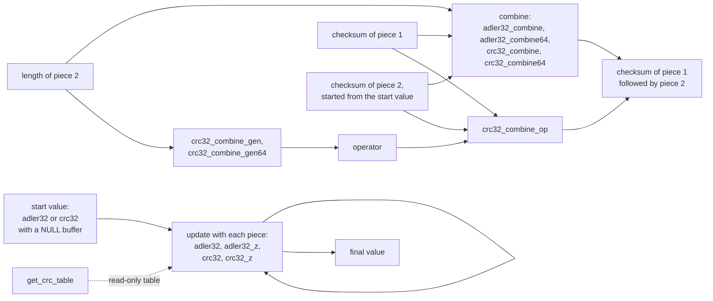

# Checksums: `adler32.c` and `crc32.c`

This page describes every function that `adler32.c` and `crc32.c` export, one section per function. It is a part of the [function reference](index.md) and of the [specification](../index.md). It is written from the verified C source (the pinned zlib checkout with the patches in `patches/` applied) and from `zlib.h`. Claims marked "run" were checked by running the real, patched library, including a build with the address and undefined-behaviour sanitizers. A run is evidence, not proof.

## The idea in short

A checksum is a small number computed from a block of bytes. zlib has two: Adler-32 (fast, used by the zlib wrapper) and CRC-32 (used by gzip). Both work the same way for the caller. Ask for the start value by passing a NULL buffer. Then feed the data in pieces, passing the last result back in. Compare the final number with the one you expect.

Both are cheap, never allocate and never fail. Every function here returns a number. None returns an error code. The only way to go wrong is to break a precondition: a buffer shorter than the length says, or an operator value that did not come from `crc32_combine_gen`.

The combine functions give the checksum of two blocks joined, from the two checksums and the length of the second block. The caller does not need the data again.

All values are `uLong`, which is 64 bits wide in the default build, but only the low 32 bits carry the checksum. High bits of an input are ignored, and the result always fits in 32 bits (apart from the error value of `adler32_combine`, see there).

## Overview: how the functions fit together



Rules that hold for every function on this page:

* The functions keep no state between calls. They are safe to call from several threads at once (the CRC tables are constant in the default build). This is a property of the code, not a promise made by `zlib.h`.
* The functions never write to memory the caller owns, never allocate and never free.
* The undefined behaviour labels (U1 and so on) refer to the closed list in [../../safety.md](../../safety.md).

---

## adler32_z

**Signature**

```c
uLong ZEXPORT adler32_z(uLong adler, const Bytef *buf, z_size_t len);
```

**Purpose**

Update a running Adler-32 checksum with `len` bytes and return the new checksum. With a NULL buffer, return the start value 1.

**Parameters**

| Name | Direction | What it must be | Valid range | May it be NULL | Ownership |
| --- | --- | --- | --- | --- | --- |
| `adler` | in | the running checksum, or 1 to start | a value this function returned earlier; only the low 32 bits are used. Both 16-bit halves must be below 65521 (see "easy to get wrong") | not a pointer | caller |
| `buf` | in | the first byte to add | points to at least `len` readable bytes | yes: returns 1 and reads nothing, for any `len` | caller keeps it; the function only reads |
| `len` | in | the number of bytes | 0 up to the size of the buffer; the type is `size_t`, so no 32-bit limit | not a pointer | not applicable |

**Preconditions**

* If `buf` is not NULL, the memory `buf[0]` to `buf[len - 1]` is readable. Nothing else is required.
* No call order. There is no setup call and no cleanup call.
* `adler` should be a value produced by this library (1 or a result of an earlier call). See below for what happens otherwise.

**What it does**

1. If `buf` is NULL, return 1 at once. The value of `adler` and `len` do not matter.
2. Split `adler` into its low half (sum of the bytes plus 1) and its high half (sum of the running sums). Only 16 bits of each are used.
3. One byte: add it, reduce once if the sum reached 65521, and return.
4. Fewer than 16 bytes: add them one by one, then reduce both halves modulo 65521.
5. Otherwise add in blocks of at most 5552 bytes (sixteen at a time) and reduce after each block. This is the largest block for which the sums cannot overflow 64 bits. Then add the remaining bytes and reduce.
6. Return the low half combined with the high half shifted left by 16.

Time grows in proportion to `len`. Nothing outside the function changes. The read memory is not modified.

**Return values**

| Case | Result |
| --- | --- |
| `buf` is NULL | `1` |
| `len` is 0 and `adler` is a valid value | `adler` unchanged |
| any other call with valid inputs | the Adler-32 of the earlier data followed by the new bytes, a number below 2^32 |
| `adler` has a half that is 65521 or more | a number below 2^32 whose value follows the code (see below); no fault |

There is no error return.

**Errors and the state afterwards**

None. There is no error state. The function never sets `errno`.

**Memory and file-handle ownership**

Nothing is allocated, freed, opened or closed. No leak is possible.

**What the caller must not do**

* Pass a non-NULL `buf` that points to fewer than `len` readable bytes (reads outside an object, U1).
* Pass a freed buffer (U4).

A NULL buffer with a length other than 0 is allowed. Before the patch `0003-adler32-null-one.patch` the code read `buf[0]` first when `len` was 1 and `buf` was NULL (a NULL read, U3). The patch moves the NULL test to the top of the function. It matches a fix submitted upstream ([madler/zlib#1364](https://github.com/madler/zlib/pull/1364)) and is applied in the verified source.

**Behaviour that is easy to get wrong**

* A NULL buffer returns 1 even when `adler` is something else, and even when `len` is not 0. The call `adler32(adler, NULL, 0)` therefore does not leave `adler` alone. It resets. (Run: `adler32(123, NULL, 1)` returns 1.)
* The length is a `size_t` here but a 32-bit `uInt` in `adler32`. A long buffer must be fed to `adler32` in pieces.
* The result for a single byte is correct only when both halves of `adler` are below 65521. For a forged start value the code subtracts 65521 once and may leave a half that is still too large. Run: starting from `0xFFFFFFF0` and adding the byte 0, one byte gives `0xFFFEFFF0`. The true Adler-32 of that start plus one zero byte is `0x000DFFF0`. A length of 0 on the same start gives `0x000EFFF0`: the high half is reduced there. So the function can change a value that was not a real checksum, and the answer depends on the length. Values the library produced are never affected.
* Only the low 32 bits of `adler` are used (run: start values `0x100000001` and `1` give the same result).
* The value 0 is not a start value. Use 1, or call with a NULL buffer.
* Adler-32 is weak for very short inputs. This is a property of the algorithm.

**Related functions**

`adler32` (32-bit length), `adler32_combine` and `adler32_combine64` (join two checksums), `crc32_z` (the other checksum).

**Where it is in the project**

* Translation: `ZlibF/Zlib/adler32.c.lean`, function `adler32_z`.
* Specification: `adler32` and `adler32Update` in `ZlibF/Spec/Format/Checksum.lean` (the byte-by-byte definition from RFC 1950). The function-level contract is part of that file; there is no entry in `ZlibF/Spec/Api` because the checksums are in the format specification.
* Proof status: safety and correctness proved. Theorems in `tests/audit/theorems.txt`: `adler32_z_safe` (no fault for a buffer inside a block), `adler32_z_correct` (equals the specification when the high half of `adler` is below 65521), `adler32_z_correct_ne_one` (equals the specification for every `adler` when `len` is not 1). A theorem also shows that the precondition on the high half is needed when `len` is 1.

---

## adler32

**Signature**

```c
uLong ZEXPORT adler32(uLong adler, const Bytef *buf, uInt len);
```

**Purpose**

The same as `adler32_z`, with a 32-bit length. This is the function `zlib.h` documents.

**Parameters**

| Name | Direction | What it must be | Valid range | May it be NULL | Ownership |
| --- | --- | --- | --- | --- | --- |
| `adler` | in | running checksum, or 1 to start | as for `adler32_z` | not a pointer | caller |
| `buf` | in | the bytes to add | at least `len` readable bytes | yes: returns 1 | caller keeps it |
| `len` | in | number of bytes | 0 to 4294967295 | not a pointer | not applicable |

**Preconditions**

The same as `adler32_z`.

**What it does**

Calls `adler32_z(adler, buf, len)` with the length widened to `size_t`.

**Return values**

The same as `adler32_z`.

**Errors and the state afterwards**

None.

**Memory and file-handle ownership**

Nothing is allocated or freed.

**What the caller must not do**

The same as `adler32_z`. Do not pass a length that is more than the readable bytes (U1).

**Behaviour that is easy to get wrong**

* A caller who holds a `size_t` length of 4 GiB or more loses the high bits at the call: the length 2^32 plus 3 becomes 3. The compiler may not warn. Use `adler32_z` or loop in pieces.
* Everything said for `adler32_z` applies (NULL buffer resets to 1; forged start values).
* `zlib.h` calls `adler` "a 32-bit unsigned integer" and describes the result in that range. It does not say that other start values are unsupported; the code treats them as above.

**Related functions**

`adler32_z`, `adler32_combine`.

**Where it is in the project**

* Translation: `ZlibF/Zlib/adler32.c.lean`, function `adler32`.
* Specification: as for `adler32_z`.
* Proof status: safety proved (`adler32_safe`, length below 2^32). Correctness follows from `adler32_z_correct` because the body is one call, but no separate theorem for `adler32` is listed in `tests/audit/theorems.txt`.

---

## adler32_combine

**Signature**

```c
uLong ZEXPORT adler32_combine(uLong adler1, uLong adler2, z_off_t len2);
```

**Purpose**

Given the Adler-32 of a byte sequence A, the Adler-32 of a byte sequence B, and the length of B, return the Adler-32 of A followed by B.

**Parameters**

| Name | Direction | What it must be | Valid range | May it be NULL | Ownership |
| --- | --- | --- | --- | --- | --- |
| `adler1` | in | the Adler-32 of A | a real checksum: `adler32(1, A, ...)` or the running value after A | not a pointer | caller |
| `adler2` | in | the Adler-32 of B, computed from the start value 1 | a real checksum of B alone | not a pointer | caller |
| `len2` | in | the length of B in bytes | 0 up to 2^63 minus 1 (`z_off_t` is a signed 64-bit number in the default build) | not a pointer | not applicable |

**Preconditions**

* `adler2` must be the checksum of B started from 1, not the running checksum after A. If B's checksum is computed as `adler32(adler1, B)`, the result is wrong (run: right inputs give the true Adler-32 of the join; continuing `adler2` from `adler1` does not).
* `len2` must be the true length of B and must not be negative. `zlib.h` says that a negative length gives a result with no meaning.

**What it does**

1. If `len2` is negative, return `0xFFFFFFFF`.
2. Reduce `len2` modulo 65521 (this is all the formula needs).
3. Combine the halves of the two checksums with a closed formula and reduce them modulo 65521. The formula has no loop. It does not look at any data.

Time is constant.

**Return values**

| Case | Result |
| --- | --- |
| `len2` is negative | `0xFFFFFFFF`. This is never a real Adler-32, because its high half is above 65520. A caller can test for it |
| valid checksums and a true length | the Adler-32 of A followed by B |
| `len2` is 0 and `adler2` is 1 | `adler1` |
| `adler1` or `adler2` is not a real checksum, or `len2` is not the length of B | some 32-bit value; no fault, but not a checksum of anything useful. Run: `len2` 0 with `adler2` 0 gives `adler1` minus 1 in the low half |

**Errors and the state afterwards**

None. The only signal is the value `0xFFFFFFFF` for a negative length.

**Memory and file-handle ownership**

Nothing is allocated or freed.

**What the caller must not do**

Nothing leads to undefined behaviour. All arithmetic is unsigned, and the one signed number (`len2`) is tested before use. Wrong arguments give a wrong answer, not a fault.

**Behaviour that is easy to get wrong**

* The error value `0xFFFFFFFF` is returned in a `uLong`; test the whole value, not the low bytes.
* The start value of B's checksum must be 1.
* The function uses only the low 32 bits of both checksums. On the default x86_64 build `z_off_t` and `z_off64_t` have the same width, so `adler32_combine` and `adler32_combine64` agree on every input. On a system with a 32-bit `z_off_t` the first cannot take a length of 2 GiB or more.
* Run: 31 different splits of a 300000-byte buffer gave the true whole-buffer checksum for both functions.

**Related functions**

`adler32_combine64`, `adler32`, `crc32_combine`.

**Where it is in the project**

* Translation: `ZlibF/Zlib/adler32.c.lean`, functions `adler32_combine_` (the internal helper) and `adler32_combine`.
* Specification: `adler32` in `ZlibF/Spec/Format/Checksum.lean`. The combine functions are not in the API model of `ZlibF/Spec/Api`; the correctness theorem below states the contract directly.
* Proof status: safety and correctness proved. `adler32_combine_safe` (no fault for any arguments), `adler32_combine_c_safe` (the same for this wrapper) and `adler32_combine_correct` (for two byte lists A and B with B shorter than 2^63, the result equals the Adler-32 of A followed by B).

---

## adler32_combine64

**Signature**

```c
uLong ZEXPORT adler32_combine64(uLong adler1, uLong adler2, z_off64_t len2);
```

**Purpose**

The same as `adler32_combine`, with an explicit 64-bit length. It exists so that programs on systems with a 32-bit `z_off_t` can combine large pieces.

**Parameters**

| Name | Direction | What it must be | Valid range | May it be NULL | Ownership |
| --- | --- | --- | --- | --- | --- |
| `adler1` | in | the Adler-32 of A | as for `adler32_combine` | not a pointer | caller |
| `adler2` | in | the Adler-32 of B from the start value 1 | as above | not a pointer | caller |
| `len2` | in | the length of B | 0 up to 2^63 minus 1 | not a pointer | not applicable |

**Preconditions**

As for `adler32_combine`.

**What it does**

Calls the same internal helper as `adler32_combine`.

**Return values**

As for `adler32_combine`: `0xFFFFFFFF` for a negative length, otherwise the combined checksum.

**Errors and the state afterwards**

None.

**Memory and file-handle ownership**

Nothing is allocated or freed.

**What the caller must not do**

Nothing reaches undefined behaviour.

**Behaviour that is easy to get wrong**

Declared in `zlib.h` only when `_LARGEFILE64_SOURCE` is defined (or the large-file macros select it). Without that macro a C compiler sees no declaration, assumes one returning `int`, and truncates the result.

**Related functions**

`adler32_combine`.

**Where it is in the project**

* Translation: `ZlibF/Zlib/adler32.c.lean`, function `adler32_combine64`.
* Specification: as for `adler32_combine`.
* Proof status: safety and correctness proved. `adler32_combine64_safe`; `adler32_combine_correct` is stated for this function.

---

## get_crc_table

**Signature**

```c
const z_crc_t FAR * ZEXPORT get_crc_table(void);
```

**Purpose**

Return a pointer to the table that `crc32` uses for byte-by-byte work. `zlib.h` lists it among the "undocumented functions (not part of the zlib API)". It exists for assembly implementations of `crc32` and, when the tables are built at run time, to force their creation before threads start.

**Parameters**

None.

**Preconditions**

None. No setup call is needed in the default build, because the table is constant data compiled into the library.

**What it does**

Returns the address of a constant array of 256 entries of type `z_crc_t` (an unsigned 32-bit integer in the default build). Entry `i` is the CRC-32 of the single byte `i` with the register started at zero and no final complement. Run: entry 0 is 0, entry 1 is `0x77073096`, entry 8 is `0x0EDB8832`, entry 255 is `0x2D02EF8D`. Two calls return the same pointer.

The function does not build anything in the default build. If the library is compiled with `DYNAMIC_CRC_TABLE`, the first call builds the tables, and until then the pointer is not safe to use from several threads. That configuration is not the one verified.

**Return values**

| Case | Result |
| --- | --- |
| always | a non-NULL pointer to 256 `z_crc_t` values |

**Errors and the state afterwards**

None.

**Memory and file-handle ownership**

The table belongs to the library. The caller does not free it. It lives as long as the program.

**What the caller must not do**

* Write through the pointer. The table is read-only data (U8).
* Read more than 256 entries. This function returns only the first table. The tables for the faster, multi-byte method are separate arrays that are not reachable through this pointer (U1).
* Free the pointer (U4).

**Behaviour that is easy to get wrong**

* The element type is `z_crc_t`, which may be wider than 32 bits on some systems. Index by element, not by byte.
* Because the function is outside the documented API, a future release could change it.

**Related functions**

`crc32`, `crc32_z`.

**Where it is in the project**

* Translation: `ZlibF/Zlib/crc32.c.lean`, function `get_crc_table`; the table data is in `ZlibF/Zlib/crc32.h.lean`.
* Specification: the table is not specified separately. Its entries are determined by `crcByte` in `ZlibF/Spec/Format/Checksum.lean`. Not written yet as a function-level contract.
* Proof status: not proved. No theorem about it is listed in `tests/audit/theorems.txt`.

---

## crc32_z

**Signature**

```c
uLong ZEXPORT crc32_z(uLong crc, const unsigned char FAR *buf, z_size_t len);
```

**Purpose**

Update a running CRC-32 with `len` bytes and return the new CRC-32. With a NULL buffer, return the start value 0. The polynomial is the one used by gzip, zip and PNG. The function does the pre- and post-complement itself.

**Parameters**

| Name | Direction | What it must be | Valid range | May it be NULL | Ownership |
| --- | --- | --- | --- | --- | --- |
| `crc` | in | the running CRC, or 0 to start | a value this function returned earlier; only the low 32 bits are used | not a pointer | caller |
| `buf` | in | the first byte to add | at least `len` readable bytes; any alignment | yes: returns 0 and reads nothing, for any `len` | caller keeps it; read only |
| `len` | in | number of bytes | 0 up to the buffer size, `size_t` | not a pointer | not applicable |

**Preconditions**

* A non-NULL `buf` points to `len` readable bytes.
* No call order and no setup.
* The caller must not complement the value: `zlib.h` says pre- and post-conditioning happen inside.

**What it does**

1. If `buf` is NULL, return 0.
2. Complement the low 32 bits of `crc`.
3. If `len` is at least 47: feed single bytes until the address of `buf` is a multiple of 8; then process blocks of 40 bytes as five interleaved streams of 8-byte words; then combine the five partial results.
4. Feed the remaining bytes eight at a time and then one at a time through the byte table.
5. Complement and return.

The result does not depend on alignment or on how a buffer is cut into calls (run: 16 alignments times 58 lengths, and 9 alignments of a 5000-byte buffer, all agree with a bit-by-bit reference).

**Return values**

| Case | Result |
| --- | --- |
| `buf` is NULL | `0` |
| `len` is 0 with a valid `crc` | `crc` (low 32 bits) |
| otherwise | the CRC-32 of the earlier data followed by the new bytes, below 2^32 |

**Errors and the state afterwards**

None.

**Memory and file-handle ownership**

Nothing is allocated or freed.

**What the caller must not do**

* A non-NULL `buf` with fewer than `len` readable bytes (U1).
* A freed buffer (U4).

The word reads use an 8-byte-aligned pointer into the caller's buffer. This is a cast of a byte pointer to a word pointer, which is formally an access of another type (U10 in the list). It does not read outside the buffer, and the proof model reads the eight bytes in order.

**Behaviour that is easy to get wrong**

* A NULL buffer returns 0 and drops `crc`. `crc32(crc, NULL, 0)` does not return `crc`. Run: `crc32(77, NULL, 100)` is 0.
* The start value is 0, not the complement. The CRC of "123456789" is `0xCBF43926` (run).
* The high 32 bits of `crc` are ignored (run: `0x1FFFFFFFF` and `0xFFFFFFFF` give the same result).
* The code detects the byte order at run time. The big-endian branch cannot be tested on the default build.

**Related functions**

`crc32` (32-bit length), `crc32_combine` and friends, `adler32_z`, `get_crc_table`.

**Where it is in the project**

* Translation: `ZlibF/Zlib/crc32.c.lean`, function `crc32_z`. The model takes the address of a block as 0, so alignment equals the offset in the block.
* Specification: `crc32Update` and `crc32` in `ZlibF/Spec/Format/Checksum.lean`.
* Proof status: not proved. A safety argument is in `docs/proof/crc32.md` (with the tail loops still to confirm), but no theorem is listed in `tests/audit/theorems.txt`.

---

## crc32

**Signature**

```c
uLong ZEXPORT crc32(uLong crc, const unsigned char FAR *buf, uInt len);
```

**Purpose**

The same as `crc32_z` with a 32-bit length. This is the function `zlib.h` documents.

**Parameters**

| Name | Direction | What it must be | Valid range | May it be NULL | Ownership |
| --- | --- | --- | --- | --- | --- |
| `crc` | in | running CRC, or 0 to start | as for `crc32_z` | not a pointer | caller |
| `buf` | in | the bytes to add | at least `len` readable bytes | yes: returns 0 | caller keeps it |
| `len` | in | number of bytes | 0 to 4294967295 | not a pointer | not applicable |

**Preconditions**

As for `crc32_z`.

**What it does**

Calls `crc32_z(crc, buf, len)`. On a machine with the S/390 vector hook (not the default build) the hook runs first.

**Return values**

As for `crc32_z`.

**Errors and the state afterwards**

None.

**Memory and file-handle ownership**

Nothing is allocated or freed.

**What the caller must not do**

As for `crc32_z`.

**Behaviour that is easy to get wrong**

The 32-bit length truncates a larger `size_t` silently, as for `adler32`. All other points of `crc32_z` apply.

**Related functions**

`crc32_z`, `crc32_combine`.

**Where it is in the project**

* Translation: `ZlibF/Zlib/crc32.c.lean`, function `crc32`.
* Specification: as for `crc32_z`.
* Proof status: not proved; no theorem listed.

---

## crc32_combine_gen64

**Signature**

```c
uLong ZEXPORT crc32_combine_gen64(z_off64_t len2);
```

**Purpose**

Build the operator that stands for "append `len2` bytes" in the CRC algebra. The result is passed to `crc32_combine_op`. Building it once and using it many times is faster than calling `crc32_combine` many times.

**Parameters**

| Name | Direction | What it must be | Valid range | May it be NULL | Ownership |
| --- | --- | --- | --- | --- | --- |
| `len2` | in | the length in bytes of the second sequence | 0 up to 2^63 minus 1; a negative value is allowed and returns 0 | not a pointer | not applicable |

**Preconditions**

None. In the default build the tables are constant; no setup is needed.

**What it does**

1. If `len2` is negative, return 0.
2. Otherwise compute the polynomial x raised to the power 8 times `len2`, modulo the CRC polynomial, in the reflected 32-bit form. The work is at most 63 table steps and 63 polynomial products.

**Return values**

| Case | Result |
| --- | --- |
| `len2` is negative | `0` |
| `len2` is 0 | `0x80000000` (run), the polynomial 1 |
| otherwise | a non-zero number below 2^32 that is not meant to be read by the caller. Run: for length 1 it is `0x00800000`, for 2^62 it is `0x20000000` |

**Errors and the state afterwards**

None. The result 0 signals a negative length, and `crc32_combine_op` turns it into the result 0.

**Memory and file-handle ownership**

Nothing is allocated or freed.

**What the caller must not do**

Nothing reaches undefined behaviour. The value is meant only as input to `crc32_combine_op`. Do not make up an operator (see `crc32_combine_op`).

**Behaviour that is easy to get wrong**

* The operator depends only on the length, not on the data or on any CRC.
* The operator value is not a CRC. Do not mask, shift or store it as one.
* A negative length does not fail loudly. It returns 0.

**Related functions**

`crc32_combine_gen`, `crc32_combine_op`, `crc32_combine64`.

**Where it is in the project**

* Translation: `ZlibF/Zlib/crc32.c.lean`, function `crc32_combine_gen64` (with `x2nmodp` and `multmodp`).
* Specification: not written yet. The API model does not contain the combine functions.
* Proof status: not proved; no theorem listed.

---

## crc32_combine_gen

**Signature**

```c
uLong ZEXPORT crc32_combine_gen(z_off_t len2);
```

**Purpose**

The same as `crc32_combine_gen64`, with a `z_off_t` length.

**Parameters**

| Name | Direction | What it must be | Valid range | May it be NULL | Ownership |
| --- | --- | --- | --- | --- | --- |
| `len2` | in | the length of the second sequence | 0 up to the largest `z_off_t`; negative gives 0 | not a pointer | not applicable |

**Preconditions**

None.

**What it does**

Converts the length to `z_off64_t` (no change on the default build) and calls `crc32_combine_gen64`.

**Return values**

As for `crc32_combine_gen64`.

**Errors and the state afterwards**

None.

**Memory and file-handle ownership**

Nothing is allocated or freed.

**What the caller must not do**

As for `crc32_combine_gen64`.

**Behaviour that is easy to get wrong**

As for `crc32_combine_gen64`. On systems where `z_off_t` is 32 bits wide the length cannot reach 2 GiB; use the 64-bit function.

**Related functions**

`crc32_combine_gen64`, `crc32_combine_op`.

**Where it is in the project**

* Translation: `ZlibF/Zlib/crc32.c.lean`, function `crc32_combine_gen`.
* Specification: not written yet.
* Proof status: not proved; no theorem listed.

---

## crc32_combine_op

**Signature**

```c
uLong ZEXPORT crc32_combine_op(uLong crc1, uLong crc2, uLong op);
```

**Purpose**

Given the CRC-32 of a sequence A, the CRC-32 of a sequence B, and the operator for the length of B, return the CRC-32 of A followed by B.

**Parameters**

| Name | Direction | What it must be | Valid range | May it be NULL | Ownership |
| --- | --- | --- | --- | --- | --- |
| `crc1` | in | the CRC-32 of A | a real CRC; only the low 32 bits are used | not a pointer | caller |
| `crc2` | in | the CRC-32 of B, computed from the start value 0 | a real CRC of B alone; low 32 bits used | not a pointer | caller |
| `op` | in | exactly a value returned by `crc32_combine_gen` or `crc32_combine_gen64` | 0, or a generated operator. **Any other value with all of its low 32 bits zero makes the call run forever** | not a pointer | caller |

**Preconditions**

* `op` came from `crc32_combine_gen` or `crc32_combine_gen64`. `zlib.h` says this ("op is generated from len2 by crc32_combine_gen") but does not say that other values hang.
* `crc2` is the CRC of B alone, started from 0. A value continued from `crc1` gives a wrong result (run).

**What it does**

1. If `op` is 0, return 0.
2. Multiply `crc1` by `op` in the CRC polynomial arithmetic. The multiplication walks the 32 bits of its first argument from the top and stops at the last set bit.
3. Exclusive-or with `crc2` and return.

**Return values**

| Case | Result |
| --- | --- |
| `op` is 0 (the result of a negative length) | `0` |
| a generated operator and real CRCs | the CRC-32 of A followed by B |
| `op` with some low 32 bit set but not generated | a 32-bit value, not a CRC of anything useful; the high 32 bits of `op` are ignored (run) |
| `op` not 0 and its low 32 bits all zero, for example `1UL << 32` | the call does not return (see below) |

**Errors and the state afterwards**

None. A zero result for a zero operator is the only signal.

**Memory and file-handle ownership**

Nothing is allocated or freed.

**What the caller must not do**

* Pass a non-zero `op` whose low 32 bits are all zero. The multiplication helper (`multmodp`) finds no set bit in its first argument, never reaches its stop test, and loops forever. Its own comment says it requires a first argument that is not zero; the check in `crc32_combine_op` tests the whole 64-bit value, not the low 32 bits. This is non-termination (U11). See "Findings to confirm".
* Pass an operator for the wrong length: the result is a well-defined but meaningless number.

**Behaviour that is easy to get wrong**

* The result 0 for operator 0 means "negative length", not "a CRC of 0".
* The high 32 bits of `crc1` and `crc2` are ignored (run).
* The operator may be reused for any number of pairs with the same second length (run: operator and direct combine agree on all cuts tried).

**Related functions**

`crc32_combine_gen`, `crc32_combine_gen64`, `crc32_combine`, `crc32_combine64`.

**Where it is in the project**

* Translation: `ZlibF/Zlib/crc32.c.lean`, function `crc32_combine_op`. The header comment of that file records the non-termination: the translation runs out of fuel for such an `op`.
* Specification: not written yet.
* Proof status: not proved; no theorem listed. A safety theorem for this function must carry the precondition on `op`.

---

## crc32_combine64

**Signature**

```c
uLong ZEXPORT crc32_combine64(uLong crc1, uLong crc2, z_off64_t len2);
```

**Purpose**

Return the CRC-32 of A followed by B, from the CRC-32 of A, the CRC-32 of B and the length of B.

**Parameters**

| Name | Direction | What it must be | Valid range | May it be NULL | Ownership |
| --- | --- | --- | --- | --- | --- |
| `crc1` | in | the CRC-32 of A | a real CRC (low 32 bits used) | not a pointer | caller |
| `crc2` | in | the CRC-32 of B from the start value 0 | a real CRC (low 32 bits used) | not a pointer | caller |
| `len2` | in | the length of B in bytes | 0 up to 2^63 minus 1. A negative value is allowed and gives 0 | not a pointer | not applicable |

**Preconditions**

`crc2` is the CRC of B alone (started from 0) and `len2` is the length of B.

**What it does**

Calls `crc32_combine_op(crc1, crc2, crc32_combine_gen64(len2))`. The time is at most about two thousand simple steps, growing with the number of bits of `len2`. It does not touch any data.

**Return values**

| Case | Result |
| --- | --- |
| `len2` is negative | `0` (documented in `zlib.h`) |
| `len2` is 0 | `crc1` exclusive-or `crc2`. For a real `crc2` of the empty sequence (0) this is `crc1` |
| valid inputs | the CRC-32 of A followed by B |

**Errors and the state afterwards**

None.

**Memory and file-handle ownership**

Nothing is allocated or freed.

**What the caller must not do**

Nothing reaches undefined behaviour here, because the operator comes from `crc32_combine_gen64`. The hang of `crc32_combine_op` cannot be reached through this function.

**Behaviour that is easy to get wrong**

* A negative length returns 0, not an error value that is distinct from a CRC. A CRC can be 0.
* With `len2` 0 and a wrong `crc2`, the result is simply the exclusive-or (run: equals `crc1 ^ crc2`).
* Run: five different splits of a 5000-byte buffer agree with the whole-buffer CRC for this function, `crc32_combine`, and the generate-then-apply pair.

**Related functions**

`crc32_combine`, `crc32_combine_gen64`, `crc32_combine_op`, `adler32_combine64`.

**Where it is in the project**

* Translation: `ZlibF/Zlib/crc32.c.lean`, function `crc32_combine64`.
* Specification: not written yet. The incremental form of the CRC is stated in `ZlibF/Spec/Format/Checksum.lean` (`crc32Update`).
* Proof status: not proved; no theorem listed.

---

## crc32_combine

**Signature**

```c
uLong ZEXPORT crc32_combine(uLong crc1, uLong crc2, z_off_t len2);
```

**Purpose**

The same as `crc32_combine64`, with a `z_off_t` length.

**Parameters**

| Name | Direction | What it must be | Valid range | May it be NULL | Ownership |
| --- | --- | --- | --- | --- | --- |
| `crc1` | in | the CRC-32 of A | a real CRC | not a pointer | caller |
| `crc2` | in | the CRC-32 of B from 0 | a real CRC | not a pointer | caller |
| `len2` | in | the length of B | 0 up to the largest `z_off_t`; negative gives 0 | not a pointer | not applicable |

**Preconditions**

As for `crc32_combine64`.

**What it does**

Converts `len2` to `z_off64_t` and calls `crc32_combine64`.

**Return values**

As for `crc32_combine64`.

**Errors and the state afterwards**

None.

**Memory and file-handle ownership**

Nothing is allocated or freed.

**What the caller must not do**

Nothing reaches undefined behaviour.

**Behaviour that is easy to get wrong**

As for `crc32_combine64`. Unlike `adler32_combine`, a negative length returns 0, not `0xFFFFFFFF`.

**Related functions**

`crc32_combine64`, `crc32_combine_gen`, `crc32_combine_op`, `adler32_combine`.

**Where it is in the project**

* Translation: `ZlibF/Zlib/crc32.c.lean`, function `crc32_combine`.
* Specification: not written yet.
* Proof status: not proved; no theorem listed.

---

## Not on this page

* The internal helpers `multmodp`, `x2nmodp`, `crc_word`, `crc_word_big`, `byte_swap` and `adler32_combine_` are not exported. Their behaviour is covered by the sections above.
* The code paths for `DYNAMIC_CRC_TABLE`, `MAKECRCH`, the ARM CRC instructions and the S/390 hook are not compiled in the default build.

## Findings to confirm

### 1. `crc32_combine_op` does not terminate for some non-zero operators

**Verdict: confirmed (run).**

Reproduction (links against the patched static library):

```c
#include <stdio.h>
#include "zlib.h"
int main(void) {
    printf("calling crc32_combine_op with op = 1 << 32\n");
    fflush(stdout);
    unsigned long r = crc32_combine_op(0x12345678UL, 0x9abcdef0UL, 1UL << 32);
    printf("returned %lx\n", r);
    return 0;
}
```

Output: the first line is printed, the second never is. The program was stopped by `timeout 10` (exit status 124). Cause: `crc32_combine_op` tests `op == 0` on the 64-bit value, then `multmodp` scans only bits 0 to 31 of `op`. With none set, its mask reaches 0 and the loop never ends.

Scope: the documented way to make `op` is `crc32_combine_gen` or `crc32_combine_gen64`. Their results are never zero for a non-negative length, never above 32 bits, and so never trigger the loop (they are powers of x modulo the polynomial, and x has an inverse). The hang needs a made-up or corrupted `op`. This is therefore a precondition violation, not a flaw reachable with documented calls. It is still a hang rather than a wrong answer. Confidence: high for the behaviour, low that upstream regards it as a bug. Not reported upstream.

### 2. `adler32_z` with one byte and a start value that is not a real checksum

**Verdict: confirmed (run), not a bug for documented use.**

For start value `0xFFFFFFF0` and the byte 0, `adler32` returns `0xFFFEFFF0` when `len` is 1 and `0x000EFFF0` when `len` is 0 (the true Adler-32 is `0x000DFFF0`). Inputs that the library produced never show this. It is recorded because the theorem for `len` 1 carries a precondition for exactly this reason.
