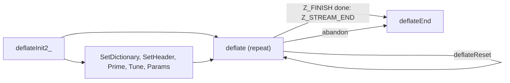

# Compression through a stream (deflate.c)

Source of truth: `deflate.c` of the verified source (the pinned zlib checkout with `patches/` applied,
default build: gzip support on, no `LIT_MEM`, no `FASTEST`) and `zlib.h`. Every statement below was
checked against the C. Statements marked "run" were also checked by running the real library
(patched `libz.a`, default configuration) with a small C program; the sanitizer runs used the same
source built with AddressSanitizer and UndefinedBehaviorSanitizer.

## The idea in short

You own a `z_stream`. You set `zalloc`, `zfree` and `opaque` (or leave them zero), call
`deflateInit_` (usually through the macro `deflateInit` or `deflateInit2`), and the library
allocates one internal state for you. Then you repeat: point `next_in` and `avail_in` at input,
point `next_out` and `avail_out` at room for output, call `deflate`. The library moves the two
pointers forward and lowers the two counters. Compressed bytes are written to your output buffer;
some input may be kept inside the library until a block is complete, unless you ask for a flush.
You end the stream with `deflate(strm, Z_FINISH)` until it returns `Z_STREAM_END`. Last you call
`deflateEnd`, which frees everything the library allocated. All other functions on this page change
settings, ask questions, or restart the stream.



### How every function here checks the stream

Every function except `deflateInit_`, `deflateInit2_`, `deflateBound` and `deflateBound_z` first
runs an internal check, which this page calls **the stream check**. The check fails (and the
function returns `Z_STREAM_ERROR` without changing anything) when:

- `strm` is NULL, or
- `zalloc` or `zfree` of the stream is NULL, or
- the `state` field is NULL, or the state does not point back to this very stream, or
- the state's status is not one of the eight known status values (zlib header, gzip header, extra,
  name, comment, header CRC, busy, finish).

The check cannot detect a stream that was never initialised and holds garbage, or a stream whose
state was freed and whose `state` field was not cleared by `deflateEnd` (`deflateEnd` does clear it).
Passing such a stream is undefined behaviour (U3, U4, U5 in [../../safety.md](../../safety.md)).

### Facts used on this page

| Fact | Value (default build) |
| --- | --- |
| Return codes | `Z_OK` 0, `Z_STREAM_END` 1, `Z_NEED_DICT` 2, `Z_ERRNO` -1, `Z_STREAM_ERROR` -2, `Z_DATA_ERROR` -3, `Z_MEM_ERROR` -4, `Z_BUF_ERROR` -5, `Z_VERSION_ERROR` -6 |
| Flush values | `Z_NO_FLUSH` 0, `Z_PARTIAL_FLUSH` 1, `Z_SYNC_FLUSH` 2, `Z_FULL_FLUSH` 3, `Z_FINISH` 4, `Z_BLOCK` 5 (`Z_TREES` 6 is for inflate only) |
| Strategies | `Z_DEFAULT_STRATEGY` 0, `Z_FILTERED` 1, `Z_HUFFMAN_ONLY` 2, `Z_RLE` 3, `Z_FIXED` 4 |
| `data_type` | `Z_BINARY` 0, `Z_TEXT` 1, `Z_UNKNOWN` 2 |
| Release string | `ZLIB_VERSION`, here `1.3.2.1-motley`; only its first character is compared by the init functions |
| Largest `memLevel` | 9 (`MAX_MEM_LEVEL`, 64-bit build); default 8 |
| The three approaches | level 0 stores, levels 1 to 3 use the fast approach, levels 4 to 9 use the lazy approach |

## deflateInit_

```c
int ZEXPORT deflateInit_(z_streamp strm, int level, const char *version, int stream_size);
```

**Purpose.** Initialises a stream for compression with the defaults: zlib wrapper, 32 KB window
(`windowBits` 15), `memLevel` 8, default strategy. The macro `deflateInit(strm, level)` in `zlib.h`
calls this function with the header's own release string and `sizeof(z_stream)`. The function does
nothing itself: it calls `deflateInit2_` with method `Z_DEFLATED`, 15, 8 and `Z_DEFAULT_STRATEGY`.
Everything on the `deflateInit2_` section applies.

**Parameters.**

| Name | Direction | Must be | Range | NULL? | Memory |
| --- | --- | --- | --- | --- | --- |
| `strm` | in-out | pointer to a writable `z_stream` | with `zalloc`, `zfree`, `opaque` set by the caller | no (`Z_STREAM_ERROR`) | caller owns the struct; the library owns the state it allocates |
| `level` | in | compression level | -1 (means 6) or 0 to 9 | n/a | n/a |
| release string (third parameter) | in | zero-terminated string | first character must equal the first character of `ZLIB_VERSION` | no (`Z_VERSION_ERROR`) | caller |
| `stream_size` | in | size of the caller's `z_stream` | must equal `sizeof(z_stream)` of the library | n/a | n/a |

**Preconditions.** As for `deflateInit2_`.

**What it does.** Same as `deflateInit2_(strm, level, Z_DEFLATED, 15, 8, Z_DEFAULT_STRATEGY, release string, stream_size)`.

**Return values.** As `deflateInit2_`, except that `Z_STREAM_ERROR` for the window, memory level,
method and strategy cannot happen; only a bad `level` or a NULL `strm` can give it.

**Errors and stream state after an error.** As `deflateInit2_`.

**Memory ownership.** As `deflateInit2_`.

**The caller must not.** As `deflateInit2_`.

**Easy to get wrong.** Calling `deflateInit_` directly with a made-up size or release string
compiles and then fails with `Z_VERSION_ERROR`; use the macro. See `deflateInit2_` for the rest.

**Related.** `deflateInit2_`, `deflateReset`, `deflateEnd`.

**In the project.** Translation: `ZlibF/Zlib/deflate.c.lean` (namespace `Zlib.Deflate`, `deflateInit_`).
Spec: `ZlibF.Spec.Api.DeflInit` (covers both init functions). Proof status: translated; no theorem
listed in `tests/audit/theorems.txt`.

## deflateInit2_

```c
int ZEXPORT deflateInit2_(z_streamp strm, int level, int method, int windowBits,
                          int memLevel, int strategy, const char *version, int stream_size);
```

**Purpose.** Initialises a stream for compression with full control: the wrapper (zlib, raw or gzip)
and the window size through `windowBits`, the memory used for hashing and buffering through
`memLevel`, and the strategy. It allocates the compressor state and four buffers, then resets the
stream so that it is ready for `deflate`. The macro `deflateInit2` in `zlib.h` supplies the last two
arguments.

**Parameters.**

| Name | Direction | Must be | Range | NULL? | Memory |
| --- | --- | --- | --- | --- | --- |
| `strm` | in-out | writable `z_stream` | `zalloc`, `zfree`, `opaque` set by the caller; other fields are ignored on entry | no | caller owns the struct |
| `level` | in | level | -1 (means 6), 0 to 9 | n/a | n/a |
| `method` | in | compression method | only 8 (`Z_DEFLATED`) | n/a | n/a |
| `windowBits` | in | base-2 log of the window size, with the wrapper in its sign and size | 8 to 15 for a zlib wrapper (8 becomes 9); -9 to -15 for raw deflate; 25 to 31 for a gzip wrapper (16 plus 9 to 15). Refused (run): 0, 1 to 7, 16 to 24, 32 and above, -1 to -8, -16 and below | n/a | n/a |
| `memLevel` | in | memory level | 1 to 9 | n/a | n/a |
| `strategy` | in | strategy | 0 to 4 | n/a | n/a |
| release string | in | zero-terminated string | first character equals that of `ZLIB_VERSION` | no (`Z_VERSION_ERROR`) | caller |
| `stream_size` | in | `sizeof(z_stream)` as seen by the caller | must equal the library's | n/a | n/a |

**Preconditions.** `zalloc`, `zfree` and `opaque` of `*strm` must have been set (zero is allowed
and means "use `malloc` and `free`"). If `zalloc` is set, `zfree` should be set too: a custom
allocator paired with the default `free` is a bug in the caller. `strm` must not be a stream that is
already initialised and not yet ended (that would leak its state).

**What it does, in order.**

1. If the release string is NULL, or its first character differs from the first character of
   `ZLIB_VERSION`, or `stream_size` is not equal to `sizeof(z_stream)`: return `Z_VERSION_ERROR`.
   This check comes first, so it works even when `strm` is NULL, and it does not touch `msg`.
2. If `strm` is NULL: return `Z_STREAM_ERROR`.
3. Set `msg` to NULL.
4. If `zalloc` is NULL: set `zalloc` to the library's allocator (a `malloc` wrapper) **and set
   `opaque` to zero**, discarding any value the caller put there. If `zfree` is NULL: set `zfree` to
   the library's `free` wrapper (`opaque` is not touched here). So if you set only `zfree` and
   `opaque`, the `opaque` value is lost.
5. Level -1 becomes 6.
6. Window and wrapper: a negative `windowBits` means raw deflate (`-windowBits` is the size; below
   -15 is refused). A value above 15 means a gzip wrapper (16 is subtracted). Then these are all
   required, otherwise `Z_STREAM_ERROR`: `memLevel` 1 to 9, `method` 8, `windowBits` 8 to 15, level
   0 to 9, strategy 0 to 4, and a window of 8 only with the zlib wrapper. Note what this implies
   (run): `-8` and gzip with an 8-bit window (24) are refused, and so are 0, 16, and 32 and above.
7. A requested window of 8 becomes 9 (the 256-byte window is not supported, `zlib.h` says so).
   A stream made with 8 has the header of a 9-bit window, so `inflateInit2` with 8 refuses it.
8. Allocate the state (one call of `zalloc` with 1 item of the state's size), and zero it. Then, with
   `w = 2^windowBits`, `h = 2^(memLevel+7)`, `l = 2^(memLevel+6)`, allocate four buffers with four
   more `zalloc` calls: window (`w` items of 2 bytes), `prev` (`w` items of 2 bytes), `head` (`h`
   items of 2 bytes), pending buffer (`l` items of 4 bytes). With the defaults this is about 64 KB
   each, so about 256 KB plus the state.
9. If any of the four buffers could not be allocated: set `msg` to the text of `Z_MEM_ERROR`
   ("insufficient memory"), free what was allocated (this is `deflateEnd`), set `state` to NULL
   and return `Z_MEM_ERROR`.
10. Store level, strategy, method; then call `deflateReset`, whose result is returned (always
    `Z_OK` here). `deflateReset` sets `total_in`, `total_out` to 0, `msg` to NULL, `data_type` to
    `Z_UNKNOWN` (2), and `adler` to 1 for the zlib and raw wrappers or 0 (the CRC-32 of nothing) for
    the gzip wrapper (run).

Nothing is read from `next_in` and no output is written; `next_in`, `avail_in`, `next_out`,
`avail_out` are not looked at.

**Return values.**

| Code | Condition |
| --- | --- |
| `Z_OK` | the stream is ready |
| `Z_VERSION_ERROR` | release string NULL or first character differs, or `stream_size` wrong (step 1) |
| `Z_STREAM_ERROR` | `strm` NULL, or any parameter outside its range (steps 2 and 6) |
| `Z_MEM_ERROR` | an allocation failed (step 8 or 9) |

**Errors and stream state after an error.** After `Z_VERSION_ERROR` the stream is unchanged. After
`Z_STREAM_ERROR` the stream may have `msg` NULL and `zalloc`, `zfree` (and `opaque`) filled in by
step 4 (run: a bad level leaves `zalloc` set), but has no state. After `Z_MEM_ERROR`:
if the very first allocation (the state) failed, `state` is **not touched** (run: if the caller left
garbage there it stays) and `msg` is NULL; if one of the four buffers failed, `state` is NULL and
`msg` is "insufficient memory" (run, for each of the four failing allocations). In every error case
there is nothing to free, and `deflateEnd` must not be called. The five allocations are always all
made when the first succeeds (run: 5 calls even if the second fails), so a failing allocator sees
the same sequence.

**Memory ownership.** On success the library owns the state and four buffers; you free them with
`deflateEnd`. If you forget, all five blocks leak. The library calls your `zalloc` and `zfree` with
your `opaque`.

**The caller must not.** Pass a `z_stream` that is uninitialised garbage in `zalloc` or `zfree`
(a garbage pointer is called: U5). Call it twice on a live stream (leak, U12). Share the stream
between threads without locking.

**Easy to get wrong.**

- `windowBits` 8 is accepted for the zlib wrapper and silently becomes 9 (`zlib.h` says so);
  raw with -8 and gzip with 24 are refused (run), although the range "8..15" in the header text
  suggests otherwise for raw.
- `opaque` is overwritten with zero when `zalloc` was NULL (step 4).
- `level` -1 is accepted; -2 is not.
- `zlib.h` says `deflateInit2` returns `Z_STREAM_ERROR` "if any parameter is invalid"; it does, but
  after it may already have filled in `zalloc` and `zfree`.
- The macro hides the release string check, so a program built against one `zlib.h` and linked
  against a library with another first character fails with `Z_VERSION_ERROR` at this point.

**Related.** `deflateInit_`, `deflateReset`, `deflateEnd`, `deflateBound`, `zlibVersion` in
[utility.md](utility.md#zlibversion).

**In the project.** Translation: `ZlibF/Zlib/deflate.c.lean` (`Zlib.Deflate.deflateInit2_`). Spec:
`ZlibF.Spec.Api.DeflInit`. Proof status: translated; no theorem listed in `tests/audit/theorems.txt`.

## deflateSetDictionary

```c
int ZEXPORT deflateSetDictionary(z_streamp strm, const Bytef *dictionary, uInt dictLength);
```

**Purpose.** Preloads the sliding window with bytes the decompressor is also going to have, so that
the first bytes of data can be compressed as references into the dictionary. It produces no output.

**Parameters.**

| Name | Direction | Must be | Range | NULL? | Memory |
| --- | --- | --- | --- | --- | --- |
| `strm` | in-out | initialised compression stream | see preconditions | no | library owns the state |
| `dictionary` | in | pointer to `dictLength` readable bytes | any | **no, even when `dictLength` is 0** (`Z_STREAM_ERROR`) | caller; only read during the call, copied into the window |
| `dictLength` | in | number of bytes | any `uInt`; only the last `windowsize` bytes are kept | n/a | n/a |

**Preconditions.** The stream check passes. For the zlib wrapper, `deflate` has not been called since
`deflateInit2_` or `deflateReset` (the status is still "zlib header"). For raw deflate, it is called
either before any `deflate`, or at a block boundary (all input consumed and all output delivered after
`Z_BLOCK`, `Z_PARTIAL_FLUSH`, `Z_SYNC_FLUSH` or `Z_FULL_FLUSH`). A gzip stream cannot take a
dictionary. Also no unprocessed lookahead may be held.

**What it does.**

1. For the zlib wrapper only: `adler` becomes `adler32(adler, dictionary, dictLength)`. It
   **continues from the current value of `adler`**; it is not restarted. After init or reset, `adler` is 1, so the
   result is the Adler-32 of the dictionary. The value covers the whole dictionary, even if only the
   tail fits. The decompressor uses it to find the dictionary (`Z_NEED_DICT`).
2. If `dictLength` is at least the window size, only the last window-size bytes are used (and for raw
   deflate in mid-stream the hash and position are cleared first).
3. The bytes are copied into the window and every position that has at least three bytes after it is
   entered in the hash. `strstart` ends at the dictionary length, `block_start` equals it, nothing is pending, and the match state is reset.
4. `next_in` and `avail_in` are restored to the values they had before (the call borrows them to feed
   the window), **but `total_in` has been increased by the number of dictionary bytes loaded** (run:
   100 for a 100 byte dictionary).
5. When `deflate` later writes the zlib header, it sets the FDICT flag and appends the saved
   Adler-32, if at least one dictionary byte was loaded (run: dictionary length 0 gives the plain
   header `78 9c`; length 1 gives `78 bb` with FDICT).

**Return values.**

| Code | Condition |
| --- | --- |
| `Z_OK` | dictionary loaded |
| `Z_STREAM_ERROR` | stream check fails; `dictionary` NULL; gzip wrapper; zlib wrapper and `deflate` already called; unprocessed lookahead; raw wrapper and not at a block boundary |

**Errors and stream state after an error.** Nothing is changed (all checks come first).

**Memory ownership.** No allocation. The dictionary buffer stays the caller's and may be freed
after the call.

**The caller must not.** Pass a `dictionary` shorter than `dictLength` (U1). Call it from another
thread while `deflate` runs.

**Easy to get wrong.** (All run.)

- Calling it twice before `deflate` is accepted, and the Adler-32 is **chained**: the second call
  starts from the first call's value, so the header then names a checksum that no single dictionary
  has, and the decompressor's `inflateSetDictionary` will report `Z_DATA_ERROR`. Call it once.
- `total_in` includes the dictionary bytes after this call. `zlib.h` says `total_in` is the total size
  of the uncompressed data; with a dictionary it is larger by the loaded amount. Subtract it if you
  save `total_in` for the decompressor.
- `dictionary` NULL is an error even for length 0.
- For raw deflate `adler` is not changed (run: stays at its old value).
- A 40000 byte dictionary with a 32 KB window loads only the last 32768 bytes
  (`deflateGetDictionary` then reports 32768), but `adler` covers all 40000.
- `zlib.h` also says at most the window size minus 262 bytes of the dictionary are used by matches;
  that is a limit on match distance (`MAX_DIST`), not on the bytes loaded.

**Related.** `inflateSetDictionary`, `deflateGetDictionary`, `deflateReset`, `deflateBound`.

**In the project.** Translation: `Zlib.Deflate.deflateSetDictionary`. Spec: `ZlibF.Spec.Api.DeflSetDict`.
Proof status: translated; no theorem in `tests/audit/theorems.txt`.

## deflateGetDictionary

```c
int ZEXPORT deflateGetDictionary(z_streamp strm, Bytef *dictionary, uInt *dictLength);
```

**Purpose.** Copies out the data that the compressor currently keeps as history, so that an
application can start a later stream with it as a dictionary.

**Parameters.**

| Name | Direction | Must be | Range | NULL? | Memory |
| --- | --- | --- | --- | --- | --- |
| `strm` | in | initialised stream | | no | library |
| `dictionary` | out | room for the result; 32768 bytes is always enough | | yes: then nothing is copied | caller |
| `dictLength` | out | pointer to an `uInt` | receives the length, 0 to the window size | yes: then not set | caller |

**Preconditions.** The stream check passes.

**What it does.** The length is `strstart + lookahead`, capped at the window size. The bytes copied
are the last that many bytes of the window, up to and **including the lookahead**, that is, input
the library has accepted but not yet compressed. If `dictionary` is not NULL and the length is not
0, the bytes are copied. If `dictLength` is not NULL, the length is stored. Nothing else changes.

**Return values.** `Z_OK`; `Z_STREAM_ERROR` if the stream check fails.

**Errors and stream state after an error.** Nothing is written.

**Memory ownership.** No allocation.

**The caller must not.** Pass a `dictionary` buffer smaller than the length it will be given (U1).

**Easy to get wrong.** (Run.) A fresh stream gives length 0. After 100 bytes were given to
`deflate(Z_NO_FLUSH)` and no output was produced, the length is already 100. After 70000 bytes it is
32768. `zlib.h` says the length can be up to 258 bytes less than the window even with more input.
After `deflateSetDictionary` with 40000 bytes it is 32768, the window size.

**Related.** `deflateSetDictionary`, `inflateGetDictionary`.

**In the project.** Translation: `Zlib.Deflate.deflateGetDictionary` (the Lean form has a flag for
the NULL length pointer). Spec: `ZlibF.Spec.Api.DeflGetDict`. Proof status: translated; no theorem.

## deflateResetKeep

```c
int ZEXPORT deflateResetKeep(z_streamp strm);
```

**Purpose.** A low-level reset that restarts the stream's counters and output but **keeps the window
and the hash chains**, so history from before the reset stays available to the compressor. It is
declared in `zlib.h` under "undocumented functions (not part of the zlib API)". Applications should
use `deflateReset`.

**Parameters.** `strm`: in-out, an initialised stream, not NULL, library owns the state.

**Preconditions.** The stream check passes.

**What it does.**

1. `total_in` and `total_out` become 0, `msg` NULL, `data_type` `Z_UNKNOWN`.
2. The pending output is dropped (`pending` is 0). If the stream had already written its trailer
   (wrap made negative by `Z_FINISH`), the wrapper type is restored.
3. The status becomes "gzip header" for the gzip wrapper, otherwise "zlib header"; `adler` becomes
   1, or 0 for gzip. `last_flush` becomes -2 (nothing flushed yet).
4. **The gzip header pointer given to `deflateSetHeader` is cleared** (default header again).
5. The block coder is reset (bit buffer, trees, counters), except that for level 0 the count of
   hashed matches is kept.
6. The current block starts at the current position; lookahead and match state are cleared.

It does **not** clear the hash, the window position, or the number of bytes of history. So the next
`deflate` can refer to data from before the reset.

**Return values.** `Z_OK`; `Z_STREAM_ERROR` if the stream check fails.

**Errors and stream state after an error.** Nothing changed.

**Memory ownership.** No allocation.

**The caller must not.** Use the result as a standalone stream if any data was compressed before
(see below).

**Easy to get wrong.** (Run, levels 6, 1 and 0, 3000 bytes compressed twice.) After
`deflateResetKeep`, the same 3000 input bytes compress to 43 bytes instead of 1058 at level 6, because they match the old
history. The new stream's header is `78 bb 00 00 00 01`: the FDICT flag is set with a dictionary checksum
of 1, and a fresh `inflate` reports `Z_NEED_DICT`. The stream cannot be decoded without the old data,
and no real dictionary has the checksum 1 (the checksum of an empty dictionary). With `deflateReset` the
second stream has the same size as the first (1058 bytes). `zlib.h` documents none of this.

**Related.** `deflateReset` (calls this, then clears the hash), `inflateResetKeep`.

**In the project.** Translation: `Zlib.Deflate.deflateResetKeep`. Spec: not written yet (the comment
on `DeflState.fresh` in `ZlibF/Spec/Api/Deflate.lean` mentions it). Proof status: translated; no
theorem.

## deflateReset

```c
int ZEXPORT deflateReset(z_streamp strm);
```

**Purpose.** Restarts compression on the same stream, keeping level, strategy, window size, memory
level, wrapper and all allocations. It is like `deflateEnd` followed by `deflateInit2_` with the same
arguments, without freeing and allocating.

**Parameters.** `strm`: in-out, initialised, not NULL.

**Preconditions.** The stream check passes. May be called in any state, including after
`Z_STREAM_END` (that is the normal way to reuse a stream).

**What it does.** `deflateResetKeep` (above), then the "longest match" initialisation: the hash heads are
cleared, the window position, block start, lookahead and `insert` are set to 0, and the tuning values
(`good_length`, `max_lazy`, `nice_length`, `max_chain`) are **reloaded from the table for the current
level**. So the effect of `deflateTune` is undone. The level and strategy as last set by
`deflateParams` are kept. A gzip header from `deflateSetHeader` is forgotten. After the call:
`total_in` and `total_out` 0, `msg` NULL, `data_type` `Z_UNKNOWN`, `adler` 1 (0 for gzip).

**Return values.** `Z_OK`; `Z_STREAM_ERROR` if the stream check fails (run: after `deflateEnd`, and for NULL).

**Errors and stream state after an error.** Nothing changed.

**Memory ownership.** No allocation, no free.

**The caller must not.** Reset a stream whose input or output buffers it intends to keep using
without setting them again: the pointers `next_in`, `next_out`, `avail_in`, `avail_out` are not
touched.

**Easy to get wrong.** Unflushed input and pending output are discarded without a trace. A
dictionary set earlier is gone, so call `deflateSetDictionary` again after a reset. `zlib.h` lists
`total_in`, `total_out`, `adler` and `msg`; also `data_type` is reset.

**Related.** `deflateResetKeep`, `deflateEnd`, `deflateInit2_`, `deflateSetHeader`.

**In the project.** Translation: `Zlib.Deflate.deflateReset`. Spec: `ZlibF.Spec.Api.DeflReset`.
Proof status: translated; no theorem.

## deflateSetHeader

```c
int ZEXPORT deflateSetHeader(z_streamp strm, gz_headerp head);
```

**Purpose.** Gives the gzip header fields that `deflate` should write for a gzip stream (made with
`windowBits` 25 to 31).

**Parameters.**

| Name | Direction | Must be | Range | NULL? | Memory |
| --- | --- | --- | --- | --- | --- |
| `strm` | in-out | initialised gzip stream | | no | library |
| `head` | in | pointer to a `gz_header` | fields: `text`, `time`, `os`, `extra` with `extra_len` bytes, `name` and `comment` zero-terminated, `hcrc`; `xflags`, `extra_max`, `name_max`, `comm_max`, `done` are ignored when writing | yes: default header | **caller owns it and it is not copied**: the structure and the buffers it points to must stay valid until `deflate` has written the whole header |

**Preconditions.** The stream check passes and the wrapper is gzip.

**What it does.** Stores the pointer `head`. When `deflate` later writes the header it uses it:
flag bits for text (1), header CRC (2), extra (4), name (8), comment (16); the low 32 bits of `time`
in little-endian order; the extra flags byte chosen from level and strategy (2 for level 9; else 4 if the
level is below 2 or the strategy is at least `Z_HUFFMAN_ONLY`, that is Huffman-only, RLE or fixed; else
0); the low 8 bits of `os`; the extra field (length in 16 bits, only the low 16 bits of `extra_len`
are used); name and comment up to and including their zero byte; and, if `hcrc`, a 16-bit CRC of the
header. Without a header, the written header has no flags, time 0, the operating-system code of the
build (3 on Unix) and no optional fields. The call itself writes nothing.

**Return values.** `Z_OK`; `Z_STREAM_ERROR` if the stream check fails or the wrapper is not gzip
(run: a zlib stream gives `Z_STREAM_ERROR`).

**Errors and stream state after an error.** Nothing changed.

**Memory ownership.** None; no copy is made.

**The caller must not.** Free or change the header structure, `name`, `comment` or `extra` while the
header is still being written (it can span several `deflate` calls when output room is small) (U1,
U4). Leave `name` or `comment` without a zero byte (the library reads until it finds one: U1). Give an
`extra` pointer with fewer than `extra_len` readable bytes (U1).

**Easy to get wrong.** (Run.) The call is accepted after `deflate` has already run, but then the
header was already written, so it has no effect on the output (it still changes what `deflateBound`
adds for the header). `deflateReset` and `deflateResetKeep` forget the header pointer. `zlib.h` says to
call `deflateBound` after `deflateSetHeader`.

**Related.** `inflateGetHeader`, `deflateBound`, `deflateReset`.

**In the project.** Translation: `Zlib.Deflate.deflateSetHeader`. Spec: `ZlibF.Spec.Api.DeflSetHeader`.
Proof status: translated; no theorem.

## deflatePending

```c
int ZEXPORT deflatePending(z_streamp strm, unsigned *pending, int *bits);
```

**Purpose.** Reports how much output has been produced but not yet delivered to your buffer.

**Parameters.**

| Name | Direction | Must be | Range | NULL? | Memory |
| --- | --- | --- | --- | --- | --- |
| `strm` | in | initialised stream | | no | library |
| `pending` | out | `unsigned` | whole bytes waiting | yes (not set) | caller |
| `bits` | out | `int` | bits waiting that do not fill a byte, 0 to 7 | yes (not set) | caller |

**Preconditions.** The stream check passes.

**What it does.** `bits` is the number of bits in the bit buffer. `pending` is the number of bytes in
the pending buffer. If the pending count does not fit an `unsigned` it stores the largest unsigned
and returns `Z_BUF_ERROR`; this cannot happen here (the buffer is at most 128 KB).

**Return values.** `Z_OK`; `Z_STREAM_ERROR` (stream check); `Z_BUF_ERROR` (count too large; cannot happen here).

**Errors and stream state after an error.** Outputs are not written on `Z_STREAM_ERROR`. The stream
is never changed.

**Memory ownership.** None.

**The caller must not.** Pass a pointer that is neither NULL nor valid (U1).

**Easy to get wrong.** (Run, raw stream, 500 bytes input, Z_SYNC_FLUSH with 3 bytes of output room:)
115 bytes pending and 7 bits. After the rest was delivered: 0 and 0. A partial flush leaves bits
waiting (2 bits). `zlib.h` says 0 to 7 bits; that holds in every run.

**Related.** `deflate`, `deflateUsed`.

**In the project.** Translation: `Zlib.Deflate.deflatePending`. Spec: `ZlibF.Spec.Api.DeflPending`.
Proof status: translated; no theorem.

## deflateUsed

```c
int ZEXPORT deflateUsed(z_streamp strm, int *bits);
```

**Purpose.** Tells how many bits of the last byte were used the last time the output was flushed to a
byte boundary, to locate the last bit of a deflate stream.

**Parameters.** `strm`: in, initialised, not NULL. `bits`: out, `int`, may be NULL (then nothing is
stored); receives 1 to 8, or 0 if no byte-aligned flush has happened since the last reset.

**Preconditions.** The stream check passes.

**What it does.** Returns the saved number. The number is set when the coder pads the output to a
byte boundary (end of a stored block or `Z_SYNC_FLUSH`, `Z_FULL_FLUSH`, `Z_FINISH`), as the bit count
in the last byte (1 to 8). `deflateReset` and `deflateResetKeep` set it to 0. `Z_PARTIAL_FLUSH` and
`Z_BLOCK` do not change it.

**Return values.** `Z_OK`; `Z_STREAM_ERROR` (stream check).

**Errors and stream state after an error.** Nothing written, nothing changed.

**Memory ownership.** None.

**The caller must not.** Pass an invalid `bits` pointer (U1).

**Easy to get wrong.** (Run.) The value stays at its last setting while a later flush is incomplete:
with the sync flush unfinished (3 bytes of room) it reported 0, and after the flush was completed 2;
after a later `Z_PARTIAL_FLUSH` or `Z_BLOCK` it still reported 2.

**Related.** `deflatePending`, `deflatePrime`.

**In the project.** Translation: `Zlib.Deflate.deflateUsed`. Spec: not written yet. Proof status: translated; no theorem.

## deflatePrime

```c
int ZEXPORT deflatePrime(z_streamp strm, int bits, int value);
```

**Purpose.** Inserts up to 16 bits at the current position of the output, to start a new raw stream
in the middle of a byte after an earlier stream.

**Parameters.**

| Name | Direction | Must be | Range | NULL? | Memory |
| --- | --- | --- | --- | --- | --- |
| `strm` | in-out | initialised stream | | no | library |
| `bits` | in | number of bits to insert | 0 to 16 (others give `Z_BUF_ERROR`) | n/a | n/a |
| `value` | in | the bits; the low `bits` bits are used | any `int` | n/a | n/a |

**Preconditions.** Stream check passes. Intended use (`zlib.h`): raw deflate, before the first
`deflate` after init or reset. **The code does not check this**: it works for any wrapper at any
time (run: accepted on a zlib stream, also after `deflate`).

**What it does.** If output has been partly delivered, the pending bytes are first moved to the
start of the pending buffer. If there is not room for the bytes that the new bits complete, the call
returns `Z_BUF_ERROR` and changes nothing else. Otherwise the bits are placed in the bit buffer low
bit first, whole bytes are moved to the pending buffer, and fewer than 8 bits stay in the bit
buffer.

**Return values.**

| Code | Condition |
| --- | --- |
| `Z_OK` | inserted (also for `bits` 0) |
| `Z_BUF_ERROR` | `bits` below 0 or above 16 (run: -1 and 17 to 20), or no room in the pending buffer |
| `Z_STREAM_ERROR` | stream check fails |

**Errors and stream state after an error.** No bits are inserted. After `Z_BUF_ERROR` for no room,
pending output may have been moved inside the buffer (harmless).

**Memory ownership.** None.

**The caller must not.** Use it on a gzip or zlib stream, or in the middle of a stream, expecting
valid output: the bits land inside the stream and corrupt it. It is not a UB, but it is a misuse.

**Easy to get wrong.** (Run.) Range errors are `Z_BUF_ERROR`, not `Z_STREAM_ERROR` as for
`inflatePrime`. After `deflatePrime(5, 0xffff)`, `deflatePending` shows 0 bytes and 5 bits; with 10 bits it
shows 1 byte and 2 bits. Priming 16 bits `0x1234` then a sync flush yields the bytes `34 12` first.

**Related.** `inflatePrime`, `deflatePending`.

**In the project.** Translation: `Zlib.Deflate.deflatePrime`. Spec: `ZlibF.Spec.Api.DeflPrime`. Proof status: translated; no theorem.

## deflateParams

```c
int ZEXPORT deflateParams(z_streamp strm, int level, int strategy);
```

**Purpose.** Changes level and strategy of a running stream.

**Parameters.**

| Name | Direction | Must be | Range | NULL? | Memory |
| --- | --- | --- | --- | --- | --- |
| `strm` | in-out | initialised stream; its `next_out` and `avail_out` must be usable because the call may run `deflate` | | no | library |
| `level` | in | new level | -1 (means 6), 0 to 9 | n/a | n/a |
| `strategy` | in | new strategy | 0 to 4 | n/a | n/a |

**Preconditions.** Stream check passes. For the change to take effect at a clean point: flush with
`Z_BLOCK` (or another flush) until `avail_out` is not zero, then give no more input, then call.

**What it does.**

1. Level -1 becomes 6. Level outside 0 to 9 or strategy outside 0 to 4: `Z_STREAM_ERROR`.
2. If the strategy changes, or the level changes to a level with a different approach (0, 1 to 3, 4
   to 9), **and** `deflate` has been called since the last init or reset: call `deflate(strm, Z_BLOCK)`
   to complete the current block with the old settings. This consumes input and writes output
   through the stream's own `next_in`/`next_out` fields. If that call returns `Z_STREAM_ERROR`, return it
   (this happens after `Z_FINISH`, with a NULL `next_out`, and so on). Then, if any input is left
   or any unprocessed data remains inside, return `Z_BUF_ERROR`: **nothing is changed** and you can
   call again with more output room.
3. If the level differs: when leaving level 0 with hashed matches, the hash is slid or cleared; the
   four tuning values are loaded from the table of the new level (undoing `deflateTune`).
4. The strategy is stored.

If only the level changes within the same approach, no flush happens and the new level applies from the next
data on. Strategy change always flushes (if `deflate` ran).

**Return values.**

| Code | Condition |
| --- | --- |
| `Z_OK` | changed |
| `Z_STREAM_ERROR` | stream check; bad level or strategy; the flush inside returned `Z_STREAM_ERROR` |
| `Z_BUF_ERROR` | the flush could not finish for lack of output room (run: with `avail_out` 0 after a first call) |

**Errors and stream state after an error.** After `Z_BUF_ERROR`, level and strategy are unchanged, but
input may have been consumed and output produced by the inner `deflate`. After `Z_STREAM_ERROR` from the
inner call, `msg` is set.

**Memory ownership.** None.

**The caller must not.** Call it with a NULL `next_out` once `deflate` has been called when the
change needs a flush (the inner call refuses; you get `Z_STREAM_ERROR` and nothing changes).

**Easy to get wrong.** (Run.) A change from level 6 to 1 with `avail_out` 0 after an earlier call gave
`Z_BUF_ERROR`; the retry with room gave `Z_OK`. A change from level 0 to 6 after 70000 stored bytes
gave `Z_OK` and the final output decoded to the right data. On a fresh stream (no `deflate` yet) any
valid change is `Z_OK` at once. The inner flush is a real `Z_BLOCK` flush, so the block structure of
the output changes when parameters change. After `Z_FINISH`, a change of strategy or of approach (6
to 1) fails with `Z_STREAM_ERROR` (msg "stream error"), while 6 to 5 is `Z_OK`.

**Related.** `deflate`, `deflateTune`, `deflateInit2_`.

**In the project.** Translation: `Zlib.Deflate.deflateParams`. Spec: `ZlibF.Spec.Api.DeflParamsFn`. Proof status: translated; no theorem.

## deflateTune

```c
int ZEXPORT deflateTune(z_streamp strm, int good_length, int max_lazy, int nice_length, int max_chain);
```

**Purpose.** Overrides the four internal match-search tuning values.

**Parameters.** `strm`: in-out, initialised, not NULL. `good_length`, `max_lazy`, `nice_length`,
`max_chain`: in, any `int` (no check).

**Preconditions.** Stream check passes. Meant for experts; the comment in `deflate.c` says
`max_lazy` should be at least 3 and `max_chain` at least 4.

**What it does.** Stores the four values (`good_length`, `max_lazy`, `max_chain` converted to
unsigned; `nice_length` kept as `int`). They steer the search of `deflate_fast`/`deflate_slow` from the next
call on. They are replaced by the table values on `deflateReset`, and by `deflateParams` when the level
changes.

**Return values.** `Z_OK`; `Z_STREAM_ERROR` (stream check).

**Errors and stream state after an error.** Nothing changed.

**Memory ownership.** None.

**The caller must not.** Nothing UB was found (see below).

**Easy to get wrong.** Negative and zero values are accepted without checks. Run under the sanitizer
build with all four values 0, -1, `INT_MAX`, `INT_MIN`, and small values, on levels 1 and 4 with 70000 bytes:
no sanitizer report, and the output always decoded correctly. Compression ratio varies (27324 to 35840 bytes).

**Related.** `deflateParams`, `deflateReset`.

**In the project.** Translation: `Zlib.Deflate.deflateTune`. Spec: `ZlibF.Spec.Api.DeflTune`. Proof status: translated; no theorem.

## deflateBound_z

```c
z_size_t ZEXPORT deflateBound_z(z_streamp strm, z_size_t sourceLen);
```

**Purpose.** Gives an upper bound for the size of the compressed output of `sourceLen` input bytes
for this particular stream (its wrapper, window, memory level, header, dictionary), when the whole
input is given to one `deflate(Z_FINISH)` call.

**Parameters.** `strm`: in, a stream (may be invalid: see below), not required non-NULL. `sourceLen`: in, any value.

**Preconditions.** For a tight, correct answer: called after init, and after `deflateSetHeader` and
`deflateSetDictionary` if those are used, and before `deflate`.

**What it does.** Computes two worst-case bounds: for fixed-code blocks (the input plus an eighth,
a 256th, a 512th, plus 4) and for stored blocks of 127 bytes (the input plus 1/32, 1/128, 1/2048,
plus 7). If the stream check fails it returns the larger of the two plus 18 (the largest wrapper).
Otherwise it adds the wrapper length: raw 0; zlib 6, plus 4 if a dictionary was loaded; gzip 18, plus
the sizes of `extra`, `name` and `comment` (with their terminators) and 2 for `hcrc` when a header was
set. If the window is not 15 bits or the memory level is not 8: the fixed-code bound if the window
is not larger than the hash size and the level is not 0, otherwise the stored bound, plus the wrapper.
For the defaults (15 and 8): input plus input over 4096, over 16384, over 33554432, plus 7 plus the
wrapper (in the formula 13 minus 6). Any overflow gives `(z_size_t)-1`.

**Return values.** The bound; no error code exists. A stream that fails the check gets the
conservative answer, so it cannot be told from a valid answer.

**Errors and stream state after an error.** The stream is never changed.

**Memory ownership.** None.

**The caller must not.** Pass a stream with garbage (U3, U5).

**Easy to get wrong.** (Run, random data and compressible data, 9 configurations.) The guarantee
holds only for `Z_FINISH` in one call with an output buffer of at least the bound; with other flush
values (apart from `Z_NO_FLUSH`) the output can be larger. The bound for a stream with a custom
header counts the header even if `deflateSetHeader` came after the header was written. Examples:
default zlib stream, 1000 bytes: 1013; raw 15 bits: 1007; gzip: 1025; 9-bit window and memLevel 1: 1051;
15-bit window with memLevel 9: 1139. For the default settings it equals `compressBound`.
`deflateBound_z(strm, SIZE_MAX)` is `SIZE_MAX`.

**Related.** `deflateBound`, `compressBound` in [utility.md](utility.md#compressbound).

**In the project.** Translation: `Zlib.Deflate.deflateBound_z`. Spec: `ZlibF.Spec.Api.DeflBound`. Proof status: translated; no theorem.

## deflateBound

```c
uLong ZEXPORT deflateBound(z_streamp strm, uLong sourceLen);
```

**Purpose.** The `uLong` form of `deflateBound_z`.

**Parameters.** As `deflateBound_z`, with `uLong` instead of `z_size_t`.

**Preconditions.** As `deflateBound_z`.

**What it does.** Calls `deflateBound_z`; if the result does not fit `uLong` it returns `(uLong)-1`.
On this 64-bit build `uLong` and `z_size_t` have the same width, so the result is the same.

**Return values.** The bound, or `(uLong)-1` on overflow.

**Errors and stream state after an error.** Never changes the stream.

**Memory ownership.** None.

**The caller must not.** As `deflateBound_z`.

**Easy to get wrong.** On Windows `uLong` has 32 bits, so very large bounds saturate there; use the `_z` form.

**Related.** `deflateBound_z`.

**In the project.** Translation: `Zlib.Deflate.deflateBound`. Spec: `ZlibF.Spec.Api.DeflBound`. Proof status: translated; no theorem.

## deflate

```c
int ZEXPORT deflate(z_streamp strm, int flush);
```

**Purpose.** Compresses input and writes output. It stops when the input is used up or the output
is full. With a flush value it also forces the pending compressed data out in the way described below.

**Parameters.**

| Name | Direction | Must be | Range | NULL? | Memory |
| --- | --- | --- | --- | --- | --- |
| `strm` | in-out | initialised stream | | no (`Z_STREAM_ERROR`) | library owns the state |
| `next_in`, `avail_in` | in-out | input pointer and count | `next_in` may be NULL only if `avail_in` is 0 | see left | caller owns the input; the library never frees it; it is read, never written; it may be changed by the caller between calls |
| `next_out`, `avail_out` | in-out | output pointer and room | `next_out` must not be NULL, even if `avail_out` is 0; `avail_out` must not be 0 (else `Z_BUF_ERROR`) | no | caller owns the output buffer |
| `flush` | in | when to emit | 0 to 5 (`Z_NO_FLUSH`, `Z_PARTIAL_FLUSH`, `Z_SYNC_FLUSH`, `Z_FULL_FLUSH`, `Z_FINISH`, `Z_BLOCK`); anything else is `Z_STREAM_ERROR` | n/a | n/a |

The input and output buffers must not overlap each other (this is a requirement of `zlib.h`; the
code copies with `memcpy`: U9).

**Preconditions.** The stream was initialised and not ended. After a call returned `Z_STREAM_END`,
only `deflateReset` and `deflateEnd` may follow (more `Z_FINISH` calls are tolerated, see below). If a
previous call returned with `avail_out` 0, call again with the **same** `flush` and more room.

**What it does, in order.**

1. The stream check and `flush` range: failure gives `Z_STREAM_ERROR`, `msg` not set.
2. `next_out` NULL, or `next_in` NULL with `avail_in` not 0, or the stream already in the finish state
   and `flush` not `Z_FINISH`: `Z_STREAM_ERROR` with `msg` set to "stream error".
   `avail_out` 0: `Z_BUF_ERROR` with `msg` "buffer error".
3. Remember the previous flush value, store the new one. If output is pending, deliver as much as
   fits; if that used all of `avail_out`, return `Z_OK` (and remember "no flush", so the next call
   is not a `Z_BUF_ERROR`). If nothing is pending, there is no input, and the flush is not stronger
   than the previous one (the strength order is: `Z_NO_FLUSH`, `Z_BLOCK`, `Z_PARTIAL_FLUSH`,
   `Z_SYNC_FLUSH`, `Z_FULL_FLUSH`, `Z_FINISH`) and is not `Z_FINISH`: `Z_BUF_ERROR`. So
   repeating `Z_SYNC_FLUSH` with no new input gives `Z_BUF_ERROR` (run).
4. If the stream already started its final block and `avail_in` is not 0: `Z_BUF_ERROR`.
5. Header, once, at the start. Zlib: two bytes (`78` for a 32 KB window; the second byte carries the
   level class: 0 for strategy at least Huffman-only or level below 2, 1 for levels 2 to 5, 2 for level
   6, 3 for 7 to 9; and the FDICT bit when a dictionary was loaded, with the four dictionary Adler bytes
   after it); `adler` is set to 1. Gzip: the 10-byte header (`1f 8b 08`, flags, time, extra flags,
   operating system), or the header from `deflateSetHeader` including extra, name, comment and header
   CRC, which can take several calls when `avail_out` is small; `adler` is the CRC-32. Raw: no header.
   If the header does not fit, return `Z_OK`.
6. If there is input, or lookahead, or a flush was requested (and the stream is not finished),
   run the compressor: stored blocks for level 0; Huffman-only coding for `Z_HUFFMAN_ONLY`; run-length
   for `Z_RLE`; else the fast approach for levels 1 to 3 and the lazy approach for levels 4 to 9
   (`Z_FILTERED` and `Z_FIXED` use these two with different block decisions). The compressor reads input (`next_in`, `avail_in`, `total_in`
   and `adler` advance) and writes output (`next_out`, `avail_out`, `total_out`). It may return with
   input not fully used if output is full.
7. If the block ended because of a flush: `Z_PARTIAL_FLUSH` adds an empty fixed block of 10 bits;
   `Z_SYNC_FLUSH` and `Z_FULL_FLUSH` add an empty stored block (3 bits, padding, then `00 00 ff ff`;
   run: the output ends with those four bytes); `Z_BLOCK` adds nothing. `Z_FULL_FLUSH` also clears the
   hash, so later data does not refer to earlier data. Then the output is delivered; if `avail_out` is 0, return `Z_OK`.
8. If `flush` is not `Z_FINISH`: return `Z_OK`.
9. With `Z_FINISH`: for raw (and when the trailer was already written) return `Z_STREAM_END`. Otherwise
   write the trailer: gzip CRC-32 and total input size modulo 2 to the 32, both little-endian; zlib
   Adler-32, big-endian. Deliver. Mark the trailer as written. Return `Z_OK` if bytes are still pending, else `Z_STREAM_END`.

`data_type` becomes `Z_BINARY` or `Z_TEXT` when the first block is emitted (it stays `Z_UNKNOWN`
before that; run: text input gave 2 after `Z_NO_FLUSH` and 1 after `Z_FINISH`; a byte ramp 0 to 255 gave
0). `adler` always holds the check value of the input read so far (Adler-32; CRC-32 for gzip; for raw deflate it stays at 1, run).

**Return values.**

| Code | Condition |
| --- | --- |
| `Z_OK` | progress was made, or output is still pending and `avail_out` is 0, or a header is still being written |
| `Z_STREAM_END` | only with `Z_FINISH`: all input compressed, all output (including the trailer) delivered. Further `Z_FINISH` calls with no input keep returning it (run) |
| `Z_STREAM_ERROR` | stream check fails; `flush` outside 0 to 5; `next_out` NULL; `next_in` NULL with `avail_in` not 0; a flush other than `Z_FINISH` after the final block started |
| `Z_BUF_ERROR` | `avail_out` is 0; or no input, nothing pending, and a flush no stronger than the last; or new input (`avail_in` not 0) after `Z_FINISH` started. Not fatal: call again |

**Errors and stream state after an error.** After `Z_STREAM_ERROR` or `Z_BUF_ERROR` the stream is
unchanged except `msg` (set by the cases in step 2 to 4 that use it; run: "stream error", "buffer
error") and `last_flush`. In particular the input pointer and counters are unchanged. The stream stays
usable. There is no error return that leaves the stream unusable; only `deflateEnd` and `deflateReset` are always safe.

**Memory ownership.** `deflate` itself allocates nothing and frees nothing. The pending buffer lives
in the state. The caller owns input and output buffers.

**The caller must not.** Change `next_in` or `avail_in` in the middle of a call (single-threaded
use only); pass buffers shorter than `avail_in` or `avail_out` (U1); make input and output overlap
(U9); use the stream concurrently; give a stream whose `state` the application overwrote. For a gzip
header, keep the `gz_header` buffers valid until the header is done.

**Easy to get wrong.** (Run unless noted.)

- New input after `Z_FINISH` gives `Z_BUF_ERROR`, but a different flush value after `Z_FINISH` gives
  `Z_STREAM_ERROR`. Both leave the stream intact.
- Repeating `Z_SYNC_FLUSH` or `Z_FULL_FLUSH` with no input gives `Z_BUF_ERROR` the second time, and so
  does `Z_NO_FLUSH` with no input after any earlier call. The very first call on a fresh stream is
  different: `Z_NO_FLUSH` with no input returns `Z_OK`. `Z_FINISH` never gives this error (an empty
  finish at once gives `Z_STREAM_END` and 8 bytes of output for a zlib stream).
- `Z_TREES` (6) is not a deflate flush value: `Z_STREAM_ERROR`.
- `avail_out` 0 on entry is `Z_BUF_ERROR` and sets `msg`, even if the stream is fine.
- A `Z_OK` return with `avail_out` 0 means "call me again"; there may be nothing left (`deflatePending` can tell).
- With `Z_FINISH` and `avail_out` at least `deflateBound`, one call returns `Z_STREAM_END`.
- `adler` is updated as input is read, not as it is compressed.

**Related.** `deflateInit2_`, `deflateEnd`, `deflateParams`, `deflatePending`, `deflateBound`, `inflate`.

**In the project.** Translation: `Zlib.Deflate.deflate` (the block compressors are in
`deflate_base.c.lean`, `deflate_strategies.c.lean`, `trees.c.lean`). Spec: `ZlibF.Spec.Api.DeflStep`
and `DeflRun`. Proof status: translated; no theorem for `deflate` in `tests/audit/theorems.txt`; the
supporting `Pilot.flush_pending_ok`, `Pilot.slide_hash_ok`, `Pilot.fillC_ok` are listed.

## deflateEnd

```c
int ZEXPORT deflateEnd(z_streamp strm);
```

**Purpose.** Frees everything the stream allocated and discards unprocessed input and unflushed output.

**Parameters.** `strm`: in-out, an initialised stream, not NULL; its `zfree` is called.

**Preconditions.** The stream check passes. May be called in any state.

**What it does.** Reads the status. Frees the pending buffer, `head`, `prev`, the window (each only
if not NULL) and then the state, through `zfree`; sets `state` to NULL.

**Return values.**

| Code | Condition |
| --- | --- |
| `Z_OK` | the stream was never used, or the final block has started (status "finish"), or the gzip header from `deflateSetHeader` was still being written |
| `Z_DATA_ERROR` | the status is "busy": the header has been produced and the final block has not started. This includes a stream fully flushed with `Z_SYNC_FLUSH`, and a stream with only some of its gzip header delivered (run: all three) |
| `Z_STREAM_ERROR` | stream check fails (including a second call: the first one cleared `state`; run) |

**Errors and stream state after an error.** `Z_STREAM_ERROR`: nothing was freed. `Z_DATA_ERROR`: all
memory **was** freed, `state` is NULL; the code only says the stream was not finished. Treat it as
informational; do not call `deflateEnd` again.

**Memory ownership.** Frees the five blocks. If you never call it, they leak. The caller's own
buffers are not touched.

**The caller must not.** Use the stream afterwards except to init again. Call twice expecting success.

**Easy to get wrong.** (Run.) After `deflate(Z_FINISH)` returns `Z_STREAM_END`: `Z_OK`. After a sync flush
with everything delivered: `Z_DATA_ERROR`. With `Z_FINISH` and too little output room: `Z_OK` as soon as the final block
began. A fresh stream: `Z_OK`. `zlib.h` says "freed prematurely (some input or output was discarded)"; the code does not look at
whether anything was discarded, only at the status.

**Related.** `deflateInit2_`, `deflateReset`.

**In the project.** Translation: `Zlib.Deflate.deflateEnd`. Spec: `ZlibF.Spec.Api.DeflEnd`. Proof status: translated; no theorem.

## deflateCopy

```c
int ZEXPORT deflateCopy(z_streamp dest, z_streamp source);
```

**Purpose.** Makes `dest` an independent copy of the running stream `source`, including its buffers.

**Parameters.**

| Name | Direction | Must be | Range | NULL? | Memory |
| --- | --- | --- | --- | --- | --- |
| `dest` | out | writable `z_stream` | contents ignored | no (`Z_STREAM_ERROR`) | the new state belongs to `dest` |
| `source` | in | initialised stream | | no (the stream check fails: `Z_STREAM_ERROR`) | unchanged |

**Preconditions.** The stream check passes for `source`. `dest` and `source` are different objects.

**What it does.** Allocates a state and four buffers (five `zalloc` calls through **source's**
allocator), copies the state and the buffer contents that matter, copies the stream struct
(so `dest` gets the same `next_in`, `avail_in`, `next_out`, `avail_out`, counters, `msg`,
`zalloc`, `zfree`, `opaque`, `adler`), and points `dest`'s state at the copy. Source stays valid.
Then each can continue independently (run: both finished with identical output).

**Return values.** `Z_OK`; `Z_STREAM_ERROR` (`dest` NULL, or the stream check on `source` fails);
`Z_MEM_ERROR` (an allocation failed).

**Errors and stream state after an error.** If `dest` is not NULL, its `state` is set to NULL and
nothing else in it is changed (also when `source` is invalid, run; also for each of the five failing
allocations, run). Everything allocated so far is freed. `source` is untouched (`msg` is not
changed either).

**Memory ownership.** On success you now have two streams to end with `deflateEnd`. Forgetting one
leaks five blocks.

**The caller must not.** Pass the same stream as both arguments (run: it returns `Z_OK`, copies the
state to a new block and **leaks the original state**). Pass a `dest` that already owns a state
(leak).

**Easy to get wrong.** `dest` receives `source`'s `msg` and I/O pointers; `next_out` of both then
point to the same buffer: set them before the next `deflate` or the two streams write over each other.
`zlib.h` says that after a failure `deflateEnd(dest)` can be called safely, which is
true only because `state` is NULL (the check then fails with `Z_STREAM_ERROR`).

**Related.** `deflateEnd`, `inflateCopy`.

**In the project.** Translation: `Zlib.Deflate.deflateCopy`. Spec: `ZlibF.Spec.Api.DeflCopy`. Proof status: translated; no theorem.

## Findings to confirm

These are candidates only. None has been reported upstream.

1. **`deflateCopy(&s, &s)` leaks.** Reproduction: init a stream `s`, call `deflateCopy(&s, &s)` (it
   returns `Z_OK`), then `deflateEnd(&s)`; a leak checker reports the original state and four buffers.
   The function never compares `dest` with `source`. Misuse; `zlib.h` does not forbid it.
2. **`deflateSetDictionary` counts the dictionary in `total_in`.** Reproduction: init a stream, call it
   with 100 bytes, read `total_in`: 100. `zlib.h` says `total_in` is the size of the uncompressed data, so a caller
   that saves `total_in` for the decompressor gets a number larger by the loaded amount. Probably known behaviour;
   needs a decision whether to document or change.
3. **`deflateSetDictionary` twice chains the Adler-32.** Reproduction: two calls with different
   dictionaries before the first `deflate`; the header's dictionary checksum matches neither. `zlib.h` says to call it
   immediately after init, so this is misuse that is not rejected.
4. **`deflatePrime` is not limited to raw streams before the first `deflate`.** Reproduction: init a
   zlib stream, call `deflate` once, then `deflatePrime(strm, 3, 5)`: `Z_OK`, and the output is corrupted.
   `zlib.h` says it can only be used for raw deflate before the first call.
5. **`deflateResetKeep` followed by `deflate` produces a stream that needs the old data** (header with
   the FDICT flag and checksum 1). Reproduction: compress 3000 bytes with `Z_FINISH`, `deflateResetKeep`,
   compress the same bytes: 43 bytes, and `inflate` returns `Z_NEED_DICT`. Undocumented function, so it may be intended.
6. **`deflateTune` accepts any values.** No fault found under the sanitizers (see its section), listed
   only because the checks are absent.
