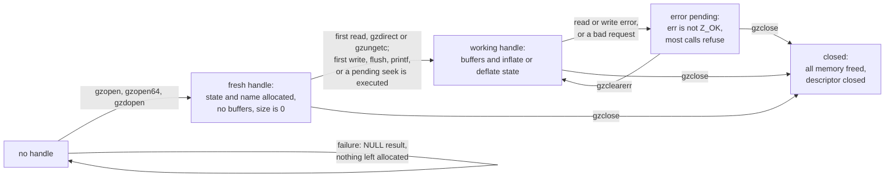
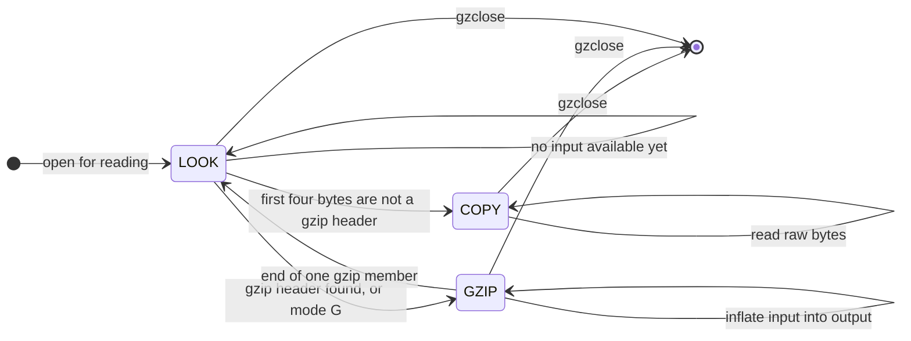
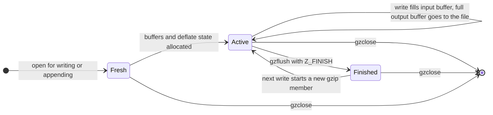
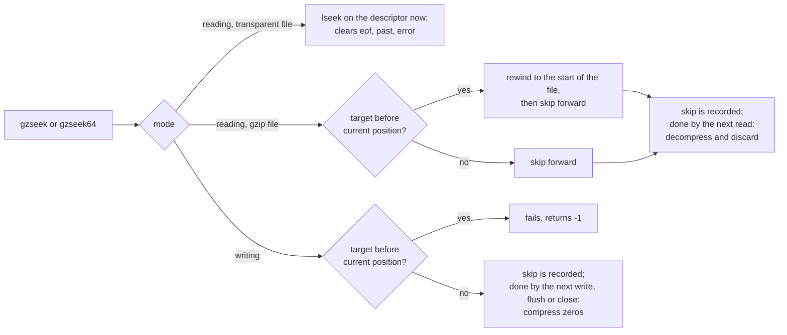

# The gzip file API: `gzlib.c`, `gzread.c`, `gzwrite.c`, `gzclose.c`

This page describes every function that these four files export, one section per function. It is a part of the [function reference](index.md) and of the [specification](../index.md). It is written from the verified C source (the pinned zlib checkout with the patches in `patches/` applied) and from `zlib.h`. Where the code and `zlib.h` differ, the page says so. Claims marked "run" were checked by running the real, patched library, also in a build with the address and undefined-behaviour sanitizers. A run is evidence, not proof. The undefined behaviour labels (U1 and so on) refer to the closed list in [../../safety.md](../../safety.md).

The default x86_64 Linux build is described: `int` has 32 bits, `long`, `z_off_t`, `z_off64_t` and `size_t` have 64 bits, and `_LARGEFILE64_SOURCE` is defined, so the `*64` functions are the real ones and the plain names call them.

## The idea in short

A `gzFile` is a handle that works like a `FILE *` for gzip files. Open it with `gzopen` (or `gzdopen` on a file descriptor you already have). Read with `gzread` and friends, or write with `gzwrite` and friends. Close with `gzclose`. A handle is for reading or for writing, never both.

The handle is a block of memory that the library allocates. It holds the file descriptor, two buffers, the compressor or decompressor, the position in the uncompressed data and an error state. The library fills the buffers late: opening a file reads and writes nothing. Reading detects the format by itself. A file that does not start with a gzip header is read as it is, byte for byte (transparent reading). Several gzip streams joined together are read as one stream.

Three things surprise most callers.

1. **Seeking is lazy.** `gzseek` returns the new position at once, but the work (reading and discarding, or writing zeros) happens at the next read, write, flush or close.
2. **Errors are sticky.** After a serious error, almost every call fails with a fixed value until `gzclearerr`. Data that was read before a read error is still delivered first.
3. **A return of 0 or -1 is not the whole story.** For reading, ask `gzerror` to tell end of file from an error. For writing, data is not in the file until `gzflush` or `gzclose`.

## Overview: the state of a handle

### Life of a handle



After a close the pointer is dead. Every later use is undefined behaviour (U4), including `gzerror`.

### The reader: `how`, `direct`, `junk`

The field `how` says what the next input bytes are. `direct` says whether the file is gzip. `junk` says whether bytes after a gzip stream may be ignored.



* `LOOK`: nothing is decided. On the first call the library reads up to one buffer of input. If it holds at least four bytes and they are `1F 8B 08` followed by a flag byte below 32, the file is gzip. If it holds no bytes, the file is empty and counts as transparent (`gzdirect` returns 1). With one to three bytes, or four other bytes, the file is not gzip. (On a non-blocking descriptor that has delivered fewer than four bytes so far, the library waits instead of deciding.)
* `COPY` (transparent): the bytes of the file are the data. The first chunk is copied to the output buffer. Later bytes are read straight into the output buffer, or into the caller's buffer for large requests. Once a handle is in COPY, it stays there.
* `GZIP`: the input is decompressed. At the end of a member the state goes back to `LOOK`. A further member is then started without looking at four bytes. If what follows is not a gzip member, the rest is ignored without error, provided no data came out of it (`junk`).
* The mode letter `G` skips the detection. The first bytes must then be a gzip header, or the first read fails with `Z_DATA_ERROR` ("incorrect header check"). An empty file gives `Z_BUF_ERROR`.
* The mode letter `T` is refused for reading.

### The writer



With the mode letter `T` there is no deflate state and no output buffer: the bytes are passed to the file unchanged. `gzdirect` returns 1 for such a handle.

### Position bookkeeping

| Field | Meaning |
| --- | --- |
| `x.pos` | the position in the uncompressed stream: bytes handed to the caller (or skipped) when reading; bytes accepted when writing. `gzungetc` lowers it by one. It starts at 0 whatever the position of the file descriptor |
| `skip` | a forward seek that has been requested and not yet carried out |
| `past` | set when a read ran into the end of the data; cleared by `gzclearerr`, `gzrewind`, a seek on a transparent file, and `gzungetc` |
| `eof` | the input file has ended. Unlike `past` it can be set while buffered data is still unread |
| `x.have`, `x.next` | the bytes that are ready in the output buffer, and where. The `gzgetc` macro reads these two fields and `x.pos` directly |
| `start` | the file offset at open time. `gzrewind` goes back to it |

`gztell` is `x.pos` plus `skip`, except that `skip` is not counted once `past` is set. A seek past the end of the data is reported at once, and corrected by the read that finds the end (run: seek to 1000 in a 16-byte stream gives 1000; after a read finds the end, `gztell` is 16).

Seeking in one picture:



### Errors

`err` holds a zlib code. `msg` holds the text, in the form `name: text`, where name is the path given to `gzopen` or `<fd:N>` for `gzdopen`. Z_OK and Z_BUF_ERROR are mild: a reader can go on after Z_BUF_ERROR (the file ended inside a gzip member; a growing file can be read again after `gzclearerr`). Any other code is serious.

A **serious error** makes these calls fail at once with their error value: all writing calls (`gzwrite`, `gzfwrite`, `gzputc`, `gzputs`, `gzprintf`, `gzflush`, `gzsetparams`), and `gzrewind` and `gzseek`. The reading calls (`gzread`, `gzfread`, `gzgetc`, `gzgets`) first deliver what is already in the output buffer and fail only afterwards. `gzungetc` still works as long as the buffers exist. `gzclearerr` clears the error. `gzclose` does not look at it (it still tries to write out pending data). The flag `again` is the exception: when the last input or output call of a non-blocking descriptor stalled (`EAGAIN` or `EWOULDBLOCK`), the error is recorded as Z_ERRNO, but the next read or write call clears it and tries again. `gzrewind` and `gzseek` do not make this exception: they refuse while a stall error is recorded.

| Code | Name | Typical cause here |
| --- | --- | --- |
| `-1` | Z_ERRNO | a failed `read`, `write`, or a stalled non-blocking call. Consult `errno` at once |
| `-2` | Z_STREAM_ERROR | request too large, internal inconsistency, or a call with no valid handle |
| `-3` | Z_DATA_ERROR | the gzip data is corrupt; or pushback had no room |
| `-4` | Z_MEM_ERROR | a buffer or the compressor could not be allocated |
| `-5` | Z_BUF_ERROR | the file ended inside a gzip member; a stalled `gzprintf` |

### Memory

Opening allocates the 248-byte state and a copy of the name. Nothing else. The first use allocates the buffers, of the size `want` (8192 bytes unless `gzbuffer` changed it):

| Handle | Input buffer | Output buffer | Other |
| --- | --- | --- | --- |
| reading | `want` | twice `want` | inflate state and window |
| writing (gzip) | twice `want` (the second half is for `gzprintf`) | `want` | deflate state |
| writing with `T` | twice `want` | none | none |

`gzclose` frees all of it, also on failure. A handle that is never closed leaks all of it and keeps the descriptor.

### Which calls work on which handle

| Call | Reading handle | Writing handle |
| --- | --- | --- |
| `gzread`, `gzfread`, `gzgetc`, `gzgetc_`, `gzungetc`, `gzgets` | yes | return their error value, no error recorded |
| `gzwrite`, `gzfwrite`, `gzputc`, `gzputs`, `gzprintf`, `gzvprintf`, `gzflush`, `gzsetparams` | return their error value, no error recorded | yes (`gzsetparams` not with `T`) |
| `gzrewind` | yes | `-1` |
| `gzseek`, `gzseek64` | yes, both directions | forward only |
| `gztell`, `gztell64`, `gzoffset`, `gzoffset64`, `gzbuffer`, `gzerror`, `gzclearerr`, `gzeof` | yes | yes (`gzeof` returns 0) |
| `gzdirect` | yes | yes (returns 1 for `T`) |
| `gzclose` | yes | yes |
| `gzclose_r` | yes | returns `Z_STREAM_ERROR`, handle not freed |
| `gzclose_w` | returns `Z_STREAM_ERROR`, handle not freed | yes |

Every function checks `file` against NULL first. Most also check the `mode` field, which holds one of two odd numbers (7247 for reading, 31153 for writing) so that a wild pointer is likely to be refused. This is not a promise: the check reads memory behind the pointer, so a pointer to freed or unrelated memory is undefined behaviour (U4, U1), not an error return.

The functions are not thread safe on one handle. Two threads may use two different handles.

---

## gzopen

**Signature**

```c
gzFile ZEXPORT gzopen(const char *path, const char *mode);
```

**Purpose**

Open the file `path` for reading or writing as a gzip file and return a handle.

**Parameters**

| Name | Direction | What it must be | Valid range | May it be NULL | Ownership |
| --- | --- | --- | --- | --- | --- |
| `path` | in | a NUL-terminated file name | any string the system call `open` accepts | yes: the result is NULL, `errno` is not set | caller; the library keeps its own copy |
| `mode` | in | a NUL-terminated string of mode letters, see below | must contain `r`, `w` or `a`; must not contain `+` | yes: the result is NULL | caller; read during the call only |

The mode letters are read from left to right. For `r`, `w`, `a` and for the strategy letters the last one wins. Each digit sets the level, the last digit wins.

| Letter | Meaning |
| --- | --- |
| `r`, `w`, `a` | read; write (create or truncate); append (create, keep, add a new gzip member at the end) |
| `0` to `9` | compression level (writing). A second digit replaces the first: `w10` is level 0 (run: accepted) |
| `f`, `h`, `R`, `F` | strategy: filtered, Huffman only, run-length, fixed codes |
| `T` | write or append without compression and without gzip format (transparent). Refused with `r` |
| `G` | reading only: refuse non-gzip input. Refused with `w` and `a`. The last of `G` and `T` wins |
| `b` | accepted and ignored |
| `e` | set close-on-exec on the descriptor |
| `x` | with `w` or `a`: fail if the file exists (`O_EXCL`). Ignored for `r` (run) |
| `N` | open the descriptor non-blocking |
| `+` | always fails: no combined reading and writing |
| any other character | ignored without error (`rbz9` is a valid reading mode) |

**Preconditions**

* `path` and `mode` are NUL-terminated strings.
* The mode string names exactly one of reading, writing or appending in its last `r`, `w` or `a`.
* A reading mode must not contain `T`. A writing mode must not contain `G`.

**What it does**

1. If `path` or `mode` is NULL, return NULL.
2. Allocate the state (248 bytes). If that fails, return NULL.
3. Read the mode string as described above. On `+`, no `r`/`w`/`a`, `T` with reading, or `G` with writing, free the state and return NULL.
4. Allocate a copy of `path` for messages. If that fails, free the state and return NULL.
5. Choose the flags for `open`: `O_RDONLY` for reading; `O_WRONLY | O_CREAT` and `O_TRUNC` for writing or `O_APPEND` for appending; `O_EXCL` with `x`; `O_CLOEXEC` with `e`; `O_NONBLOCK` with `N`. The permissions for a new file are 0666 before the process mask.
6. Call `open`. If it fails, free the copy and the state and return NULL; `errno` is the one from `open`.
7. For appending, move the descriptor to the end of the file (so that `gzoffset` is right) and treat the handle as a writer.
8. For reading, remember the current offset of the descriptor as `start`, or 0 if it cannot be read (a pipe).
9. Reset the state: position 0, no error, no pending seek, how is LOOK for readers.

Nothing is read or written. The file is not checked to be gzip. No buffer is allocated until the first use.

**Return values**

| Case | Result |
| --- | --- |
| success | a non-NULL handle |
| `path` or `mode` is NULL | NULL |
| allocation failure | NULL |
| invalid mode (see step 3) | NULL |
| `open` fails (missing file, no permission, exists with `x`, would block with `N`, and so on) | NULL, with `errno` set by `open`. Run: missing file gives `ENOENT`, `wbx` on an existing file gives `EEXIST` |

**Errors and the state afterwards**

There is no handle to ask. On NULL, only `errno` can tell, and only for a failed `open`. For invalid modes `errno` is not set by the library and should not be relied on.

**Memory and file-handle ownership**

On success the caller owns a handle and must call `gzclose` exactly once. On NULL nothing stays allocated and no descriptor stays open (run: the leak checker reports nothing after every failing path). A handle that is not closed leaks the state, the name, the buffers and the descriptor.

**What the caller must not do**

* Pass `path` or `mode` that are not NUL-terminated (read outside an object, U1).
* Use the handle after `gzclose` (U4).
* Use one handle from two threads at the same time.

**Behaviour that is easy to get wrong**

* Unknown mode letters are ignored. A stray letter such as in `"wb9z"` does no harm. But a wrong letter that was meant to be `r`, `w` or `a` is just as silent: `"Wb"` is not a writing mode (letters are case sensitive), and the call returns NULL only because no `r`, `w` or `a` is left.
* The last digit wins, so `w10` means level 0.
* `gzopen` of a file that is not gzip succeeds in read mode. Format is decided at the first read, unless `G` is given.
* Opening a directory for reading succeeds; the first read fails with `Z_ERRNO` and the message `.: Is a directory` (run).
* An empty path fails with `ENOENT`.
* Append mode does not look at the existing file. It adds a new gzip member (`zlib.h`). Reading the result gives both members' data (run).
* A file written with mode `wT` is not a gzip file.
* With `N`, `open` itself can fail with `EAGAIN`; try again.

**Related functions**

`gzopen64`, `gzdopen`, `gzbuffer` (call it before the first use), `gzclose`.

**Where it is in the project**

* Translation: `ZlibF/Zlib/gzlib.c.lean`, functions `gz_open` and `gzopen`. The operating system (`open`, `read`, `write`, `lseek`, `close`, `fcntl`) is modelled in `ZlibF/Zlib/gzfs.lean`, which is part of the trusted base.
* Specification: `GzOpen` and `gzMode?` in `ZlibF/Spec/Api/Gz.lean` (the mode string and the file content decide whether the result is NULL).
* Proof status: not proved. The translation exists; no theorem is listed in `tests/audit/theorems.txt`. The refinement goal `Goal.gz_open_refines` is stated.

---

## gzopen64

**Signature**

```c
gzFile ZEXPORT gzopen64(const char *path, const char *mode);
```

**Purpose**

The same as `gzopen`. It exists so that programs on systems with a 32-bit `off_t` can ask for 64-bit file offsets by name.

**Parameters**

As for `gzopen`.

**Preconditions**

As for `gzopen`.

**What it does**

Calls the same internal function as `gzopen`. On the default build `gzopen` and `gzopen64` behave identically.

**Return values**

As for `gzopen`.

**Errors and the state afterwards**

As for `gzopen`.

**Memory and file-handle ownership**

As for `gzopen`.

**What the caller must not do**

As for `gzopen`.

**Behaviour that is easy to get wrong**

`zlib.h` declares it only when `_LARGEFILE64_SOURCE` is defined (or the large-file mapping is on). Without a declaration a C compiler assumes a return type of `int` and drops half of the pointer.

**Related functions**

`gzopen`, `gzseek64`, `gztell64`, `gzoffset64`.

**Where it is in the project**

* Translation: `ZlibF/Zlib/gzlib.c.lean`, function `gzopen64`.
* Specification: `GzOpen`.
* Proof status: not proved.

---

## gzdopen

**Signature**

```c
gzFile ZEXPORT gzdopen(int fd, const char *mode);
```

**Purpose**

Make a handle for a file descriptor that is already open (from `open`, `dup`, `pipe`, a socket, or `fileno`).

**Parameters**

| Name | Direction | What it must be | Valid range | May it be NULL | Ownership |
| --- | --- | --- | --- | --- | --- |
| `fd` | in | an open file descriptor, not used by anyone else while the handle exists | 0 or more; a negative value gives NULL. A descriptor that is not open is not detected here | not a pointer | passes to the handle on success; stays with the caller when the result is NULL |
| `mode` | in | as for `gzopen` | as for `gzopen` | yes: result NULL | caller |

**Preconditions**

* `fd` is open, with the access that the mode needs (read for `r`, write for `w`/`a`).
* The caller does not read, write, seek or close `fd` while the handle exists, and does not use `fd` again after `gzclose`.
* To keep the descriptor after `gzclose`, pass `dup(fd)` (`zlib.h`).

**What it does**

1. If `fd` is negative or the temporary name cannot be allocated, return NULL.
2. Build the name `<fd:N>` for messages and call the same function as `gzopen`, passing the descriptor instead of opening a file. Free the temporary name.
3. The mode letters work as for `gzopen`, except that `x` has no effect. `N` sets `O_NONBLOCK` on the descriptor, `e` sets close-on-exec. The results of those `fcntl` calls are not checked.
4. For appending, the descriptor is moved to the end of the file. For reading, the current offset is remembered as the start for `gzrewind`; `gztell` is 0 there (`zlib.h`).

**Return values**

| Case | Result |
| --- | --- |
| success | a non-NULL handle |
| `fd` negative (run: -1 and -5) | NULL |
| invalid mode, or allocation failure | NULL; the descriptor is still open (run) |

**Errors and the state afterwards**

An invalid descriptor is not found at open. The first read, write or close reports it (run: `gzdopen(999, "rb")` succeeds; `gzread` returns -1 with the message `<fd:999>: Bad file descriptor`; `gzclose` returns -1).

**Memory and file-handle ownership**

On success, `gzclose` closes the descriptor. On NULL the caller still owns it and must close it, or it leaks (`zlib.h`).

**What the caller must not do**

* Pass a `mode` that is not NUL-terminated (U1).
* Close the descriptor and then use the handle, or close it twice (the handle's later `close` fails, or closes someone else's new descriptor with the same number).
* Use the handle after `gzclose` (U4).

**Behaviour that is easy to get wrong**

* On a descriptor that is not at offset 0, reading starts from the current offset; `gzoffset` includes the bytes before it (run: offset 10 into a 32-byte file reads the last 22 bytes, `gztell` 22, `gzoffset` 32).
* On a pipe or socket the offset functions fail: `gzoffset` returns -1 and `gzrewind` returns -1 (run).
* With `N` the library sets non-blocking mode on a descriptor the caller may share.
* After `gzclose` the descriptor is closed (run: `close(fd)` then fails).

**Related functions**

`gzopen`, `gzclose`.

**Where it is in the project**

* Translation: `ZlibF/Zlib/gzlib.c.lean`, function `gzdopen`.
* Specification: `GzOpen`.
* Proof status: not proved.

---

## gzopen_w

**Signature**

```c
gzFile ZEXPORT gzopen_w(const wchar_t *path, const char *mode);
```

**Purpose**

Open a file whose name is a wide-character string (Windows only).

**What it does**

The function is compiled only when `WIDECHAR` is defined, which the build sets on Windows. On the default Linux build it does not exist: the static library has no symbol `gzopen_w` (run: `nm` finds none) and `zlib.h` does not declare it. A program that calls it does not link.

The other sections of the template do not apply. For the behaviour, the parameters, the return values and the ownership rules of the Windows function, read `gzopen`: the only differences are that the name is converted to the current code page for messages, and `_wopen` replaces `open`.

**Where it is in the project**

* Translation: not translated, because the code is not part of the default configuration. Windows builds are future work.
* Specification: none.
* Proof status: not applicable.

---

## gzbuffer

**Signature**

```c
int ZEXPORT gzbuffer(gzFile file, unsigned size);
```

**Purpose**

Set the size of the internal buffers before the first use.

**Parameters**

| Name | Direction | What it must be | Valid range | May it be NULL | Ownership |
| --- | --- | --- | --- | --- | --- |
| `file` | in-out | a handle for reading or writing that has not allocated its buffers yet | one live handle | yes: returns -1 | caller keeps it |
| `size` | in | the wanted buffer size in bytes | 0 to 2147483647 (2^31 minus 1). Values below 8 are raised to 8. The size doubled must fit in 32 bits | not a pointer | not applicable |

**Preconditions**

* The call comes straight after `gzopen` or `gzdopen`, before any call that allocates the buffers: a read, `gzdirect`, `gzungetc` (all of which may read the file), a write, a flush, a `gzprintf`. (`zlib.h`: "before any other calls that read or write the file".) `gzseek`, `gzrewind`, `gztell`, `gzoffset`, `gzeof`, `gzerror` and `gzclearerr` do not allocate.

**What it does**

1. If `file` is NULL, or its mode is not reading or writing, return -1.
2. If the buffers exist (`size` of the state is not 0), return -1.
3. If doubling `size` would overflow 32 bits, return -1.
4. Raise `size` to 8 if it is smaller. Store it as the wanted size. Return 0.

No memory is allocated here. At the first use the library allocates: for reading `size` bytes of input and twice `size` of output; for writing twice `size` of input and `size` of output. The deflate or inflate state comes on top. `zlib.h` says "three times that size".

**Return values**

| Case | Result |
| --- | --- |
| success | `0` |
| `file` NULL; mode is not read or write | `-1` |
| buffers already allocated | `-1` |
| `size` is 2147483648 or more | `-1` |

**Errors and the state afterwards**

No error is recorded, also on failure. The handle is unchanged on failure.

**Memory and file-handle ownership**

Nothing is allocated or freed now. A size close to 2 GiB makes the first read try to allocate about 6 GiB and may fail with `Z_MEM_ERROR` (reading), or about the same for writing.

**What the caller must not do**

Use a closed handle (U4). Nothing else.

**Behaviour that is easy to get wrong**

* A small `size` is not an error. 0 is accepted and means 8 (run: returns 0).
* `gzbuffer` after a read returns -1 and changes nothing (run).
* The size limits `gzprintf` to `size - 1` bytes per call (run: 99 for size 100) and the pushback of `gzungetc` to twice `size` bytes (run: 128 for size 64).
* Call it before `gzdirect`, which allocates the buffers (`zlib.h`).

**Related functions**

`gzopen`, `gzprintf`, `gzungetc`, `gzdirect`.

**Where it is in the project**

* Translation: `ZlibF/Zlib/gzlib.c.lean`, function `gzbuffer`.
* Specification: `GzBuffer` in `ZlibF/Spec/Api/Gz.lean`.
* Proof status: not proved.

---

## gzsetparams

**Signature**

```c
int ZEXPORT gzsetparams(gzFile file, int level, int strategy);
```

**Purpose**

Change the compression level and strategy of a writing handle. Data written earlier is compressed with the old settings.

**Parameters**

| Name | Direction | What it must be | Valid range | May it be NULL | Ownership |
| --- | --- | --- | --- | --- | --- |
| `file` | in-out | a handle opened for writing, not with `T` | one live handle | yes: returns `Z_STREAM_ERROR` | caller keeps it |
| `level` | in | compression level | -1 (default) or 0 to 9. **Other values are not rejected here** | not a pointer | not applicable |
| `strategy` | in | strategy | `Z_DEFAULT_STRATEGY` (0), `Z_FILTERED` (1), `Z_HUFFMAN_ONLY` (2), `Z_RLE` (3), `Z_FIXED` (4). Others are not rejected here | not a pointer | not applicable |

**Preconditions**

The handle is a compressing writer without a serious error pending.

**What it does**

1. Check the handle (see return values). Clear a recorded stall error.
2. If `level` and `strategy` equal the stored ones, return `Z_OK` and do nothing. The stored values start from the mode string (default level -1, strategy 0).
3. If a seek is pending, execute it (compress the zeros). On failure return the error code.
4. If the buffers exist: if input is waiting, compress it with the old settings and a block flush (`Z_BLOCK`); on failure return the error code. Then call `deflateParams`. **The result of `deflateParams` is ignored.**
5. Store `level` and `strategy`. Return `Z_OK`.

If the buffers do not exist yet, the values are only stored and take effect when the first write creates the compressor.

**Return values**

| Case | Result |
| --- | --- |
| success, also when the change was not applied (see below) | `Z_OK` (0) |
| `file` NULL; not a writer; serious error pending; transparent writer (`T`) | `Z_STREAM_ERROR` (-2) |
| executing the pending seek, or the flush, failed | the error code of the handle: `Z_ERRNO` (-1) for a failed write, `Z_MEM_ERROR` (-4) if the compressor could not be created |

**Errors and the state afterwards**

Errors are recorded as for `gzwrite` and are sticky. `zlib.h` lists `Z_ERRNO` and `Z_MEM_ERROR` as results, and the code also returns `Z_STREAM_ERROR` for a pending error.

**Memory and file-handle ownership**

If a pending seek or the first flush runs, the buffers and the compressor are allocated here; `gzclose` frees them.

**What the caller must not do**

Use a closed handle (U4). Nothing else.

**Behaviour that is easy to get wrong**

* **The change may silently not happen.** `deflateParams` can return `Z_BUF_ERROR` when the flush it must do does not fit into the free space of the output buffer. `gzsetparams` still stores the new values, still returns `Z_OK`, and the compressor keeps the old ones. Run: after writing 16650 random bytes at level 6, `gzsetparams(f, 0, 0)` returned 0 while `deflateParams` returned -5; the 200000 zeros written afterwards were compressed (output about as long as the random data) instead of stored. 4 of 242 lengths tried show it. The data stays valid. See "Findings to confirm".
* **Invalid values are not caught.** Before the first write, `gzsetparams(f, 99, 0)` returns 0; the first write then fails with `Z_MEM_ERROR` and the text "out of memory" (the compressor refused the level) and `gzclose` returns -4 (run). After the first write the same call also returns 0, `deflateParams` returns `Z_STREAM_ERROR` unseen, and writing goes on with the old level (run).
* Calling it with the settings the handle already has does nothing and returns `Z_OK` (a default handle has level -1 and strategy 0).
* The flush uses `Z_BLOCK`: the pending data ends on a block boundary, not a byte boundary of the file.

**Related functions**

`gzopen` (level and strategy letters), `gzwrite`, `gzflush`.

**Where it is in the project**

* Translation: `ZlibF/Zlib/gzwrite.c.lean`, function `gzsetparams`.
* Specification: `GzSetParams` in `ZlibF/Spec/Api/Gz.lean`. It allows the results `Z_OK` (data written unchanged), `Z_STREAM_ERROR` and `Z_ERRNO`; it says nothing about the level actually used, which matches the behaviour described above.
* Proof status: not proved.

---

## gzread

**Signature**

```c
int ZEXPORT gzread(gzFile file, voidp buf, unsigned len);
```

**Purpose**

Read and decompress up to `len` bytes into `buf`. Plain files are copied unchanged.

**Parameters**

| Name | Direction | What it must be | Valid range | May it be NULL | Ownership |
| --- | --- | --- | --- | --- | --- |
| `file` | in-out | a handle opened for reading | one live handle | yes: returns -1 | caller keeps it |
| `buf` | out | the destination | at least `len` writable bytes; must not overlap the library's buffers | only if `len` is 0; the code does not check | caller; written during the call only |
| `len` | in | the most bytes wanted | 0 to 2147483647. A larger value is refused | not a pointer | not applicable |

**Preconditions**

* The handle was opened with `r` and not closed.
* `buf` has room for `len` bytes. Nothing is read from `buf`.
* For a file being written by someone else, see the notes on `gzclearerr`.

**What it does**

1. Refuse if `file` is NULL, the handle is not a reader, or a serious error is pending, with nothing left in the output buffer.
2. If the last call stalled (`again`), clear that error.
3. If `len` is above 2147483647, record `Z_STREAM_ERROR` ("request does not fit in an int") unless a serious error is already recorded, and return -1.
4. Run the pending forward seek, if any: read and discard that many bytes.
5. Copy bytes. First from the output buffer. When it is empty: if the input has ended and nothing is left, stop (inside a gzip member this records `Z_BUF_ERROR`, "unexpected end of file"). For a request smaller than twice the buffer size, or when the format is not known yet, fill the output buffer (reading from the file, detecting the format, decompressing) and copy from there. For a larger request, read or decompress straight into `buf`.
6. Count the position forward by the bytes delivered. If the request was not satisfied and the input has ended, set the end-of-file flag (`gzeof`).
7. If nothing was delivered: return -1 for a serious error, or, if input stalled after some input had been read but no output came, record `Z_ERRNO` and return -1. Otherwise return the count.

An error that happens after some bytes were delivered is recorded but not reported: the bytes are returned, and the next call returns -1.

`errno` is set to 0 before each system `read`. After a return of -1 caused by a stalled non-blocking descriptor it is `EAGAIN` or `EWOULDBLOCK` (run).

**Return values**

| Case | Result |
| --- | --- |
| `len` bytes were available | `len` |
| fewer were available, then the data ended or an error came | the number delivered, between 1 and `len` minus 1 |
| `len` is 0 | `0`, nothing else changes |
| end of data and nothing delivered | `0` (and `gzeof` becomes true) |
| a gzip member was cut off and nothing was delivered | `0`, error `Z_BUF_ERROR` recorded |
| `file` NULL, or not a reader (no error recorded, run) | `-1` |
| `len` above 2147483647 | `-1`, `Z_STREAM_ERROR` recorded (sticky, run) |
| serious error and nothing buffered; corrupt data with no good bytes first | `-1` |
| non-blocking input stalled with nothing to deliver | `-1`, error `Z_ERRNO`, `errno` is `EAGAIN` or `EWOULDBLOCK`; call again |

**Errors and the state afterwards**

* `gzerror` tells the error. The text has the form `name: text`: for example `bad.gz: incorrect data check` or `t.gz: unexpected end of file`.
* A return of 0 can be end of file or an error. Call `gzerror`: code 0 means the data ended cleanly. `Z_BUF_ERROR` means the file ended inside a gzip member.
* Data that was good before a data error is delivered (run: a flipped bit in the body gave all 16 bytes and then `Z_DATA_ERROR`; the next call returned -1).
* The errors are sticky until `gzclearerr`, except `Z_BUF_ERROR` and the stall, which later reads may overcome.
* The `Z_BUF_ERROR` of a truncated file is also returned by `gzclose`.
* On a non-blocking descriptor `gzerror` can show `Z_ERRNO` ("Resource temporarily unavailable") right after a successful short read, because the read stopped on a stall. The next read clears it (run).

**Memory and file-handle ownership**

The first read allocates the buffers and the inflate state; if that fails, `Z_MEM_ERROR` ("out of memory") is recorded and -1 returned. `gzclose` frees them. The file descriptor stays open.

**What the caller must not do**

* Give a `buf` smaller than `len` (write outside an object, U1) or NULL with `len` above 0 (U3).
* Pass a closed handle (U4).
* Use `buf` as a view of the library's own buffers.

Known defect in the verified source: when the file is read transparently and a system `read` fails after it has already delivered some bytes in the same loop, `gzread` may copy from a stale pointer and read past the end of its buffer. See "Findings to confirm" (confirmed with the address sanitizer). The normal usage rule does not prevent it.

**Behaviour that is easy to get wrong**

* **On a blocking pipe or socket, `gzread` waits until its internal buffer is full or the writer closes.** It does not return after `len` bytes. Run: 3 bytes in a pipe with the writer open and `gzread(f, b, 2)` never returned (stopped by a time limit). Use the `N` mode letter, or read from a file.
* The result type is `int`; `len` above 2147483647 is not "read in pieces". It is refused, and the refusal is a sticky error: the following `gzread(f, b, 3)` also returned -1 until `gzclearerr` (run).
* `gzeof` is not true after reading exactly to the end. It becomes true on the read that finds nothing more (run).
* Several gzip members are read as one stream. Garbage after a member is ignored silently (run: 6 bytes read, `gzerror` 0).
* A file that is not gzip is read as is, whatever it holds. Use the mode letter `G` to get an error instead (run: `Z_DATA_ERROR`, "incorrect header check").
* A damaged checksum at the end still delivers all the data first.
* A pushed-back byte (`gzungetc`) comes out first.
* The reader asks the system for a full buffer (8192 bytes by default), so the descriptor is ahead of the data the caller has seen.

**Related functions**

`gzfread`, `gzgetc`, `gzgets`, `gzeof`, `gzerror`, `gzclearerr`, `gzbuffer`, `gzseek`.

**Where it is in the project**

* Translation: `ZlibF/Zlib/gzread.c.lean`, functions `gzread` and the helpers `gz_read`, `gz_fetch`, `gz_look`, `gz_decomp`, `gz_load`, `gz_avail`, `gz_skip`.
* Specification: `GzReadFn` in `ZlibF/Spec/Api/Gz.lean`, with `GzDecoded` (what a whole file decodes to).
* Proof status: not proved; no theorem is listed.

---

## gzfread

**Signature**

```c
z_size_t ZEXPORT gzfread(voidp buf, z_size_t size, z_size_t nitems, gzFile file);
```

**Purpose**

Read up to `nitems` items of `size` bytes, like `fread`. Takes and returns a `size_t`, so there is no limit of 2 GiB.

**Parameters**

| Name | Direction | What it must be | Valid range | May it be NULL | Ownership |
| --- | --- | --- | --- | --- | --- |
| `buf` | out | the destination | at least `size * nitems` writable bytes | only if the product is 0 | caller |
| `size` | in | bytes per item | any; the product with `nitems` must fit in `size_t` | not a pointer | not applicable |
| `nitems` | in | the most items wanted | any | not a pointer | not applicable |
| `file` | in-out | a handle opened for reading | one live handle | yes: returns 0 | caller keeps it |

**Preconditions**

As for `gzread`, with `size * nitems` in place of `len`.

**What it does**

1. Refuse (return 0) if `file` is NULL, not a reader, or a serious error is pending with nothing buffered. Clear a stall error.
2. Compute the byte count `size * nitems`. If it overflows, record `Z_STREAM_ERROR` ("request does not fit in a size_t") unless a serious error is recorded, and return 0.
3. If the count is 0 return 0.
4. Read as `gzread` does (the same helper), and return the number of bytes read divided by `size`, rounded down.

**Return values**

| Case | Result |
| --- | --- |
| all items read | `nitems` |
| data ended or an error came | the number of whole items; possibly 0 |
| `size` or `nitems` is 0 | `0` |
| product overflows | `0`, `Z_STREAM_ERROR` recorded |
| `file` NULL, not a reader, serious error | `0` |

**Errors and the state afterwards**

As for `gzread`. A return of 0 needs `gzerror` to tell end of file from error.

**Memory and file-handle ownership**

As for `gzread`.

**What the caller must not do**

As for `gzread`: a buffer shorter than `size * nitems` (U1), a closed handle (U4).

**Behaviour that is easy to get wrong**

* A final partial item **is consumed and copied into `buf`**; only whole items are counted. The caller can infer the partial length from `gztell`. Run: 16 bytes read as 100 items of 5 bytes gives 3, `gztell` is 16 and `gzeof` is true. This is as in `fread`, and it loses data on a growing file with `size` above 1 (`zlib.h`).
* The multiplication overflow is a sticky error like the over-long `gzread`.
* A `size` of 0 returns 0 without reading (by the code: the byte count is 0).

**Related functions**

`gzread`, `gzfwrite`.

**Where it is in the project**

* Translation: `ZlibF/Zlib/gzread.c.lean`, function `gzfread`.
* Specification: `GzFread`.
* Proof status: not proved.

---

## gzgetc

**Signature**

```c
int ZEXPORT gzgetc(gzFile file);
```

In `zlib.h` this name is also a macro: `gzgetc(g)` expands to a test of `g->have` followed by direct use of `g->have`, `g->pos` and `g->next`, and calls the function only when the output buffer is empty.

**Purpose**

Read one byte.

**Parameters**

| Name | Direction | What it must be | Valid range | May it be NULL | Ownership |
| --- | --- | --- | --- | --- | --- |
| `file` | in-out | a handle opened for reading | one live handle | function: yes, returns -1. **Macro: no** | caller keeps it |

**Preconditions**

As for `gzread`. For the macro, `file` is a valid, non-NULL pointer to a live handle and the expression has no side effects, because the macro uses it several times.

**What it does**

1. Refuse (return -1) if `file` is NULL, not a reader, or a serious error is pending with nothing buffered. Clear a stall error.
2. If a byte is ready in the output buffer, take it: lower `have` by one, raise the position by one, return the byte.
3. Otherwise read one byte as `gzread` does (running a pending seek first) and return it.

**Return values**

| Case | Result |
| --- | --- |
| a byte | 0 to 255 |
| end of data, error, or any refusal | `-1` |

**Errors and the state afterwards**

As for `gzread`. -1 does not say whether it was the end or an error; use `gzerror`.

**Memory and file-handle ownership**

As for `gzread`.

**What the caller must not do**

* Pass the macro a NULL or closed handle: the macro dereferences it with no check (U3, U4).
* Pass the macro an expression with side effects.
* Compile the macro against a `zlib.h` of another release than the library that is linked: the macro depends on the layout of the first fields of the handle.

**Behaviour that is easy to get wrong**

* The macro does not check that the handle is a reader. On a writer `have` is 0, so the function is called and returns -1 (run).
* The byte 255 is returned as 255, not as -1, because the byte is not sign-extended.
* After the end of data, `gzgetc` returns -1 and sets the end-of-file flag; a pushed-back byte (`gzungetc`) clears it.

**Related functions**

`gzgetc_`, `gzread`, `gzungetc`, `gzgets`.

**Where it is in the project**

* Translation: `ZlibF/Zlib/gzread.c.lean`, function `gzgetc`. The macro is in `zlib.h`; it is not part of the translation.
* Specification: `GzGetc`.
* Proof status: not proved.

---

## gzgetc_

**Signature**

```c
int ZEXPORT gzgetc_(gzFile file);
```

**Purpose**

The function form of `gzgetc`, for programs that cannot use the macro. Kept for backward compatibility.

**Parameters**

| Name | Direction | What it must be | Valid range | May it be NULL | Ownership |
| --- | --- | --- | --- | --- | --- |
| `file` | in-out | a handle opened for reading | one live handle | yes: returns -1 | caller keeps it |

**Preconditions**

As for `gzgetc`.

**What it does**

Calls the function `gzgetc`.

**Return values**

As for `gzgetc`.

**Errors and the state afterwards**

As for `gzgetc`.

**Memory and file-handle ownership**

As for `gzread`.

**What the caller must not do**

As for `gzread`.

**Behaviour that is easy to get wrong**

Nothing beyond `gzgetc`. Unlike the macro, it checks for NULL.

**Related functions**

`gzgetc`.

**Where it is in the project**

* Translation: `ZlibF/Zlib/gzread.c.lean`, function `gzgetc_`.
* Specification: `GzGetc` (no separate entry).
* Proof status: not proved.

---

## gzungetc

**Signature**

```c
int ZEXPORT gzungetc(int c, gzFile file);
```

**Purpose**

Push one byte back so that the next read returns it first.

**Parameters**

| Name | Direction | What it must be | Valid range | May it be NULL | Ownership |
| --- | --- | --- | --- | --- | --- |
| `c` | in | the byte to push | 0 to 255; a negative value is refused. Larger values are accepted and cut to 8 bits when stored | not a pointer | not applicable |
| `file` | in-out | a handle opened for reading | one live handle | yes: returns -1 | caller keeps it |

**Preconditions**

The handle is a reader. At least one pushback is always possible; right after the open, twice the buffer size (16384 by default) are possible (`zlib.h`).

**What it does**

1. Refuse (return -1) if `file` is NULL or not a reader.
2. If nothing has been read yet (state LOOK and the output buffer empty), look at the file now: allocate the buffers and read the first chunk (errors are ignored here).
3. Refuse if a serious error is pending and no buffer exists. Clear a stall error.
4. Run a pending forward seek. If it fails, return -1.
5. Refuse a negative `c` (the seek of step 4 has already been done; this is the way to force a pending seek, `zlib.h`).
6. If the output buffer is empty, store the byte at its end, set `have` to 1, lower the position by one, clear the end-of-file flag, return `c`.
7. If the output buffer is full (twice the buffer size), record `Z_DATA_ERROR` ("out of room to push characters") unless a serious error is recorded, and return -1.
8. Otherwise, if the unread data starts at the beginning of the buffer, slide it to the end. Put the byte in front, raise `have`, lower the position, clear the end-of-file flag, return `c`.

**Return values**

| Case | Result |
| --- | --- |
| success | `c`, **as given**, not cut to 8 bits (run: `gzungetc(300)` returns 300, the next `gzgetc` returns 44) |
| `c` negative | `-1` |
| `file` NULL or not a reader | `-1` |
| no room | `-1` and `Z_DATA_ERROR` recorded |
| pending seek failed, or serious error without buffers | `-1` |

**Errors and the state afterwards**

"No room" is a serious error, and sticky; the data already buffered, including pushed bytes, is still delivered first (run).

**Memory and file-handle ownership**

May allocate the buffers (step 2). `gzclose` frees them. Call `gzbuffer` first if a particular size matters.

**What the caller must not do**

* Pass a closed handle (U4).
* Push back at position 0 and then call `gzseek` (see below): the signed arithmetic overflows (U6). Confirmed by the undefined-behaviour sanitizer.

**Behaviour that is easy to get wrong**

* **The position can become -1.** Right after the open, `gzungetc` lowers the position to -1. `gztell` then returns -1, which looks like an error (run). A `gzseek` with `SEEK_CUR` or `SEEK_SET` in that state hits a signed overflow in the bound check: `GZ_OFF_MAX - pos` with `pos` equal -1 (run: sanitizer report at the line of that test; without the sanitizer `gzseek(f, 0, SEEK_CUR)` returned -1, refusing a valid seek). See "Findings to confirm".
* The pushed byte need not be the byte that was read. Anything can be pushed.
* The capacity is not fixed: it is the free room before the unread data. Right after the open it is twice the buffer size (run: 16384, and 128 for `gzbuffer(f, 64)`). After a read it may be as little as one.
* A push at the end of the data clears `gzeof` (run: end-of-file 1, push, end-of-file 0, then the byte, then -1 again).
* `gzseek` and `gzrewind` throw pushed bytes away.
* `gzungetc(-1, f)` is the way to run a pending seek without reading; afterwards `gztell` is exact even when the seek went past the end (run: seek to 1000 in a 16-byte stream, then `gzungetc(-1, f)` returns -1 and `gztell` returns 16).

**Related functions**

`gzgetc`, `gzread`, `gzseek`, `gzbuffer`.

**Where it is in the project**

* Translation: `ZlibF/Zlib/gzread.c.lean`, function `gzungetc`.
* Specification: `GzUngetc` in `ZlibF/Spec/Api/Gz.lean`.
* Proof status: not proved.

---

## gzgets

**Signature**

```c
char * ZEXPORT gzgets(gzFile file, char *buf, int len);
```

**Purpose**

Read one line, like `fgets`.

**Parameters**

| Name | Direction | What it must be | Valid range | May it be NULL | Ownership |
| --- | --- | --- | --- | --- | --- |
| `file` | in-out | a handle opened for reading | one live handle | yes: returns NULL | caller keeps it |
| `buf` | out | the destination | at least `len` writable bytes | **no**: returns NULL | caller |
| `len` | in | the size of `buf` including the terminating zero | 1 up to 2147483647; below 1 returns NULL | not a pointer | not applicable |

**Preconditions**

As for `gzread`, with `len` bytes of room in `buf`.

**What it does**

1. Return NULL if `file` or `buf` is NULL, `len` is below 1, the handle is not a reader, or a serious error is pending with nothing buffered. Clear a stall error. Run a pending seek (return NULL if it fails).
2. Copy at most `len` minus 1 bytes, stopping after a newline (the newline is copied). It fetches more output when the buffer runs dry. At the end of data it records the end-of-file flag and stops.
3. Write a terminating zero after the copied bytes.
4. Return NULL if no byte was copied and `len` is above 1. Otherwise return `buf`.

**Return values**

| Case | Result |
| --- | --- |
| one or more bytes copied | `buf`, zero-terminated |
| `len` is 1 | `buf`, holding an empty string, **also at the end of data** (run) |
| end of data with nothing copied and `len` above 1 | NULL; `buf` is not touched (run) |
| error with nothing copied | NULL |
| `file` or `buf` NULL; `len` below 1; not a reader | NULL |

**Errors and the state afterwards**

As for `gzread`. Bytes copied before an error are returned; the next call returns NULL.

**Memory and file-handle ownership**

As for `gzread`.

**What the caller must not do**

A `buf` shorter than `len` (U1); a closed handle (U4).

**Behaviour that is easy to get wrong**

* The result does not say how many bytes were read. If the data holds zero bytes, `strlen` stops early. Use `gzread` for binary data.
* A line longer than `len` minus 1 comes out in pieces (run: `len` 4 gives `wor`, then `ld\n`).
* The last line may have no newline (run: `last`).
* `zlib.h` says NULL is returned at end of file; with `len` equal 1 the code returns `buf` instead.
* On a non-blocking descriptor lines can be broken at any point.

**Related functions**

`gzread`, `gzgetc`.

**Where it is in the project**

* Translation: `ZlibF/Zlib/gzread.c.lean`, function `gzgets`.
* Specification: `GzGets`.
* Proof status: not proved.

---

## gzwrite

**Signature**

```c
int ZEXPORT gzwrite(gzFile file, voidpc buf, unsigned len);
```

**Purpose**

Compress `len` bytes from `buf` and write them to the file (after buffering).

**Parameters**

| Name | Direction | What it must be | Valid range | May it be NULL | Ownership |
| --- | --- | --- | --- | --- | --- |
| `file` | in-out | a handle opened for writing or appending | one live handle | yes: returns 0 | caller keeps it |
| `buf` | in | the data | at least `len` readable bytes | only if `len` is 0; the code does not check | caller; read during the call only |
| `len` | in | number of bytes | 0 to 2147483647. A larger value is refused | not a pointer | not applicable |

**Preconditions**

* The handle was opened with `w` or `a` and not closed, and has no serious error recorded.
* `buf` points to `len` readable bytes.

**What it does**

1. Return 0 if `file` is NULL, the handle is not a writer, or a serious error is pending (and the last call did not merely stall).
2. Clear the error state (this removes a stall error, and the message).
3. If `len` is above 2147483647, record `Z_DATA_ERROR` ("requested length does not fit in int") and return 0.
4. If `len` is 0 return 0.
5. On first use, allocate the buffers and the compressor (a transparent writer needs no compressor).
6. Run a pending forward seek: compress zeros up to the target position.
7. If `len` is smaller than the buffer size, copy the data into the input buffer, compressing and writing whenever the buffer is full. Otherwise, first compress what is in the input buffer, then compress the caller's data directly, in pieces of up to 4 GiB.
8. Raise the position by the bytes accepted. Return the count.

Data reaches the file when the compressor's output buffer is full, on `gzflush` and on `gzclose`. After a successful call the library does not use `buf` again.

With the mode letter `T`, the bytes are written to the file as they are.

**Return values**

| Case | Result |
| --- | --- |
| all accepted | `len` |
| a non-blocking descriptor stalled | the number accepted so far, from 1 to `len` minus 1; error `Z_ERRNO` recorded with `errno` `EAGAIN` or `EWOULDBLOCK` (run: 98304 of 200000 into an unread pipe). The call may be repeated with the rest |
| `len` is 0 | `0` |
| error or refusal (see below) | `0` |

**Errors and the state afterwards**

* `file` NULL, not a writer, or an earlier serious error: 0, nothing changes, nothing new recorded.
* `len` above 2147483647: 0; `Z_DATA_ERROR` is recorded and **stays**. The next `gzwrite(f, "x", 1)` also returned 0 (run) until `gzclearerr`.
* Write failure (disk full, closed pipe): 0; `Z_ERRNO` recorded with the system message, for example `name: No space left on device`; `errno` holds the code.
* Allocation failure: 0; `Z_MEM_ERROR`.
* All these errors are sticky. `gzclearerr` clears them but does not repair the writer (see `gzclearerr`).
* `gzerror` reports the error. `gzclose` still tries to flush.

**Memory and file-handle ownership**

The first call allocates the buffers (twice `want` for input, `want` for output) and the deflate state. `gzclose` frees them and closes the descriptor. A handle that is abandoned without `gzclose` leaves a gzip file without its end: it cannot be read to the end (`Z_BUF_ERROR`), and the buffered data is lost.

**What the caller must not do**

* Give a `buf` shorter than `len` (U1), or NULL with `len` above 0 (U3).
* Modify `buf` from another thread during the call.
* Pass a closed handle (U4).

**Behaviour that is easy to get wrong**

* **0 means error or nothing written**, and so does a call with `len` 0. Test the error with `gzerror`.
* A request above 2 GiB is not split. It is refused with a sticky error. The same happens in `gzread`.
* Success does not mean the data is in the file. Until `gzflush` or `gzclose`, up to a buffer of input and a buffer of output are pending (run: `gzoffset` is 0 after 12 bytes written).
* A short return happens only on non-blocking descriptors.
* The error text for a failed deflate setup is "out of memory" even when the cause is a bad compression level (see `gzsetparams`).

**Related functions**

`gzfwrite`, `gzputc`, `gzputs`, `gzprintf`, `gzflush`, `gzclose`.

**Where it is in the project**

* Translation: `ZlibF/Zlib/gzwrite.c.lean`, function `gzwrite` and the helpers `gz_write`, `gz_comp`, `gz_zero`, `gz_init`.
* Specification: `GzWrite` (with `GzWriteBytes`) in `ZlibF/Spec/Api/Gz.lean`.
* Proof status: not proved.

---

## gzfwrite

**Signature**

```c
z_size_t ZEXPORT gzfwrite(voidpc buf, z_size_t size, z_size_t nitems, gzFile file);
```

**Purpose**

Write `nitems` items of `size` bytes, like `fwrite`. Takes and returns a `size_t`.

**Parameters**

| Name | Direction | What it must be | Valid range | May it be NULL | Ownership |
| --- | --- | --- | --- | --- | --- |
| `buf` | in | the data | at least `size * nitems` readable bytes | only if the product is 0 | caller |
| `size` | in | bytes per item | the product with `nitems` must fit in `size_t` | not a pointer | not applicable |
| `nitems` | in | number of items | as above | not a pointer | not applicable |
| `file` | in-out | a handle opened for writing | one live handle | yes: returns 0 | caller keeps it |

**Preconditions**

As for `gzwrite`.

**What it does**

1. Return 0 if `file` is NULL, not a writer, or a serious error is pending. Clear the error state.
2. Compute `size * nitems`. If it overflows, record `Z_STREAM_ERROR` ("request does not fit in a size_t") and return 0.
3. If the count is 0 return 0. Otherwise write as `gzwrite` does and return the bytes accepted divided by `size`, rounded down.

**Return values**

| Case | Result |
| --- | --- |
| all written | `nitems` |
| stalled or failed | whole items accepted; possibly 0 |
| count 0, refusal, overflow | `0` |

**Errors and the state afterwards**

As for `gzwrite`. The overflow error is sticky (run: afterwards `gzfwrite("abcdefg", 3, 2, f)` returned 0 until `gzclearerr`).

**Memory and file-handle ownership**

As for `gzwrite`.

**What the caller must not do**

As for `gzwrite`.

**Behaviour that is easy to get wrong**

* After a stall the bytes of a partial item have been accepted but are not counted. Use `size` 1 on non-blocking descriptors (`zlib.h`).
* A request larger than 2 GiB is allowed here (it is not limited to `int`).

**Related functions**

`gzwrite`, `gzfread`.

**Where it is in the project**

* Translation: `ZlibF/Zlib/gzwrite.c.lean`, function `gzfwrite`.
* Specification: `GzFwrite`.
* Proof status: not proved.

---

## gzputc

**Signature**

```c
int ZEXPORT gzputc(gzFile file, int c);
```

**Purpose**

Write one byte.

**Parameters**

| Name | Direction | What it must be | Valid range | May it be NULL | Ownership |
| --- | --- | --- | --- | --- | --- |
| `file` | in-out | a handle opened for writing | one live handle | yes: returns -1 | caller keeps it |
| `c` | in | the byte | any `int`; only the low 8 bits are written | not a pointer | not applicable |

**Preconditions**

As for `gzwrite`.

**What it does**

1. Return -1 if `file` is NULL, not a writer, or a serious error is pending. Clear the error state.
2. Run a pending forward seek.
3. If the buffers exist and the input buffer has room, store the byte there, raise the position, and return.
4. Otherwise write the byte as `gzwrite` does.

**Return values**

| Case | Result |
| --- | --- |
| success | the byte written, `c` & 0xFF, 0 to 255 (run: 300 returns 44, -1 returns 255) |
| failure or refusal | `-1` |

**Errors and the state afterwards**

As for `gzwrite`.

**Memory and file-handle ownership**

As for `gzwrite`.

**What the caller must not do**

Pass a closed handle (U4).

**Behaviour that is easy to get wrong**

* The result 255 is a success, -1 is not: but `gzputc(f, -1)` writes 255 and returns 255 (run).
* The byte sits in the library's buffer until flush or close, as for `gzwrite`.

**Related functions**

`gzwrite`, `gzgetc`.

**Where it is in the project**

* Translation: `ZlibF/Zlib/gzwrite.c.lean`, function `gzputc`.
* Specification: `GzPutc`.
* Proof status: not proved.

---

## gzputs

**Signature**

```c
int ZEXPORT gzputs(gzFile file, const char *s);
```

**Purpose**

Write a string without its terminating zero.

**Parameters**

| Name | Direction | What it must be | Valid range | May it be NULL | Ownership |
| --- | --- | --- | --- | --- | --- |
| `file` | in-out | a handle opened for writing | one live handle | yes: returns -1 | caller keeps it |
| `s` | in | a NUL-terminated string | length at most 2147483647 | **no**: `strlen` is called on it unchecked | caller |

**Preconditions**

As for `gzwrite`; `s` ends with a zero byte within readable memory.

**What it does**

1. Return -1 if `file` is NULL, not a writer, or a serious error is pending. Clear the error state.
2. Measure the string. If its length is above 2147483647, record `Z_STREAM_ERROR` ("string length does not fit in int") and return -1.
3. Write the bytes as `gzwrite` does.
4. If the string was not empty and nothing was accepted, return -1; otherwise return the number of bytes accepted.

**Return values**

| Case | Result |
| --- | --- |
| all written | the length of `s` |
| empty string | `0`, a success (run) |
| stalled with part written | the number accepted, less than the length |
| failure with nothing accepted, refusal, too long | `-1` |

**Errors and the state afterwards**

As for `gzwrite`.

**Memory and file-handle ownership**

As for `gzwrite`.

**What the caller must not do**

Pass `s` that is NULL (U3) or not zero-terminated (U1), or a closed handle (U4).

**Behaviour that is easy to get wrong**

* `gzputs` returns 0 for an empty string, and that is a success. A 0 from `gzwrite` means an error or nothing to write. Do not treat 0 from `gzputs` as an error.
* A short positive result is possible only on a non-blocking descriptor.
* The string must not contain a zero byte that is part of the data: it ends the string.

**Related functions**

`gzwrite`, `gzprintf`.

**Where it is in the project**

* Translation: `ZlibF/Zlib/gzwrite.c.lean`, function `gzputs`.
* Specification: `GzPuts`.
* Proof status: not proved.

---

## gzprintf

**Signature**

```c
int ZEXPORTVA gzprintf(gzFile file, const char *format, ...);
```

**Purpose**

Format text like `fprintf` and write it.

**Parameters**

| Name | Direction | What it must be | Valid range | May it be NULL | Ownership |
| --- | --- | --- | --- | --- | --- |
| `file` | in-out | a handle opened for writing | one live handle | yes: returns `Z_STREAM_ERROR` | caller keeps it |
| `format` | in | a NUL-terminated `printf` format | the formatted text is shorter than the buffer size (8192 by default, so at most 8191 bytes) | **no** | caller |
| `...` | in | the arguments the format asks for | types and count match the format | depends on the format | caller |

**Preconditions**

* As for `gzwrite`.
* The arguments match the format (a mismatch is undefined behaviour of the C library, with no label in the closed list).
* The formatted text must fit in `size` minus 1 bytes, where `size` is the buffer size set by `gzbuffer`. The caller has to make sure of this: the function cannot tell the caller the needed length (`zlib.h`).

**What it does**

Calls `gzvprintf` with the argument list.

**Return values**

As for `gzvprintf`.

**Errors and the state afterwards**

As for `gzvprintf`.

**Memory and file-handle ownership**

As for `gzwrite`.

**What the caller must not do**

* A format that does not match the arguments, a NULL `format` (U3), a closed handle (U4).

**Behaviour that is easy to get wrong**

See `gzvprintf`. In particular: a result of 0 means that nothing was written, whether the text was empty or too long.

**Related functions**

`gzvprintf`, `gzputs`, `gzwrite`, `gzbuffer`.

**Where it is in the project**

* Translation: `ZlibF/Zlib/gzwrite.c.lean`, function `gzprintf` (the form with `va_list`; the form with twenty `int` arguments is not compiled). The arguments are modelled as a list in `ZlibF/Zlib/gzfs.lean`.
* Specification: `GzPrintf` in `ZlibF/Spec/Api/Gz.lean` takes the formatted bytes as given. Refused calls return `Z_STREAM_ERROR` (-2); empty or oversized formatted output returns zero. The concrete public contract also covers allocation failure, partial acceptance and cleanup.
* Proof status: not proved.

---

## gzvprintf

**Signature**

```c
int ZEXPORTVA gzvprintf(gzFile file, const char *format, va_list va);
```

**Purpose**

The same as `gzprintf`, taking an argument list. Declared in `zlib.h` only if `<stdarg.h>` is available.

**Parameters**

| Name | Direction | What it must be | Valid range | May it be NULL | Ownership |
| --- | --- | --- | --- | --- | --- |
| `file` | in-out | a handle opened for writing | one live handle | yes: returns `Z_STREAM_ERROR` | caller keeps it |
| `format` | in | a NUL-terminated `printf` format | as for `gzprintf` | **no** | caller |
| `va` | in | an argument list started with `va_start` | consumed by this call | not a pointer | caller must call `va_end` |

**Preconditions**

As for `gzprintf`. The list `va` is not used again after the call, unless it was copied with `va_copy`.

**What it does**

1. Return `Z_STREAM_ERROR` if `file` is NULL, not a writer, or a serious error is pending. Clear the error state.
2. On first use, allocate the buffers; return the error code if that fails. Run a pending seek.
3. Make room: if the second half of the input buffer holds data, write it out (`gz_vacate`). On a stall that leaves too much data, record `Z_BUF_ERROR` ("stalled write on gzprintf") and return it. On another write error return the error code.
4. Format into the free part of the input buffer with `vsnprintf`, with a limit of `size` bytes.
5. If the result is 0, or does not fit, return 0: nothing is written and the position is not changed (run: 8191 bytes accepted, 8192 bytes gave 0, `gzerror` 0, `gztell` 8191).
6. Count the text into the buffer, raise the position. If more than half the buffer is full, write it out. If the write stalls, take the text back again, record `Z_BUF_ERROR` and return it. On another write error return the error code (the text then stays buffered).
7. Return the number of bytes.

**Return values**

| Case | Result |
| --- | --- |
| success | the number of bytes written, 1 to `size` minus 1 |
| formatted text is empty, longer than `size` minus 1, or `vsnprintf` failed | `0`; nothing written; **no error recorded** |
| `file` NULL, not a writer, serious error pending | `Z_STREAM_ERROR` (-2) |
| allocation failure | `Z_MEM_ERROR` (-4) |
| write error (full disk, closed pipe) | `Z_ERRNO` (-1) |
| non-blocking stall | `Z_BUF_ERROR` (-5): nothing written, retry later |

**Errors and the state afterwards**

As for `gzwrite`. A stall error is recorded as `Z_BUF_ERROR` with the text "stalled write on gzprintf".

**Memory and file-handle ownership**

As for `gzwrite`. The second half of the double-sized input buffer exists for this function.

**What the caller must not do**

* A format that does not match the arguments in `va`, a NULL `format` (U3), reuse of `va` (no label), a closed handle (U4).
* The `%n` directive writes through a pointer argument; it is the caller's responsibility.

**Behaviour that is easy to get wrong**

* **0 is ambiguous.** It means empty output or output that is too long. The function does not set an error in that case (`zlib.h` says "returns an error (0) with nothing written").
* The limit is the buffer size minus 1 (run: 99 for `gzbuffer(f, 100)`; a 150-byte text gave 0).
* The return value can be a negative zlib code, which is not a byte count. Test `ret < 0` for errors.
* The text is formatted in the input buffer, which may hold earlier written data. The output is correct in order (run: mixed `gzwrite`, `gzputc`, `gzputs`, `gzprintf` read back in order).
* The insecure alternatives named in `zlib.h` (`sprintf`, no `vsnprintf`) are not compiled in the verified configuration.

**Related functions**

`gzprintf`, `gzputs`, `gzbuffer`.

**Where it is in the project**

* Translation: `ZlibF/Zlib/gzwrite.c.lean`, functions `gzvprintf` and `gz_vacate`.
* Specification: `GzPrintf` (no separate entry for `gzvprintf`; see the note under `gzprintf`).
* Proof status: not proved.

---

## gzflush

**Signature**

```c
int ZEXPORT gzflush(gzFile file, int flush);
```

**Purpose**

Push all pending output to the file, as `deflate` does with the given flush mode.

**Parameters**

| Name | Direction | What it must be | Valid range | May it be NULL | Ownership |
| --- | --- | --- | --- | --- | --- |
| `file` | in-out | a handle opened for writing | one live handle | yes: returns `Z_STREAM_ERROR` | caller keeps it |
| `flush` | in | a flush mode | `Z_NO_FLUSH` (0), `Z_PARTIAL_FLUSH` (1), `Z_SYNC_FLUSH` (2), `Z_FULL_FLUSH` (3), `Z_FINISH` (4). Others, including `Z_BLOCK` (5), are refused | not a pointer | not applicable |

**Preconditions**

A writer without a serious error. Allowed with `T` (the flush mode is then ignored and the buffered bytes are written).

**What it does**

1. Return `Z_STREAM_ERROR` for NULL, a non-writer, or a serious error. Clear the error state.
2. Return `Z_STREAM_ERROR` if `flush` is outside 0 to 4.
3. Run a pending forward seek. If that fails, return the error code.
4. Compress the pending input with the requested mode and write the output. With `Z_SYNC_FLUSH` or `Z_FULL_FLUSH` the data written so far ends on a byte boundary in the file and can be decoded up to there. With `Z_FINISH` the gzip member is completed with its trailer; the next write starts a new member.
5. Return the error code of the handle (`Z_OK` if all went well).

**Return values**

| Case | Result |
| --- | --- |
| success | `Z_OK` (0) |
| `file` NULL; not a writer; serious error pending (the earlier error is **not** returned, run); `flush` outside 0 to 4 | `Z_STREAM_ERROR` (-2) |
| write failed, allocation failed | the error code: `Z_ERRNO` (-1), `Z_MEM_ERROR` (-4), `Z_STREAM_ERROR` |

**Errors and the state afterwards**

Write errors are recorded as for `gzwrite` and are sticky. A failed flush leaves the pending output in the handle. If the flush was `Z_FINISH`, see "Findings to confirm" before retrying.

**Memory and file-handle ownership**

May allocate the buffers (a flush before any write). Nothing is freed.

**What the caller must not do**

Pass a closed handle (U4).

**Behaviour that is easy to get wrong**

* **Compression suffers** if flushing is frequent (`zlib.h`).
* `Z_FINISH` ends the member. Later writes create further members. Reading handles them all (run: `abcdefg42-xy` then `NEW` read back as one stream).
* `Z_BLOCK` and `Z_TREES` are refused (run: 5 gives -2) although `deflate` knows them.
* After a write error, `gzflush` returns `Z_STREAM_ERROR`, not the original error (run: `/dev/full`, first flush -1, then -2). Use `gzerror`.
* A flush on an empty gzip writer writes the header (run: a handle opened and closed with nothing written is a 20-byte file).
* The count of bytes in the file is not the count written (`gzoffset` shows the file side).

**Related functions**

`gzwrite`, `gzclose`, `gzsetparams`, `gzclearerr`.

**Where it is in the project**

* Translation: `ZlibF/Zlib/gzwrite.c.lean`, function `gzflush`.
* Specification: `GzFlush`.
* Proof status: not proved.

---

## gzrewind

**Signature**

```c
int ZEXPORT gzrewind(gzFile file);
```

**Purpose**

Go back to the start of a reading handle.

**Parameters**

| Name | Direction | What it must be | Valid range | May it be NULL | Ownership |
| --- | --- | --- | --- | --- | --- |
| `file` | in-out | a handle opened for reading | one live handle | yes: returns -1 | caller keeps it |

**Preconditions**

The handle is a reader and has no serious error (Z_BUF_ERROR is accepted). The descriptor must support `lseek`.

**What it does**

1. Return -1 for NULL, a non-reader, or an error other than `Z_OK` and `Z_BUF_ERROR` (a stall error also stops it).
2. Move the descriptor to the offset it had at open time (`start`). On failure return -1 and leave the handle alone.
3. Reset the reader: no data in the output buffer (pushed-back bytes are lost), position 0, how is LOOK, end-of-file and past cleared, no pending seek, error cleared.
4. Return 0.

**Return values**

| Case | Result |
| --- | --- |
| success | `0` |
| NULL, not a reader, serious error, `lseek` failed (a pipe, run) | `-1` |

**Errors and the state afterwards**

No error is recorded when `lseek` fails (the handle stays as it was). On success the error state is cleared, including `Z_BUF_ERROR`.

**Memory and file-handle ownership**

The buffers stay allocated. Nothing is freed.

**What the caller must not do**

Pass a closed handle (U4).

**Behaviour that is easy to get wrong**

* The target is the offset at open time, not byte 0 of the file. For a handle made with `gzdopen` on a descriptor at offset 10 it goes back to 10.
* On a handle that had not detected its format yet, the format is detected again.
* `zlib.h` says it equals `gzseek(file, 0L, SEEK_SET)`. That is true for a gzip reader. For a transparent reader `gzseek` moves the descriptor itself; for a writer `gzrewind` returns -1, while `gzseek(f, 0, SEEK_SET)` at position 0 succeeds.

**Related functions**

`gzseek`, `gzoffset`.

**Where it is in the project**

* Translation: `ZlibF/Zlib/gzlib.c.lean`, function `gzrewind`.
* Specification: `GzRewind`.
* Proof status: not proved.

---

## gzseek64

**Signature**

```c
z_off64_t ZEXPORT gzseek64(gzFile file, z_off64_t offset, int whence);
```

**Purpose**

Set the position in the uncompressed stream for the next read or write.

**Parameters**

| Name | Direction | What it must be | Valid range | May it be NULL | Ownership |
| --- | --- | --- | --- | --- | --- |
| `file` | in-out | a handle for reading or writing | one live handle | yes: returns -1 | caller keeps it |
| `offset` | in | the distance to move | the target must lie between 0 and 2^63 minus 1 | not a pointer | not applicable |
| `whence` | in | the origin | `SEEK_SET` (0) or `SEEK_CUR` (1). `SEEK_END` and anything else give -1 | not a pointer | not applicable |

**Preconditions**

* No serious error is pending (Z_BUF_ERROR is accepted). A stall error also blocks it.
* A writer moves only forward.
* A reader that is a gzip file can move backward, at the cost of decompressing again from the start.

**What it does**

1. Return -1 for NULL, a handle that is neither reader nor writer, a serious error, or a `whence` other than 0 or 1.
2. Compute the target position: `offset` for `SEEK_SET`, or the current position (`gztell`) plus `offset` for `SEEK_CUR`. Return -1 if that overflows or is negative.
3. **Reader, transparent file** (the format was found not to be gzip): move the descriptor to the target with `lseek` at once (relative to the current descriptor offset, corrected for the unread bytes). Clear the buffered data, end-of-file, past, pending seek and error. Return the target. A target beyond the end of the file is accepted.
4. Otherwise, if the target is before the current position: a writer returns -1; a reader calls `gzrewind` and returns -1 if that fails.
5. **Reader, gzip or not yet known**: drop as much of the target distance as the output buffer holds. The rest is recorded as a pending skip, done by the next read.
6. **Writer**: record the distance as a pending skip. The next write, flush or close writes that many zero bytes.
7. Return the target.

**Return values**

| Case | Result |
| --- | --- |
| success | the new position, in bytes from the start of the uncompressed stream |
| failure (see steps 1, 2, 4) | `-1`; the position is not changed |

**Errors and the state afterwards**

No error is recorded by the function itself. A pending skip that fails later records its error then (end of data inside a gzip member gives `Z_BUF_ERROR`, a read error gives `Z_ERRNO`).

**Memory and file-handle ownership**

None allocated or freed. The compressor and decompressor are not touched except by the later skip.

**What the caller must not do**

* Pass a closed handle (U4).
* Call it after `gzungetc` at the very start of the stream, when the position is -1: the bound check `GZ_OFF_MAX - pos` overflows a signed 64-bit number (U6). Confirmed with the sanitizer. In an ordinary build the call wraps and returns -1.

**Behaviour that is easy to get wrong**

* **The position is promised, not checked.** `gzseek(f, 1000, SEEK_SET)` on a 16-byte stream returns 1000 and `gztell` returns 1000. The next read finds the end and `gztell` becomes 16 (run). To learn the real length, use `gzseek` then `gzungetc(-1, f)` (`zlib.h`).
* **Writers get zeros.** A forward seek of a writer adds zero bytes to the data (run: write `AB`, seek +5, write `Z` gives 8 bytes `41 42 00 00 00 00 00 5a`). Backward seeks, `SEEK_END` and `gzrewind` fail on a writer (run).
* For a gzip reader a backward seek is a rewind followed by a skip. It can be very slow (`zlib.h`).
* A seek on a writer or a gzip reader does not move the descriptor.
* The write-side skip is executed by `gzclose` too: a seek followed by a close writes the zeros (run: seek to 3 on a fresh writer, close, the file decodes to 3 bytes).
* `SEEK_END` returns -1 (run).

**Related functions**

`gzseek`, `gztell64`, `gzrewind`, `gzungetc`, `gzoffset64`.

**Where it is in the project**

* Translation: `ZlibF/Zlib/gzlib.c.lean`, function `gzseek64`.
* Specification: `GzSeek` in `ZlibF/Spec/Api/Gz.lean`.
* Proof status: not proved. Negative positions after pushback remain in the concrete target domain. The overflow report is a proof blocker to confirm, not permission to add a nonnegative-position precondition.

---

## gzseek

**Signature**

```c
z_off_t ZEXPORT gzseek(gzFile file, z_off_t offset, int whence);
```

**Purpose**

The same as `gzseek64` with a `z_off_t` offset.

**Parameters**

As for `gzseek64`; `offset` has the type `z_off_t`, which has 64 bits in the default build.

**Preconditions**

As for `gzseek64`.

**What it does**

Calls `gzseek64` and converts the result to `z_off_t`. If the result does not fit, returns -1. On the default build it always fits.

**Return values**

As for `gzseek64`.

**Errors and the state afterwards**

As for `gzseek64`.

**Memory and file-handle ownership**

As for `gzseek64`.

**What the caller must not do**

As for `gzseek64`.

**Behaviour that is easy to get wrong**

On a system with a 32-bit `z_off_t` a position of 2 GiB or more is reported as -1, though the seek itself was carried out: use `gzseek64` there. This does not happen in the default build.

**Related functions**

`gzseek64`, `gztell`.

**Where it is in the project**

* Translation: `ZlibF/Zlib/gzlib.c.lean`, function `gzseek`.
* Specification: `GzSeek`.
* Proof status: not proved.

---

## gztell64

**Signature**

```c
z_off64_t ZEXPORT gztell64(gzFile file);
```

**Purpose**

Return the position in the uncompressed stream where the next read or write happens.

**Parameters**

| Name | Direction | What it must be | Valid range | May it be NULL | Ownership |
| --- | --- | --- | --- | --- | --- |
| `file` | in | a handle for reading or writing | one live handle | yes: returns -1 | caller keeps it |

**Preconditions**

None beyond a live handle.

**What it does**

Returns `x.pos` plus the pending skip, with the skip left out once the end of data was seen (`past`). It changes nothing and does not look at errors.

**Return values**

| Case | Result |
| --- | --- |
| success | the position: 0 at the start, even when appending, or when reading through `gzdopen` from the middle of a file |
| NULL or neither reader nor writer | `-1` |

**Errors and the state afterwards**

None. No state changes.

**Memory and file-handle ownership**

None.

**What the caller must not do**

Pass a closed handle (U4).

**Behaviour that is easy to get wrong**

* **-1 is also a position.** After `gzungetc` right after the open, the position is -1 (run).
* The value after a seek past the end differs before and after the read that finds the end (see `gzseek64`).
* For a writer it is the number of uncompressed bytes accepted, plus a pending seek. It is not the size of the file (`gzoffset`).

**Related functions**

`gztell`, `gzseek64`, `gzoffset64`.

**Where it is in the project**

* Translation: `ZlibF/Zlib/gzlib.c.lean`, function `gztell64`.
* Specification: `GzTell` and `GzHandle.tell`.
* Proof status: not proved.

---

## gztell

**Signature**

```c
z_off_t ZEXPORT gztell(gzFile file);
```

**Purpose**

The same as `gztell64` with a `z_off_t` result.

**Parameters**

As for `gztell64`.

**Preconditions**

As for `gztell64`.

**What it does**

Calls `gztell64` and returns -1 if the value does not fit in `z_off_t` (never, in the default build).

**Return values**

As for `gztell64`.

**Errors and the state afterwards**

None.

**Memory and file-handle ownership**

None.

**What the caller must not do**

Pass a closed handle (U4).

**Behaviour that is easy to get wrong**

As for `gztell64`.

**Related functions**

`gztell64`, `gzseek`.

**Where it is in the project**

* Translation: `ZlibF/Zlib/gzlib.c.lean`, function `gztell`.
* Specification: `GzTell`.
* Proof status: not proved.

---

## gzoffset64

**Signature**

```c
z_off64_t ZEXPORT gzoffset64(gzFile file);
```

**Purpose**

Return the current offset in the compressed file (the real file), for example for a progress display.

**Parameters**

| Name | Direction | What it must be | Valid range | May it be NULL | Ownership |
| --- | --- | --- | --- | --- | --- |
| `file` | in | a handle for reading or writing | one live handle | yes: returns -1 | caller keeps it |

**Preconditions**

The descriptor supports `lseek`.

**What it does**

1. Return -1 for NULL or a handle that is neither reader nor writer.
2. Ask the system for the offset of the descriptor. Return -1 if that fails.
3. For a reader, subtract the input bytes that are in the buffer and not yet used.
4. Return the result.

It reads the descriptor position and changes nothing else.

**Return values**

| Case | Result |
| --- | --- |
| success | the file offset in bytes, including bytes before the gzip data (after `gzdopen` or an append) |
| NULL, bad handle, or `lseek` fails (a pipe or socket, run) | `-1` |

**Errors and the state afterwards**

None recorded.

**Memory and file-handle ownership**

None.

**What the caller must not do**

Pass a closed handle (U4).

**Behaviour that is easy to get wrong**

* For a writer the offset counts only bytes that reached the file, not the buffered ones (run: 0 after writing 12 bytes, 28 after a sync flush).
* For a gzip reader the unused buffered input is left out, as `zlib.h` says. **For a transparent reader it is not:** the bytes already copied from the file into the output buffer are counted. Run: after `gzgetc` on a 100-byte plain file, `gzoffset` returned 100 and `gztell` returned 1.
* It needs a seekable descriptor.

**Related functions**

`gzoffset`, `gztell64`.

**Where it is in the project**

* Translation: `ZlibF/Zlib/gzlib.c.lean`, function `gzoffset64`.
* Specification: `GzOffset`.
* Proof status: not proved.

---

## gzoffset

**Signature**

```c
z_off_t ZEXPORT gzoffset(gzFile file);
```

**Purpose**

The same as `gzoffset64` with a `z_off_t` result.

**Parameters**

As for `gzoffset64`.

**Preconditions**

As for `gzoffset64`.

**What it does**

Calls `gzoffset64` and returns -1 if the value does not fit in `z_off_t`.

**Return values**

As for `gzoffset64`.

**Errors and the state afterwards**

None.

**Memory and file-handle ownership**

None.

**What the caller must not do**

Pass a closed handle (U4).

**Behaviour that is easy to get wrong**

As for `gzoffset64`.

**Related functions**

`gzoffset64`.

**Where it is in the project**

* Translation: `ZlibF/Zlib/gzlib.c.lean`, function `gzoffset`.
* Specification: `GzOffset`.
* Proof status: not proved.

---

## gzeof

**Signature**

```c
int ZEXPORT gzeof(gzFile file);
```

**Purpose**

Tell whether a read ran into the end of the data.

**Parameters**

| Name | Direction | What it must be | Valid range | May it be NULL | Ownership |
| --- | --- | --- | --- | --- | --- |
| `file` | in | a handle for reading or writing | one live handle | yes: returns 0 | caller keeps it |

**Preconditions**

None beyond a live handle.

**What it does**

Returns the `past` flag for a reader and 0 for a writer. Changes nothing.

**Return values**

| Case | Result |
| --- | --- |
| a reader whose last read request ran past the end | `1` |
| any other reader, any writer, NULL, bad handle | `0` |

**Errors and the state afterwards**

None.

**Memory and file-handle ownership**

None.

**What the caller must not do**

Pass a closed handle (U4).

**Behaviour that is easy to get wrong**

* True only after a read asked for more than was there. After reading exactly the last byte it is still 0 (run; `zlib.h` says the same). A loop that reads until `gzeof` may need one more read.
* `gzeof` is also true after a read error that cut the data. Test `gzerror`.
* Cleared by `gzclearerr`, `gzrewind`, a transparent seek, and `gzungetc`.
* A file that grows can be read further after `gzclearerr`.

**Related functions**

`gzclearerr`, `gzerror`, `gzread`.

**Where it is in the project**

* Translation: `ZlibF/Zlib/gzlib.c.lean`, function `gzeof`.
* Specification: `GzEof`.
* Proof status: not proved.

---

## gzdirect

**Signature**

```c
int ZEXPORT gzdirect(gzFile file);
```

**Purpose**

Tell whether a reading handle copies the file as it is (1) or decompresses a gzip stream (0). For a writer, whether `T` was requested.

**Parameters**

| Name | Direction | What it must be | Valid range | May it be NULL | Ownership |
| --- | --- | --- | --- | --- | --- |
| `file` | in-out | a handle for reading or writing | one live handle | yes: returns 0 | caller keeps it |

**Preconditions**

For a reader, call `gzbuffer` before this function if the buffer size matters, because `gzdirect` can allocate the buffers.

**What it does**

1. If `file` is NULL, return 0.
2. If the handle is a reader that has not decided its format and has no buffered data, look at the file now: allocate the buffers and read the first chunk, and decide as `gzread` would. Then apply a pending forward seek to the buffer. Errors of this step are not reported.
3. Return 1 if the handle is transparent, 0 if it is gzip.

**Return values**

| Case | Result |
| --- | --- |
| reader of a gzip file | `0` |
| reader of a non-gzip file, or an empty file | `1` |
| reader opened with `G` | `0`, even for a non-gzip file (run); the first read fails |
| writer opened with `T` | `1` |
| other writer | `0` |
| NULL | `0` |
| non-blocking reader that has fewer than four bytes so far | `1`; it can change later |

**Errors and the state afterwards**

None recorded by this function (an allocation failure in step 2 is recorded as `Z_MEM_ERROR`).

**Memory and file-handle ownership**

May allocate the buffers (step 2). `gzclose` frees them.

**What the caller must not do**

Pass a closed handle (U4). Call `gzbuffer` after this function and expect it to work: it returns -1.

**Behaviour that is easy to get wrong**

* It reads from the file. Calling it on a handle that must stay cheap, or on a pipe, blocks until the first chunk or the end arrives.
* The empty file is "transparent".
* On a reader the answer can turn from 1 to 0 on a non-blocking descriptor once four bytes arrive (`zlib.h`).
* On a writer it only reports the mode letter, and it pulls the reading code into a static program (`zlib.h`).

**Related functions**

`gzopen` (letters `G`, `T`), `gzread`, `gzbuffer`.

**Where it is in the project**

* Translation: `ZlibF/Zlib/gzread.c.lean`, function `gzdirect`.
* Specification: `GzDirect`.
* Proof status: not proved.

---

## gzerror

**Signature**

```c
const char * ZEXPORT gzerror(gzFile file, int *errnum);
```

**Purpose**

Return the text and the code of the last error of the handle.

**Parameters**

| Name | Direction | What it must be | Valid range | May it be NULL | Ownership |
| --- | --- | --- | --- | --- | --- |
| `file` | in | a handle for reading or writing | one live handle | yes: returns NULL and leaves `*errnum` alone | caller keeps it |
| `errnum` | out | a place for the code | one `int` | yes: only the text is returned | caller |

**Preconditions**

A live handle. Do not call it after `gzclose`.

**What it does**

If `errnum` is not NULL, store the error code in it. Return the text: `"out of memory"` for `Z_MEM_ERROR`, the empty string if no text is recorded, otherwise the recorded text of the form `name: text`. Changes nothing.

**Return values**

| Case | Result |
| --- | --- |
| no error | `""` (not NULL), code 0 (run) |
| error | a text, code from -5 to -1; for example `bad.gz: incorrect data check` |
| NULL or bad handle | NULL, `*errnum` not set |

**Errors and the state afterwards**

None. The text is owned by the handle.

**Memory and file-handle ownership**

The caller must not free or change the text. It is valid until the next call that changes the error state (almost any call on the handle) and ends at `gzclose`. Copy it if it must live longer (`zlib.h`).

**What the caller must not do**

* Use the text after the next gz call or after `gzclose` (U4).
* Modify the text.

**Behaviour that is easy to get wrong**

* Code `Z_ERRNO` means the cause is in the operating system: read `errno` at once, because later calls can change it. The text includes `strerror` already.
* With code `Z_OK` the text is empty.
* `Z_BUF_ERROR` may be set after a read returned good data: the file ended inside a gzip member (`t.gz: unexpected end of file`, run).
* After a short read on a non-blocking descriptor, the code can be `Z_ERRNO` with "Resource temporarily unavailable" although nothing went wrong (run).
* The error is reported as soon as it happens, which can be before all the earlier data has been read (`zlib.h`).

**Related functions**

`gzclearerr`, `gzeof`, `gzread`, `gzclose`.

**Where it is in the project**

* Translation: `ZlibF/Zlib/gzlib.c.lean`, function `gzerror` (and `gz_error`, the internal setter).
* Specification: `GzError`.
* Proof status: not proved.

---

## gzclearerr

**Signature**

```c
void ZEXPORT gzclearerr(gzFile file);
```

**Purpose**

Clear the error and the end-of-file flag, like `clearerr`.

**Parameters**

| Name | Direction | What it must be | Valid range | May it be NULL | Ownership |
| --- | --- | --- | --- | --- | --- |
| `file` | in-out | a handle for reading or writing | one live handle | yes: nothing happens | caller keeps it |

**Preconditions**

A live handle.

**What it does**

For a reader, clear the end-of-file flags (`eof`, `past`). For both, set the error code to `Z_OK` and free the error text. Nothing else is touched: the pending seek, the buffers, the position and the compressor or decompressor keep their state.

**Return values**

None (the function returns nothing).

**Errors and the state afterwards**

`gzerror` returns code 0 and the empty text (run). The next call is no longer refused for a recorded error.

**Memory and file-handle ownership**

Frees the old error text. Nothing else.

**What the caller must not do**

* Pass a closed handle (U4).
* Keep a text pointer from `gzerror` across this call.

**Behaviour that is easy to get wrong**

* **It does not repair the handle.** For a reader this is the way to read on after the file grew (`zlib.h`): when the code was `Z_OK` or `Z_BUF_ERROR`. After `Z_DATA_ERROR` the decompressor is in an undefined position of the stream and reading on is not meaningful.
* **For a writer, clearing an error can lose data silently.** After a failed `gzflush(f, Z_FINISH)`, `gzclearerr`, more writes and `gzclose`, the close returned `Z_OK` and the file was empty (run). Retrying the same `gzflush(f, Z_FINISH)` first is fine (run). See "Findings to confirm".
* After a failed write, a retry loop must flush with the same mode before it writes more.

**Related functions**

`gzerror`, `gzeof`, `gzrewind`.

**Where it is in the project**

* Translation: `ZlibF/Zlib/gzlib.c.lean`, function `gzclearerr`.
* Specification: `GzClearerr`.
* Proof status: not proved.

---

## gzclose

**Signature**

```c
int ZEXPORT gzclose(gzFile file);
```

**Purpose**

Finish a handle: flush a writer, free everything, close the descriptor.

**Parameters**

| Name | Direction | What it must be | Valid range | May it be NULL | Ownership |
| --- | --- | --- | --- | --- | --- |
| `file` | in | a handle for reading or writing | one live handle, closed exactly once | yes: returns `Z_STREAM_ERROR` | the handle and everything behind it is freed here |

**Preconditions**

A live handle that has not been closed. Not used by another thread.

**What it does**

If `file` is NULL, return `Z_STREAM_ERROR`. If the handle is a reader (mode field), call `gzclose_r`; otherwise call `gzclose_w`. See those functions for the steps.

**Return values**

As for `gzclose_r` and `gzclose_w`. In particular `Z_STREAM_ERROR` for NULL, and for a handle whose mode field is neither (the handle is then **not** freed).

**Errors and the state afterwards**

The handle no longer exists after a call that did not return `Z_STREAM_ERROR`, whatever the result. The result reports whether the final steps worked.

**Memory and file-handle ownership**

Frees the state, both buffers, the compressor or decompressor, the name and the error text, and closes the descriptor. A leak is a handle that is not closed.

**What the caller must not do**

* Close a handle twice, or use it afterwards, including `gzerror` (U4).
* Close the descriptor given to `gzdopen` as well (a double close).

**Behaviour that is easy to get wrong**

* A non-zero result does not mean the handle is still open. Do not retry the close.
* For a writer the result is the only report of a failed final flush. Check it.
* `zlib.h` lists `Z_MEM_ERROR` as a possible result. A reader never returns it (see `gzclose_r`).

**Related functions**

`gzclose_r`, `gzclose_w`, `gzflush`, `gzerror`.

**Where it is in the project**

* Translation: `ZlibF/Zlib/gzclose.c.lean`, function `gzclose`.
* Specification: `GzClose` in `ZlibF/Spec/Api/Gz.lean` (the result and the file contents afterwards).
* Proof status: not proved. The refinement goal `Goal.gz_close_refines` is stated.

---

## gzclose_r

**Signature**

```c
int ZEXPORT gzclose_r(gzFile file);
```

**Purpose**

Close a reading handle. Links in the reading code only.

**Parameters**

| Name | Direction | What it must be | Valid range | May it be NULL | Ownership |
| --- | --- | --- | --- | --- | --- |
| `file` | in | a handle opened for reading | one live handle | yes: returns `Z_STREAM_ERROR` | freed here |

**Preconditions**

The handle is a reader.

**What it does**

1. Return `Z_STREAM_ERROR` for NULL or a handle that is not a reader (nothing is freed).
2. If the buffers exist, end the decompressor and free both buffers.
3. Remember `Z_BUF_ERROR` if that was the recorded error.
4. Free the error text and the name. Close the descriptor. Free the state.
5. Return `Z_ERRNO` if `close` returned non-zero, otherwise the remembered code.

**Return values**

| Case | Result |
| --- | --- |
| success | `Z_OK` (0) |
| the last read ended inside a gzip member | `Z_BUF_ERROR` (-5) |
| `close` failed | `Z_ERRNO` (-1); this wins over `Z_BUF_ERROR` |
| NULL, or not a reader (a writer, run) | `Z_STREAM_ERROR` (-2), nothing freed |

**Errors and the state afterwards**

The handle is gone, unless `Z_STREAM_ERROR` was returned.

**Memory and file-handle ownership**

Frees everything the handle owns and closes the descriptor.

**What the caller must not do**

Close twice, use afterwards (U4).

**Behaviour that is easy to get wrong**

* **Read errors are not reported.** A handle with `Z_DATA_ERROR`, `Z_ERRNO` or `Z_MEM_ERROR` recorded closes with `Z_OK` (run: the corrupt file closed with 0). Check `gzerror` before the close.
* `Z_BUF_ERROR` is reported only if it is the error at close time; an earlier `gzclearerr` hides it.
* Calling it on a writer returns `Z_STREAM_ERROR` and the writer stays open (run).

**Related functions**

`gzclose`, `gzclose_w`.

**Where it is in the project**

* Translation: `ZlibF/Zlib/gzread.c.lean`, function `gzclose_r`.
* Specification: `GzClose`.
* Proof status: not proved.

---

## gzclose_w

**Signature**

```c
int ZEXPORT gzclose_w(gzFile file);
```

**Purpose**

Close a writing handle after finishing the gzip stream. Links in the writing code only.

**Parameters**

| Name | Direction | What it must be | Valid range | May it be NULL | Ownership |
| --- | --- | --- | --- | --- | --- |
| `file` | in | a handle opened for writing or appending | one live handle | yes: returns `Z_STREAM_ERROR` | freed here |

**Preconditions**

The handle is a writer.

**What it does**

1. Return `Z_STREAM_ERROR` for NULL or a handle that is not a writer (nothing is freed).
2. Run a pending forward seek (write the zeros). If that fails, remember the error code.
3. Flush with `Z_FINISH`: compress the pending input, write the gzip trailer, write the output. If that fails, remember the error code. A handle that never wrote anything gets a header and a trailer (run: a 20-byte file). A transparent writer just writes its buffered bytes (an empty `wT` file has 0 bytes, run).
4. End the compressor, free both buffers, the error text and the name.
5. Close the descriptor. If that fails, the result is `Z_ERRNO`.
6. Free the state and return the remembered code.

All the freeing is done, whether or not the steps failed.

**Return values**

| Case | Result |
| --- | --- |
| everything worked | `Z_OK` (0) |
| the seek or the final flush failed | the handle's error code at that moment: `Z_ERRNO` (-1) for a failed write (run: `/dev/full`), `Z_MEM_ERROR` (-4), `Z_STREAM_ERROR` |
| `close` failed | `Z_ERRNO`; this wins |
| NULL, or not a writer (a reader, run) | `Z_STREAM_ERROR` (-2), nothing freed |

**Errors and the state afterwards**

The handle is gone, unless `Z_STREAM_ERROR` was returned. An error recorded earlier (for example by a failed `gzwrite`) is not by itself reported: only a failure of the steps above counts. If the earlier failure left data stuck, the final flush tries to write it again, and fails again for a persistent cause (run: `/dev/full` gives -1).

**Memory and file-handle ownership**

Frees everything and closes the descriptor.

**What the caller must not do**

Close twice, use afterwards (U4).

**Behaviour that is easy to get wrong**

* The return value is the only sign that the last bytes reached the file. Check it.
* After a failed `gzflush(f, Z_FINISH)` and `gzclearerr`, the close can return `Z_OK` with an empty file. See "Findings to confirm".
* A handle that is never closed leaves a gzip file without its end.
* The descriptor is closed even if the flush failed.

**Related functions**

`gzclose`, `gzclose_r`, `gzflush`, `gzwrite`.

**Where it is in the project**

* Translation: `ZlibF/Zlib/gzwrite.c.lean`, function `gzclose_w`.
* Specification: `GzClose`.
* Proof status: not proved.

---

## Not on this page

* The internal functions `gz_open`, `gz_reset`, `gz_error`, `gz_intmax`, `gz_load`, `gz_avail`, `gz_look`, `gz_decomp`, `gz_fetch`, `gz_skip`, `gz_skip_have`, `gz_read`, `gz_init`, `gz_comp`, `gz_zero`, `gz_write`, `gz_vacate` are not part of the interface. They are described where they matter. `gz_error` and `gz_intmax` are visible in the static library but declared only in the private header.
* The form of `gzprintf` with twenty `int` arguments is for compilers without `<stdarg.h>` and is not compiled.
* Windows code (`gzopen_w`, `gz_strwinerror`) is not compiled, see `gzopen_w`.

## Findings to confirm

Each item has a verdict. "Confirmed" means the program below was run against the patched library (the verified source) and showed the behaviour. The source of the gz files is not patched in this workspace. The earlier upstream fixes for items 3 and 4 are therefore not applied. A run is evidence, not proof.

### 1. `gzsetparams` ignores a `Z_BUF_ERROR` from `deflateParams`

**Verdict: confirmed (run).** `gzsetparams` returns `Z_OK` and stores the new level, but the compressor keeps the old one.

```c
/* cc -D_LARGEFILE64_SOURCE=1 -I<zlib> t.c libz.a -Wl,--wrap=deflateParams */
#include <stdio.h>
#include <stdlib.h>
#include "zlib.h"
int __real_deflateParams(z_streamp, int, int);
int __wrap_deflateParams(z_streamp s, int l, int st) {
    int r = __real_deflateParams(s, l, st);
    printf("  deflateParams(level %d) returned %d\n", l, r);
    return r;
}
int main(void) {
    unsigned char *r = malloc(80000);
    unsigned s = 12345, i;
    for (i = 0; i < 80000; i++) { s = s * 1103515245 + 12345; r[i] = (s >> 16) & 0xff; }
    unsigned ns[] = {16650, 1000};
    for (int k = 0; k < 2; k++) {
        gzFile f = gzopen("t.gz", "wb6");
        gzwrite(f, r, ns[k]);
        printf("n=%u\n", ns[k]);
        printf("  gzsetparams=%d\n", gzsetparams(f, 0, 0));
        gzclose(f);
    }
    return 0;
}
```

Output:

```
n=16650
  deflateParams(level 0) returned -5
  gzsetparams=0
n=1000
  deflateParams(level 0) returned 0
  gzsetparams=0
```

The effect on the file: after `gzsetparams(f, 0, 0)` at 16650 bytes, 200000 zero bytes are written. With level 0 applied the file would grow by about 200000 bytes. It grows by about 300 (output size 16958). The earlier test over 242 values of the first length showed this for 4 of them (16650, 32869, 49419, 65638). The data stays valid; only the compression level is wrong. `zlib.h` promises that the parameters are applied and lists `Z_BUF_ERROR` nowhere. Confidence: high. Scope: output that nearly fills the 8192-byte output buffer when `gzsetparams` is called. Not reported upstream.

### 2. Invalid level or strategy in `gzsetparams` is not rejected

**Verdict: confirmed (run).**

```c
gzFile f = gzopen("b.gz", "wb");
gzsetparams(f, 99, 0);          /* before any write: returns 0 */
gzwrite(f, "hello", 5);         /* returns 0: Z_MEM_ERROR, "out of memory" */
gzclose(f);                      /* returns -4 */
```

Run result: `gzsetparams` 0, `gzerror` after the write is -4 with the text "out of memory", `gzclose` -4. After a write, `gzsetparams(f, 99, 0)` returns 0, later writes succeed with the old level. `zlib.h` says only that `Z_STREAM_ERROR` means "not opened for writing". Impact: wrong error text and a late failure. Confidence: high.

### 3. `gz_fetch` leaves `x.next` stale when a transparent read fails after delivering bytes (heap overread)

**Verdict: confirmed (run, address sanitizer).** In `gz_fetch`, case `COPY`, `gz_load` is called with `x.have` as its output counter, and `x.next` is set only after it returns. If a system `read` returns some data and then fails with an error other than "would block", `gz_load` returns -1 with `x.have` non-zero and `x.next` unchanged. `gz_read` then copies `x.have` bytes from the old `x.next`.

```c
/* cc -g -fsanitize=address -D_LARGEFILE64_SOURCE=1 -I<zlib> r2.c libz.a -Wl,--wrap=read */
#define _GNU_SOURCE
#include <stdio.h>
#include <stdlib.h>
#include <errno.h>
#include <unistd.h>
#include "zlib.h"
static int calls = 0;
ssize_t __real_read(int, void *, size_t);
ssize_t __wrap_read(int fd, void *b, size_t n) {
    calls++;
    if (calls == 3 && fd > 2) { errno = EIO; return -1; }   /* third read fails */
    return __real_read(fd, b, n);
}
int main(void) {
    FILE *g = fopen("plain.bin", "wb");
    for (int i = 0; i < 20000; i++) fputc('A' + i % 26, g);
    fclose(g);
    gzFile f = gzopen("plain.bin", "rb");
    char *buf = malloc(30000);
    gzread(f, buf, 8192);          /* detects the format, delivers 8192 bytes */
    gzread(f, buf, 12000);         /* second chunk: read #2 gets 11808 bytes, read #3 fails */
    return 0;
}
```

Result: the address sanitizer reports `heap-buffer-overflow ... READ of size 11808 ... 0 bytes after 16384-byte region` in the `memcpy` of `gz_read` (`gzread.c` line 369). With a smaller request (5000) there is no overflow but the bytes returned are the wrong ones. Scope: reading a non-gzip file (transparent) when the operating system reports a read error after a partial chunk, for example a failing disk. The fix upstream moves the assignment of `x.next` before the `gz_load` call; it was submitted as a pull request and is not in this source. Confidence: high.

### 4. `gzseek` after `gzungetc` at the start: signed overflow, and a valid position -1

**Verdict: confirmed (run, undefined-behaviour sanitizer).**

```c
gzFile g = gzopen("t.gz", "wb"); gzwrite(g, "hello world", 11); gzclose(g);
gzFile f = gzopen("t.gz", "rb");
gzungetc('a', f);                      /* position becomes -1 */
printf("%ld\n", (long)gztell(f));      /* -1: looks like an error */
printf("%ld\n", (long)gzseek(f, 0, SEEK_CUR));
gzclose(f);
```

Output: `-1`, then `gzlib.c:395:29: runtime error: signed integer overflow: 9223372036854775807 - -1 cannot be represented in type 'long int'`, then `-1`. The bound check `offset > GZ_OFF_MAX - pos` overflows for a negative `pos`. In an ordinary build the wrapped value makes the seek fail, so a valid seek is refused. Upstream has a fix pending that tests `pos > 0` first. Confidence: high. This is reachable with documented calls (`zlib.h` allows pushback right after open).

### 5. `x.next` is dangling after a direct decompression into the caller's buffer

**Verdict: state reproduced; no fault reproduced (not a runtime bug).** After `gzread` decompresses straight into the caller's buffer, `x.have` is set to 0 and `x.next` keeps pointing into that buffer. When the caller frees the buffer and then calls `gzseek` or `gzdirect`, the library executes `x.next += 0` on the dangling pointer.

```c
/* cc -g -fsanitize=address,undefined -D_LARGEFILE64_SOURCE=1 -I<zlib> dn.c libz.a */
#include <stdio.h>
#include <stdlib.h>
#include "zlib.h"
int main(void) {
    size_t N = 200000;
    unsigned char *src = malloc(N); unsigned s = 1;
    for (size_t i = 0; i < N; i++) { s = s * 1103515245 + 12345; src[i] = (s >> 16) & 0xff; }
    gzFile f = gzopen("d.gz", "wb"); gzwrite(f, src, N); gzclose(f);
    f = gzopen("d.gz", "rb");
    struct gzFile_s *x = (struct gzFile_s *)f;
    unsigned char one[10]; gzread(f, one, 1);                  /* fills the output buffer */
    unsigned char *tmp = malloc(x->have); gzread(f, tmp, x->have); free(tmp);   /* drain it */
    unsigned char *big = malloc(65536);
    gzread(f, big, 65536);                                       /* direct decompression into big */
    printf("x.next == big: %d, x.have: %u\n", x->next == big, x->have);
    free(big);
    printf("gzseek=%ld gzdirect=%d\n", (long)gzseek(f, 0, SEEK_CUR), gzdirect(f));
    gzclose(f); free(src); return 0;
}
```

Output (addresses vary): `x.next` equals the start of the freed buffer, `x.have` is 0, `gzseek` returns 81920 and `gzdirect` 0, and neither sanitizer reports anything. The pointer is never dereferenced, because `x.have` is 0 and the added amount is 0. The only issue is formal: the value of a pointer to a freed object is indeterminate in C, so adding to it is undefined by the letter of the standard. Confidence: high that there is no observable effect. The project can treat it as a modelling decision (allow `p + 0` on a freed block) or remove it by setting `x.next` to NULL when `x.have` is set to 0 there.

### 6. `x.next` is never initialised by `gz_open` or `gz_reset`

**Verdict: confirmed (state), no observable effect.** Right after `gzopen` for reading, `x.next` holds whatever `malloc` returned (the sanitizer fills it with `0xbebebebebebebebe`, run). `gzseek` and `gzdirect` then add 0 to it. Same class as item 5: formal undefined behaviour with no effect. A patch used earlier in this project set `x.next` to NULL in `gz_reset`; it is not in the patch set of this workspace.

### 7. After a failed `gzflush(f, Z_FINISH)`, `gzclearerr` and more writes lose all data and `gzclose` returns `Z_OK`

**Verdict: confirmed (run).** The descriptor is pointed at a full disk first, then at a real file after the failure, so the failure is transient.

```c
/* cc -D_LARGEFILE64_SOURCE=1 -I<zlib> t.c libz.a ; run in an empty directory */
#include <stdio.h>
#include <fcntl.h>
#include <unistd.h>
#include "zlib.h"
int main(void) {
    int real = open("real.gz", O_WRONLY | O_CREAT | O_TRUNC, 0666);
    int full = open("/dev/full", O_WRONLY);
    dup2(full, 5); close(full);
    gzFile f = gzdopen(5, "wb");
    gzwrite(f, "first part, ", 12);
    printf("flush: %d\n", gzflush(f, Z_FINISH));     /* -1, no space left on device */
    dup2(real, 5); close(real);                       /* the disk has room again */
    gzclearerr(f);
    gzwrite(f, "second part", 11);
    printf("close: %d\n", gzclose(f));                /* 0 */
    return 0;
}
```

Output: `flush: -1`, `close: 0`. The file `real.gz` has size 0. Running `gzip -t real.gz` reports "unexpected end of file". The same program with a retry `gzflush(f, Z_FINISH)` before the second write gives a valid 63-byte file that holds both parts; with `Z_SYNC_FLUSH` as the first flush it also works. Cause: after `deflate(Z_FINISH)` ended the stream and the `write` failed, `gz_comp` returned before it set the `reset` flag. The next `gz_comp` finds the stream finished, `deflate` refuses new input with `Z_BUF_ERROR`, and the loop ends without writing the pending output. The close reports success. Scope: a writer whose `Z_FINISH` flush failed, whose error is cleared, and which is written to without repeating the flush. `zlib.h` does not say that a writer can be used after a write error. Confidence: high for the behaviour. It is arguably a misuse, but the silent `Z_OK` is the harmful part. Not reported upstream.

### 8. Differences between `zlib.h` and the code (not bugs in the C)

| Point | `zlib.h` says | The code does | Verdict |
| --- | --- | --- | --- |
| `gzgets` at end of file | returns NULL | with `len` equal 1 returns `buf` and an empty string | confirmed (run) |
| `gzoffset` of a transparent reader | does not include unused buffered input | includes it: 100 after reading one byte of a 100-byte file | confirmed (run) |
| `gzclose` results | may return `Z_MEM_ERROR`, `Z_ERRNO` on file errors | `gzclose_r` never returns `Z_MEM_ERROR` and does not report earlier read errors; a corrupt file closes with 0 | confirmed (run) |
| `gzread` on a pipe | returns what is available | waits for a full buffer or the end of input on a blocking descriptor | confirmed (run: did not return within 5 s) |
| `gzrewind` | same as `gzseek(file, 0, SEEK_SET)` | different for writers and for transparent readers | by reading the code and a run on a writer |
| `gzprintf` limits | an error (0) | 0 without any error recorded | confirmed (run) |
| `gzsetparams` results | `Z_ERRNO`, `Z_MEM_ERROR`, `Z_STREAM_ERROR` | also `Z_OK` when the parameters were not applied (items 1 and 2) | confirmed (run) |

### 9. The specification `GzPrintf` differs from the C for refused calls

The earlier model returned zero for a reader or a pending error. That was incorrect: the C returns `Z_STREAM_ERROR` (-2). The model and concrete target now state that refusal separately from empty or oversized formatted output.
