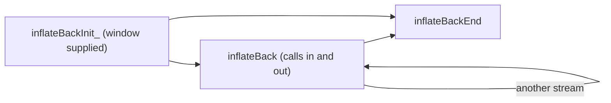

# Decompression with callbacks (infback.c)

Source of truth: `infback.c` of the verified source (pinned zlib checkout with `patches/` applied,
default build) and `zlib.h`. Statements marked "run" were also checked by running the real library
with a small C program (patched `libz.a`, default configuration).

## The idea in short

`inflateBack` decodes a raw deflate stream (no zlib or gzip header or trailer) with **callbacks**
instead of buffers. You give the library a window buffer of `2^windowBits` bytes, a function `in`
that hands it input, and a function `out` that receives output. The window itself is the output
buffer: the decoder writes into it and calls `out` with a pointer into the window each time it is full
(and once at the end). That saves the copy between output and window that `inflate` makes.

The order is: `inflateBackInit_` once, then `inflateBack` (once per stream; it can be called again for
another stream), then `inflateBackEnd` once.



The two callback types, from `zlib.h`:

```c
typedef unsigned (*in_func)(void FAR *, z_const unsigned char FAR * FAR *);
typedef int (*out_func)(void FAR *, unsigned char FAR *, unsigned);
```

`in(in_desc, &buf)` must return the number of input bytes it provides and set `buf` to point to
them, or return 0 for "no more input" (then `buf` is ignored). `out(out_desc, buf, len)` receives
`len` bytes at `buf` (at most the window size) and returns 0 on success or non-zero on failure.

## inflateBackInit_

```c
int ZEXPORT inflateBackInit_(z_streamp strm, int windowBits, unsigned char FAR *window,
                             const char *version, int stream_size);
```

**Purpose.** Prepares a stream for `inflateBack`: allocates the internal state and records your window
buffer. The macro `inflateBackInit(strm, windowBits, window)` in `zlib.h` supplies the last two arguments.

**Parameters.**

| Name | Direction | Must be | Range | NULL? | Memory |
| --- | --- | --- | --- | --- | --- |
| `strm` | in-out | writable `z_stream` | `zalloc`, `zfree`, `opaque` set by the caller (zero allowed) | no (`Z_STREAM_ERROR`) | caller owns the struct; the library owns the state |
| `windowBits` | in | base-2 log of the window size | 8 to 15 only (run: 7, 16 and -15 are refused) | n/a | n/a |
| `window` | in | a buffer of exactly `2^windowBits` writable bytes | must stay valid and untouched by you until `inflateBack` returns | no (`Z_STREAM_ERROR`) | **caller owns it**; the library never frees it |
| release string (fourth parameter) | in | zero-terminated string | first character equals the first character of `ZLIB_VERSION` | no (`Z_VERSION_ERROR`) | caller |
| `stream_size` | in | `sizeof(z_stream)` of the caller | must equal the library's | n/a | n/a |

Except for special applications where deflate was used with a small window, `windowBits` must be 15
and the window 32768 bytes, otherwise general streams fail with "invalid distance too far back"
(run: a 9-bit window on a 15-bit stream gave `Z_DATA_ERROR`).

**Preconditions.** `zalloc`, `zfree`, `opaque` of `*strm` set (zero means defaults). The stream is not
already live.

**What it does, in order.**

1. Release string NULL, or first character differs, or `stream_size` wrong: `Z_VERSION_ERROR`.
2. `strm` NULL, or `window` NULL, or `windowBits` outside 8 to 15: `Z_STREAM_ERROR`.
3. `msg` set to NULL. If `zalloc` is NULL it is set to the library allocator and `opaque` to zero
   (any value you set is lost); if `zfree` is NULL it is set to the library free.
4. One allocation for the state (the same state type as `inflate`'s). **It is not zeroed.** If it fails:
   `Z_MEM_ERROR`, `state` untouched (run: a preset value stays).
5. The state records the largest distance (32768), the window bits and size, your window pointer, window
   position and fill 0, and the "sane distance" flag. `state` of the stream points to it.

Input and output pointers and counters of the stream, and `total_in`, `total_out`, `adler`, `data_type`,
are not touched.

**Return values.**

| Code | Condition |
| --- | --- |
| `Z_OK` | ready |
| `Z_VERSION_ERROR` | release string or `stream_size` wrong |
| `Z_STREAM_ERROR` | `strm` or `window` NULL, or `windowBits` outside 8 to 15 |
| `Z_MEM_ERROR` | the state could not be allocated |

**Errors and stream state after an error.** No state is attached after any error. `zalloc` and
`zfree` may have been filled in (after `Z_MEM_ERROR`; not after the earlier errors). Nothing to end.

**Memory ownership.** One block (the state) from your `zalloc`; freed by `inflateBackEnd`. If you
forget, it leaks. The window is yours.

**The caller must not.** Pass a `window` smaller than `2^windowBits` bytes (U1); reuse the window for
something else between `inflateBackInit_` and `inflateBackEnd`; init a live stream twice (U12).

**Easy to get wrong.** The state is uninitialised memory except for the fields listed above; that is
fine because `inflateBack` sets everything else before using it. Using the stream with `inflate`
instead of `inflateBack` would read uninitialised fields (do not).

**Related.** `inflateBack`, `inflateBackEnd`, `inflateInit2_`.

**In the project.** Translation: `ZlibF/Zlib/infback.c.lean` (namespace `Zlib.Infback`,
`inflateBackInit_`). Spec: not written yet. Proof status: translated; no theorem in
`tests/audit/theorems.txt`; differential tests in `tests/c/infback.c` (evidence of fidelity, not proof).

## inflateBack

```c
int ZEXPORT inflateBack(z_streamp strm, in_func in, void FAR *in_desc,
                        out_func out, void FAR *out_desc);
```

**Purpose.** Decodes one complete raw deflate stream, taking input from the callback `in` (and optionally
from `next_in` first) and giving output to the callback `out`.

**Parameters.**

| Name | Direction | Must be | Range | NULL? | Memory |
| --- | --- | --- | --- | --- | --- |
| `strm` | in-out | stream set up by `inflateBackInit_` | | no (`Z_STREAM_ERROR`) | library owns the state |
| `next_in`, `avail_in` (fields of `strm`) | in-out | optional first input | `next_in` must be initialised; if NULL, `in` is called at once and `avail_in` is ignored (run); if not NULL, `avail_in` bytes are used first | see left | caller |
| `in` | in | function | | **no** (a NULL function pointer is called: undefined behaviour) | n/a |
| `in_desc` | in | any pointer | passed back to `in` | yes | caller |
| `out` | in | function | | **no** | n/a |
| `out_desc` | in | any pointer | passed back to `out` | yes | caller |

**Preconditions.** `inflateBackInit_` succeeded on this stream and `inflateBackEnd` has not been called.
The window is intact. Neither `in` nor `out` may change the window; `out` may read it. The input
bytes that `in` returns must stay unchanged until `in` is called again or `inflateBack` returns. The call
is not re-entrant on the same stream.

**What it does.**

1. If `strm` or its `state` is NULL: `Z_STREAM_ERROR`. (This is the only check; `zalloc` and `zfree`
   are not looked at. A stream set up by `inflateInit_` instead of `inflateBackInit_` is not detected.)
2. Reset: `msg` NULL, first block expected, window fill 0, output position at the start of the window.
   Initial input is `next_in` and `avail_in` (or nothing if `next_in` is NULL).
3. Decode blocks until a block marked "last" is finished, as raw deflate: stored blocks are copied
   (input to window, in pieces); fixed and dynamic blocks are decoded with the tables built per block (the
   fast loop is used when at least 6 input bytes and 258 bytes of window room are available). Whenever input
   runs out `in` is called; whenever the window is full `out` is called with the whole window (length =
   window size) and writing restarts at the beginning of the window. A match may copy from the window as it
   wraps; a distance larger than the data written since the start (or beyond the window size) is an error.
4. On leaving, **for every result** (success, error, callback failure): if any data is in the window that
   was not yet passed to `out`, `out` is called once more with it (length at most the window size). If that
   last `out` fails and the result was `Z_STREAM_END`, the result becomes `Z_BUF_ERROR`; for other results the
   failure is ignored.
5. `next_in` and `avail_in` are set to the unused input (the rest of the last chunk that `in` returned, or
   of the initial input). `total_in`, `total_out`, `adler`, `data_type` are never touched. There is no check
   value: you handle any zlib or gzip header and trailer yourself.

**Return values.**

| Code | Condition |
| --- | --- |
| `Z_STREAM_END` | the last block was decoded and all output was passed to `out`. The only success code; `Z_OK` is never returned |
| `Z_BUF_ERROR` | `in` returned 0 when input was needed (then `next_in` is set to NULL and `avail_in` to 0); or `out` returned non-zero (then `next_in` is not NULL) |
| `Z_DATA_ERROR` | the deflate stream is invalid; `msg` says why (messages as in [inflate-stream.md](inflate-stream.md#inflate), such as "invalid block type", "invalid stored block lengths", "invalid code lengths set", "invalid distance too far back") |
| `Z_STREAM_ERROR` | `strm` or `state` NULL; or an impossible internal mode |

**Errors and stream state after an error.** (Run.) After `Z_BUF_ERROR` from a truncated input: `out` had already received the
39991 bytes decoded so far, `next_in` is NULL. After `Z_DATA_ERROR` on a corrupted first block: no output was
produced. After either, the stream can be used for another `inflateBack` (it restarts from scratch) or ended
with `inflateBackEnd`.

**Memory ownership.** `inflateBack` allocates nothing and frees nothing. The window is yours; the state
belongs to the stream until `inflateBackEnd`.

**The caller must not.** Pass a NULL `in` or `out` (U3); pass a stream not set up by `inflateBackInit_`
(its fields are not those the code reads: U3, U5); change the window or the input buffer while the call is
running (U1); have `out` or `in` call back into the same stream; use the stream from two threads; let `in`
return a count larger than the bytes at `*buf` (U1); let `out` read beyond `len` bytes.

**Easy to get wrong.** (All run.)

- `strm->next_in` must be set before the call even if you want `in` to supply everything: NULL
  means "call `in` first". With NULL, `avail_in` is ignored.
- Output reaches `out` also on failure, including `Z_DATA_ERROR`; a caller must not assume that an error
  means nothing was written. The last chunk may be a partial window.
- With data after the end of the deflate stream in the same chunk, `inflateBack` stops exactly after the
  last block and returns the remaining bytes in `next_in`/`avail_in` (50 trailing bytes came back as 50).
  This is how you find a gzip trailer.
- To tell the two `Z_BUF_ERROR` causes apart, test `next_in` for NULL (`zlib.h`). If `out` fails in the
  final call, `next_in` is set (it is not NULL).
- A window larger than the sender's is fine; a smaller one gives "invalid distance too far back".
- A second `inflateBack` on the same stream decodes a new stream from scratch (run: twice gave the same 40000 bytes).
- With the sizes in the run, 40000 bytes of output came out in 2 calls of `out` (the window size 32768 first).

**Related.** `inflateBackInit_`, `inflateBackEnd`, `inflate` (for streams with headers).

**In the project.** Translation: `Zlib.Infback.inflateBack` (the loop is split in `back_TYPE`,
`back_STORED`, `back_TABLE`, `back_LEN`, `back_dispatch`). Spec: `ZlibF.Spec.Api.InflBack` (with
`BackCallbacks` and `BackResult`). Proof status: translated; no theorem in `tests/audit/theorems.txt`.

## inflateBackEnd

```c
int ZEXPORT inflateBackEnd(z_streamp strm);
```

**Purpose.** Frees the state allocated by `inflateBackInit_`.

**Parameters.** `strm`: in-out, a stream from `inflateBackInit_`; `zfree` must be set.

**Preconditions.** `inflateBackInit_` succeeded.

**What it does.** If `strm` is NULL, its `state` is NULL or its `zfree` is NULL: `Z_STREAM_ERROR`. Otherwise
calls `zfree` on the state, sets `state` to NULL and returns `Z_OK`. The window is not touched.

**Return values.** `Z_OK`; `Z_STREAM_ERROR` (run: a second call, a zeroed stream, and NULL).

**Errors and stream state after an error.** Nothing freed.

**Memory ownership.** Frees the one block from init. Your window buffer is still yours to free.

**The caller must not.** Call it on a stream that `inflateBackInit_` did not set up, or free the window
before the last `inflateBack` returned.

**Easy to get wrong.** It does not run the full stream check that `inflateEnd` runs, so it cannot tell a
stream set up for `inflate` from one set up for `inflateBack`; it would free either state.

**Related.** `inflateBackInit_`, `inflateEnd`.

**In the project.** Translation: `Zlib.Infback.inflateBackEnd`. Spec: not written yet. Proof status: translated; no theorem.

## Findings to confirm

1. **`inflateBackEnd` and `inflateBack` accept an `inflate`-style state.** Neither runs the stream check;
   `inflateBack(strm, ...)` on a stream from `inflateInit_` reads a state whose window pointer is NULL,
   which is a null dereference as soon as data is written. Misuse only; the API has no way to detect it.
   Not run (it would crash).
2. **`inflateBackInit_` leaves most of the state uninitialised.** All later reads are preceded by writes in
   `inflateBack` (checked by reading the code), so no fault is expected; a sanitizer (memory sanitizer) run over
   the differential inputs would confirm it. Not run here.
