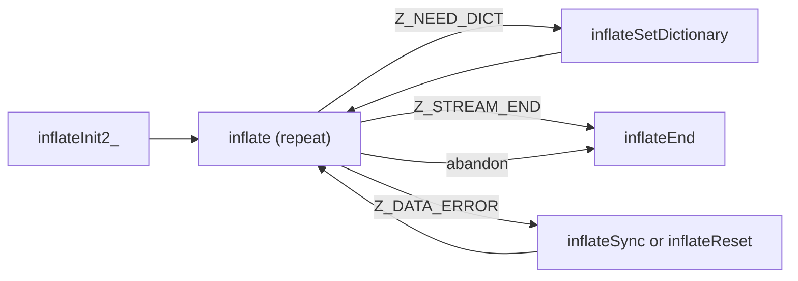

# Decompression through a stream (inflate.c)

Source of truth: `inflate.c` of the verified source (pinned zlib checkout with `patches/` applied,
default build: gzip decoding on, no `PKZIP_BUG_WORKAROUND`, no `INFLATE_STRICT`, no
`INFLATE_ALLOW_INVALID_DISTANCE_TOOFAR_ARRR`) and `zlib.h`. Statements marked "run" were also checked
by running the real library (patched, default configuration, and a sanitizer build) with a small C
program.

## The idea in short

You own a `z_stream`. You set `zalloc`, `zfree` and `opaque` (or leave them zero) and call
`inflateInit_` (usually through the macro `inflateInit` or `inflateInit2`). Then you repeat: point
`next_in` and `avail_in` at compressed input, point `next_out` and `avail_out` at room for the
result, call `inflate`. The library moves the pointers forward and lowers the counters. It stops
with `Z_STREAM_END` when it has decoded the end of the stream and checked the trailer, with
`Z_NEED_DICT` when the stream needs a preset dictionary, and with `Z_DATA_ERROR` when the input is
not a valid stream. It never reads or writes outside the buffers you describe, whatever the input
bytes are. `inflateEnd` frees the state.

The state keeps the last window of output (up to 32 KB) so that later matches can refer back to
it; the window is allocated only when `inflate` returns without having finished everything.



### How every function here checks the stream

Every function except the init functions first runs an internal **stream check**. It fails (the
function returns `Z_STREAM_ERROR`, or the value stated for it, and changes nothing) when `strm` is
NULL, or `zalloc` or `zfree` is NULL, or `state` is NULL, or the state does not point back to this
stream, or the state's mode is outside the range from "waiting for the header" to "searching for a
sync point". A stream that was never initialised and holds garbage cannot be detected: passing one is
undefined behaviour (U3, U4, U5 in [../../safety.md](../../safety.md)).

### How the wrapper request is stored

Inside, the request is a small number, `wrap`: bit 0 (value 1) means a zlib header is accepted, bit 1
(value 2) means a gzip header is accepted, bit 2 (value 4) means the check value is verified. From
`windowBits` it is computed as `(windowBits shifted right by 4) plus 5` for the non-negative
values, and 0 for raw. So 8 to 15 gives 5 (zlib, verified); 16 to 31 gives 6 (gzip only, verified);
32 to 47 gives 7 (either, verified); raw gives 0.

### Facts used on this page

| Fact | Value |
| --- | --- |
| Return codes | `Z_OK` 0, `Z_STREAM_END` 1, `Z_NEED_DICT` 2, `Z_STREAM_ERROR` -2, `Z_DATA_ERROR` -3, `Z_MEM_ERROR` -4, `Z_BUF_ERROR` -5, `Z_VERSION_ERROR` -6 |
| Flush values | `Z_NO_FLUSH` 0, `Z_PARTIAL_FLUSH` 1, `Z_SYNC_FLUSH` 2, `Z_FULL_FLUSH` 3, `Z_FINISH` 4, `Z_BLOCK` 5, `Z_TREES` 6 |
| Window | `2^windowBits` bytes, at most 32768; allocated on demand |

## inflateResetKeep

```c
int ZEXPORT inflateResetKeep(z_streamp strm);
```

**Purpose.** A low-level reset that restarts decoding at the beginning of a new stream but **keeps
the window contents**. Declared in `zlib.h` under "undocumented functions (not part of the zlib
API)". Applications use `inflateReset`.

**Parameters.** `strm`: in-out, initialised stream, not NULL; the library owns the state.

**Preconditions.** The stream check passes.

**What it does.** `total_in`, `total_out` and the internal total become 0; `msg` NULL; `data_type`
0. If a wrapper is requested (wrap not 0), `adler` becomes bit 0 of the wrapper value, that is 1 for a
zlib or automatic request and 0 for a gzip-only request; for raw it is not touched. The mode becomes "waiting
for the header". The last-block flag, the dictionary flag and the gzip header flags are cleared; the
largest distance is set back to 32768; **the gzip header request from `inflateGetHeader` is
cleared**; the bit buffer is emptied; the code table pointers go back to the start of the table area;
the "sane distance" flag is set; the mark position is cleared. The window buffer, its fill count and
the wrapper request are **not** changed.

**Return values.** `Z_OK`; `Z_STREAM_ERROR` if the stream check fails.

**Errors and stream state after an error.** Nothing changed.

**Memory ownership.** No allocation or free.

**The caller must not.** Rely on it to forget old data: matches in the next stream may refer to the
old window.

**Easy to get wrong.** After a failed or completed stream this does not clear the dictionary history;
`inflateReset` does. It also does not undo `inflateSync`'s change of the wrapper request
(see `inflateSync`).

**Related.** `inflateReset`, `inflateReset2`, `deflateResetKeep`.

**In the project.** Translation: `ZlibF/Zlib/inflate.c.lean` (namespace `Zlib.Inflate`,
`inflateResetKeep`). Spec: not written yet (mentioned in the comment of `InflState.fresh`). Proof
status: translated; no theorem in `tests/audit/theorems.txt`.

## inflateReset

```c
int ZEXPORT inflateReset(z_streamp strm);
```

**Purpose.** Starts a new stream on the same state, with the window size and wrapper kind that
`inflateInit2_` or `inflateReset2` last requested. It is like `inflateEnd` followed by
`inflateInit2_`, without freeing and allocating the state.

**Parameters.** `strm`: in-out, initialised stream, not NULL.

**Preconditions.** The stream check passes. May be called in any mode, including after an error or
after `Z_STREAM_END`. This is the way to continue after a gzip member (see `inflate`).

**What it does.** If the current window size differs from the requested one, the window buffer is freed
(`zfree`) and the size set to the requested one. The wrapper value is set back to the requested one kept by
init, `inflateReset2` and `inflateValidate` (this undoes `inflateSync`'s change to the wrapper value). The window fill is set to
0 (the history is dropped, though the buffer stays allocated if the size is the same). Then it does
`inflateResetKeep`. After it: counters 0, `msg` NULL, `data_type` 0, `adler` 1 (or 0 for gzip-only),
the gzip header request cleared.

**Return values.** `Z_OK`; `Z_STREAM_ERROR` (stream check; run: after `inflateEnd`).

**Errors and stream state after an error.** Nothing changed.

**Memory ownership.** May free the window; never allocates.

**The caller must not.** Expect it to keep a pending `inflateGetHeader` request; call it again
afterwards.

**Easy to get wrong.** (Run.) After `inflateValidate(strm, 0)`, a following `inflateReset` keeps
validation off (the requested wrapper bits are what `inflateValidate` changed), while
`inflateReset2` sets the request afresh and validation is on again.

**Related.** `inflateReset2`, `inflateResetKeep`, `inflateInit2_`.

**In the project.** Translation: `Zlib.Inflate.inflateReset`. Spec: `ZlibF.Spec.Api.InflReset`. Proof
status: translated; no theorem.

## inflateReset2

```c
int ZEXPORT inflateReset2(z_streamp strm, int windowBits);
```

**Purpose.** Like `inflateReset`, and also changes the window size and wrapper kind. It is how
`inflateInit2_` sets them.

**Parameters.**

| Name | Direction | Must be | Range | NULL? | Memory |
| --- | --- | --- | --- | --- | --- |
| `strm` | in-out | initialised stream | | no | library |
| `windowBits` | in | as for `inflateInit2_` | exactly these (run): -15 to -8, 0, 8 to 15, 16, 24 to 31, 32, 40 to 47; the meaning is in the `inflateInit2_` section | n/a | n/a |

**Preconditions.** Stream check passes.

**What it does.** Converts `windowBits` to the wrapper request and window bits (see "How the wrapper
request is stored"). Values 48 and above, and values below -15, are refused. After this step the
window bits must be 0 or 8 to 15. If a window exists and its size differs from the new one, it is freed.
The new request is stored, then `inflateReset` runs.

**Return values.** `Z_OK`; `Z_STREAM_ERROR` (stream check, or invalid `windowBits`; run: 48 and 7 refused, 31, 15 and -15 accepted).

**Errors and stream state after an error.** Nothing changed (the checks come before any change).

**Memory ownership.** May free the window.

**The caller must not.** Use it to switch a stream part-way: all input history is dropped.

**Easy to get wrong.** The accepted values are not simply "8 to 15 plus 16 or 32". Plus 16 or 32 are
accepted only with 0 or 8 to 15 (so 16, 24 to 31, 32, 40 to 47), and 17 to 23 and 33 to 39 are refused.

**Related.** `inflateReset`, `inflateInit2_`.

**In the project.** Translation: `Zlib.Inflate.inflateReset2`. Spec: `ZlibF.Spec.Api.InflReset2`. Proof status: translated; no theorem.

## inflateInit2_

```c
int ZEXPORT inflateInit2_(z_streamp strm, int windowBits, const char *version, int stream_size);
```

**Purpose.** Initialises a stream for decompression with a chosen window size and wrapper
(zlib, gzip, either, raw). The macro `inflateInit2` in `zlib.h` supplies the last two arguments.

**Parameters.**

| Name | Direction | Must be | Range | NULL? | Memory |
| --- | --- | --- | --- | --- | --- |
| `strm` | in-out | writable `z_stream` | `zalloc`, `zfree`, `opaque` set by the caller; `next_in` and `avail_in` should be set before the first `inflate` | no (`Z_STREAM_ERROR`) | caller owns the struct |
| `windowBits` | in | window size and wrapper | see below | n/a | n/a |
| release string (third parameter) | in | zero-terminated string | first character equals the first character of `ZLIB_VERSION` | no (`Z_VERSION_ERROR`) | caller |
| `stream_size` | in | `sizeof(z_stream)` of the caller | must equal the library's | n/a | n/a |

`windowBits` (all run, sweep from -70 to 70): -15 to -8 raw deflate with that window; 0 zlib wrapper,
window size taken from the stream header; 8 to 15 zlib wrapper, that window is the maximum; 16 gzip
wrapper only, window from the stream ("16 plus 0"); 24 to 31 gzip only with maximum window 8 to 15;
32 zlib or gzip detected from the first bytes, window from the stream; 40 to 47 the same with maximum
window 8 to 15. Everything else is refused: -16 and below, -7 to -1, 1 to 7, 17 to 23, 33 to 39, 48 and
above.

**Preconditions.** `zalloc`, `zfree`, `opaque` set (zero allowed); the stream is not already live.

**What it does.**

1. Release string NULL or first character differs, or `stream_size` not equal: `Z_VERSION_ERROR`
   (before anything else; `strm` is not touched, not even when NULL).
2. `strm` NULL: `Z_STREAM_ERROR`.
3. `msg` set to NULL. If `zalloc` is NULL it is set to the library allocator **and `opaque` is set to
   zero**; if `zfree` is NULL it is set to the library's free (`opaque` untouched).
4. One allocation of the state (size of the inflate state), zeroed. If it fails: `Z_MEM_ERROR`, and
   `state` is **not** modified (run: a preset value stays).
5. The state points back to the stream; `inflateReset2(strm, windowBits)` is called. If it fails
   (invalid `windowBits`), the state is freed, `state` set to NULL, and its error (`Z_STREAM_ERROR`)
   returned. Note that the zeroed state was allocated before the value was checked.
6. On success: `total_in`, `total_out` 0, `msg` NULL, `data_type` 0, `adler` 1 (0 for gzip only; not
   touched for raw). `next_in`, `avail_in`, `next_out`, `avail_out` are not read or changed. No window is
   allocated (run: one allocation at init).

**Return values.**

| Code | Condition |
| --- | --- |
| `Z_OK` | ready |
| `Z_VERSION_ERROR` | release string or `stream_size` wrong |
| `Z_STREAM_ERROR` | `strm` NULL, or invalid `windowBits` |
| `Z_MEM_ERROR` | the state could not be allocated |

**Errors and stream state after an error.** After `Z_VERSION_ERROR`: unchanged. After `Z_STREAM_ERROR`
for `windowBits`: no state (NULL), `zalloc` and `zfree` possibly filled in. After `Z_MEM_ERROR`: no
state was set. There is nothing to end: do not call `inflateEnd`.

**Memory ownership.** One block for the state now; one block for the window later (allocated by
`inflate` or `inflateSetDictionary`, freed by `inflateEnd`, or by a reset that changes the size).
Forgetting `inflateEnd` leaks them. Allocation sizes: the state is allocated with one item of its
own size, the window with `2^windowBits` items of 1 byte.

**The caller must not.** Initialise a stream that is still live (leak, U12); pass garbage in
`zalloc` or `zfree` (U5).

**Easy to get wrong.** (Run unless noted.)

- 16 and 24 to 31 mean gzip only; a zlib stream then gives `Z_DATA_ERROR` "incorrect header
  check", and a gzip stream given to a plain `inflateInit` (15) also does.
- `zlib.h` documents 8 to 15, 0, the negative values, and "add 16" or "add 32"; the code accepts the
  offsets only on 0 and 8 to 15, so 17 to 23 and 33 to 39 are refused.
- `windowBits` smaller than the stream's window gives `Z_DATA_ERROR` "invalid window size" at the
  header (run: 10 on a 15-bit stream).
- Unlike `deflateInit2_`, the value -8 is accepted for raw, and 0, 16 and 32 are accepted.
- `zlib.h` says "next_in and avail_in may be modified" by init; in this code they are not.

**Related.** `inflateInit_`, `inflateReset2`, `inflateEnd`, `deflateInit2_`.

**In the project.** Translation: `Zlib.Inflate.inflateInit2_`. Spec: `ZlibF.Spec.Api.InflInit`. Proof
status: translated; no theorem.

## inflateInit_

```c
int ZEXPORT inflateInit_(z_streamp strm, const char *version, int stream_size);
```

**Purpose.** Initialises for decompression of a zlib stream with a 32 KB maximum window. The macro
`inflateInit(strm)` supplies the other arguments.

**Parameters.** As `inflateInit2_` with `windowBits` fixed to 15.

**Preconditions.** As `inflateInit2_`.

**What it does.** Calls `inflateInit2_(strm, 15, release string, stream_size)`. A zlib stream with
any window up to 15 is accepted; a gzip stream is not (run: `Z_DATA_ERROR` "incorrect header check").

**Return values.** As `inflateInit2_` (`Z_STREAM_ERROR` only for a NULL `strm`).

**Errors and stream state after an error.** As `inflateInit2_`.

**Memory ownership.** As `inflateInit2_`.

**The caller must not.** As `inflateInit2_`.

**Easy to get wrong.** Use `inflateInit2` with 47 (or 32 plus 15) to accept both zlib and gzip.

**Related.** `inflateInit2_`, `inflateEnd`.

**In the project.** Translation: `Zlib.Inflate.inflateInit_`. Spec: `ZlibF.Spec.Api.InflInit`. Proof status: translated; no theorem.

## inflatePrime

```c
int ZEXPORT inflatePrime(z_streamp strm, int bits, int value);
```

**Purpose.** Puts bits into the decoder's bit buffer, to start decoding in the middle of a byte, or
clears the buffer.

**Parameters.**

| Name | Direction | Must be | Range | NULL? | Memory |
| --- | --- | --- | --- | --- | --- |
| `strm` | in-out | initialised stream | | no | library |
| `bits` | in | number of bits | 0; 1 to 16; negative clears the buffer | n/a | n/a |
| `value` | in | the bits | only the low `bits` bits are used | n/a | n/a |

**Preconditions.** Stream check passes. Meant for raw streams before the first `inflate`, or after
`inflate` returned at a block or header boundary with `Z_BLOCK`.

**What it does.** `bits` 0: nothing. Negative: the bit buffer is emptied (hold and count become 0).
Otherwise, if `bits` is above 16 or the buffer would hold more than 32 bits, `Z_STREAM_ERROR`. Else the
low `bits` bits of `value` are added above the bits already there, and the count grows. The bits are
used before any byte from `next_in`. `data_type` is **not** updated.

**Return values.** `Z_OK`; `Z_STREAM_ERROR` (stream check, `bits` above 16, buffer overflow).

**Errors and stream state after an error.** Nothing changed.

**Memory ownership.** None.

**The caller must not.** Nothing UB; the range is checked.

**Easy to get wrong.** (Run.) With a raw stream shifted so that the first 5 bits of its first byte go
into `inflatePrime(5, …)` and the rest into `next_in`, the stream decodes correctly. `bits` 16 twice fills
the 32-bit buffer; one more bit is `Z_STREAM_ERROR`. `zlib.h` says `inflatePrime` is for raw inflate
before the first call; the code does not check that, nor the mode.

**Related.** `deflatePrime`, `inflate` (`Z_BLOCK`).

**In the project.** Translation: `Zlib.Inflate.inflatePrime`. Spec: `ZlibF.Spec.Api.InflPrime`. Proof status: translated; no theorem.

## inflate

```c
int ZEXPORT inflate(z_streamp strm, int flush);
```

**Purpose.** Decompresses as much as possible: it reads from `next_in` and writes to `next_out`
until the input is used up, the output is full, the stream ends, or an error is found. It detects and
checks the wrapper (zlib or gzip) as requested at init, verifies the check value at the end, and can
stop at block boundaries on request.

**Parameters.**

| Name | Direction | Must be | Range | NULL? | Memory |
| --- | --- | --- | --- | --- | --- |
| `strm` | in-out | initialised stream | | no | library owns the state |
| `next_in`, `avail_in` | in-out | input and count | `next_in` may be NULL only with `avail_in` 0 | see left | caller; read only; not freed |
| `next_out`, `avail_out` | in-out | output buffer and room | `next_out` must not be NULL (even when `avail_out` is 0); `avail_out` may be 0 | no | caller; written |
| `flush` | in | when to return early | 0 to 6; **any int is accepted** (run: 7 and -1) and behaves like `Z_NO_FLUSH` unless it is `Z_FINISH` (4), `Z_BLOCK` (5) or `Z_TREES` (6) | n/a | n/a |

The input and output buffers must not overlap (U9).

**Preconditions.** The stream was initialised. After `Z_STREAM_END` or `Z_DATA_ERROR` only
`inflateReset`, `inflateReset2`, `inflateEnd` (and for an error `inflateSync`) make sense. After
`Z_NEED_DICT`, call `inflateSetDictionary` before the next `inflate`.

**What it does.**

1. Stream check fails, or `next_out` is NULL, or `next_in` is NULL with `avail_in` not 0:
   `Z_STREAM_ERROR` (no `msg`). If a sync search is in progress (after `inflateSync` returned
   `Z_DATA_ERROR`), it also returns `Z_STREAM_ERROR` (run).
2. Decodes in modes: header (zlib: two bytes with check bits, method 8, window size; optional four
   dictionary-id bytes, which make it stop with `Z_NEED_DICT` until the dictionary is set; gzip: ten
   bytes, then optional extra, name, comment and header CRC, which are stored if `inflateGetHeader`
   asked), blocks (stored, fixed, dynamic), then the trailer (zlib: Adler-32, big-endian; gzip:
   CRC-32 and the length modulo 2 to the 32, little-endian). With a raw request there is no header or trailer.
3. Input advances `next_in` and lowers `avail_in`; output advances `next_out` and lowers
   `avail_out`. The library may hold some bits of the last input bytes inside; that is counted as consumed.
   On returning it adds the consumed input to `total_in` and the produced output to `total_out`.
4. The check value: for the zlib or gzip wrapper with checking on, `adler` is updated with the output of
   each call (Adler-32, or CRC-32 for gzip); at the end the trailer is compared. On mismatch:
   `Z_DATA_ERROR` "incorrect data check" (and "incorrect length check" for gzip).
5. On every return that is not an early `Z_STREAM_ERROR` or a memory error, the last output (up to the
   window size) is saved to the window, allocating it if needed. The window is not needed (and not allocated) when
   `Z_FINISH` is given and the stream completes in this call (run: one allocation in the whole run; with a partial
   output two). If the window allocation fails the state becomes "memory error", and
   `Z_MEM_ERROR` is returned; it is sticky until a reset.
6. `data_type` is set at every return to: the number of unused bits in the bit buffer, plus 64 if the
   last block is being decoded, plus 128 if `inflate` stopped right after an end-of-block code or the header, plus 256 if it
   stopped at the end of a block header with `Z_TREES`.
7. Return code: see below. If the call made no progress (no input consumed and no output
   produced), or `flush` is `Z_FINISH`, and the result would be `Z_OK`, it is `Z_BUF_ERROR`.

`flush` has no other effect on how much is decoded: `inflate` always writes as much as it can.
`Z_BLOCK` makes it return right after the header and after each end-of-block code (for raw
streams it first processes the first block); `Z_TREES` also returns after each block header (run:
`data_type` 128, 325, 196, 64 over four calls on a small stream).

**Return values.**

| Code | Condition |
| --- | --- |
| `Z_OK` | progress was made (input consumed or output produced); also an early stop for `Z_BLOCK` or `Z_TREES` |
| `Z_STREAM_END` | the end of the stream was decoded, the trailer checked, all output written. Further calls with the same stream keep returning `Z_STREAM_END` and consume nothing (run) |
| `Z_NEED_DICT` | the zlib header names a preset dictionary that is not set. `adler` holds its Adler-32; `total_in` counts the header (6 bytes in the run) |
| `Z_DATA_ERROR` | the input is not valid; `msg` says why. The mode is then "bad": every further call returns `Z_DATA_ERROR` and consumes nothing (run) |
| `Z_STREAM_ERROR` | see step 1; or an impossible internal mode |
| `Z_MEM_ERROR` | the window could not be allocated; sticky |
| `Z_BUF_ERROR` | no progress possible (run: no input and room gave -5; a repeat call after a truncated trailer gave -5), or `flush` is `Z_FINISH` and the stream did not finish |

**Error messages (`msg` for `Z_DATA_ERROR`).** "incorrect header check", "unknown compression
method", "invalid window size", "unknown header flags set", "header crc mismatch", "invalid block type",
"invalid stored block lengths", "too many length or distance symbols", "invalid code lengths set",
"invalid bit length repeat", "invalid code -- missing end-of-block", "invalid literal/lengths set",
"invalid distances set", "invalid literal/length code", "invalid distance code", "invalid distance too far
back", "incorrect data check", "incorrect length check". The pointer is a static string; do not free it.

**Errors and stream state after an error.** After `Z_DATA_ERROR`, the counters and `adler` reflect
what was decoded before the error (run: a bad trailer still counted all 40000 output bytes). The
stream is in the sticky "bad" mode and must be reset, ended, or sent to `inflateSync`. After
`Z_BUF_ERROR` or `Z_OK` nothing is wrong. `Z_MEM_ERROR` is permanent until a reset.

**Memory ownership.** The state came from init. `inflate` allocates the window when it first needs
one (size `2^wbits` bytes) with your `zalloc`; it is freed by `inflateEnd`, or by a reset that changes
the size. An allocation failure gives `Z_MEM_ERROR`, no leak.

**The caller must not.** Pass buffers smaller than the counts (U1); overlap the buffers (U9); change
the state; use the stream concurrently; call with a `next_out` that moves outside the buffer between calls.

**Easy to get wrong.** (Run unless noted.)

- `inflate` stops at the end of a gzip member and does not read the next member: you get
  `Z_STREAM_END`, the rest of the input stays in `next_in`/`avail_in`. To decode more members call
  `inflateReset` and continue.
- `inflate` returns `Z_BUF_ERROR` also when only the progress rule is violated; a loop must treat it as
  "give more input or output", not as failure.
- With input exhausted in the middle of the trailer the first call returns `Z_OK` (it consumed bytes),
  the next one `Z_BUF_ERROR`.
- `Z_FINISH` returns `Z_BUF_ERROR` if the stream is not finished, even when progress was made.
- `adler` after `Z_NEED_DICT` is the dictionary id, not the output checksum.
- `msg` is only set on errors found while decoding (data errors); `Z_STREAM_ERROR` from the checks
  does not set it.
- With `inflateValidate(strm, 0)` the check is skipped: a corrupted trailer is accepted and
  `adler` stays 1 (run).
- `zlib.h` lists five flush values for inflate; the code does not validate the value.

**Related.** `inflateInit2_`, `inflateSetDictionary`, `inflateSync`, `inflateReset`, `inflateGetHeader`, `inflateMark`, `deflate`, `uncompress`.

**In the project.** Translation: `Zlib.Inflate.inflate` (with the fast loop in `inffast.c.lean` and
the tables in `inftrees.c.lean`). Spec: `ZlibF.Spec.Api.InflStep` and `InflRun`. Proof status:
translated; no theorem for `inflate`; `Pilot.updatewindow_ok` and `Pilot.uw_*` (window update) are
listed in `tests/audit/theorems.txt`.

## inflateEnd

```c
int ZEXPORT inflateEnd(z_streamp strm);
```

**Purpose.** Frees the decompression state and the window.

**Parameters.** `strm`: in-out, initialised stream, not NULL.

**Preconditions.** Stream check passes. Any mode.

**What it does.** Frees the window if there is one, frees the state, sets `state` to NULL. Unprocessed
input is dropped. Nothing else in the stream changes.

**Return values.** `Z_OK`; `Z_STREAM_ERROR` (stream check; run: a second call).

**Errors and stream state after an error.** Nothing freed.

**Memory ownership.** Frees what init and `inflate` allocated. Without it, the state and window leak.

**The caller must not.** Use the stream again, except to init it. Call it twice and expect `Z_OK`.

**Easy to get wrong.** Unlike `deflateEnd`, it never returns `Z_DATA_ERROR`: ending a stream part-way
is silently fine.

**Related.** `inflateInit2_`, `inflateReset`.

**In the project.** Translation: `Zlib.Inflate.inflateEnd`. Spec: `ZlibF.Spec.Api.InflEnd`. Proof status: translated; no theorem.

## inflateGetDictionary

```c
int ZEXPORT inflateGetDictionary(z_streamp strm, Bytef *dictionary, uInt *dictLength);
```

**Purpose.** Copies out the sliding window (the most recent output, up to the window size).

**Parameters.** `strm`: in, initialised, not NULL. `dictionary`: out, room for the result (32768
bytes is always enough), may be NULL (then only the length is returned). `dictLength`: out, `uInt`
pointer, may be NULL (then not set).

**Preconditions.** Stream check passes.

**What it does.** If the window holds data and `dictionary` is not NULL, copies it in order, oldest
byte first. Stores the number of bytes in `dictLength` if not NULL. The window is updated only when
`inflate` returns or a dictionary is set, so output of the call in progress is included only after it returns.

**Return values.** `Z_OK`; `Z_STREAM_ERROR` (stream check).

**Errors and stream state after an error.** Nothing written.

**Memory ownership.** None.

**The caller must not.** Pass a buffer smaller than the length it will receive (U1).

**Easy to get wrong.** (Run.) A fresh stream: length 0. After `inflateSetDictionary` with 300 bytes:
300, equal to the dictionary. After amending with 200 more: 500, the concatenation. If the stream
finished in one `Z_FINISH` call there is no window and the length is 0.

**Related.** `inflateSetDictionary`, `deflateGetDictionary`.

**In the project.** Translation: `Zlib.Inflate.inflateGetDictionary`. Spec: `ZlibF.Spec.Api.InflGetDict`. Proof status: translated; no theorem.

## inflateSetDictionary

```c
int ZEXPORT inflateSetDictionary(z_streamp strm, const Bytef *dictionary, uInt dictLength);
```

**Purpose.** Gives the decompressor the preset dictionary that the compressor used.

**Parameters.**

| Name | Direction | Must be | Range | NULL? | Memory |
| --- | --- | --- | --- | --- | --- |
| `strm` | in-out | initialised stream | | no | library |
| `dictionary` | in | `dictLength` readable bytes | | no (`Z_STREAM_ERROR`), even for length 0 | caller; copied into the window |
| `dictLength` | in | number of bytes | any; only the last window-size bytes are kept | n/a | n/a |

**Preconditions.** Stream check passes. For a zlib stream: `inflate` has just returned `Z_NEED_DICT`
(the mode is "waiting for dictionary"). For a raw stream: any time. For a gzip stream: never (always an error).

**What it does.** For a stream with a wrapper (mode is "waiting for dictionary"): computes the Adler-32 of the
dictionary and compares it with the id from the header; on mismatch returns `Z_DATA_ERROR` and changes nothing.
Then copies the dictionary into the window (allocating it if needed; if the window already has data and
the new dictionary is shorter than the window, it is appended and older data stays), and marks the dictionary as set. The next
`inflate` call continues.

**Return values.**

| Code | Condition |
| --- | --- |
| `Z_OK` | dictionary set |
| `Z_STREAM_ERROR` | stream check; `dictionary` NULL; a wrapper is requested and the mode is not "waiting for dictionary" (run: before the first `inflate`, and after the end) |
| `Z_DATA_ERROR` | wrong dictionary (Adler-32 does not match); the stream still waits |
| `Z_MEM_ERROR` | the window could not be allocated; the mode becomes "memory error" |

**Errors and stream state after an error.** `Z_DATA_ERROR`: the next `inflate` still returns
`Z_NEED_DICT` (run); you may try another dictionary. `Z_MEM_ERROR`: sticky.

**Memory ownership.** May allocate the window; freed by `inflateEnd`. The dictionary buffer is not kept.

**The caller must not.** Pass a shorter buffer than `dictLength` (U1).

**Easy to get wrong.** (Run.) The id check uses the whole dictionary, so a dictionary one byte short is
`Z_DATA_ERROR`. For raw streams no id exists, so a wrong dictionary decodes garbage or fails later. A dictionary
of length 0 is accepted for raw. A zlib stream with a preset dictionary gives no way to know the
dictionary except by its Adler-32.

**Related.** `deflateSetDictionary`, `inflateGetDictionary`, `inflate`.

**In the project.** Translation: `Zlib.Inflate.inflateSetDictionary`. Spec: `ZlibF.Spec.Api.InflSetDict`. Proof status: translated; no theorem.

## inflateGetHeader

```c
int ZEXPORT inflateGetHeader(z_streamp strm, gz_headerp head);
```

**Purpose.** Asks `inflate` to store the gzip header fields it reads into your `gz_header`.

**Parameters.**

| Name | Direction | Must be | Range | NULL? | Memory |
| --- | --- | --- | --- | --- | --- |
| `strm` | in-out | initialised stream that accepts gzip | `windowBits` 16 to 31 or 32 to 47 | no | library |
| `head` | out | pointer to a `gz_header` | its `extra`, `name`, `comment` are NULL or point to `extra_max`, `name_max`, `comm_max` writable bytes | **no: NULL is dereferenced** (U3) | **caller owns it; it is not copied**; it must stay valid until the header is done |

**Preconditions.** Stream check passes; the request includes gzip (a zlib-only or raw stream gives
`Z_STREAM_ERROR`, run); called after init or reset and before the first `inflate`.

**What it does.** Stores the pointer and sets `done` to 0. As `inflate` reads the gzip header it fills
`text`, `time`, `xflags`, `os`, `hcrc`, `extra_len` and the buffers. `extra`: up to `extra_max` bytes;
`name` and `comment`: up to `name_max` and `comm_max` bytes, including the terminating zero; longer ones are truncated without a
terminator. Fields absent from the header get a NULL pointer (run). When complete, `done` is 1; for a
zlib stream (automatic detection) `done` is -1. `inflateReset` clears the request.

**Return values.** `Z_OK`; `Z_STREAM_ERROR` (stream check, or gzip not accepted).

**Errors and stream state after an error.** Nothing changed.

**Memory ownership.** None; the buffers stay the caller's.

**The caller must not.** Pass NULL for `head` on a gzip-capable stream (null dereference, U3; the
check for the gzip request comes first, so NULL on a raw stream is just `Z_STREAM_ERROR`); free or
move the structure or buffers before `done` is set; give `extra`, `name` or `comment` pointers with less room than `extra_max`, `name_max`, `comm_max` say (U1).

**Easy to get wrong.** (Run, 20 byte file name into 8 bytes of room.) `name` receives 8 characters and no zero, so
the application sees the truncation by the missing zero. `extra_len` is the real length (25) even when `extra_max`
(20) is smaller. With `Z_BLOCK` the call returns right after the header and `data_type` is 128, with `done` 1. The
header CRC being valid is known only when `done` is 1.

**Related.** `deflateSetHeader`, `inflate`.

**In the project.** Translation: `Zlib.Inflate.inflateGetHeader`. Spec: `ZlibF.Spec.Api.InflGetHeader`. Proof status: translated; no theorem.

## inflateSync

```c
int ZEXPORT inflateSync(z_streamp strm);
```

**Purpose.** After a data error (or to resume at a known point), skips input until the pattern
`00 00 ff ff` that ends an empty stored block (a sync or full flush point), then restarts decoding there.

**Parameters.** `strm`: in-out, initialised, not NULL; `next_in` and `avail_in` describe the input to search.

**Preconditions.** Stream check passes. Input is available in `next_in` or in the bit buffer.

**What it does.**

1. No input and fewer than 8 bits in the bit buffer: `Z_BUF_ERROR` (nothing changed).
2. On the first call of a search, the whole bytes in the bit buffer are searched first, and the mode
   becomes "searching".
3. The input is searched; `next_in`, `avail_in` and `total_in` advance past the bytes examined. A
   partial match is remembered across calls, so you can feed more input in several calls.
4. If the pattern is not complete: `Z_DATA_ERROR`; the mode stays "searching". In this mode **`inflate` returns `Z_STREAM_ERROR`** (run).
5. If complete: the stream is reset (`inflateReset`) but `total_in` and `total_out` keep their values.
   If no header had been read (the flags marker is still unset), the wrapper request becomes raw; otherwise the
   check bit is cleared (no check value afterwards). If the window size was never read from a header it is set to
   15. The mode becomes "waiting for block type". Return `Z_OK`.

**Return values.**

| Code | Condition |
| --- | --- |
| `Z_OK` | pattern found; decoding can continue with the data after it, as raw deflate blocks |
| `Z_DATA_ERROR` | not found yet; call again with more input |
| `Z_BUF_ERROR` | no input at all |
| `Z_STREAM_ERROR` | stream check fails |

**Errors and stream state after an error.** After `Z_DATA_ERROR` the stream is only good for more
`inflateSync` calls, `inflateReset` or `inflateEnd` (run: `inflate` gives -2, `inflateSyncPoint` 0).

**Memory ownership.** May free the window when the window size has to be set to 15; no allocation.

**The caller must not.** Call `inflate` while a search is unfinished.

**Easy to get wrong.** (Run.) After success the rest of the stream is decoded with **no check
value**; the final trailer is not verified and must be read by the application. The pattern can
occur by chance in compressed data, so a found position may not be a real flush point. After a sync flush (as opposed to a full flush) later matches can refer to data before the
point, which is lost, and decoding then fails with "invalid distance too far back". In the run (bytes 10
to 29 corrupted in a stream with a full flush every 4000 bytes) the call succeeded and 36000 of 40000 bytes were recovered.
`total_in` after success points just after the pattern.

**Related.** `inflateSyncPoint`, `deflate` (`Z_FULL_FLUSH`), `inflateReset`.

**In the project.** Translation: `Zlib.Inflate.inflateSync` (with `syncsearch`). Spec: `ZlibF.Spec.Api.InflSync`. Proof status: translated; no theorem.

## inflateSyncPoint

```c
int ZEXPORT inflateSyncPoint(z_streamp strm);
```

**Purpose.** Tells whether `inflate` is stopped at the start of the length bytes of an empty stored block,
that is, right after a sync or full flush marker's block header. One PPP implementation uses it.

**Parameters.** `strm`: in, initialised, not NULL.

**Preconditions.** Stream check passes.

**What it does.** Returns 1 if the mode is "stored block, waiting for lengths" and the bit buffer is
empty; otherwise 0. Changes nothing.

**Return values.** 1; 0; `Z_STREAM_ERROR` (stream check; run on an uninitialised zeroed stream).

**Errors and stream state after an error.** None.

**Memory ownership.** None.

**The caller must not.** Nothing special.

**Easy to get wrong.** (Run.) A stream that was given everything up to, but not including, the final
`00 00 ff ff` of a sync flush gives 1; once those four bytes are consumed it gives 0. It is 0 after a data
error and on a fresh stream. The result for an error is -2, which is also a "true" value in C; test `== 1`.

**Related.** `inflateSync`, `deflate` (`Z_SYNC_FLUSH`).

**In the project.** Translation: `Zlib.Inflate.inflateSyncPoint`. Spec: `ZlibF.Spec.Api.InflSyncPoint`. Proof status: translated; no theorem.

## inflateCopy

```c
int ZEXPORT inflateCopy(z_streamp dest, z_streamp source);
```

**Purpose.** Makes `dest` an independent copy of `source`, for example to remember a decoding position for random access.

**Parameters.**

| Name | Direction | Must be | Range | NULL? | Memory |
| --- | --- | --- | --- | --- | --- |
| `dest` | out | writable `z_stream` | contents ignored | no (`Z_STREAM_ERROR`) | gets its own state |
| `source` | in | initialised stream | | no (`Z_STREAM_ERROR`) | unchanged |

**Preconditions.** Stream check passes for `source`; `dest` is a different object and not live.

**What it does.** Allocates a state (zeroed) and, if `source` has a window, a window of the same size,
through **source's** allocator. Copies the stream struct (so `dest` gets the same pointers, counters,
`msg`, `adler`, allocator), copies the state, repoints the code tables into the new state, copies the
filled part of the window, and attaches the copy to `dest`.

**Return values.** `Z_OK`; `Z_STREAM_ERROR` (`dest` or `source` NULL, or the stream check fails on
`source`); `Z_MEM_ERROR`.

**Errors and stream state after an error.** If `dest` is not NULL, its `state` is set to NULL and
nothing else is changed; this also holds when `source` is invalid. Allocated parts are freed. `source`
is unchanged. (Run, for the failing first and second allocation, with and without a window.)

**Memory ownership.** After success both streams must be ended.

**The caller must not.** Pass the same stream twice; by reading the code the old state is lost (a
leak checker run did not report it, a stale pointer on the stack can hide it; the same call is a
confirmed leak for `deflateCopy`).

**Easy to get wrong.** The window is copied only as far as it is filled. The two streams share the
input and output pointers, so set them before the next `inflate`. Both can finish (run: both reached
40000 bytes).

**Related.** `deflateCopy`, `inflateEnd`.

**In the project.** Translation: `Zlib.Inflate.inflateCopy`. Spec: `ZlibF.Spec.Api.InflCopy`. Proof
status: translated; the earlier `Pilot.inflateCopy_ok` is listed in `tests/audit/theorems.txt` (on the
pilot form of the function, not on this translation).

## inflateUndermine

```c
int ZEXPORT inflateUndermine(z_streamp strm, int subvert);
```

**Purpose.** A test aid: in a build with the symbol `INFLATE_ALLOW_INVALID_DISTANCE_TOOFAR_ARRR`
defined, it lets `inflate` accept distances that reach before the start of the output (filling with
zeros). Declared in `zlib.h` under "undocumented functions".

**Parameters.** `strm`: in-out, initialised, not NULL. `subvert`: in, any int.

**Preconditions.** Stream check passes.

**What it does.** In the default build (that symbol not defined) it sets the "sane" flag to 1 and
changes nothing else. With the symbol it would set the flag to the opposite of `subvert`.

**Return values.** Default build: `Z_DATA_ERROR` for every `subvert` (run: 0 and 1 both -3);
`Z_STREAM_ERROR` if the stream check fails. A build with the symbol: `Z_OK`.

**Errors and stream state after an error.** Even the `Z_DATA_ERROR` leaves the stream fully
usable (run: a following `inflate` finished the stream).

**Memory ownership.** None.

**The caller must not.** Treat `Z_DATA_ERROR` as damage to the stream.

**Easy to get wrong.** The return value `Z_DATA_ERROR` here means "this build cannot do it", not that the
stream is bad. It is unrelated to its name in every other respect.

**Related.** `inflate`.

**In the project.** Translation: `Zlib.Inflate.inflateUndermine`. Spec: `ZlibF.Spec.Api.InflUndermine`. Proof status: translated; no theorem.

## inflateValidate

```c
int ZEXPORT inflateValidate(z_streamp strm, int check);
```

**Purpose.** Turns the checking of the trailer's check value on or off.

**Parameters.** `strm`: in-out, initialised, not NULL. `check`: in; non-zero turns checking on, zero off.

**Preconditions.** Stream check passes. Meant before the first `inflate`.

**What it does.** If `check` is non-zero and a wrapper is requested, the check bit is set in the
current and in the requested wrapper value; otherwise cleared in both. With a raw request nothing
changes. When checking is off, `inflate` does not compute `adler` or compare the trailer (and for
gzip does not compare the length).

**Return values.** `Z_OK`; `Z_STREAM_ERROR` (stream check).

**Errors and stream state after an error.** Nothing changed.

**Memory ownership.** None.

**The caller must not.** Nothing special.

**Easy to get wrong.** (Run.) With checking off a stream whose last trailer byte was flipped returns
`Z_STREAM_END`, with `adler` 1 and the right `total_out`. `inflateReset` keeps the setting (the requested value was
changed), `inflateReset2` replaces it and checking is on again.

**Related.** `inflate`, `inflateSync` (which also clears the check bit).

**In the project.** Translation: `Zlib.Inflate.inflateValidate`. Spec: `ZlibF.Spec.Api.InflValidate`. Proof status: translated; no theorem.

## inflateMark

```c
long ZEXPORT inflateMark(z_streamp strm);
```

**Purpose.** Reports where `inflate` is inside a block, for random-access indexes.

**Parameters.** `strm`: in, initialised, not NULL.

**Preconditions.** Stream check passes.

**What it does.** Computes a `long` from two parts: the upper part (the value shifted right by 16) is
the number of bits back from the current input position to the start of the code being processed, or
-1 when decoding is between codes or inside a stored block or a header; the lower 16 bits are, in a stored block,
the bytes still to copy, and in a match, the bytes of the match already written; otherwise 0.

**Return values.** The value; -65536 (that is, -1 in the upper part and 0 in the lower) if the stream check fails.

**Errors and stream state after an error.** Nothing changed.

**Memory ownership.** None.

**The caller must not.** Nothing special.

**Easy to get wrong.** (Run.) Between blocks the value is -65536, which is also the error value.
Inside a long match with 100 output bytes written the value was 131170, which is 2 times 65536 plus 98
(2 bits back, 98 bytes of the match already written). Inside a stored block after 1000 bytes of output the
value was -26536, which is -1 times 65536 plus 39000 (39000 bytes of the block still to copy). The code
adds the lower part to the shifted upper part, so use an arithmetic shift for the upper part and a mask
of 0xffff for the lower part.

**Related.** `inflate` (`Z_BLOCK`, `Z_TREES`), `inflateCodesUsed`.

**In the project.** Translation: `Zlib.Inflate.inflateMark`. Spec: `ZlibF.Spec.Api.InflMark`. Proof status: translated; no theorem.

## inflateCodesUsed

```c
unsigned long ZEXPORT inflateCodesUsed(z_streamp strm);
```

**Purpose.** Reports how many entries of the decoding table area the current block's tables use; a
debugging aid (used by test programs to check table sizes). Declared in `zlib.h` under
"undocumented functions".

**Parameters.** `strm`: in, initialised, not NULL.

**Preconditions.** Stream check passes.

**What it does.** Returns the distance, in entries, from the start of the table area to the end of the
tables built so far (0 at the start of a stream or before any dynamic block; fixed blocks use static tables and leave the count unchanged).

**Return values.** The count (0 to 1444, the table area size); `(unsigned long)-1` if the stream check fails.

**Errors and stream state after an error.** Nothing changed.

**Memory ownership.** None.

**The caller must not.** Nothing special.

**Easy to get wrong.** (Run.) A fresh stream gives 0; a stream stopped after a dynamic block gave 330 and 204 for
the two kinds of blocks used. The error value is all bits set, not -1 in a signed type.

**Related.** `inflateMark`.

**In the project.** Translation: `Zlib.Inflate.inflateCodesUsed`. Spec: not written yet. Proof status: translated; no theorem.

## Findings to confirm

1. **`inflateGetHeader(strm, NULL)` dereferences NULL on a gzip-capable stream.** Reproduction (sanitizer
   build): `inflateInit2(&s, 31); inflateGetHeader(&s, NULL);` reports "member access within null pointer
   of type struct gz_header" at the line `head->done = 0`. `zlib.h` does not say NULL is allowed, so this is
   misuse, but the function checks everything else.
2. **`inflate` does not validate `flush`.** Values 7 and -1 were accepted and decoded normally. `zlib.h` lists
   five values (and `deflate` does reject out-of-range values). Harmless, but inconsistent.
3. **`inflateCopy(&s, &s)` replaces the state with a copy** (returns `Z_OK`); by reading the code the original
   state block is lost. Not reproduced by a leak checker in one run.
4. **`inflateInit2_` allocates the state before it validates `windowBits`**, so an invalid value costs an allocation
   and a free, and a failing allocator reports `Z_MEM_ERROR` instead of `Z_STREAM_ERROR` for a value that is invalid anyway.
   Observation, not a defect.
