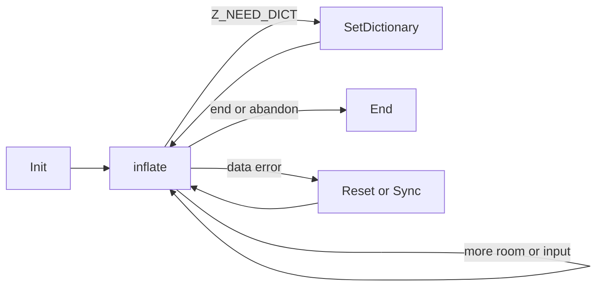

# Decompression through a stream (inflate.c)

These focused contracts describe the pinned `inflate.c` and `zlib.h` in the default build: gzip enabled, without the optional invalid-distance or strict-distance modes.
They are source readings **to confirm** by proof. They do not replace or narrow the
registered Lean public targets. Proof status and remaining work belong in
[the overview](../../overview.md).

All contracts below have a **restricted domain**. A C pointer type alone does not
supply the storage, lifetime or call history required here.

- A **live stream** was successfully initialised or copied, has not been ended,
  retains its library-owned state, and is used without concurrent calls. Use the
  default allocator and free function. Init takes a writable, non-live stream with
  allocator fields set to NULL or the default functions.
- A readable or writable range has the stated capacity for the whole call. Caller
  ranges are separate from the stream and its owned storage. Input and output
  ranges do not overlap. Dictionary destinations, the registered header record
  and its destination buffers are separate from each other and from the stream.
  Registered header storage is also separate from input/output ranges on calls
  using it. These are explicit focused-domain restrictions.
- The caller owns its stream object and buffers. The library owns the state and
  optional window. A call changes only its stream, owned storage, stated output
  ranges and any registered header destination. It never frees caller buffers.
- A rejected **stream check** returns `Z_STREAM_ERROR` without changes, unless a
  query or copy contract says otherwise. This covers NULL and safely readable
  records rejected by the check; it does not cover dangling or arbitrary pointers.
  The check requires allocators, state, the state's back-pointer and a valid mode.
- Counters use the C unsigned widths and wrap. No contract assumes allocation
  succeeds. End remains available after decoding, dictionary or allocation errors.



## inflateResetKeep

```c
int ZEXPORT inflateResetKeep(z_streamp strm);
```

Restart decoding while retaining history. This is an undocumented entry point.

**Domain / effects.** Restricted: live streams in any mode; mutates state, no allocation or free.
**Pre.** The common live-stream conditions hold. The caller deliberately wants the
old window to remain usable by the next stream.
**Post.** Returns `Z_OK`. Clears totals, message, `data_type`, buffered bits,
dictionary-set status and header registration. Restarts header/block decoding with
the current wrapper, retaining the window and its history. For a wrapper, `adler`
is 1 if zlib is accepted, otherwise 0; raw leaves `adler` unchanged.
**Edges.** Does not restore wrapper settings changed by recovery. A failed stream
check changes nothing. Use `inflateReset` to discard history.

## inflateReset

```c
int ZEXPORT inflateReset(z_streamp strm);
```

Start a new independent compressed stream using the existing configuration.

**Domain / effects.** Restricted: live streams, including completed or failed ones;
mutates state and may free the window, never allocates.
**Pre.** The common live-stream conditions hold.
**Post.** Returns `Z_OK`. Restores the requested wrapper and window size, discards
history, then performs the reset described by `inflateResetKeep`. Input/output
pointers and available counts stay unchanged. A window of the same size may remain
allocated; an incompatible window is freed.
**Edges.** Clears header registration. Keeps the validation setting selected by
`inflateValidate`, while undoing temporary recovery wrapper changes. A failed
stream check changes nothing.

## inflateReset2

```c
int ZEXPORT inflateReset2(z_streamp strm, int windowBits);
```

Reset and select a new wrapper and maximum window size.

**Domain / effects.** Restricted: live streams and every signed `windowBits` value;
mutates state and may free the window, never allocates.
**Pre.** The common live-stream conditions hold. Old decoding is being abandoned.
**Post.** For an accepted value, returns `Z_OK` and has the effect of `inflateReset`
with the new request. Accepted values and meanings are listed under `inflateInit2_`.
Validation is enabled for the new wrapper request.
**Edges.** Invalid values return `Z_STREAM_ERROR` before changing anything. Changing
the requested size frees an incompatible window. Pending header registration and
history are discarded, even if the size stays the same.

## inflateInit2_

```c
int ZEXPORT inflateInit2_(z_streamp strm, int windowBits, const char *version, int stream_size);
```

Create a decoder with a selected wrapper and window.

**Domain / effects.** Restricted: fresh writable stream storage, default allocator,
and NULL or readable version pointer; all signed scalar arguments. Allocates state.
**Pre.** The stream is not live. Allocator fields follow the common convention.
Only the first version byte must be readable; a whole string is not inspected.
**Post.** On `Z_OK`, the stream is live with zero totals, NULL message, zero
`data_type`, no window, history, buffered bits or header registration. Wrapper
`adler` starts at 1 for zlib/automatic detection and 0 for gzip-only; raw preserves
it. Buffer pointers and available counts are unchanged.

Accepted `windowBits` values are:

| Values | Decoder request |
| --- | --- |
| -15 through -8 | Raw DEFLATE, window bits equal to the magnitude |
| 0; 8 through 15 | Zlib; header-selected size for 0, otherwise that maximum |
| 16; 24 through 31 | Gzip only; default size for 16, otherwise value minus 16 |
| 32; 40 through 47 | Zlib/gzip detection; header/default size for 32, otherwise value minus 32 |

**Errors.** NULL/wrong version first byte or wrong `stream_size` returns
`Z_VERSION_ERROR` without changes, before inspecting `strm`. Otherwise NULL `strm`
returns `Z_STREAM_ERROR`. State allocation is attempted before the window argument
is checked. Failure returns `Z_MEM_ERROR`, retaining the old `state` field, with
message cleared and default callbacks installed as needed. An invalid window
argument after successful allocation returns `Z_STREAM_ERROR`, frees that state
and sets `state` to NULL. No failing init retains a new allocation. Only successful
init needs a later `inflateEnd`; its window may be allocated by later calls.

## inflateInit_

```c
int ZEXPORT inflateInit_(z_streamp strm, const char *version, int stream_size);
```

Create a zlib decoder with a 32 KiB maximum window.

**Domain / effects.** Restricted: the same storage, version and allocator domain as
`inflateInit2_`; allocates state.
**Pre.** The `inflateInit2_` preconditions hold.
**Post.** Exactly `inflateInit2_(strm, 15, version, stream_size)`. On success it
accepts zlib streams with a window up to 32 KiB, and owns one state allocation.
**Errors.** The same version, NULL-stream and allocation failures and cleanup as
`inflateInit2_`. Gzip and raw bytes are not accepted by later decoding as zlib.

## inflatePrime

```c
int ZEXPORT inflatePrime(z_streamp strm, int bits, int value);
```

Supply bits before the next input byte, or clear buffered bits.

**Domain / effects.** Restricted: live raw streams before first decoding or at a
reported block/header boundary; every signed `bits` and `value`; mutates state only.
**Pre.** The common live-stream conditions and the stated priming call order hold.
**Post.** Zero bits returns `Z_OK` unchanged. Negative bits empties the bit buffer.
For 1 through 16 bits that fit within the 32-bit buffer, returns `Z_OK`, appending
the low `bits` bits of `value` above existing bits. These bits precede `next_in`.
**Errors.** More than 16 bits, insufficient bit-buffer space or a failed stream
check returns `Z_STREAM_ERROR` unchanged. Does not update `data_type`. The C does
not enforce the raw-stream or call-order restriction.

## inflate

```c
int ZEXPORT inflate(z_streamp strm, int flush);
```

Consume compressed bytes and write decoded bytes, preserving state across calls.

**Domain / effects.** Restricted: live streams with common buffer/header lifetimes;
arbitrary compressed bytes, input/output splits and signed `flush` values. Mutates
stream, output and registered header storage; may allocate the history window.
**Pre.** `next_in` describes `avail_in` readable bytes and may be NULL only when
that count is zero. `next_out` is non-NULL even for zero `avail_out`, and describes
that many writable bytes. A registered header and its buffers remain writable.
Calls may continue with more input/room, supply a requested dictionary, or follow
successful reset/recovery. Terminal/error repeats have the behavior below.
**Post.** Reads/writes within the stated ranges. Advances pointers and reduces
available counts by bytes consumed/produced. In an ordinary run from init/reset,
with a valid selected format and the correct dictionary, accumulated output is a
prefix of the decoded data and equals it at `Z_STREAM_END`. Malformed bytes are
part of the domain: detected format or enabled checksum/length failures return
`Z_DATA_ERROR`, possibly after output. Incomplete input alone needs more input;
it need not be reported as a data error.

| Result | Meaning and next action |
| --- | --- |
| `Z_OK` | Made input or output progress; continue with available input/room |
| `Z_STREAM_END` | Finished one stream/member, including enabled trailer checks; trailing input remains |
| `Z_NEED_DICT` | Zlib dictionary required; `adler` is its identifier; set the dictionary |
| `Z_BUF_ERROR` | No progress, or `Z_FINISH` could not complete; provide input/room |
| `Z_DATA_ERROR` | Detected malformed data; reset, recover or end |
| `Z_MEM_ERROR` | Window allocation failed; reset or end |
| `Z_STREAM_ERROR` | Stream/buffer check failed, or recovery search is unfinished |

**Accounting.** Normal returns, including data and buffer errors, update totals by
consumed/produced bytes and update the enabled output checksum. `Z_NEED_DICT`
accounts for consumed header bytes and leaves `adler` as the dictionary identifier.
A late window-allocation failure can follow input consumption and output writes:
pointers/counts already reflect them, but normal final total/checksum/`data_type`
accounting is skipped. Do not treat `Z_MEM_ERROR` as an unchanged-output result.
**Edges.** Zero input or output room is allowed. `Z_BLOCK` stops at a header or
block boundary; `Z_TREES` also stops after block descriptions. `Z_FINISH` changes an
otherwise `Z_OK` result to `Z_BUF_ERROR`. Other signed flush values are accepted
and behave like `Z_NO_FLUSH`. `data_type` on normal returns records unused bits,
plus 64 for the last block, 128 at a header/block boundary, and 256 after a block
header. Data and memory errors are sticky; completed streams repeat `Z_STREAM_END`.
**Ownership.** New window storage belongs to the stream and remains available for
reset/end, including after errors. A one-call `Z_FINISH` completion may need no
window. Concatenated gzip members require reset between members. Error messages
are borrowed static strings. Buffer and stream check refusals change nothing.

## inflateEnd

```c
int ZEXPORT inflateEnd(z_streamp strm);
```

Release decoder storage, including when decoding was abandoned or failed.

**Domain / effects.** Restricted: live streams in every mode, including after
allocation/data errors; mutates the stream and frees owned storage.
**Pre.** The common live-stream conditions hold.
**Post.** Returns `Z_OK`, frees the optional window and state exactly once, and
sets `state` to NULL. Other stream fields and caller buffers are unchanged. This
allocates nothing and cannot return `Z_MEM_ERROR` with the default free function.
**Edges.** Does not require stream completion or report incomplete data as an
error. A failed stream check, including an already ended stream, returns
`Z_STREAM_ERROR` without freeing anything. Reinitialise before using it again.

## inflateGetDictionary

```c
int ZEXPORT inflateGetDictionary(z_streamp strm, Bytef *dictionary, uInt *dictLength);
```

Read the retained sliding history, oldest byte first.

**Domain / effects.** Restricted: live streams with optional writable dictionary
and length destinations; observes state and writes only those destinations.
**Pre.** A non-NULL dictionary has room for the retained history; 32768 bytes is
always enough. Non-NULL `dictLength` points to writable `uInt` storage.
**Post.** Returns `Z_OK`. Copies the history if `dictionary` is non-NULL and stores
its size if `dictLength` is non-NULL. Allocates/frees nothing; leaves stream unchanged.
**Edges.** Either destination may be NULL. Fresh history is empty. A stream
finished without allocating a window can also have empty history despite having
produced output. A failed stream check writes nothing.

## inflateSetDictionary

```c
int ZEXPORT inflateSetDictionary(z_streamp strm, const Bytef *dictionary, uInt dictLength);
```

Install or amend the bytes available for backward matches.

**Domain / effects.** Restricted: live zlib streams waiting after `Z_NEED_DICT`, or
live raw streams at any call boundary; mutates history and may allocate its window.
**Pre.** `dictionary` is non-NULL and describes `dictLength` readable bytes, even
when the length is zero. For correct output it matches the compressor's dictionary.
**Post.** Returns `Z_OK` after retaining the last window-sized suffix of old
history followed by the new dictionary. The whole supplied dictionary is checked
against the zlib identifier. Caller bytes are copied, not retained or freed.
**Errors.** A wrong zlib identifier returns `Z_DATA_ERROR` unchanged; another
dictionary can be tried. NULL dictionary, failed stream check or wrapped stream
not awaiting a dictionary returns `Z_STREAM_ERROR`. Allocation failure returns
`Z_MEM_ERROR` and leaves the stream in the memory-error mode, still endable.
**Edges.** Gzip has no preset-dictionary path. Raw mode has no identifier check;
a wrong dictionary can produce wrong output or a later error. Zero-length raw
dictionaries are accepted. No input/output pointers or totals are advanced.

## inflateGetHeader

```c
int ZEXPORT inflateGetHeader(z_streamp strm, gz_headerp head);
```

Register caller storage for the next gzip header.

**Domain / effects.** Restricted: live gzip-capable streams after init/reset and
before decoding; registers borrowed storage and writes `head->done`.
**Pre.** `head` is non-NULL and writable. Its `extra`, `name`, `comment` pointers
are NULL or have writable capacities `extra_max`, `name_max`, `comm_max`. Keep all
registered storage valid until header parsing ends or the request is cleared.
The header record and its destination buffers stay separate from each other,
the stream and its owned storage, and the input/output ranges of calls using them.
**Post.** Returns `Z_OK`, retains the pointer and sets `done` to 0. Later `inflate`
calls fill scalar fields and available buffer prefixes. With an extra field,
`extra_len` is its actual length; without one, `extra` becomes NULL and `extra_len`
is unchanged. Names/comments are terminated only if the terminator fits.
Absent optional fields set the corresponding pointer to NULL. Completion sets
`done` to 1; automatic detection of zlib sets it to -1.
**Edges.** No allocation or ownership transfer. Reset clears registration. A
failed stream check or request without gzip support returns `Z_STREAM_ERROR`
unchanged. NULL `head` on an accepted request is outside this contract and is
dereferenced by the C; it is not a clean-error case.

## inflateSync

```c
int ZEXPORT inflateSync(z_streamp strm);
```

Search for a possible full-flush boundary after damaged input.

**Domain / effects.** Restricted: live streams after a data error or during a
recovery search, with readable input; consumes input, mutates state, may free a window.
**Pre.** `next_in` and `avail_in` describe a readable range. Output is not used.
**Post.** Searches buffered whole bytes and then input for `00 00 ff ff`, retaining
partial matches across calls. Input pointers/counts and `total_in` advance by the
input searched. No output is produced and `total_out` is preserved.
**Results.** `Z_OK` means a pattern was found: history and header registration are
reset, totals are preserved, decoding can resume at the following block. If no
header had been read, recovery uses raw mode; otherwise it disables trailer
validation. A still unknown window size becomes 15. `Z_DATA_ERROR` means continue
searching; ordinary `inflate` returns `Z_STREAM_ERROR` during that search.
**Edges.** No input and fewer than eight buffered bits returns `Z_BUF_ERROR`
unchanged. A failed stream check changes nothing. A found pattern need not be a
real flush point; even a sync-flush boundary can need earlier history. Recovery
does not promise a valid suffix or restored checksum checking. No allocation.

## inflateSyncPoint

```c
int ZEXPORT inflateSyncPoint(z_streamp strm);
```

Test whether stored-block length bytes are the next thing expected.

**Domain / effects.** Restricted: live streams in any mode; read-only query.
**Pre.** The common live-stream conditions hold.
**Post.** Returns 1 exactly when waiting for stored-block lengths with an empty
bit buffer, otherwise 0. Allocates/frees nothing and changes nothing.
**Edges.** Returns `Z_STREAM_ERROR` on a failed stream check. Test `== 1`, since
the negative error code also counts as true in C. This is not a search for a marker.

## inflateCopy

```c
int ZEXPORT inflateCopy(z_streamp dest, z_streamp source);
```

Create a decoder that can resume from the source position.

**Domain / effects.** Restricted: live source, distinct writable non-live
destination; allocates independent state and, if present, a window.
**Pre.** The common conditions hold for source. Destination does not overlap
source or its owned storage. Shared input/output and header pointers retain their
caller lifetimes; give the streams separate writable destinations before use.
**Post.** `Z_OK` copies decoding position, history and stream fields. Both streams
own their state/window independently and must be ended. Source is unchanged.
Caller buffer pointers, message and any registered header pointer are shared,
not deep-copied. No caller data is consumed or produced.
**Errors.** NULL `dest` returns `Z_STREAM_ERROR`. For other refusals, non-NULL
`dest` has `state` cleared and is otherwise unchanged. Allocation failure returns
`Z_MEM_ERROR` and frees all allocations made by this attempt. Source is unchanged.
**Edges.** Self-copy is excluded explicitly: the C overwrites the original state
pointer, so the ownership consequence remains **to confirm**, not a clean refusal.

## inflateUndermine

```c
int ZEXPORT inflateUndermine(z_streamp strm, int subvert);
```

Request the optional permissive-distance mode. This is an undocumented entry point.

**Domain / effects.** Restricted: live streams and every signed `subvert`; mutates state only.
**Pre.** The common live-stream conditions hold.
**Post.** In the default build, returns `Z_DATA_ERROR` and enables normal distance
checking, regardless of `subvert`. Allocates/frees nothing.
**Edges.** This return does not place the decoder in data-error mode. A failed
stream check returns `Z_STREAM_ERROR` unchanged. The optional permissive build is
outside this page's scope.

## inflateValidate

```c
int ZEXPORT inflateValidate(z_streamp strm, int check);
```

Enable or disable wrapper checksum and gzip length validation.

**Domain / effects.** Restricted: live streams before decoding and every signed
`check`; mutates configuration only.
**Pre.** The common live-stream conditions and the stated call order hold.
**Post.** Returns `Z_OK`. Zero disables checks; nonzero enables them for wrapped
streams. Changes both current and requested settings. Raw streams stay raw.
No allocation/free or buffer access occurs.
**Edges.** Disabled checking permits otherwise bad trailers and does not maintain
the output checksum. `inflateReset` preserves this choice; `inflateReset2` replaces
it. A failed stream check returns `Z_STREAM_ERROR` unchanged.

## inflateMark

```c
long ZEXPORT inflateMark(z_streamp strm);
```

Report the current code position for indexing.

**Domain / effects.** Restricted: live streams in any mode; read-only query.
**Pre.** The common live-stream conditions hold.
**Post.** Returns `back * 65536 + progress`: `back` is the bits back to the current
code, or -1 between codes/in a header or stored block. `progress` is remaining
stored-block bytes, emitted match bytes, or zero otherwise. Changes nothing and
allocates/frees nothing.
**Edges.** A failed stream check returns -65536. That value also occurs on valid
streams, so it does not by itself identify an error.

## inflateCodesUsed

```c
unsigned long ZEXPORT inflateCodesUsed(z_streamp strm);
```

Report the decoding-table entries used so far. This is an undocumented entry point.

**Domain / effects.** Restricted: live streams in any mode; read-only query.
**Pre.** The common live-stream conditions hold.
**Post.** Returns the number of entries from the embedded table area's beginning
to its next free entry, between 0 and 1444. A fresh/reset stream gives zero. Fixed
blocks use static tables and need not change this count. No changes or allocation/free.
**Edges.** A failed stream check returns `(unsigned long)-1`, the unsigned maximum.
