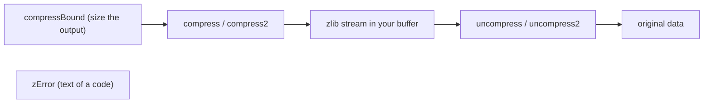

# Utility functions (compress.c, uncompr.c, zutil.c)

Source of truth: `compress.c`, `uncompr.c` and `zutil.c` of the verified source (pinned zlib checkout
with `patches/` applied, default x86-64 Linux build) and `zlib.h`. Statements marked "run" were also
checked by running the real library with a small C program (patched `libz.a`; the NULL-pointer cases
with a sanitizer build).

## The idea in short

`compress` and `uncompress` (and their relatives) do a whole job in one call on buffers in memory: you
give the whole input and an output buffer and the length of that buffer. They build a stream
internally, run `deflate` or `inflate` to the end, free the stream, and tell you how many bytes were
produced (and, for `uncompress2`, how many were consumed). They always use the zlib wrapper, the default
window and memory level, and the default allocators. The `_z` forms take `size_t` lengths; the plain
forms take `uLong`, which has the same width on this platform (64 bits) but not on Windows (32 bits).

`zutil.c` adds three small query functions: the release string, a word describing how the library was
built, and the text of a return code.

How the utility calls are used:



### Facts used on this page

| Fact | Value |
| --- | --- |
| Return codes | `Z_OK` 0, `Z_STREAM_ERROR` -2, `Z_DATA_ERROR` -3, `Z_MEM_ERROR` -4, `Z_BUF_ERROR` -5 |
| Chunking | lengths above `UINT_MAX` (4294967295) are fed to the stream in pieces of `UINT_MAX` |
| Default level | `Z_DEFAULT_COMPRESSION` (-1), which means 6; the zlib header of such a stream starts with `78 9c` (run) |
| Memory | each call allocates a compressor (about 256 KB plus a small state) or a decompressor (a small state, plus a window of up to 32 KB) with `malloc` and frees it before returning |

## compress2_z

```c
int ZEXPORT compress2_z(Bytef *dest, z_size_t *destLen, const Bytef *source,
                        z_size_t sourceLen, int level);
```

**Purpose.** Compresses `sourceLen` bytes at `source` into a zlib stream in `dest`, at the given level,
and stores the number of bytes written in `*destLen`.

**Parameters.**

| Name | Direction | Must be | Range | NULL? | Memory |
| --- | --- | --- | --- | --- | --- |
| `dest` | out | buffer of `*destLen` writable bytes | | only if `*destLen` is 0, but then the result is `Z_STREAM_ERROR` (run) | caller |
| `destLen` | in-out | pointer to a `z_size_t` | in: capacity of `dest`; out: bytes written | **no** (`Z_STREAM_ERROR`) | caller |
| `source` | in | `sourceLen` readable bytes | | only if `sourceLen` is 0 | caller; read only |
| `sourceLen` | in | length | any `z_size_t` | n/a | n/a |
| `level` | in | compression level | -1 (means 6), 0 to 9 | n/a | n/a |

The two buffers must not overlap (U9).

**Preconditions.** For a guaranteed `Z_OK`, `*destLen` must be at least `compressBound_z(sourceLen)`
(with the default settings that is the bound `deflateBound` would give; run: they agree on sampled
lengths).

**What it does.**

1. If `sourceLen` is above 0 and `source` is NULL, or `destLen` is NULL, or `*destLen` is above 0 and
   `dest` is NULL: return `Z_STREAM_ERROR` and change nothing.
2. Remember the capacity, then set `*destLen` to 0.
3. Initialise a local stream with the default allocators and `deflateInit(level)`. If that fails
   (bad level: `Z_STREAM_ERROR`, or `Z_MEM_ERROR`), return its code; `*destLen` stays 0.
4. Loop: give the stream up to `UINT_MAX` bytes of room and of input at a time, and call `deflate` with
   `Z_NO_FLUSH`, except that the call that is given the last of the input, and every call after it, uses `Z_FINISH`. Repeat while the
   result is `Z_OK`.
5. Store the bytes written in `*destLen`, free the stream, and return `Z_OK` if the last result was
   `Z_STREAM_END`, else that result.

**Return values.**

| Code | Condition |
| --- | --- |
| `Z_OK` | the whole stream was written; `*destLen` is its length |
| `Z_STREAM_ERROR` | a NULL argument as in step 1; or `level` outside -1 to 9; or `dest` NULL with `*destLen` 0 (the inner `deflate` refuses a NULL output pointer; run) |
| `Z_MEM_ERROR` | the compressor could not be allocated |
| `Z_BUF_ERROR` | the output buffer was too small |

**Errors and stream state after an error.** There is no stream left to clean up: it is always freed.
After `Z_BUF_ERROR`, `dest` holds the first `*destLen` bytes of the stream (a truncated stream), and
`*destLen` equals the capacity (run: 100 of 100). After the argument errors of step 1, `*destLen` is
unchanged; after a bad level or `Z_MEM_ERROR`, `*destLen` is 0 (run).

**Memory ownership.** Internal allocation, freed before return, also on errors. Nothing for the caller
to free.

**The caller must not.** Give `dest` less room than `*destLen` says (U1); give `source` less than
`sourceLen` (U1); overlap input and output (U9); pass the same `destLen` pointer to two threads.

**Easy to get wrong.** (Run.)

- `dest` NULL with `*destLen` 0 gives `Z_STREAM_ERROR`, but `dest` non-NULL with `*destLen` 0 gives
  `Z_BUF_ERROR` (and `*destLen` 0). `uncompress2_z` treats NULL with 0 more kindly (see there).
- An empty `source` (length 0, even with `source` NULL) gives the 8-byte stream
  `78 9c 03 00 00 00 00 01`; with room 7 it is `Z_BUF_ERROR`, with 8 `Z_OK`.
- The bound is a guarantee, not a minimum: 1000 bytes of repetitive text needed only 28 bytes.
- Level 0 gives a valid zlib stream with stored blocks, slightly longer than the input (40011 for 40000).
- Level -1 is accepted, -2 and 10 are not (`Z_STREAM_ERROR`).
- `zlib.h` mentions only the buffer-too-small, memory and level errors; the argument errors of step 1 are
  in the code only.

**Related.** `compress2`, `compress_z`, `compressBound_z`, `uncompress2_z`, `deflateInit2_`.

**In the project.** Translation: `ZlibF/Zlib/compress.c.lean` (namespace `Zlib.Compress`,
`compress2_z`). Spec: `ZlibF.Spec.Api.Compress2` (in `ZlibF/Spec/Api/Compress.lean`). Proof status:
translated; no theorem in `tests/audit/theorems.txt`; no differential test file for `compress.c` yet.

## compress2

```c
int ZEXPORT compress2(Bytef *dest, uLongf *destLen, const Bytef *source,
                      uLong sourceLen, int level);
```

**Purpose.** The `uLong` form of `compress2_z`.

**Parameters.** As `compress2_z` with `uLongf *destLen` and `uLong sourceLen`. **`destLen` must not
be NULL** (see below).

**Preconditions.** As `compress2_z`.

**What it does.** Copies `*destLen` into a `z_size_t`, calls `compress2_z`, copies the result back into
`*destLen`, returns the code. The copy back happens on every path, including errors.

**Return values.** As `compress2_z`.

**Errors and stream state after an error.** As `compress2_z`.

**Memory ownership.** As `compress2_z`.

**The caller must not.** Pass a NULL `destLen`: the wrapper reads `*destLen` before the NULL check in
`compress2_z` (a null dereference, U3; run under the sanitizer: "load of null pointer"). Everything
else as `compress2_z`.

**Easy to get wrong.** `compress2_z` returns `Z_STREAM_ERROR` for a NULL `destLen`, this function crashes.

**Related.** `compress2_z`, `compress`.

**In the project.** Translation: `Zlib.Compress.compress2`. Spec: `ZlibF.Spec.Api.Compress2`. Proof status: translated; no theorem.

## compress_z

```c
int ZEXPORT compress_z(Bytef *dest, z_size_t *destLen, const Bytef *source, z_size_t sourceLen);
```

**Purpose.** `compress2_z` at the default level.

**Parameters.** As `compress2_z` without `level`.

**Preconditions.** As `compress2_z`.

**What it does.** Calls `compress2_z(dest, destLen, source, sourceLen, Z_DEFAULT_COMPRESSION)`.

**Return values.** As `compress2_z`; `Z_STREAM_ERROR` cannot come from the level.

**Errors and stream state after an error.** As `compress2_z`.

**Memory ownership.** As `compress2_z`.

**The caller must not.** As `compress2_z`.

**Easy to get wrong.** Level -1 means 6, so the result equals `compress2_z(…, 6)` (run: same size).

**Related.** `compress2_z`, `compress`.

**In the project.** Translation: `Zlib.Compress.compress_z`. Spec: `ZlibF.Spec.Api.Compress`. Proof status: translated; no theorem.

## compress

```c
int ZEXPORT compress(Bytef *dest, uLongf *destLen, const Bytef *source, uLong sourceLen);
```

**Purpose.** `compress2` at the default level.

**Parameters.** As `compress2` without `level`. `destLen` must not be NULL.

**Preconditions.** As `compress2_z`.

**What it does.** Calls `compress2(dest, destLen, source, sourceLen, Z_DEFAULT_COMPRESSION)`.

**Return values.** As `compress2`.

**Errors and stream state after an error.** As `compress2`.

**Memory ownership.** As `compress2`.

**The caller must not.** As `compress2` (NULL `destLen`).

**Easy to get wrong.** `zlib.h` says `destLen` must be at least `compressBound(sourceLen)` for success;
it can succeed with less when the data compresses well (run).

**Related.** `compress2`, `compressBound`.

**In the project.** Translation: `Zlib.Compress.compress`. Spec: `ZlibF.Spec.Api.Compress`. Proof status: translated; no theorem.

## compressBound_z

```c
z_size_t ZEXPORT compressBound_z(z_size_t sourceLen);
```

**Purpose.** An upper bound for the output size of `compress` and `compress2` (any level) for
`sourceLen` input bytes.

**Parameters.** `sourceLen`: in, any value.

**Preconditions.** None.

**What it does.** Returns `sourceLen + (sourceLen / 4096) + (sourceLen / 16384) + (sourceLen /
33554432) + 13`, where the divisions are right shifts by 12, 14 and 25. If the sum wrapped around, returns
the largest `z_size_t`.

**Return values.** The bound (run: 0 gives 13, 1 gives 14, 4095 gives 4108, 4096 gives 4110, 1000000
gives 1000318); the maximum value for huge inputs.

**Errors and stream state after an error.** No error.

**Memory ownership.** None.

**The caller must not.** Nothing.

**Easy to get wrong.** The source comment says that if the default window or memory level of
`deflateInit` change, this function must be changed too. Here it equals `deflateBound` of a default
stream (run: equal for sampled lengths). It is a bound for the zlib wrapper only; for a gzip or raw
stream use `deflateBound`.

**Related.** `compressBound`, `deflateBound`.

**In the project.** Translation: `Zlib.Compress.compressBound_z`. Spec: `ZlibF.Spec.Api.compressBound`. Proof status: translated; no theorem.

## compressBound

```c
uLong ZEXPORT compressBound(uLong sourceLen);
```

**Purpose.** The `uLong` form of `compressBound_z`.

**Parameters.** `sourceLen`: in.

**Preconditions.** None.

**What it does.** Calls `compressBound_z`; if the result does not fit `uLong`, returns the largest
`uLong`.

**Return values.** As `compressBound_z`.

**Errors and stream state after an error.** No error.

**Memory ownership.** None.

**The caller must not.** Nothing.

**Easy to get wrong.** On a 32-bit `uLong` the saturation happens for inputs above about 4 GB.

**Related.** `compressBound_z`.

**In the project.** Translation: `Zlib.Compress.compressBound`. Spec: `ZlibF.Spec.Api.compressBound`. Proof status: translated; no theorem.

## uncompress2_z

```c
int ZEXPORT uncompress2_z(Bytef *dest, z_size_t *destLen, const Bytef *source, z_size_t *sourceLen);
```

**Purpose.** Decompresses one zlib stream from `source` into `dest`. On return `*destLen` is the
number of bytes produced and `*sourceLen` the number of input bytes consumed.

**Parameters.**

| Name | Direction | Must be | Range | NULL? | Memory |
| --- | --- | --- | --- | --- | --- |
| `dest` | out | buffer of `*destLen` writable bytes | | yes if `*destLen` is 0 | caller |
| `destLen` | in-out | pointer | in: capacity; out: bytes produced | **no** (`Z_STREAM_ERROR`) | caller |
| `source` | in | `*sourceLen` readable bytes | | yes if `*sourceLen` is 0 | caller; read only |
| `sourceLen` | in-out | pointer | in: input length; out: bytes consumed | **no** (`Z_STREAM_ERROR`) | caller |

**Preconditions.** The input is a zlib stream (a gzip or raw stream is not accepted). The output
capacity is at least the size of the original data, which the caller must know by other means.

**What it does.**

1. `sourceLen` NULL, or `*sourceLen` above 0 with `source` NULL, or `destLen` NULL, or `*destLen` above 0 with
   `dest` NULL: `Z_STREAM_ERROR`, nothing changed.
2. If `*destLen` is 0 and `dest` is NULL, a private dummy location (the `reserved` field of the local
   stream) is used as the output pointer, because `inflate` refuses a NULL output pointer.
3. Local stream, default allocators, `inflateInit`. If it fails, return its code; `*sourceLen` and
   `*destLen` are unchanged.
4. Loop: give the stream up to `UINT_MAX` bytes of room and input at a time, call `inflate(Z_NO_FLUSH)`
   while the result is `Z_OK`.
5. `*sourceLen` becomes the input consumed (including bytes the decoder had pulled into its bit buffer);
   `*destLen` the output produced. The stream is freed.
6. Result: `Z_OK` for `Z_STREAM_END`; `Z_DATA_ERROR` for `Z_NEED_DICT`; `Z_DATA_ERROR` for `Z_BUF_ERROR`
   when all the input was consumed; otherwise the code `inflate` returned.

**Return values.**

| Code | Condition |
| --- | --- |
| `Z_OK` | the stream was complete and its check value matched; trailing bytes after it are ignored and not counted in `*sourceLen` (run: 109 of 139) |
| `Z_BUF_ERROR` | the output buffer was too small while input was left. Run: for 450670 pairs of small inputs (levels 0, 1, 6, 9) and every too-small capacity, the result was always `Z_BUF_ERROR` |
| `Z_DATA_ERROR` | invalid data, wrong check value, an unfinished (truncated) stream, a stream needing a preset dictionary, a gzip stream, or empty input |
| `Z_MEM_ERROR` | the decompressor or its window could not be allocated |
| `Z_STREAM_ERROR` | a NULL argument as in step 1 |

**Errors and stream state after an error.** Output produced before the error stays in `dest` (run: with
a bad Adler-32 all 40000 bytes were produced and then `Z_DATA_ERROR`; with a bad header none). `*destLen`
and `*sourceLen` say how much was produced and consumed (run: bad header: 0 and 2; dictionary needed: 0 and 6).

**Memory ownership.** Internal allocation, freed before return.

**The caller must not.** Give `dest` less room than `*destLen` says (U1); overlap buffers (U9).

**Easy to get wrong.** (Run.)

- A truncated stream gives `Z_DATA_ERROR`, not `Z_BUF_ERROR`: every prefix of a 56-byte stream, from 0 to
  55 bytes, gave `Z_DATA_ERROR`, with `*destLen` showing what could be decoded (the last prefix produced all
  4000 bytes, only the check value was missing).
- The two codes are told apart only by whether input is left over: a too-small output buffer with
  input left is `Z_BUF_ERROR`; if all the input was already consumed, the error would be mapped to
  `Z_DATA_ERROR` even if the real cause was the output size. This never happened in the test above.
- A stream that needs a preset dictionary is `Z_DATA_ERROR`; there is no way to supply a dictionary.
- `dest` NULL with capacity 0 is accepted here (the stream is read, `Z_BUF_ERROR` if there is any output),
  unlike `compress2_z`. An empty valid stream decodes with `dest` NULL: `Z_OK`.
- Empty input (`*sourceLen` 0) is `Z_DATA_ERROR`.
- `zlib.h` says `Z_MEM_ERROR`, `Z_BUF_ERROR` and `Z_DATA_ERROR`; the argument error `Z_STREAM_ERROR` is
  in the code only.

**Related.** `uncompress2`, `uncompress_z`, `inflate`.

**In the project.** Translation: `ZlibF/Zlib/uncompr.c.lean` (namespace `Zlib.Uncompr`,
`uncompress2_z`). Spec: `ZlibF.Spec.Api.Uncompress2` (in `ZlibF/Spec/Api/Compress.lean`). Proof
status: translated; no theorem in `tests/audit/theorems.txt`; no differential test file for `uncompr.c` yet.

## uncompress2

```c
int ZEXPORT uncompress2(Bytef *dest, uLongf *destLen, const Bytef *source, uLong *sourceLen);
```

**Purpose.** The `uLong` form of `uncompress2_z`.

**Parameters.** As `uncompress2_z` with `uLongf *destLen` and `uLong *sourceLen`. **Neither pointer may be NULL.**

**Preconditions.** As `uncompress2_z`.

**What it does.** Copies both lengths into `z_size_t` variables, calls `uncompress2_z`, copies both back
on every path, returns its code.

**Return values.** As `uncompress2_z`.

**Errors and stream state after an error.** As `uncompress2_z`.

**Memory ownership.** As `uncompress2_z`.

**The caller must not.** Pass NULL for `destLen` or `sourceLen`: the wrapper reads them before the NULL
checks (null dereference, U3; run under the sanitizer: "load of null pointer" in both cases).

**Easy to get wrong.** The NULL checks in `uncompress2_z` are not reached through this wrapper.

**Related.** `uncompress2_z`, `uncompress`.

**In the project.** Translation: `Zlib.Uncompr.uncompress2`. Spec: `ZlibF.Spec.Api.Uncompress2`. Proof status: translated; no theorem.

## uncompress_z

```c
int ZEXPORT uncompress_z(Bytef *dest, z_size_t *destLen, const Bytef *source, z_size_t sourceLen);
```

**Purpose.** `uncompress2_z` when you do not need to know how much input was used.

**Parameters.** As `uncompress2_z`, but `sourceLen` is passed by value.

**Preconditions.** As `uncompress2_z`.

**What it does.** Copies `sourceLen` into a local and calls `uncompress2_z` with its address.

**Return values.** As `uncompress2_z`; since the length is local, the `sourceLen` NULL check cannot fail.

**Errors and stream state after an error.** As `uncompress2_z`.

**Memory ownership.** As `uncompress2_z`.

**The caller must not.** As `uncompress2_z`.

**Easy to get wrong.** Trailing bytes after the stream are silently ignored and you cannot tell.

**Related.** `uncompress2_z`, `uncompress`.

**In the project.** Translation: `Zlib.Uncompr.uncompress_z`. Spec: `ZlibF.Spec.Api.Uncompress`. Proof status: translated; no theorem.

## uncompress

```c
int ZEXPORT uncompress(Bytef *dest, uLongf *destLen, const Bytef *source, uLong sourceLen);
```

**Purpose.** The classic one-call decompressor.

**Parameters.** As `uncompress2` but `sourceLen` by value. `destLen` must not be NULL.

**Preconditions.** As `uncompress2_z`.

**What it does.** Calls `uncompress2` with the address of a local copy of `sourceLen`.

**Return values.** As `uncompress2_z`.

**Errors and stream state after an error.** As `uncompress2_z`.

**Memory ownership.** As `uncompress2_z`.

**The caller must not.** Pass a NULL `destLen` (null dereference in the wrapper; run under the sanitizer).

**Easy to get wrong.** When the buffer is too small, the output buffer is filled up to its capacity
and `*destLen` is the capacity (run: 39999 of 39999).

**Related.** `uncompress2`, `uncompress_z`.

**In the project.** Translation: `Zlib.Uncompr.uncompress`. Spec: `ZlibF.Spec.Api.Uncompress`. Proof status: translated; no theorem.

## zlibVersion

```c
const char * ZEXPORT zlibVersion(void);
```

**Purpose.** Returns the release string of the library you linked, to compare with the `ZLIB_VERSION`
of the header you compiled against.

**Parameters.** None.

**Preconditions.** None.

**What it does.** Returns a pointer to the constant text of `ZLIB_VERSION`, here `1.3.2.1-motley`.
It returns the same pointer every time (run).

**Return values.** The pointer; never NULL.

**Errors and stream state after an error.** No error.

**Memory ownership.** The text is static and read-only. Do not free or change it.

**The caller must not.** Write through the pointer (U8).

**Easy to get wrong.** The init functions compare only the **first character** of the release string, not
the whole text, so a library with release `1.2.x` and a header with `1.3.x` are accepted. The header also
defines a lower-case macro that calls this function.

**Related.** `deflateInit2_`, `inflateInit2_`, `inflateBackInit_`.

**In the project.** Translation: `ZlibF/Zlib/zutil.c.lean` (namespace `Zlib.Zutil`, `zlibVersion`).
Spec: not written yet. Proof status: safety and correctness proved:
`Zlib.Zutil.Proofs.zlibVersion_safe` and `zlibVersion_correct`, both listed in `tests/audit/theorems.txt`.

## zlibCompileFlags

```c
uLong ZEXPORT zlibCompileFlags(void);
```

**Purpose.** Returns a bit mask that describes the sizes of the main types and the compile-time options
of the library.

**Parameters.** None.

**Preconditions.** None.

**What it does.** Adds up the following bits (two bits each for sizes: 0 for 16 bits, 1 for 32, 2 for 64, 3
for other): bits 1 and 0 the size of `uInt`; bits 3 and 2 of `uLong`; bits 5 and 4 of a pointer; bits 7 and 6
of `z_off_t`. Then single bits: 8 if built with `ZLIB_DEBUG`; 10 `ZLIB_WINAPI`; 12 `BUILDFIXED`; 13
`DYNAMIC_CRC_TABLE`; 16 `NO_GZCOMPRESS`; 17 `NO_GZIP`; 20 `PKZIP_BUG_WORKAROUND`; 21 `FASTEST`; and
the group of bits 24 to 27 about the `printf` function used by `gzprintf` (all 0 when a standard
`vsnprintf` is available).

**Return values.** In the default build: 169 (hexadecimal `a9`): 1 for `uInt` of 32 bits, plus 8 for `uLong` of 64
bits, plus 32 for 64-bit pointers, plus 128 for 64-bit `z_off_t` (run).

**Errors and stream state after an error.** No error.

**Memory ownership.** None.

**The caller must not.** Nothing.

**Easy to get wrong.** `zlib.h` lists bit 9 (`ASMV` or `ASMINF`, assembler code) but in the source the code that would
set it is commented out, so bit 9 is never set, even in a build with assembler code. Reserved bits are
0. The value 169 holds for this configuration only; other configurations give other values.

**Related.** `zlibVersion`.

**In the project.** Translation: `Zlib.Zutil.zlibCompileFlags`. Spec: not written yet. Proof status:
safety and correctness proved: `Zlib.Zutil.Proofs.zlibCompileFlags_safe` and `zlibCompileFlags_correct`,
listed in `tests/audit/theorems.txt`.

## zError

```c
const char * ZEXPORT zError(int err);
```

**Purpose.** Returns a short text for a return code of the compression functions. It is exported so that
programs can turn an error code into text for `compress` and `uncompress` (comment in `zutil.c`).

**Parameters.** `err`: in, any `int`.

**Preconditions.** None.

**What it does.** Looks up the text: 2 gives "need dictionary", 1 "stream end", 0 the empty string, -1
"file error", -2 "stream error", -3 "data error", -4 "insufficient memory", -5 "buffer error"; -6 gives the
text "incompatible" followed by the English word that corresponds to the last part of the identifier
`Z_VERSION_ERROR`, in lower case. Any other number, including all numbers above 2 and below -6, gives the
empty string.

**Return values.** A pointer to a static string; never NULL (run for -8 to 4, the smallest and the largest `int`).

**Errors and stream state after an error.** No error.

**Memory ownership.** Static read-only text; do not free or change it. The same pointer is returned
for all unknown codes (run: for -7 and 3, and for 0 and 99).

**The caller must not.** Write through the pointer (U8).

**Easy to get wrong.** The empty string is returned both for `Z_OK` and for an unknown code. The same table
is used to set the `msg` field when `deflateInit2_` runs out of memory.

**Related.** `deflate`, `inflate`, `compress`, `uncompress`, `gzerror` in [gz-file.md](gz-file.md).

**In the project.** Translation: `Zlib.Zutil.zError`. Spec: not written yet. Proof status: safety and
correctness proved: `Zlib.Zutil.Proofs.zError_safe` and `zError_correct`, listed in `tests/audit/theorems.txt`.

## Other symbols of zutil.c that are linked but not part of the API

These are in the static library but not documented as API and not marked `ZEXPORT`:

| Symbol | What it is |
| --- | --- |
| `z_errmsg` | the table behind `zError`: ten text pointers, indexed by 2 minus the code |
| `zcalloc(opaque, items, size)` | the default allocator that `zalloc` is set to: `malloc(items * size)`, **not zeroed**; the product is computed in 32-bit `unsigned` and wraps (the proof notes in [../../proof/zutil.md](../../proof/zutil.md) cover it) |
| `zcfree(opaque, ptr)` | the default `zfree`: `free(ptr)` |

Proofs for `zcalloc` and `zcfree` (`Zlib.Zutil.Proofs.zcalloc_safe`, `zcalloc_correct_some`,
`zcalloc_correct_size`, `zcalloc_correct_none`, `zcfree_safe`, `zcfree_correct`, `zcfree_correct_null`,
`zcalloc_zcfree_no_leak`) are listed in `tests/audit/theorems.txt`.

## Findings to confirm

1. **`compress`, `compress2`, `uncompress`, `uncompress2` dereference `destLen` (and `sourceLen`) before
   any NULL check.** Reproduction (sanitizer build): `compress(dest, NULL, src, 10)` reports "load of null
   pointer of type uLongf" at the line that copies `*destLen`; `uncompress(dest, NULL, src, 3)` and
   `uncompress2(dest, &n, src, NULL)` likewise. The `_z` functions check for NULL and return
   `Z_STREAM_ERROR`, so the wrappers are less safe than what they wrap. `zlib.h` does not say NULL is allowed.
2. **`compress2_z(NULL, &n, src, len, level)` with `n` equal to 0 returns `Z_STREAM_ERROR`, while
   `uncompress2_z` returns the natural error for the same situation** (a dummy output pointer is used).
   A caller that probes "how big must the buffer be" with a NULL output and capacity 0 gets a different
   code from the two. Inconsistency, not a fault.
3. **`uncompress2_z` maps `Z_BUF_ERROR` to `Z_DATA_ERROR` whenever all input was consumed.** If a
   decoder ever consumed all input bytes while still lacking output room, the caller would be told "data
   error" for a mere size problem. 450670 trials over small inputs never produced such a case; a proof
   that it cannot happen (or a counterexample) is open.
