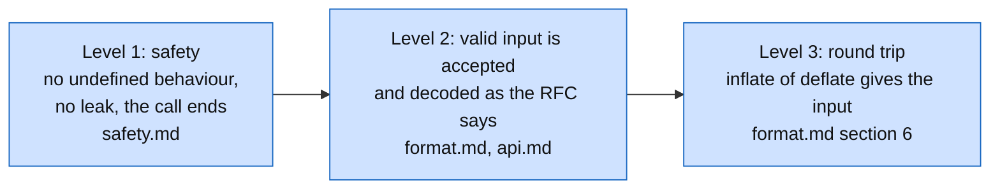

# Specification

This directory says, in plain language, what zlib is supposed to do. The proofs in
[../proof/index.md](../proof/index.md) and the Lean theorems refer to it. Both must agree with
the verified source and public contract. A disagreement requires review; neither may be weakened
to fit an existing proof.

The final public verification boundary and acceptance stages are in
[public-goals.md](public-goals.md).

## Sources of truth

| Question | Source |
| --- | --- |
| What bytes are valid input to `inflate`, and what does `deflate` have to produce? | RFC 1951 (deflate), RFC 1950 (zlib wrapper), RFC 1952 (gzip wrapper). Summary in [format.md](format.md) |
| How may a program call the library? What does each call return and change? | `zlib.h` at the pinned commit. Summary in [api.md](api.md); the model in Lean in [api-lean.md](api-lean.md) |
| What does each exported function do, parameter by parameter? | The manual in [functions/index.md](functions/index.md), written from the C code and checked by running it |
| What does an internal function promise to its callers? | The C code and its comments. Written down in [internal.md](internal.md) |
| What does "safe" mean? | [../safety.md](../safety.md) |

The RFCs are the contract for the data. They are short, free to redistribute, and stable. We do
not copy them. [format.md](format.md) states the parts that the proofs use, with tables, and
points to the RFC section for the rest.

`zlib.h` is the contract for the program. Where `zlib.h` is silent we say so and mark the item
**not specified**. We do not guess.

## Numbering

Each normative sentence in the specification has an identifier, so that a proof can cite it.

| Prefix | Meaning | Example |
| --- | --- | --- |
| `F` | a rule of the data format | `F-fixed-lengths` |
| `A` | a rule of the API | `A-inflate-err-data` |
| `I` | a promise of an internal function | `I-inflate_table-complete` |

The proofs name the identifiers they use. A sentence that no proof uses is either a gap in the
proofs or a sentence we do not need. Both are worth knowing.

## Levels of specification

All three levels are goals. Level 1 comes first for each component, because a function that may
fault has no result to specify.

## Conventions

- "Byte" is 8 bits. "Bit sequence" is written first bit first.
- A number written `0x1F` is hexadecimal.
- `a mod b` is the non-negative remainder.
- "Stream" means a `z_stream` object together with the state it points to.
- "The caller" is the program that calls the library. "Legal call" means a call that meets the
  requirements written in [api.md](api.md).
- Return codes are the constants of `zlib.h`: `Z_OK` 0, `Z_STREAM_END` 1, `Z_NEED_DICT` 2,
  `Z_ERRNO` -1, `Z_STREAM_ERROR` -2, `Z_DATA_ERROR` -3, `Z_MEM_ERROR` -4, `Z_BUF_ERROR` -5,
  `Z_VERSION_ERROR` -6.
