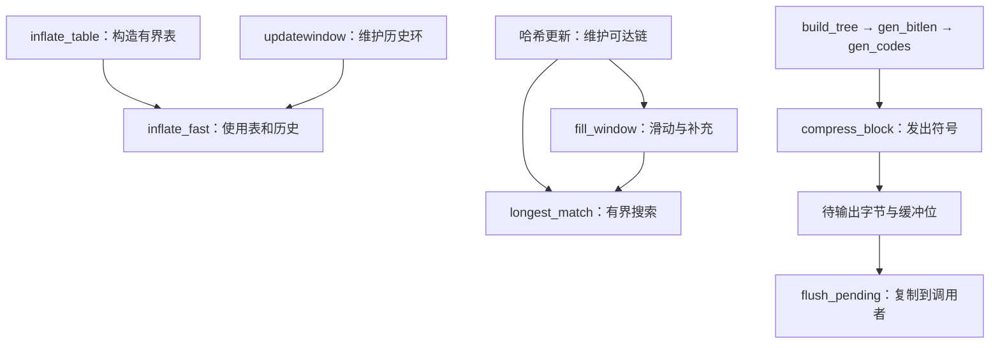

# 内部调用处的证明义务

这些是默认构建辅助函数的文档契约。它们解释调用者必须建立什么，以及辅助函数执行证明必须给出什么。
下列全部 C 源码解读都**待确认**；表格本身不是证明，也不是可假设的被调函数契约。
执行证明见[证明指南](../proof/README.md)，状态见[进度](../progress.md)。

内部前置条件可以强于公开入口的前置条件。实际调用者必须从初始化建立的不变量和当前执行状态推导它，
不能将其变成公开调用的隐藏限制。尤其是，较小内存级别、任意新分配整数内容和文档错误情况，
仍然是对应公开调用者的证明义务。

## 如何阅读各条目

每个稳定的 `I-*` 标识符命名一项义务。`Pre` 描述辅助函数定义域，`Post` 描述结果，
`Effects` 限定允许读写的范围。中间事实必须在所命名的阶段成立，早于 C 将相同字段复用于其他用途。

每个条目也要求共同的内存事实：被引用存储存活、表示正确且访问有界；
写入目标可写；`memcpy` 范围互不重叠；指针字段使用前已被写入。
每个辅助函数证明都必须建立终止性、无故障，以及其作用之外存储的帧性质。
这些义务针对其翻译后函数体，包括调用更底层、已有证明的辅助函数。

箭头表示证明依赖和所维护数据，不是穷尽的 C 调用图。

## 构造解码表：`inflate_table`

用途：构造规范解码表。
`inflate_table(type, lens, codes, &table, &bits, work)`；`base` 是入口时的 `*table`。

| 类别／ID | 契约 |
| --- | --- |
| Pre `I-it-pre-lens` | `lens[0..codes)` 可读，长度处于 `0..15`。对于 `CODES`，长度至多为 7，请求的 `*bits` 至少为 7。 |
| Pre `I-it-pre-codes` | `type` 是 `CODES`、`LENS` 或 `DISTS`；`codes` 分别至多为 19、288 或 32。 |
| Pre `I-it-pre-work` | `work[0..codes)` 是可写临时区，与其他参数互不重叠。 |
| Pre `I-it-pre-table` | `table`／`bits` 是可写单元；对于 `CODES`／`LENS`／`DISTS`，`base` 分别容纳 128／852／592 项，并与其他参数互不重叠。 |
| Post `I-it-ret` | 成功返回 0，无效长度返回 -1，`LENS`／`DISTS` 容量不足拒绝返回 1。空码集合以无效表项成功构造。 |
| Effects `I-it-writes` | 只修改临时区、指针／位宽单元及容量内表项。成功构造 `[base, base + used)`；错误可能留下部分写入。 |
| Post `I-it-advance` | 成功时，`*table = base + used`，`*bits` 是实际根表位宽。 |
| Post `I-it-complete` | 成功时写入全部已构造项，包括允许的单符号码对应的一个无效项，或空码集合对应的两个无效项。 |
| Post `I-it-links` | 每个成功构造的根表链接及其完整子表都位于 `[base, base + used)`。 |
| Post `I-it-canonical` | 成功时按照[规范赋码](format/README.md)解码，并为保留符号设置无效标记。 |
| Post `I-it-term` | 调用在所述定义域内结束。 |

## 留足余量进行解码：`inflate_fast`

用途：解码直到空间不足、块结束或数据无效。

| 类别／ID | 契约 |
| --- | --- |
| Pre `I-if-pre-room` | 模式为 `LEN`；`avail_in ≥ 6`、`avail_out ≥ 258`、`start ≥ avail_out`。`next_out - (start - avail_out)` 是外层 `inflate` 调用此前输出的起点，位于同一对象且可读。输入／输出互不重叠。 |
| Pre `I-if-pre-bits` | `bits < 8`；`hold` 恰好包含这些缓冲的低位，其他位均未置位。 |
| Pre `I-if-pre-tables` | `lencode`／`distcode` 及根表位宽满足成功建表的表项／链接规则，包括固定表。 |
| Pre `I-if-pre-window` | `whave ≤ wsize`；`wsize = 0` 蕴含 `whave = wnext = 0`；否则 `wnext < wsize`，且 `window` 容纳 `wsize` 字节。有效历史有 `whave` 字节；`sane` 已设置。 |
| Effects `I-if-reads` | 字节读取使用入口输入、外层调用此前输出或有效窗口历史；表读取保持在解码表内。 |
| Effects `I-if-writes` | 只写入入口输出、流的游标／计数／`msg`，以及状态的 `hold`／`bits`／`mode`；不分配内存。 |
| Post `I-if-post` | 游标／计数记录已消费输入与输出。未使用的完整输入字节被退回；`bits < 8`。模式为 `LEN`、`TYPE` 或 `BAD`；`BAD` 可能已消费无效符号的一部分。 |
| Post `I-if-dist` | 若距离超过外层 `inflate` 调用已产生字节数加 `whave`，则在复制该匹配前设置 `BAD`。 |

## 保持解码器历史：`updatewindow`

用途：将 `[end - copy, end)` 追加到历史，包括字典数据。

| 类别／ID | 契约 |
| --- | --- |
| Pre `I-uw-pre` | `[end - copy, end)` 可读且与目标窗口互不重叠。`wbits` 位于配置允许的 inflate 范围。已有窗口具有 `2^wbits` 个可写字节。环尚未使用（`wsize = 0`），或满足 `wsize = 2^wbits`、`whave ≤ wsize`、`wnext < wsize` 和 `whave < wsize → wnext = whave`。 |
| Effects `I-uw-alloc` | 仅在窗口不存在时分配。分配失败返回 1，否则返回 0。只写窗口存储／字段和分配器状态；失败保持已有历史。 |
| Post `I-uw-inv` | 返回 0 时，`wsize = 2^wbits`、`whave ≤ wsize`、`wnext < wsize` 且 `whave < wsize → wnext = whave`。 |
| Post `I-uw-content` | 成功时保留旧历史与输入拼接后的后缀，至多 `wsize` 字节；`whave` 记录其长度，环形顺序在 `wnext` 处结束。 |

## 补充与滑动：`fill_window`、`slide_hash`、`read_buf`

用途：补充前瞻输入，并维护窗口／哈希位置。

| 类别／ID | 契约 |
| --- | --- |
| Pre `I-fw-pre` | `fill_window` 满足 `lookahead < MIN_LOOKAHEAD`、`window_size = 2*w_size`、`strstart + lookahead ≤ window_size` 及 `insert ≤ strstart`。窗口、哈希大小／掩码、高水位、搜索设置和位置范围满足配置的 deflate 状态，包括 `I-hc-inv`。输入具有可读的 `avail_in` 视图。 |
| Post `I-fw-post-room` | `fill_window` 返回后满足 `strstart ≤ window_size - MIN_LOOKAHEAD`。 |
| Post `I-fw-post-lookahead` | 返回后满足 `lookahead ≥ MIN_LOOKAHEAD` 或 `avail_in = 0`。新读入字节按顺序扩展当前前瞻输入。 |
| Effects `I-fw-slide` | 滑动将上半窗口的存活字节下移 `w_size`，用 C 算术调整位置／`insert`，并调用 `slide_hash`。其他写入包括输入／校验和核算、哈希及高水位填充。 |
| Pre / Post `I-sh-total` | `slide_hash` 要求正的 `hash_size` 和 `w_size`，以及可写的 `head[0..hash_size)`／`prev[0..w_size)`。每项在 `m ≥ w_size` 时变为 `m - w_size`，否则变为 `NIL`；并设置 `slid = 1`。不可达的 `prev` 值不必初始化。 |
| Pre / Post `I-rb-copy` | `read_buf` 要求可写入 `n = min(avail_in, size)` 字节的目标，并与输入互不重叠。它返回 `n`、复制该前缀、推进 `next_in`、减少 `avail_in`、增加 `total_in`，并为当前包装更新 Adler-32／CRC-32。`n = 0` 时不改变任何内容。 |

## 搜索有效哈希链：`longest_match`

用途：在预算内搜索较早的哈希链位置。

| 类别／ID | 契约 |
| --- | --- |
| Pre / Post `I-hc-inv` | `INSERT_STRING`、`slide_hash`、`CLEAR_HASH`、`fill_window` 和 `deflateSetDictionary` 保持：链头指向已插入位置，可达 `prev[p mod w_size]` 槽已写入 `NIL` 或更小的同哈希位置。位置与当前窗口／前瞻输入一致。 |
| Pre `I-lm-pre` | `cur_match` 是当前字符串哈希的非零链头，`cur_match < strstart`，且距离至多为 `MAX_DIST`。`I-hc-inv` 成立；`strstart ≤ window_size - MIN_LOOKAHEAD`、`1 ≤ prev_length ≤ MAX_MATCH`，配置的搜索设置在可能的缩减后仍给出正链预算。 |
| Effects `I-lm-reads` | 读取窗口直到且包括 `strstart + MAX_MATCH`，可能越过前瞻输入，并读取已写入的可达 `prev` 槽。只修改 `match_start`；填充字节不能用来论证无效匹配。 |
| Post `I-lm-ret` | 返回至多 `min(MAX_MATCH, lookahead)`。找到更优结果时设置有效的 `match_start`；否则可以保留 `prev_length`，再以 lookahead 为上限，但不提供新的 `match_start` 保证。 |
| Post `I-lm-term` | 在链预算内结束；遍历的非零位置严格递减。不保证全局最优匹配。 |

## 构造并发出 Huffman 树：`trees.c`

用途：构造有界 Huffman 码并发出一个块。

| 类别／ID | 契约 |
| --- | --- |
| Pre `I-bt-pre` | `build_tree` 接收对应 286／30／19 个字面量-长度／距离／位长度叶子的描述符、已设置的频次，以及容纳内部节点／堆／深度的空间。补足叶子后的频次总和适合对应字段。 |
| Effects `I-bt-heap` | 堆索引小于 573；节点保持在各自树内。写入描述符最大值、节点、堆／深度、位数统计和成本。 |
| Intermediate `I-bt-forest` | 在长度／编码覆盖父节点／频次字段前，节点在正频次符号上形成满二叉树，并通过强制叶子补足两个。父节点频次等于子节点频次之和。 |
| Pre / Post `I-gb-len` | 给定该树、有序堆和描述符，`gen_bitlen` 写入活跃叶子长度，位于 `1..max_length`（15 或 7），并满足 Kraft 和为 1，同时写入计数和成本。 |
| Post `I-gb-count` | `bl_count[l]` 统计长度为 `l` 的活跃叶子；`bl_count[0] = 0`。 |
| Pre / Post `I-gc-code` | `gen_codes` 要求直到 `max_code` 的长度处于 `0..15`，且完整码计数匹配。它只写正长度的编码字段：按符号顺序排列的位反转规范码字。 |
| Pre / Effects `I-cb-reads` | `compress_block` 要求 `sym_buf[0..sym_next)` 中有完整三字节符号、有效的字面量／匹配范围、具有可用编码的匹配树，以及待输出／位缓冲空间。它按顺序读取符号，发出对应编码／额外位，最后发出 `END_BLOCK`。 |
| Post `I-cb-pending` | 在符号 `k`（从 0 开始）之后，`pending < lit_bufsize + 3*(k+1)`。发出过程也必须始终保持未读符号。该上界必须证明，不能从调用者处假设。 |
| Pre / Post `I-tf-choice` | `_tr_flush_block` 要求有效块符号／频次、处于 `0..1` 的 `last`、待输出容量；若选择 stored 块，还要求 `stored_len ≤ 65535` 和可读的 `buf[0..stored_len)`。若 `buf != NULL` 且 `stored_len + 4 ≤ opt_lenb` 则选择 stored；否则在 `static_lenb = opt_lenb` 时选择 fixed，其余选择 dynamic。`opt_lenb` 是取整后的两种压缩大小中的较小者，但 `Z_FIXED` 会优先选择 fixed。它重置块核算，若 `last` 成立则对齐位。 |

默认[重叠存储上界](../proof/trees.md)必须覆盖每个公开内存级别，不能成为隐藏的调用者限制。

## 排出待输出内容：`flush_pending` 与位写入函数

用途：收集缓冲位，并把待输出字节复制到输出。

| 类别／ID | 契约 |
| --- | --- |
| Pre / Post `I-fp-inv` | `pending_out` 位于待输出分配内，且 `pending_out + pending ≤ pending_buf + pending_buf_size`。写入函数还要求实际写入偏移处有空间；仅有该区间条件并不足够。 |
| Pre / Post `I-fp-copy` | `flush_pending` 要求可写的 `avail_out` 输出，与待输出存储互不重叠，并要求有效位缓冲状态为 `_tr_flush_bits` 留出空间。它先排出完整的缓冲字节，再复制 `n = min(pending, avail_out)`，推进两个游标、增加 `total_out`，并从两个计数中减去 `n`。非零复制清空待输出内容后，`pending_out = pending_buf`。只修改待输出／位字段、流的输出字段和已复制输出字节。 |
| Pre / Post `I-pb-room` | `put_byte` 和 `put_short` 要求各自待输出偏移处有一／两个可写字节。`send_bits` 要求 `1 ≤ length ≤ 16`、数值适合该长度、有效的 `bi_valid`／`bi_buf`，并为可能的 short 写入留出空间。它们追加字节／位而不检查容量。调用者必须建立空间条件；`I-cb-pending` 必须保护重叠区内的未读符号。 |

[翻译规则](../design/translation.md)解释这些义务引用的操作。
[API 模型](../design/api-model.md)解释字节历史与具体堆效果的区别。

[设计指南](../design/README.md) · [文档首页](../README.md)
