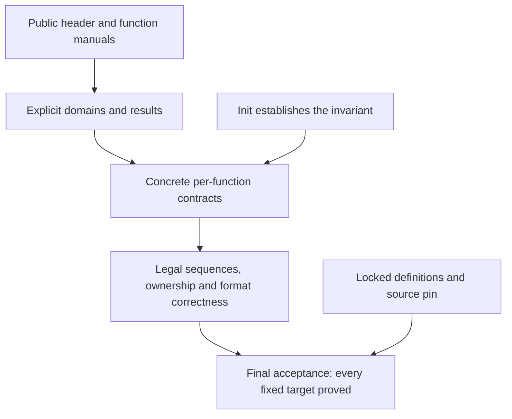

# Public verification boundary

We aim to prove that the public API is safe and implements its documented behaviour.
The first target is the default x86_64 Linux static build with the default allocator.
Allocation failure remains in scope. Other upstream configurations remain project goals.

The public inventory is `tests/audit/public-api.json`. It lists every function declared by
`zlib.h`, its translated entry, its manual section and its required final target name.
The inventory is checked against the pinned header. The Windows-only `gzopen_w` is identified
explicitly. A name in the inventory is a requirement, not a theorem or a completed specification.

## What each final contract must state

| Part | Required statement |
| --- | --- |
| Domain | Every call permitted by the public contract is covered. Parameters rejected by the API have a specified error path. Internal helper bounds are established by the implementation, not added as caller requirements. |
| Execution | The actual translated entry returns without a runtime fault, including fuel exhaustion. Quantify over every allowed initial heap and allocation-failure oracle. An empty run relation cannot discharge this requirement. |
| Result | The return code, scalar outputs, output bytes and stream changes satisfy the function's public contract. Include error ordering, partial output and counter behaviour. Do not infer an untouched buffer from an error code. |
| Frame | Caller storage outside the permitted write ranges and unrelated live objects are unchanged. |
| Ownership | Successful init and copy establish ownership. Failed init and copy release partial allocations. End and close release owned resources exactly once. An ordinary error leaves the documented recovery or cleanup operations available. |

The function manuals specify the individual operations. Their signatures, parameters, allowed
call order, effects and ownership are in [functions/index.md](functions/index.md).
All 95 implementation targets are in `ZlibF/Spec/Public/`. `Domains.lean` and `Sequences.lean`
add the eight family targets. The [contract review](contract-review.md) maps their modules and
explains the format, abstract API and public-target layers. Every target fixes actual execution.
Its presence is not a proof.

The byte format is in [format.md](format.md). An abstract model property alone does not discharge
an implementation contract.

## Properties of sequences

Four additional targets cover the inflate, deflate, callback inflate and gz lifecycles.
Their safety and cleanup clauses quantify over finite legal call histories, including reset,
dictionary changes, copy, recovery, end and close where allowed. Ordinary data epochs connect
accepted and produced bytes to the format model; [contract-review.md](contract-review.md)
states the advanced-operation boundary explicitly.
Copies have independent ownership and the same observable continuation behaviour.
Completed compression produces valid data. Decompression recovers its input under compatible
wrapper, window and dictionary settings. Checksums satisfy their mathematical definitions.

Four initialisation-domain targets ensure that the public domains can hold. Init must establish
the representation invariant on success for every documented parameter combination, and clean
up on failure. A single convenient witness does not replace universal parameter coverage.
Concrete witnesses supplement the top-level results.

## Execution assumptions and limits

The caller provides live objects and the readable or writable ranges required by the API.
One stream is used sequentially. The caller does not modify library-owned state.
Buffer-overlap requirements and scalar-pointer representation limits must be reviewed against
the public contract. A stronger restriction must be explicit in [../deviations.md](../deviations.md).

Callback and system-call code is external. Safety requires its documented memory contract.
Termination requires that callbacks and external operations return, and that callback input is
finite where a stream may otherwise continue indefinitely. This is an execution assumption,
not a theorem about arbitrary caller code or the operating system.

We do not prove compiler or operating-system correctness, performance, constant-time behaviour,
resource bounds against decompression bombs, or behaviour of callers that violate the public
contract. Undefined behaviour in a permitted library call is a blocker, not a new caller restriction.
The trusted semantic limits are in [../trusted-base.md](../trusted-base.md).

## Acceptance stages

| Command | What passing establishes |
| --- | --- |
| `python3 scripts/verification.py coverage` | The public inventory, translated entry names, manual sections, source pin and audited import closure agree. |
| `python3 scripts/verification.py check` | Development build, fresh kernel replay and declaration audit pass; semantic and source locks match. Open proofs remain allowed. |
| `python3 scripts/verification.py specs` | Every required public and sequence target exists as a closed Lean proposition, and the development checks pass. |
| `python3 scripts/verification.py final --baseline COMMIT` | Every required target has an exactly matching registered theorem and the approved semantic baseline is unchanged. |

Coverage does not imply specification readiness. Specification readiness does not imply a proof.
Exact type matching does not establish that a proposition expresses the whole public contract.
That judgement requires independent review before the baseline is approved.

Final acceptance also requires the no-placeholder check, differential tests, audit self tests,
proof mutants for the proved functions and the repository's required CI checks on the named commit.
Differential tests are finite evidence of translation fidelity, not proof.

Proof progress and specification blockers are listed only in [../overview.md](../overview.md).
