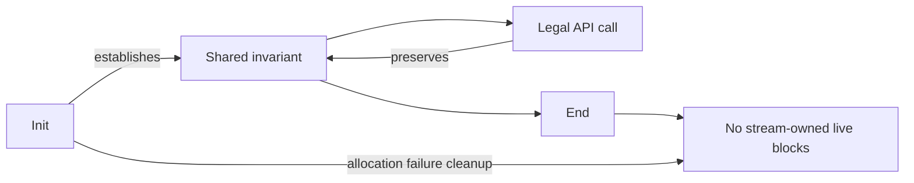

# Safety claims and caller obligations

The goal is that every call permitted by `zlib.h` avoids undefined behaviour, returns,
and preserves memory ownership. This is a target, not a claim that all functions are proved.
[Overview](../overview.md) records checked status and remaining work. The [proof method](../proof/method.md)
explains how these obligations become Lean theorems. [Trusted base](../trusted-base.md) describes
where the model needs a separate argument before a model result applies to C.

## Terms and reading guide

**Undefined behaviour (UB)** means a program action for which the applicable C
standard gives no behavioural guarantee. A crash is not required. A successful
execution or agreement with a test does not establish that the action is defined.
This follows the terminology in [C draft N1570, section 3.4.3](https://www.open-std.org/jtc1/sc22/wg14/www/docs/n1570.pdf).

Keep these cases separate:

| Case | Meaning for this project |
| --- | --- |
| Defined error return | A permitted request is refused through the documented API result. Malformed compressed bytes may return `Z_DATA_ERROR` without UB. |
| Outside a theorem's precondition | The theorem says nothing about that input. This alone does not classify the C execution as UB. |
| C UB | The selected C language rules give no guarantee for that operation. Pointer arithmetic, overflow and lifetime rules need separate checks. |
| `Fault.ub` | The executable model detects a violation. It is a model result, not a complete definition or detector of C UB. |
| `Fault.outOfFuel` | The model exhausted its loop budget. The termination proof must exclude it. Nontermination is not automatically C UB. |
| Leak | A lifetime fails its resource-accounting requirement. A leak is a safety failure here, even when no C operation has UB. |

Implementation-defined choices must be stated for the selected build.
Unspecified outcomes require a proof for every admitted outcome where they affect
the result. Neither term means UB. A C claim needs both a no-fault execution proof
and correspondence for the operations used, including the documented model gaps.

Read section 1 for each call, section 2 for whole lifetimes, section 3 for UB and
model limitations, and section 4 for caller obligations. The [API](api/README.md)
and [format](format/README.md) state the functional requirements.

## 1. What a function theorem must say

For every admitted caller state and argument, the translated function returns without a fault.
It preserves the shared representation invariant, changes only its permitted memory, and
accounts for every allocation and free. Error returns are included.

| Clause | Required conclusion |
| --- | --- |
| No fault | The run has a result, rather than `Fault.ub` or `Fault.outOfFuel`. |
| Preservation | The next legal call can use the same representation invariant. |
| Frame | Memory outside the call's footprint is unchanged. |
| Ownership | The live blocks owned by the stream change exactly as allocation and freeing require. |

Initialisation must establish the invariant from the admitted caller state. A callee contract
is a proved theorem about that callee; it cannot be assumed to discharge a caller's proof.
A top-level theorem also needs a concrete witness. Neither a witness nor an unsatisfiable
invariant can substitute for coverage of all admitted arguments.

Leak freedom concerns the whole lifetime. Successful init leaves its allocations owned by
the stream. End frees each owned block exactly once. Failed init frees everything it allocated.
The live-block set after end or failed init equals the set before init. Copy and partial-failure
paths need the same accounting. A failed operation must leave a state in which the documented
recovery or end operation is safe.

## 2. Calls and sequences

Sequence safety is part of the goal. It follows by induction only after init establishes the
invariant and every permitted transition preserves it. This includes reset, dictionaries,
priming, copy, recovery and end. A collection of isolated function lemmas is insufficient.

Termination means that every loop completes before its fuel limit. The runtime uses `2^64`
iterations; exhausting it is a separate fault. Termination and leaks are safety obligations here,
even though neither is itself an instance of C undefined behaviour.

## 3. Faults, undefined behaviour and model gaps

The identifiers below name the safety obligations. Runtime faults detect many violations.
They do not alone establish C safety: the exceptions in this section and
[trusted-base.md, item 2](../trusted-base.md#2-runtime-and-object-schema) remain part of the argument.

| ID | Obligation | Main reason it matters |
| --- | --- | --- |
| U1 | No read or write outside an object | Buffer indices and table accesses need bounds. |
| U2 | Pointer arithmetic stays within an object or one past it | Offset updates and back-reference copies need live, bounded pointers. |
| U3 | No null dereference | Stream, state, window and header accesses need the appropriate live pointer. |
| U4 | No use after free or double free | Ownership must persist through copy, failure and end. |
| U5 | No invalid use of uninitialised data | Garbage must not become an unchecked index or address; pointer fields need a write-before-read argument. |
| U6 | No signed overflow | Counters, positions and conversions need explicit range checks. |
| U7 | No invalid shift | Counts must be nonnegative and below the promoted operand's width. |
| U8 | No write to a read-only object | Static data and immutable byte blocks must remain unchanged. |
| U9 | No overlapping `memcpy` | Copies need disjoint ranges; overlapping copies use `memmove`. |
| U10 | Accesses respect C type and alignment requirements | The object heap has no general byte view of records, type tags or complete ABI layout. CRC word reads need separate review. |
| U11 | Every call terminates | Loop measures must rule out fuel exhaustion. |
| U12 | No memory leak | Every exit must preserve ownership or perform exact cleanup. |

Unsigned arithmetic wraps in the translation. Signed arithmetic and shifts are checked by
the translation's operations, rather than automatically by the computation monad.
U1 through U10 describe C and representation obligations. U11 and U12 add termination
and resource requirements; they are not a claim that every failure is C UB.

### Null pointers and pointer differences

The current implementation has three distinct rules:

| Expression or operation | Current model | What a C claim still needs |
| --- | --- | --- |
| Typed null pointer plus integer zero | `Ptr.add` returns the null pointer. | A definedness argument for each reachable use under the selected C rules. No fault is raised for this case. |
| Typed null pointer plus a nonzero integer | `Ptr.add` raises `Fault.ub`. | Exclude the operation in every admitted execution. |
| Null pointer minus null pointer | Generic `Ptr.diff` raises `Fault.ub`; `Zlib.Compress.ptrDiff` instead returns zero. | Review the actual helper used and the C expression it translates. The helper exception is not a proof of definedness. |
| Two nonnull pointers in the same live array | `Ptr.diff` checks both offsets, permits one-past, and checks that the difference fits signed 64 bits. | Establish the actual C object, offsets and `ptrdiff_t` correspondence. |
| Pointers in different objects, or dangling pointers | `Ptr.diff` raises `Fault.ub`. | Exclude subtraction of such values on every admitted path. |
| Addition of two typed pointer values | There is no pointer-plus-pointer primitive. | This violates C's addition operand constraints; it is different from adding integer zero to a null pointer. |

Read the definitions of [Ptr.add and Ptr.diff](../../ZlibF/Runtime/Ptr.lean)
and the [compressor helper](../../ZlibF/Zlib/compress.c.lean), rather than inferring
the rule from the name “pointer difference”. The token `NULL` can expand to a null
pointer constant; the table describes typed pointer values, not macro spelling.

[N1570, section 6.5.6](https://www.open-std.org/jtc1/sc22/wg14/www/docs/n1570.pdf)
requires array-relative pointer arithmetic and same-array subtraction with a
representable result. Null pointers do not denote array elements. The
[C23 draft N3096, section 6.5.6](https://www.open-std.org/jtc1/sc22/wg14/www/docs/n3096.pdf)
retains those conditions. The `Ptr.diff` source comment attributing a zero result
for two nulls to C23 is therefore inaccurate. It does not change the executed
definition or provide a language guarantee.

[N3261](https://www.open-std.org/jtc1/sc22/wg14/www/docs/n3261.pdf) proposes relaxed
null/zero operations for a later C revision. That proposal is not authority for
silently treating them as defined in this project's existing C target. The
correspondence review must identify the language edition and any implementation
extensions it relies on. Matching differential results and a silent sanitizer
do not discharge that requirement.

The current model therefore does **not** detect every potentially undefined C
null-arithmetic operation. This limitation belongs in the claimed scope. Any
runtime or translation correction requires its own reviewed change and renewed
proof checks. [Overview](../overview.md) records the outstanding review.

### Uninitialised memory

Fresh integer cells contain arbitrary values from `Heap.garbage`. A theorem must hold for
every garbage function. The model assigns one fixed value to each cell for the run; repeated
reads agree. It does not model a fresh unspecified value at every read. A proof must not use
that agreement to justify C behaviour. Copying bytes copies these values, including garbage.

This matters in `slide_hash`, which visits uncleared `prev` entries, and `longest_match`,
which compares bytes beyond the real input data. Their source comments explain the intended
independence from those contents. That reading is **to confirm** by the relevant execution
proofs. Arbitrary-value quantification alone does not prove output independence or that a
hash-chain walk reaches only entries written with real positions.

Fresh pointer fields are NULL in the model. This is weaker than tracking an uninitialised
pointer: comparison with NULL, copying and `free(NULL)` succeed without detecting a missing
write. Every pointer field read therefore needs evidence of an earlier write. The two state
init translations explicitly zero their allocated state records. This does not initialise
all caller or automatic stream records. The compressor's automatic stream starts with
arbitrary integer fields and model-null pointers; its field writes must follow the C.

### Object representation

Declared record-array lengths require `WellFormed` and `Heap.RecordsWellFormed` hypotheses.
Static lengths require `Statics.WellFormed`, and values must match the translated C tables.
A Lean `Array` type does not enforce its C extent. Allocation requires `Fresh` and a valid
cross-table block identity discipline. No initialisation bits or allocation-origin tags are
present. Read-only flags cover byte blocks and represented statics, not all typed objects.

Pointer equality uses object identity and offset. Different objects compare unequal, and
comparing a dangling pointer does not fault. A proof must not depend on those outcomes where
C does not guarantee them. The CRC address helper represents only the low three address bits.
Heap byte blocks retain the aligned-origin convention. Static and embedded byte objects have
arbitrary stable origin residues. This is not a general ABI, effective-type or scalar-alias
model; those limits remain recorded in [deviations](../deviations.md).

## 4. Caller obligations

A public theorem must state these obligations explicitly and distinguish invalid arguments
that require a clean error return from inputs outside the C API's domain.

| ID | Obligation or scope |
| --- | --- |
| A1 | A non-null stream argument denotes a live `z_stream`; allocator fields are set as required before init. Null cases documented as refusals remain covered. |
| A2 | The caller provides the readable input and writable output ranges required by the operation. |
| A3 | Buffer separation follows the entry's explicit precondition. A universal separation requirement attributed to `zlib.h` is **to confirm**; stronger restrictions belong in [deviations](../deviations.md). |
| A4 | Calls on the same stream are not concurrent. |
| A5 | The initial target uses the default allocator. Its allocation failures remain in scope. |
| A6 | Use after end or close is excluded; documented reinitialisation starts a new lifetime. |
| A7 | Every scalar value is classified: documented normal use, documented refusal, or an explicit caller restriction. Invalid values cannot be silently omitted to avoid checking error paths. |

## 5. Other properties

Functional correctness is also required: see the [format](format/README.md) and
[API contracts](api/README.md). Malformed input remains in the safety domain; an error return
must not hide a fault. Custom allocators and other upstream configurations follow the initial
default x86_64 Linux/LP64 static build target. Compiler and operating-system correctness,
performance, stack bounds and resource limits against decompression bombs are outside the
model. The [trusted base](../trusted-base.md) records these boundaries.
