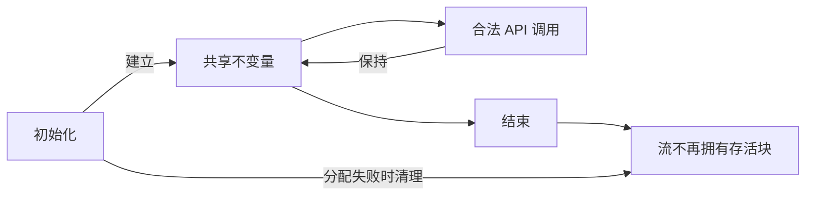

<!-- source-sha256: b7064c2fe16f1f9e2b70e4e7e620c987789e376ed5c163922b10cf68e941877d -->

# 安全性主张与调用者义务

目标是：`zlib.h` 允许的每次调用都避免未定义行为、能够返回，并保持内存所有权。
这是目标，不是所有函数都已获证明的声明。
[进度](../progress.md)记录受检状态与剩余工作。[证明方法](../proof/method.md)解释这些义务如何成为 Lean 定理。
[可信基础](../trusted-base.md)说明模型结果应用于 C 前，哪些地方还需要独立论证。

已接受的[平台假设](platform.md)，包括每个字节对象的大小上界，属于环境前提。
执行证明建立这些前提在执行中的保持性。

## 目标所在位置

每个安全目标都是 `ZlibF/Spec/Safety/` 中的一个 Lean 定义 `ZlibF.Spec.Public.Goal.<name>`。读这个目录及其导入的内容，就得到完整的必需目标：快速门禁中的 `scripts/check-spec-layers.py` 拒绝它导入任何功能规范。

| 函数 | 安全目标 | 文件 |
| --- | --- | --- |
| inflate 与 deflate 的流函数 | `Goal.<function>_safety`：对可达的流再调用一次（第 2 节） | `Safety/Streams.lean` |
| `inflateEnd`、`deflateEnd` | `Goal.<function>_safety`：流释放它拥有的一切 | `Safety/Streams.lean` |
| 初始化函数 | 在新记录上的 `Goal.<function>_safety` | `Safety/Initialisation.lean` |
| `inflateCopy`、`deflateCopy` | `Goal.<function>_safety` | `Safety/Copy.lean` |
| 校验和、`zlibVersion`、`zlibCompileFlags` | `Goal.<function>_safety`：调用返回，堆不变 | `Safety/Checksums.lean`、`Safety/Queries.lean` |
| `compress*`、`uncompress*` | `Goal.compress*_safety`、`Goal.uncompress*_safe` | `Safety/Utilities.lean` |
| `compressBound`、`compressBound_z` | 完整契约（纯函数） | `Functional/Queries.lean` |
| gzip 文件接口、`inflateBack` | 序列目标 `Goal.gz_sequence_safety`、`Goal.inflate_back_sequence_safety` | `Public/GzSafety.lean`、`Public/Sequences.lean` |

`tests/audit/public-api.json` 给出每个函数的 `safety_goal` 和 `functional_goal`。`NULL` 或不一致的流属于 `Goal.inflate_refusal`、`Goal.deflate_refusal` 和 `Goal.gz_refusal` 的定义域。非空性目标（`Goal.*_initialisation_domain`）表明每个定义域都有成员。审计要求以上全部目标；`open_safety` 带负责人列出尚无已登记定理的那些。

## 术语与阅读指南

**未定义行为（UB）**指适用 C 标准对其行为不作保证的程序操作。
它不一定引发崩溃。一次执行成功或与测试一致，都不能证明该操作有定义。
这一术语遵循 [C 草案 N1570 第 3.4.3 节](https://www.open-std.org/jtc1/sc22/wg14/www/docs/n1570.pdf)。

应区分以下情况：

| 情况 | 本项目中的含义 |
| --- | --- |
| 有定义的错误返回 | 通过文档规定的 API 结果拒绝一个允许的请求。格式错误的压缩字节可以返回 `Z_DATA_ERROR`，而不发生 UB。 |
| 不满足定理的前置条件 | 定理对该输入不作结论。仅凭这一点不能把 C 执行判定为 UB。 |
| C UB | 所选 C 语言规则不保证该操作的行为。指针算术、溢出和生命周期规则需要分别检查。 |
| `Fault.ub` | 可执行模型检测到违规。这是模型结果，不是 C UB 的完整定义或完整检测器。 |
| `Fault.outOfFuel` | 模型耗尽循环预算。终止性证明必须排除它。不终止并不自动等于 C UB。 |
| 泄漏 | 生命周期不满足资源核算要求。即使没有 C 操作发生 UB，泄漏在本项目中也属于安全性失败。 |

所选构建中由实现定义的选择必须明确写出。
对于未指定结果，只要它会影响结论，证明就必须覆盖每一种允许的结果。
这两个术语都不表示 UB。关于 C 的主张既需要无故障执行证明，也需要所用操作与 C 对应的论证，
包括已记录的模型缺口。

第 1 节介绍单次调用，第 2 节介绍完整生命周期，第 3 节介绍 UB 和模型限制，第 4 节介绍调用者义务。
[API](api/README.md)和[格式](format/README.md)规定功能要求。

## 1. 单次调用的安全保证

对每个允许的调用者状态和参数，翻译后的函数都无故障地返回。
它保持共享表示不变量，只修改许可内存，并核算每次分配和释放。错误返回也包括在内。这里的“表示不变量”是一组关于真实状态和内存的事实，例如某个窗口仍然存活、有效历史不超过容量、游标仍指向允许的范围；只有它们继续成立，下一次调用才有可靠的起点。

| 条款 | 所需结论 |
| --- | --- |
| 无故障 | 执行得到结果，而非 `Fault.ub` 或 `Fault.outOfFuel`。 |
| 保持性 | 下一次合法调用可以使用同一表示不变量。 |
| 帧性质 | 调用作用范围之外的内存不变。 |
| 所有权 | 流拥有的存活块集合，恰好按分配和释放要求变化。 |

初始化必须从允许的调用者状态建立不变量。被调函数契约必须是关于该函数的已证明定理，
不能将它作为假设来完成调用者的证明。顶层定理还需要具体见证。
一个见证或不可满足的不变量，都不能替代对所有允许参数的覆盖。

无泄漏涉及整个生命周期。初始化成功后，分配的内存由流拥有。
结束操作恰好释放每个自有块一次。初始化失败则释放该次尝试分配的全部内存。
结束操作或初始化失败后的存活块集合，等于初始化前的集合。复制操作和部分失败路径需要相同核算。
失败操作必须留下一个状态，使文档允许的恢复或结束操作仍然安全。

## 2. 调用与调用序列

调用序列安全性也是目标的一部分。只有初始化建立不变量、每个允许的转换保持不变量后，
才能通过归纳得出这一性质。这包括重置、字典、位预置、复制、恢复和结束。
孤立函数引理的集合不足以建立序列安全性。

终止性指每个循环都在步数预算上限前完成。运行时使用 `2^64` 次迭代的预算；耗尽它是独立故障。
终止性和无泄漏在本项目中都属于安全义务，尽管它们本身并不是 C 未定义行为的实例。

## 3. 故障、未定义行为与模型缺口

下面的标识符命名安全性义务。运行时故障检测许多违规，但仅靠它们不能建立 C 安全性：
本节例外与[可信基础第 2 项](../trusted-base.md#2-runtime-and-object-schema)仍属于论证的一部分。

| ID | 义务 | 主要原因 |
| --- | --- | --- |
| U1 | 不在对象外读写 | 缓冲区索引与表访问需要边界。 |
| U2 | 指针算术保持在对象内或其尾后一位 | 偏移更新和向后引用复制需要存活且有界的指针。 |
| U3 | 不解引用空指针 | 访问流、状态、窗口和头部需要对应的存活指针。 |
| U4 | 无释放后使用或重复释放 | 所有权必须贯穿复制、失败和结束。 |
| U5 | 不无效使用未初始化数据 | 任意垃圾值不能成为未经检查的索引或地址；指针字段需要先写后读的论证。 |
| U6 | 无有符号溢出 | 计数器、位置与转换需要明确的范围检查。 |
| U7 | 无无效移位 | 移位数必须非负且小于整数提升后操作数的位宽。 |
| U8 | 不写只读对象 | 静态数据和不可变字节块必须保持不变。 |
| U9 | 无重叠 `memcpy` | 复制需要互不重叠的范围；重叠复制使用 `memmove`。 |
| U10 | 访问满足 C 的类型和对齐要求 | 对象堆没有记录的一般字节视图、类型标签或完整 ABI 布局。CRC 字读取需要独立审阅。 |
| U11 | 每次调用终止 | 循环度量必须排除步数预算耗尽。 |
| U12 | 无内存泄漏 | 每条退出路径都必须保持所有权或进行精确清理。 |

翻译中的无符号算术回绕。有符号算术和移位由翻译操作检查，计算单子本身不会自动检查。
U1 到 U10 描述 C 和表示义务。U11、U12 增加终止性和资源要求；
这不表示每种失败都是 C UB。

### 空指针与指针差

当前实现区分三类规则：

| 表达式或操作 | 当前模型 | 关于 C 的主张还需要什么 |
| --- | --- | --- |
| 有类型的空指针加整数零 | `Ptr.add` 返回空指针。 | 在所选 C 规则下，为每处可达使用论证其有定义。此情况不引发故障。 |
| 有类型的空指针加非零整数 | `Ptr.add` 引发 `Fault.ub`。 | 在每个允许执行中排除该操作。 |
| 空指针减空指针 | 通用 `Ptr.diff` 引发 `Fault.ub`；`Zlib.Compress.ptrDiff` 则返回零。 | 审阅实际使用的辅助函数及其翻译的 C 表达式。辅助函数例外不能证明 C 行为有定义。 |
| 同一存活数组中的两个非空指针 | `Ptr.diff` 检查两个偏移，允许尾后一位，并检查差值适合有符号 64 位。 | 建立实际 C 对象、偏移和 `ptrdiff_t` 的对应关系。 |
| 不同对象中的指针，或悬空指针 | `Ptr.diff` 引发 `Fault.ub`。 | 在每条允许路径上排除这种相减。 |
| 两个有类型指针值相加 | 没有指针加指针的原语。 | 这违反 C 的加法操作数约束；它不同于空指针加整数零。 |

应阅读 [Ptr.add 与 Ptr.diff](../../ZlibF/Runtime/Ptr.lean) 以及[压缩器辅助函数](../../ZlibF/Zlib/compress.c.lean)的定义，
不要从“指针差”这一名称推断规则。`NULL` 可以展开为空指针常量；表格描述的是有类型指针值，而非宏的拼写。

[N1570 第 6.5.6 节](https://www.open-std.org/jtc1/sc22/wg14/www/docs/n1570.pdf)
要求指针算术相对于数组进行，相减的指针属于同一数组，结果也必须可表示。
空指针不指向数组元素。[C23 草案 N3096 第 6.5.6 节](https://www.open-std.org/jtc1/sc22/wg14/www/docs/n3096.pdf)
保留这些条件。因此，`Ptr.diff` 源码注释将两个空指针相减为零归因于 C23，并不准确。
该注释既不改变实际执行的定义，也不提供语言保证。

[N3261](https://www.open-std.org/jtc1/sc22/wg14/www/docs/n3261.pdf)为后续 C 修订版提议放宽空／零操作。
它不能授权本项目在现有 C 目标下悄悄将这些操作视为有定义。
对应关系审阅必须确定所依赖的语言版本及实现扩展。差分结果相同、运行时检测器未报错，都不能完成这一义务。

因此，当前模型**不能**检测 C 中每一种可能未定义的空指针算术操作。
这一限制必须纳入主张范围。运行时或翻译的任何修正都需要独立审阅，并重新检查证明。
[进度](../progress.md)记录尚待完成的审阅。

### 未初始化内存

新分配的整数单元包含来自 `Heap.garbage` 的任意值。
定理必须对每一种提供任意初值的函数 `garbage` 成立。模型在一次执行中为每个单元指定固定值，因此重复读取一致。
它不模拟每次读取都重新取得未指定值。证明不能依赖这种一致性来论证 C 行为。
字节复制也会复制这些值，包括垃圾值。

这一点关系到访问未清零 `prev` 项的 `slide_hash`，以及比较实际输入数据之外字节的 `longest_match`。
其源码注释解释了预期结果应独立于这些内容。相应执行证明需要建立这一独立性，并为实际到达的前驱槽提供先写后读的证据。
仅量化任意值，不能证明输出独立，也不能证明哈希链遍历只会到达写入真实位置的项。

模型把新分配的指针字段设为 NULL。这比跟踪未初始化指针更弱：
与 NULL 比较、复制和 `free(NULL)` 都可以成功，而不会检测缺失写入。
因此，每次读取指针字段都需要更早写入的证据。两个状态初始化的翻译显式清零其分配的状态记录。
这不会初始化所有调用者记录或自动流记录。压缩器的自动流最初含任意整数字段和模型空指针；
其字段写入必须遵循 C。

### 对象表示

声明的记录数组长度需要 `WellFormed` 和 `Heap.RecordsWellFormed` 假设。
静态长度需要 `Statics.WellFormed`，数值必须匹配翻译后的 C 表。
Lean 的 `Array` 类型不会强制 C 数组的长度。分配需要 `Fresh`，以及有效的跨表块标识纪律。
模型没有初始化位或分配来源标签。只读标记覆盖字节块和被表示的静态对象，不覆盖所有有类型对象。

指针相等性使用对象标识和偏移。不同对象比较为不等，比较悬空指针也不引发故障。
在 C 不保证这些结果的地方，证明不能依赖它们。CRC 地址辅助函数只表示地址最低三位。
堆字节块保持起始地址对齐的约定。静态和嵌入字节对象的起始地址具有任意但稳定的余数。
这不是一般的 ABI、有效类型或标量别名模型；这些限制仍记录于[偏差](../deviations.md)。

## 4. 调用者义务

公开定理必须明确陈述这些义务，并区分需要规范错误返回的无效参数和 C API 定义域之外的输入。

| ID | 义务或范围 |
| --- | --- |
| A1 | 非空流参数指向存活的 `z_stream`；初始化前按要求设置分配器字段。文档规定应拒绝的空指针情况仍被覆盖。 |
| A2 | 调用者提供操作要求的可读输入范围和可写输出范围。 |
| A3 | 缓冲区分离遵循入口的明确前置条件。公开头文件是否要求普遍分离，需要逐入口对照；更强限制记录于[偏差](../deviations.md)。 |
| A4 | 对同一流的调用不并发。 |
| A5 | 初始目标使用默认分配器，其分配失败仍在范围内。 |
| A6 | 排除结束或关闭后继续使用；文档规定的重新初始化开始新的生命周期。 |
| A7 | 每个标量值都须分类：文档规定的正常使用、文档规定的拒绝，或明确的调用者限制。不能悄悄省略无效值来回避错误路径检查。 |

## 5. 其他性质

也要求功能正确性，见[格式](format/README.md)和[API 契约](api/README.md)。
格式错误的输入仍属于安全性定义域；错误返回不能掩盖故障。
自定义分配器和其他上游配置不在计划内：目标是默认的 x86_64 Linux/LP64 静态构建。
编译器与操作系统正确性、性能、栈空间上界，以及防解压炸弹的资源限制都在模型之外。
[可信基础](../trusted-base.md)记录这些边界。
