# Supporting proofs

<!-- proof-link-revision: 234bfef3036e52b9a52d400430ece7af13412c7b -->

[Documentation](README.md) · [Current work and group graph](overview.md) · [Public API targets](progress.md)

This generated view contains **78 supporting targets**.
These are internal obligations, byte-address goals and abstract models. They are excluded from the public API progress count.
Each target is from `tests/audit/goals.txt`. Colours report the freshly built
local environment, not final acceptance. A checked theorem must have exactly the target
as its type and use only allowed axioms. Source-only candidates never count as checked.
The numbers count targets, not proof difficulty or percentage of effort.

## Status key

| Status | Targets | Meaning |
| --- | ---: | --- |
| Registered proof | 27 | 🟩 Exact checked proof listed in the theorem registry. |
| Locally checked | 33 | 🟦 Exact checked proof, not yet registered. |
| Not proved | 17 | ⬜ No exact checked proof or documented blocker. Source drafts do not count. |
| Blocked | 1 | 🟥 Not proved; a documented obstacle needs resolution. Click for its reason and next step. |

Registered proofs still need the full audit and CI for final acceptance.
Disallowed axiom dependencies stop generation with an error; they are not a progress state.

Solid arrows in the module graph show observed references between specification and proof modules.
Dotted arrows are not used in that graph. These are structural references, not a complete proof plan.

## Blockers

| Blocked targets | Reason and next step |
| --- | --- |
| [gz_seek_read](./supporting-proofs.md#target-zlibf-spec-api-goal-gz-seek-read) | [Gzip seek mode](./overview.md#gzip-seek-mode) |

Red marks an explicit blocker recorded in overview, not elapsed time or proof difficulty.
Other targets are not marked red merely because they call a blocked function.

**Why can an isolated node be unfinished?** The public graph omits supporting goals.
The supporting module graph records source references, not a complete proof plan.
No arrows means no displayed link, not that a proof exists or is easy.
Green requires a checked, registered exact proof. See the
[supporting proofs](supporting-proofs.md) and [representation limits](trusted-base.md).

## Clickable index

Diagram links open a fixed GitHub snapshot, `234bfef`.
A target opens its specification. Red targets open their blocker;
groups open their specification file or folder. These links survive merges and branch deletion.
Some Markdown viewers disable diagram links; use the ordinary tables in that case.
Table links remain document-relative and follow the branch being viewed on GitHub.
Local previews open the corresponding local documents.

| Group | Targets |
| --- | ---: |
| [Byte-address model](./supporting-proofs.md#group-addresses) | 9 |
| [Format and API models](./supporting-proofs.md#group-models) | 20 |
| [Internal proof obligations](./supporting-proofs.md#group-internal) | 49 |

## Module dependencies

This is a module reference graph, not a graph of assumed callee contracts. A solid arrow A → B means declarations in B reference A, directly or through omitted helper modules. Both definition and type references are included. Module nodes have no proof status; the target table below carries the status colours. A missing edge only means no reference was observed in this compiled snapshot.

```mermaid
flowchart LR
  m0["Math/InflateFastMatchHistory"]
  m1["Math/LZ77Copy"]
  m2["Math/LZ77CopySpec"]
  m3["Math/LZ77History"]
  m4["Math/LZ77HistorySpec"]
  m5["Proof/Api/Compress"]
  m6["Proof/Api/CompressFailure"]
  m7["Proof/Api/CompressRoundtrip"]
  m8["Proof/Api/Concrete"]
  m9["Proof/Api/Deflate"]
  m10["Proof/Api/DeflateBounds"]
  m11["Proof/Api/DeflateFlush"]
  m12["Proof/Api/DictionaryRoundtrip"]
  m13["Proof/Api/GzRoundtrip"]
  m14["Proof/Api/GzipRoundtrip"]
  m15["Proof/Api/HeaderRoundtrip"]
  m16["Proof/Api/Inflate"]
  m17["Proof/Api/InflateCausality"]
  m18["Proof/ByteAddress"]
  m19["Proof/Format/Api"]
  m20["Proof/Format/Token"]
  m21["Proof/crc32.c.views"]
  m22["Proof/inffast.c.body-origin"]
  m23["Proof/inffast.c.body-token"]
  m24["Proof/inffast.c.body"]
  m25["Proof/inffast.c.call-origin"]
  m26["Proof/inffast.c.distance-origin"]
  m27["Proof/inffast.c.distance-result"]
  m28["Proof/inffast.c.distance-semantics"]
  m29["Proof/inffast.c.final"]
  m30["Proof/inffast.c.length-semantics"]
  m31["Proof/inffast.c.length-trace"]
  m32["Proof/inffast.c.match-history"]
  m33["Proof/inffast.c.origin"]
  m34["Proof/inftrees.c.decode.frame"]
  m35["Proof/inftrees.c.decode.stability-rejection"]
  m36["Spec/Api/Concrete"]
  m37["Spec/Api/Goals"]
  m38["Spec/Api/Inflate"]
  m39["Spec/ByteAddress"]
  m40["Spec/Crc32ByteViews"]
  m41["Spec/Format/Token"]
  m42["Spec/InflateDecodeTableFrame"]
  m43["Spec/InflateDecodeTableInvariant"]
  m44["Spec/InflateDecodeTableRejection"]
  m45["Spec/InflateDecodeTableSemantics"]
  m46["Spec/InflateDecodeTableShort"]
  m47["Spec/InflateDecodeTableSoundness"]
  m48["Spec/InflateDecodeTableStability"]
  m49["Spec/InflateFast"]
  m50["Spec/InflateFastBodyOrigin"]
  m51["Spec/InflateFastBodyToken"]
  m52["Spec/InflateFastCallOrigin"]
  m53["Spec/InflateFastDistanceOrigin"]
  m54["Spec/InflateFastDistanceResult"]
  m55["Spec/InflateFastDistanceSemantics"]
  m56["Spec/InflateFastLengthSemantics"]
  m57["Spec/InflateFastLengthTrace"]
  m58["Spec/InflateFastMatchHistory"]
  m59["Spec/InflateFastOrigin"]
  m60["Spec/InflateFastTableFlags"]
  m61["Spec/InflateRootTable"]
  m62["Spec/InflateSubtable"]
  m63["Spec/InflateTableContent"]
  m64["Spec/InflateTableExtent"]
  m65["Spec/InflateTableSafety"]
  m2 --> m1
  m2 --> m23
  m2 --> m27
  m2 --> m32
  m2 --> m51
  m2 --> m54
  m2 --> m58
  m4 --> m3
  m36 --> m6
  m36 --> m8
  m37 --> m5
  m37 --> m7
  m37 --> m9
  m37 --> m10
  m37 --> m11
  m37 --> m12
  m37 --> m13
  m37 --> m14
  m37 --> m15
  m37 --> m16
  m37 --> m19
  m38 --> m5
  m38 --> m7
  m38 --> m8
  m38 --> m9
  m38 --> m10
  m38 --> m11
  m38 --> m12
  m38 --> m13
  m38 --> m14
  m38 --> m16
  m38 --> m17
  m38 --> m36
  m38 --> m37
  m39 --> m18
  m40 --> m21
  m41 --> m20
  m41 --> m51
  m42 --> m34
  m43 --> m48
  m43 --> m51
  m43 --> m54
  m43 --> m55
  m43 --> m56
  m45 --> m23
  m45 --> m28
  m45 --> m42
  m45 --> m43
  m45 --> m44
  m45 --> m46
  m45 --> m47
  m45 --> m48
  m45 --> m54
  m45 --> m55
  m45 --> m56
  m45 --> m60
  m46 --> m35
  m46 --> m43
  m46 --> m48
  m47 --> m28
  m47 --> m43
  m47 --> m44
  m47 --> m46
  m47 --> m48
  m47 --> m60
  m48 --> m35
  m48 --> m51
  m48 --> m54
  m48 --> m55
  m48 --> m56
  m49 --> m22
  m49 --> m23
  m49 --> m24
  m49 --> m29
  m49 --> m50
  m49 --> m51
  m49 --> m52
  m49 --> m57
  m50 --> m22
  m51 --> m23
  m52 --> m25
  m53 --> m26
  m54 --> m27
  m55 --> m28
  m56 --> m23
  m56 --> m30
  m56 --> m31
  m56 --> m57
  m57 --> m23
  m57 --> m31
  m57 --> m51
  m58 --> m0
  m58 --> m23
  m58 --> m27
  m58 --> m32
  m58 --> m51
  m58 --> m54
  m59 --> m22
  m59 --> m25
  m59 --> m26
  m59 --> m33
  m59 --> m50
  m59 --> m52
  m59 --> m53
  m60 --> m30
  m60 --> m51
  m60 --> m54
  m60 --> m55
  m60 --> m56
  m61 --> m43
  m61 --> m62
  m62 --> m28
  m62 --> m43
  m64 --> m42
  m64 --> m43
  m64 --> m48
  m64 --> m60
  m65 --> m64
  click m0 href "https://github.com/cla7aye15I4nd/zlib-f/blob/234bfef3036e52b9a52d400430ece7af13412c7b/ZlibF/Math/InflateFastMatchHistory.lean" "Open module source" _blank
  click m1 href "https://github.com/cla7aye15I4nd/zlib-f/blob/234bfef3036e52b9a52d400430ece7af13412c7b/ZlibF/Math/LZ77Copy.lean" "Open module source" _blank
  click m2 href "https://github.com/cla7aye15I4nd/zlib-f/blob/234bfef3036e52b9a52d400430ece7af13412c7b/ZlibF/Math/LZ77CopySpec.lean" "Open module source" _blank
  click m3 href "https://github.com/cla7aye15I4nd/zlib-f/blob/234bfef3036e52b9a52d400430ece7af13412c7b/ZlibF/Math/LZ77History.lean" "Open module source" _blank
  click m4 href "https://github.com/cla7aye15I4nd/zlib-f/blob/234bfef3036e52b9a52d400430ece7af13412c7b/ZlibF/Math/LZ77HistorySpec.lean" "Open module source" _blank
  click m5 href "https://github.com/cla7aye15I4nd/zlib-f/blob/234bfef3036e52b9a52d400430ece7af13412c7b/ZlibF/Proof/Api/Compress.lean" "Open module source" _blank
  click m6 href "https://github.com/cla7aye15I4nd/zlib-f/blob/234bfef3036e52b9a52d400430ece7af13412c7b/ZlibF/Proof/Api/CompressFailure.lean" "Open module source" _blank
  click m7 href "https://github.com/cla7aye15I4nd/zlib-f/blob/234bfef3036e52b9a52d400430ece7af13412c7b/ZlibF/Proof/Api/CompressRoundtrip.lean" "Open module source" _blank
  click m8 href "https://github.com/cla7aye15I4nd/zlib-f/blob/234bfef3036e52b9a52d400430ece7af13412c7b/ZlibF/Proof/Api/Concrete.lean" "Open module source" _blank
  click m9 href "https://github.com/cla7aye15I4nd/zlib-f/blob/234bfef3036e52b9a52d400430ece7af13412c7b/ZlibF/Proof/Api/Deflate.lean" "Open module source" _blank
  click m10 href "https://github.com/cla7aye15I4nd/zlib-f/blob/234bfef3036e52b9a52d400430ece7af13412c7b/ZlibF/Proof/Api/DeflateBounds.lean" "Open module source" _blank
  click m11 href "https://github.com/cla7aye15I4nd/zlib-f/blob/234bfef3036e52b9a52d400430ece7af13412c7b/ZlibF/Proof/Api/DeflateFlush.lean" "Open module source" _blank
  click m12 href "https://github.com/cla7aye15I4nd/zlib-f/blob/234bfef3036e52b9a52d400430ece7af13412c7b/ZlibF/Proof/Api/DictionaryRoundtrip.lean" "Open module source" _blank
  click m13 href "https://github.com/cla7aye15I4nd/zlib-f/blob/234bfef3036e52b9a52d400430ece7af13412c7b/ZlibF/Proof/Api/GzRoundtrip.lean" "Open module source" _blank
  click m14 href "https://github.com/cla7aye15I4nd/zlib-f/blob/234bfef3036e52b9a52d400430ece7af13412c7b/ZlibF/Proof/Api/GzipRoundtrip.lean" "Open module source" _blank
  click m15 href "https://github.com/cla7aye15I4nd/zlib-f/blob/234bfef3036e52b9a52d400430ece7af13412c7b/ZlibF/Proof/Api/HeaderRoundtrip.lean" "Open module source" _blank
  click m16 href "https://github.com/cla7aye15I4nd/zlib-f/blob/234bfef3036e52b9a52d400430ece7af13412c7b/ZlibF/Proof/Api/Inflate.lean" "Open module source" _blank
  click m17 href "https://github.com/cla7aye15I4nd/zlib-f/blob/234bfef3036e52b9a52d400430ece7af13412c7b/ZlibF/Proof/Api/InflateCausality.lean" "Open module source" _blank
  click m18 href "https://github.com/cla7aye15I4nd/zlib-f/blob/234bfef3036e52b9a52d400430ece7af13412c7b/ZlibF/Proof/ByteAddress.lean" "Open module source" _blank
  click m19 href "https://github.com/cla7aye15I4nd/zlib-f/blob/234bfef3036e52b9a52d400430ece7af13412c7b/ZlibF/Proof/Format/Api.lean" "Open module source" _blank
  click m20 href "https://github.com/cla7aye15I4nd/zlib-f/blob/234bfef3036e52b9a52d400430ece7af13412c7b/ZlibF/Proof/Format/Token.lean" "Open module source" _blank
  click m21 href "https://github.com/cla7aye15I4nd/zlib-f/blob/234bfef3036e52b9a52d400430ece7af13412c7b/ZlibF/Proof/crc32.c.views.lean" "Open module source" _blank
  click m22 href "https://github.com/cla7aye15I4nd/zlib-f/blob/234bfef3036e52b9a52d400430ece7af13412c7b/ZlibF/Proof/inffast.c.body-origin.lean" "Open module source" _blank
  click m23 href "https://github.com/cla7aye15I4nd/zlib-f/blob/234bfef3036e52b9a52d400430ece7af13412c7b/ZlibF/Proof/inffast.c.body-token.lean" "Open module source" _blank
  click m24 href "https://github.com/cla7aye15I4nd/zlib-f/blob/234bfef3036e52b9a52d400430ece7af13412c7b/ZlibF/Proof/inffast.c.body.lean" "Open module source" _blank
  click m25 href "https://github.com/cla7aye15I4nd/zlib-f/blob/234bfef3036e52b9a52d400430ece7af13412c7b/ZlibF/Proof/inffast.c.call-origin.lean" "Open module source" _blank
  click m26 href "https://github.com/cla7aye15I4nd/zlib-f/blob/234bfef3036e52b9a52d400430ece7af13412c7b/ZlibF/Proof/inffast.c.distance-origin.lean" "Open module source" _blank
  click m27 href "https://github.com/cla7aye15I4nd/zlib-f/blob/234bfef3036e52b9a52d400430ece7af13412c7b/ZlibF/Proof/inffast.c.distance-result.lean" "Open module source" _blank
  click m28 href "https://github.com/cla7aye15I4nd/zlib-f/blob/234bfef3036e52b9a52d400430ece7af13412c7b/ZlibF/Proof/inffast.c.distance-semantics.lean" "Open module source" _blank
  click m29 href "https://github.com/cla7aye15I4nd/zlib-f/blob/234bfef3036e52b9a52d400430ece7af13412c7b/ZlibF/Proof/inffast.c.final.lean" "Open module source" _blank
  click m30 href "https://github.com/cla7aye15I4nd/zlib-f/blob/234bfef3036e52b9a52d400430ece7af13412c7b/ZlibF/Proof/inffast.c.length-semantics.lean" "Open module source" _blank
  click m31 href "https://github.com/cla7aye15I4nd/zlib-f/blob/234bfef3036e52b9a52d400430ece7af13412c7b/ZlibF/Proof/inffast.c.length-trace.lean" "Open module source" _blank
  click m32 href "https://github.com/cla7aye15I4nd/zlib-f/blob/234bfef3036e52b9a52d400430ece7af13412c7b/ZlibF/Proof/inffast.c.match-history.lean" "Open module source" _blank
  click m33 href "https://github.com/cla7aye15I4nd/zlib-f/blob/234bfef3036e52b9a52d400430ece7af13412c7b/ZlibF/Proof/inffast.c.origin.lean" "Open module source" _blank
  click m34 href "https://github.com/cla7aye15I4nd/zlib-f/blob/234bfef3036e52b9a52d400430ece7af13412c7b/ZlibF/Proof/inftrees.c.decode.frame.lean" "Open module source" _blank
  click m35 href "https://github.com/cla7aye15I4nd/zlib-f/blob/234bfef3036e52b9a52d400430ece7af13412c7b/ZlibF/Proof/inftrees.c.decode.stability-rejection.lean" "Open module source" _blank
  click m36 href "https://github.com/cla7aye15I4nd/zlib-f/blob/234bfef3036e52b9a52d400430ece7af13412c7b/ZlibF/Spec/Api/Concrete.lean" "Open module source" _blank
  click m37 href "https://github.com/cla7aye15I4nd/zlib-f/blob/234bfef3036e52b9a52d400430ece7af13412c7b/ZlibF/Spec/Api/Goals.lean" "Open module source" _blank
  click m38 href "https://github.com/cla7aye15I4nd/zlib-f/blob/234bfef3036e52b9a52d400430ece7af13412c7b/ZlibF/Spec/Api/Inflate.lean" "Open module source" _blank
  click m39 href "https://github.com/cla7aye15I4nd/zlib-f/blob/234bfef3036e52b9a52d400430ece7af13412c7b/ZlibF/Spec/ByteAddress.lean" "Open module source" _blank
  click m40 href "https://github.com/cla7aye15I4nd/zlib-f/blob/234bfef3036e52b9a52d400430ece7af13412c7b/ZlibF/Spec/Crc32ByteViews.lean" "Open module source" _blank
  click m41 href "https://github.com/cla7aye15I4nd/zlib-f/blob/234bfef3036e52b9a52d400430ece7af13412c7b/ZlibF/Spec/Format/Token.lean" "Open module source" _blank
  click m42 href "https://github.com/cla7aye15I4nd/zlib-f/blob/234bfef3036e52b9a52d400430ece7af13412c7b/ZlibF/Spec/InflateDecodeTableFrame.lean" "Open module source" _blank
  click m43 href "https://github.com/cla7aye15I4nd/zlib-f/blob/234bfef3036e52b9a52d400430ece7af13412c7b/ZlibF/Spec/InflateDecodeTableInvariant.lean" "Open module source" _blank
  click m44 href "https://github.com/cla7aye15I4nd/zlib-f/blob/234bfef3036e52b9a52d400430ece7af13412c7b/ZlibF/Spec/InflateDecodeTableRejection.lean" "Open module source" _blank
  click m45 href "https://github.com/cla7aye15I4nd/zlib-f/blob/234bfef3036e52b9a52d400430ece7af13412c7b/ZlibF/Spec/InflateDecodeTableSemantics.lean" "Open module source" _blank
  click m46 href "https://github.com/cla7aye15I4nd/zlib-f/blob/234bfef3036e52b9a52d400430ece7af13412c7b/ZlibF/Spec/InflateDecodeTableShort.lean" "Open module source" _blank
  click m47 href "https://github.com/cla7aye15I4nd/zlib-f/blob/234bfef3036e52b9a52d400430ece7af13412c7b/ZlibF/Spec/InflateDecodeTableSoundness.lean" "Open module source" _blank
  click m48 href "https://github.com/cla7aye15I4nd/zlib-f/blob/234bfef3036e52b9a52d400430ece7af13412c7b/ZlibF/Spec/InflateDecodeTableStability.lean" "Open module source" _blank
  click m49 href "https://github.com/cla7aye15I4nd/zlib-f/blob/234bfef3036e52b9a52d400430ece7af13412c7b/ZlibF/Spec/InflateFast.lean" "Open module source" _blank
  click m50 href "https://github.com/cla7aye15I4nd/zlib-f/blob/234bfef3036e52b9a52d400430ece7af13412c7b/ZlibF/Spec/InflateFastBodyOrigin.lean" "Open module source" _blank
  click m51 href "https://github.com/cla7aye15I4nd/zlib-f/blob/234bfef3036e52b9a52d400430ece7af13412c7b/ZlibF/Spec/InflateFastBodyToken.lean" "Open module source" _blank
  click m52 href "https://github.com/cla7aye15I4nd/zlib-f/blob/234bfef3036e52b9a52d400430ece7af13412c7b/ZlibF/Spec/InflateFastCallOrigin.lean" "Open module source" _blank
  click m53 href "https://github.com/cla7aye15I4nd/zlib-f/blob/234bfef3036e52b9a52d400430ece7af13412c7b/ZlibF/Spec/InflateFastDistanceOrigin.lean" "Open module source" _blank
  click m54 href "https://github.com/cla7aye15I4nd/zlib-f/blob/234bfef3036e52b9a52d400430ece7af13412c7b/ZlibF/Spec/InflateFastDistanceResult.lean" "Open module source" _blank
  click m55 href "https://github.com/cla7aye15I4nd/zlib-f/blob/234bfef3036e52b9a52d400430ece7af13412c7b/ZlibF/Spec/InflateFastDistanceSemantics.lean" "Open module source" _blank
  click m56 href "https://github.com/cla7aye15I4nd/zlib-f/blob/234bfef3036e52b9a52d400430ece7af13412c7b/ZlibF/Spec/InflateFastLengthSemantics.lean" "Open module source" _blank
  click m57 href "https://github.com/cla7aye15I4nd/zlib-f/blob/234bfef3036e52b9a52d400430ece7af13412c7b/ZlibF/Spec/InflateFastLengthTrace.lean" "Open module source" _blank
  click m58 href "https://github.com/cla7aye15I4nd/zlib-f/blob/234bfef3036e52b9a52d400430ece7af13412c7b/ZlibF/Spec/InflateFastMatchHistory.lean" "Open module source" _blank
  click m59 href "https://github.com/cla7aye15I4nd/zlib-f/blob/234bfef3036e52b9a52d400430ece7af13412c7b/ZlibF/Spec/InflateFastOrigin.lean" "Open module source" _blank
  click m60 href "https://github.com/cla7aye15I4nd/zlib-f/blob/234bfef3036e52b9a52d400430ece7af13412c7b/ZlibF/Spec/InflateFastTableFlags.lean" "Open module source" _blank
  click m61 href "https://github.com/cla7aye15I4nd/zlib-f/blob/234bfef3036e52b9a52d400430ece7af13412c7b/ZlibF/Spec/InflateRootTable.lean" "Open module source" _blank
  click m62 href "https://github.com/cla7aye15I4nd/zlib-f/blob/234bfef3036e52b9a52d400430ece7af13412c7b/ZlibF/Spec/InflateSubtable.lean" "Open module source" _blank
  click m63 href "https://github.com/cla7aye15I4nd/zlib-f/blob/234bfef3036e52b9a52d400430ece7af13412c7b/ZlibF/Spec/InflateTableContent.lean" "Open module source" _blank
  click m64 href "https://github.com/cla7aye15I4nd/zlib-f/blob/234bfef3036e52b9a52d400430ece7af13412c7b/ZlibF/Spec/InflateTableExtent.lean" "Open module source" _blank
  click m65 href "https://github.com/cla7aye15I4nd/zlib-f/blob/234bfef3036e52b9a52d400430ece7af13412c7b/ZlibF/Spec/InflateTableSafety.lean" "Open module source" _blank
```

## Proof references

The links below let a reader check the evidence behind each coloured node.
A source-only candidate is not a completed proof. An open target may still have useful
internal lemmas; they do not automatically prove the public target.

### Byte-address model

| Target statement | State | Contract | Proof evidence |
| --- | --- | --- | --- |
| [address_read_is_pure](../ZlibF/Spec/ByteAddress.lean#L39) | [Registered proof](./supporting-proofs.md#status-registered) | See target statement | [C.ByteAddress.Proofs.address_read_is_pure](../ZlibF/Proof/ByteAddress.lean#L28) |
| [raw_block_unchanged](../ZlibF/Spec/ByteAddress.lean#L43) | [Registered proof](./supporting-proofs.md#status-registered) | See target statement | [C.ByteAddress.Proofs.raw_block_unchanged](../ZlibF/Proof/ByteAddress.lean#L33) |
| [every_layout_is_representable](../ZlibF/Spec/ByteAddress.lean#L50) | [Registered proof](./supporting-proofs.md#status-registered) | See target statement | [C.ByteAddress.Proofs.every_layout_is_representable](../ZlibF/Proof/ByteAddress.lean#L39) |
| [every_existing_heap_accepts_layout](../ZlibF/Spec/ByteAddress.lean#L57) | [Registered proof](./supporting-proofs.md#status-registered) | See target statement | [C.ByteAddress.Proofs.every_existing_heap_accepts_layout](../ZlibF/Proof/ByteAddress.lean#L94) |
| [mask_refines_base_plus_offset](../ZlibF/Spec/ByteAddress.lean#L65) | [Registered proof](./supporting-proofs.md#status-registered) | See target statement | [C.ByteAddress.Proofs.mask_refines_base_plus_offset](../ZlibF/Proof/ByteAddress.lean#L54) |
| [pointer_advance_preserves_low_bits](../ZlibF/Spec/ByteAddress.lean#L70) | [Registered proof](./supporting-proofs.md#status-registered) | See target statement | [C.ByteAddress.Proofs.pointer_advance_preserves_low_bits](../ZlibF/Proof/ByteAddress.lean#L60) |
| [first_aligned_offset](../ZlibF/Spec/ByteAddress.lean#L77) | [Registered proof](./supporting-proofs.md#status-registered) | See target statement | [C.ByteAddress.Proofs.first_aligned_offset](../ZlibF/Proof/ByteAddress.lean#L67) |
| [byte_stores_preserve_bases](../ZlibF/Spec/ByteAddress.lean#L83) | [Registered proof](./supporting-proofs.md#status-registered) | See target statement | [C.ByteAddress.Proofs.byte_stores_preserve_bases](../ZlibF/Proof/ByteAddress.lean#L81) |
| [byte_modifies_preserve_bases](../ZlibF/Spec/ByteAddress.lean#L87) | [Registered proof](./supporting-proofs.md#status-registered) | See target statement | [C.ByteAddress.Proofs.byte_modifies_preserve_bases](../ZlibF/Proof/ByteAddress.lean#L88) |

### Format and API models

| Target statement | State | Contract | Proof evidence |
| --- | --- | --- | --- |
| [format_deterministic](../ZlibF/Spec/Api/Goals.lean#L42) | [Registered proof](./supporting-proofs.md#status-registered) | See target statement | [ZlibF.Spec.Api.Proofs.format_deterministic](../ZlibF/Proof/Format/Api.lean#L51) |
| [format_prefix_free](../ZlibF/Spec/Api/Goals.lean#L47) | [Registered proof](./supporting-proofs.md#status-registered) | See target statement | [ZlibF.Spec.Api.Proofs.format_prefix_free](../ZlibF/Proof/Format/Api.lean#L56) |
| [inflate_decodes](../ZlibF/Spec/Api/Goals.lean#L58) | [Registered proof](./supporting-proofs.md#status-registered) | See target statement | [ZlibF.Spec.Api.Proofs.inflate_decodes](../ZlibF/Proof/Api/Inflate.lean#L346) |
| [inflate_completes](../ZlibF/Spec/Api/Goals.lean#L69) | [Registered proof](./supporting-proofs.md#status-registered) | See target statement | [ZlibF.Spec.Api.Proofs.inflate_completes](../ZlibF/Proof/Api/Inflate.lean#L353) |
| [inflate_rejects_invalid](../ZlibF/Spec/Api/Goals.lean#L84) | [Not proved](./supporting-proofs.md#status-open) | See target statement | — |
| [deflate_valid](../ZlibF/Spec/Api/Goals.lean#L99) | [Registered proof](./supporting-proofs.md#status-registered) | See target statement | [ZlibF.Spec.Api.Proofs.deflate_valid](../ZlibF/Proof/Api/Deflate.lean#L181) |
| [deflate_completes](../ZlibF/Spec/Api/Goals.lean#L106) | [Registered proof](./supporting-proofs.md#status-registered) | See target statement | [ZlibF.Spec.Api.Proofs.deflate_completes](../ZlibF/Proof/Api/DeflateBounds.lean#L164) |
| [deflate_full_flush_resync](../ZlibF/Spec/Api/Goals.lean#L116) | [Registered proof](./supporting-proofs.md#status-registered) | See target statement | [ZlibF.Spec.Api.Proofs.deflate_full_flush_resync](../ZlibF/Proof/Api/DeflateFlush.lean#L169) |
| [roundtrip](../ZlibF/Spec/Api/Goals.lean#L134) | [Registered proof](./supporting-proofs.md#status-registered) | See target statement | [ZlibF.Spec.Api.Proofs.roundtrip](../ZlibF/Proof/Api/GzipRoundtrip.lean#L177) |
| [roundtrip_completes](../ZlibF/Spec/Api/Goals.lean#L143) | [Registered proof](./supporting-proofs.md#status-registered) | See target statement | [ZlibF.Spec.Api.Proofs.roundtrip_completes](../ZlibF/Proof/Api/GzipRoundtrip.lean#L186) |
| [dict_roundtrip](../ZlibF/Spec/Api/Goals.lean#L162) | [Locally checked](./supporting-proofs.md#status-local) | See target statement | [ZlibF.Spec.Api.Proofs.dict_roundtrip](../ZlibF/Proof/Api/DictionaryRoundtrip.lean#L121) |
| [header_roundtrip](../ZlibF/Spec/Api/Goals.lean#L180) | [Locally checked](./supporting-proofs.md#status-local) | See target statement | [ZlibF.Spec.Api.Proofs.header_roundtrip](../ZlibF/Proof/Api/HeaderRoundtrip.lean#L89) |
| [deflate_bound_adequate](../ZlibF/Spec/Api/Goals.lean#L189) | [Registered proof](./supporting-proofs.md#status-registered) | See target statement | [ZlibF.Spec.Api.Proofs.deflate_bound_adequate](../ZlibF/Proof/Api/DeflateBounds.lean#L103) |
| [compress_bound_adequate](../ZlibF/Spec/Api/Goals.lean#L196) | [Registered proof](./supporting-proofs.md#status-registered) | See target statement | [ZlibF.Spec.Api.Proofs.compress_bound_adequate](../ZlibF/Proof/Api/Compress.lean#L8) |
| [compress_roundtrip](../ZlibF/Spec/Api/Goals.lean#L203) | [Registered proof](./supporting-proofs.md#status-registered) | See target statement | [ZlibF.Spec.Api.Proofs.compress_roundtrip](../ZlibF/Proof/Api/CompressRoundtrip.lean#L32) |
| [gz_roundtrip](../ZlibF/Spec/Api/Goals.lean#L214) | [Registered proof](./supporting-proofs.md#status-registered) | See target statement | [ZlibF.Spec.Api.Proofs.gz_roundtrip](../ZlibF/Proof/Api/GzRoundtrip.lean#L15) |
| [gz_seek_read](../ZlibF/Spec/Api/Goals.lean#L221) | [Blocked](./supporting-proofs.md#status-blocked) | See target statement | [Blocker: Gzip seek mode](./overview.md#gzip-seek-mode) |
| [compress_bound_value](../ZlibF/Spec/Api/Concrete.lean#L57) | [Registered proof](./supporting-proofs.md#status-registered) | See target statement | [ZlibF.Spec.Api.Proofs.compress_bound_value](../ZlibF/Proof/Api/Concrete.lean#L57) |
| [compress2_z_first_alloc_failure](../ZlibF/Spec/Api/Concrete.lean#L67) | [Registered proof](./supporting-proofs.md#status-registered) | See target statement | [ZlibF.Spec.Api.Proofs.compress2_z_first_alloc_failure](../ZlibF/Proof/Api/CompressFailure.lean#L29) |
| [inflate_deferred_distance](../ZlibF/Spec/Api/Inflate.lean#L267) | [Registered proof](./supporting-proofs.md#status-registered) | See target statement | [ZlibF.Spec.Api.Proofs.inflate_deferred_distance](../ZlibF/Proof/Api/InflateCausality.lean#L244) |

### Internal proof obligations

| Target statement | State | Contract | Proof evidence |
| --- | --- | --- | --- |
| [crc32_z_all_byte_views](../ZlibF/Spec/Crc32ByteViews.lean#L17) | [Registered proof](./supporting-proofs.md#status-registered) | See target statement | [Zlib.Crc32.Proofs.crc32_z_all_byte_views](../ZlibF/Proof/crc32.c.views.lean#L567) |
| [crc32_all_byte_views](../ZlibF/Spec/Crc32ByteViews.lean#L28) | [Registered proof](./supporting-proofs.md#status-registered) | See target statement | [Zlib.Crc32.Proofs.crc32_all_byte_views](../ZlibF/Proof/crc32.c.views.lean#L573) |
| [actual_body_preserves_origin](../ZlibF/Spec/InflateFastBodyOrigin.lean#L18) | [Locally checked](./supporting-proofs.md#status-local) | See target statement | [Zlib.Inffast.Proofs.BodyOriginProof.actual_body_preserves_origin](../ZlibF/Proof/inffast.c.body-origin.lean#L374); [Zlib.Inffast.Proofs.actual_body_preserves_origin](../ZlibF/Proof/inffast.c.body-origin.lean#L374) |
| [actual_body_refines_token](../ZlibF/Spec/InflateFastBodyToken.lean#L73) | [Locally checked](./supporting-proofs.md#status-local) | See target statement | [Zlib.Inffast.Proofs.BodyTokenProof.actual_body_refines_token](../ZlibF/Proof/inffast.c.body-token.lean#L564); [Zlib.Inffast.Proofs.actual_body_refines_token](../ZlibF/Proof/inffast.c.body-token.lean#L564) |
| [actual_fast_preserves_origin](../ZlibF/Spec/InflateFastCallOrigin.lean#L24) | [Locally checked](./supporting-proofs.md#status-local) | See target statement | [Zlib.Inffast.Proofs.actual_fast_preserves_origin](../ZlibF/Proof/inffast.c.call-origin.lean#L176) |
| [actual_distance_block_preserves_origin](../ZlibF/Spec/InflateFastDistanceOrigin.lean#L18) | [Locally checked](./supporting-proofs.md#status-local) | See target statement | [Zlib.Inffast.Proofs.actual_distance_block_preserves_origin](../ZlibF/Proof/inffast.c.distance-origin.lean#L324) |
| [actual_distance_refines_lz77](../ZlibF/Spec/InflateFastDistanceResult.lean#L101) | [Locally checked](./supporting-proofs.md#status-local) | See target statement | [Zlib.Inffast.Proofs.actual_distance_refines_lz77](../ZlibF/Proof/inffast.c.distance-result.lean#L382) |
| [distance_lookup_matches_format](../ZlibF/Spec/InflateFastDistanceSemantics.lean#L20) | [Locally checked](./supporting-proofs.md#status-local) | See target statement | [Zlib.Inffast.Proofs.distance_lookup_matches_format](../ZlibF/Proof/inffast.c.distance-semantics.lean#L22) |
| [fast_safe](../ZlibF/Spec/InflateFast.lean#L68) | [Locally checked](./supporting-proofs.md#status-local) | See target statement | [Zlib.Inffast.Proofs.inflate_fast_safe](../ZlibF/Proof/inffast.c.final.lean#L257) |
| [step_safe](../ZlibF/Spec/InflateFast.lean#L40) | [Locally checked](./supporting-proofs.md#status-local) | See target statement | [Zlib.Inffast.Proofs.inflate_fast_body_step_safe](../ZlibF/Proof/inffast.c.body.lean#L315) |
| [length_lookup_matches_format](../ZlibF/Spec/InflateFastLengthSemantics.lean#L34) | [Locally checked](./supporting-proofs.md#status-local) | See target statement | [Zlib.Inffast.Proofs.length_lookup_matches_format](../ZlibF/Proof/inffast.c.length-semantics.lean#L22) |
| [actual_body_retains_selected_length](../ZlibF/Spec/InflateFastLengthTrace.lean#L51) | [Locally checked](./supporting-proofs.md#status-local) | See target statement | [Zlib.Inffast.Proofs.LengthTraceProof.actual_body_retains_selected_length](../ZlibF/Proof/inffast.c.length-trace.lean#L247); [Zlib.Inffast.Proofs.actual_body_retains_selected_length](../ZlibF/Proof/inffast.c.length-trace.lean#L247) |
| [actual_copy_match_refines_lz77](../ZlibF/Spec/InflateFastMatchHistory.lean#L39) | [Locally checked](./supporting-proofs.md#status-local) | See target statement | [Zlib.Inffast.Proofs.actual_copy_match_refines_lz77](../ZlibF/Proof/inffast.c.match-history.lean#L329) |
| [match_array_refines_lz77](../ZlibF/Spec/InflateFastMatchHistory.lean#L25) | [Locally checked](./supporting-proofs.md#status-local) | See target statement | [Zlib.Inffast.Proofs.fast_match_array_refines_lz77](../ZlibF/Math/InflateFastMatchHistory.lean#L56) |
| [actual_drop_preserves_origin](../ZlibF/Spec/InflateFastOrigin.lean#L68) | [Locally checked](./supporting-proofs.md#status-local) | See target statement | [Zlib.Inffast.Proofs.actual_drop_preserves_origin](../ZlibF/Proof/inffast.c.origin.lean#L138) |
| [actual_pull_preserves_origin](../ZlibF/Spec/InflateFastOrigin.lean#L57) | [Locally checked](./supporting-proofs.md#status-local) | See target statement | [Zlib.Inffast.Proofs.actual_pull_preserves_origin](../ZlibF/Proof/inffast.c.origin.lean#L127) |
| [actual_rollback_preserves_origin](../ZlibF/Spec/InflateFastOrigin.lean#L81) | [Locally checked](./supporting-proofs.md#status-local) | See target statement | [Zlib.Inffast.Proofs.actual_rollback_preserves_origin](../ZlibF/Proof/inffast.c.origin.lean#L150) |
| [drop_preserves_origin](../ZlibF/Spec/InflateFastOrigin.lean#L38) | [Locally checked](./supporting-proofs.md#status-local) | See target statement | [Zlib.Inffast.Proofs.drop_preserves_origin](../ZlibF/Proof/inffast.c.origin.lean#L41) |
| [initial_origin](../ZlibF/Spec/InflateFastOrigin.lean#L27) | [Locally checked](./supporting-proofs.md#status-local) | See target statement | [Zlib.Inffast.Proofs.initial_origin](../ZlibF/Proof/inffast.c.origin.lean#L16) |
| [pull_preserves_origin](../ZlibF/Spec/InflateFastOrigin.lean#L32) | [Locally checked](./supporting-proofs.md#status-local) | See target statement | [Zlib.Inffast.Proofs.pull_preserves_origin](../ZlibF/Proof/inffast.c.origin.lean#L21) |
| [rollback_preserves_origin](../ZlibF/Spec/InflateFastOrigin.lean#L46) | [Locally checked](./supporting-proofs.md#status-local) | See target statement | [Zlib.Inffast.Proofs.rollback_preserves_origin](../ZlibF/Proof/inffast.c.origin.lean#L83) |
| [decode_table_classifies_input](../ZlibF/Spec/InflateDecodeTableRejection.lean#L19) | [Not proved](./supporting-proofs.md#status-open) | See target statement | — |
| [decode_table_matches_format](../ZlibF/Spec/InflateDecodeTableSemantics.lean#L51) | [Not proved](./supporting-proofs.md#status-open) | See target statement | — |
| [short_decode_table_leaf_sound](../ZlibF/Spec/InflateDecodeTableShort.lean#L26) | [Not proved](./supporting-proofs.md#status-open) | See target statement | — |
| [decode_table_leaf_sound](../ZlibF/Spec/InflateDecodeTableSoundness.lean#L31) | [Not proved](./supporting-proofs.md#status-open) | See target statement | — |
| [decode_table_read_preserved](../ZlibF/Spec/InflateDecodeTableFrame.lean#L20) | [Locally checked](./supporting-proofs.md#status-local) | See target statement | [Zlib.Inftrees.Proofs.decode_table_read_preserved](../ZlibF/Proof/inftrees.c.decode.frame.lean#L55) |
| [constructor_establishes_decode_table_invariant](../ZlibF/Spec/InflateDecodeTableInvariant.lean#L51) | [Not proved](./supporting-proofs.md#status-open) | See target statement | — |
| [decode_table_invariant_of_prefix](../ZlibF/Spec/InflateDecodeTableInvariant.lean#L68) | [Not proved](./supporting-proofs.md#status-open) | See target statement | — |
| [constructor_establishes_query_stability](../ZlibF/Spec/InflateDecodeTableStability.lean#L30) | [Not proved](./supporting-proofs.md#status-open) | See target statement | — |
| [query_stability_of_prefix](../ZlibF/Spec/InflateDecodeTableStability.lean#L43) | [Locally checked](./supporting-proofs.md#status-local) | See target statement | [Zlib.Inftrees.Proofs.query_stability_of_prefix](../ZlibF/Proof/inftrees.c.decode.stability-rejection.lean#L20) |
| [short_rejected_leaf_stays_invalid](../ZlibF/Spec/InflateDecodeTableStability.lean#L54) | [Locally checked](./supporting-proofs.md#status-local) | See target statement | [Zlib.Inftrees.Proofs.short_rejected_leaf_stays_invalid](../ZlibF/Proof/inftrees.c.decode.stability-rejection.lean#L31) |
| [constructor_establishes_fast_leaf_flags](../ZlibF/Spec/InflateFastTableFlags.lean#L52) | [Not proved](./supporting-proofs.md#status-open) | See target statement | — |
| [fast_leaf_flags_of_prefix](../ZlibF/Spec/InflateFastTableFlags.lean#L66) | [Not proved](./supporting-proofs.md#status-open) | See target statement | — |
| [fixed_tables_have_fast_leaf_flags](../ZlibF/Spec/InflateFastTableFlags.lean#L76) | [Not proved](./supporting-proofs.md#status-open) | See target statement | — |
| [leaf_classification_agrees](../ZlibF/Spec/InflateFastTableFlags.lean#L42) | [Not proved](./supporting-proofs.md#status-open) | See target statement | — |
| [inflate_table_content](../ZlibF/Spec/InflateTableContent.lean#L32) | [Not proved](./supporting-proofs.md#status-open) | See target statement | — |
| [inflate_table_decoder_safe](../ZlibF/Spec/InflateTableSafety.lean#L28) | [Not proved](./supporting-proofs.md#status-open) | See target statement | — |
| [inflate_table_read_extent](../ZlibF/Spec/InflateTableExtent.lean#L28) | [Not proved](./supporting-proofs.md#status-open) | See target statement | — |
| [constructor_root_bits](../ZlibF/Spec/InflateRootTable.lean#L21) | [Not proved](./supporting-proofs.md#status-open) | See target statement | — |
| [constructor_subtable_bits](../ZlibF/Spec/InflateSubtable.lean#L26) | [Not proved](./supporting-proofs.md#status-open) | See target statement | — |
| [output_copy_refines_lz77](../ZlibF/Math/LZ77CopySpec.lean#L22) | [Locally checked](./supporting-proofs.md#status-local) | See target statement | [ZlibF.Math.LZ77Copy.output_copy_refines_lz77](../ZlibF/Math/LZ77Copy.lean#L65) |
| [window_copy_refines_lz77](../ZlibF/Math/LZ77CopySpec.lean#L32) | [Locally checked](./supporting-proofs.md#status-local) | See target statement | [ZlibF.Math.LZ77Copy.window_copy_refines_lz77](../ZlibF/Math/LZ77Copy.lean#L124) |
| [copy_back_compose](../ZlibF/Math/LZ77HistorySpec.lean#L21) | [Locally checked](./supporting-proofs.md#status-local) | See target statement | [ZlibF.Math.LZ77History.copy_back_compose](../ZlibF/Math/LZ77History.lean#L31) |
| [copy_back_extends_history](../ZlibF/Math/LZ77HistorySpec.lean#L15) | [Locally checked](./supporting-proofs.md#status-local) | See target statement | [ZlibF.Math.LZ77History.copy_back_extends_history](../ZlibF/Math/LZ77History.lean#L17) |
| [retained_history_agrees](../ZlibF/Math/LZ77HistorySpec.lean#L29) | [Locally checked](./supporting-proofs.md#status-local) | See target statement | [ZlibF.Math.LZ77History.retained_history_agrees](../ZlibF/Math/LZ77History.lean#L59) |
| [window_distance_check_agrees](../ZlibF/Math/LZ77HistorySpec.lean#L39) | [Locally checked](./supporting-proofs.md#status-local) | See target statement | [ZlibF.Math.LZ77History.window_distance_check_agrees](../ZlibF/Math/LZ77History.lean#L72) |
| [rejected_has_no_symbols](../ZlibF/Spec/Format/Token.lean#L84) | [Locally checked](./supporting-proofs.md#status-local) | See target statement | [ZlibF.Spec.Token.rejected_has_no_symbols](../ZlibF/Proof/Format/Token.lean#L49) |
| [step_composes_symbols](../ZlibF/Spec/Format/Token.lean#L62) | [Locally checked](./supporting-proofs.md#status-local) | See target statement | [ZlibF.Spec.Token.step_composes_symbols](../ZlibF/Proof/Format/Token.lean#L15) |
| [symbols_exposes_step](../ZlibF/Spec/Format/Token.lean#L73) | [Locally checked](./supporting-proofs.md#status-local) | See target statement | [ZlibF.Spec.Token.symbols_exposes_step](../ZlibF/Proof/Format/Token.lean#L35) |

## Refresh

Run `python3 scripts/proof-progress.py` from the repository root after proof or registry
updates. It rechecks source hashes, builds the root without downloading cached artifacts,
and inspects exact compiled theorem types. It updates both target pages and only the
marked graph section at the top of overview. `--check` detects stale views.
It never changes a registry, target, proof, lock or verification gate.
Use the [acceptance checks](checking/README.md) for acceptance evidence.
Current work and remaining tasks are maintained only in [overview](overview.md).

Input fingerprint: `7cdc02e2b3cc172baa0c2ca3ad7205ee94bf0753cda9ebedaec2b6a0085f6fa3`.
