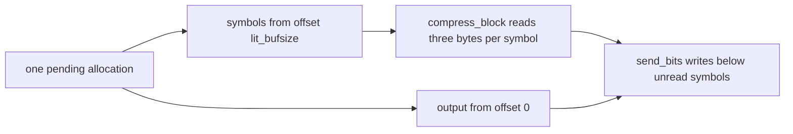

# Compressor, tree and checksum translation notes

These are source-review records for `deflate.c`, `trees.c`, `crc32.c`, `zutil.c`,
`compress.c`, `uncompr.c` and their headers. They explain representation choices
and places where a faithful translation is easy to get wrong. They do not state
the public contracts or establish that the C is safe.

Read [the deflate API](../api/deflate-stream.md) for caller-facing behavior,
[the design](../design/README.md) for representation rules and
[the deflate proof guide](../proof/deflate.md) for proof structure.
[Overview](../overview.md) alone records current progress and remaining work.
A source interpretation marked **to confirm** needs a proof. A finite execution
comparison is evidence of fidelity, not proof.

## Source and selected configuration

The source review used upstream commit
`757f0527154291bcf6bfbd6396ecde6bedd2db95`, version `1.3.2.1-motley`.
The source boundary is the pinned submodule plus the patches listed in
[the patch record](../../patches/README.md). There are currently no patches.

The selected target is the default static x86_64 Linux build with LP64 types.
The important preprocessing choices are:

| Choice | Translation consequence |
| --- | --- |
| Gzip enabled; `LIT_MEM` disabled | Gzip header states exist. Symbols use three bytes in `sym_buf`, within the pending allocation. There are no separate `d_buf` and `l_buf` fields. |
| `FASTEST` and `UNALIGNED_OK` disabled | Hash chains, the slow strategy and byte-wise `longest_match` are present. The alternate short matcher and unaligned short loads are absent. |
| Debug checks disabled | Assertions and traces execute no checks. Inline tally macros are used. The separate `_tr_tally` function is compiled but has no library caller. |
| Static generated tables | `tr_static_init` has an empty body. CRC table generation and one-time initialization are absent. |
| CRC `N = 5`, `W = 8` | Five eight-byte braids are live. Sixth-braid and ARM-specific branches are absent. The big-endian branch is compiled but unreachable on this target. |
| Generic allocator and memory operations | `zcalloc` takes its `malloc` branch. Copy and zero macros have the usual byte-memory semantics. |

The 16-bit alternatives, `MAXSEG_64K`, forced block choices and generated-header
programs are outside this configuration. `TOO_FAR` is 4096 and `OS_CODE` is 3.
A configuration extension must revisit these choices.

## Integer and memory representation

| C type | Selected Lean representation |
| --- | --- |
| `unsigned char`, `unsigned short` | `UInt8`, `UInt16` |
| `unsigned`, `uInt`, `z_crc_t` | `UInt32` |
| `unsigned long`, `uLong`, `ulg`, `size_t`, `z_size_t`, `z_word_t` | `UInt64` |
| `int` | `Int32` |
| `long`, `z_off_t`, `z_off64_t`, pointer difference | `Int64` |

Unsigned operations wrap. Signed operations need the C range checks, even when
Lean's machine integer operation would return a value. Small unsigned operands
promote to `int`. A cast after an expression does not change its evaluation type.

`strstart - block_start` is signed `long` arithmetic on this target: `long` can
represent the `uInt` operand. The same matters for `block_start -= (long)wsize`
during a slide and for the mixed expressions in `deflateParams`. They must not
become unsigned differences or unchecked signed subtraction. **to confirm**:
reachability invariants exclude overflow. A rough count of symbols or slides is
not that proof.

The two unions in `ct_data` each have two `unsigned short` members. They become
two shared cells: `Freq` and `Code` name one; `Dad` and `Len` name the other.
Tree construction deliberately overwrites a parent with a length, then a
frequency with a code. Independent fields would lose the aliasing.

Dynamic tree descriptors point into arrays embedded in their own state. Static
descriptors point to read-only tables. Those identities matter for framing and
for the pointer fix-ups in `deflateCopy`.

### Uninitialized storage and repeated reads

The default allocator returns fresh storage, not zeroed storage. `deflateInit2_`
explicitly zeroes its state record, but does not clear all of `prev` or the
window. `lm_init` clears hash heads; predecessor slots are written as positions
are inserted.

`slide_hash` intentionally reads the whole predecessor array. `longest_match`
can compare bytes beyond real lookahead. The model permits arbitrary
uninitialized integer values; the theorem must cover every such value. It must
show that a garbage predecessor is never used as an address. Copies preserve
those values. The fixed-garbage and fresh-pointer limitations are described in
[safety](../safety.md) and [the trusted base](../trusted-base.md).

In `build_tree`, a conditional compares both child depths, then reads the
selected depth again. Caching the compared value omits that source read. The
[depth-read regression](../../tests/regression/trees-depth-read/README.md)
includes a structural check because initialized examples give the same final
value either way. **to confirm**: each actual depth read follows the write that
initializes it. Agreement on initialized fixtures does not prove that history.

## Allocation, initialization and copying

`zcalloc(items, size)` multiplies 32-bit unsigned arguments before widening for
allocation. Wrapping is defined behavior. Compressor allocation sizes stay
below that threshold: the state is 5968 bytes; the window is `2 * w_size` bytes;
`prev` has `w_size` 16-bit entries; `head` has `hash_size` 16-bit entries; and
pending storage is `4 * lit_bufsize` bytes.

`deflateInit2_` checks version, stream size and parameters before constructing
the state. It raises a requested eight-bit zlib window to nine bits. Preserve
these checks and their order. Absent allocator callbacks are replaced by the
defaults. Custom callback behavior has a separate scope in
[deviations](../deviations.md).

The version check reads only the first byte after its null test. State checks
read a deflate-state back-pointer and status; they do not make an arbitrary
pointer or an inflate-state pointer safe to interpret as a deflate record.
**to confirm**: the represented pointer kind and legal call history justify
these reads without silently narrowing the public refusal domain.

There are five owned allocations: state, window, predecessors, heads and pending
storage. After state allocation, the four buffer allocations occur before the
combined failure check. Later attempts still occur when an earlier buffer
allocation fails. Cleanup must free exactly the blocks obtained, clear the
public state as the C does and retain the source return code. Fresh model
pointer fields being null cannot replace a proof that C initialized every
pointer read by cleanup.

`deflateEnd` reads status before freeing. It frees pending storage, heads,
predecessors, window and state in that order, then clears the stream's state
pointer. It can return `Z_DATA_ERROR` for a busy stream after freeing everything.
Return codes and ownership effects are separate facts.

`deflateCopy` copies the state record, allocates its backing blocks, then copies
the public stream and installs the destination state. Failure frees the new
blocks, not the source pointers copied into the record. Successful copying
retains these distinctions:

- The window copy is limited by `high_water`.
- The predecessor copy covers a whole window after a slide, otherwise the
  prefix determined by `strstart - insert`. **to confirm**: `insert <= strstart`
  justifies that unsigned size calculation.
- The pending-output pointer retains its offset within the new block. Unsent
  pending bytes and used symbol bytes are copied to their corresponding offsets.
  `sym_buf` becomes the new pending base plus `lit_bufsize`.
- The stream back-pointer and dynamic descriptor pointers change to the
  destination. Borrowed gzip-header and static descriptor pointers stay shared.

The C uses whole-stream copying, so overlaps cannot silently be treated as safe.
Identical source and destination can also replace the source state and lose its
old ownership; whether the API admits that call is **to confirm**. Byte copies
can include uninitialized data. A value copy must preserve that data and the
source order of subsequent fix-ups.

## Window movement and strategy loops

`read_buf` decreases `avail_in` before copying, computes the checksum over the
destination bytes, then advances `next_in` and `total_in`. The stored strategy
also uses it to copy input directly to caller output. Changing the checksum
input or moving the counter update changes the translation.

`fill_window` computes free space in `ulg`, narrows to `unsigned`, and may slide
before testing whether input remains. A slide copies the upper window region
down, adjusts positions and the signed block origin, caps `insert`, then slides
hash entries. High-water zeroing initializes a read margin; it does not make all
future window bytes meaningful input.

**to confirm**: slide copies are bounded and disjoint, and their sizes do not
underflow. Matcher reads, including final pre-incremented comparisons, stay
inside the window even past `strstart + lookahead`. Returned match lengths are
clipped to real lookahead. These are different obligations.

In `longest_match`, `continue` reaches the `do` loop condition, which follows a
predecessor and conditionally decrements the chain counter. `break` skips that
condition. The inner scan performs eight short-circuited pre-increment
comparisons before testing its end pointer. Replacing it with a memory
comparison would change the reads. **to confirm**: reachable chain entries are
older inserted positions, so following them is safe and terminates even when
tuning values alter the counter.

`deflate_stored` first tries to write directly to caller output. It emits a
dummy stored header, overwrites its four length bytes, flushes it, copies window
bytes, then reads input directly into output. It subsequently reconstructs
retained history in the window and can fall back to buffered stored blocks.
Preserve these stages and their early exits.

Its `len`, `left`, `have` and `used` locals are unsigned. For example,
`(unsigned)(strstart - block_start)` performs a signed difference before
narrowing; `((unsigned)bi_valid + 42) >> 3` casts before addition.
`MIN(pending_buf_size - have, MAX_STORED)` compares in `ulg`. **to confirm**:
block origins used as pointers are nonnegative, `insert <= w_size`, and backward
input pointers stay within bytes already consumed from that object. `matches`
records deferred hash slides while level zero bypasses the matcher.

| Function | Source distinction to preserve |
| --- | --- |
| `deflate_fast` | Insertion inside a short match differs from hash re-priming after a long match. The flush macro can return from the enclosing loop. |
| `deflate_slow` | Lazy match state persists between iterations. After flushing a pending literal, positions change before output exhaustion is checked. The final pending literal is followed immediately by a flush. |
| `deflate_rle` | Refills at `lookahead <= MAX_MATCH`, uses a previous byte only when `strstart > 0`, and preserves the unrolled scan and clipping. It does not maintain hash chains. |
| `deflate_huff` | Emits literals without matching and resets `insert`. Empty-input and flush exits remain part of its loop. |

## Public state changes that constrain translation

These observations explain source decisions. Full domains and effects belong
in [the API manual](../api/deflate-stream.md).

### Reset, dictionary, header and parameter operations

`deflateResetKeep` resets counters and block state, normalizes a negative
wrapper, selects the initial checksum and clears the header pointer. It saves
level-zero deferred slides around `_tr_init`, which clears `matches`.
`deflateReset` additionally runs `lm_init`. Combining them would lose retained
history behavior.

`deflateSetDictionary` saves the input view and wrapper, disables checksum
wrapping, installs dictionary input, calls `fill_window`, builds hash entries
and restores the saved view and wrapper. The zlib checksum is computed before
truncating a long dictionary to its retained suffix. Calls through `read_buf`
also increase `total_in`. That counter effect was observed in the earlier
review; interpreting the public counter's dictionary meaning is **to confirm**,
rather than grounds for deleting the update.

Raw dictionary replacement and zlib preset dictionaries have different domains.
The C can accept a zlib dictionary after stream end even though the ordinary
model describes documented ordering before compression. A model rejection must
not replace that execution. See [deviations](../deviations.md).

`deflateGetDictionary` copies the suffix ending at `strstart + lookahead`,
capped by `w_size`. Its buffer and length outputs are independently optional.
Preserve source pointer arithmetic and each guarded write.

`deflateSetHeader` stores a borrowed pointer; it neither copies nor frees the
header. The C checks the wrapper but does not enforce documented call order.
Replacing the pointer with null after header emission begins can leave a later
header state dereferencing null. **to confirm**: legal histories establish the
non-null header relation. Extra data, its low-16-bit length, and NUL-terminated
name and comment must stay valid while emission resumes across calls. Shrinking
`extra_len` below `gzindex` can wrap the remaining-length calculation. These
requirements do not establish an unrestricted pointer-domain result.

`deflateParams` can call `deflate(..., Z_BLOCK)` before changing compressor
function or strategy. Refusal can follow that call's effects. Level-zero
bookkeeping chooses between sliding and clearing hashes when compression
resumes. The compressor function pointer becomes the stored/fast/slow choice;
its equality test must retain the source dispatch decision.

`deflateTune` stores negative arguments into unsigned fields by conversion; it
does not reject them. `nice_length` stays signed. A zero chain limit can wrap on
pre-decrement. **to confirm**: the chain argument and buffer invariant cover the
accepted tuning domain. Assuming only default tuning values would narrow a
later `deflate` theorem.

### Priming, queries and the main state machine

`deflatePrime` rejects bit counts outside `0..16`. Before its capacity refusal,
it can compact pending bytes with a forward byte loop. Preserve that loop and
its effect on refusal. The insertion loop is a `do` loop, so zero bits still
execute its body. A full bit buffer can insert zero bits in a step, flush, then
make progress.

The mask and left shift are signed `int` expressions. **to confirm**: operands
and counts exclude overflow and invalid shifts. Right shift of a negative
`value` follows the target's arithmetic-shift behavior. That is
implementation-defined C behavior, not a reason to reject negative values.

`deflatePending` writes the bit output first. It narrows pending bytes to
`unsigned`, compares with the original `ulg`, then overwrites with the unsigned
maximum on overflow before returning `Z_BUF_ERROR`. Both stores matter.
`deflateUsed` has its own optional bit output. Scalar writes need their explicit
represented-cell and aliasing scope.

The main `deflate` header phases are sequential `if` statements, not exclusive
branches. One call can traverse several phases. Each can return with pending
output, `gzindex` and `last_flush` ready for the next call. Header loops can
return from the enclosing function. The header CRC helper captures stream and
state and checksums the exact pending slice produced since its saved beginning.

Dispatch checks level zero, Huffman-only and RLE before using the configuration
table function. Finishing writes a trailer and negates `wrap` to record its
emission. Error checks, pending flushes and `last_flush` changes retain source
order, including calls that ultimately refuse input.

## Trees, bit output and the shared-buffer overlay

The pending block contains both output and symbols:

`sym_end = 3 * (lit_bufsize - 1)`. Tallies write distance low byte, distance high
byte and literal or length byte, then update frequencies. A literal uses zero
distance. A match needs positive distance before the macro's 16-bit decrement:
zero would wrap to 65535 and make `d_code` index 767 in a 512-entry table.
**to confirm**: callers supply distances `1..32768` and length offsets `0..255`,
and every flush decision leaves room for its three-byte tally.

Bit-output helpers perform no capacity checks. **to confirm**: every write fits
and cannot overwrite unread symbols. The overlay bound depends on block choice
and tree lengths, not just allocation size. Stored blocks also need capacity
for padding, four length bytes and payload.

The earlier overlay analysis included a checked case analysis for memory
levels 4 through 9 and a relaxation-based analysis for levels 1 through 3.
These different forms of evidence do not prove all actual executions. See
[the tree proof guide](../proof/trees.md) for the mathematical argument.

`send_bits` promotes `ush` to signed `int` for shifts, then narrows stores.
**to confirm**: bit counts and code ranges exclude invalid shifts and signed
overflow, including a shift by 16. `bi_windup` computes
`((bi_valid - 1) & 7) + 1`; zero valid bits yield eight on this target.
Replacing that result with zero changes `bi_used`.

| Function or concern | Source distinction and required justification |
| --- | --- |
| `init_block`, `_tr_init` | Reset clears frequencies and costs, not every old length or parent. Initialization also installs descriptors and resets bit-buffer fields. |
| `gen_codes` | Local `next_code[16]` has no read of entry zero. Entries `1..15` are written before use. Starting codes use unsigned arithmetic and narrow to 16 bits. Post-increment supplies the old value to reversal. |
| Heap construction | `pqremove` reads the old heap end, decrements `heap_len`, then sifts. Equal frequencies compare depths. Selected-depth rereads remain separate accesses. |
| `build_tree` | Forces extra leaves when needed. Cost decrements wrap in `ulg` by design. Frequency sums promote to `int` before narrowing to `ush`. |
| `gen_bitlen` | Replaces parents with lengths. **to confirm**: parent writes precede reads, heap nodes are valid, and length repair finds a nonzero lower count before decrementing below zero. Its cost adjustments wrap by design. |
| `scan_tree`, `send_tree` | The former writes the `max_code + 1` sentinel; the latter reads it with the same maximum. Dynamic arrays have 573, 61 and 39 entries. **to confirm**: the extra slot is in bounds and stays a next length, never a real length used as a tree index. |
| `_tr_flush_block` | Stored, fixed and dynamic costs determine emission before reset. Preserve rounded unsigned costs and exact tie choices. |

Macro scope and control flow also matter. `send_bits` declares `len` and `val`;
the distance tally declares `len` and `dist`. Existing arguments avoid capture.
`put_short` and `MIN` can evaluate arguments repeatedly. `INSERT_STRING` is an
ordered comma expression. `FLUSH_BLOCK` can return from its caller;
`FLUSH_BLOCK_ONLY` cannot. Compiled-out assertions prove none of their bounds.

## Bounds and buffer utility wrappers

`compressBound_z` uses wrapped additions and a saturation test. A proof of the
formula alone does not show that every compressor output fits it.
`deflateBound_z` also reads wrapper state and optional header strings. Each
scan includes the terminating null. It normalizes a negative `wrap` after
finishing and retains every overflow guard.

The historical `deflateBound_z` header issue concerns correctness, not signed
overflow: `2 + extra_len` is evaluated as 32-bit unsigned before addition to the
64-bit wrapper cost. For `extra_len >= 0xfffffffe` it wraps, whereas emission
uses only `extra_len & 0xffff`. The earlier proposed correction used
`2 + (z_size_t)(extra_len & 0xffff)`
([upstream discussion](https://github.com/madler/zlib/pull/1360)). This history
does not authorize an unlisted patch. **to confirm**: the output bound follows
for its stated source and header domain.

`compress2_z` and `uncompress2_z` have automatic local streams. Creating them
must not fail, consume an allocator-oracle call or shift the failure index of
library allocations. Address-taken scalar locals also have automatic lifetime.
Model storage is released on every source return without adding a C allocation.
The [allocation regression](../../tests/regression/compress-allocation/README.md)
records the corrected distinction and error-ordering observations.

The utility loops refill 32-bit availability fields from wider remaining
lengths. They continue only on `Z_OK`, call `End` after successful initialization,
and retain result mapping and final scalar writes. Late decoder memory failure
can follow emitted output; it does not imply an empty destination.

Two named decisions from the original review remain relevant:

- **R-2, wrapper null reads.** `compress2` reads `*destLen` before its `_z` call;
  `uncompress2` reads both scalar cells. The `_z` null tests cannot protect those
  reads. Separate execution witnesses diagnosed them. They are not valid-call
  comparison rows.
- **D-4, null subtraction.** `compress2_z` computes `next_out - dest` after a
  zero-capacity null destination. Its translation explicitly allows null minus
  null to be zero. Whether that matches the selected C language semantics is
  **to confirm**. Equal results and silent sanitizers cannot settle it.

The compressor adapter represents its length pointer as an optional input and a
returned value. It cannot express aliases with byte buffers. Counted
decompressor adapters also have scalar separation limits. See
[deviations](../deviations.md); these limits do not settle the full C domain.

`uncompress2_z` uses the address of its local stream's `reserved` field as a
non-null dummy output at zero capacity. A separate represented byte can model
that use only if it is never dereferenced and its lifetime and aliasing are
accounted for. **to confirm**: zero capacity excludes a write through it during
the actual decoder call.

## CRC and small utility decisions

`crc32_z` returns zero immediately for a null buffer. On the non-null path it
masks the complemented CRC to 32 bits. Braiding begins at length 47. Alignment
consumes at most seven bytes, leaving at least one 40-byte block. The
`while (--blks)` loop processes all but the final block, which is combined
separately. **to confirm**: this argument bounds every load and excludes counter
wrap.

Pointer-to-integer tests and byte-to-word casts cross representation boundaries.
The address helper uses offsets for allocated byte blocks and arbitrary stable
origin residues for static and embedded byte arrays. The
[static-address regression](../../tests/verification/regressions/crc-static-address.lean)
checks the former counterexample's valid 47-byte static-table read. Local proofs
cover every represented byte-array view and residue. Word loads assemble eight
bytes in target byte order. **to confirm**: general ABI layout and the C cast's
strict-aliasing semantics are covered by the representation bridge. Reading the low byte of the local
endian marker also depends on the target. Default execution cannot test its
unreachable big-endian branch.

`multmodp` scans bits 31 down to zero of its first operand. If its low word is
zero, the mask reaches zero and the C loop never terminates. The earlier review
observed this through `crc32_combine_op(1, 2, 1UL << 32)`. The documented operator
comes from `crc32_combine_gen`; an arbitrary nonzero 64-bit value is insufficient.
`crc32_combine_op` handles zero before calling `multmodp`. Negative lengths are
rejected before `x2nmodp` can arithmetic-shift a negative value forever. Its
index is masked by 31. **to confirm**: generated operators have the nonzero low
word needed for termination. This misuse observation is not a confirmed defect
within the documented domain.

The source review regenerated the static tree and CRC headers and reported
byte-identical results. That supports table fidelity, not mathematical meaning.
Important shapes include the 288-entry literal tree, 30-entry distance tree,
512-entry distance map, 256-entry length map, 256-entry CRC table, eight-row braid
tables and 32-entry polynomial-power table. Static entries and bounds must stay
faithful to the source.

`zError` checks the error range before evaluating `2 - err`. Hoisting subtraction
could overflow for an arbitrary `int`. `zlibCompileFlags` yields 169 for the
reviewed configuration; retain its source decisions rather than treat that
number as universal. Returned version and error strings are read-only statics.

## Evidence boundary

The earlier review recorded 8000 randomized compressor sessions with sanitizers
and round-trip comparison. It varied levels, strategies, memory levels,
wrappers, chunk sizes down to one output byte, flush modes, parameter changes
and copying. It reported no mismatch or sanitizer diagnostic in those sessions.
Dictionary setting, priming and custom gzip headers were outside that run. The
one-byte-window stored path was also excluded.

These observations do not prove safety for all inputs, initialization history,
overlay capacity, other configurations or the C assumptions above. Focused
reproducible evidence belongs with its regression. Acceptance rules belong in
[checking](../checking/README.md). [Overview](../overview.md) records current
unresolved items and proof acceptance.
