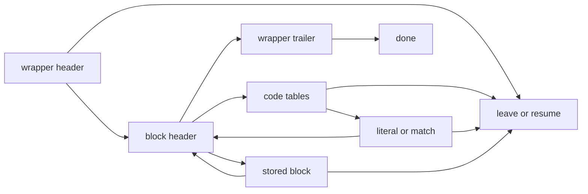

# Decoder translation review

These notes cover `inflate.c`, `inffast.c`, `inftrees.c` and `infback.c`.
They explain source order, representation choices and review hazards. They do not establish
function correctness. A source reading that still needs a proof is marked **to confirm**.
See [overview](../overview.md) for status and remaining work, [API](../api/README.md) for
contracts, and [proof notes](../proof/README.md) for proof structure.

## Source and configuration

The source is the pinned `zlib/` tree plus the patches listed in
[patches/README.md](../../patches/README.md). The recorded source pin is
`757f0527154291bcf6bfbd6396ecde6bedd2db95`, version `1.3.2.1-motley`.
The listed Adler-32 patch does not modify these four files. The historical `ub.patch`
was never applied here. In particular, `inflateCopy` still uses relational pointer comparisons.

The translation selects the default x86_64 Linux LP64 build. Gzip support and the C fast
decoder are enabled. `Z_SOLO`, `PKZIP_BUG_WORKAROUND`, `INFLATE_STRICT`,
`INFLATE_ALLOW_INVALID_DISTANCE_TOOFAR_ARRR`, `BUILDFIXED`, `MAKEFIXED` and debugging are
disabled. Thus `dmax` is written but not read; `inflateUndermine` sets `sane = 1` and returns
`Z_DATA_ERROR`; and `inflate_fixed` uses `inffixed.h`, without runtime table construction.
Other configurations are separate proof domains.

Unsigned byte, short and int values have widths 8, 16 and 32. Unsigned long and pointer
sizes are 64 bits; `int` is signed 32-bit and `long` and pointer differences are signed
64-bit. Unsigned arithmetic wraps. Signed arithmetic and shifts retain their checks.
The [translation design](../design/README.md) and [runtime schema](../runtime-schema.md)
define the representation. Field offsets belong in the schema, not in a second layout table here.

## Control flow and bit buffers

`inflate` keeps its C registers in `IL`. Each mode is a helper in
`ExceptT Ex (StateT IL M)`. A switch `break` returns to the dispatcher. `Ex.leave` jumps to
`inf_leave` with the registers as they stand; it does not roll back prior reads or writes.
`Ex.ret` is a direct C return. Fall-through calls the next mode body. The dispatcher reads
`state->mode` from the heap on each iteration.

The following details are observable and must survive helper boundaries:

- `TYPE` falls into `TYPEDO` without writing `mode`. If reading the block header runs out of
  input, the saved mode is still `TYPE`. This affects `data_type` and the next entry.
- `PULLBYTE` checks for input before changing anything. A failing `NEEDBITS` preserves all
  bytes pulled on earlier iterations. `DROPBITS` changes `hold` before subtracting from
  `bits`; `BYTEBITS` uses the old bit count in both expressions.
- `BITS(n)` casts `hold` to unsigned int before masking with `(1U << n) - 1`.
  `hold` itself is unsigned long. Neither the cast nor the shift width may be simplified.
- In `HEAD`, the header modulus expression adds an unsigned 32-bit shifted term to
  `hold >> 8` in 64-bit arithmetic. Primed high bits participate in that expression.
- `DICT` returns `Z_NEED_DICT` after `RESTORE` and the input-total update. It bypasses
  the normal epilogue. `MEM` and `SYNC` also return directly.
- `CHECK` updates output totals and the checksum, then resets the local output baseline.
  The epilogue uses that changed baseline, avoiding a second count of the same bytes.
- `inf_leave` restores registers before it updates the window. A window-allocation failure
  returns `Z_MEM_ERROR` before later totals and checksum updates. Output already written
  remains written; memory error does not imply empty output.

The usual normalized bit-buffer facts are `bits ≤ 39` and `hold < 2^bits`.
They are proof obligations, not assumptions valid for every arbitrary state record.
`inflatePrime` clears the buffer for a negative bit count, refuses counts above 16 or a
combined count above 32, and masks `value` using the signed-long expression before converting
it to unsigned long. Negative values must follow that conversion order.

`inflateMark` also needs its exact conversions: sign-extend `back`, convert to unsigned
long, shift by 16, convert back to signed long, then add the unsigned conditional term.
The default platform's out-of-range conversions are modular. The error result is `-65536`.

## Decode tables and flags

`code` has byte fields `op`, `bits` and a 16-bit `val`. Default table capacity is
`ENOUGH_LENS = 852`, `ENOUGH_DISTS = 592`, total 1444. Code lengths are at most 15.
The code-length permutation is `16,17,18,0,8,7,9,6,10,5,11,4,12,3,13,2,14,1,15`.

| Entry | Meaning |
| --- | --- |
| `op = 0` | literal |
| `op = 1..15` | subtable link; low bits give its index width |
| `op = 16 + e` | length or distance base with `e` extra bits |
| `op = 96` | end of block; both bits 32 and 64 are set |
| `op = 64`, `68` or `193` | invalid symbol |

Flag order matters. The slow literal/length decoder tests end-of-block before invalidity.
The fast decoder tests literal, length, link, then end-of-block/invalid exits in source order.
An arbitrary safety-shaped table does not justify interchanging these tests. Semantic
bridges require compatible leaf flags from actual construction or fixed tables.
`DIST` lacks the `op != 0` guard used by `LEN`; only a distance-table invariant makes that
safe. `CODELENS` reads `val` without checking `op`. An all-zero alphabet produces two
invalid entries with `val = 0`; decoding eventually fails the missing-end-of-block check.

The fixed tables are copies of `inffixed.h`: 512 literal/length entries and 32 distance
entries, with roots 9 and 5. Reconstructing them through `inflate_table` changes four
literal/length entries, indices 99, 227, 355 and 483. The generated invalid flags are 68 or
193; the header uses 64. All reject the reserved symbols, but byte-for-byte fidelity requires
the header values. The older reference to tables inside `fixedtables` in `inflate.c` was stale.
The base/extra arrays and permutation are indexed constants. Error messages remain readable,
read-only string blocks because callers can inspect `strm->msg`.

### `inflate_table`

Keep the counting, Kraft check, sorting, table fill and tail in source order.
Lengths within `0..15`, sufficient `lens`/`work` space and table capacity are internal
premises that callers must establish; the function does not validate every index itself.
The no-symbol case writes two invalid entries and updates both out-parameters before
returning success. Oversubscribed and disallowed incomplete alphabets return `-1`.
Capacity exhaustion returns `1`, possibly after table entries have been written.

The translation passes `*table` and `*bits` by value and returns their new values.
An error preserves those two scalar values, but does not undo entry writes. Callers must
preserve that distinction on every return path. In `CODELENS`, `lencode` is assigned before
the length-table call, and `distcode` is assigned from the advanced `next` before the distance
call. Reordering either assignment changes the heap history.

Keep these arithmetic details:

- `count` and `offs` are 16-bit arrays with C promotion and narrowing.
- `left` is signed, including its shifts and subtractions. The later `1 << curr` is a
  signed expression; the earlier `1U << root` is unsigned.
- The variable `min` changes meaning at `min = fill`: it now holds the current table size.
- `fill -= incr` and the final `while (copy--)` in the caller retain unsigned behavior.
- Root links store a pointer difference narrowed to 16 bits. Their index and shift bounds
  depend on the canonical-code construction, **to confirm** against the written heap.

### Slow lookup and malformed lookahead

A root lookup can select an entry before its nominal root width is available, provided the
selected entry's own consumed length fits the available prefix. The needed property is
stability under future suffix bits. A link requires the corresponding second-level lookup
and both consumed lengths. Memory bounds alone do not establish symbol meaning.

Pulled input and checked input differ. A decoder can pull malformed future bits while
already having enough checked bits to justify a literal or match. Requiring every pulled
byte to have a valid continuation is false. The causal model instead uses a checked bit
prefix with a valid completion, and requires the output to agree with every compatible
completion and every still-permitted dictionary. An unknown wrapped dictionary cannot be
silently replaced by the empty dictionary. This is a specification distinction, not permission
to alter refill order. See [API contracts](../api/README.md) and [proof notes](../proof/README.md).

The earlier fixed eight-byte error-detection lag also has a counterexample. It cannot be used
as a source invariant or repaired by merely increasing the constant. Current status belongs
in [overview](../overview.md).

## Fast decoder: margins, copies and rollback

`inflate_fast` enters in `LEN`, with at least six input bytes, 258 output bytes,
`start ≥ avail_out`, and fewer than eight buffered bits. `inflate` checks all these margins.
`inflateBack` checks the byte margins but relies on its mode transitions for `bits < 8`:
**to confirm**, including dynamic tables and stored blocks.

`last = in + (avail_in - 5)` and `end = out + (avail_out - 257)` use unsigned subtraction.
Their safety depends on the entry margins. Each iteration reads at most six bytes and writes
at most 258. `beg = out - (start - avail_out)` names the beginning of this call's output.
The two callers use `start` equal to the original output room or the callback window size.

`here` is a pointer to a table entry here; the slow decoder copies an entry value.
`dolen` and `dodist` preserve the backward jumps for links. A valid table bounds link depth;
fuel in the translation does not itself prove termination. Error and end-of-block `break`s
skip the loop condition. Pointer comparisons in that condition and in final accounting must
compare pointers in the same object.

Copies from the window and current output retain the source's unrolled loops and read/write
order. Overlapping output matches are intentional: a newly written byte can be read by a
later copy step. They cannot become `memcpy` or a snapshot of the initial source range.
The minimum match length is three. Every pre-decrement copy loop needs a positive count.

On every exit, including invalid symbols and too-far distances, the epilogue returns whole
unused bytes to the input, retains only `bits mod 8` low bits, and writes back pointers and
remaining counts. A semantic proof must track the exact source-bit prefix through this
rollback, not just the number of consumed bytes.

## Window, dictionaries, copying and buffer views

The retained history is chronological data, not just `whave` bytes of arbitrary storage.
For an allocated window, `8 ≤ wbits ≤ 15`, `whave ≤ wsize`, and `wnext < wsize` when
`wsize > 0`; a partly filled window has `wnext = whave`. A full ring's chronological order
starts at `wnext`. Match proofs must connect that order to prior output and dictionaries.

`updatewindow` allocates uninitialised bytes, then copies either the last full window or a
split suffix around the ring boundary. Only written history may be read. `inflateGetDictionary`
returns the tail from `window + wnext` followed by the prefix. `inflateSetDictionary` validates
the Adler identifier in `DICT` and passes the dictionary end to `updatewindow`; raw replacement
has different epoch semantics from one preset dictionary. `inflateResetKeep` retains history;
`inflateReset` restores the requested settings and clears history, freeing a changed-size window.

`inflateCopy` allocates through the source allocator, frees the new state if window allocation
fails, and clears `dest->state` on its source-check and allocation failures. On success it
copies both records, repairs the stream backlink, rebases internal table pointers and copies
only `whave` window bytes. `next` always refers into the state's `codes` array.
`lencode`/`distcode` either name that array or the shared fixed tables. Those facts must come
from initialization and preservation, **to confirm**. Source and destination records must not
overlap.

The existing source tests whether `lencode` lies within `codes` using `>=` and `<=`.
With fixed tables these are different objects. The translation retains the comparisons and
faults; it does not implement the historical proposal `lencode == codes`. Earlier notes
recorded a sanitizer pointer-pair report for a copied stream stopped inside a fixed block,
and a clean run after that proposed change. That is historical evidence, not a reproduction
performed by this documentation revision or an applied patch.

Byte input, output, header and dictionary ranges must meet their actual access requirements.
The runtime now permits disjoint ranges in the same byte object for `memcpy`; the older
claim that distinct blocks were required is obsolete. Overlap still faults. Local fast-decoder
lemmas with distinct raw blocks do not cover every public buffer view; see
[deviations](../deviations.md).

## Initialization, recovery and pointer representation

`inflateInit2_` zeroes its allocated state before setting fields and calling reset.
Version checks inspect only the first version byte and the stream size, 112 in this build.
`inflateReset2` rejects negative values below `-15` before negation, so `INT_MIN` cannot reach
that operation. Custom allocators remain outside the represented default-allocator domain.

`inflateStateCheck` preserves short-circuit checks before dereferences. A deflate-state cast
faults in the object model; a numeric layout coincidence is not a proof of a valid inflate
state. Initialization families must stay paired: `inflateBackInit_` is not interchangeable
with `inflateInit2_`, and their end functions own different objects.

`inflateGetHeader` retains a caller pointer and writes `head->done` unconditionally.
It therefore needs a non-null record and live auxiliary buffers of their advertised capacities.
Its documented timing matters to `extra_len - length`. Preserve the assignment inside
`EXTRA`'s condition and the post-increments in `NAME` and `COMMENT`.

`syncsearch` returns the updated scalar `have`; `inflateSync` stores it at the source call
boundary. Recovery first searches buffered whole bytes, then caller input, and restores saved
totals and wrapper facts after reset. Local four-byte arrays for recovery and header CRC
have real temporary byte storage and are released on all returns.
`inflateGetDictionary` represents its optional scalar length out-parameter as a returned
value. This does not model arbitrary aliases of a caller scalar pointer; public-domain review
must account for that representation choice.

## Callback decoder

`inflateBackInit_` allocates a state without zeroing it. It writes only its window settings,
window pointer, history counters and `sane`. Fresh integers are arbitrary and fresh pointer
fields are null in the model. The latter is weaker than C. A proof must show each pointer was
written before it is read; absence of a runtime fault is insufficient. The mode, bit registers,
code lengths and table pointers used by `inflateBack` are initialized along its paths:
**to confirm** by temporal initialization reasoning.

The window is supplied and owned by the caller. `inflateBackEnd` frees only the state.
`ROOM` resets output space and writes `whave` before calling `out`. `PULL` calls `in` only
when the current input is exhausted; a zero result sets `next = NULL` and returns buffer error.
The final partial-window `out` call happens before testing whether `ret == Z_STREAM_END`.
It can therefore occur on an error path, including after an earlier callback refusal.
The final epilogue writes only `next_in` and `avail_in`, not the output registers.

Callbacks run on the shared heap. The implementation's `InCb` receives the current input
pointer and returns `(count, newPointer)`; it does not allocate the older proposal's real
cell for `&next`. A callback that retains that address and later writes through it is outside
this representation. `OutCb` receives the window pointer and length and returns an integer.

Callback obligations are caller premises, not assumed specifications of zlib callees.
They include valid readable input until the next `in` call, preservation of the active window
slice and stream state, and suitable framing of callback effects. Descriptor storage may share
the window allocation outside that slice. Additional restrictions must be explicit in
[deviations](../deviations.md). A concrete initialized example is needed for a top-level claim.

Returning callbacks alone do not imply termination. An input callback can supply infinitely
many empty non-final blocks. A terminating theorem needs a finite input bound or another
stated progress condition. Functional observations must include callback events and failures;
there is no unconditional promise that failed output is delivered exactly once.
