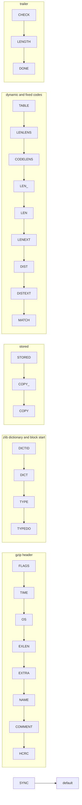

# Translation notes: `inflate.c`, `inffast.c`, `inftrees.c`, `infback.c`

Analysis for the people who translate these four files. It reads the C; it contains no proofs. Where a reading of
the C still has to be checked by a proof or a test it is marked **to confirm**. Facts were taken from the source and
from the output of the C preprocessor; three facts were also checked by running the real C (marked **run**).

Contents: 0 source and live configuration; 1 (a) table of functions; 2 (b) undefined behaviour and `ub.patch`;
3 (c) static tables; 4 (d) struct fields; 5 macros; 6 `inftrees.c` and `inffast.c`; 7 small functions of `inflate.c`;
8 `inflate()` outline; 9 `infback.c` and the call-backs; 10 decisions; 11 surprises; 12 order of work.

## 0. Source, line numbers, conventions

* Verified source: zlib commit `757f0527154291bcf6bfbd6396ecde6bedd2db95` (`ZLIB_VERSION "1.3.2.1-motley"`) plus the
  patches. `patches/0003-adler32-null-one.patch` touches only `adler32.c` and has no effect on these files. `ub.patch`
  (described in the old repository; one hunk in `inflate.c`, one in `gzlib.c`) is **not yet in this workspace**. These
  notes assume it is applied; its `inflate.c` hunk is discussed in section 2.
* **Line numbers are those of the original (not preprocessed) files**. `inflate.c` is the file with the `ub.patch`
  hunk applied. The hunk replaces two lines by one at L1383, so for lines after L1384 the upstream line is the
  patched line plus 1. The other three files are unpatched. Headers: `inflate.h`, `inftrees.h`, `inffast.h`,
  `inffixed.h`, `zutil.h`, `zlib.h` as in the pinned tree.
* Configuration: default x86_64 Linux build (LP64, `./configure --static`). Every `#ifdef` was decided by running the
  C preprocessor (`-E -P`, with `-D_LARGEFILE64_SOURCE=1 -DHAVE_HIDDEN -DHAVE_UNISTD_H=1 -DHAVE_STDARG_H=1`) on each
  file and reading what is left.
* Names: a Lean identifier cannot be `have` or `in` (keywords). The skeletons use `have_`, `in_`, `out_`. This is a
  renaming only.
* Types (translation guide): `unsigned char` = `UInt8`, `unsigned short` = `UInt16`, `unsigned` and `uInt` =
  `UInt32`, `unsigned long`, `uLong`, `size_t` = `UInt64`, `int` = `Int32`, `long` = `Int64`, an `enum` = `UInt32`.
  A pointer difference is `Int64` (`ptrdiff_t`).

### 0.1 Which branches of the C are live

| Macro | Value in the default build | Live / dead consequence |
| --- | --- | --- |
| `GUNZIP` | defined (`inflate.h` L15-17, since `NO_GZIP` is not) | live: modes `FLAGS` `TIME` `OS` `EXLEN` `EXTRA` `NAME` `COMMENT` `HCRC` `LENGTH`; `CRC2`, `CRC4`; `UPDATE_CHECK` is `state->flags ? crc32 : adler32`; gzip magic test in `HEAD` (L521); `windowBits &= 15` (L163); the `state->flags ? hold : ZSWAP32(hold)` test in `CHECK` (L1093) |
| `Z_SOLO` | undefined | live: `inflateInit2_` and `inflateBackInit_` install `zcalloc`/`zcfree` when `zalloc`/`zfree` are null (L195-196, L203; infback L41-42, L49) |
| `PKZIP_BUG_WORKAROUND` | undefined | `ENOUGH_LENS` 852, `ENOUGH_DISTS` 592, `ENOUGH` 1444 (`inftrees.h` L50-51, L57); the check `nlen > 286 \|\| ndist > 30` is live (inflate L799-806, infback L303-310) |
| `INFLATE_STRICT` | undefined | dead: `inflate.c` L1019-1025, `inffast.c` L57-59, L84-86, L156-163. So `state->dmax` is written (L114, L555; infback L56) and **never read** |
| `INFLATE_ALLOW_INVALID_DISTANCE_TOOFAR_ARRR` | undefined | dead: `inflate.c` L1041-1053, `inffast.c` L177-195. `inflateUndermine` takes the `#else` branch (L1403-1407): sets `sane = 1`, returns `Z_DATA_ERROR` |
| `ASMINF` | undefined | the C `inflate_fast` is live (`inffast.c` L13-305) |
| `BUILDFIXED`, `MAKEFIXED` | undefined | dead: `inftrees.c` L313-349 (`buildtables`), L365-367 (`z_once`), L374-424 (`main`). Live: `#include "inffixed.h"` at L351 |
| `ZLIB_DEBUG` | undefined | `Trace`, `Tracev`, `Tracevv` expand to nothing. The preprocessed files contain no `fprintf`. A statement `Tracev((...));` is an empty statement |
| `ZLIB_CONST` | undefined | `z_const` is empty; `FAR` is empty; `local` is `static` |
| `HAVE_HIDDEN` | defined | `ZLIB_INTERNAL` is `visibility("hidden")` (`inflate_table`, `inflate_fixed`, `inflate_fast`). No semantic effect |
| `Z_ONCE` | undefined | `inflate_fixed` does not call `z_once` |

## 1. (a) All functions: lines and difficulty

27 live functions (21 in `inflate.c`, 1 in `inffast.c`, 2 in `inftrees.c`, 3 in `infback.c`). Dead code (not counted):
`buildtables` and `main` in `inftrees.c`. "Lines" is the number of lines from the signature to the closing brace.
Difficulty is for the **translation** (not the proof): easy = straight-line code; medium = struct copy, pointer
arithmetic, allocation, or a small loop; hard = labels or loops with early exit, pointer-heavy, or a call-back.

| File | Function | Lines | Count | Difficulty | Why |
| --- | --- | --- | --- | --- | --- |
| inflate.c | `inflateStateCheck` (local) | 88-98 | 11 | easy | reads `state` through `strm->state` which may be a deflate state (type pun, section 2 row U2) |
| inflate.c | `inflateResetKeep` | 100-123 | 24 | easy | chain assignments, pointer fields set to `codes` |
| inflate.c | `inflateReset` | 125-142 | 18 | easy | `ZFREE` of the window |
| inflate.c | `inflateReset2` | 144-179 | 36 | easy | `windowBits` arithmetic, `ZFREE` |
| inflate.c | `inflateInit2_` | 181-220 | 40 | medium | `ZALLOC` (uninitialised memory), `zmemzero`, `zcalloc` stored as a function pointer, version string read |
| inflate.c | `inflateInit_` | 222-225 | 4 | easy | one call |
| inflate.c | `inflatePrime` | 227-244 | 18 | easy | `1L << bits`, `value &= ...` mixes `int` and `long` |
| inflate.c | `updatewindow` (local) | 260-304 | 45 | medium | `ZALLOC`, three `memcpy` with pointer arithmetic `end - copy` |
| inflate.c | `inflate` | 482-1162 | 681 | **hard** | 32 modes, `switch` with fall-through, `goto inf_leave` from inside macros and nested loops, 20 macros, pointer to local `hbuf`, `inflate_table` out-parameters |
| inflate.c | `inflateEnd` | 1164-1174 | 11 | easy | two `ZFREE` |
| inflate.c | `inflateGetDictionary` | 1176-1194 | 19 | medium | two `memcpy`; `dictionary + whave - wnext` |
| inflate.c | `inflateSetDictionary` | 1196-1227 | 32 | medium | `adler32` on caller data, `updatewindow` |
| inflate.c | `inflateGetHeader` | 1229-1241 | 13 | easy | stores a caller pointer, writes `head->done` |
| inflate.c | `syncsearch` (local) | 1254-1272 | 19 | easy | `unsigned *have` is a pointer to a struct field |
| inflate.c | `inflateSync` | 1274-1328 | 55 | medium | local `buf[4]` passed by address, `&state->have`, `inflateReset` then restores fields |
| inflate.c | `inflateSyncPoint` | 1338-1344 | 7 | easy | |
| inflate.c | `inflateCopy` | 1346-1393 | 48 | medium (**5th hardest**) | whole-struct copy, three pointer rebasings by pointer difference, two `ZALLOC`, the UB of section 2 |
| inflate.c | `inflateUndermine` | 1395-1408 | 14 | easy | |
| inflate.c | `inflateValidate` | 1410-1424 | 15 | easy | |
| inflate.c | `inflateMark` | 1426-1435 | 10 | easy | `unsigned long` to `long` conversion, mixed `unsigned`/`long` addition |
| inflate.c | `inflateCodesUsed` | 1437-1442 | 6 | easy | pointer difference |
| inffast.c | `inflate_fast` | 50-305 | 256 | **hard** | two labels with backward `goto`, `break` out of a `do while`, 7 pointer-post-increment reads, four unrolled copy loops, pointer comparisons and differences, unsigned wrap that is relied on |
| inftrees.c | `inflate_table` | 46-311 | 266 | **hard** | nine loops with `break` and early `return`, variable `min` reused, out-parameters `table` and `bits`, narrowing to `unsigned char`/`unsigned short`, writes into the caller's table |
| inftrees.c | `inflate_fixed` | 364-372 | 9 | easy | four field writes; points at the static `lenfix`/`distfix` |
| infback.c | `inflateBackInit_` | 25-64 | 40 | medium | state is **not zeroed**; stores the caller's window pointer; same version check |
| infback.c | `inflateBack` | 191-570 | 380 | **hard** | caller call-backs `in`/`out`, `&next` passed to a call-back, macros `PULL` and `ROOM` that `goto inf_leave` and call the call-backs, `inf_leave` calls `out` again |
| infback.c | `inflateBackEnd` | 572-579 | 8 | easy | |

**The five hardest:** `inflate` (size, control flow); `inflateBack` (call-backs and the same control flow as `inflate`);
`inflate_table` (loop nest and narrowings); `inflate_fast` (labels, pointer reads and writes with no checks; its
safety rests on the 6-byte and 258-byte margins); `inflateCopy` (struct copy plus pointer rebasing plus the one real UB).

## 2. (b) Undefined behaviour

Three classes. **R**: a call that `zlib.h` allows reaches UB in the C. **P**: UB only if the caller breaks a
precondition (documented in `zlib.h` or only implied). **I**: the C is correct only because an invariant, a margin or an
earlier test excludes it. The Lean translation must raise `Fault.ub` at every R, P and I site; the proofs discharge the I
sites and state the P sites as preconditions of the theorem. Section 7 repeats the sites function by function.

### 2.1 Class R: the one real UB, and the patch

| Id | Line | Code | Why it is UB | Handled by |
| --- | --- | --- | --- | --- |
| U1 | `inflate.c` L1383-1384 (upstream L1383-1384) | `if (state->lencode >= state->codes && state->lencode <= state->codes + ENOUGH - 1)` in `inflateCopy` | relational comparison (C11 6.5.8p5) of `lencode` with `codes`. When the stream is inside a fixed block, `lencode` points to the static `lenfix` (set by `inflate_fixed`, `inftrees.c` L368), a different object from `state->codes`. Any `inflateCopy` of such a stream is UB | `ub.patch` replaces the test by `state->lencode == state->codes` |

**Evidence (run).** A small program compresses with `Z_FIXED`, calls `inflate` with a 10-byte output buffer so that it stops
inside the fixed block, then calls `inflateCopy`. The upstream `inflate.c` built with an address sanitiser
with its pointer-comparison check enabled stops with `invalid-pointer-pair` at L1383:
one pointer is "0 bytes inside global variable `lenfix`", the other "1384 bytes inside a 7176-byte region". The file with
`ub.patch` applied runs the same program cleanly.

**Is the patch what the live code needs?** Yes. Reasoning, all from the source:

* Every assignment to `lencode` in the four files is: `inflate.c` L118 (`= codes`), L820 (`= codes`), L898 (`= codes`),
  `inftrees.c` L368 (`= lenfix`). `infback.c` writes `lencode` at L323, L400 (`= codes`) and through `inflate_fixed`. So at every
  moment `lencode` is exactly `&codes[0]` or exactly `&lenfix[0]`. The old range test therefore means "is `lencode`
  `codes[0]`", and `==` computes the same truth value on every execution on which the old test was defined.
* `==` on pointers to two different objects is defined and false, unless one is a one-past-the-end pointer of the object
  that precedes the other in memory (C11 6.5.9p6). Neither `lenfix` nor `codes` is a one-past-the-end pointer here, so
  no such case arises. In the Lean pointer type this is plain structural inequality of two constructors.
* `distcode` is rebased only inside the branch. The branch needs `distcode` to point into `codes`. It does: whenever
  `lencode = codes`, `distcode` is `codes` (L118, L820) or `codes + k` (L907 where `k` is the number of entries used by the
  literal/length table); whenever `lencode = lenfix`, `distcode = distfix` (`inftrees.c` L370).
  **To confirm** as a state invariant `PI` (section 8.1).

**Do other sites need a patch?** No. All pointer comparisons in the four files:

| Line | Comparison | Objects |
| --- | --- | --- |
| `inffast.c` L288, L299, L300 | `in < last`, `out < end` | `last` is `in + k` and `end` is `out + k`: same object |
| `inflate.c` L1383 (patched) | `lencode == codes` | different objects allowed (equality) |
| `inflate.c` L94 | `state->strm != strm` | equality |
| `inflate.c` L91, L1169, ... | `zalloc == 0`, `window != Z_NULL` | equality with null |

Pointer differences (always inside one object, assuming the invariants): `inffast.c` L167, L299-301; `inflate.c`
L1384, L1385, L1387, L1441; `inftrees.c` L293. There is no relational comparison in `infback.c` or `inftrees.c`.

### 2.2 Class P: caller preconditions that the C does not check

| Id | Line | What | `zlib.h` text |
| --- | --- | --- | --- |
| U2 | `inflate.c` L93-95 | `inflateStateCheck` reads `state->strm` (offset 0) and `state->mode` (offset 8) through `struct inflate_state` although `strm->state` may be a `deflate_state`. In that struct offset 0 is `strm` and offset 8 is `status` (values 42..666, below `HEAD` = 16180), so the check returns 1. This is a type pun, formally UB. Same for every `inflate*` function called on a deflate stream | each function: "Z_STREAM_ERROR if the stream state was inconsistent". The schema (`runtime-schema.md`) makes the cast a fault, so a theorem about `inflate(deflate_stream)` is not provable without a decision (section 10, D6) |
| U3 | `infback.c` L209, L55-62 | `inflateBack` checks only `strm->state == Z_NULL`. `inflateBackInit_` allocates the state **without zeroing** and never writes `state->strm` or `state->mode`. `inflateEnd` after `inflateBackInit_` would read the unwritten `state->strm` (L94). `inflateBack` on an `inflateInit` stream has `window = NULL`, `wsize = 0`, so `*put++` (L456) writes through a null pointer | `inflateBack` is documented to return `Z_STREAM_ERROR` "if the stream was not properly initialized"; the code does not check that. Precondition of the API-sequence theorem: pair `inflateBackInit` with `inflateBack`/`inflateBackEnd`, `inflateInit` with `inflate`/`inflateEnd` |
| U4 | `inflate.c` L1238-1239 | `head->done = 0` with `head == NULL` | not forbidden, not checked |
| U5 | `inflate.c` L622-629, L647-650, L669-672 | writes into `head->extra`, `name`, `comment`: bounded by `extra_max`, `name_max`, `comm_max`, so safe if the caller owns that much space | `zlib.h` L1090-1097 ("must each be either Z_NULL or point to space"). The caller must call `inflateGetHeader` **before the first `inflate`** (`zlib.h` L1077); if not, `head->extra_len - state->length` (L624) is meaningless (unsigned wrap) |
| U6 | `inflate.c` L1186-1189 | `inflateGetDictionary` writes `whave` bytes to `dictionary` and forms `dictionary + whave - wnext` | "dictionary must have enough space, where 32768 bytes is always enough" |
| U7 | `inflate.c` L1212, L1219 | `inflateSetDictionary` reads `dictLength` bytes at `dictionary` | implied |
| U8 | `inflate.c` L780, L626; `infback.c` L283 | `memcpy` between the input and the output (or the header buffer): overlapping ranges are UB | not stated. Note the runtime's `memcpyB` is stricter than C: it requires **different blocks**, C only requires **non-overlapping ranges** (two halves of one array are fine in C). Narrowing to be recorded (D7) |
| U9 | `inflate.c` L1380 | `zmemcpy(dest, source, sizeof(z_stream))` with `dest == source` (or overlapping) | not stated |
| U10 | `inflate.c` L370 (`PULLBYTE`) | reads `*next++` for `avail_in` bytes at `next_in`; also `strm->next_out` writable for `avail_out` | the general contract of `z_stream` |
| U11 | `infback.c` L102, L563, L157 | the call-backs return `have` readable bytes at `next` (`in`), and `out` may read `len` bytes at `put` | `zlib.h` text on `inflateBack` (section 9) |
| U12 | `inflate.c` L186 | `version[0]` reads the first char of the caller's string | implied |

### 2.3 Class I: sites excluded only by an invariant (the proof obligations)

Each row is a place where the C does something that would be UB or wrong if the stated fact failed. Section 7 gives the
line for every one.

| Function | Sites | Fact that excludes them |
| --- | --- | --- |
| `inflate_fast` | L80, L82, L83 (pointer plus wrapped unsigned) | entry: `avail_in >= 6`, `avail_out >= 258`, `start >= avail_out` (callers test `have >= 6 && left >= 258`) |
| `inflate_fast` | `*in++` at L102, L104, L124, L133, L135, L148, L151 | at most 6 bytes are read per iteration and the loop runs only while `in < last` (`avail_in - 5`) |
| `inflate_fast` | `*out++` | at most 258 bytes per iteration, loop runs only while `out < end` (`avail_out - 257`) |
| `inflate_fast` | L107, L138, L265, L275 (table index), L141, L110 | tables complete (T2 of `proof/inftrees.md`) |
| `inflate_fast` | L102.. `<< bits` | `bits <= 30` at every refill |
| `inflate_fast` | L197-247 window reads; L250 `out - dist` | `op > whave` test (L170), `dist > op` test (L168), window invariant W |
| `inflate_fast` | L292 `in -= len`, L294 `1U << bits` | entry `bits < 8` (`inffast.c` L29) |
| `inflate_table` | L119 `count[lens[sym]]`, L156 `offs[lens[sym]]` | every `lens[i] <= 15`; the code comment says "assumes, but does not check" (L97-98) |
| `inflate_table` | L156 `work[...]`, L130-131, L243, L291-293, L304 (writes into `*table`) | `work` has `codes` slots; Kraft test (L141-147); `used` test (L216, L285) for `LENS`/`DISTS`; for `CODES` the root is lowered to `max <= 7` |
| `inflate_table` | L229-230 `extra[work[sym]-match]`, `base[...]` | `work[sym] - match <= 30` (`LENS`), `<= 31` (`DISTS`); for `CODES` the branch is not taken |
| `inflate_table` | L238 `1U << (len-drop)`, L247 `1U << (len-1)`, L212 `1U << root` | `len >= 1`, `len <= 15`, `drop` is 0 or `root`, `len > drop` once `drop = root` |
| `inflate` | L814, L818 `lens[order[have++]]` | `have < ncode <= 19` |
| `inflate` | L842, L854, L879 `lens[have..]`; L887 `lens[256]` | `have + copy <= nlen + ndist <= 316 < 320` (L800, L872); `nlen >= 257` |
| `inflate` | L836, L934, L941, L986, L993 | table completeness (T2); shift `BITS(last.bits + last.op)` count `<= 15` |
| `inflate` | L1031-1072 (`MATCH`) | `offset > copy` branch uses `copy > whave -> BAD`; window invariant W; `put - offset` only when `offset <= out - left` |
| `inflate` | L1089, L1155 (`put - out`, `next_out - out`) | `out` is the number of bytes written since the start of this call or since `CHECK` |
| `inflate` | L1144 `updatewindow(strm, next_out, out - avail_out)` | `copy` is the number of bytes just written before `next_out` |
| `updatewindow` | L269 `1U << wbits`, L283 `end - wsize`, L290, L293 | `8 <= wbits <= 15` whenever a window exists; `copy >= wsize` in the first branch |
| `inflateSync` | L1293 `buf[len++]` | `state->bits <= 39` always, so at most 4 bytes |
| `inflateCopy` | L1384, L1385, L1387; `inflateCodesUsed` L1441 | invariant `PI` (section 8.1) |
| `inflateCopy` | L1371, L1389 | window exists implies its size is `1U << wbits`, and `whave <= wsize` |
| `inflateBack` | L516-521, L525-543 | `left <= wsize`; distance test; `bits < 8` at every `LEN` entry |

### 2.4 Operations that look dangerous but are defined

* Conversions out of range are implementation-defined, not UB: `(int)(hold)` L565, `(long)(unsigned long)` L1432. The
  compiler of the default build wraps modulo 2^n; the Lean translation should use the same wrap and the proofs show the value is in range where it matters.
* Unsigned wrap that is intended or harmless: `copy--` after the last pass of `while (copy--)` (L878, infback L380) leaves
  `copy = UINT_MAX`, unused; `fill -= incr` ends at 0 (`inftrees.c` L242); `count`/`offs` are `unsigned short` but never
  exceed 288.
* `NULL + 0`: `strm->next_in += len` with a null `next_in` and `len == 0` (L1304) is allowed by the project decision.

### 2.5 Other sanitizer runs (run)

A stress program (all four strategies, windowBits -15, 9, 15, 31, chunk sizes 1, 7, 49, ... 16807 bytes, gzip header with extra,
name, comment and header CRC, random and corrupt inputs, `inflateGetDictionary`, `inflateCopy`, `inflateMark`,
`inflateSyncPoint`, `inflateSync`, `inflateBack` with call-backs) was run under an address sanitiser, an undefined-behaviour sanitiser and the pointer-comparison check
on the file set with `ub.patch`. No report. This is evidence that there is no other reachable UB for those inputs, not a proof.

## 3. (c) Static tables and constants

### 3.1 Tables

| Name | Where | Type and size | Content comes from |
| --- | --- | --- | --- |
| `lenfix` | `inffixed.h` L10, included at `inftrees.c` L351 (file scope, `static const`) | `code[512]` (2048 bytes) | the file `inffixed.h`, generated by `makefixed` (`inftrees.c` L374-424, dead code) |
| `distfix` | `inffixed.h`, same include | `code[32]` (128 bytes) | same |
| `lbase` | `inftrees.c` L69-71, function-local `static const` of `inflate_table` | `unsigned short[31]` | literal: `3 4 5 6 7 8 9 10 11 13 15 17 19 23 27 31 35 43 51 59 67 83 99 115 131 163 195 227 258 0 0` (codes 257..285 and two zeros for 286, 287) |
| `lext` | L72-74 | `unsigned short[31]` | literal: `16` x8, `17` x4, `18` x4, `19` x4, `20` x4, `21` x4, `16`, `68`, `193` (an entry is `16 + extra bits`; 68 and 193 are invalid markers for 286, 287) |
| `dbase` | L75-78 | `unsigned short[32]` | literal: `1 2 3 4 5 7 9 13 17 25 33 49 65 97 129 193 257 385 513 769 1025 1537 2049 3073 4097 6145 8193 12289 16385 24577 0 0` |
| `dext` | L79-82 | `unsigned short[32]` | literal: `16 16 16 16 17 17 18 18 19 19 20 20 21 21 22 22 23 23 24 24 25 25 26 26 27 27 28 28 29 29 64 64` |
| `order` | `inflate.c` L499-500 and `infback.c` L205-206 (two identical copies, function-local `static const`) | `unsigned short[19]` | literal: `16 17 18 0 8 7 9 6 10 5 11 4 12 3 13 2 14 1 15` |
| `inflate_copyright` | `inftrees.c` L25 | `const char[49]` (48 chars plus NUL) | literal; no function reads it |
| error strings | `strm->msg = (z_const char *)"..."` | 18 distinct strings | `header crc mismatch`, `incorrect data check`, `incorrect header check`, `incorrect length check`, `invalid bit length repeat`, `invalid block type`, `invalid code -- missing end-of-block`, `invalid code lengths set`, `invalid distance code`, `invalid distance too far back`, `invalid distances set`, `invalid literal/length code`, `invalid literal/lengths set`, `invalid stored block lengths`, `invalid window size`, `too many length or distance symbols`, `unknown compression method`, `unknown header flags set`. `invalid distance too far back` also appears in dead code (`inffast.c` L159, `inflate.c` L1021) |

* The schema (`runtime-schema.md`) lists `lenfix`/`distfix` with the source "inside `fixedtables` in `inflate.c`". **That is stale
  for this commit**: there is no `fixedtables`; the tables are in `inffixed.h`, included by `inftrees.c`, and are used by
  `inflate_fixed`. The schema has no entry for `lbase lext dbase dext order`, the error strings and `inflate_copyright`.
  Suggestion: the four `inflate_table` tables and `order` are only ever indexed, never addressed, so they can be Lean
  constants (`Array UInt16`) inside the translation of the function that uses them. `base` and `extra` in `inflate_table`
  are `NULL` for `CODES` and never dereferenced then; they can be a choice between two constants. The error strings must
  be readable static byte blocks, because `strm->msg` is a pointer that callers read.
* **How `lenfix`/`distfix` relate to `inflate_table` (run).** Building the same tables with `inflate_table` (lengths 8 x144,
  9 x112, 7 x24, 8 x8, root 9, type `LENS`; then 5 x32, root 5, type `DISTS`) gives 512 + 32 entries and
  `bits` 9 and 5, and equals `inffixed.h` in every entry except four: `lenfix[99]`, `[227]`, `[355]`, `[483]`. The built table
  has `{68,8,0}` and `{193,8,0}` (symbols 286 and 287, from `lext[29]`, `lext[30]`); `inffixed.h` has `{64,8,0}`
  (`makefixed` forces `op` to 64 where `(low & 127) == 99`, `inftrees.c` L405). All of 64, 68 and 193 have `op & 64` set
  and `op & 32`, `op & 16` clear, so every reader treats them as "invalid code". The Lean tables must be a **copy of
  `inffixed.h`** (not computed by the translation of `inflate_table`), and a test should compare the two.
* Enum `inflate_mode`: `HEAD` = 16180, then consecutive: `FLAGS` 16181, `TIME` 16182, `OS` 16183, `EXLEN` 16184, `EXTRA` 16185,
  `NAME` 16186, `COMMENT` 16187, `HCRC` 16188, `DICTID` 16189, `DICT` 16190, `TYPE` 16191, `TYPEDO` 16192, `STORED` 16193,
  `COPY_` 16194, `COPY` 16195, `TABLE` 16196, `LENLENS` 16197, `CODELENS` 16198, `LEN_` 16199, `LEN` 16200, `LENEXT` 16201,
  `DIST` 16202, `DISTEXT` 16203, `MATCH` 16204, `LIT` 16205, `CHECK` 16206, `LENGTH` 16207, `DONE` 16208, `BAD` 16209, `MEM` 16210,
  `SYNC` 16211 (32 modes, underlying type `unsigned int`, 4 bytes). The order matters: `inflate()` tests `mode < BAD`,
  `mode < CHECK` (L1142-1143) and `inflateStateCheck` tests `mode < HEAD || mode > SYNC` (L95).
* Other constants: `ENOUGH_LENS` 852, `ENOUGH_DISTS` 592, `ENOUGH` 1444 (`codes` has 1444 entries, 5776 bytes); `MAXBITS` 15
  (`inftrees.c` L23); `Z_DEFLATED` 8; `Z_BLOCK` 5, `Z_TREES` 6, `Z_FINISH` 4; result codes `Z_OK` 0, `Z_STREAM_END` 1,
  `Z_NEED_DICT` 2, `Z_STREAM_ERROR` -2, `Z_DATA_ERROR` -3, `Z_MEM_ERROR` -4, `Z_BUF_ERROR` -5, `Z_VERSION_ERROR` -6;
  `DEF_WBITS` = `MAX_WBITS` = 15; `ZLIB_VERSION[0]` = `'1'`; `sizeof(z_stream)` = 112, `sizeof(struct inflate_state)` = 7176,
  `sizeof(code)` = 4 (checked by compiling).

### 3.2 `code` entries: what `op` means

`op` as set by `inflate_table` (`inftrees.h` L30-36): `0` literal; `1..15` a link, low four bits are the sub-table index
bits; `16 + e` a length or distance base with `e` extra bits (`16..31`); `96` end of block (`32 + 64`); `64` invalid; and the
two invalid values `68`, `193` in a built table. Readers test `op == 0`, `op & 16`, `(op & 0xf0) == 0` (link), `op & 32`, `op & 64`.

## 4. (d) Struct fields that the code touches

R = read, W = write. Offsets and sizes were obtained by compiling (LP64); compare them with the generated schema.

### 4.1 `z_stream` (112 bytes)

| Field | Touched by |
| --- | --- |
| `next_in`, `avail_in` | R/W `inflate`, `inflate_fast`, `inflateBack`, `inflateSync` |
| `total_in` | W `inflateResetKeep`, `inflate` (DICT path L711, `inf_leave` L1150), `inflateSync` |
| `next_out`, `avail_out` | R/W `inflate`, `inflate_fast`, `inflateBack` |
| `total_out` | W `inflateResetKeep`, `inflate` (CHECK L1085, `inf_leave` L1151), `inflateSync` |
| `msg` | W (string or null) in `inflateResetKeep`, `inflateInit2_`, `inflate`, `inflate_fast`, `inflateBack*`; never read |
| `state` | R everywhere; W `inflateInit2_`, `inflateEnd`, `inflateCopy`, `inflateBackInit_`, `inflateBackEnd` |
| `zalloc`, `zfree`, `opaque` | R through `ZALLOC`/`ZFREE`, R in `inflateStateCheck`; W in `inflateInit2_` and `inflateBackInit_` (defaults) |
| `data_type` | W `inflateResetKeep`, `inflate` (L1156) |
| `adler` | W `inflateResetKeep`, `inflate` (HEAD, HCRC, DICTID, DICT, CHECK, `inf_leave`) |
| `reserved` | not touched, except by the whole-struct copy in `inflateCopy` L1380 |

### 4.2 `gz_header` (80 bytes): all 13 fields are touched, through `state->head`

W: `text`, `time`, `xflags`, `os`, `hcrc`, `done`, `extra_len`; R/W: `extra`, `name`, `comment` (read to test non-null, written to set
null); R: `extra_max`, `name_max`, `comm_max`. (`inflate.c` L530-531, L576-577, L585-586, L594-597, L607-608, L613-614, L622-628,
L647-650, L658-659, L669-672, L680-681, L694-696, L1239.)

### 4.3 `inflate_state` (7176 bytes), 37 fields: all are touched

| Field | Offset | Size | Read by | Written by |
| --- | --- | --- | --- | --- |
| `strm` | 0 | 8 | `inflateStateCheck` | `inflateInit2_`, `inflateCopy` |
| `mode` | 8 | 4 | `inflateStateCheck`, `inflate`, `inflateSync`, `inflateSyncPoint`, `inflateSetDictionary`, `inflateMark`, `inflateBack` | `inflate` (all modes), `inflate_fast`, `inflateResetKeep`, `inflateInit2_`, `inflateSync`, `inflateSetDictionary`, `inflateBack` |
| `last` | 12 | 4 | TYPEDO, `inf_leave`, `inflateBack` | `inflateResetKeep`, TYPEDO, `inflateBack` |
| `wrap` | 16 | 4 | `inflate`, `inflateGetHeader`, `inflateValidate`, `inflateSetDictionary` | `inflateReset`, `inflateReset2`, `inflateSync`, `inflateValidate` |
| `reqwrap` | 20 | 4 | `inflateReset`, `inflateValidate` | `inflateReset2`, `inflateValidate` |
| `havedict` | 24 | 4 | DICT | `inflateResetKeep`, `inflateSetDictionary` |
| `flags` | 28 | 4 | `inflate`, `UPDATE_CHECK`, `inflateSync` | `inflateResetKeep` (-1), HEAD (0), FLAGS (`(int)hold`), `inflateSync` |
| `dmax` | 32 | 4 | **never** (default build) | `inflateResetKeep`, HEAD L555, `inflateBackInit_` |
| `check` | 40 | 8 | CHECK, HCRC, `UPDATE_CHECK`, CRC macros, `inflateSetDictionary` | HEAD, FLAGS..EXLEN, DICTID, DICT, HCRC, CHECK, `inf_leave` |
| `total` | 48 | 8 | LENGTH L1109 | `inflateResetKeep`, CHECK, `inf_leave` |
| `head` | 56 | 8 | `inflate` | `inflateResetKeep`, `inflateGetHeader` |
| `reqbits` | 64 | 4 | `inflateReset` | `inflateReset2` |
| `wbits` | 68 | 4 | HEAD, `updatewindow`, `inflateReset*`, `inflateSync`, `inflateCopy` | HEAD, `inflateReset*`, `inflateSync`, `inflateBackInit_` |
| `wsize` | 72 | 4 | `inf_leave`, MATCH, `updatewindow`, `inflate_fast`, `inflateBack` | `updatewindow`, `inflateReset`, `inflateBackInit_` |
| `whave` | 76 | 4 | MATCH, `updatewindow`, `inflateGetDictionary`, `inflateCopy`, `inflate_fast`, `inflateBack` | `updatewindow`, `inflateReset`, `inflateBackInit_`, `inflateBack` L217, `ROOM` L156 |
| `wnext` | 80 | 4 | MATCH, `updatewindow`, `inflateGetDictionary`, `inflate_fast` | `updatewindow`, `inflateReset`, `inflateBackInit_` |
| `window` | 88 | 8 | many | `inflateInit2_`, `inflateReset*`, `updatewindow`, `inflateSync`, `inflateCopy`, `inflateBackInit_` |
| `hold` | 96 | 8 | `LOAD`, `inflate_fast`, `inflateSync` | `RESTORE`, `inflate_fast`, `inflateResetKeep`, `inflatePrime`, `inflateSync` |
| `bits` | 104 | 4 | `LOAD`, `inflate_fast`, `inflatePrime`, `inflateSync`, `inflateSyncPoint`, `inf_leave` (data_type) | the same writers as `hold` |
| `length` | 108 | 4 | EXTRA.., COPY, LEN.., MATCH, LIT, `inflateMark` | EXLEN, EXTRA, NAME, COMMENT, STORED, COPY, LEN, LENEXT, MATCH |
| `offset` | 112 | 4 | MATCH | DIST, DISTEXT |
| `extra` | 116 | 4 | LENEXT, DISTEXT | LEN, DIST |
| `lencode`, `distcode` | 120, 128 | 8, 8 | `inflate`, `inflate_fast`, `inflateCopy` | `inflateResetKeep`, LENLENS, CODELENS, `inflate_fixed` |
| `lenbits`, `distbits` | 136, 140 | 4, 4 | `inflate`, `inflate_fast` | LENLENS, CODELENS, `inflate_fixed`, and **through `&state->lenbits` / `&state->distbits` by `inflate_table`** |
| `ncode`, `nlen`, `ndist` | 144, 148, 152 | 4 each | LENLENS, CODELENS | TABLE |
| `have` | 156 | 4 | LENLENS, CODELENS, `inflateSync` | the same; `inflateSync` also through `&state->have` (`syncsearch`) |
| `next` | 160 | 8 | `inflateCopy`, `inflateCodesUsed` | `inflateResetKeep`, LENLENS, CODELENS, **through `&state->next` by `inflate_table`** |
| `lens` | 168 | 640 (320 x 2) | LENLENS, CODELENS, `inflate_table` | LENLENS, CODELENS |
| `work` | 808 | 576 (288 x 2) | `inflate_table` | `inflate_table` |
| `codes` | 1384 | 5776 (1444 x 4) | the table lookups | `inflate_table` (through `next`) |
| `sane` | 7160 | 4 | MATCH, `inflate_fast` | `inflateResetKeep`, `inflateUndermine`, `inflateBackInit_` |
| `back` | 7164 | 4 | `inflateMark` | `inflateResetKeep`, LEN, LENEXT, DIST, DISTEXT (`+=`), after `inflate_fast` |
| `was` | 7168 | 4 | `inflateMark` | LENEXT |

Padding: offsets 36, 44, 84, 92 hold padding; 7172 is tail padding. `infback.c` does not touch `strm`, `wrap`, `reqwrap`,
`havedict`, `flags`, `check`, `total`, `head`, `reqbits`, `back`, `was`.

### 4.4 `code` (4 bytes): `op` (uchar), `bits` (uchar), `val` (ushort). All three are read and written.

## 5. Macros: exact expansion

The macros are **not** to become Lean macros. Write each as a small `def` on the record of locals (section 8) and call it at
the place of use, so that the order of evaluation and the point of the `goto` stay visible. The text below is the output of
the preprocessor (compare `inflate.c` L306-398 and `infback.c` L66-162). All macros use the names `strm` and `state` of the
enclosing function.

### 5.1 `inflate.c`

| Macro | Expansion | Reads | Writes | Control flow |
| --- | --- | --- | --- | --- |
| `LOAD()` | `do { put = strm->next_out; left = strm->avail_out; next = strm->next_in; have = strm->avail_in; hold = state->hold; bits = state->bits; } while (0)` | `strm.next_out avail_out next_in avail_in`, `state.hold bits` | locals `put left next have hold bits` | none |
| `RESTORE()` | `do { strm->next_out = put; strm->avail_out = left; strm->next_in = next; strm->avail_in = have; state->hold = hold; state->bits = bits; } while (0)` | the six locals | the same six fields | none |
| `INITBITS()` | `do { hold = 0; bits = 0; } while (0)` | | `hold bits` | none |
| `PULLBYTE()` | `do { if (have == 0) goto inf_leave; have--; hold += (unsigned long)(*next++) << bits; bits += 8; } while (0)` | `have next bits hold`, the byte `*next` | `have hold next bits` | **`goto inf_leave` before any change** when `have == 0` |
| `NEEDBITS(n)` | `do { while (bits < (unsigned)(n)) PULLBYTE(); } while (0)` | `bits`, and whatever `n` mentions | as `PULLBYTE` | `goto inf_leave` from inside the `while`, **after the bytes pulled so far have been added** (the locals at the `goto` include them). `n` is evaluated at every test; it is always free of side effects (a constant, `here.bits + 2`, `state->extra`) |
| `BITS(n)` | `((unsigned)hold & ((1U << (n)) - 1))` | `hold` | | none. Type `unsigned`. `n` must be in `0..31`; the comment says `n < 16` |
| `DROPBITS(n)` | `do { hold >>= (n); bits -= (unsigned)(n); } while (0)` | `hold bits` | `hold bits` | none. `n` evaluated twice. `hold >>= n` needs `0 <= n < 64`; `bits -= n` wraps if `bits < n` (defined, but later shifts then go wrong) |
| `BYTEBITS()` | `do { hold >>= bits & 7; bits -= bits & 7; } while (0)` | `hold bits` | `hold bits` | none. The second line sees the old `bits` (only `hold` changed) |
| `UPDATE_CHECK(check, buf, len)` | `(state->flags ? crc32(check, buf, len) : adler32(check, buf, len))` | `state->flags`, the arguments | | an expression of type `uLong`; `flags == -1` (raw) counts as non-zero, but `wrap & 4` is false in raw mode so it is not reached. Used at L1089 and L1155 |
| `CRC2(check, word)` | `do { hbuf[0] = (unsigned char)(word); hbuf[1] = (unsigned char)((word) >> 8); check = crc32(check, hbuf, 2); } while (0)` | `word` (always `hold`), `check` (always `state->check`) | `hbuf[0..1]`, `state->check` | none |
| `CRC4(check, word)` | the same with `hbuf[0..3]` (`>> 8`, `>> 16`, `>> 24`) and length 4 | | `hbuf[0..3]`, `state->check` | none |
| `ZSWAP32(q)` (`zutil.h` L258) | `((((q) >> 24) & 0xff) + (((q) >> 8) & 0xff00) + (((q) & 0xff00) << 8) + (((q) & 0xff) << 24))` | `q` four times | | an expression. With `q = hold` (`unsigned long`) everything is computed in 64 bits and only bits 0..31 of `q` matter: it is the exact byte swap of the low 32 bits, result below 2^32. Used at L704 and L1095 |
| `Tracev(x)`, `Tracevv(x)`, `Trace` | nothing | | | the statement becomes `;` |
| `ZALLOC(strm, items, size)` | `(*((strm)->zalloc))((strm)->opaque, (items), (size))` | `strm.zalloc opaque` | | indirect call; default is `zcalloc` = `malloc(items * size)`, **uninitialised**; the product is `unsigned` |
| `ZFREE(strm, addr)` | `(*((strm)->zfree))((strm)->opaque, (voidpf)(addr))` | | | default is `zcfree` = `free` |
| `zmemcpy`, `zmemzero(d, n)` | `memcpy`, `memset(d, 0, n)` | | | |

### 5.2 `infback.c`

`LOAD`, `RESTORE`, `INITBITS`, `NEEDBITS`, `BITS`, `DROPBITS`, `BYTEBITS` have the same text as above. Different:

| Macro | Expansion | Reads | Writes | Control flow |
| --- | --- | --- | --- | --- |
| `PULL()` | `do { if (have == 0) { have = in(in_desc, &next); if (have == 0) { next = Z_NULL; ret = Z_BUF_ERROR; goto inf_leave; } } } while (0)` | `have`, `in`, `in_desc`; the call-back reads/writes the local `next` through `&next` | `have`, `next`, `ret` | calls the caller's `in`; **`goto inf_leave`** with `next = NULL`, `ret = Z_BUF_ERROR` |
| `PULLBYTE()` | `do { PULL(); have--; hold += (unsigned long)(*next++) << bits; bits += 8; } while (0)` | | `have hold next bits ret` | via `PULL` |
| `ROOM()` | `do { if (left == 0) { put = state->window; left = state->wsize; state->whave = left; if (out(out_desc, put, left)) { ret = Z_BUF_ERROR; goto inf_leave; } } } while (0)` | `left`, `state.window wsize` | `put left state.whave ret` | calls the caller's `out`; **`goto inf_leave`** with `ret = Z_BUF_ERROR`. Note `whave` is set **before** `out` is called |

`NEEDBITS` in `infback.c` can therefore call `in` several times and leaves with `ret` set; there is no `RESTORE` in `inf_leave`
(section 9).

## 6. `inftrees.c` and `inffast.c`

### 6.1 `inflate_table` (`inftrees.c` L46-311, 266 lines)

1. **Signature (L46-48).** `int ZLIB_INTERNAL inflate_table(codetype type, unsigned short FAR *lens, unsigned codes, code FAR * FAR *table, unsigned FAR *bits, unsigned short FAR *work)`.
2. **Callees.** None (no library function, no libc).
3. **Control flow.**
   * No `goto`, no label, no macro with control flow.
   * Loops: L116 `for` (clear `count`); L118 `for` (count); L123 `for (max = MAXBITS; max >= 1; max--) if (count[max] != 0) break;`
     (when all counts are 0 the loop ends with `max == 0`, and the test at L126 relies on that; `max` is unsigned but never wraps);
     L135 `for (min = 1; min < max; min++) ... break;`; L141 `for` with `return -1` inside (L144); L151 `for`; L155 `for`;
     L221 `for (;;)` (the main loop); inside it a `do ... while (fill != 0)` (L241-244, body runs at least once),
     `while (huff & incr) incr >>= 1;` (L248) and `while (curr + drop < max)` (L276-281) with a `break` (L278).
   * The only exits from the main loop are `break` at L260 (inside `if (--(count[len]) == 0) { if (len == max) break; ...}`) and
     `return 1` at L287. There is no `switch` around it, so the `break` leaves the `for (;;)`.
   * Six `return`s: L133 (`0`, no symbols), L144 and L147 (`-1`), L218 and L287 (`1`), L310 (`0`).
   * `switch (type)` L190-202: `CODES` and `LENS` end with `break`; `DISTS` is last. No `default`. No fall-through.
4. **Memory.**
   * Reads `*bits` (L122), `lens[0 .. codes-1]`, `work[0 .. m-1]` (the sorted symbols; `m` = number of symbols with non-zero length), the entries of `*table` it has written, the four local tables.
   * Writes: `*(*table)++ = here` twice (L130-131: stores at `*table` then advances `*table`), `*bits = 1` (L132); `work[offs[lens[sym]]++]` (L156); `next[(huff >> drop) + fill] = here` (L243, a 4-byte struct store); `(*table)[low].op`, `.bits`, `.val` (L291-293, field stores into the root table); `next[huff] = here` (L304); `*table += used` (L308); `*bits = root` (L309).
   * `table` is the address of `state->next` and `bits` the address of `state->lenbits` or `state->distbits` at all six call sites (`inflate.c` L822, L900, L909; `infback.c` L325, L402, L411): pointers to **struct fields**. The schema does not model them; pass `*table` and `*bits` in and return the new values: result `(ret, table', bits')`. On `return -1` and `return 1` neither `*table` nor `*bits` was changed (the only stores to `*table` itself are L130-131 and L308, to `*bits` L132 and L309), but table **entries** may already have been written. So the three-tuple result is `(ret, table, bits)` with the inputs unchanged, and the caller keeps writing `state->next` and `lenbits` as the C does (the C writes nothing extra).
   * `lens` and `work` are `state->lens` (`state->lens + state->nlen` for `DISTS`) and `state->work`: pointers into array fields (`istate_lens`, `istate_work`). `next` and `*table` are `istate_codes` pointers into the same array.
   * `count[16]`, `offs[16]` are locals whose address is never taken: pure arrays of `UInt16`. `here` is a local struct copied by value into the table.
   * `base`, `extra` point into `lbase/dbase` and `lext/dext` (function-local static const arrays); both are NULL for `CODES` and never read then.
5. **Integer rules.**
   * L119 `count[...]++` on `unsigned short` (promote, add, narrow; at most 320, no wrap). L152 `offs[len+1] = offs[len] + count[len]`: int sum narrowed to `unsigned short` (at most 288).
   * L140-147 `left` is `int`: `left <<= 1` (signed left shift of a non-negative value at most 2^15: defined), `left -= count[len]` (`count` promoted to `int`), `left < 0` returns. L275 `left = (int)(1 << curr)` with `1 << curr` a **signed** shift, `curr <= 14` (**to confirm**: `curr = len - drop <= 14`, and L276 raises `curr` only while `curr + drop < max <= 15`); L277, L280.
   * L211 `low = (unsigned)(-1)` is `UINT_MAX`; L212 `used = 1U << root`, `root` in `1..15` whatever `*bits` was (L122-137 clamp it into `[min, max]`).
   * L223 `(unsigned char)(len - drop)`, L225 `(unsigned char)0`, L229 `(unsigned char)(extra[work[sym] - match])` (values up to 193 fit), L233 `(unsigned char)(32 + 64)`, L291 `(unsigned char)curr`, L293 `(unsigned short)(next - *table)` (a `ptrdiff_t`; at most 1444).
   * L224 `work[sym] + 1U < match`: `unsigned short` promoted, `+ 1U` makes it unsigned. For `DISTS` `match` is 0, so L224 is false and L228 `work[sym] >= match` true: the base/extra branch is always taken. L229-230 index `work[sym] - match` (unsigned subtraction; no wrap in the taken branch).
   * **L240 `min = fill`** re-uses the variable `min`; after it `min` means "entries in the current table" (used at L271 `next += min`). The shortest length is used only at L137 and L207.
   * L238 `1U << (len - drop)`, L247 `1U << (len - 1)`, L239 `1U << curr`, L284 `1U << curr`: shift counts below 32 (section 2.3).
   * L242 `fill -= incr` unsigned, ends exactly at 0. L251-252 `huff &= incr - 1; huff += incr;`.
   * L259 `--(count[len]) == 0`: decrement on the `unsigned short` object.
6. **Proposed structure.** One `def inflate_table (type) (lens : WPtr) (codes : UInt32) (table : CodePtr) (bits : UInt32) (work : WPtr) : M (Int32 × CodePtr × UInt32)`.
   Helper `def`s, one per loop that has a `break` or an inner state:
   * phase 1 (L116-147), only `count` and scalars: loops over `count : Array UInt16`; early results `-1`, or `0` at L126-134 (which writes two entries first);
   * phase 2 (L150-156): `offs`, then the sort loop (heap writes to `work`);
   * phase 3: the `switch`: a pure choice of `(base, extra, match)`;
   * phase 4: the main loop, with loop-carried record `TS` = `{huff sym len curr drop low used min fill incr : UInt32, mask, left : Int32, next : CodePtr, count : Array UInt16}`. The loop body returns `Except Int32 (TS × Bool)` where `Left 1` is `return 1` and the `Bool` is the `break` at L260. The inner loops are `cdoWhile` (fill, L241-244) and `cwhile` (L248; L276 with a flag for the `break`);
   * phase 5: tail (L300-310).
   Keep `min` as one variable with the same name, with a comment at L240.
   ```
   def inflate_table (ty : CodeType) (lens : WPtr) (codes : UInt32) (table : CodePtr) (bits : UInt32) (work : WPtr) :
       M (Int32 × CodePtr × UInt32) := do
     let count := Array.mkArray 16 0                    -- L116-117
     let count ← countLoop lens codes count               -- L118-119 (reads lens through the heap)
     ...
     -- return -1 / 1 : pure (-1, table, bits); the table entries already written stay written
   ```
   Termination of every loop is by `cwhile`/`cdoWhile` fuel (section 3 of the runtime); no loop needs a hand measure for the translation.

### 6.2 `inflate_fixed` (`inftrees.c` L364-372, 9 lines)

1. `void inflate_fixed(struct inflate_state FAR *state)` (declared `ZLIB_INTERNAL`, `inftrees.h` L70).
2. Callees: none live (L365-367 `z_once` is dead). 3. No control flow.
4. Writes `state->lencode = lenfix` (pointer to element 0 of the static `lenfix`: `CodePtr.st_lenfix 0`), `lenbits = 9`, `distcode = distfix` (`st_distfix 0`), `distbits = 5`. Reads nothing.
5. No integer rules (constants). 6. One `def inflate_fixed (state : InflateStateRef) : M Unit`; four field writes.

### 6.3 `inflate_fast` (`inffast.c` L50-305, 256 lines)

1. **Signature (L50).** `void ZLIB_INTERNAL inflate_fast(z_streamp strm, unsigned start)`. Entry assumptions (L23-29): `mode == LEN`, `avail_in >= 6`, `avail_out >= 258`, `start >= avail_out`, `bits < 8`.
2. **Callees.** None. No libc. (`Tracevv` is empty.)
3. **Control flow.**
   * One loop: `do { ... } while (in < last && out < end);` (L100-288).
   * Labels: **`dolen`** (L108) and **`dodist`** (L139). Jumps: `goto dolen` at L276, inside the last `else if ((op & 64) == 0)` of the chain that begins right after `dolen:` (second-level length entry). `goto dodist` at L266, inside the matching branch of the chain that begins after `dodist:` (second-level distance entry). Both are **backward jumps inside the loop body and inside their own block**; each can be re-entered at most once more with a correct table (an entry reached from a link is never itself a link).
   * `break` at L175 (`op > whave` with `sane`), L271 (invalid distance code), L281 (end of block), L286 (invalid length code), and at L161 (dead, `INFLATE_STRICT`). All of them are in the `do while` and **not** in a `switch`: they leave the loop and **skip the loop condition**. `continue` at L182, L193 is dead (`ARRR`).
   * Copy loops: `do { *out++ = *from++; } while (--op);` at L202-204, L213-215, L220-222, L231-233 (pre-decrement test; body runs at least once; `op` must be at least 1 or the count wraps to 2^32); `while (len > 2) {3 copies; len -= 3;}` L237-242; `if (len) {...; if (len > 1) ...}` L243-247; direct copy `do { 3 copies; len -= 3; } while (len > 2);` L251-256 (needs `len >= 3`; true since the smallest length is 3, and relies on the table).
   * No macros with control flow; no `switch`.
4. **Memory.**
   * Reads: `strm.state next_in avail_in next_out avail_out`; `state.wsize whave wnext window hold bits lencode distcode lenbits distbits sane`. Reads of tables through `here` (a pointer, `code const *`: `lcode + k`, `dcode + k`); of the input through `in`; of the window and of the output through `from`.
   * Writes: `*out++` (output buffer); `strm.next_in next_out avail_in avail_out msg`; `state.mode hold bits`.
   * `here` is a **pointer** into the table, not a copy of the entry (unlike `inflate()`, where `here` is a `code` value).
   * Pointers: `in`, `last` derived from `next_in`; `out`, `end`, `beg` from `next_out`; `from` is `window + k` or `out - dist` or the running copy of those; `window` a separate block (`state->window`, or the user's window in `inflateBack`).
   * Casts: `(struct inflate_state FAR *)strm->state` (L78); `(unsigned long)(*in++)`; `(unsigned char)(here->val)` (L117); `(z_const char *)"..."`.
   * Pointer comparisons: L288 `in < last`, `out < end`; L299-300 (same). All pairs derive from one pointer: no UB. Pointer differences: L167 `out - beg`, L299-301 `last - in`, `in - last`, `end - out`, `out - end`.
5. **Integer rules.**
   * L80 `in + (strm->avail_in - 5)`, L83 `out + (strm->avail_out - 257)`, L82 `out - (start - strm->avail_out)`: the inner subtractions are `unsigned`, and a wrap gives a pointer offset of about 2^32 (UB); the entry assumptions exclude it.
   * L95-96 `(1U << state->lenbits) - 1`, `distbits`.
   * L102, 104, 124, 133, 135, 148, 151 `hold += (unsigned long)(*in++) << bits`: a 64-bit shift of a byte; `bits <= 30` by Lemma A.
   * L107 `lcode + (hold & lmask)`: `unsigned long & unsigned`, pointer plus a 64-bit unsigned index.
   * L110 `hold >>= op`; L111 `bits -= op` (unsigned, must not wrap); L127 `len += (unsigned)hold & ((1U << op) - 1)` (cast first, then `&`); L155 the same for `dist`. In L265 and L275 `op` is the link's index width and `1U << op` needs `op <= 31` (it is at most 15).
   * L167 `op = (unsigned)(out - beg)`: `ptrdiff_t` narrowed to `unsigned`. L169 `op = dist - op`. L199 `from += wsize - op`; L209 `from += wsize + wnext - op` (evaluated as `(wsize + wnext) - op`); L228 `from += wnext - op`: all unsigned, no wrap by Lemma E.
   * L291 `len = bits >> 3`; L292 `in -= len`; L293 `bits -= len << 3`; L294 `hold &= (1U << bits) - 1` (`unsigned long &= unsigned`).
   * L299 `(unsigned)(in < last ? 5 + (last - in) : 5 - (in - last))` and L300-301: the `?:` has type `long` (`5 + ptrdiff_t`), narrowed to `unsigned`; both branches are non-negative.
6. **Proposed structure.**
   * Immutable context `Ctx` = `{strm, state, beg, last, end, window, wsize, whave, wnext, lcode, dcode, lmask, dmask, sane}` (read once at L78-96).
   * Loop-carried record `FS = {in_, out_ : BPtr, hold : UInt64, bits : UInt32, broke : Bool}`.
   * `def dodist`, `def dolen` as **fuel-recursive helpers**: `dodist ctx fs here` does L140-143, then the three-way chain; the link branch calls `dodist` again with the new `here`. `dolen` does L109-113 and the chain; the link branch calls `dolen`; the length branch calls `dodist`. The C text puts `dodist:` inside `dolen`'s length branch, so `dolen` calls `dodist`.
   * `def copyWindow` for L197-247 (the three-way split) and `def copyDirect` for L250-261: each is a few `cdoWhile` loops over `(out, from, op/len)`; keep the unrolled structure (do not replace by one loop): the order of reads and writes is visible when the ranges overlap (`dist < len`).
   * Main loop `cdoWhile body cond fs0` where `cond fs = if fs.broke then (false, fs) else (in < last && out < end)`; the `break`s set `broke` (the C skips the test). The comparison must fault if the two pointers are in different blocks.
   * Epilogue L291-304 as straight code.
   ```
   structure FS where (in_ out_ : BPtr) (hold : UInt64) (bits : UInt32) (broke : Bool)
   def inflate_fast_iter (c : Ctx) (s : FS) : M FS := do
     -- L101-106  if bits < 15 then two pulls
     -- L107      let here := c.lcode + (hold &&& c.lmask)
     -- L108-    dolen c s here
   ```
   * **To confirm:** the `bits < 8` entry fact over all mode transitions of `inflate()` (the existing `proof/inffast.md` section 10); and that the only caller values are `start = out` (inflate) and `start = wsize` (inflateBack).

## 7. `inflate.c`: the small functions

Each entry: (1) signature and size, (2) callees, (3) control flow, (4) memory, (5) integer rules, (6) approach. "Approach: one `def`"
means one Lean `def` with the C name; `return` in the middle of the C becomes `return` in a `do` block.

### 7.1 `inflateStateCheck` (L88-98, 11 lines, `local`)

1. `local int inflateStateCheck(z_streamp strm)`. 2. Callees: none.
3. Two `return 1`, one `return 0`. The `||` chains are short-circuit: `strm == NULL` is tested before `strm->zalloc` is read; `state == NULL` before `state->strm`.
4. Reads `strm->zalloc`, `strm->zfree` (function pointers, compared with `(alloc_func)0`), `strm->state`; `state->strm` (pointer equality with `strm`), `state->mode`. The cast `(struct inflate_state FAR *)strm->state` is where a deflate state can arrive (U2).
5. `mode` is an `unsigned` enum: `mode < HEAD || mode > SYNC` is an unsigned comparison (a wild value is rejected).
6. Approach: one `def` returning `Int32`. Decision D6 for the deflate-state case.

### 7.2 `inflateResetKeep` (L100-123, 24 lines)

1. `int ZEXPORT inflateResetKeep(z_streamp strm)`. 2. Callees: `inflateStateCheck`.
3. One early return. No loops.
4. Reads `strm->state`, `state->wrap`. Writes `strm->total_in`, `total_out`, `msg` (`Z_NULL`), `data_type`, `adler` (only if `state->wrap`); `state->total mode last havedict flags dmax head hold bits lencode distcode next sane back`.
   L105 is a chain assignment (right to left: `state->total = 0`, then `strm->total_out`, then `strm->total_in`). L118 `lencode = distcode = next = codes` makes all three point to `&codes[0]` of this state (`istate_codes ref 0`), `lencode`/`distcode` as `const code *`.
5. L109 `strm->adler = state->wrap & 1` (`int` to `unsigned long`, non-negative). `flags = -1`, `back = -1` (`int`), `dmax = 32768U`.
6. Approach: one `def`.

### 7.3 `inflateReset` (L125-142, 18 lines)

1. `int ZEXPORT inflateReset(z_streamp strm)`. 2. Callees: `inflateStateCheck`, `ZFREE` (the stream's `zfree`), `inflateResetKeep`.
3. One early return. 4. Reads `state->wbits reqbits window reqwrap`; writes `window` (to null), `wbits`, `wrap`, `wsize`, `whave`, `wnext`; frees the window (`free`, a fault if the block was already freed).
5. None. 6. One `def`; `ZFREE` is the runtime's `free` on the window block.

### 7.4 `inflateReset2` (L144-179, 36 lines)

1. `int ZEXPORT inflateReset2(z_streamp strm, int windowBits)`. 2. Callees: `inflateStateCheck`, `ZFREE`, `inflateReset`.
3. Three early returns (L149, L155, L169). `windowBits` is a by-value parameter and is modified (L157, L163): a local.
4. Reads `state->window wbits`; writes `window` (null), `reqwrap`, `wrap`, `reqbits`, `wbits`. Frees the window if its size would change.
5. L157 `windowBits = -windowBits` is guarded by `windowBits < -15` at L154, so `INT_MIN` returns first. L160 `(windowBits >> 4) + 5` with `windowBits >= 0`: no overflow even for `INT_MAX`. L163 `windowBits &= 15` only if `< 48`. L168 `windowBits && (windowBits < 8 || windowBits > 15)`. L170 `state->wbits != (unsigned)windowBits`. L177 `(unsigned)windowBits`.
   Values: `windowBits` in `8..15` gives `wrap = 5`; `16..31` gives 6 (gzip) and is masked to `0..15`; `32..47` gives 7 (auto-detect), masked; `>= 48` is rejected at L168 because it is above 15; `0` is allowed (size taken from the header); negative `-8..-15` gives `wrap = 0` (raw).
6. One `def`.

### 7.5 `inflateInit2_` (L181-220, 40 lines)

1. `int ZEXPORT inflateInit2_(z_streamp strm, int windowBits, const char *version, int stream_size)`.
2. Callees: `ZALLOC` (through `strm->zalloc`), `zmemzero`, `inflateReset2`, `ZFREE`; `zcalloc`, `zcfree` are installed as function pointers.
3. Early returns L188, L189, L207; a conditional on `ret` at L215.
4. Reads `version[0]` and `ZLIB_VERSION[0]` (`'1'`), `strm->zalloc zfree`. Writes `strm->msg zalloc opaque zfree state`. `ZALLOC(strm, 1, sizeof(struct inflate_state))` returns uninitialised memory (the default `zcalloc` is `malloc(items * size)`); L208 `zmemzero(state, 7176)` zeroes the whole struct (so every later read of the state is of initialised data); then `state->strm`, `state->window`, `state->mode` are written.
   Modelling: `zcalloc` is the only allocator modelled. If `strm->zalloc` is not null at entry, calling it is `ub "custom allocator not modelled"` (translation guide). The branch `strm->zalloc == 0` stores the library function.
5. L187 `stream_size != (int)(sizeof(z_stream))` (112). `items * size` inside `zcalloc` is `unsigned` multiplication.
6. One `def`. The record is allocated, zeroed, and then the fields set; the Lean "zero record" is `InflateState.zero`. The call `inflateReset2` is an ordinary call; on failure the state is freed and `strm->state` set to null.

### 7.6 `inflateInit_` (L222-225, 4 lines)

`int ZEXPORT inflateInit_(z_streamp strm, const char *version, int stream_size)`; callee `inflateInit2_(strm, DEF_WBITS, ...)` with `DEF_WBITS` = 15. Easy.

### 7.7 `inflatePrime` (L227-244, 18 lines)

1. `int ZEXPORT inflatePrime(z_streamp strm, int bits, int value)`. 2. Callees: `inflateStateCheck`.
3. Three early returns (L231 before the state is read; L237; L239 `Z_STREAM_ERROR`). 4. Reads/writes `state->hold`, `state->bits`.
5. L239 `state->bits + (uInt)bits > 32` (unsigned; here `bits > 0`). L240 `value &= (1L << bits) - 1`: `1L << bits` with `bits` in `1..16` (a `long`), the right side is a `long`, `value` (int) is converted to `long`, masked, and converted back to `int` (value fits in 16 bits). L241 `(unsigned long)value << state->bits`: `state->bits <= 31` here. L242 `+= (uInt)bits`.
6. One `def`.

### 7.8 `updatewindow` (L260-304, 45 lines, `local`)

1. `local int updatewindow(z_streamp strm, const Bytef *end, unsigned copy)`. 2. Callees: `ZALLOC`, `zmemcpy` (3 sites).
3. Early return `1` at L271. No loops. 4. Reads `state->window wsize wbits wnext whave`; writes `window` (new block), `wsize`, `wnext`, `whave`. `ZALLOC(strm, 1U << state->wbits, 1)`: uninitialised bytes. Copies: `window <- end - wsize` for `wsize` bytes (L283); `window + wnext <- end - copy` for `dist` bytes (L290); `window <- end - copy` for `copy` bytes (L293, after `copy -= dist`). The source is a caller buffer (the output buffer, or the dictionary), always a different block from the window. `end - k` is a pointer before `end`; `copy` bytes before `end` must exist (U-class I).
5. L276 `1U << state->wbits`; L288 `dist = wsize - wnext` unsigned; L291 `copy -= dist`; L299 `wnext += dist`. The proof of window invariant W is in `proof/inflate.md` section 2.
6. One `def`; the three copies as `memcpyB`. The pilot (`docs/pilot.md`) already contains a proved version of the second half.

### 7.9 `inflateEnd` (L1164-1174, 11 lines)

1. `int ZEXPORT inflateEnd(z_streamp strm)`. 2. Callees: `inflateStateCheck`, `ZFREE` twice. 3. One early return.
4. Frees `state->window` (if non-null) and `strm->state`; writes `strm->state = Z_NULL`. 5. None. 6. One `def`; both frees are `free` (double free is a fault). In the `inflateBack` case the window is the caller's and is **not** freed here (this function is not for `inflateBack`).

### 7.10 `inflateGetDictionary` (L1176-1194, 19 lines)

1. `int ZEXPORT inflateGetDictionary(z_streamp strm, Bytef *dictionary, uInt *dictLength)`. 2. Callees: `inflateStateCheck`, `zmemcpy` x2.
3. One early return; an `if` on `whave && dictionary != NULL`; a null test on `dictLength`.
4. Reads `state->whave wnext window`. Copies `whave - wnext` bytes from `window + wnext` to `dictionary`, then `wnext` bytes from `window` to `dictionary + whave - wnext` (read as `(dictionary + whave) - wnext`). Writes `*dictLength = whave` through a caller pointer (`uInt *`: a pointer to a `UInt32` cell; the schema has no pointer-to-scalar type, so a one-cell block or a `WPtr` of 32-bit words is needed: decision D3).
5. `state->whave - state->wnext` unsigned, no wrap since `wnext <= whave` (invariant W). 6. One `def`.

### 7.11 `inflateSetDictionary` (L1196-1227, 32 lines)

1. `int ZEXPORT inflateSetDictionary(z_streamp strm, const Bytef *dictionary, uInt dictLength)`.
2. Callees: `inflateStateCheck`, `adler32` x2, `updatewindow`. 3. Early returns L1204, L1207, L1214, L1222.
4. Reads `state->wrap mode check`; `dictionary[0..dictLength)` (through `adler32`); writes `state->mode = MEM`, `state->havedict = 1`. `updatewindow(strm, dictionary + dictLength, dictLength)`: the pointer `dictionary + dictLength`, then `end - copy` inside.
5. L1211 `adler32(0L, Z_NULL, 0)` needs the patched `adler32` (returns 1 for a null buffer); with `dictLength == 0` and `dictionary != NULL`, `adler32` and `updatewindow` get a zero length. 6. One `def`.

### 7.12 `inflateGetHeader` (L1229-1241, 13 lines)

1. `int ZEXPORT inflateGetHeader(z_streamp strm, gz_headerp head)`. 2. Callees: `inflateStateCheck`. 3. Two early returns.
4. Writes `state->head = head`, then `head->done = 0` (through the caller's pointer; UB if `head` is null, U4). 5. `state->wrap & 2`. 6. One `def`.

### 7.13 `syncsearch` (L1254-1272, 19 lines, `local`)

1. `local unsigned syncsearch(unsigned FAR *have, const unsigned char FAR *buf, unsigned len)`. 2. Callees: none.
3. One `while (next < len && got < 4)` with an `if/else if/else` chain; no break.
4. Reads `*have`, `buf[next]` for `next < len`; writes `*have`. `have` is the address of `state->have` (a pointer to a struct field; D3). The result is the number of bytes consumed.
5. L1262 `(int)(buf[next]) == (got < 2 ? 0 : 0xff)`; L1267 `got = 4 - got` with `got` in `2..3` (only reached when `buf[next] == 0` and `got >= 2`, as `got < 2` and a zero byte takes the first branch). 6. Translate as a function returning `(UInt32 × UInt32)` = (consumed, new `got`) and let `inflateSync` store `state->have`.

### 7.14 `inflateSync` (L1274-1328, 55 lines)

1. `int ZEXPORT inflateSync(z_streamp strm)`. 2. Callees: `inflateStateCheck`, `syncsearch` x2, `inflateReset`, `ZFREE`.
3. Early returns L1282, L1284, L1308, L1327. One `while (state->bits >= 8)` (L1292-1296). No goto.
4. Locals: `buf[4]` (address passed to `syncsearch` at L1298: a stack block of 4 bytes, freed before return), `flags`, `in`, `out` (`unsigned long`), `len`. Reads `strm->avail_in next_in total_in total_out`; `state->bits mode hold have flags wbits window`. Writes `state->mode`, `hold`, `bits`, `have`, `strm->avail_in`, `next_in`, `total_in`, `total_out`, and then (after `inflateReset`) `state->flags`, `wrap`, `wbits`, `window`, `mode`. `inflateReset` resets `total_in/out`, `hold`, `bits`, `mode`, ... so the function saves and restores `flags`, `total_in`, `total_out`.
5. L1289-1290 `state->bits & 7` (`unsigned`); L1293 `(unsigned char)(state->hold)`; `buf[len++]`: `bits` at most 39, so `len <= 4`; L1304 `strm->next_in += len` (with `len == 0` and a null `next_in` this is NULL plus 0). L1317 `state->wrap &= ~4` (`int`).
6. One `def`; `buf` is a 4-byte block allocated at the declaration and freed before every return (L1282, L1284, L1308, L1327), per the translation guide.

### 7.15 `inflateSyncPoint` (L1338-1344, 7 lines)

`int ZEXPORT inflateSyncPoint(z_streamp strm)`; callee `inflateStateCheck`; returns `state->mode == STORED && state->bits == 0` (an `int` 0 or 1). Easy.

### 7.16 `inflateCopy` (L1346-1393, 48 lines)

1. `int ZEXPORT inflateCopy(z_streamp dest, z_streamp source)`.
2. Callees: `inflateStateCheck`, `ZALLOC` x2 (on **`source`**'s allocator), `zmemzero`, `ZFREE`, `zmemcpy` x3.
3. Early returns L1353, L1356 (after `dest->state = Z_NULL`), L1365, L1375. One `if` at L1383 (the patched test). No loop.
4. Order of events: `copy` = new `inflate_state` block (uninit), zeroed (L1367); `window` allocated (L1371) of `1U << state->wbits` if the source has a window; on failure free `copy`. Then: `zmemcpy(dest, source, sizeof(z_stream))` (whole-struct value copy; `dest != source` required, U9); `zmemcpy(copy, state, sizeof(struct inflate_state))` (whole-struct value copy; copies `lens`, `work`, `codes` too); `copy->strm = dest`; the rebasing:
   * `if (state->lencode == state->codes)`: `copy->lencode = copy->codes + (state->lencode - state->codes)` (index 0) and `copy->distcode = copy->codes + (state->distcode - state->codes)` (a pointer difference, valid because `distcode` is in `codes` then, invariant PI);
   * else both stay as copied (they point to `lenfix`/`distfix`, shared static objects);
   * `copy->next = copy->codes + (state->next - state->codes)` (always);
   * `zmemcpy(window, state->window, state->whave)` if `window != NULL`; `copy->window = window`; `dest->state = copy`.
   Pointer differences: three, each between two pointers into the **same** `codes` array. Pointer sum: pointer plus `ptrdiff_t`.
5. L1371 `1U << state->wbits`. 6. One `def`. The record copy is `let c := state` (value copy); then set the pointer fields to constructors over `copy`'s own `codes` (`istate_codes copyRef idx`, with `idx` taken from the old pointer). The three rebasings are the only place where an `istate_codes` pointer is converted between two states: write a helper `rebase (old new : InflateStateRef) (p : CodePtr) : M CodePtr` that faults if `p` is not an `istate_codes old _`.
   The existing pilot `inflateCopy_ok` covers this shape.

### 7.17 `inflateUndermine` (L1395-1408, 14 lines)

Live text: `(void)subvert; state->sane = 1; return Z_DATA_ERROR;` after `inflateStateCheck`. Always returns `Z_DATA_ERROR` for a good stream. Easy.

### 7.18 `inflateValidate` (L1410-1424, 15 lines)

`int ZEXPORT inflateValidate(z_streamp strm, int check)`: `if (check && state->wrap) state->wrap |= 4; else state->wrap &= ~4;` and the same for `reqwrap`. Integer: `int |=`, `&= ~4`. Easy.

### 7.19 `inflateMark` (L1426-1435, 10 lines)

1. `long ZEXPORT inflateMark(z_streamp strm)`. 2. Callees: `inflateStateCheck`. 3. `?:` chain.
4. Reads `state->back mode length was`. 5. `-(1L << 16)` on error. Otherwise `(long)(((unsigned long)((long)state->back)) << 16) + (state->mode == COPY ? state->length : (state->mode == MATCH ? state->was - state->length : 0))`:
   `(long)back` sign-extends; `(unsigned long)` of a negative value is modular; `<< 16` in unsigned long (defined); `(long)` of a value above `LONG_MAX` is implementation-defined (modular on the default build, so `back = -1` gives -65536). The conditional has type `unsigned` (`length` and `was - length` are `unsigned`, `0` converts), `was - length` wraps if `length > was`; the sum `long + unsigned` converts the `unsigned` to `long` (no loss on LP64). No signed overflow (`back` is small).
6. One `def`; use the explicit steps above.

### 7.20 `inflateCodesUsed` (L1437-1442, 6 lines)

`unsigned long ZEXPORT inflateCodesUsed(z_streamp strm)`: returns `(unsigned long)-1` on a bad stream, else `(unsigned long)(state->next - state->codes)` (pointer difference of two pointers into `codes`; `ptrdiff_t` to `unsigned long`). Easy.

## 8. `inflate()` (L482-1162, 681 lines): the complete outline

### 8.1 Facts the translation and the proofs depend on

* `inflate` reads and writes `state->mode` as its program counter: `for (;;) switch (state->mode)` (L512-513) re-reads the field on
  every trip. The mode is a heap field, so a `return` in the middle of a mode leaves the machine in a defined, resumable state.
* **Locals that live across trips of the loop** (the "registers"): `next put have left hold bits in out ret`.
  Together with `strm` and `state` and the argument `flush`, nothing else survives a trip. `copy len from here last hbuf` are
  assigned before they are read inside the same mode (checked by reading every mode; **to confirm** with a def-use pass
  when the translation exists): the only apparent exception, `len` and `copy` in `CODELENS`, are set in each branch before use.
  The 4-byte `hbuf` is a local array whose address goes to `crc32`.
* **Saved and restored**: `LOAD()` at L508 (entry) and L927 (after `inflate_fast`); `RESTORE()` at L710 (DICT), L925 (before
  `inflate_fast`) and L1141 (`inf_leave`). `ret` is not saved anywhere: it is `Z_OK` at L511, set by `inflate_table`
  (L822, L900, L909; non-zero only on the way to `BAD`), `Z_STREAM_END` (L1121), `Z_DATA_ERROR` (L1124).
  `in`, `out` are the avail values at entry (L509-510); `CHECK` changes `out` (L1084, L1090).
* State invariants that the C relies on (section 2.3): **PI** pointers: `lencode = &codes[0]` and `distcode` in `codes`, or `lencode =
  &lenfix[0]` and `distcode = &distfix[0]`; `next` in `[&codes[0], &codes[1444]]`. **W** window: `window != NULL` implies its size is
  `1 << wbits`, `8 <= wbits <= 15`, `whave <= wsize`, `wnext < wsize` (when `wsize > 0`), `whave < wsize` implies `wnext = whave`.
  **B** bit buffer: `bits <= 39`, `hold < 2^bits`.
* `flush` is not validated; any `int` is accepted. Only `Z_BLOCK` (5), `Z_TREES` (6), `Z_FINISH` (4) are compared.

### 8.2 Control-flow inventory

* **Label**: `inf_leave` (L1140). Jumped to from `goto` at L636, 643, 656, 665, 678, 718, 742, 769, 779, 918, 1030, 1076, 1122, 1125,
  and from `PULLBYTE` (through `NEEDBITS`) at L519, 564, 584, 593, 605, 686, 703, 726, 758, 792, 813, 838, 846, 859, 866, 936,
  944, 975, 988, 996, 1014, 1083, 1108. No other label.
* **Returns that do not go through `inf_leave`**: L504 (bad arguments), L712 (`DICT`, after `RESTORE` and a `total_in` update),
  L1127 (`MEM`), L1131 (`SYNC` and `default`). Inside `inf_leave`: L1146 (the `updatewindow` failure) and L1161 (the normal end).
* **Fall-through chains** (every `/* fallthrough */` comment and the two without a comment):



  `HEAD`, `HCRC`, `TYPEDO`, `COPY`, `MATCH`, `LIT` end with `break`. `DONE`, `BAD` end with `goto inf_leave`. `MEM`,
  `SYNC`/`default` end with `return`.
* **Every fall-through writes `state->mode` first, except one.** `TYPE` falls into `TYPEDO` (L717-720) **without** changing the
  mode, so the mode field is still `TYPE` during the body of `TYPEDO`. This is observable: a `NEEDBITS(3)` that leaves at L726
  returns with `mode == TYPE`, and `data_type` (L1157, `+ 128`), `inflateSyncPoint`, and the check at L507 (`TYPE` becomes `TYPEDO` at the next entry) see it.
  The translation must make `TYPE`'s handler call `TYPEDO`'s body directly and must not write the mode in between.
* **`break` statements.** There are 41 live `break;` in `inflate()` (43 with the two in dead code, L1023 and L1052); none of them leaves the `for (;;)`. They fall in four groups (31 + 3 + 5 + 2):
  * leave the `switch` (continue the `for (;;)`): all `break;` at statement level of a mode, e.g. L517, 528, 539, 544, 551, 561, 569, 574, 690, 700, 724, 755, 762, 786, 790, 804, 827, 884, 891, 905, 914, 930, 957, 963, 968, 1006, 1039, 1074, 1080, 1098, 1112;
  * leave the inner `switch (BITS(2))` (L729-753): L734, L744, L749; after it `DROPBITS(2); break;` (L754-755) runs;
  * leave an inner `for (;;)` lookup loop: L837 (CODELENS), L935, L943 (LEN), L987, L995 (DIST);
  * leave the `while (state->have < nlen + ndist)` of CODELENS (it is a `while`, not the `switch`): L852 and L876, both preceded by `state->mode = BAD`; after the loop `if (state->mode == BAD) break;` (L884) leaves the switch.
  The `default:` of the inner `switch` (L750-752) has no `break`; control reaches `DROPBITS(2)`.
* **Loops with an inner exit**: `do { ... } while (len && copy < have);` L645-651 (NAME) and L667-673 (COMMENT): no break, the exit is the condition; the body runs at least once (guarded by `have == 0 -> goto`). `do { *put++ = *from++; } while (--copy);` L1070-1072: `copy >= 1` is required (else 2^32 iterations): `copy >= 1` because `left != 0` (L1030), `length != 0` (re-entry only while `length > 0`), and `copy = out - left` branch gives `>= 1`. `while (copy--)` L878.

### 8.3 Mode table

Columns: mode, lines, the fields written, how it ends. "needs" is the `NEEDBITS` count. `B` = `break`, `L` = `goto inf_leave`.

| Mode | Lines | Needs | Writes (besides `hold/bits/have/next` locals) | Ends / notes |
| --- | --- | --- | --- | --- |
| HEAD | 514-561 | 16 | `wbits`, `check`, `head->done`, `msg`, `mode`, `dmax`, `flags`, `strm->adler` | `wrap == 0`: `mode = TYPEDO`, B. gzip magic (`wrap & 2 && hold == 0x8b1f`, L521): `mode = FLAGS`, B. Else zlib header: test `!(wrap & 1) \|\| ((BITS(8) << 8) + (hold >> 8)) % 31` (**`unsigned long` arithmetic**), method `BITS(4) != 8`, `len = BITS(4)+8`, `mode = hold & 0x200 ? DICTID : TYPE`, `INITBITS`, B. Errors: `mode = BAD`, B |
| FLAGS | 563-582 | 16 | `flags = (int)hold`, `head->text`, `check` (CRC2) | BAD on method or flags; else `mode = TIME`, falls |
| TIME | 583-591 | 32 | `head->time`, `check` (CRC4) | falls to OS |
| OS | 592-602 | 16 | `head->xflags`, `head->os`, `check` | falls to EXLEN |
| EXLEN | 603-616 | 16 (if flag) | `length`, `head->extra_len`, `head->extra` (null), `check` | falls to EXTRA |
| EXTRA | 617-640 | none | `head->extra[..]` (memcpy), `check` (crc32), `have next length` | `if (state->length) goto inf_leave` (L636); else `length = 0`, falls |
| NAME | 641-662 | none | `head->name[..]`, `check`, `have next length` | `have == 0` L; do-while; `if (len) L`; falls |
| COMMENT | 663-683 | none | `head->comment[..]`, `check`, ... | same |
| HCRC | 684-700 | 16 (if flag) | `head->hcrc`, `head->done`, `strm->adler`, `check` | mismatch: BAD, B. Else `mode = TYPE`, **B** |
| DICTID | 702-707 | 32 | `strm->adler`, `check` (= `ZSWAP32(hold)`) | `mode = DICT`, falls |
| DICT | 708-716 | none | `strm->adler`, `check`, `mode` | `havedict == 0`: `RESTORE`, `strm->total_in += in - strm->avail_in`, **return** `Z_NEED_DICT`. Else `mode = TYPE`, falls |
| TYPE | 717-719 | none | none | `flush == Z_BLOCK \|\| flush == Z_TREES`: L. Falls (without writing mode) |
| TYPEDO | 720-755 | 3 | `last`, `mode`, `msg`, `lencode`.. via `inflate_fixed` | `last`: `BYTEBITS`, `mode = CHECK`, B. Else read 3 bits; inner switch: 0 -> STORED; 1 -> `inflate_fixed`, `mode = LEN_`, `if (flush == Z_TREES) { DROPBITS(2); L }`; 2 -> TABLE; 3 -> BAD. Then `DROPBITS(2)`, B |
| STORED | 756-770 | 32 | `length`, `mode`, `msg` | `BYTEBITS` first; `(hold & 0xffff) != ((hold >> 16) ^ 0xffff)` BAD, B; `INITBITS`; `mode = COPY_`; `flush == Z_TREES`: L; falls |
| COPY_ | 771-773 | none | `mode = COPY` | falls |
| COPY | 774-790 | none | output bytes, `have next left put length` | `copy = min(length, have, left)`; `copy == 0`: L; memcpy; B. If `length == 0`: `mode = TYPE`, B |
| TABLE | 791-810 | 14 | `nlen ndist ncode have mode msg` | `nlen > 286 \|\| ndist > 30`: BAD, B. Falls |
| LENLENS | 811-832 | 3 each | `lens[order[have++]]`, `next lencode distcode lenbits`, via `inflate_table` `next lenbits`; `ret` | `inflate_table(CODES,...)` nonzero: BAD, B. `have = 0`, `mode = CODELENS`, falls |
| CODELENS | 833-919 | per code | `lens[..]`, `have`, `next`, `lencode`, `lenbits`, `distcode`, `distbits`, `ret`, `msg` | see 8.5. `Z_TREES`: L at L918. Falls |
| LEN_ | 920-922 | none | `mode = LEN` | falls |
| LEN | 923-972 | per code | `back`, `length`, `extra`, `mode` | fast path (L924-931) or slow decode; falls to LENEXT, or B (LIT, TYPE, BAD) |
| LENEXT | 973-983 | `extra` | `length`, `back`, `was`, `mode = DIST` | falls |
| DIST | 984-1011 | per code | `back`, `offset`, `extra`, `mode` | BAD, B on `op & 64`. Falls |
| DISTEXT | 1012-1028 | `extra` | `offset`, `back`, `mode = MATCH` | falls |
| MATCH | 1029-1074 | none | output bytes, `left put length mode` | `left == 0`: L. `offset > copy` (window) else (output) copy; BAD, B if too far (`sane`); `length == 0`: `mode = LEN`; B |
| LIT | 1075-1080 | none | one output byte, `left put`, `mode = LEN` | `left == 0`: L; B |
| CHECK | 1081-1105 | 32 (if `wrap`) | `strm->total_out`, `state->total`, `strm->adler`, `check`, local `out`, `mode` | see 8.5; BAD, B on mismatch; falls (`mode = LENGTH`) |
| LENGTH | 1106-1119 | 32 (if `wrap && flags`) | `mode = DONE` | BAD, B on mismatch; falls |
| DONE | 1120-1122 | none | `ret = Z_STREAM_END` | L |
| BAD | 1123-1125 | none | `ret = Z_DATA_ERROR` | L |
| MEM | 1126-1127 | none | none | **return** `Z_MEM_ERROR` |
| SYNC / default | 1128-1131 | none | none | **return** `Z_STREAM_ERROR` (any other mode value, and `SYNC` entered through `inflateSync`) |

### 8.4 What the translation produces

One `def` per **mode** (so the 32 handlers, with `SYNC` merged into `default`), plus the entry, the dispatch and the epilogue. No handler
is longer than about 90 lines of C (`CODELENS` and `LEN` are the longest). This is a restructuring of one `def` into several, justified
by Lean's elaboration cost; it changes no statement. The dispatch is the only new code.

```lean
/-- Loop-carried locals of `inflate()` (the "registers"). `have`, `in` are Lean keywords. -/
structure IL where
  next : BPtr           -- z_const unsigned char FAR *next
  put  : BPtr           -- unsigned char FAR *put
  have_ left : UInt32
  hold : UInt64
  bits : UInt32
  in_ out_ : UInt32     -- saved avail_in, avail_out
  ret  : Int32

/-- How a mode ends: `brk` = `break` (go round the for(;;) again), `leave` = `goto inf_leave`, `ret v` = `return v`. -/
inductive Ex | brk | leave | ret (v : Int32)

abbrev Handler := IL → M (Ex × IL)

/-- `PULLBYTE`: `none` = `goto inf_leave` (the locals are unchanged). -/
def pullbyte (c : Ctx) (l : IL) : M (Option IL) := ...
/-- `NEEDBITS(n)`: `(false, l)` = `goto inf_leave` with the locals after the bytes pulled so far. -/
def needbits (c : Ctx) (n : UInt32) (l : IL) : M (Bool × IL) := ...
-- BITS n, DROPBITS n, BYTEBITS, INITBITS, LOAD, RESTORE: pure or heap functions of IL, one def each.

-- chains: define from the tail, because a handler calls its successor in tail position
def inflate_DONE  (c : Ctx) : Handler := fun l => do pure (.leave, { l with ret := Z_STREAM_END })
def inflate_LENGTH (c : Ctx) : Handler := fun l => do
  if (← wrap) != 0 && (← flags) != 0 then
    let (ok, l) ← needbits c 32 l
    if !ok then return (.leave, l)
    ...                       -- mismatch: set mode BAD, msg; return (.brk, l)
  write mode DONE
  inflate_DONE c l            -- /* fallthrough */
def inflate_TYPE (c : Ctx) (flush) : Handler := fun l => do
  if flush == Z_BLOCK || flush == Z_TREES then return (.leave, l)
  inflate_TYPEDO c flush l    -- falls through WITHOUT writing the mode
```

The dispatch and the loop (the mode value of the heap field is read each trip):

```lean
def inflate_dispatch (c : Ctx) (flush : Int32) (l : IL) : M (Ex × IL) := do
  match ← readMode c with
  | 16180 => inflate_HEAD c flush l         -- one arm per enum value
  | ...
  | _ => pure (.ret Z_STREAM_ERROR, l)      -- MEM is its own arm; SYNC and every other value
def inflate_loop (c : Ctx) (flush) (l0 : IL) : M (Ex × IL) :=
  cwhile (fun s => pure (s.1 == .brk, s))   -- `for (;;)` ends when a handler returns leave/ret
         (fun s => inflate_dispatch c flush s.2) (.brk, l0)
def inflate (strm) (flush : Int32) : M Int32 := do
  -- L502-504 argument test; L506-507 mode TYPE -> TYPEDO; LOAD; in_ := have_; out_ := left; ret := Z_OK
  match ← inflate_loop ... with
  | (.ret v, _) => pure v                   -- the three direct returns (no epilogue)
  | (_, l)      => inflate_leave c flush l  -- `inf_leave`
```

Rules for the handlers:

* **Fall-through is a tail call** to the successor handler with the current locals, not a re-dispatch through the heap: it keeps TYPE→TYPEDO exact and avoids a spurious trip.
* **A `NEEDBITS` inside a loop**: the loop state carries the locals and a `left : Bool`; the condition returns false when `left` is set; after the loop the code returns `(.leave, l)`. `LENLENS` (L812-816), `CODELENS` (L834-881), and `NEEDBITS` in a `do`/`for (;;)` lookup (L933-937 etc.) need this. The existing `cwhile` works unchanged; `needbits`/`pullbyte` are not loops themselves. (`needbits` is the `while` of the macro and is written once with `cwhile`.)
* `Ex.leave` always continues at `inflate_leave`, which starts with `RESTORE()` using the locals returned by the handler.
* The nested `switch (BITS(2))` of `TYPEDO` is a `match` whose arms return the next mode; then `DROPBITS(2)` and `(.brk, l)`. Arm 1 with `Z_TREES` does its own `DROPBITS(2)` and returns `(.leave, l)`.
* `STORED`'s `Z_TREES` exit (L769) and `CODELENS`'s (L918) are `(.leave, l)` after the mode has been written (`COPY_`, `LEN_`).

### 8.5 The modes that need a decision

* **`CODELENS`** (L833-919). Loop state: `{l : IL, here : Code, copy len : UInt32, left : Bool}`; the body has the inner `for (;;)` lookup (L835-839: `here := lencode[BITS(lenbits)]`, `if (unsigned)here.bits <= bits then break else PULLBYTE`). The two `break` at L852 and L876 set `mode = BAD` and leave the **while**; after it L884 tests `mode == BAD` and breaks the switch. Keep the test of the heap field `state->mode` as the C does. Repeat code `16`, `17`, `18` set `len` and `copy` in separate branches. `while (copy--) lens[have++] = (unsigned short)len` is a `cwhile` whose condition decrements (the runtime's `cwhile` supports this: condition may update the state). Then L887 `lens[256]`, the two `inflate_table` calls with the new `lencode`/`distcode`/`next`/`lenbits`/`distbits` stores around them (the table call returns the new `next` and bits; the stores happen after the call, in the same order as in C: **`state->lencode = state->next` is stored before the call and `state->distcode = state->next` after the first call**, so the translation stores `next` first, calls, writes back `next` and `lenbits`).
* **`LEN`** (L923-972): the first statement tests `have >= 6 && left >= 258 && bits < 8` (note `bits < 8`), then `RESTORE; inflate_fast(strm, out); LOAD; if (state->mode == TYPE) state->back = -1; break;`. Slow path: `back = 0`; first lookup (for/PULLBYTE); `if (here.op && (here.op & 0xf0) == 0)` second lookup using `last`; `DROPBITS(last.bits)`; `back += last.bits`; `DROPBITS(here.bits)`; ... `here` and `last` are `Code` **values** (the table entry is copied). Index expression at L941-942 is `last.val + (BITS(last.bits + last.op) >> last.bits)` in `unsigned` arithmetic.
* **`DIST`**: the second-level test is `(here.op & 0xf0) == 0` **without** the `here.op != 0` guard that `LEN` has (L938 vs L990). A distance entry with `op == 0` cannot be built by `inflate_table`, but the translation must keep the difference.
* **`MATCH`** (L1029-1074): `copy = out_ - left` is the bytes written in this call; the two branches (window / output) assign `from` and `copy`; the common tail clamps `copy` to `left`, subtracts, and runs the do-while. `from` is `window + k` (a pointer into the window block) or `put - offset`.
* **`CHECK`** (L1081-1105): modifies the local `out_` twice (`out_ -= left` at L1084, `out_ := left` at L1090), accumulates `strm->total_out` and `state->total`, and calls `UPDATE_CHECK(state->check, put - out_, out_)` where `put - out_` is a pointer **before** `put`. After the mode `LENGTH` the epilogue uses the changed `out_` (so `inf_leave` counts only the bytes written after `CHECK`).
* **`EXTRA`** (L617-640): `len = head->extra_len - state->length` is an assignment **inside a condition** (L624) and `len` is used in the `zmemcpy` call (L626-628); the byte count is `len + copy > extra_max ? extra_max - len : copy`. Keep the assignment where it is.
* **`NAME`/`COMMENT`**: `state->head->name[state->length++] = (Bytef)len;` stores through the caller's buffer, `length++` as a post-increment in the index.
* **`HEAD`**: three expressions with C-specific typing (L536, L541, L559); see section 8.6.

### 8.6 Integer and conversion rules in `inflate()` (line by line)

* L536 `((BITS(8) << 8) + (hold >> 8)) % 31`: `BITS(8)` is `unsigned`; `<< 8` is `unsigned`; `hold >> 8` is `unsigned long`; the sum is `unsigned long`; `% 31` on `unsigned long`. If `hold` has more than 16 bits (primed input) the upper bits are included.
* L547 `len = BITS(4) + 8`; L548 `len > 15 || (state->wbits != 0 && len > state->wbits)`; L555 `1U << len` (`len <= 15` here).
* L559 `hold & 0x200 ? DICTID : TYPE` parses as `(hold & 0x200) ? ... : ...`.
* L565 `(int)(hold)`; L577 `(int)((hold >> 8) & 1)`; L586 `head->time = hold`; L595-596 `(int)(hold & 0xff)`, `(int)(hold >> 8)`; L606 `(unsigned)(hold)`; L608 `(unsigned)hold`. For L565, L577, L595-596 the mode needs 16 bits, so `bits < 16` at every earlier return and `inflatePrime` adds at most 16 bits: `hold < 2^31` and the conversions are in range (**to confirm**).
* L624 `len = extra_len - state->length` unsigned wrap is defined. L627 `len + copy > extra_max` is safe from wrap because `copy <= state->length <= extra_len` (so `len + copy <= extra_len`) **when `inflateGetHeader` was called before the first `inflate`** (U5).
* L650, L672 `(Bytef)len` truncation. L687 `hold != (state->check & 0xffff)`; L695 `(int)((state->flags >> 9) & 1)` with `flags >= 0`.
* L727 `state->last = BITS(1)` (`unsigned` to `int`). L759 `(hold & 0xffff) != ((hold >> 16) ^ 0xffff)` all `unsigned long`. L764 `(unsigned)hold & 0xffff`.
* L793 `BITS(5) + 257`, L795 `BITS(5) + 1`, L797 `BITS(4) + 4`, all `unsigned`.
* L814 `(unsigned short)BITS(3)`; L842 `lens[have++] = here.val`; L846 `NEEDBITS(here.bits + 2)` is `(unsigned)(here.bits + 2)` (`unsigned char` promoted to `int`).
* L855 `copy = 3 + BITS(2)`; L869 `11 + BITS(7)`; L872 `state->have + copy > state->nlen + state->ndist` (no wrap: at most 316 + 138).
* L941-943: `last.val` is `unsigned short` (promoted to `int`), plus an `unsigned`: `unsigned` index. `(unsigned)(last.bits + here.bits) <= bits`.
* L947, L950, L978, L999, L1002, L1017 `state->back += ...` on `int` (bounded by 48 per symbol; `back` is reset at L932).
* L1031 `copy = out - left`; L1033 `copy = state->offset - copy`; L1056 `copy -= state->wnext`; L1057 `state->window + (state->wsize - copy)`; L1060 `state->window + (state->wnext - copy)`; L1064 `put - state->offset`.
* L1085 `strm->total_out += out` (`uLong += unsigned`); L1086 `state->total += out`.
* L1093-1095 `(state->flags ? hold : ZSWAP32(hold)) != state->check`: both operands `unsigned long`.
* L1109 `hold != (state->total & 0xffffffff)`.
* L1148-1152 `in -= strm->avail_in`, `out -= strm->avail_out` (unsigned, no wrap), `+=` into `uLong`.
* L1156-1158 `(int)state->bits + (last ? 64 : 0) + (mode == TYPE ? 128 : 0) + (mode == LEN_ || mode == COPY_ ? 256 : 0)`: `int` sum.
* L1159 `((in == 0 && out == 0) || flush == Z_FINISH) && ret == Z_OK` then `ret = Z_BUF_ERROR`.

### 8.7 `inf_leave` and the epilogue (L1140-1161)

```
RESTORE();
if (state->wsize || (out != strm->avail_out && state->mode < BAD && (state->mode < CHECK || flush != Z_FINISH)))
    if (updatewindow(strm, strm->next_out, out - strm->avail_out)) { state->mode = MEM; return Z_MEM_ERROR; }
in -= strm->avail_in; out -= strm->avail_out;
strm->total_in += in; strm->total_out += out; state->total += out;
if ((state->wrap & 4) && out) strm->adler = state->check = UPDATE_CHECK(state->check, strm->next_out - out, out);
strm->data_type = (int)state->bits + ...;
if (((in == 0 && out == 0) || flush == Z_FINISH) && ret == Z_OK) ret = Z_BUF_ERROR;
return ret;
```
One `def inflate_leave`. `state->mode < BAD` and `< CHECK` are `unsigned` enum comparisons. The `updatewindow` argument `out - strm->avail_out` is `unsigned`; it is the number of bytes written since the entry (or since `CHECK`).

## 9. `infback.c`

### 9.1 `inflateBackInit_` (L25-64, 40 lines)

1. `int ZEXPORT inflateBackInit_(z_streamp strm, int windowBits, unsigned char FAR *window, const char *version, int stream_size)`.
2. Callees: `ZALLOC`. (`zcalloc`/`zcfree` stored as function pointers if the stream has none.)
3. Early returns L32, L35, L53. No loops.
4. Reads `version[0]`; `strm->zalloc zfree`. Writes `strm->msg zalloc opaque zfree state`. The state is allocated with `ZALLOC` and **not zeroed** (compare `inflateInit2_`, which calls `zmemzero`). It writes only `dmax = 32768U`, `wbits`, `wsize = 1U << windowBits`, `window` (the **caller's** buffer, stored as a pointer), `wnext = 0`, `whave = 0`, `sane = 1`. Every other field (`strm`, `mode`, `last`, `wrap`, `hold`, `bits`, `lens`, `work`, `codes`, ...) holds malloc garbage.
   Read-before-write check for `inflateBack` and the `inflate_fast` it calls: `mode last whave` are written at L215-217; `hold bits` are written by `RESTORE` before `inflate_fast` reads them; `length offset extra nlen ndist ncode have lens work codes next lencode distcode lenbits distbits` are each written before they are read (**to confirm** by a def-use pass: in particular `lens[0 .. nlen+ndist)` is written by the code-length loop before `inflate_table` and `lens[256]` read, and `state->strm` is never read in this file).
5. L34 `windowBits < 8 || windowBits > 15`; L57 `(uInt)windowBits`; L58 `1U << windowBits`.
6. One `def`. The record is allocated with arbitrary integers and null pointers (schema rule), not with `InflateState.zero`; theorems must hold for every value of the unwritten fields.

### 9.2 `inflateBackEnd` (L572-579, 8 lines)

`int ZEXPORT inflateBackEnd(z_streamp strm)`. Callee `ZFREE`. Three-part `||` guard, then frees `strm->state` and nulls it. It does **not** free the window (the caller's). Easy.

### 9.3 `inflateBack` (L191-570, 380 lines)

1. **Signature (L191-192).** `int ZEXPORT inflateBack(z_streamp strm, in_func in, void FAR *in_desc, out_func out, void FAR *out_desc)`, with `typedef unsigned (*in_func)(void FAR *, z_const unsigned char FAR * FAR *);` and `typedef int (*out_func)(void FAR *, unsigned char FAR *, unsigned);` (`zlib.h` L1138-1140).
2. **Callees.** Library: `inflate_fixed` (L245), `inflate_table` (L325, L402, L411), `inflate_fast` (L426), `zmemcpy` (L283). Caller code: `in(in_desc, &next)` (inside `PULL`, L102), `out(out_desc, put, left)` (inside `ROOM`, L157; and at `inf_leave`, L563). No allocation.
3. **Control flow.**
   * Label `inf_leave` (L561). `goto` at L548 (`DONE`), L552 (`BAD`), L557 (`default`), and inside macros: `PULL` (L279, and through `PULLBYTE`/`NEEDBITS` at L235, 265, 296, 316, 340, 348, 361, 368, 435, 443, 479, 489, 497, 512) and `ROOM` (L280, L455, L526).
   * `for (;;) switch (state->mode)` with cases `TYPE`, `STORED`, `TABLE`, `LEN`, `DONE`, `BAD`, `default`. One fall-through: `TABLE` into `LEN` (L419-422; the mode is written first). `TYPE`, `STORED`, `LEN` end with `break`.
   * Nested `switch (BITS(2))` in `TYPE` (L238-258) as in `inflate()`; breaks L242, 249, 254 leave the inner switch, then `DROPBITS(2); break;`.
   * `TABLE` contains `LENLENS` and `CODELENS` inline (`inflate()` has them as separate modes): two `while` loops with `NEEDBITS`, and the `while (state->have < nlen + ndist)` loop (L336-383) with `break` at L354 and L378 that leave the **while**; L386 `if (state->mode == BAD) break;` leaves the switch. Breaks at L339, 434, 442, 488, 496 leave the inner `for (;;)` lookups.
   * `STORED`: `while (state->length != 0)` (L277-289) with `PULL()` and `ROOM()` (gotos) inside.
   * `LEN`: after the lookups, the literal case (`ROOM`; store; `break`), end of block, invalid, then the length/distance decode, then the big `do { ROOM(); ...; do {...} while (--copy); } while (state->length != 0);` (L525-542; `ROOM` is inside, so this loop can `goto inf_leave`), `break` at L543.
   * No `Z_TREES`, no `TYPEDO`, no `back`, no `was`.
4. **Memory.**
   * Reads `strm->state`, `next_in`, `avail_in`. Writes `strm->msg`, and by `RESTORE`/`inf_leave`: `next_in avail_in next_out avail_out`. State fields as in section 4.3 (the column for `infback`).
   * The output buffer is the caller's `state->window`; `put` is `window + (wsize - left)`; `from` is `put + copy` (the wrapped part of the window; `copy = wsize - offset < left`) or `put - offset`. Both are inside the window.
   * The input is `strm->next_in`/`avail_in` or what `in` returns through the **address of the local `next`** (L102): `next` is a local whose address escapes to caller code.
   * `zmemcpy(put, next, copy)` (L283) from the input block to the window. If `in` returns a pointer into the window the ranges may overlap (U8).
   * `hold`/`bits`/`have`/`left` are registers as in `inflate()`; `RESTORE` and `LOAD` bracket `inflate_fast` (L425-427).
5. **Integer rules.** L219 `have = next != Z_NULL ? strm->avail_in : 0`. L516-517 `state->offset > state->wsize - (state->whave < state->wsize ? left : 0)` (all `unsigned`; `left <= wsize` so no wrap). L527 `copy = state->wsize - state->offset` (no wrap after L516). L528 `copy < left`. L529 `put + copy`; L530 `left - copy`; L533 `put - state->offset`. L536-538. L541 `do ... while (--copy)` needs `copy >= 1` (after `ROOM`, `left >= 1`; `length >= 1`). L562-563 `left < wsize`, `wsize - left`. Bit-buffer rules as in section 8.6.
   * L424: the fast-path test is `have >= 6 && left >= 258` **without** `bits < 8` (compare `inflate.c` L924). `inflate_fast` needs `bits < 8`; here it holds because every `DROPBITS` follows a minimal `NEEDBITS`/lookup, and priming does not exist in this API (**to confirm** by induction over the transitions: after `TYPE` header `bits < 8`; after the table loops `bits < 8`; after each symbol `bits < 8`; `INITBITS` after a stored length).
6. **Proposed structure.** Same shape as `inflate()` with fewer modes:
   * Locals record `BL = {next put : BPtr, have_ left : UInt32, hold : UInt64, bits : UInt32, ret : Int32}`; `Ex = brk | leave`. `ret` is assigned before every route to `inf_leave` (L105, L158, L547, L551, L556), so it is never read uninitialised; model `ret` as an `Int32` that starts as an arbitrary value (the C leaves it unset) or give it a default and note that it is never observed (**to confirm**: every `goto inf_leave` is preceded by an assignment).
   * Handlers: `back_TYPE`, `back_STORED`, `back_TABLE` (ends by calling `back_LEN` in tail position, after writing `mode = LEN`), `back_LEN`, and `DONE`/`BAD`/`default` in the dispatcher. `back_STORED`, `back_LEN` contain loops with `PULL`/`ROOM`/`NEEDBITS` inside: the loop state carries the locals and a `left : Bool` as in section 8.4.
   * `pull`, `pullbyte`, `needbits`, `room` are `def`s of `BL` returning the new locals and a flag (`false` = `goto inf_leave`). `pull` and `room` call the callbacks (section 9.4).
   * The epilogue: `if left < wsize then { if (out(out_desc, window, wsize - left) != 0 && ret == Z_STREAM_END) ret := Z_BUF_ERROR }` — **`out` is called first and always** (when `left < wsize`), and only then is `ret` consulted; then `strm->next_in := next; strm->avail_in := have; return ret`. There is no `RESTORE` here (the output pointers in `strm` are not updated).
   * `inflate_fast(strm, state->wsize)`: `start = wsize` and `beg = out - (wsize - left) = window`.

### 9.4 The call-backs `in_func` and `out_func`

**The problem.** `in` and `out` are pointers to code written by the caller. The runtime has `FnPtr` (null or a name) and refuses any
function but the default allocator. `inflateBack` cannot even be run without a way to give it call-backs.

**Proposed model: higher-order translation, theorems over all well-behaved call-backs.**

```lean
/-- `in_func`: unsigned (*)(void *desc, const unsigned char **buf). The second argument is the address of the local `next`. -/
abbrev InCb  := BPtr → BPtr → M UInt32           -- (desc, cell holding next) -> number of bytes
/-- `out_func`: int (*)(void *desc, unsigned char *buf, unsigned len). -/
abbrev OutCb := BPtr → BPtr → UInt32 → M Int32   -- (desc, buf, len) -> 0 = ok

def inflateBack (strm : ZStreamRef) (inCb : InCb) (in_desc : BPtr) (outCb : OutCb) (out_desc : BPtr) : M Int32
```

* The local `next` lives in a one-pointer **cell** (a block) allocated at entry and freed at every return, so `&next` is a real pointer: the call-back may write it (that is its whole job), and the translation reads `next` from the cell after the call. This is faithful even if the call-back keeps the pointer (legal in C while `inflateBack` runs).
* A call-back is an `M`-computation on the shared heap, so it can read and write any block; the model does not hide what it does.
* The theorem quantifies over **all** `inCb`, `outCb` that satisfy contracts. The contracts are the text of `zlib.h` (L1142-1190) and nothing more:
  * `InOK`: `inCb d cell` does not fault; returns `n`; if `n > 0` then the cell then holds a pointer `p` with `[p, p+n)` inside one live block, bytes readable and initialised; it changes no block of the state record, no stream record, and not the window; the previously returned input block is unchanged until this call ("the application must not change the provided input until in() is called again"); if `n = 0` nothing else is claimed.
  * `OutOK`: `outCb d buf len` is called with `buf` = the window and `len <= wsize`; does not fault; changes neither the window, nor the state/stream records, nor the current input block; returns any `Int32`.
  * Neither calls back into `inflateBack` or touches the stream (not stated in `zlib.h`; it is an assumption and must be listed with the deviations).
* **A conflict with a rule to settle** (D4): `AGENTS.md` says there are no callee contracts as assumptions. The rule is about library callees. These call-backs are the *caller's* code: the contract is a precondition of the API (like "`next_in` points to `avail_in` readable bytes"), taken from `zlib.h`. It should be written as hypotheses of the theorem and listed, and at least one witness must run concrete call-backs (a reader over a fixed buffer, a writer that appends to a counting block) on a heap made by `inflateBackInit_`, to show the hypotheses are satisfiable together.

**What the theorems can say.**

1. Safety: for all call-backs satisfying `InOK`/`OutOK`, `inflateBack` never faults (no UB, no read of an uninitialised byte, no write outside the state and the window). This is a statement about every prefix of the run; it does not need termination.
2. Every call `out(d, window, n)` has `n <= wsize` and the `n` bytes of the window it names have all been written by `inflateBack` in this run (so `out` never sees uninitialised bytes).
3. `in` is called only when `have == 0`, and the bytes it returns are consumed in order.
4. Functional correctness: let the chunks returned by `in` be concatenated into a deflate stream `S`; if the result is `Z_STREAM_END` then the concatenation of the `out` chunks is the decoding of `S` (specification in `ZlibF/Spec/Format`); `Z_DATA_ERROR` iff `S` has a format error at the first point where the spec stops, with `strm->msg` set; `Z_BUF_ERROR` iff `in` returned 0 (and then `strm->next_in = NULL`) or `out` returned non-zero. On return, `next_in/avail_in` describe the unconsumed suffix of the **last** chunk. To state 4 the call-backs must be able to log (append to a ghost list kept in the heap), which means the contract of the call-backs includes "appends this event to the log".
5. Frame: only the state, the stream fields, the window, the cell, and what the call-backs themselves change are modified.

**What they cannot say.**

* Termination. With an `in` that supplies input forever, `inflateBack` may run forever (an endless sequence of empty non-final stored blocks consumes input and produces nothing). `cwhile` would end with `outOfFuel`. The terminating statement needs a hypothesis on the call-backs ("`in` returns 0 after finitely many calls", or "the stream reaches a final block").
* What `out` does with the data (for example that it wrote a file), and what `in` returns beyond the contract.
* Any conclusion if a call-back breaks its contract (for example changes the window): the memory model has no answer there and the theorem has none.
* The order of calls relative to other effects of the call-backs, beyond the log.
* That `out` is called with every byte exactly once if `out` fails: after a failure `inf_leave` calls `out` again (L563) when `left < wsize`, with the partial window; the second return value is only used when `ret == Z_STREAM_END`.

## 10. Decisions to settle before translating (for the coordinator and the runtime owner)

| Id | Question | Proposal |
| --- | --- | --- |
| D1 | `inflate` and `inflateBack` as many `def`s? | Yes: one handler per mode, fall-through as a tail call (section 8.4); record this in the "needed a decision" list of the pull request |
| D2 | How does `goto inf_leave` leave nested loops? | Handlers return `Ex`; macros return the locals and a flag; loops that contain `NEEDBITS` carry a `left : Bool`. This needs no change to `cwhile`. Alternative: make `cwhile` generic over a monad stack with an exception for `leave` |
| D3 | Pointers to scalars and to struct fields | `&state->next`, `&state->lenbits`, `&state->distbits` (`inflate_table`) and `&state->have` (`syncsearch`): pass the value in and take the new value out, no pointer (the callee does not alias them). `uInt *dictLength` (caller memory, `inflateGetDictionary` writes it) and `&next` (inflateBack): one-cell blocks. `hbuf[4]`, `buf[4]`: byte blocks allocated at the declaration |
| D4 | Call-backs of `inflateBack` | Section 9.4 |
| D5 | Static data | Add to `Statics` or inline: `lbase lext dbase dext order` (indexed only, so constants suffice); the 18 error strings (as read-only byte blocks, since callers read `strm->msg`); fix the stale source note for `lenfix`/`distfix`; copy `inffixed.h` verbatim and test it against `inflate_table` (section 3.1) |
| D6 | `inflateStateCheck` on a stream whose `state` is a deflate state, or whose `state` was never set | The C reads through the wrong type (U2). Either keep it a fault (then the API theorem for `inflate` has the precondition "the state is an inflate state") or give `inflateStateCheck` the defined meaning "wrong kind returns 1", which is what the C does on x86_64. Needs a ruling |
| D7 | `memcpy` onto the same block | The runtime requires different blocks; C requires non-overlapping ranges. `inflate` (L780) with input and output in two halves of one array is defined C. Record as a narrowing in `docs/deviations.md` or give `memcpyB` the range-disjoint rule |
| D8 | Uninitialised memory | `ZALLOC` memory is uninitialised (the window; `inflateBackInit_`'s state). The library never reads window bytes it has not written; the theorem for `inflate` must say the bytes read are in `[0, whave)` |
| D9 | Custom `zalloc`/`zfree` | Modelled as `ub` (guide). `zlib.h` allows custom allocators: a narrowing to list in `docs/deviations.md` |
| D10 | Version check | `version[0] != '1'` reads the first byte of a caller string; `ZLIB_VERSION` is `"1.3.2.1-motley"` |

## 11. Things in the source that look surprising or possibly wrong

1. **`inflateCopy` L1383 (upstream L1383-1384): relational pointer comparison across objects.** Confirmed real UB (sanitiser run, section 2.1). Fixed by `ub.patch`. Confidence: high. Scope: any `inflateCopy` of a stream stopped inside a fixed block.
2. **`inflateBack` L424 has no `bits < 8` test before `inflate_fast`** (unlike `inflate` L924). Safe by an induction (section 9.3 item 5) — **to confirm**. If it did not hold, `inflate_fast` L292 `in -= len` could move `in` before the start of the input. Confidence that it is correct: high.
3. **`inflateBack` documents `Z_STREAM_ERROR` "if the stream was not properly initialized" but checks only `strm->state == Z_NULL` (L209).** An `inflateInit` stream has no usable window; a deflate stream has a deflate state. And `inflateBackInit_` does not set `state->strm` or `state->mode` (L55-62) and does not zero the state, so `inflateEnd` on it reads garbage (L94). API-sequence precondition (U3).
4. **`TYPE` falls into `TYPEDO` without writing the mode** (L717-720). Deliberate and observable (`data_type`, `inflateSyncPoint` is unaffected); a translation that "normalises" it changes `strm->data_type` (+128) after a `NEEDBITS(3)` return.
5. **The `DIST` mode tests `(here.op & 0xf0) == 0` without the `here.op != 0` guard of `LEN`** (L990 vs L938). Equivalent only because a distance table never contains `op == 0`.
6. **`CODELENS` never looks at `here.op`** (L836-880). When all 19 code-length-code lengths are zero, `inflate_table` returns 0 with two entries `{64,1,0}`; the loop then reads each bit as a length of 0, fills `lens`, and the later `lens[256] == 0` check (L887) rejects the block. No bug, but the behaviour depends on `val == 0` for the invalid entries.
7. **`min` is reused in `inflate_table`** (L240). Translating it as a second variable named `min` that keeps the first meaning would be wrong from L240 on.
8. **`inflateGetHeader` writes `head->done` unconditionally** (L1239); the documented requirement that it is called before the first `inflate` is what keeps `extra_len - length` (L624) meaningful.
9. **`inflate` returns at `DICT` (L712) before the epilogue**: `total_out`, `data_type`, the window and the check are not updated. Deliberate: nothing was output yet in that mode.
10. **Window bytes are never initialised** (`ZALLOC` is `malloc`); `inflateCopy` copies only `whave` bytes (L1389). Consistent with invariant W.
11. **Implementation-defined conversions** at L565 and L1432 (section 2.4). The default build wraps; the Lean translation must wrap the same way.
12. `lenfix` differs from the output of `inflate_table` in four entries (section 3.1): harmless but a test that compares them must expect these four.

## 12. Suggested order of work

1. `inftrees.c` (pure arithmetic plus writes into one array), with the table copy of `inffixed.h` and a differential test of `inflate_table` against the C on random length vectors (including incomplete and over-subscribed ones and `max == 0`).
2. `inffast.c`, tested against the C on random streams fed with `avail_in >= 6`, `avail_out >= 258`, and entry states with `bits < 8`.
3. The easy and medium functions of `inflate.c` (7.1 to 7.20), then `inflate` (section 8) one chain at a time: gzip header chain, dictionary/block-start chain, stored chain, dynamic chain, trailer chain; test each against the C with `Z_BLOCK`, `Z_TREES`, one-byte input and output buffers (which reach every `goto inf_leave` and every resumption).
4. `infback.c` last, after the call-back model is decided (D4).
