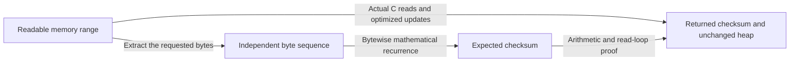

## Check recovered bytes before accepting the trailer {#checksums}

A decoder can recover perfectly ordinary bytes from damaged input. If the sender had `AB` and the receiver obtains `AC`, both are valid byte strings; the decoding instructions alone do not establish that this is the intended content. Before accepting completion, the receiver needs a second check on the recovered data.

The sender computes a short number from the original bytes and includes it in the wrapper trailer. The receiver computes the same kind of number over recovered bytes, then compares them. This number is a **checksum**. Different values detect damage; matching values cannot rule out all damage, because many possible messages share the same small summary. It is not cryptographic authentication. The zlib wrapper uses Adler-32; gzip uses CRC-32 and also checks the original length modulo `2^32`.

Two difficulties determine the implementation. First, the receiver may see only `ABABA` now and `BAB` in a later output buffer. It must carry one checksum forward without storing or rereading the whole message. Second, a long message makes per-byte division or eight separate bit operations expensive. Faster batching, table lookup and word processing must preserve exactly the same answer and read exactly the intended bytes.

We derive each calculation from the information it retains, work through bytes, then introduce the C operations and their optimizations. The final argument connects those numerical steps to readable memory and the actual output ranges. Throughout, the data being checked is the original or recovered `ABABABAB`, not its compressed codes.

### Adler-32: two sums retain byte values and order {#adler}

An incremental update needs only the old summary and the next byte range. Call the old summary the **seed**; a new Adler sequence starts with seed 1. After A arrives, retain its returned checksum. When B arrives, use that result as the next seed. This is continuation over new bytes. Joining checksums computed independently is a different operation, derived after the update rule.

#### Two accumulators {#adler-accumulators}

One running total records the sum of the byte values. A second records the sum of all the running totals, so an early byte affects more terms than a late byte. Call these totals `a` and `s`. To keep each small enough for half of the result, reduce it modulo `M = 65521`; “modulo” means keeping the remainder after division by `M`. Begin with `a = 1` and `s = 0`. For the next byte value `b`, compute:

```text
a := (a + b) mod M
s := (s + a) mod M
```

The second line uses the new `a`: the first A makes both totals 66, then B makes them 132 and 198. If that B becomes C, the totals instead become 133 and 199, so the checksum changes. If A and B trade places, the byte sum remains the same but the prefix sum changes. To express this for any input, call its length `n` and its byte values `b₁` through `bₙ`. Before taking remainders:

```text
a = 1 + b₁ + b₂ + ... + bₙ
s = n + n·b₁ + (n−1)·b₂ + ... + bₙ
```

After taking remainders, the two sides have the same remainder modulo `M`. The weights in the second expression explain why byte order matters: the first byte contributes to all `n` prefixes, while the last contributes to only one.

The returned checksum packs the reduced `a` into the low 16 bits and `s` into the high 16 bits: `a | (s << 16)`. The shift `<< 16` moves `s` into the upper half; bitwise OR, `|`, joins the two disjoint halves. This numeric layout is separate from a wrapper's byte order. The zlib trailer transmits the four checksum bytes most significant first.

#### Eight bytes {#adler-bytes}

ASCII A is 65; B is 66. No reduction is needed in this short example:

| Bytes processed | `a` | `s` | Packed checksum, hexadecimal |
| --- | --- | --- | --- |
| Empty | 1 | 0 | `00000001` |
| A | 66 | 66 | `00420042` |
| AB | 132 | 198 | `00c60084` |
| ABA | 197 | 395 | `018b00c5` |
| ABAB | 263 | 658 | `02920107` |
| ABABA | 328 | 986 | `03da0148` |
| ABABAB | 394 | 1380 | `0564018a` |
| ABABABA | 459 | 1839 | `072f01cb` |
| ABABABAB | 525 | 2364 | `093c020d` |

For the second byte, `a` becomes `66 + 66 = 132`; `s` becomes `66 + 132 = 198`. The second accumulator does not simply add the new byte. The final zlib checksum field for these eight bytes is therefore `09 3c 02 0d`.

<div class="zl-demo-mount"><zlib-demo kind="adler"><p>Starting from a=1 and s=0, step through the fixed byte strings AB, ABABABAB or ABC. A gives a=66,s=66; the following B gives a=132,s=198. This teaching model uses the normal initial seed; it does not model arbitrary-seed or combination API cases.</p></zlib-demo></div>

The independent byte recurrence and the pinned C checksum functions agree on these displayed values. The general argument below connects the same recurrence to the actual reads and machine arithmetic.

#### Batches and reductions {#adler-batches}

The table above follows the mathematical rule byte by byte. On a long buffer, taking a remainder after every addition would repeat expensive work. Adding first and taking the remainder later gives the same remainder, provided the machine sum does not overflow in between. zlib therefore groups a bounded number of byte steps into a batch.

The C needs to track both the checksum and its place in the buffer. Its two running sums are `adler` for `a` and `sum2` for `s`; `buf` points to the next bytes and `len` counts how many bytes remain. The modulus `M` is named `BASE` in the source. A batch may process at most `NMAX = 5552` bytes before reducing the sums; we will derive that limit below. Within a batch, the C counter `n` counts groups of 16 bytes, not individual bytes. The macro argument `i` is a byte offset from `buf`; the sixteen-step expansion uses offsets 0 through 15.

Here is the single-byte macro and the body of a full-batch loop, from the [pinned `adler32.c`, lines 14–18](https://github.com/madler/zlib/blob/757f0527154291bcf6bfbd6396ecde6bedd2db95/adler32.c#L14-L18) and [97–106](https://github.com/madler/zlib/blob/757f0527154291bcf6bfbd6396ecde6bedd2db95/adler32.c#L97-L106). The two excerpts are separated by the blank line:

```c
#define DO1(buf,i)  {adler += (buf)[i]; sum2 += adler;}

    while (len >= NMAX) {
        len -= NMAX;
        n = NMAX / 16;
        do {
            DO16(buf);
            buf += 16;
        } while (--n);
        MOD(adler);
        MOD(sum2);
    }
```

`DO1` reads one byte, adds it to the first sum, then adds the updated first sum to the second. `DO16` expands this operation sixteen times in order. The `while` guard reserves a complete batch before `len` is decreased. `n` counts its sixteen-byte groups; after each group `buf` advances by 16. `--n` ends the inner loop after the reserved groups. The two `MOD` lines then reduce the sums; in the selected default branch each means `% BASE`. The proof must connect these pointer advances and delayed remainders to the bytewise rule, not replace the C by that simpler rule.

Why choose 5552 bytes for `NMAX`? Call the number of bytes since the last reduction `m`, to distinguish it from the C group counter `n`. Starting with reduced components, each at most `M−1`, and bytes at most 255, the second sum is bounded by:

```text
s ≤ (m + 1)(M − 1) + 255·m(m + 1)/2
```

The first term covers the initial second sum and `m` copies of the initial first sum. The last term covers the worst-case byte contributions with weights `m,m−1,…,1`. At `m = 5552`, this is `4294690200`, below `2^32 − 1`. At 5553 it becomes `4296171735`, above that limit. This is why the source selects `NMAX = 5552`.

The proof obligation follows the same dependency: after each step the first sum and the sum of prefixes remain congruent to the bytewise recurrence. A group of sixteen preserves that relation sixteen times in source order. The no-overflow bound makes this a statement about the actual machine sums; a later remainder then preserves it.

Each full batch executes 347 groups of 16 byte steps. The unrolled groups reduce loop overhead while retaining the dependency from each new `a` to `s`. Remaining data uses groups of 16 followed by individual bytes. Separate short and one-byte paths avoid unnecessary setup.

The selected build uses a 64-bit data model called LP64: pointers and `unsigned long` are both 64 bits wide. Its sums therefore have more room than the 32-bit bound above, but the implementation keeps the same batch size. Another optional source branch replaces division using `2^16 ≡ 15 (mod 65521)`. That identity explains the possibility of folding high bits downward; it does not make that branch part of the default execution described here.

#### Buffer boundaries {#adler-chunks}

Return to the decoder that delivers A, then B. The first update starts at 1 and returns `00420042`. Pass that returned number as the next seed; the function unpacks it into `a=66,s=66`. Reading B then returns `00c60084`, exactly the ordinary checksum of AB. Starting the second call at 1 would instead compute B alone, `00430043`, and lose A's contribution.

This is why application input splits need not coincide with batch boundaries. One call may finish after a single byte; the next can continue from the packed, reduced sums. The checksum state describes accepted bytes, not the number of calls used to supply them.

The checksum function itself does not allocate, retain a caller pointer, or write the input. The enclosing compressor or decoder separately decides which newly processed bytes contribute to its wrapper checksum.

#### Independent chunks {#adler-combination}

Suppose two workers already computed A and B separately, each from 1, and kept only their checksums. They might be two threads or two programs handling separate file chunks. Passing B's checksum as an update seed cannot join them: an update consumes bytes, not a second checksum. Combination instead recovers the checksum of the concatenation using the two summaries and the second chunk's length, without rereading either chunk.

For general chunks X followed by Y, write the separately computed components as `(aX,sX)` and `(aY,sY)`. Let `n` be Y's byte length, and `(aXY,sXY)` the components we want for X followed by Y. Then, modulo `M`:

```text
aXY = aX + aY − 1
sXY = sX + sY + n·(aX − 1)
```

Subtracting one removes Y's extra initial value. The length term accounts for X's byte sum contributing to every new prefix in Y. The relevant length is Y's, not X's or their combined length.

For X=A and Y=B, the components are `(66,66)` and `(67,67)`. With `n=1`, the result is `(132,198)`, again `00c60084`. For a large Y, the implementation first reduces its nonnegative length modulo 65521; no scan of Y is needed. Adler combination uses this length-weighted arithmetic, rather than the polynomial powers used by CRC-32.

#### Checksum entries {#adler-entries}

The C interface exposes the same update with two byte-count widths. A large buffer needs a count that can represent its full size:

[`adler32_z`](/reference/functions/adler32_z.html) takes a `z_size_t` byte count, 64 bits in the selected build; [`adler32`](/reference/functions/adler32.html) takes a 32-bit count. Use several updates or the wider entry instead of truncating a large count.

[`adler32_combine`](/reference/functions/adler32_combine.html) and [`adler32_combine64`](/reference/functions/adler32_combine64.html) combine independently started checksums using Y's signed length. Negative lengths return `0xffffffff`. Genuine empty Y has checksum 1 and preserves X's checksum.

Here a seed is the checksum value supplied before an update. A genuine continuation seed is a previous result; an arbitrary seed is any caller-supplied integer, which may not describe a real prefix. NULL means that no input pointer is supplied. The precise NULL and arbitrary-seed cases matter: this project's Adler initialization query requires NULL with length zero. A forged seed need not follow the canonical one-byte recurrence. The branch-order argument below explains these cases; they are part of the numeric result, not restrictions that can be hidden inside the ordinary recurrence.

The [public Adler update theorems](/reference/source/ZlibF/Proof/public-adler-update.html#L36) give exact return values and the unchanged whole heap for all represented readable ranges and all seed words, together with the explicit zero-length NULL query. “All seeds” uses the exact scalar result below; it does not reinterpret every supplied word as a genuine prefix checksum.

The [public Adler combination theorem](/reference/source/ZlibF/Proof/public-adler-combine.html#L118) gives terminating scalar execution for both length entries, including negative-length rejection. Its concatenation conclusion additionally requires each input's low 32 bits to describe its real chunk and the signed length to equal the second chunk's length. Extra upper argument bits do not invalidate that genuine-checksum conclusion.

#### Return the calculation to decoding {#adler-integration}

The calculation gives `093c020d` for `ABABABAB`. In the five-byte output-buffer example, update with `ABABA` and continue with `BAB`: the result must be the same. The zlib trailer stores it as `09 3c 02 0d`. Incremental updating preserves one summary of the original data rather than producing an independent answer for each output buffer.

### CRC-32: retain a polynomial remainder in bits {#crc}

Gzip performs the same data check with a different calculation. Instead of Adler's two sums, it retains a 32-bit value transformed by shifts and bit comparisons. The operation called XOR sets a result bit to one when the two corresponding input bits differ, and to zero when they agree. A new public CRC starts at zero. The returned value still suffices to continue over the next buffer, so A and then B must give the same answer as AB together.

Start with one bit step to make that state visible. From it we derive a byte table, then interleaved word calculations that expose independent work. Polynomial language will explain why these transformations and independent-chunk combination preserve the same result.

#### Reflected register {#crc-register}

The calculation needs a small state that summarizes all bytes processed so far. It keeps that state in a 32-bit working value, called its register `r`. Each step removes its low bit by shifting right. When the removed bit was one, it also XORs the constant `0xedb88320` into the shifted result. XOR compares bits independently: equal bits give zero, different bits give one, with no carries. The notation `>> 1` shifts right by one bit, and `r & 1` keeps only the low bit to test it. Hexadecimal constants use the prefix `0x`. Call one such step `T`:

```text
T(r) = (r >> 1) XOR (0xedb88320 if r & 1 else 0)
```

To consume the next byte, call its value `b`, XOR it into the register's low eight bits, then apply `T` eight times. The byte's least significant bit enters first. This is the reflected bit convention: the computation moves toward the low bit.

The public running checksum is the bitwise complement of this internal register: each zero bit becomes one and vice versa. A new public checksum starts at 0, so its working register starts at `ffffffff`. The function complements the incoming checksum, processes bytes, then complements the result. Callers pass the returned value directly into the next update; complementing it again would change the calculation.

The constant is chosen by CRC's polynomial rule. A register's bits can be read as coefficients that are either zero or one; polynomial addition then becomes XOR. This arithmetic is called GF(2). The CRC polynomial has degree 32, with its highest term `x^32` implicit in the stored constant. We will use that description when joining separately computed chunks; the one-byte calculation needs only the shift-and-XOR rule above.

#### One byte {#crc-one-byte}

For ASCII A, `b = 0x41`. Starting from public checksum zero gives internal register `ffffffff`. XOR the byte to obtain `ffffffbe`, then perform the eight bit steps:

| Bit steps completed | Internal register, hexadecimal |
| --- | --- |
| Before stepping | `ffffffbe` |
| 1 | `7fffffdf` |
| 2 | `d2477ccf` |
| 3 | `849b3d47` |
| 4 | `aff51d83` |
| 5 | `ba420de1` |
| 6 | `b09985d0` |
| 7 | `584cc2e8` |
| 8 | `2c266174` |

The first step only shifts because the outgoing bit is zero. The next step shifts `7fffffdf` to `3fffffef`, then XORs `edb88320`, giving `d2477ccf`. Complementing the eighth result gives public CRC `d3d99e8b`.

<div class="zl-demo-mount"><zlib-demo kind="crc"><p>Start with public checksum zero and internal register ffffffff. Step through AB, ABABABAB or ABC one bit at a time, checking the outgoing low bit before each shift and conditional polynomial XOR. This fixed-seed teaching model does not implement arbitrary-seed or combination contracts.</p></zlib-demo></div>

Now let the first buffer end after A. Its returned checksum `d3d99e8b` can be stored as the whole continuation state. Passing it into an update over B gives `30694c07`, the CRC of AB. Processing B independently from zero gives `4ad0cf31`; that number alone has no A contribution. The independent recurrence and pinned C functions agree on these examples; the general argument below also accounts for tables, word loads and arbitrary incoming seeds.

#### Byte tables {#crc-tables}

Eight shifts and conditional XORs for every byte are repetitive. The contribution from the low byte has only 256 possibilities, so compute each once and store it in an array called `table`. In the notation below, `i` is one of those byte values, `T⁸` means eight applications of the bit step, and `byte_step` is the working register after consuming one byte:

```text
table[i] = T⁸(i)
byte_step(r,b) = (r >> 8) XOR table[(r XOR b) & 255]
```

The upper 24 register bits shift down, while the table supplies the lower byte's polynomial contribution. This separation works because the steps preserve XOR: applying them to two values XORed together gives the XOR of their separate results. For A, the index is `be`; `table[be] = 2cd99e8b`. XOR with `00ffffff` again gives `2c266174`.

In the C, `buf` points to the next input byte, `len` is the remaining byte count, `crc_table` is this 256-entry table, and local `crc` holds the internal register. The latter differs from the public checksum while the calculation is in progress. Here is the byte tail that actually uses the table, from [pinned `crc32.c`, lines 934–940](https://github.com/madler/zlib/blob/757f0527154291bcf6bfbd6396ecde6bedd2db95/crc32.c#L934-L940):

```c
    while (len) {
        len--;
        crc = (crc >> 8) ^ crc_table[(crc ^ *buf++) & 0xff];
    }

    /* Return the CRC, post-conditioned. */
    return crc ^ 0xffffffff;
```

`len` is the remaining byte count. The guard ensures a byte remains before the decrement and read. `*buf++` reads that byte and advances the pointer; XOR and `& 0xff` form the table index, always from 0 to 255. `crc >> 8` moves the old register's upper bits down, and `^` combines them with the table contribution. The return flips the low 32 bits back to the public convention. Earlier, [line 635](https://github.com/madler/zlib/blob/757f0527154291bcf6bfbd6396ecde6bedd2db95/crc32.c#L626-L635) performed `crc = (~crc) & 0xffffffff`, so this local `crc` is the working register, not the public value during the loop.

[`get_crc_table`](/reference/functions/get_crc_table.html) exposes this byte table. Its contract identifies the static pointer and all 256 byte-step entries. Those entries describe internal register updates, without the public complements. The returned storage is static and read-only; the pointer does not authorize reading neighboring braid tables, writing entries, or freeing the array.

#### Words and braids {#crc-braids}

Table lookup removes the eight-bit inner loop, but every next byte still needs the previous register. To expose independent work, the selected default branch groups input into eight-byte units, called words, and reads each as a 64-bit value. It keeps five interleaved running values, called braided lanes: each lane has its own register and handles every fifth word. Number the words from zero after the initial alignment bytes: lane zero handles positions 0,5,10,…; lane one handles 1,6,11,…, and so on.

Those are spaced subsequences. Their tables account for the polynomial distance between successive words. Lane zero receives the preprocessed incoming register `(~crc) & 0xffffffff`; the other lanes start at zero. They are not five ordinary checksums of contiguous chunks. The last-block code merges their contributions in the original byte order using word recurrences.

This branch cannot start safely just because one word remains. In the C, `N` counts lanes and `W` counts bytes per word. Its [entry and alignment loop, lines 640–650](https://github.com/madler/zlib/blob/757f0527154291bcf6bfbd6396ecde6bedd2db95/crc32.c#L640-L650), first require `len >= N * W + W - 1`, then consume individual bytes until `((z_size_t)buf & (W - 1)) == 0`. For `N=5,W=8`, the threshold is `5×8 + 8−1 = 47` bytes. Alignment means the input address is a multiple of eight; the mask `W - 1` tests its low three address bits. At most seven bytes reach such an address, leaving at least one 40-byte block.

One block contains one word for each lane, so it has `N × W = 40` bytes. The C counter `blks` counts complete blocks left, including a final block reserved for merging. The [block loop at line 710](https://github.com/madler/zlib/blob/757f0527154291bcf6bfbd6396ecde6bedd2db95/crc32.c#L706-L728) uses `while (--blks)`: it processes all but the last block. Separate code handles that last block and its merge. Reserving at least one block prevents the initial decrement from underflowing. Fewer than 40 bytes remain afterward, handled by an unrolled byte tail and then individual bytes.

To see the independent dependencies in the C, follow lane zero through the little-endian branch. Here `words` is a pointer into the input measured in eight-byte words. `crc0` is lane zero’s running register; `word0` temporarily holds its XOR with the next input word. The table `crc_braid_table` has a row for each byte position within a word, and `k` selects that position. These excerpts select its statements from [line 712](https://github.com/madler/zlib/blob/757f0527154291bcf6bfbd6396ecde6bedd2db95/crc32.c#L710-L720), [lines 728–732](https://github.com/madler/zlib/blob/757f0527154291bcf6bfbd6396ecde6bedd2db95/crc32.c#L728-L732) and [lines 748–765](https://github.com/madler/zlib/blob/757f0527154291bcf6bfbd6396ecde6bedd2db95/crc32.c#L748-L765). Intervening statements for the other lanes and their preprocessor guards are omitted; this is not the complete loop:

```c
                word0 = crc0 ^ words[0];

                words += N;

                crc0 = crc_braid_table[0][word0 & 0xff];

                for (k = 1; k < W; k++) {
                    crc0 ^= crc_braid_table[k][(word0 >> (k << 3)) & 0xff];
                }
```

`words[0]` loads the next word assigned to lane zero; `word0` mixes that word with the lane's old `crc0`. The neighboring source lines do the same for `words[1]` through `words[4]` and `crc1` through `crc4`. All five words are loaded before `words += N` advances the common pointer to the next block. Each lane update depends on its own old value and input word, so it can proceed without waiting for another lane's newly computed CRC.

For a concrete address path, call the first aligned byte's offset `q`. With the selected `N=5,W=8`, lane zero first reads bytes `q…q+7`, lane one reads `q+8…q+15`, and lane four reads `q+32…q+39`. Advancing `words` by five words moves it 40 bytes. If another regular iteration remains, lane zero then reads `q+40…q+47`, and lane one reads `q+48…q+55`. Successive words in the same lane are therefore 40 bytes apart; they are not adjacent eight-byte chunks.

The first table lookup handles byte position zero of `word0`. The `k` loop extracts positions 1 through 7 by right-shifting 8 through 56 bits, looks each up, and XORs their contributions into `crc0`. On this little-endian path, the low byte corresponds to the earliest byte of the loaded word. The table row `k` means a byte position within a word, not a lane number; all lanes use the same rows. These braid tables include the spacing between same-lane words, unlike the ordinary one-byte table. The [last-block merge, lines 772–780](https://github.com/madler/zlib/blob/757f0527154291bcf6bfbd6396ecde6bedd2db95/crc32.c#L772-L780), then combines lanes zero through four in order with `crc_word`, restoring a single register before the byte tail.

This organization exposes independent lane dependencies while amortizing loop work. Word endianness and address alignment remain part of selecting and interpreting the actual loads. The selected proof model assembles the same bytes in target order; the C cast and ABI correspondence require their own review.

#### Polynomial operators {#crc-operators}

What if two workers computed A and B independently and discarded their bytes? We cannot update the first CRC using the second CRC as if it were B's data. We need to move A's contribution past the byte position occupied by B, then combine the two contributions with XOR.

For general byte sequences X followed by Y, call Y's length `n`. `CRC(X)` and `CRC(Y)` mean independently computed public checksums, each started at zero; `X ++ Y` means concatenation. Let `T⁸ⁿ` mean applying the earlier bit step `8n` times, advancing a 32-bit value through `n` zero bytes without the public complements. Then:

```text
CRC(X ++ Y) = T⁸ⁿ(CRC(X)) XOR CRC(Y)
```

The initial and final complement terms cancel in this concatenation identity. Do not implement `T⁸ⁿ` by calling the public update on `n` zero bytes: that call includes its own complement convention.

For X=A and Y=B, `T⁸(d3d99e8b) = 7ab98336`. XOR with B's independent `4ad0cf31` gives `30694c07`, the CRC of AB.

The advance preserves XOR, so it can be represented by a binary matrix or by multiplication modulo the CRC polynomial. Either representation encodes the operation “advance the existing contribution by this length,” not the second chunk’s bytes or checksum.

The selected source uses polynomial multiplication. Its [generator, lines 954–960](https://github.com/madler/zlib/blob/757f0527154291bcf6bfbd6396ecde6bedd2db95/crc32.c#L954-L960), calls `x2nmodp(len2, 3)`: `len2` is Y’s length in bytes, and the helper computes a power representing that many bytes of advancement. Its second argument selects a power of two per length unit; 3 selects eight bit steps per byte, since `2^3 = 8`.

[That helper, lines 184–194](https://github.com/madler/zlib/blob/757f0527154291bcf6bfbd6396ecde6bedd2db95/crc32.c#L184-L194), examines one length bit at a time. The powers in `x2n_table` come from repeated squaring. For each set length bit the helper multiplies by the corresponding power, then shifts the length right and moves to the next power. This computes an operator for `x^(8n)` without traversing `n` bytes.

For a second chunk of 13 bytes, `13 = 8 + 4 + 1`. The implementation combines precomputed advances of 8, 4 and 1 bytes to advance 13 bytes, or 104 zero-input bits, without performing 104 separate steps. This is why the length’s binary digits can drive the computation. The proof must still establish the meaning of each precomputed operator and multiplication.

In this reflected multiplication representation, the identity is `0x80000000`: multiplication by it represents no advance yet. This is polynomial multiplication, not ordinary integer multiplication.

#### Checksum entries {#crc-entries}

The same CRC update is exposed with two byte-count widths, while separate entries handle the independently computed summaries and reusable length operators:

[`crc32_z`](/reference/functions/crc32_z.html) uses a `z_size_t` byte count, 64 bits in the selected build; [`crc32`](/reference/functions/crc32.html) uses a 32-bit count. [`crc32_combine`](/reference/functions/crc32_combine.html) and [`crc32_combine64`](/reference/functions/crc32_combine64.html) take independent checksums and Y's signed length.

When many second chunks share a length, generate its operator once with [`crc32_combine_gen`](/reference/functions/crc32_combine_gen.html) or [`crc32_combine_gen64`](/reference/functions/crc32_combine_gen64.html), then reuse it through [`crc32_combine_op`](/reference/functions/crc32_combine_op.html). A generated operator is a domain requirement, not merely any nonzero integer.

Negative lengths generate zero and make the combine call return zero. A genuine empty Y has CRC zero and preserves X's checksum. Arbitrary scalar inputs at length zero instead produce the XOR of their low 32 bits. NULL update queries return zero even with nonzero lengths. These scalar API cases differ from the concatenation guarantee, which additionally requires genuine chunk checksums and the correct second length.

The [CRC update theorems](/reference/source/ZlibF/Proof/public-crc-updates.html#L18) give the exact value and unchanged heap for all represented readable byte views, arbitrary seeds and the permitted NULL queries. Their global-table premise fixes the byte and polynomial-power tables to the library's initialized values; it does not let the caller choose an arbitrary lookup table.

The [CRC combination theorems](/reference/source/ZlibF/Proof/public-crc-combine.html#L76) establish the exact polynomial results for both generators, the application of generated operators and both combination widths, without changing the heap. Their scalar formulas include arbitrary incoming checksum words by projecting to the low 32 bits; interpreting the result as the checksum of concatenation also requires those words and the second length to describe the actual chunks.

#### Return the calculation to gzip {#crc-integration}

The CRC-32 of the same `ABABABAB` is `94b093a4`, different from the Adler value used by zlib. Gzip stores it least-significant byte first as `a4 93 b0 94`, followed by the original eight-byte length as `08 00 00 00`. Decoding computes the checksum over recovered data. If output arrives as `ABABA` followed by `BAB`, the CRC update continues across that boundary.

### Connect the arithmetic to the bytes actually read {#checksum-proof}

The trailer comparison now has numerical targets: Adler-32 is `093c020d` and CRC-32 is `94b093a4` for `ABABABAB`. To justify using those targets, we must establish that **the computed number describes exactly the original data processed by this compression or decoding call**.

With a five-byte destination, `ABABA` and then `BAB` must contribute once each. Repeating the first batch, omitting the last byte or restarting from the initial seed breaks the result even when each addition and table lookup is correct. The argument therefore tracks the byte slice, running checksum and read pointer together, and carries that relation to trailer comparison.

For manageable arithmetic below, shorten the data to A in one buffer and B in the next. Algorithm meaning, machine arithmetic, memory reads and chunk combination are different steps in connecting those two buffers to one result. The Adler recurrence says the final checksum is `00c60084`; CRC-32 says `30694c07`. That calculation alone does not establish that zlib reads each requested byte exactly once, carries the first result into the second call, or returns without an invalid access. The C also uses different code for short inputs, delayed reductions, tables and aligned words. A proof must connect every selected path to the same byte meaning.

The proof must describe both the bytes and where the program reads them. The caller heap records the existing memory objects and their contents. A pointer selects the first byte, and a length counts the requested bytes. The seed is the checksum supplied before this update, normally the previous call's result. These inputs must satisfy the entry's explicit domain. Its conclusion includes the exact return value and the unchanged heap. To see what that buys the application, keep three questions separate:

| Question | What must be established? |
| --- | --- |
| Does the call run safely and finish? | Every read, arithmetic operation and loop is admitted; execution returns without a model fault. |
| What number does it return? | The exact numeric behavior of that C entry, including arbitrary seed words and query/error cases. |
| Is that number the checksum of the intended data? | The seed describes the actual prefix, this call covers exactly the next bytes, and combination uses the actual second length. |

A numerically correct call over the wrong buffer still checksums the wrong bytes. Conversely, a readable buffer with a forged seed can be safe while its numeric result does not mean “the checksum of this whole stream.” The proof is organized to expose both distinctions.

#### Independent recurrences {#checksum-proof-model}

First choose a definition of the answer that does not borrow the implementation's optimizations. The independent [format definitions](/reference/source/ZlibF/Spec/Format/Checksum.html) define Adler through bytewise modular updates and CRC through bytewise XOR and eight reflected bit steps. Neither definition invokes the translated checksum function or its tables. A table generated incorrectly by C therefore cannot make the intended answer change to match it.

To “fold” a byte sequence means to start with the seed and apply its update step to each byte in order. Call the first sequence X and the second Y. Folding over X and then Y equals folding over `X ++ Y`, their concatenation. This establishes model-level incremental meaning. It does not show that the pointer loop visits that list or its unrolled arithmetic computes the same step.



Execution supplies those facts on the actual heap. Let `off` be the initial array offset and `k` the number of bytes already read. The loop invariant connects three things: the pointer is at `off+k`, the next read is still permitted when bytes remain, and the register represents the first `k` requested bytes. Initialization establishes this at zero reads. One step preserves it; loop exit yields the full requested sequence.

For example, the short Adler branch maintains two sums: `adler` adds byte values, and `sum2` adds each updated first sum. `buf` points to the next byte and `len` counts bytes left. `BASE` is Adler’s modulus, 65521; `MOD28` is a reduction macro, implemented as remainder by `BASE` in the selected default build. The branch actually contains these lines, from [pinned `adler32.c`, lines 85–94](https://github.com/madler/zlib/blob/757f0527154291bcf6bfbd6396ecde6bedd2db95/adler32.c#L85-L94):

```c
    if (len < 16) {
        while (len--) {
            adler += *buf++;
            sum2 += adler;
        }
        if (adler >= BASE)
            adler -= BASE;
        MOD28(sum2);            /* only added so many BASE's */
        return adler | (sum2 << 16);
    }
```

`len < 16` selects this path; it does not itself establish that `buf` is readable. `while (len--)` tests the old count, so the body runs only while a byte remains. `*buf++` reads the current byte before advancing. The next line uses the updated first sum. When the old count is zero, the unsigned post-decrement wraps but the loop body does not run; treating that wrap as a negative count would describe different C. The proof relates the actual loop to the natural-number count of completed reads, then justifies the remaining lines: one conditional subtraction reduces `adler`, `MOD28` reduces `sum2`, and the return packs them into the low and high halves. On one two-byte AB buffer, the two iterations produce the familiar `(132,198)` components. Two separate one-byte calls instead take the earlier fast path; the execution proof must cover both routes.

#### Machine arithmetic {#checksum-proof-arithmetic}

The loop invariant must describe the arithmetic the machine really performs. Adler's mathematical modulus is 65521. Machine unsigned overflow uses a power-of-two modulus. These are not interchangeable: `2^32 mod 65521 = 225`, so an unnoticed 32-bit wrap before reduction can change the desired answer. “Unsigned wrap is defined C” would establish only that this operation is allowed, not that the answer matches Adler's recurrence.

The selected build uses a 64-bit data model called LP64: pointers and `unsigned long` are both 64 bits wide. Adler’s additions therefore use 64-bit `unsigned long`. Let `a` and `s` be the unreduced first and second sums, and `j` the number of bytes read in a batch. For up to 5552 steps starting from masked 16-bit seed halves, a convenient bound is:

```text
a ≤ 65535 + 255j
s ≤ 65535 + j(65535 + 255×5552)
```

For `j≤5552`, these give `a≤1481295` and `s≤8224215375`, below `2^64`. Thus the additions agree with natural-number arithmetic. Congruence then justifies postponing reduction. The earlier reduced-component batch limit, `NMAX = 5552` bytes between reductions, was derived using 32-bit sums and already reduced components; the wider bound also accommodates the masked arbitrary seeds used by the numeric execution argument.

CRC uses a different arithmetic: each bit is a coefficient that is zero or one, and addition is XOR with no carries. This is arithmetic over GF(2). Lean’s `UInt32` represents a 32-bit unsigned value; XOR and logical right shifts on it implement the CRC register steps directly. Its table proof must show that each entry equals the corresponding eight polynomial bit steps; merely showing that 256 entries exist establishes no numeric meaning. Word recurrences also track widened temporaries, byte order and the final 32-bit projection. Thus Adler's main arithmetic bridge is bounded unreduced sums, while CRC's is equality between different representations of the same bit transition.

#### Memory views {#checksum-proof-memory}

Now connect the sequence to memory. `offset` is the first byte's position, `length` is the requested count, and `array.size` is the containing byte object's size. Readability requires `offset+length≤array.size`; dereferences occur before the endpoint. For example, offset 3 and length 2 in a five-byte object permit reading positions 3 and 4; position 5 is the endpoint and is never read. An empty range can use the object's one-past pointer, the position immediately after its last byte. Both updates retain the whole heap and ownership: they read their input, allocate nothing and retain no caller pointer.

CRC’s eight-byte loads need an address divisible by eight. That depends on the address where an object begins as well as the index within it. The model gives allocated byte blocks an aligned origin; static and embedded arrays may begin at any fixed address remainder modulo eight. These remainders are the origin residues. The [general byte-view theorem](/reference/source/ZlibF/Proof/crc32.c.views.html#L567) covers those represented views and residues. It does not prove a general machine ABI or every effective-type alias.

The word path above assigns one eight-byte word to each of five interleaved lanes, making a block of 40 bytes. Its entry threshold is 47 bytes: at most seven byte steps reach an aligned address, leaving at least one whole block. That matters before the pre-decrement block loop. Row indices stay below 8, byte indices below 256, and extraction shifts at most 56 bits in a 64-bit word. These facts justify accesses; polynomial invariants justify their contents and merges.

Stream-state results use a [platform premise](/reference/docs/spec/platform.html) that bounds each represented byte object below `2^63` bytes; the complete stream can span many such objects. The public checksum update results instead use the readable-view bounds above, without adding that narrower stream-state domain. The [trusted-base account](/reference/docs/trusted-base.html) explains the alignment, casting and aliasing correspondence between modeled word reads and C.

#### Combined lengths {#checksum-proof-composition}

Continuing an update needs bytes, but combination needs two checksums and the second chunk's length. If A and B were computed independently, Adler combination must produce `00c60084` and CRC combination `30694c07` without reading either buffer. Proving this requires both the exact scalar computation and a theorem connecting its inputs to real sequences. A wrong second length still produces a number, with no concatenation guarantee.

Adler combination expands the two independently started component sums, removes the duplicated initial one, and counts the first chunk's contribution to new prefixes. The implementation's nonnegative-length reduction must preserve that length contribution; negative lengths follow the separate rejection branch.

For CRC combination, first move the first chunk’s contribution past the second chunk. Let `n` be the second chunk’s length in bytes, and `T` one register step on a zero input bit. Then `T^(8n)` means `8n` such steps, because each byte occupies eight bits. This advance can be represented by a binary matrix or by multiplication modulo the CRC polynomial.

The selected source uses polynomial multiplication: `multmodp` multiplies two values whose low 32 bits encode polynomial remainders. A generated operator is the value encoding the required `n`-byte advance. The powers stored in `x2n_table` let the implementation build that operator from the set bits of `n`, instead of performing `8n` separate steps. The proof connects those precomputed powers and each actual multiplication to the independent bit recurrence.

Termination has a real domain condition. In [pinned `crc32.c`, lines 166–175](https://github.com/madler/zlib/blob/757f0527154291bcf6bfbd6396ecde6bedd2db95/crc32.c#L166-L175), `multmodp` begins its scan at bit 31. It can break only after finding a set bit with no lower set bits left. If the low 32 bits of that operand were all zero, shifting its scan mask down would never reach that break. Any nonzero 64-bit integer is therefore not enough.

The operator-generation theorem establishes the required low-bit fact before multiplication. The [`crc32_combine_op` contract](/reference/functions/crc32_combine_op.html) therefore uses generated operators, including the zero rejection result. In the C, [lines 969–972](https://github.com/madler/zlib/blob/757f0527154291bcf6bfbd6396ecde6bedd2db95/crc32.c#L969-L972) return zero before calling `multmodp` when the generated operator is zero. For a valid positive operator the proof uses the proved multiplication result, not an assumed callee contract.

#### Queries and seed domains {#checksum-proof-domains}

A seed is the numeric checksum passed into an update. Short examples normally use the initial seeds 1 for Adler or 0 for CRC. A public numeric theorem must also account for callers who supply other seed words, empty ranges and query arguments. These cases must be read from the actual branch order.

Adler's [one-byte fast path, lines 70–82](https://github.com/madler/zlib/blob/757f0527154291bcf6bfbd6396ecde6bedd2db95/adler32.c#L70-L82), precedes its NULL check: at length one it reads `buf[0]` before reaching the query branch. The project's explicit initialization-query domain is NULL with zero length; this restriction appears in the [deviations](/reference/docs/deviations.html). CRC checks NULL first and returns zero for any supplied length. A non-NULL empty CRC update preserves the incoming low 32 bits.

Adler also distinguishes normal checksums from forged seed words. For `adler32_z(0xfffffff0,"\0",1)`, the masked components are 65520 and 65535. The low half, 65520, is the first sum; the high half, 65535, is the second. Adding the zero byte leaves the first sum unchanged, then adding that first sum makes the second sum 131055; one conditional subtraction leaves 65534, producing `0xfffefff0`. Fully reducing the starting components would instead leave high component 13. The call is memory-safe; the naive arbitrary-seed functional statement is wrong.

The numeric specification [`adlerValue`](/reference/source/ZlibF/Spec/Public/Checksums.html#L41) retains that one-byte behavior and canonicalizes other lengths. Genuine incremental seeds agree with the ordinary recurrence. Entry widths, non-NULL empty ranges, negative combine lengths and generated operators need distinct cases.

#### Exact results {#checksum-proof-evidence}

The update and combination results now provide different pieces of the same application argument. Readable-range premises establish which bytes an update may read. Exact scalar results establish its answer, including query and unusual-seed behavior. The independent recurrence connects normal seeds and true chunk lengths to the data sequence. Static-table results establish the values used by the optimized code. They cannot be substituted for one another.

Applying these results to C retains the stated address, alignment, cast and alias conditions. In the enclosing compressor or decoder, the final step selects exactly the newly accepted or recovered bytes and the appropriate wrapper field. A correct checksum over some other readable range would not meet that obligation.

#### Pass the local guarantee to the wrapper {#checksum-proof-integration}

An update proof establishes the checksum of a specified memory range. Streaming accounting supplies the exact recovered range for the current call. Apply the update to that range once, carry its result across a pause, and compare the cumulative value with the trailer only at the proper completion boundary. A mismatched trailer can therefore reject the message after some output has already reached the application; it does not erase those bytes.

For gzip file operations, the same relation continues through file buffers and the uncompressed ranges returned to the application. The file layer must account for read-ahead and member boundaries while each member's checksum still describes that member's recovered data. This is how the local numerical guarantee participates in decoding rather than becoming an isolated arithmetic result.
