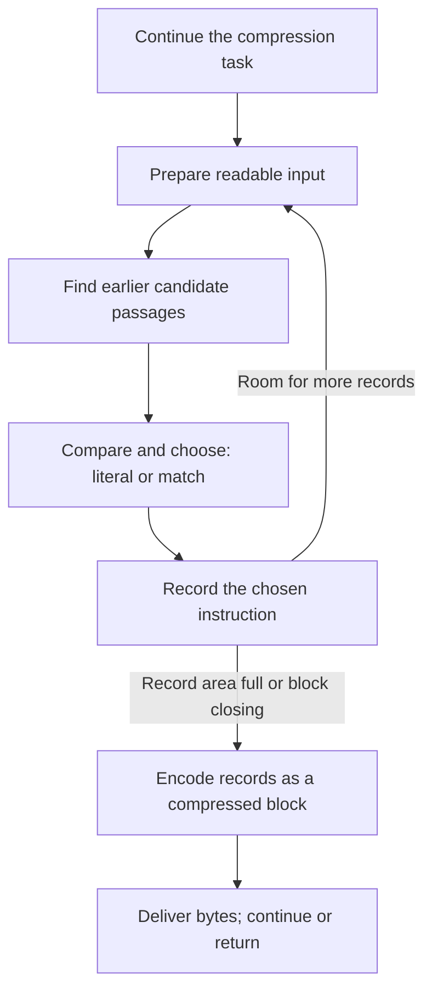
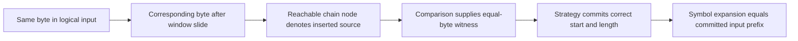

Compression replaces repeated bytes with instructions for reproducing them. After reading `ABCQABCR`, a compressor sees `ABCQABCX`: it could write those eight bytes directly, or say “go back eight bytes and copy seven,” then write `X`. A direct byte is called a **literal**; a backward distance and copy length form a **match**. Either choice must reproduce exactly the original bytes when expanded.

The difficult part is making these decisions as input keeps arriving. Keeping every previous byte would use unbounded memory. Comparing every retained position would spend too much time. Accepting the first available match could also hide a better choice one byte later. Zlib answers these three problems with a bounded sliding window, an index with a search budget, and an optional one-position delay before commitment. We will derive each mechanism from the problem it solves, then explain what the proof must preserve through it.

This chapter follows original bytes until they become literal or match records. Those records are instructions for a later stage, which packs them into compressed bits. A block groups decisions that will be encoded together; its boundary need not coincide with the end of an application call. Finding a match and encoding its bits are separate decisions: first choose what the output means, then how to represent that meaning compactly.

## Entering the strategy loop from a public call {#dispatch}

Compression is one continuing task even when the application supplies input in several batches. The compressor keeps its earlier bytes, partial decisions and unfinished output between calls. Each call can accept some more input, produce some compressed bytes, and return so the application can supply more room. A return need not finish a compressed block or the whole message.

The default path looks for repeated passages and waits one position before committing a choice. A faster path commits immediately; special paths store bytes directly, skip matching, or restrict matches to runs of one repeated byte. These are different ways to spend time and memory on the same task. The application chooses among them through a compression level and a strategy. A **level** is an effort setting: zero stores bytes without match search, while levels 1–9 spend increasing effort looking for shorter representations. A **strategy** changes the kind of repetition considered, or restricts the later encoding choice. These options change the work performed, not the original bytes the decoder must recover.

The C entry point is `deflate`. It first checks that the continuing task has valid state, delivers previously prepared output, and writes any required format header. Then it chooses the byte-processing engine. In the following four lines from [the engine dispatch](https://github.com/madler/zlib/blob/757f0527154291bcf6bfbd6396ecde6bedd2db95/deflate.c#L1236-L1239), `s` points to the compressor's internal state. Its `level` and `strategy` fields hold the selected options; `flush` says whether to continue, close a block, or finish. `bstate` receives an internal result used by the outer function.

```c
bstate = s->level == 0 ? deflate_stored(s, flush) :
         s->strategy == Z_HUFFMAN_ONLY ? deflate_huff(s, flush) :
         s->strategy == Z_RLE ? deflate_rle(s, flush) :
         (*(configuration_table[s->level].func))(s, flush);
```

Branch order matters. Level 0 selects stored bytes first. At nonzero levels, `Z_HUFFMAN_ONLY` generates literals, and `Z_RLE` specializes in repetitions at distance one. Other strategies use the fast or lazy engine selected by the level table. Each produces representations admitted by DEFLATE.



This is the ordinary matching loop. Preparing readable input is the window's job; finding candidates is the index's job; comparison and commitment are the strategy's job. The block encoder receives only decisions that have already been committed.

The engine reports whether it needs another opportunity to run, has closed a block, or has started or finished stream completion. The C names are `need_more`, `block_done`, `finish_started` and `finish_done`. The outer function translates these into continued work or public results such as `Z_OK` and `Z_STREAM_END`. Running out of application output space can interrupt this process without changing the meaning of its saved state.

## Configuration changes the execution path {#configuration}

The loop now has a purpose: turn original bytes into committed recovery instructions. Before following its memory and search operations, separate its choices from its resource limits. A level trades search effort for compression; a strategy changes which repetitions are considered. The byte window bounds retained input, and separate tables and record storage bound indexing and accumulated decisions. A wrapper adds the header, trailer and checksum around the compressed data. These are the purposes of the configuration parameters below.

This chapter uses the ordinary build with all compression levels and bytewise match comparison; the simplified build option `FASTEST` is disabled. With `deflateInit`, `Z_DEFAULT_COMPRESSION` normalizes to level 6, the default window scale is 32768 bytes (exponent 15), `memLevel` is 8, and the strategy is `Z_DEFAULT_STRATEGY`. The table below describes those source settings. After tuning, the saved field values determine the search.

| Parameter | What it changes directly | Effect on execution |
| --- | --- | --- |
| `level` | Engine and search thresholds | 0 uses stored bytes; 1–3 use `deflate_fast`; 4–9 use `deflate_slow`. |
| `strategy` | Match policy or block-coding restriction | `Z_HUFFMAN_ONLY` bypasses matching; `Z_RLE` uses distance one; `Z_FILTERED` adjusts short-match decisions in the lazy engine; `Z_FIXED` retains matching and excludes dynamic block selection; stored blocks remain possible. |
| `windowBits` | Wrapper and window scale | Changes retained bytes and search distance; the wrapper also selects headers, trailers and checksums. |
| `memLevel` | Candidate-index and symbol-record storage | A larger index can separate candidates better; larger record capacity can accumulate more decisions. Both use memory. |
| `flush` | Whether to wait for more input, close a block or finish the stream | Changes when the loop may wait and how it commits the input tail. |

The extended initializer [`deflateInit2_`](/reference/functions/deflateInit2_.html) exposes these choices. The ordinary build accepts levels 0–9 and the default-level value; the method must be `Z_DEFLATED`. The selected default build accepts `memLevel` 1–9. Positive `windowBits` 8–15 choose the zlib wrapper, −9 through −15 choose raw DEFLATE, and 25–31 choose gzip. Zlib's 8 normalizes to 9; raw −8 and gzip 24 are rejected. Once wrapper selection is removed, the remaining exponent b gives a scale of 2^b bytes. The ordinary compressor window scale in this chapter is consequently 512–32768 bytes. These gzip parameter ranges assume the default gzip-enabled build; defining `NO_GZIP` removes gzip wrapper creation.

An application can also give the compressor a shared starting text, called a preset dictionary. This lets the first input bytes refer to text that both compressor and decoder already know. The worked runs start without one. When a stream is initialized with a dictionary, its retained suffix supplies initial match history rather than being emitted as a new prefix of the decompressed message. The corresponding content relation starts with that dictionary context and compares only newly expanded bytes with the committed original input.

[`deflateParams`](/reference/functions/deflateParams.html) can change level and strategy on a live stream. If the strategy or engine class changes after processing has started, it first runs the existing work with `Z_BLOCK`; if old input or block work cannot be cleared, it returns `Z_BUF_ERROR`. Configuration cannot simply be replaced in the middle of an arbitrary record. [`deflateTune`](/reference/functions/deflateTune.html) writes the four search parameters, replacing the level table's values. The four controls set the threshold for reducing search effort, the threshold for looking one position ahead, the length considered good enough to stop, and the candidate-visit budget. The search section below works through their values. Three are converted to the unsigned C type `uInt`; the good-enough length, `nice_length`, is saved as a signed integer, so tuned values must be interpreted using those machine types.

Compile-time choices also change the algorithm. `FASTEST` normalizes every nonzero level to 1, uses simplified matching and omits the ordinary index links that let search follow one earlier candidate to another. `UNALIGNED_OK` selects two-byte probes and comparisons, with requirements on short-integer width, addresses and access rules. Those branches have their own conditions; the C comparison below is the ordinary bytewise branch.

## The window retains candidate source bytes {#window}

First solve the memory problem. Return to `ABCQABCX` after `ABCQABCR`. Finding the length-7, distance-8 match requires the earlier `ABCQ` to remain readable. Since input can grow indefinitely, the retained range must be bounded. A sliding window keeps recent bytes available to later references.

First see the purpose with a smaller teaching input, `0123ABCDABCDwxyz`, after `0123ABCD` has been processed. The second `ABCD` can refer four bytes back to the first. The animation reduces retention to eight bytes. It illustrates a logical recent suffix, not a legal zlib window parameter.

<div class="zl-demo-mount"><zlib-demo kind="window"><p>The second ABCD uses distance 4 and length 4. The latest eight bytes become ABCDABCD, then ABCDwxyz after wxyz. Bytes outside retention cannot supply a new reference.</p></zlib-demo></div>

The actual compressor reduces copying by allocating an array twice the configured window scale. Call that scale W; C saves it in `w_size`, and the contiguous array has `2W` bytes. The array holds both processed history and received input whose representation has not yet been decided. Byte comparisons advance through contiguous array positions.

`strstart` is the array index of the current processing position. `lookahead` counts real loaded bytes starting there. The real data ends at `strstart + lookahead`; free space follows it. Array indices change during a slide, while a byte's logical position in the entire input stays fixed.

```text
window, capacity 2W
[ processed bytes ][ received, unprocessed bytes ][ room for more input ]
                   ^ strstart                    ^ strstart + lookahead
```

A DEFLATE match copies at least 3 and at most 258 bytes, named `MIN_MATCH` and `MAX_MATCH` in the source. Before deciding, the strategy normally prepares enough lookahead for a maximum match and for indexing following three-byte strings. This target, `MIN_LOOKAHEAD`, is `258 + 3 + 1 = 262`. At end of input or on a flush, the loop also handles a shorter tail.

The search must be able to read that comparison margin even when the processing position is near the array end. Ordinary search reserves room for those reads, so its maximum backward search distance is `W - 262`, named `MAX_DIST(s)` in [the distance and lookahead definitions](https://github.com/madler/zlib/blob/757f0527154291bcf6bfbd6396ecde6bedd2db95/deflate.h#L296-L301). Default W=32768 gives 32506 bytes. The DEFLATE format still permits distance 32768; this is the compressor's search limit. A byte can physically remain in the array while already falling outside the permitted candidate range.

## Refilling input and sliding in batches {#refill}

The window must eventually make room for the next batch without losing any source that a future match can still use. Moving bytes after every processed byte would be expensive. Instead, the compressor advances through the larger array and reclaims a whole lower region only when it approaches the end.

The helper `fill_window` performs that preparation when fewer than 262 real bytes remain ahead of the processing position. It first computes free tail space: `more = window_size - strstart - lookahead`. Ordinary `window_size` is `2W`. Near the array end, when `strstart ≥ 2W - 262`, it moves the retained upper region to low addresses before receiving more input. The constants work together: at the threshold, the earliest source permitted by the distance bound is `(2W−262)−(W−262)=W`. Moving the upper region down by W therefore preserves every source still admitted at that point. This is why the search margin, search distance and slide threshold cannot be chosen independently.

Take legal W=512, `strstart=800` and `lookahead=100`. Real data ends at index 900, leaving 124 free bytes. The slide threshold is 762, so the 388 bytes in `[512,900)` move to `[0,388)`. The current start becomes 288, with lookahead still 100. Candidate 700 becomes 188, retaining distance 100: `800−700 = 288−188`. Before sliding, the earliest permitted source is 550 (`800−250`), so discarding positions below 512 loses no source allowed by the distance bound. The copied interval includes some older bytes, positions 512–549, that are physically retained but already too far away to search.

The question for the animation is whether moving addresses changes the input or merely makes more room. Suppose the application has another 300 bytes ready. Before sliding there are only 124 tail bytes free; afterward there are 636. All 300 can now be appended at `[388,688)`. Lookahead grows from 100 to 400, while processing stays at the same original-input position. The refill target of 262 is a threshold for requesting input, not a limit on how much one read may bring in.

<div class="zl-demo-mount"><zlib-demo kind="refill"><p>For W=512, capacity is 1024 and maximum search distance is 250. With start 800 and 100 unread bytes, move array [512,900) to [0,388), then append 300 bytes at [388,688). Start 800 becomes 288; source 700 becomes 188, preserving distance 100. The current input byte does not change. This is a contiguous copy; byte addresses are not reduced modulo W.</p></zlib-demo></div>

The [actual slide](https://github.com/madler/zlib/blob/757f0527154291bcf6bfbd6396ecde6bedd2db95/deflate.c#L285-L299) changes bytes and positions together. `wsize` is a local copy of W; signed `block_start` identifies the current block's original-byte start:

```c
zmemcpy(s->window, s->window + wsize, (unsigned)wsize - more);
s->match_start -= wsize;
s->strstart    -= wsize; /* we now have strstart >= MAX_DIST */
s->block_start -= (long) wsize;
```

After “Load 300 bytes,” the unread count reaches 400, but the logical processing position remains 800 and the tracked distance remains 100. Receiving input has made work available without committing any new instruction. Copying does not erase the old source region; later writes can replace those stale copies. Which bytes are meaningful is determined by the live interval and distance bound, rather than by whether an address still happens to contain an old value.

The compressor also saves source positions so later searches can find them again. Those positions must move by the same offset as their bytes. The code calls `slide_hash` to perform that translation, adjusts the count of unfinished index insertions, and increases the free-space count. The index section below explains the saved links. `block_start` may become negative: the original beginning of the current block can have left the array. Choosing a stored block later therefore also requires its original byte range to remain readable.

With space available, new input is appended after existing data. The application describes its buffers in a `z_stream` structure; the compressor keeps a pointer to it in `s->strm`. Within that structure, `next_in` points to the next unread application byte and `avail_in` counts available bytes. The helper `read_buf` copies from that buffer, up to the capacity argument `more`, and returns the actual byte count `n`:

```c
n = read_buf(s->strm, s->window + s->strstart + s->lookahead, more);
s->lookahead += n;
```

It reads at most `min(avail_in, more)` bytes, advances the caller's input pointer and updates consumption and the selected wrapper checksum. `lookahead` grows only by the actual count. Receiving bytes and committing them to symbols are distinct events: the former advances `next_in`, while the latter depends on the strategy.

The loop tries to obtain 262 bytes while caller input remains. Under `Z_NO_FLUSH`, insufficient lookahead may return `need_more` and wait. The last one or two positions may lack a complete three-byte key; `insert` retains that deferred indexing work until more bytes arrive.

A separate boundary protects speculative comparisons. Fast comparison can inspect bytes after real input, while still inside the allocated array. `high_water` marks the initialized prefix. The source clears up to 258 bytes beyond real data as needed, capped by allocation size. This makes locations readable without making the zeros new input. The returned match length remains capped by `lookahead`.

## Three-byte hashing and candidate chains {#hash}

The window bounds memory, but it has not solved the time problem. Keeping bytes does not make it cheap to compare every earlier start. The next step is to group likely sources before expensive comparison. A **hash** is a small integer computed from bytes; a **bucket** is the group assigned to one such integer. Zlib computes the hash of the next three bytes and visits earlier positions in that bucket. Three bytes are enough to reject starts that cannot even form the shortest DEFLATE match. Equal three-byte strings share a bucket; different strings can also share one, a collision. A bucket therefore supplies candidates, not a byte-equality result.

The default index has 32768 buckets, selected by `memLevel=8`. A 15-bit bucket number suffices, so `hash_bits=15` and its low-bit mask `hash_mask=32767`. The shift amount is `hash_shift=5`. Each new byte shifts the running hash by five, XORs the byte, and retains the low fifteen bits:

```text
h := ((h << hash_shift) XOR next_byte) AND hash_mask
```

Reading A, B and C changes the hash from 0 to 65, 2146 and 3075. Adding D gives 36, also obtained by hashing B, C and D from zero. Repeated shifts remove the older byte's contribution through the mask, letting `ABC` advance to `BCD` without recalculating the whole key.

The head table `head` holds the newest position in each bucket. The predecessor table `prev` gives an inserted position's earlier same-bucket candidate. Inserting p first takes the old head as the candidate and predecessor, then publishes p as the new head. In the macro, `str` is the inserted position, `ins_h` the running hash and `match_head` the returned old bucket head. `w_mask` is W−1, used to select a predecessor slot. The ordinary macro preserves that order:

```c
#define INSERT_STRING(s, str, match_head) \
   (UPDATE_HASH(s, s->ins_h, s->window[(str) + (MIN_MATCH-1)]), \
    match_head = s->prev[(str) & s->w_mask] = s->head[s->ins_h], \
    s->head[s->ins_h] = (Pos)(str))
```

Searching from that old head avoids using the current position as its own source. Zero is the `NIL` sentinel, not an ordinary candidate.

`prev` has only W slots, selected by `p & (W−1)`, equivalent to p modulo W. At W=512, positions 100 and 612 reuse slot 100; their distance 512 exceeds this configuration's 250-byte search bound. This circular reuse belongs to the **predecessor table**. Compared bytes remain in the contiguous `2W` array.

`slide_hash` applies `m ≥ W ? m−W : 0` to saved head and predecessor values. Sliding W preserves slot numbers while changing saved positions. In our W=512 example, a source at 700 uses slot 188. If that slot points to source 650, the slide leaves the slot at 188 but changes its saved value from 650 to 138. The source itself has moved from 700 to 188; its earlier source has moved from 650 to 138. Initialization clears heads; predecessor slots are written as positions are inserted. A never-used slot cannot be treated as an initialized chain node.

## Comparing real bytes within a budget {#search}

With history `ABCQABCR` and current `ABCQABCX`, the nearest candidate at distance 4 matches `ABC` and fails at R/Q. The older candidate at distance 8 matches `ABCQABC` and fails at R/X. Thus length 3/distance 4 and length 7/distance 8 can both be legal choices. The seven-byte comparison crosses the earliest four-character fragment through one contiguous array; candidates are starts, not separately stored words.

<div class="zl-demo-mount"><zlib-demo kind="search"><p>The nearest candidate matches three bytes. Following one predecessor can find seven. A one-candidate budget stops before the longer source is visited.</p></zlib-demo></div>

The animation labels the earliest fragment with logical offset zero. Actual head tables reserve zero as a sentinel. Increasing all example positions by one preserves every distance and comparison. The scenario illustrates a budget decision; actual bucket chains depend on real insertion history.

The next question is how much a second candidate can improve the answer. Set the animation’s visit budget to one and then two: the first choice stops at three bytes, while the second reaches seven. Ordinary `longest_match` follows the old head toward earlier predecessor positions. `prev_length` supplies the length baseline to beat, and `best_len` tracks the best length. A candidate that improves it must agree at the start and around the current best end. Before that full comparison, `scan` points at current input and `match` at the candidate; `scan_end1` and `scan_end` cache current bytes at `best_len−1` and `best_len`. Four cheap probes can reject many candidates first:

```c
if (match[best_len]     != scan_end  ||
    match[best_len - 1] != scan_end1 ||
    *match              != *scan     ||
    *++match            != scan[1])      continue;
```

Passing the probes still requires comparison of the middle. With equal hash keys and equal first two bytes, the selected hash parameters imply equality of the third byte. The later short-circuit condition expands eight comparisons per loop test, reducing control overhead.

This ties checking frequency to reserved space. Real input length is not rechecked after each comparison, so the array needs the readable margin established earlier; the final length is then capped at real `lookahead`. Only `len > best_len` updates `match_start` and the best length. Without an improvement, the old `match_start` does not become a new witness for the current position.

Search need not exhaust every candidate. `max_chain_length` supplies the initial visit budget. It bounds visits when the effective budget remains positive after the possible reduction below. `nice_match` is a sufficient length for early stopping. If the previous match reaches `good_match`, ordinary search quarters the chain budget. Some level-table settings are below; lengths are bytes:

| Level | Engine | `good_match` | Lazy/insertion threshold | `nice_match` | Chain budget |
| --- | --- | --- | --- | --- | --- |
| 1 | Fast | 4, not reached by the default fast-path baseline | 4 | 8 | 4 |
| 6 | Lazy | 8 | 16 | 128 | 128 |
| 9 | Lazy | 32 | 258 | 258 | 4096 |

At level 6, ordinary search allows up to 128 candidates, reduced to 32 when the previous match reaches eight bytes. A candidate of at least 128 bytes allows early stopping; the input tail also caps that threshold at available input. Higher levels spend more comparison work. The name `longest_match` does not promise the globally longest source in the entire window.

All table budgets are positive. Values written by `deflateTune` require the actual control flow, including zero, a negative integer converted to an unsigned field, or a small positive budget reduced to zero by quartering: this is a `do...while` that compares before decrementing. Zero does not mean “visit no candidate”; unsigned zero can wrap when the decrement condition is reached. Strictly descending predecessor positions still limit the reachable chain, but the default table's time-budget interpretation does not directly apply to those values.

## Fast commitment and lazy decisions {#lazy}

A bounded search now gives a useful match at the current position. One decision remains: commit it now, or test whether waiting one byte gives a better continuation?

`deflate_fast` immediately accepts a useful current match. It inserts intermediate starts along shorter matches, but can skip them for a long match and restart hashing near the new position. This reduces current work and the candidates available to later searches. For levels 1–3, the shared threshold field is therefore an insertion-length bound, rather than a threshold for searching the next position.

`deflate_slow` retains one decision. Suppose history contains `XABZ` and `ABCDEFGH`, and current input is `XABCDEFGQ`. Position S finds `XAB` of length 3, while S+1 can match `ABCDEFG` of length 7. Assume search reaches those sources, and the following position finds no better improvement:

| Iteration start | Comparison and decision | Committed records |
| --- | --- | --- |
| S | Find length 3, defer, advance one byte | Nothing yet for S |
| S+1 | Length 7 improves on the previous 3 | Record literal X, retain the seven-byte candidate |
| S+2 | New result does not improve on seven | Record the match starting at S+1, advance to S+8 |

`match_available` marks a deferred position; `prev_length` and `prev_match` retain the previous position's length and source. The actual tally for the third row is:

```c
_tr_tally_dist(s, s->strstart - 1 - s->prev_match,
               s->prev_length - MIN_MATCH, bflush);
```

Distance starts at `strstart−1`, because the committed match belongs to the previous position. Subtracting 3 converts its length to the stored offset; `bflush` reports a full symbol area. Accepting it consumes only `prev_length−1` more lookahead bytes because one has already been crossed. The insertion loop also stops before starts lacking three real bytes.

Expansion gives X, ABCDEFG and Q: the same nine input bytes. Lazy choice can improve compression, while actual bit cost also depends on distance codes, symbol frequencies and block headers. `max_lazy_match` lets a sufficiently long previous match avoid the next search. `Z_FILTERED` rejects some short matches; `TOO_FAR` can reject distant three-byte matches. These policies change selection quality, not decoding rules.

## Committed symbols and input accounting {#symbols}

The choice becomes part of the compressed message only when it is recorded. Before that point, lazy matching can replace it. After it, the block encoder must preserve it.

Only after commitment does the encoder receive a stable record. In the default layout without `LIT_MEM`, each record uses three bytes: a two-byte distance followed by a literal value or length offset. Distance zero identifies a literal; a nonzero distance and length offset identify a match. Length 6/distance 2 stores distance 2 and offset 3, not six repeated letters.

To make the records small, the block encoder assigns bit sequences to the items it must transmit: literal values, length ranges and distance ranges. These items are called coding symbols. Huffman coding gives frequent symbols shorter bit sequences. To make that choice, it needs counts as well as the record sequence. Tallying therefore also updates frequencies in the literal/length and distance coding tables, called trees in the implementation. A six-byte match increments one length-code frequency and one distance-code frequency; it does not count its restored bytes as six literals. The byte offset of the next record is `sym_next`; the capacity boundary is `sym_end`. The offset advances according to the layout. At that boundary, the strategy requests block encoding. `memLevel` changes record capacity too, and can consequently change block boundaries.

There are now three distinct kinds of progress: input copied from the caller, positions advanced by the strategy, and input committed to symbol records. Lazy matching shows why their boundaries need not coincide. The byte encoder receives the last kind: committed symbols and frequencies. Huffman coding and block choice can change the bit representation while preserving symbol order and meaning.

## Correctness from a moving array to original input {#correctness}

The promise is visible in the example: whether search chooses length 3/distance 4 or length 7/distance 8, expanding committed symbols must produce exactly the committed original-input prefix. The execution argument maintains byte identity, meaningful chains and the correct commitment start, rather than checking only final counts.



### Sliding preserves addresses and contents together {#proof-window}

For the dictionary-free run, let L be the logical input position represented by array index zero. Within the retained real-data interval, array position i must hold input byte L+i; free tail space has no such content requirement. After sliding W, the new base is L+W, and new index i holds old index i+W. The identity is `(L+W)+i = L+(i+W)`. Candidate 700 becoming 188 in the example preserves its logical identity and distance.

The shape bound `strstart + lookahead ≤ 2W` proves that real data fits, without specifying its contents. Under W≥512, that shape bound and the slide condition, [`slide_copy`](/reference/source/ZlibF/Proof/deflate.c.engine.window.html#L52) supplies arithmetic facts for an in-bounds copy of the correct length with nonoverlapping source and destination. The content relation says the copy retains the same input. [`read_buf_ok`](/reference/source/ZlibF/Proof/deflate.c.engine.readbuf.html#L99) connects actual reads, pointer movement and accounting to the returned heap; guard-byte initialization leaves logical input unchanged.

The cited read theorem handles a nonzero copy and requires readable source, writable destination, valid disjoint ranges, and stream/state pointers to the corresponding heap objects. Its gzip checksum branch uses the fixed CRC-table relation; the zlib one-byte update conclusion carries the Adler high-half bound below 65521. Those are concrete call-site facts derived from initialization and saved state. Zero-byte input has its corresponding branch.

### Meaningful chains follow reachability {#proof-chains}

[`HashChains`](/reference/source/ZlibF/Proof/deflate.c.engine.chains.html#L29) constrains reachable nodes whose slots still belong to them. Such a node was inserted, has three real input bytes with the bucket's hash, and points strictly backward. Parameter `top` describes insertion progress; `top ≤ p+W` identifies an unreused slot. Clearing bucket heads at initialization prevents search from following never-written predecessor slots.

The insertion proof separates the new node from old reachable nodes. Its saved old head is earlier. For an old node, reusing a slot must leave every still-needed link intact. Sliding uniformly subtracts W from retained positions, preserves slot remainders, and moves bytes by the same offset. The relations [`chains_insert` and `chains_slide`](/reference/source/ZlibF/Proof/deflate.c.engine.chains.html) establish that insertion and sliding preserve these mathematical conditions. [`INSERT_STRING_ok`](/reference/source/ZlibF/Proof/deflate.c.engine.macros.html#L177) connects the insertion macro to actual heap writes; [`slide_hash_ok`](/reference/source/ZlibF/Proof/deflate.c.engine.slide.html#L166) does the same for position translation.

### Search results carry match witnesses {#proof-search}

A match witness records an earlier source, a permitted distance and length, and equality at every compared byte. Lean's [`GoodMatch`](/reference/source/ZlibF/Proof/deflate.c.engine.lmbody.html#L29) makes the content of a useful match explicit. `wa` is the window byte array, `ss` the current start, `ws` the scale W, `m` the source and `len` the length. `Nat` means a nonnegative integer; `bfn wa i` reads byte i of the array. The execution assumptions separately ensure that these reads are within the allocation:

```lean
def GoodMatch (wa : Array UInt8) (ss ws m len : Nat) : Prop :=
  m < ss ∧ ss - m ≤ ws - 262 ∧ len ≤ 258 ∧
    ∀ j, j < len → bfn wa (m + j) = bfn wa (ss + j)
```

It requires an earlier source, admitted distance, bounded length and equality of every byte in the interval. Cheap probes can reject candidates without establishing that final universal equality. [`firstMis_spec`](/reference/source/ZlibF/Proof/deflate.c.engine.match.html#L50) and [the inner execution statement](/reference/source/ZlibF/Proof/deflate.c.engine.lminner.html#L36) connect the eight expanded comparisons to the first mismatch. Hash parameters and the first two equal bytes justify the omitted third-byte comparison.

[`longest_match_ok`](/reference/source/ZlibF/Proof/deflate.c.engine.lmmain.html#L212) uses the [`LMEnv` assumptions](/reference/source/ZlibF/Proof/deflate.c.engine.lmbody.html#L35): actual window and predecessor heap blocks, power-of-two W within 512–32768, mask W−1, room for comparison, a legal earlier initial candidate, and descending/content facts for reachable chain nodes. Its result names an internal best length `best`, returns `min(best, lookahead)`, changes only `match_start` and distinguishes two outcomes:

- No improvement over `prev_length`, with the old `match_start` retained.
- Strict improvement, with the new `match_start` supplying a `GoodMatch` witness.

That distinction determines which relation the strategy can use. Retaining an older match requires its earlier-state witness; an old field cannot simply be treated as a new match at the current position. Strictly descending candidate positions also prove termination. `lm_loop_ok` uses `cur_match.toNat` as its measure, without assuming that unsigned budgets never wrap from zero.

### Deferred positions and committed prefixes advance together {#proof-symbols}

The strategy invariant joins search to input by recording the committed prefix, at most one deferred byte, and remaining lookahead separately. For `XABCDEFGQ`, committing X extends the prefix by one byte; accepting the retained seven-byte match adds ABCDEFG. At iteration S+2, the record must begin at S+1. The C expression `strstart−1` preserves that correspondence.

Expansion still works when match length exceeds distance. Let S be the copy start, d its positive distance and j the step. Step j reads S+j−d. When j<d, the source is earlier history; otherwise it is the byte produced at step j−d. Since j−d<j, induction supplies that byte's meaning. Access bounds and equal-byte witnesses together let the new record continue to represent the correct input prefix.

For one record, [`tr_tally_spec`](/reference/source/ZlibF/Proof/trees.c.tally.html#L327) states the three stored bytes, the exact frequency updates and preservation outside that record, under the live-array invariant and room for three packed bytes. A literal uses distance zero and a byte value below 256; a match uses a length-minus-three value below 256 and distance 1–32768. [`tallyCalls_preserves`](/reference/source/ZlibF/Proof/trees.c.tally-support.html#L46) composes a capacity-bounded sequence of those actual calls and retains the representation invariant `TreesInvAt`: the symbol area and coding tables remain well formed. It also preserves the end-marker frequency and the code-length tree, which this recording step does not use, and gives the exact record cursor. For a match record, the strategy supplies length 3–258, an admitted positive distance and the input relation; for a literal it supplies the current input byte. In both cases, the per-record result supplies the storage correspondence used by block emission.
