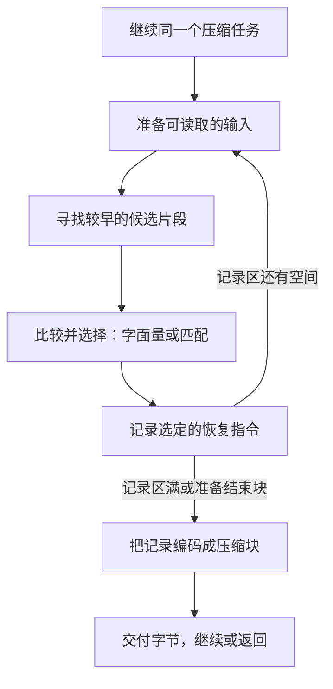

压缩可以把重复的字节换成恢复它们的指令。读过 `ABCQABCR` 后，压缩器又遇到 `ABCQABCX`：它可以直接写出这八个字节，也可以说“往前八字节，复制七字节”，然后写出 `X`。直接写出的单个字节称为**字面量**；回退距离和复制长度组成一条**匹配**。无论选择哪种表示，展开后都必须得到完全相同的原文。

难点在于，输入会持续到来。一直保存全部旧字节，内存就会无限增长；逐一比较每个保留位置，查找又会太慢；立即接受眼前的匹配，还可能错过下一字节开始的更好选择。zlib 用有限的滑动窗口、有搜索预算的索引，以及可选的单位置延迟决策，分别处理这些问题。本章从这些限制推导实现，再说明证明需要在每一步保住什么。

我们跟随原文字节，直到它们变成字面量或匹配记录。记录是一组交给后续阶段的恢复指令，后续阶段再把它们编码成压缩位流。一个块把一组决定放在一起编码；块边界不必与应用程序一次调用的结束重合。寻找匹配和编码位流是两个决定：先选定输出表达什么，再决定怎样用更少的位表达它。

## 从公开调用进入策略循环 {#dispatch}

即使应用程序分批提供输入，压缩也始终是同一个连续任务。压缩器在调用之间保存旧字节、尚未决定的输入，以及没有交付完的输出。每次调用可以接收一部分输入、产生一部分压缩字节，然后返回，让应用程序提供下一批空间。返回并不意味着一个压缩块或整条消息已经结束。

默认路径寻找重复片段，并多看一个位置再作决定；较快的路径立即接受当前选择；另有路径直接存储原字节、跳过匹配，或只寻找同一字节连续重复的片段。这些路径对同一个任务作出不同的时间和内存取舍。应用程序通过压缩级别和策略选择它们。**级别**是投入多少计算的设置：零级直接存储字节，不查找匹配；1–9 级愿意逐步花更多工作寻找短表示。**策略**则改变考虑哪种重复，或限制后续编码选择。配置改变计算过程，不改变解码器必须恢复的原字节。

C 入口是 `deflate`。它先检查连续任务的状态，交付先前准备好的输出，并写入格式要求的头部，随后才选择处理原文字节的引擎。下面四行来自[引擎分派位置](https://github.com/madler/zlib/blob/757f0527154291bcf6bfbd6396ecde6bedd2db95/deflate.c#L1236-L1239)。`s` 指向压缩器内部状态，其中 `level` 和 `strategy` 保存所选配置；`flush` 表示继续、结束一个块，还是结束整条流；`bstate` 接收供外层使用的内部执行结果。

```c
bstate = s->level == 0 ? deflate_stored(s, flush) :
         s->strategy == Z_HUFFMAN_ONLY ? deflate_huff(s, flush) :
         s->strategy == Z_RLE ? deflate_rle(s, flush) :
         (*(configuration_table[s->level].func))(s, flush);
```

分支顺序有意义。级别 0 先选择原样存储；非零级别下，`Z_HUFFMAN_ONLY` 只生成字面量，`Z_RLE` 专门寻找距离为 1 的重复。其余策略使用级别表中的快速或延迟匹配引擎。它们产生的都是 DEFLATE 格式允许的表示。



这是普通匹配路径的循环。窗口负责准备可读取的输入，索引负责找出候选，策略负责比较和决定，块编码器则只接收已经确定的记录。

引擎需要告诉外层：还需要机会继续运行、刚刚结束一个块，或已经开始或完成整条流的收尾。对应的 C 名称是 `need_more`、`block_done`、`finish_started`、`finish_done`。外层再据此继续工作，或返回公开的 `Z_OK`、`Z_STREAM_END` 等结果。应用程序的输出空间用完可以中断这段执行，但保存状态的含义仍须保持。

## 配置如何改变这条路径 {#configuration}

这条循环的任务已经确定：把原字节变成已提交的恢复指令。在进入内存和搜索操作前，先区分算法选择与资源限制。压缩级别决定愿意花多少时间查找，策略决定考虑哪些重复；字节窗口限制保留的输入量，另一些表和记录区限制索引规模与积累的决定。封装则在压缩数据外添加头尾和校验。这些就是下面各项配置存在的目的。

本章采用保留全部压缩级别、逐字节比较匹配的普通构建；没有启用简化构建选项 `FASTEST`。调用 `deflateInit` 时，默认压缩级别 `Z_DEFAULT_COMPRESSION` 被归一化为 6；默认窗口尺度为 32768 字节（指数为 15），`memLevel` 为 8，策略为 `Z_DEFAULT_STRATEGY`。本章的配置表描述这组源码设置，调参后要使用实际保存的字段值。

| 参数 | 直接改变什么 | 对执行的影响 |
| --- | --- | --- |
| `level` | 引擎及搜索阈值 | 0 使用原样存储；1–3 使用 `deflate_fast`；4–9 使用 `deflate_slow`。 |
| `strategy` | 候选选择或块编码限制 | `Z_HUFFMAN_ONLY` 绕过匹配；`Z_RLE` 使用距离 1；`Z_FILTERED` 在延迟引擎中调整短匹配取舍；`Z_FIXED` 保留匹配搜索并排除动态块，仍然可以选择原样存储块。 |
| `windowBits` | 封装及窗口尺度 | 影响保留的字节数和可搜索距离；封装还决定头尾与校验方式。 |
| `memLevel` | 候选索引与符号记录的存储量 | 更大的索引通常更容易区分候选，记录区更大容许积累更多决定；内存占用也增加。 |
| `flush` | 本轮是否继续等待输入、是否结束块或流 | 改变循环可以等待的时机，以及如何把尾部输入提交出去。 |

扩展初始化函数 [`deflateInit2_`](/reference/functions/deflateInit2_.zh.html) 提供这些选择。普通构建接受级别 0–9，另接受默认级别值；方法参数必须为 `Z_DEFLATED`。所选默认构建接受 `memLevel` 1–9。`windowBits` 的正值 8–15 选择 zlib 封装，负值 −9 到 −15 选择 raw DEFLATE，25–31 选择 gzip。zlib 的 8 会归一化为 9；raw 的 −8 和 gzip 的 24 被拒绝。去掉封装选择后，剩余的指数 b 给出 2^b 字节的窗口尺度。因此，本章普通压缩窗口的实际尺度是 512 到 32768 字节。上述 gzip 参数范围以默认启用 gzip 的构建为前提；定义 `NO_GZIP` 会移除 gzip 封装的生成支持。

应用程序还可以提供一段双方约定的起始文本，称为预设字典。这样，最初的输入也能引用压缩器和解压器都已经知道的内容。本章运行例子没有设置字典。流若以字典初始化，字典保留的后缀会提供初始匹配来源，而不会作为解压消息的新前缀被直接发出。对应内容关系以该字典上下文为起点，只把新展开的字节与已经提交的原始输入比较。

[`deflateParams`](/reference/functions/deflateParams.zh.html) 可以在活流中更改级别和策略。策略改变或引擎类别改变、且流已开始处理时，它先用 `Z_BLOCK` 处理现有工作；若旧输入或块工作未能清空，就返回 `Z_BUF_ERROR`。配置不是任意一条记录中间可直接替换的常量。[`deflateTune`](/reference/functions/deflateTune.zh.html) 则写入四个搜索参数，不能再用级别表的默认数值解释后续搜索。这四个参数分别控制缩减搜索投入的阈值、多看一个位置的阈值、认为足够长即可停止的长度，以及候选访问预算；搜索一节会用具体数值说明。三个值转换为 C 的无符号类型 `uInt`，足够长即可停止的 `nice_length` 则保存为有符号整数，所以调参后的数值必须按这些机器类型解释。

编译配置也会改变算法。`FASTEST` 将非零级别归一化为 1，采用简化匹配实现，并省去普通索引里从一个旧候选指向另一个旧候选的链接维护。`UNALIGNED_OK` 选择两字节探测与比较分支，同时带来短整数宽度、地址和访问规则的条件。这些分支分别说明使用条件；本章下面的 C 比较片段属于普通逐字节分支。

## 窗口保存候选需要的字节 {#window}

先解决内存问题。回到 `ABCQABCR` 后面的 `ABCQABCX`。当前位置必须还能读取较早的 `ABCQ`，才能发现长度 7、距离 8 的匹配。输入可以持续增长，因此保留范围必须有限。滑动窗口保存近期字节，供后续位置引用。

先用一个更小的教学场景看这个目的：输入是 `0123ABCDABCDwxyz`，已经处理了 `0123ABCD`。第二组 `ABCD` 可以引用四字节之前的第一组。保留上限在动画中缩成八字节；它只表示逻辑上的近期后缀，并非一个合法的 zlib 窗口参数。

<div class="zl-demo-mount"><zlib-demo kind="window"><p>第二组 ABCD 引用距离 4、长度 4。处理后最近八字节是 ABCDABCD；再处理 wxyz 后是 ABCDwxyz。退出保留范围的旧字节不再成为新引用的来源。</p></zlib-demo></div>

真实压缩器为了减少搬移，分配一个容量为窗口尺度两倍的数组。把这个配置尺度记作 W，C 把它保存在 `w_size` 中，因此连续数组有 `2W` 字节；数组里同时放历史和已经接收、尚未处理的新输入。字节比较直接沿数组中的连续位置前进。

`strstart` 是当前处理位置的数组下标，`lookahead` 是从这里起真实装入的待处理字节数。于是当前数据末尾为 `strstart + lookahead`，后面才是空闲空间。数组下标会在搬移后改变；一个字节在整条输入中的逻辑位置不变。

```text
window，容量 2W
[ 已处理的字节 ][ 已接收、待处理的字节 ][ 可补充输入的空闲区 ]
               ^ strstart             ^ strstart + lookahead
```

一条 DEFLATE 匹配最少复制 3 字节，最多复制 258 字节。源码把它们命名为 `MIN_MATCH` 和 `MAX_MATCH`。策略希望作决定前准备足够预读，既能比较最长匹配，又有余量为后续位置建立三字节索引。这个预读目标叫 `MIN_LOOKAHEAD`，值为 `258 + 3 + 1 = 262`。输入结束或刷新时，循环仍然要处理不足 262 字节的尾部。

处理位置接近数组末端时，搜索仍然必须有空间读取这些比较余量。普通搜索为这些读取预留空间，因此实际最大搜索距离为 `W - 262`，对应[距离与预读定义](https://github.com/madler/zlib/blob/757f0527154291bcf6bfbd6396ecde6bedd2db95/deflate.h#L296-L301)中的 `MAX_DIST(s)`。默认 W=32768 给出 32506 字节。DEFLATE 格式允许的距离上限仍为 32768；这里是压缩器寻找来源的限制。物理上还在数组里的字节，也可能已超出本轮搜索范围。

## 补充输入与成批搬移 {#refill}

窗口终究要为下一批输入腾出位置，又不能丢掉仍可作为匹配来源的字节。如果每处理一个字节就搬移一次，代价会很高。因此，压缩器先在较大的数组里向前推进，接近末端时才一次回收一整段低地址空间。

当处理位置前方的真实字节不足 262 时，辅助函数 `fill_window` 负责准备输入。它先求数组尾部的空闲字节数：`more = window_size - strstart - lookahead`。普通布局的 `window_size` 为 `2W`。接近数组末端，即 `strstart ≥ 2W - 262` 时，它把仍需保留的上半部分搬到低地址，再继续装入输入。这些常量是配合起来的：到达阈值时，距离界允许的最早来源是 `(2W−262)−(W−262)=W`。因此，把上部区间向下平移 W，能够保住此时所有距离合法的来源。比较余量、搜索距离和搬移阈值不能各自独立选择。

取合法的 W=512，令 `strstart=800`、`lookahead=100`。真实数据占到下标 900，空闲量是 124。滑动阈值为 762，于是把 `[512,900)` 中的 388 字节搬到 `[0,388)`。当前起点变为 288，预读量仍是 100。原候选 700 变为 188，距离仍是 100：`800−700 = 288−188`。搬移前，距离界允许的最早来源是 550（`800−250`），所以丢掉 512 之前的内容不会损失任何距离合法的来源。实际复制的区间还包含 512–549：这些字节物理上保留着，却已经远到不允许搜索。

接下来的动画要检查：换地址究竟改变了输入，还是只腾出了空间？假设应用程序又准备了 300 字节。搬移前尾部只空出 124 字节，搬移后则有 636 字节，可以把这 300 字节全部接到 `[388,688)`。预读量由 100 变为 400，当前处理的仍是原输入中的同一个位置。262 是需要补输入的判断阈值，并不是一次读取最多只能达到的预读量。

<div class="zl-demo-mount"><zlib-demo kind="refill"><p>W=512 时，数组容量为 1024，最大搜索距离为 250。当前起点 800、预读 100 字节时，把数组 [512,900) 复制到 [0,388)，再把新到的 300 字节接到 [388,688)。起点 800 变为 288，来源 700 变为 188，距离仍是 100。当前输入字节没有改变。这是连续区间的复制，字节地址并不对 W 取模。</p></zlib-demo></div>

下面的[实际搬移代码](https://github.com/madler/zlib/blob/757f0527154291bcf6bfbd6396ecde6bedd2db95/deflate.c#L285-L299)同时更新字节和位置。`wsize` 是 W 的局部副本；`block_start` 是当前块原始输入的起点，使用有符号类型：

```c
zmemcpy(s->window, s->window + wsize, (unsigned)wsize - more);
s->match_start -= wsize;
s->strstart    -= wsize; /* we now have strstart >= MAX_DIST */
s->block_start -= (long) wsize;
```

点击“装入 300 字节”后，待处理量达到 400，但处理的原输入位置仍是 800，跟踪来源的距离仍是 100。接收输入只增加可用工作，并未提交新指令。复制不会清除原来的来源区域；后续写入可以覆盖那里留下的副本。哪些字节仍有意义，要由有效区间和距离界决定，不能只看某个地址是否还碰巧存着旧值。

压缩器还保存来源的位置，让后续搜索不必重新查找。字节换地址时，这些位置也必须一起改变。代码调用 `slide_hash` 作相同的平移，调整尚未完成的索引插入数量，再增加空闲计数。后面的索引一节会说明这些链接。`block_start` 可以变成负数：当前块的原始开头可能已经离开数组。后续选择原样存储块时，便需要检查原始区间是否仍可读取。

有了空间，新输入就可以接到现有数据末尾。应用程序用 `z_stream` 结构描述自己的缓冲区，压缩器通过 `s->strm` 指向它。其中 `next_in` 指向应用程序尚未交出的下一个字节，`avail_in` 表示可读字节数。辅助函数 `read_buf` 从这块缓冲区复制输入，最多复制容量参数 `more` 指定的字节数，并返回实际复制量 `n`：

```c
n = read_buf(s->strm, s->window + s->strstart + s->lookahead, more);
s->lookahead += n;
```

它至多读取 `min(avail_in, more)` 个字节，推进调用者的输入指针，更新消费计数以及相应封装的校验和。`lookahead` 只增加实际读到的数量。接收输入与把输入提交成符号是两个时刻：前者推进 `next_in`，后者由策略决定。

循环在调用者仍有输入时尽量补足 262 字节；`Z_NO_FLUSH` 下预读不足，可以返回 `need_more`，等待更多输入。尾部的一两个字节暂时没有完整三字节键，`insert` 保存这些延期索引工作，新字节到达后再补上。

还有一个独立边界：快速比较可能查看真实数据末尾之后、但仍在分配区内的字节。`high_water` 记录已经初始化的前缀末尾；源码按需在真实数据后清零最多 258 字节，限制在分配范围内。它只让这些位置可读取，没有把零变成新的输入。最后返回的匹配长度仍受 `lookahead` 限制。

## 三字节哈希与候选链 {#hash}

窗口限制了内存，却还没有解决查找时间的问题。保存字节以后，逐一比较窗口中每个旧起点仍然很贵。下一步是先把可能的来源归组，再进行昂贵的比较。**哈希**是从字节算出的一个较小整数；分到同一个整数的候选归入同一个**桶**。zlib 计算当前位置三个字节的哈希，只访问同桶的旧位置。三字节足以排除连最短 DEFLATE 匹配都无法构成的起点。同样的三字节串一定进入同桶；不同内容也可能进入同桶，这叫碰撞。因此桶给出的是候选，不能代替字节比较。

默认索引由 `memLevel=8` 选择，有 32768 个桶。十五位足以表示桶编号，因此 `hash_bits=15`，低位掩码 `hash_mask=32767`；移位量为 `hash_shift=5`。每接入一个字节，已有哈希左移五位、与字节异或，再保留低十五位：

```text
h := ((h << hash_shift) XOR next_byte) AND hash_mask
```

连续读取 A、B、C 时，哈希从 0 变成 65、2146、3075；再接 D 得到 36，也就是从零计算 B、C、D 的结果。较早字节的贡献被连续移位推出掩码，因此从 `ABC` 移到 `BCD` 不必重算整个键。

头表 `head` 保存每个桶最新的位置。前驱表 `prev` 为已插入位置保存较早的同桶位置。插入位置 p 时，先取旧桶头作为候选和前驱，再把桶头改成 p。在宏中，`str` 是插入位置，`ins_h` 是滚动哈希，`match_head` 接收旧桶头；`w_mask` 为 W−1，用来选择前驱槽位。普通宏保留了这个顺序：

```c
#define INSERT_STRING(s, str, match_head) \
   (UPDATE_HASH(s, s->ins_h, s->window[(str) + (MIN_MATCH-1)]), \
    match_head = s->prev[(str) & s->w_mask] = s->head[s->ins_h], \
    s->head[s->ins_h] = (Pos)(str))
```

搜索从旧桶头开始，避免把当前位置当成自己的来源。零是 `NIL` 哨兵，不作为普通候选。

`prev` 只有 W 个槽位，使用 `p & (W−1)` 取槽，等价于 p 对 W 取模。W=512 时，位置 100 与 612 复用槽位 100；两位置相隔 512，已经超过该配置的 250 字节搜索界。这个循环复用发生在**前驱表**，字节比较使用的仍是连续 `2W` 数组。

`slide_hash` 对头表和前驱值执行 `m ≥ W ? m−W : 0`。滑动 W 不改变槽位编号，却改变槽位里保存的位置。在 W=512 的例子中，来源 700 使用槽位 188。若槽内保存更早来源 650，搬移后槽位仍为 188，但保存值由 650 变为 138；来源本身由 700 搬到 188，更早来源由 650 搬到 138。头表在初始化时清零；前驱槽位随着插入写入，不能把每个从未使用的槽位都当成已初始化链结点。

## 在预算内比较真正的字节 {#search}

在 `ABCQABCR` 与后续 `ABCQABCX` 的场景中，距离 4 的最近候选匹配 `ABC`，到第四字节 R/Q 时失败。距离 8 的较早候选匹配 `ABCQABC`，到第八字节 R/X 时失败。因此两条合法选择是长度 3／距离 4 和长度 7／距离 8。七字节比较沿同一数组越过了最早的四字符片段，候选并不是单独保存的词。

<div class="zl-demo-mount"><zlib-demo kind="search"><p>最近候选给出三个相同字节，沿下一条前驱链接可找到七个。访问预算为一时，搜索在较长候选之前停止。</p></zlib-demo></div>

动画用逻辑偏移零标记最早片段；真实头表用零作哨兵。将例子中的所有位置统一加一，距离和比较结果不变。这个选择场景说明预算的作用，具体桶链仍由真实插入历史决定。

第二个候选能改善多少？把动画的访问预算分别设为一和二：前者停在三字节匹配，后者能找到七字节匹配。普通 `longest_match` 从旧桶头沿前驱链向更早位置走。`prev_length` 给出需要超越的长度基线，`best_len` 保存当前最好长度。要超越基线，候选在开头和基线末端都必须相等；完整比较前，`scan` 指当前输入起点，`match` 指候选；`scan_end1` 与 `scan_end` 缓存当前输入在 `best_len−1` 和 `best_len` 的字节。四次便宜探测可以先排除许多候选：

```c
if (match[best_len]     != scan_end  ||
    match[best_len - 1] != scan_end1 ||
    *match              != *scan     ||
    *++match            != scan[1])      continue;
```

探测通过后，仍要比较中间内容。前两个字节已相同、哈希键又相同时，所选哈希参数可以推出第三字节相同；随后一次短路条件展开八次比较，减少逐字节循环的控制开销。

这个优化把检查频率和空间余量联系起来：它不是每比较一个字节都重新检查真实输入长度，所以窗口需要前面的可读余量；比较得到的长度最后还要截到真实 `lookahead`。源码只在 `len > best_len` 时更新 `match_start` 和最佳长度。没有改善基线时，旧的 `match_start` 不会自动成为当前位置的新匹配见证。

搜索也不要求穷尽所有候选。`max_chain_length` 提供初始访问预算；经过下面可能发生的缩减后，有效预算为正时才按该数限制访问次数。`nice_match` 给出“已足够长，可以停止”的阈值；前一个匹配达到 `good_match` 时，普通搜索把链预算缩为四分之一。级别表中的部分设置如下，长度单位为字节：

| 级别 | 引擎 | `good_match` | 延迟／插入阈值 | `nice_match` | 链预算 |
| --- | --- | --- | --- | --- | --- |
| 1 | 快速 | 4，默认快路基线不会达到此阈值 | 4 | 8 | 4 |
| 6 | 延迟 | 8 | 16 | 128 | 128 |
| 9 | 延迟 | 32 | 258 | 258 | 4096 |

级别 6 的普通搜索最多按预算检查 128 个候选；前一个匹配已达 8 字节时缩为 32。找到至少 128 字节的候选可提前停止，输入尾部还会把这个停止阈值截到现有输入长度。高压缩级别愿意花更多比较时间；函数名 `longest_match` 并不承诺找到整个窗口中全局最长的来源。

表中的预算都是正数。`deflateTune` 写入零、把负整数转换成无符号字段，或者较小的正预算被四等分成零时，都要按实际控制流解释：这是先执行候选比较、再递减预算的 `do...while`。零不是“一个候选也不检查”；在走到递减条件时，无符号零可以回绕。前驱位置持续下降仍能限制可访问的链，但默认表中的时间预算解释不能直接套在这些值上。

## 快速提交与延迟决策 {#lazy}

有预算的搜索已经给出了当前位置的一条可用匹配。现在还剩一个决定：立即采用它，还是多看一个字节，寻找更好的后续？

`deflate_fast` 立即采用当前位置的有用匹配。较短匹配经过的中间位置也插入哈希表；匹配较长时，可以跳过这些插入，并在新位置附近重新准备哈希。它减少当前工作，也减少后面能访问的候选。级别 1–3 里的公共阈值字段因此用作插入长度限制，而非下一位置的延迟搜索限制。

`deflate_slow` 多保留一个决定。设历史中存在 `XABZ` 和 `ABCDEFGH`，当前输入为 `XABCDEFGQ`。在位置 S 发现长度 3 的 `XAB`，下一位置 S+1 却能匹配长度 7 的 `ABCDEFG`。假设搜索到达这些来源，且再下一位置没有更好的改进：

| 本轮起点 | 比较与选择 | 记录结果 |
| --- | --- | --- |
| S | 找到长度 3，暂缓决定，前进一个字节 | 暂不记录 S |
| S+1 | 长度 7 优于上一步的 3 | 记录字面量 X，保存七字节候选 |
| S+2 | 新结果不优于七字节候选 | 记录从 S+1 开始的匹配，前进到 S+8 |

`match_available` 表示有一个延期位置，`prev_length` 和 `prev_match` 保留前一位置的长度与来源。第三行的实际记录调用如下：

```c
_tr_tally_dist(s, s->strstart - 1 - s->prev_match,
               s->prev_length - MIN_MATCH, bflush);
```

距离从 `strstart−1` 计算，因为要提交的是上一位置的匹配。长度减去 3 后成为存储偏移；`bflush` 表示符号区是否已满。接受旧匹配后只再消费 `prev_length−1` 个预读字节，因为其中一个已经在前一步越过。插入循环也只处理仍有三个真实字节的起点。

最终展开是 X、ABCDEFG、Q，仍是原来的九个字节。延迟选择可能提高压缩率，但最终位数还取决于距离编码、符号频率和块头成本。`max_lazy_match` 让足够长的旧匹配省去下一次搜索；`Z_FILTERED` 会放弃部分短匹配，`TOO_FAR` 启发式也可能放弃距离很远的三字节匹配。这些都改变选择质量，不改变解压规则。

## 提交符号与输入记账 {#symbols}

选择只有写成记录后，才成为压缩消息的一部分。在此之前，延迟匹配仍可替换它；在此之后，块编码器就必须保留它。

策略提交之后，编码器才得到稳定记录。在默认、未启用 `LIT_MEM` 的布局中，每条记录占三字节：两字节距离，再加一个字面量值或长度偏移。距离零表示字面量；非零距离配合长度偏移表示匹配。长度 6、距离 2 会保存距离 2 和偏移 3，而不是保存六个重复字母。

为了压缩这些记录，块编码器为需要传递的项目分配位序列：字面量值、长度范围和距离范围。这些项目称为编码符号。Huffman 编码给频繁出现的符号分配更短的位序列，因此除了记录顺序，还需要出现次数。记录操作也就同时更新字面量／长度编码表与距离编码表中的频率；实现把这些表称为树。一次六字节匹配增加一个长度码和一个距离码的次数；它不会为那六个恢复字节各增加一次字面量计数。下条记录的字节偏移名为 `sym_next`，容量边界名为 `sym_end`。偏移按记录布局前进，达到边界时，策略要求编码当前块。`memLevel` 也改变这个记录容量，因而可以改变块边界。

到这里有三种不同的“已处理”：调用者输入已被复制到窗口，策略可能已经越过某个位置，符号记录已经承诺一段输入。延迟匹配说明这三者并不总在同一点。字节编码器接收的是最后一类：已经提交的符号序列与其频率。后续 Huffman 编码和块选择可以换一种位表示，却必须保留这些符号的顺序与含义。

## 正确性：从移动的数组到原输入 {#correctness}

本章的承诺可以直接在例子里检查：不管预算找到长度 3／距离 4，还是找到长度 7／距离 8，展开已提交符号都应恰好得到原输入的已提交前缀。证明要沿真实执行维持字节身份、链的意义和提交起点，不能只检查最终计数。


### 搬移同时保持地址与内容 {#proof-window}

对没有预设字典的运行，把数组下标零对应的逻辑输入位置记为 L。在保留的真实数据区间内，数组位置 i 保存的应是输入位置 L+i 的字节；空闲尾部没有这个内容要求。滑动 W 之后，新基准为 L+W，新位置 i 保存旧位置 i+W 的字节，依据是 `(L+W)+i = L+(i+W)`。在具体例子里，候选 700 变为 188，逻辑位置和距离一起保持。

数值界 `strstart + lookahead ≤ 2W` 说明真实数据装得下，却没有说明存了正确字节。[`slide_copy`](/reference/source/ZlibF/Proof/deflate.c.engine.window.html#L52) 在 W≥512、这个形状界及滑动条件下给出复制范围在界内、长度正确、源目标不重叠的算术结论；窗口内容关系说明复制后还是同一段输入。[`read_buf_ok`](/reference/source/ZlibF/Proof/deflate.c.engine.readbuf.html#L99) 再把实际读取、指针推进及记账接到返回堆，清零保护尾部的操作则保持逻辑输入不变。

这里引用的读取命题处理非零复制量，要求源可读、目标可写、两端范围合法且不重叠，流和状态指向相应堆对象。gzip 校验分支还使用固定 CRC 表关系；zlib 的单字节更新结论带有 Adler 高半部小于 65521 的条件。这些是调用点要从初始化和保存状态取得的具体事实，零字节读取另有对应分支。

### 链的有效性来自可达性 {#proof-chains}

[`HashChains`](/reference/source/ZlibF/Proof/deflate.c.engine.chains.html#L29) 只要求搜索可达且槽位尚属该位置的结点有意义：它已被插入，三个字节属于真实输入并具有对应哈希，前驱严格更早。参数 `top` 表示插入进度，`top ≤ p+W` 区分尚未复用的槽位。初始化清空桶头就能让搜索避开从未写入的前驱槽位。

插入证明分新结点与旧可达结点两种情况。新结点保存的旧桶头在它之前；对旧结点，需要证明复用的槽位没有破坏仍然需要的链接。滑动时，位置统一减 W，槽位取模结果不变，字节内容也按同一偏移移动。数学关系 [`chains_insert`、`chains_slide`](/reference/source/ZlibF/Proof/deflate.c.engine.chains.html) 分别建立插入和搬移后的条件保持。[`INSERT_STRING_ok`](/reference/source/ZlibF/Proof/deflate.c.engine.macros.html#L177) 把插入宏接到真实堆写入；[`slide_hash_ok`](/reference/source/ZlibF/Proof/deflate.c.engine.slide.html#L166) 则处理位置平移的实际执行。

### 搜索返回值带着匹配见证 {#proof-search}

匹配见证需要记录更早来源、允许的距离与长度，以及每个比较位置的字节相等。Lean 的 [`GoodMatch`](/reference/source/ZlibF/Proof/deflate.c.engine.lmbody.html#L29) 把“有用匹配”的内容写得很明确。`wa` 是窗口字节数组，`ss` 是当前起点，`ws` 是 W，`m` 是来源，`len` 是长度。`Nat` 表示非负整数，`bfn wa i` 读取数组的第 i 个字节；执行前提另行保证这些读取在分配范围内：

```lean
def GoodMatch (wa : Array UInt8) (ss ws m len : Nat) : Prop :=
  m < ss ∧ ss - m ≤ ws - 262 ∧ len ≤ 258 ∧
    ∀ j, j < len → bfn wa (m + j) = bfn wa (ss + j)
```

它同时要求来源更早、距离允许、长度有界，以及区间中每一个字节相等。便宜探测只能排除候选，不能直接建立最后那个逐字节结论。八次展开比较由 [`firstMis_spec`](/reference/source/ZlibF/Proof/deflate.c.engine.match.html#L50) 和[内层执行命题](/reference/source/ZlibF/Proof/deflate.c.engine.lminner.html#L36)连接到首次不相等位置；哈希参数与头两个字节相等则为省去的第三字节比较提供依据。

[`longest_match_ok`](/reference/source/ZlibF/Proof/deflate.c.engine.lmmain.html#L212) 的前提 [`LMEnv`](/reference/source/ZlibF/Proof/deflate.c.engine.lmbody.html#L35) 指定实际窗口和前驱堆块、W 为 512–32768 内的二次幂、掩码 W−1、比较所需空间、合法的初始较早候选，以及可达链的下降和字节关系。它的结论把内部最佳长度记为 `best`，返回 `min(best, lookahead)`，只改变 `match_start`，并明确分开两个结果：

- 没有改善 `prev_length`，保留旧 `match_start`。
- 有严格改善，新 `match_start` 给出 `GoodMatch` 见证。

这一区分决定策略能使用哪一条关系：保留旧匹配时，需要前一状态的见证，不能把旧字段当作当前位置新找到的匹配。循环终止还可由严格下降的候选位置证明；`lm_loop_ok` 使用 `cur_match.toNat` 作为度量，无须假定无符号预算永远不会从零回绕。

### 延期位置与提交前缀一起归纳 {#proof-symbols}

策略的不变量再把搜索结果接回输入：它分别记录已提交前缀、最多一个延期字节和剩余预读输入。对 `XABCDEFGQ`，提交 X 让前缀增长一个字节，提交保存的七字节匹配再增长 `ABCDEFG`。在 S+2 这轮，记录必须从 S+1 而非 S+2 开始；C 中的 `strstart−1` 正是在维持这条对应。

若匹配长度大于距离，展开仍然逐字节成立。设复制起点为 S，距离为正数 d，第 j 步读取 S+j−d。j<d 时来源属于既有历史；j≥d 时来源是此前第 j−d 步产生的字节。因为 j−d<j，可以对复制步骤归纳。内存访问界与字节相等见证一起，让新记录继续表示正确的输入前缀。

对单条记录，[`tr_tally_spec`](/reference/source/ZlibF/Proof/trees.c.tally.html#L327) 在数组不变量成立、还有三个紧凑记录字节的空间时，给出三个存储字节、精确频率更新，以及记录区间之外的保持。字面量的距离为零，字节值小于 256；匹配的长度减三后小于 256，距离在 1–32768。[`tallyCalls_preserves`](/reference/source/ZlibF/Proof/trees.c.tally-support.html#L46) 组合容量有界的一串真实记录调用，保持表示不变量 `TreesInvAt`，也就是符号区和编码表仍满足结构约束。它还保持本步骤没有使用的结束符频率和码长树，并给出精确的记录游标。匹配记录由策略提供长度 3–258、允许的正距离及输入关系；字面量则提供当前输入字节。两种情况下，单条记录结果都提供块发射所需的存储对应。
