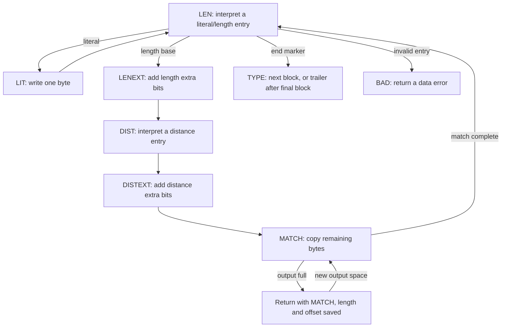
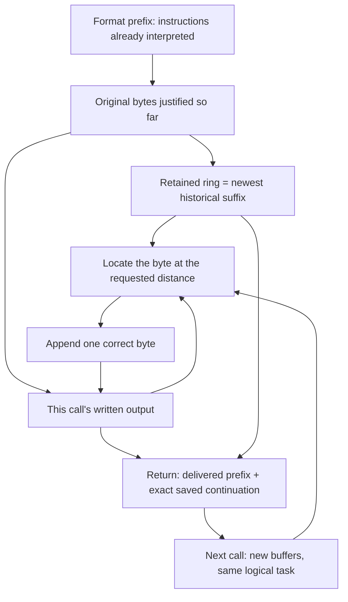

A decoding table identifies an instruction; it has not yet recovered the instruction's output. This chapter follows the next task: turn literals and backward references into the original bytes, even when the application supplies those bytes' destination a small buffer at a time.

Several difficulties shape the implementation. A backward reference can read bytes it has just written, so an ordinary fixed-source memory copy is insufficient. A return can split one instruction across different output buffers, so the decoder must preserve both unfinished work and the older bytes that work needs. The fast loop then moves capacity checks outside that work, while keeping its byte order and error checks. Finally, producing all bytes still leaves a wrapped stream's integrity check to finish.

Use one small result throughout: `ABABABAB`. The selected raw stream `73 74 82 40 00` describes A, B, length six at distance two, then end of block. First execute this instruction with enough room; then interrupt it after `ABABA`; finally explain the optimization and the proof relations that make both executions agree. The wrapper example later adds a separate question: whether those recovered bytes pass the stream's final check.

## From a table entry to the next operation {#dispatch}

Reading an instruction and executing it can stop at different points. For a literal, the decoder may already know the byte but lack a place to write it. For a match, it may know the length but still need the distance, or know both values and have copied only part of the result. Restarting all this work at each call would reread compressed bits and duplicate output. The decoder therefore records **the next piece of work**, together with the values already obtained.

The C implements this record with `state->mode` and a `switch` inside `inflate`'s `for (;;)` loop. `LEN` selects the next literal/length instruction; `LIT` keeps a decoded literal awaiting its write; `MATCH` keeps a decoded length and distance awaiting the remaining copies. The intervening states finish the extra bits and distance. The diagram follows these states in the [ordinary decoder](https://github.com/madler/zlib/blob/757f0527154291bcf6bfbd6396ecde6bedd2db95/inflate.c#L930-L1080); each arrow preserves work already done.



In `LEN`, the C first ensures enough buffered bits for the selected table entry, follows a subtable link when required, and removes precisely the entry's code bits. The selected entry is held in `here`; its value field, `here.val`, is put into `state->length`. The operation field then gives that value its role: for a literal it is a byte; for a match it is a length base. `LENEXT` adds the selected extra bits. `DIST` and `DISTEXT` perform the corresponding distance calculation and save it as `state->offset`.

A block-end marker changes to `TYPE`, not directly to a completed stream. The final-block flag saved as `last` determines whether to read another block or proceed to final alignment and wrapper checks. Invalid length or distance symbols choose `BAD`. Lack of input during extra-bit reading returns with the mode and the available bits preserved.

## A literal needs one writable position {#literals}

Writing a literal needs exactly one writable byte. The application provides a destination slice: its start is `next_out`, and its available length is `avail_out`. During execution the decoder uses the local names `put` for the next writable position and `left` for the remaining room. The decoded literal waits in `state->length`; that field holds a byte in this state, although it holds a match length in other states. The [entire literal case](https://github.com/madler/zlib/blob/757f0527154291bcf6bfbd6396ecde6bedd2db95/inflate.c#L1075-L1080) is:

```c
case LIT:
    if (left == 0) goto inf_leave;
    *put++ = (unsigned char)(state->length);
    left--;
    state->mode = LEN;
    break;
```

For A, the stored value is 65. With room, it becomes the next output byte, `put` advances by one, and `left` falls by one. Without room, the return keeps `LIT` and the saved byte. The next call writes that byte; it does not decode the literal again. B follows the same route, leaving the prefix `AB`.

The private state and the temporary output area have different lifetimes. The stream state survives returns. The application can consume and reuse a delivered output slice under the buffer contract. A later match must therefore locate its source either in this call's output or in the decoder's own retained history.

## A match extends the output while reading it {#copy}

The instruction length six, distance two means: repeatedly read the byte two positions behind the current end and append it. The distance stays two while both source and destination move.

| Copy step | Byte read | Prefix after the write |
| --- | --- | --- |
| 1 | A from the earlier literal | `ABA` |
| 2 | B from the earlier literal | `ABAB` |
| 3 | A written at step 1 | `ABABA` |
| 4 | B written at step 2 | `ABABAB` |
| 5 | A written at step 3 | `ABABABA` |
| 6 | B written at step 4 | `ABABABAB` |

The third read is already a read of newly produced data. An unchanged snapshot of the original two-byte source cannot supply the six-byte result. The implementation must retain the forward byte-by-byte order even when it groups several assignments into a loop body.

Step through this recurrence below. The arrow identifies the byte read for the next append; after two writes, that source is already inside the part generated by this match. This isolates the copying rule from bit parsing and API returns.

<div class="zl-demo-mount"><zlib-demo kind="copy"><p>Start with AB, then append six bytes at distance two. Each write becomes available to subsequent reads.</p></zlib-demo></div>

To implement the same rule with a limited destination, copy only a batch that fits, then keep the remaining debt. In `MATCH`, that debt is `state->length`. The source pointer is `from`, the destination pointer is `put`, and `copy` counts the current batch. The [actual copying tail](https://github.com/madler/zlib/blob/757f0527154291bcf6bfbd6396ecde6bedd2db95/inflate.c#L1028-L1073) clips that batch to the available room:

```c
if (copy > left) copy = left;
left -= copy;
state->length -= copy;
do {
    *put++ = *from++;
} while (--copy);
if (state->length == 0) state->mode = LEN;
```

`copy` is positive on entry to this `do` loop. The case has already tested `left != 0`, the match has positive remaining length, and a window segment is bounded by a positive source span. Subtracting the count before the loop records how much work will remain after those writes. In the direct-output arm, `from` can advance into the output just written. A change from window storage to output performs a new source selection; a pointer does not walk from one allocation into the other. Returning to `LEN` is justified only when the remaining match length reaches zero.

## Current output and saved history {#window}

The `AB` example kept every source byte in the destination being filled. That stops being enough when the application consumes a completed slice and offers another buffer: a later backward reference may still need bytes from the old slice. The decoder must own a bounded copy of the newest past bytes. This saved suffix is its **history window**.

A circular array lets this suffix grow without moving every retained byte: new bytes replace the oldest slots as the write position wraps. In the implementation, `wsize` is its capacity, `whave` counts valid retained bytes, and `wnext` identifies the next slot to replace. A newly allocated slot is not usable history until it has received a byte. These fields therefore record different facts. This decoder ring differs from the compressor's continuous `2W` byte array and its sliding moves.

The ordinary decoder saves the output capacity at the start of this call as `out`; `left` is the space still unused. Thus `out - left` counts bytes produced **in this call**. If the match distance is no greater than that count, `put - offset` lies in the current output. Otherwise, the distance reaches before the call's output start, and the excess must come from the ring.

Here is the source choice in the ordinary case, reduced to its actual direct-output arm:

```c
else {                              /* copy from output */
    from = put - state->offset;
    copy = state->length;
}
```

The window arm first computes the excess distance. If it exceeds the valid-history count `whave`, normal missing-history handling selects `BAD`. The state flag `sane` enables that rejection and is set by default: the requested source bytes do not exist. Otherwise it locates the chronological source around `wnext`, limits the copy to a contiguous segment, and returns to the same case if more match bytes remain. The next segment can come from the ring's start or from the new output.

The next example exposes a difficulty the `AB` copy did not have: one logical source crosses the array end and then crosses into current output. Use an eight-cell teaching ring whose physical cells contain `ABCDEFGH`, with next-write index `wnext = 3` and all eight cells valid. The oldest byte is at index 3, so chronological history is `DEFGHABC`. This call has produced `DE`, and the next instruction asks for length six, distance six:

| Quantity | Value | Meaning |
| --- | ---: | --- |
| Current-call output | 2 bytes | `DE` already lies in the caller's current output slice. |
| Excess distance | `6 - 2 = 4` | The first four source bytes must come from retained history. |
| First physical source index | `8 + 3 - 4 = 7` | Cell 7 contains H. |

Read H from cell 7, wrap, and read ABC from cells 0–2. The remaining two bytes come from current output, DE. The instruction contributes `HABCDE`, leaving current output `DEHABCDE`. A distance remains a logical backward distance even though its physical source changes twice.

Eight cells make the indexing visible; they are not an admitted initialization window size. With the normal source configuration, reset establishes `sane = 1`. This rejects unavailable history in both ordinary and fast copying. The optional `INFLATE_STRICT` build adds a separate comparison with `dmax`, the maximum distance derived from the zlib header. That additional header-limit check and the available-history check are different conditions.

Window configuration also changes what survives a return. A full 32 KiB retained window can preserve the format's largest history suffix. A smaller configured window retains less; bytes already in the current output may still satisfy a long distance, while the same distance after rebuffering may no longer have enough retained history. A preset dictionary contributes past bytes without counting as new output. For a zlib dictionary request, its Adler identifier is checked before the dictionary is installed; raw mode has no header identifier to perform that handshake.

The API [`inflateUndermine`](https://github.com/madler/zlib/blob/757f0527154291bcf6bfbd6396ecde6bedd2db95/inflate.c#L1396-L1408) exposes a build-dependent change to missing-history handling. Without `INFLATE_ALLOW_INVALID_DISTANCE_TOOFAR_ARRR`, it keeps `sane = 1` and returns `Z_DATA_ERROR`. The specially enabled build has separate zero-fill behavior for missing history. Its semantics must be stated explicitly rather than silently treated as ordinary DEFLATE repetition.

## A full output buffer pauses the same instruction {#suspension}

A limited output slice should change only when the result is delivered, not which result is decoded. To test that requirement, supply all five bytes of our raw stream but only five output positions. The caller reuses the same destination after handling each returned slice, while retaining the same stream state:

<!-- example:inflate-chunks#call -->

The offered space is five bytes on each iteration. Subtracting the returned unused space tells the application how many bytes it can handle. This program's two calls return:

| Call | Compressed bytes consumed | Original bytes delivered | Return |
| --- | ---: | --- | --- |
| 1 | 4 | `ABABA` | `Z_OK` |
| 2 | 1 | `BAB` | `Z_STREAM_END` |

The first two bytes are literals; the next three are the beginning of the six-byte match. At the first return, the saved state is `MATCH`, remaining length three, distance two. The decoder also retains the required suffix of `ABABA` in its own window. The application can now deliver those five bytes and reuse the output storage.

The second call first reads B and A from retained history. Its third byte reads the B just written in the new output. It completes the saved match before returning to `LEN` to read the end marker. The compressed instruction was decoded once, even though its output crossed two calls.

<div class="zl-demo-mount"><zlib-demo kind="stream"><p>The first output slice contains ABABA and leaves three match bytes at distance two. The next slice receives BAB, continuing that same saved MATCH operation.</p></zlib-demo></div>

Keeping that source available after the application reuses its buffer is the job of [`updatewindow`](https://github.com/madler/zlib/blob/757f0527154291bcf6bfbd6396ecde6bedd2db95/inflate.c#L250-L305). It retains the most recent suffix when a return needs history. If this call produced at least a window's capacity, it copies only the newest full window. Otherwise it appends the shorter new suffix, splitting the memory copy at the ring boundary when necessary. Initial window allocation is delayed until this retained history is needed. A one-call finish can therefore avoid an otherwise unnecessary window allocation and copy; that optimization is controlled by the actual return condition, not by the assumption that every stream fits one call.

The same pause principle applies before a literal write, midway through extra bits, and during header or trailer fields. Saved modes distinguish these jobs. Replacing input must preserve the unconsumed suffix; replacing output provides new writable space while the decoder owns the historical bytes it still needs.

## Fast decoding checks room for a whole instruction {#fast}

The ordinary route works even with small slices because it checks input at refill points and limits each output batch to the room available. On a large slice those repeated tests cost work. The fast route asks a different question first: **is there enough input and output room to execute any one length/distance instruction without stopping for capacity?** If so, the loop can move those capacity checks to the instruction boundary. Invalid codes and unavailable history still need their semantic checks.

The output bound comes directly from the longest DEFLATE match: 258 bytes. For input, a length code uses at most 15 bits and its extra field at most 5; a distance code uses at most 15 bits and its extra field at most 13. Their total is at most 48 bits. These are bounds across all admitted instructions, not a description of the six-byte, distance-two match in our example. The actual refill operations also need a shared bit-balance argument to fit six input bytes.

The C calls this route `inflate_fast`. At the point where it is ready to read a new literal/length instruction (`LEN`), the [entry branch](https://github.com/madler/zlib/blob/757f0527154291bcf6bfbd6396ecde6bedd2db95/inflate.c#L923-L929) uses three quantities: unread input bytes `have`, writable output bytes `left`, and already fetched but unconsumed bits `bits`:

```c
case LEN:
    if (have >= 6 && left >= 258 && bits < 8) {
        RESTORE();
        inflate_fast(strm, out);
        LOAD();
```

In this branch, `RESTORE` publishes the outer loop's local cursors and held bits to the stream before the helper reads them; `LOAD` obtains the helper's returned values afterward. Six input bytes supply the refill margin and 258 output positions supply the maximum expansion margin. The third condition serves a different purpose: fewer than eight held bits make exact whole-byte backtracking possible when the helper exits, as the return section explains. These capacity and bit-count tests do not certify the input. Installed tables and available history still have to describe valid readable sources.

Change the three quantities below to see this distinction. First compare five and six unread bytes, then 257 and 258 output positions. Each change selects a route; it does not decide whether the compressed data is valid. The inspection steps explain the general bounds separately from the small copying example.

<div class="zl-demo-mount"><zlib-demo kind="fastpath"><p>The fast branch needs at least six unread input bytes, 258 writable output positions and fewer than eight held bits. If any condition fails, the ordinary decoder continues.</p></zlib-demo></div>

The five-byte, five-output-slot example above cannot enter this branch. More generally, a default build still chooses between the paths at run time: the current mode, offered input/output space, and retained bits determine entry. With insufficient margins, the ordinary state machine continues to support the same admitted small-buffer calls.

Inside the helper, the names `in` and `out` are **pointers**, unlike the main function's saved count named `out`. The helper receives that saved count as its argument `start`. Its setup is:

```c
in = strm->next_in;
last = in + (strm->avail_in - 5);
out = strm->next_out;
beg = out - (start - strm->avail_out);
end = out + (strm->avail_out - 257);
```

`beg` recovers the start of the outer call's output, including bytes written before entering the helper. `in < last` means at least six input bytes remain; `out < end` means at least 258 output positions remain. The body starts as a `do` loop, so the caller must establish the margins for its first iteration. Later iterations test `in < last && out < end`.

For example, the helper may fetch two bytes to bring its reservoir above a threshold, consume a shorter code, and reuse the leftover bits for the next field. The refill bound therefore depends on residual bits, not on adding each refill site's independent maximum. Earlier pulls can leave enough bits to reduce what a later site needs. The branch-level proof tracks that shared bit balance, which excludes the impossible combination that a naive independent sum would count as seven input bytes.

Here is that exclusion explicitly. The refill sites can fetch two bytes before the length code, one for its extra bits, two before the distance code, and two for its extra bits. Adding those separate maxima gives seven. For all four maxima to occur together, the first refill would leave at least 16 bits and the length code could consume at most 15, leaving at least one. Fetching one byte for at most five length-extra bits would then leave at least four. The next two-byte refill would give at least 20 bits; a distance code of at most 15 bits leaves at least five. One more byte already supplies all 13 possible distance-extra bits, so that site's second byte cannot be needed. If any earlier site fetches less than its maximum, the total is already at most six. The six-byte margin follows from that dependency between refills, in addition to the 48-bit field bound.

After moving the capacity checks, the [direct-output match loop](https://github.com/madler/zlib/blob/757f0527154291bcf6bfbd6396ecde6bedd2db95/inffast.c#L249-L263) reduces loop overhead by writing three bytes per iteration. The decoded backward distance is named `dist`; `len` counts the match bytes still to write. The moving source pointer `from` starts that distance before the next output position. The assignments remain ordered:

```c
from = out - dist;          /* copy direct from output */
do {                        /* minimum length is three */
    *out++ = *from++;
    *out++ = *from++;
    *out++ = *from++;
    len -= 3;
} while (len > 2);
```

A one- or two-byte tail follows when required. The first body is safe because DEFLATE match lengths start at three. With distance one or two, later assignments can read earlier assignments' output, exactly as the ordinary byte loop does. Window segments have separate positive counters and cases for an unwrapped suffix, a wrapped suffix, and transition into current output. The optimization groups operations; it keeps their dependency order.

Literal/length and distance lookups can follow a link into a subtable. The table relations bound that chain. An invalid entry or too-far distance selects `BAD`; block end selects `TYPE`; falling below the next-iteration margins leaves mode `LEN`. The helper then restores an exact boundary for the outer state machine.

## Return unused bytes and publish exact cursors {#restore}

A helper return must tell the outer decoder exactly where the next instruction begins. The fast loop can have fetched bytes beyond the bits its last instruction needed. Leaving all those bytes counted as consumed would hide unread input from the outer decoder or the application. It therefore returns unused **whole bytes** to the unread range and retains only the partial byte still needed. The bit reservoir is named `hold`, with `bits` counting its valid low bits. The [actual epilogue](https://github.com/madler/zlib/blob/757f0527154291bcf6bfbd6396ecde6bedd2db95/inffast.c#L291-L309) is:

```c
len = bits >> 3;
in -= len;
bits -= len << 3;
hold &= (1U << bits) - 1;
```

Here `len` has been reused for a whole-byte count, not a match length. If 19 bits remain, two bytes return to the input range and three bits stay in the reservoir. The entry condition `bits < 8` ensures those returned whole bytes were read by this helper. Masking `hold` removes their duplicate representation, leaving exactly the residual low bits.

The helper writes back pointers, availability, `hold` and `bits`; the main loop's `LOAD` reads that returned state. At a normal API return, `RESTORE` similarly publishes the local output cursor and room (`put/left`), input cursor and unread count (`next/have`), and saved bits (`hold/bits`). These fields describe work already performed, including reads or writes made before a pause or error.

For a single call, compute effects from the offered and returned availability values:

```text
consumed = avail_in_before  - avail_in_after
produced = avail_out_before - avail_out_after
```

The input/output pointers advance by those amounts. Input bytes pulled into `hold` can count as consumed even if some of their bits remain to interpret. The returned input range and held bits together describe the exact continuation.

Publishing buffer positions and maintaining cumulative totals are separate operations. This matters if retaining history needs memory and allocation fails. The [common `inf_leave` path](https://github.com/madler/zlib/blob/757f0527154291bcf6bfbd6396ecde6bedd2db95/inflate.c#L1138-L1171) restores pointers **before** it may allocate a history window:

```c
inf_leave:
    RESTORE();
    if (state->wsize || (out != strm->avail_out && state->mode < BAD &&
            (state->mode < CHECK || flush != Z_FINISH)))
        if (updatewindow(strm, strm->next_out, out - strm->avail_out)) {
            state->mode = MEM;
            return Z_MEM_ERROR;
        }
```

The public cumulative counters are `total_in` and `total_out`; the private `state->total` counts this member's original bytes for the gzip size check. Their increments and the remaining output-checksum update occur after this excerpt. A delayed window allocation can fail after output was written and the cursors restored. That exit returns `Z_MEM_ERROR` before those later updates. Returned output slices and total counters therefore need separate relations; an error does not imply that no bytes were written. The later resource chapter follows the objects that remain to clean up.

`Z_OK` means the call has not returned a complete stream. `Z_BUF_ERROR` can indicate no progress, or a `Z_FINISH` request that has not completed. The C changes `Z_OK` to `Z_BUF_ERROR` when neither input was consumed nor output produced, or when that unfinished call requested `Z_FINISH`. Supplying the same blocked ranges repeatedly cannot create missing input or output space. `Z_BLOCK` and `Z_TREES` additionally request earlier structural stopping points. Those stops still use the same cursor and saved-state accounting.

## End of a block and end of a wrapped stream {#wrappers}

Recovering the final original byte answers the copying question. A wrapped stream asks another: do the recovered bytes agree with the integrity value stored by its sender? A **checksum** is a small value calculated from the byte sequence; the decoder recomputes it as bytes emerge and compares it with the value in the trailer. Raw DEFLATE has no such trailer and completes after its final alignment. A zlib stream uses Adler-32. A gzip member uses CRC-32 and also records the original size modulo `2^32`. These header and trailer fields are compressed-input metadata; they do not become original output bytes.

Use a stored block for `ABC` to expose the wrapper boundaries. The selected raw body is `01 03 00 fc ff 41 42 43`; add zlib header `78 01` and trailer `01 8d 00 c7`. Cut input immediately after C. All three original bytes have reached the application, yet `CHECK` still needs four input bytes. Supplying a mismatching complete trailer returns a data error when validation is enabled; supplying none leaves a task waiting for input. The decoder cannot retract bytes delivered earlier.

To compare exactly the bytes already delivered, the [C trailer path](https://github.com/madler/zlib/blob/757f0527154291bcf6bfbd6396ecde6bedd2db95/inflate.c#L1081-L1128) first updates the produced-byte account in `CHECK`, the state that reads the checksum field. It then sets the local output baseline to `left`, so the common return does not add those same bytes a second time. Gzip's following `LENGTH` case compares its size field with `state->total & 0xffffffff`. Only after these required fields does `DONE` return `Z_STREAM_END`. Input after the completed stream or member can remain unread; finishing one gzip member does not automatically consume a concatenated member.

The initialization's wrapper choice decides which headers are admitted. [`inflateValidate`](https://github.com/madler/zlib/blob/757f0527154291bcf6bfbd6396ecde6bedd2db95/inflate.c#L1411-L1424) changes the validation bit for the active and requested wrapper settings. Disabling validation can permit incorrect checksum/size fields, but does not turn their bytes into DEFLATE payload or disable table and history-access checks. Raw mode has no wrapper check to enable. Dictionary requests likewise belong to the stream context: a pending zlib dictionary handshake must be resolved before ordinary decoding can continue.

The comparison depends on how Adler-32 and CRC-32 summarize the recovered bytes. Their incremental rules must give the same value whether output arrives as one slice or many; this is the next part of the decoder argument.

<!-- include:checksums -->

## Correctness across copying, optimization and return {#correctness}

The central claim is now concrete: changing buffer boundaries or selecting the fast route must not change the original bytes justified by the compressed input. To prove it, follow one logical decoded prefix through three places: what the format says has been decoded, what the application has received, and what the decoder retains for the next call. The proof relation connects these places after every step. When a source crosses from ring storage to current output, its physical address changes but the logical byte named by the distance does not.



### The byte copied at each step {#byte-proof}

Let `d` be the positive distance, `L` the requested length, and `j < L` the number of match bytes already written. For a match that passed the source check, `d` is no greater than the available logical history length. Before step `j`, the logical history contains the dictionary and every output byte justified so far. If `j < d`, this step reads from history present before the match. Otherwise it reads byte `j-d` produced by this same match. Since `d > 0`, `j-d < j`: induction already gives that earlier byte's meaning. Appending it establishes the claim for `j+1`.

The physical proof adds a mapping from chronological history to ring indices, and from current-call output to its live caller allocation. For the eight-cell example, that mapping explains why cell 7, cells 0–2 and current output positions 0–1 implement one contiguous logical source. The copy counter decreases by the number written, establishing termination of each copying segment. Writable room, readable source spans, initialized bytes and unrelated memory must all be retained in the execution relation.

The actual [`copyMatch_run`](/reference/source/ZlibF/Proof/inffast.c.match.html#L100) states successful copying or the too-far-distance result. Its premises include a valid fast-decoder environment, context agreement, positive distance, match length at least three, sufficient output room, and the current output position. Its conclusion identifies the resulting byte array and output pointer, while retaining the helper's input and bit state. The statement's normal-history premise is consistent with default `sane = 1`; it is not a theorem about arbitrary zero-fill builds.

### The optimization preserves the same instruction {#fast-proof}

For ordinary and fast routes, the proof relates the bits supporting a decoded instruction to the exact table entries read and the bytes written. Bounds alone cannot identify the right symbol. Likewise, checking a table's meaning does not justify reading outside its allocated regions. The consumer uses the table contents, widths and heap produced by construction.

The source statement [`actual_body_refines_token`](/reference/source/ZlibF/Proof/inffast.c.body-token.html#L685) connects one actual fast body to a token, block end or rejected token. [`inflate_fast_safe`](/reference/source/ZlibF/Proof/inffast.c.final.html#L257) covers the helper's safety, termination, frame, normalization and writeback goal. Their roles differ: instruction meaning must accompany the memory and exit properties when composing the whole route. At every entry, the actual guard establishes the six-byte, 258-byte and held-bit margins. The stream invariant supplies the table-content and retained-history relations; the numeric guard alone cannot establish them.

For fast exit, define the remaining input bits as the valid low bits of `hold` followed by the unread input bytes expanded in reading order. Backtracking two whole bytes from a 19-bit reservoir changes where these bits live; it does not change their sequence. Keeping only three low held bits avoids representing the returned bytes twice. That equality connects the helper's returned state to the next ordinary lookup.

### A return preserves both work and storage {#return-proof}

At a suspension inside our match, the output prefix is `ABABA`, the remaining length is three, and the distance is two. The ring relation identifies the retained B and A needed by the next call. Rebinding output changes the allowed destination allocation, not the logical result already delivered. In the next call, copying B, A and the newly written B extends that same prefix by `BAB`.

The relation separately records the actual output slice, published cursors, totals and checks. This separation covers the late `updatewindow` allocation failure: restored pointers identify written bytes even when the common total/checksum tail has not executed. The return code also records the right completion, waiting or error outcome. Validating a trailer connects the accumulated check to exactly the recovered original-byte sequence.

A completion statement has stronger premises than preservation of a prefix. The definition [`InflateCompletes`](/reference/source/ZlibF/Spec/Public/Sequences.html#L128) requires an actual single-dictionary data history that has not yet returned `Z_STREAM_END`, a valid remaining source, `Good` saved state outside failed/recovery modes, any dictionary request resolved, valid input/output and header storage, no allocation failure, and enough output room. It also uses `FullWindow`, which is defined on the normalized wrapper and window width. Width 15 means 32 KiB; its initialization arguments are `-15` for raw, `15` for zlib, `31` for gzip, and `47` for automatic detection. Normalized zero settings are also admitted: `0` obtains a width-15 zlib declaration, `16` selects gzip width 15, and `32` selects the appropriate zlib or gzip case. A header-derived zlib window must announce 15. Raw mode has no zero-width form. These are the conditions for the stated completion guarantee; a smaller retained window cannot silently receive that same guarantee.

Under these premises and an admitted completion flush, the target is an actual `Z_STREAM_END` result and the exact remaining decoded suffix. For our two-call example, three free positions hold `BAB`, but they work together with the correct remaining input, history bytes and saved mode. The proof's invariant brings those facts to each actual return boundary. Mode changes that read no input and write no output additionally need a decreasing control rank, so the decoder cannot change modes forever without progressing or returning.
