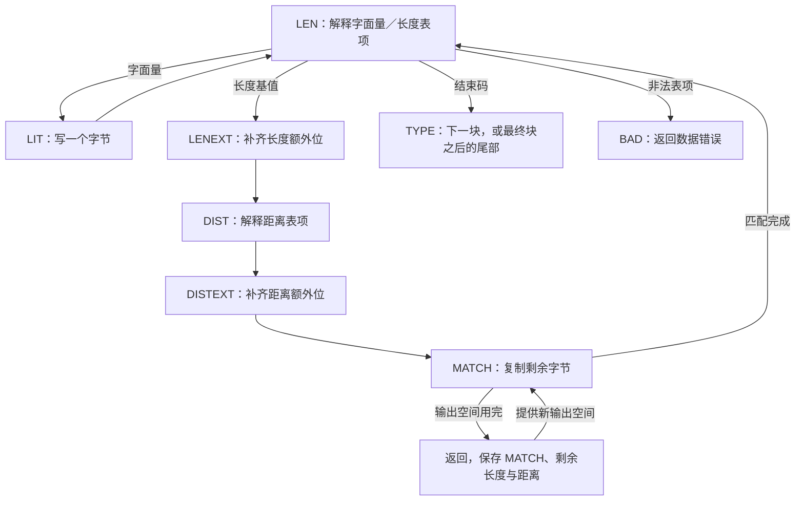
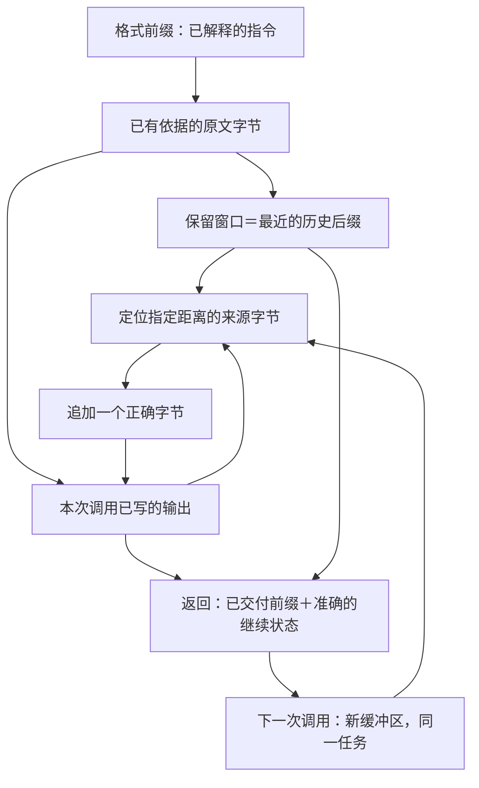

码表认出一条指令，还不等于已经恢复了这条指令对应的原文。本章处理接下来的任务：把字面量和向后引用变成原文字节，即使应用一次只提供一小块输出空间。

实现要解决几项困难。向后引用可能读到自己刚写出的字节，不能简单地把固定来源整段搬走。一次返回可能把同一条指令分到不同输出区中执行，因此解码器要同时保存未完成的工作，以及这份工作还要读取的较早字节。快速循环又把容量检查移到整条指令之前，必须保持同样的字节次序与错误检查。最后，即使原文已经全部写出，带封装的流仍要完成完整性校验。

下面始终追踪一个很小的结果：`ABABABAB`。选定裸流 `73 74 82 40 00` 描述 A、B、长度六／距离二，随后是块结束。先给足空间执行它，再在 `ABABA` 处暂停，最后解释优化和证明关系为什么让两种执行一致。后面的封装例子再加入一个问题：恢复出的字节能否通过流末尾的校验。

## 从表项进入实际操作 {#dispatch}

读取指令和执行指令可能在不同位置停下来。对于字面量，解码器可能已经知道要写哪个字节，却没有可写位置。对于匹配，它可能只取得长度，尚未读完距离；也可能已经取得两者，却只复制了一部分。每次调用都从头做这些工作，会重复读取压缩位并重复输出。因此，解码器要记录**接下来该做哪一步**，以及此前已经取得的值。

C 用 `state->mode` 保存这份工作位置，再由 `inflate` 的 `for (;;)` 循环中的 `switch` 选择分支。`LEN` 选择下一条字面量／长度指令；`LIT` 保存等待写出的字面量；`MATCH` 保存已经解出的长度和距离，继续剩余复制。中间的状态负责补齐额外位和距离。下图沿着[普通解码器](https://github.com/madler/zlib/blob/757f0527154291bcf6bfbd6396ecde6bedd2db95/inflate.c#L930-L1080)追踪这些状态，每条箭头都保留已经完成的工作。



在 `LEN` 中，C 先确认缓冲位足够解释选中的表项，需要时进入子表，再恰好移除该码字消费的位。选中的表项暂存在 `here` 中，它的值字段 `here.val` 被存入 `state->length`。随后由操作字段确定这个值的用途：字面量时，它是一个字节；匹配时，它是长度基值。`LENEXT` 加上额外位选择的长度偏移。`DIST` 和 `DISTEXT` 对距离做相应处理，最后把结果保存在 `state->offset`。

块结束码进入 `TYPE`，并不直接宣布整条流完成。最终块标志 `last` 决定接着读另一块，还是进行最终对齐和封装检查。非法长度码或距离码进入 `BAD`。读取额外位时若输入耗尽，返回时保留当前模式和已经缓冲的位。

## 字面量只需要一个可写位置 {#literals}

写一个字面量，恰好需要一个可写字节。应用提供一段目标空间：起点叫 `next_out`，可用长度叫 `avail_out`。执行期间，解码器用局部指针 `put` 指向下一个可写位置，用 `left` 记录还剩多少空间。已经解出的字面量暂存在 `state->length` 中；这个字段在当前状态存字节，在其他状态也用于保存匹配长度。[完整的字面量分支](https://github.com/madler/zlib/blob/757f0527154291bcf6bfbd6396ecde6bedd2db95/inflate.c#L1075-L1080)如下：

```c
case LIT:
    if (left == 0) goto inf_leave;
    *put++ = (unsigned char)(state->length);
    left--;
    state->mode = LEN;
    break;
```

对 A，保存的值是 65。有空间时，它成为下一个输出字节，`put` 前进一位，`left` 减一。没有空间时，返回仍留下 `LIT` 和已解出的字节。下一次调用继续写这个字节，不会再次解码它。B 沿同一条路径写出，得到前缀 `AB`。

私有状态和临时输出区具有不同的生命周期。流状态跨返回保留；应用可以按缓冲区约定消费并复用已交付的输出切片。因此，后续匹配必须从本次输出，或从解码器自己保留的历史中定位来源。

## 匹配一边读取，一边扩展输出 {#copy}

长度六、距离二的意思是：反复读取当前末尾往回两个位置的字节，再追加它。距离保持为二，来源和目标位置都向前推进。

| 复制步骤 | 读取的字节 | 写入后的前缀 |
| --- | --- | --- |
| 1 | 较早字面量中的 A | `ABA` |
| 2 | 较早字面量中的 B | `ABAB` |
| 3 | 第一步刚写出的 A | `ABABA` |
| 4 | 第二步刚写出的 B | `ABABAB` |
| 5 | 第三步刚写出的 A | `ABABABA` |
| 6 | 第四步刚写出的 B | `ABABABAB` |

第三次读取已经依赖本次匹配刚产生的内容。把原来两字节保存成不变快照，不能得到这条六字节结果。即使把多次赋值合并到一个循环体里，实现仍要保留向前逐字节读取和写入的次序。

在下面逐步执行这条规则。箭头指出下一次追加要读取哪个字节；写出两个字节后，来源已经进入本次匹配刚生成的区域。这个模型只展示复制规则，暂时不加入位解析和 API 返回。

<div class="zl-demo-mount"><zlib-demo kind="copy"><p>从 AB 开始，以距离二追加六个字节。每次写出的字节，都可以成为后续读取的来源。</p></zlib-demo></div>

目标空间有限时，实现只复制当前容得下的一批，再保存还欠多少字节。在 `MATCH` 中，这份欠量就是 `state->length`。来源指针叫 `from`，目标指针叫 `put`，本批数量叫 `copy`。[实际复制尾部](https://github.com/madler/zlib/blob/757f0527154291bcf6bfbd6396ecde6bedd2db95/inflate.c#L1028-L1073)先按可写空间截短这一批：

```c
if (copy > left) copy = left;
left -= copy;
state->length -= copy;
do {
    *put++ = *from++;
} while (--copy);
if (state->length == 0) state->mode = LEN;
```

进入这个 `do` 循环时，`copy` 必须为正。该分支此前已确认 `left != 0`；匹配有正的剩余长度；窗口来源段也受一个正的连续区间限制。循环前先减去本次数量，记录这批写入完成后还剩多少工作。在直接输出分支中，来源指针 `from` 可以前进到刚写出的输出中。从窗口改用输出时，要重新选择来源；指针不会从一个分配区直接走进另一个分配区。只有剩余长度成为零，才允许回到 `LEN`。

## 当前输出与保留窗口 {#window}

刚才的 `AB` 例子中，所有来源字节都在正在填写的目标区里。但应用处理完一块输出、换上另一个缓冲区后，后续向后引用仍可能需要旧输出中的字节。解码器因此要自己保存一份有界的最近字节后缀，这就是它的**历史窗口**。

用环形数组保存后缀，不必每次都搬动全部保留字节：写入位置绕回开头时，新字节覆盖最旧的槽。在实现中，`wsize` 是容量，`whave` 是有效保留字节数，`wnext` 是下次要替换的槽。刚分配的槽只有真正写入字节后才能作为历史。因此，这三个字段记录不同的事实。解码器的这个环，与压缩器连续的 `2W` 字节数组及其滑动搬移不同。

普通解码器把本次调用开始时的输出容量保存在 `out` 中；`left` 是尚未使用的空间。因此，`out - left` 表示**本次调用**已经写出的字节数。如果匹配距离不超过这个数量，`put - offset` 就落在当前输出内。否则，距离越过了本次输出起点，超出的部分必须由窗口提供。

下面是普通分支选择来源时，实际采用的直接输出一臂：

```c
else {                              /* copy from output */
    from = put - state->offset;
    copy = state->length;
}
```

窗口分支先计算超出本次输出的距离。如果它大于有效历史数量 `whave`，普通的缺失历史处理会选择 `BAD`。状态标志 `sane` 控制这次拒绝，默认启用：请求的来源字节并不存在。否则，按照 `wnext` 找出时间顺序上的来源，复制一个连续段；匹配仍有剩余时，再进入同一分支。下一段来源可能是窗口开头，也可能已经转为新输出。

下面用另一个例子看清 `AB` 复制还没遇到的困难：同一段逻辑来源，先绕过数组末端，再跨入当前输出。取一个八格教学窗口，物理数组存放 `ABCDEFGH`，下次写入下标 `wnext = 3`，八个字节都有效。最旧字节位于下标三，因此时间顺序上的历史是 `DEFGHABC`。本次调用已经产生 `DE`，接着读到长度六、距离六：

| 数量 | 本例的值 | 含义 |
| --- | ---: | --- |
| 本次输出 | 2 字节 | `DE` 已在调用者当前输出切片中。 |
| 超出本次输出的距离 | `6 - 2 = 4` | 前四个来源字节来自保留历史。 |
| 起始物理下标 | `8 + 3 - 4 = 7` | 第七格是 H。 |

先从第七格读 H，绕回开头，再从零到二格读 ABC。余下两字节来自本次输出的 DE。这条指令追加 `HABCDE`，当前输出成为 `DEHABCDE`。距离始终描述同一段逻辑上的向后引用，物理来源却发生了两次转换。

八格只是为了看清下标，不是合法的初始化窗口大小。在普通源码配置中，重置建立 `sane = 1`，普通复制与快速复制都会拒绝缺失的历史。可选构建宏 `INFLATE_STRICT` 另外启用对 `dmax` 的比较；它是从 zlib 头取得的最大距离界。头部距离限制与“实际拥有多少历史”是两条不同的检查。

窗口配置也决定返回后能保留什么。完整的 32 KiB 窗口能保存格式允许的最大历史后缀。较小窗口保留更少字节；较长距离仍可能从当前输出得到满足，但相同距离在更换输出区之后，可能不再有足够保留历史。预设字典提供较早字节，却不计入新输出。对 zlib 字典请求，安装字典前要核对 Adler 标识；裸模式没有头部标识可执行这次握手。

API [`inflateUndermine`](https://github.com/madler/zlib/blob/757f0527154291bcf6bfbd6396ecde6bedd2db95/inflate.c#L1396-L1408) 提供的缺失历史处理方式取决于构建配置。未启用 `INFLATE_ALLOW_INVALID_DISTANCE_TOOFAR_ARRR` 时，它保持 `sane = 1` 并返回 `Z_DATA_ERROR`。特别启用该宏的构建有针对缺失历史的补零行为；其含义需要单独说明，不能悄悄当作普通 DEFLATE 重复规则。

## 输出满时，暂停的是同一条指令 {#suspension}

输出区大小应当只改变结果分几次交付，不应改变解码出的结果。现在用它检验这个要求：一次提供选定裸流的五个输入字节，但只给五个输出位置。调用者处理每次返回的切片后，复用同一块目标空间，同时保留同一个流状态：

<!-- example:inflate-chunks#call -->

每轮提供五字节空间，减去返回时尚未使用的空间，便得到应用可以处理的字节数。这段程序的两次调用返回如下：

| 调用 | 消费的压缩字节 | 交付的原文字节 | 返回值 |
| --- | ---: | --- | --- |
| 1 | 4 | `ABABA` | `Z_OK` |
| 2 | 1 | `BAB` | `Z_STREAM_END` |

前两个字节来自字面量；随后三字节来自六字节匹配的开头。第一次返回时，保存模式是 `MATCH`，剩余长度三，距离二。解码器还把 `ABABA` 中需要的后缀保留到自己的窗口里。应用此时可以处理这五字节，并复用原输出区。

第二次调用先从保留历史中读 B 和 A，第三个字节则读取本次新输出刚写出的 B。它先完成保存的匹配，再返回 `LEN` 读取结束码。压缩指令只解码了一次，输出却跨越两次调用。

<div class="zl-demo-mount"><zlib-demo kind="stream"><p>第一个输出切片是 ABABA，留下距离二、剩余三字节的匹配。下一个切片写出 BAB，继续同一个已保存的 MATCH 操作。</p></zlib-demo></div>

应用复用缓冲区后仍能读到所需来源，是 [`updatewindow`](https://github.com/madler/zlib/blob/757f0527154291bcf6bfbd6396ecde6bedd2db95/inflate.c#L250-L305) 的任务。需要在返回后保留历史时，它保存最近的后缀。如果本次输出至少有一整窗，就只复制最新的一窗。否则，追加较短的新后缀，跨过数组末端时把内存复制拆成两段。首次窗口分配会延迟到确实需要保留这段历史的时刻。因此，某些一次调用完成的情况能省掉窗口分配和复制；选择这项优化的是实际返回条件，不是“每条流都能一次完成”的假设。

同样的暂停规则也用于字面量写入之前、额外位的中途，以及头部或尾部字段的中途。不同模式区分这些工作。更换输入必须保留未消费的后缀；更换输出提供新的可写空间，解码器自己拥有之后还需要读取的历史字节。

## 快速解码先为整条指令检查余量 {#fast}

普通路径能使用很小的缓冲区，是因为它在补位位置检查输入，并把每批输出限制在现有空间内。缓冲区很大时，这些重复检查也有成本。快速路径先换一种问法：**现有输入和输出余量，够不够执行任意一条长度／距离指令，而不因容量不足停下来？** 如果足够，就能把容量检查移到指令边界。非法码字和缺失历史仍然需要各自的含义检查。

输出上界直接来自 DEFLATE 的最长匹配：258 字节。输入方面，长度码最多 15 位，其额外字段最多 5 位；距离码最多 15 位，其额外字段最多 13 位，合计最多 48 位。这些是覆盖所有允许指令的上界，不是前面那条长度六、距离二指令的实际用位量。实际补位操作能否落在六个输入字节内，还要追踪共享的位余额。

C 把这条路径命名为 `inflate_fast`。准备读取新的字面量／长度指令时，也就是 `LEN` 状态，[入口分支](https://github.com/madler/zlib/blob/757f0527154291bcf6bfbd6396ecde6bedd2db95/inflate.c#L923-L929)检查三个数量：未读输入字节数 `have`、可写输出字节数 `left`，以及已经取入但还未消费的位数 `bits`：

```c
case LEN:
    if (have >= 6 && left >= 258 && bits < 8) {
        RESTORE();
        inflate_fast(strm, out);
        LOAD();
```

在这个分支中，`RESTORE` 先把外层循环的局部指针与保存位发布到流中，供辅助函数读取；辅助函数返回后，`LOAD` 再取得它返回的值。六个输入字节提供补位余量，258 个输出位置提供最大展开余量。第三项的用途不同：保存位少于八位，才方便辅助函数退出时准确退回多读的完整字节，后面的返回一节会解释它。这些容量和位数检查并不能证明输入有效；已经安装的码表和实际可用历史仍须给出合法、可读的来源。

改变下面的三个数量，就能看清这个区别。先比较五个与六个未读字节，再比较 257 与 258 个输出位置。每次改变决定走哪条路径，不决定压缩数据是否有效。逐项展开的说明把通用上界与小型复制例子分开。

<div class="zl-demo-mount"><zlib-demo kind="fastpath"><p>快速分支要求至少六个未读输入字节、258 个可写输出位置，以及少于八个保存位。任一条件不满足，就继续普通解码。</p></zlib-demo></div>

上面只有五个输入字节、五个输出位置的例子，无法进入这个分支。更一般地，默认构建也会在运行时选择不同路径：当前模式、输入与输出余量、已保存位数共同决定入口。余量不够时，普通状态机仍然支持相同定义域内的小缓冲区调用。

辅助函数内部的 `in` 和 `out` 是**指针**；主函数中同名的 `out` 却是保存的数量，并作为参数 `start` 传入。快速辅助函数的设置如下：

```c
in = strm->next_in;
last = in + (strm->avail_in - 5);
out = strm->next_out;
beg = out - (start - strm->avail_out);
end = out + (strm->avail_out - 257);
```

`beg` 还原外层调用的输出起点，因此包含进入辅助函数前已经写出的字节。`in < last` 表示至少还有六个输入字节；`out < end` 表示至少还有 258 个输出位置。循环体以 `do` 开始，调用者必须为第一次迭代建立余量；后续迭代才检查 `in < last && out < end`。

例如，辅助函数可能先取入两个字节，把保存位补到所需阈值；读掉一个较短码字后，剩下的位又可用于下一个字段。因此，补位上界取决于剩余位数，不能把每个补位位置各自可能的最大读取量直接相加。较早的读取可以留下足够的位，减少后续位置需要补入的字节。分支证明追踪这份共享的位余额，从而排除“各处独立取最大值”会错误算出的七字节组合。

把这个排除过程展开来看：长度码前至多补两字节，长度额外位至多补一字节，距离码前至多补两字节，距离额外位至多补两字节。各自相加似乎是七字节。如果四处都取到最大值，第一次补位后至少有 16 位，长度码至多消费 15 位，至少留下一位。再补一字节、消费至多五个长度额外位，至少留下四位。接下来补两字节得到至少 20 位，距离码至多消费 15 位，至少留下五位。此时再补一个字节，就已经够读取全部 13 个可能的距离额外位，不会再补第二个字节。如果更早的任一位置没有取到最大值，总量本来就至多六字节。因此，六字节余量既依赖 48 位的字段上界，也依赖这些补位步骤之间的关系。

移出容量检查后，[直接输出匹配循环](https://github.com/madler/zlib/blob/757f0527154291bcf6bfbd6396ecde6bedd2db95/inffast.c#L249-L263)再通过每轮写三字节减少循环开销。已经解出的向后距离叫 `dist`，剩余匹配字节数叫 `len`。移动的来源指针 `from` 从下一个输出位置往回这个距离开始。三次赋值仍然保持先后次序：

```c
from = out - dist;          /* copy direct from output */
do {                        /* minimum length is three */
    *out++ = *from++;
    *out++ = *from++;
    *out++ = *from++;
    len -= 3;
} while (len > 2);
```

需要时，后面再复制一到两个尾字节。DEFLATE 的匹配长度从三开始，保证第一次循环体有足够工作。距离一或二时，较后的赋值可能读取较早赋值刚写出的内容，与普通逐字节循环完全一样。窗口来源段有单独的正计数，并分别处理连续后缀、跨末端后缀，以及转入当前输出的情形。优化把操作分组，同时保留了它们之间的依赖次序。

字面量／长度查询和距离查询都可能沿链接进入子表。码表关系限制链接深度。非法表项或过远距离选择 `BAD`，块结束选择 `TYPE`，下次迭代余量不足则留下 `LEN`。辅助函数随后为外层状态机恢复准确的边界。

## 退回多读字节，写回准确位置 {#restore}

辅助函数返回时，必须准确告诉外层解码器下一条指令从哪里继续。快速循环可能取入了最后一条指令用不到的字节；如果仍把它们全算作已经消费，外层解码器或应用就看不到这部分未读输入。因此，它把未使用的**完整字节**退回未读区间，只保留仍需保存的不完整字节。保存这些位的容器叫 `hold`，`bits` 记录其中有效的低位数量。[实际尾部](https://github.com/madler/zlib/blob/757f0527154291bcf6bfbd6396ecde6bedd2db95/inffast.c#L291-L309)如下：

```c
len = bits >> 3;
in -= len;
bits -= len << 3;
hold &= (1U << bits) - 1;
```

这里 `len` 被复用成完整字节数量，不再表示匹配长度。若还剩 19 位，就退回两个字节，在寄存器中保留三位。入口的 `bits < 8` 保证退回的完整字节都由本辅助函数读入。对 `hold` 加掩码会移除它们的重复表示，只留下有效的低位余量。

辅助函数写回指针、可用量、`hold` 和 `bits`，主循环通过 `LOAD` 取得返回状态。正常 API 返回时，`RESTORE` 同样发布局部输出指针与余量（`put/left`）、输入指针与未读量（`next/have`），以及保存位（`hold/bits`）。这些字段描述已经发生的工作，包括暂停或错误之前完成的读取和写入。

对一次调用，可以从提供前和返回后的可用量计算效果：

```text
consumed = avail_in_before  - avail_in_after
produced = avail_out_before - avail_out_after
```

输入和输出指针分别前进这两个数量。已经取入 `hold` 的字节可以计入已消费输入，即使其中一些位仍待解释。返回的输入区间与保存位一起，描述准确的继续位置。

发布缓冲区位置与维护累计总数，是两项分开的操作。保存历史可能需要分配内存，分配失败时，这个次序尤其重要。[公共 `inf_leave` 路径](https://github.com/madler/zlib/blob/757f0527154291bcf6bfbd6396ecde6bedd2db95/inflate.c#L1138-L1171)先恢复指针，**随后**才可能分配历史窗口：

```c
inf_leave:
    RESTORE();
    if (state->wsize || (out != strm->avail_out && state->mode < BAD &&
            (state->mode < CHECK || flush != Z_FINISH)))
        if (updatewindow(strm, strm->next_out, out - strm->avail_out)) {
            state->mode = MEM;
            return Z_MEM_ERROR;
        }
```

公开累计计数叫作 `total_in`、`total_out`；私有的 `state->total` 计数当前成员的原文字节，用于 gzip 大小检查。推进这些计数、更新剩余输出校验和的语句位于这段代码之后。延迟窗口分配可能在输出已经写出、指针已经恢复后失败。这条路径会先返回 `Z_MEM_ERROR`，跳过后面的更新。因此，返回输出切片和总计数需要分别表示；错误不意味着没有写过字节。后面的资源章节会追踪这时仍需清理的对象。

`Z_OK` 表示本次还没有返回完整流。`Z_BUF_ERROR` 可以表示没有进展，也可以表示 `Z_FINISH` 请求尚未完成。没有消费输入也没有产生输出，或这次未完成调用请求了 `Z_FINISH` 时，C 会把 `Z_OK` 改为 `Z_BUF_ERROR`。反复提供同一组受阻区间，不会凭空增加输入或输出空间。`Z_BLOCK` 和 `Z_TREES` 还会请求较早的结构停止点；这些停止仍采用相同的指针和保存状态记账。

## 块结束与封装流结束 {#wrappers}

恢复最后一个原文字节，解决了复制问题。带封装的流还要回答另一个问题：恢复出的字节，与发送方保存的完整性校验值是否一致？**校验和**是按字节序列算出的一个小数值；解码器一边产出字节一边重新计算它，最后与尾部记录的值比较。裸 DEFLATE 没有这种尾部，在最终对齐后完成。zlib 流使用 Adler-32；gzip 成员使用 CRC-32，并另记原文长度模 `2^32` 的值。这些头尾字段属于压缩输入的元数据，不会成为原文输出。

用存放 `ABC` 的原样存储块看清封装边界。选定的裸载荷为 `01 03 00 fc ff 41 42 43`；前面加 zlib 头 `78 01`，后面加尾部 `01 8d 00 c7`。在 C 后面截断输入。三个原文字节已经交给应用，`CHECK` 却还需要四个输入字节。验证启用时，提供完整但不匹配的尾部会返回数据错误；不提供尾部则留下等待输入的任务。解码器无法撤回先前已经交付的字节。

为了比较恰好已经交付的那批字节，[C 的尾部路径](https://github.com/madler/zlib/blob/757f0527154291bcf6bfbd6396ecde6bedd2db95/inflate.c#L1081-L1128)先在 `CHECK` 中更新已产生字节的记账；这个状态负责读取校验字段。随后把局部输出基准设为 `left`，避免公共返回路径再次累计同一批字节。gzip 后续的 `LENGTH` 分支把大小字段与 `state->total & 0xffffffff` 比较。只有这些必要字段完成后，`DONE` 才返回 `Z_STREAM_END`。完成的流或成员后面仍可留有未读输入；完成一个 gzip 成员，不会自动消费后面串接的成员。

初始化时的封装选择决定允许哪些头部。[`inflateValidate`](https://github.com/madler/zlib/blob/757f0527154291bcf6bfbd6396ecde6bedd2db95/inflate.c#L1411-L1424) 改变当前封装和所请求封装设置中的验证位。禁用验证可以接受错误的校验值或大小字段，但不会把它们变成 DEFLATE 载荷，也不会关闭表访问和历史访问检查。裸模式没有可启用的封装校验。字典请求同样属于流的上下文：zlib 字典握手尚未满足时，要先解决它，才能继续普通解码。

这次比较依赖 Adler-32 和 CRC-32 如何概括已经恢复的字节。它们的增量规则必须保证：原文一次写出或分多次写出，算出的值相同。下面继续解释解码器论证中的这一步。

<!-- include:checksums -->

## 复制、优化与返回的正确性 {#correctness}

现在可以准确说出核心结论：改变缓冲区边界或选择快速路径，不应改变压缩输入所确定的原文字节。证明为此追踪同一个逻辑解码前缀在三个位置的对应：格式已经解释了什么，应用已经收到了什么，解码器又为下次调用保存了什么。每执行一步，都保持这份对应关系。来源从窗口跨入当前输出时，物理地址变了，距离所指的逻辑字节却没有改变。



### 每一步复制的字节 {#byte-proof}

记正距离为 `d`，请求的长度为 `L`，已经写出的匹配字节数为 `j < L`。对通过来源检查的匹配，距离不超过可用逻辑历史的长度。第 `j` 步之前，逻辑历史包括字典，以及迄今所有已经建立含义的输出字节。若 `j < d`，这一步读取匹配开始前已有的历史；否则，它读取本次匹配第 `j-d` 步产生的字节。因为 `d > 0`，所以 `j-d < j`，归纳假设已经给出那个较早字节的含义。追加它，就得到第 `j+1` 步的结论。

物理执行的证明还要给出时间顺序历史到环形下标的映射，以及当前输出到调用者活分配区的映射。对八格例子，这个映射说明第七格、零到二格、当前输出零到一号位置为什么实现了逻辑上连续的来源。每段复制的计数按实际写入量递减，给出该段循环的终止依据。执行关系还要保留目标可写、来源可读、字节已初始化，以及无关内存不变这些事实。

实际 [`copyMatch_run`](/reference/source/ZlibF/Proof/inffast.c.match.html#L100) 陈述成功复制或距离过远的结果。它的前提包括有效的快路环境、上下文一致、正距离、至少为三的匹配长度、足够的输出空间，以及当前输出位置。结论确定返回字节数组和输出指针，同时保留辅助函数的输入与位状态。其正常历史前提与默认的 `sane = 1` 一致，并不是任意补零构建的定理。

### 优化仍执行同一条指令 {#fast-proof}

普通路径和快速路径都把支撑指令的输入位，连接到实际读取的表项和实际写出的字节。只有数组界，无法确定正确的符号；只有表的含义，也不能允许读出分配区。消费者使用的是构造器在返回堆中建立的表内容和表宽度。

源码中的 [`actual_body_refines_token`](/reference/source/ZlibF/Proof/inffast.c.body-token.html#L685) 把一次真实快路循环体连接到一条指令、块结束或拒绝的指令。[`inflate_fast_safe`](/reference/source/ZlibF/Proof/inffast.c.final.html#L257) 覆盖辅助函数的安全、终止、框架、归一化与写回目标。两者承担不同角色：组合执行时，指令含义与内存、出口性质一起传递。每次快路入口，实际守卫建立六字节、258 字节和保存位数的余量条件。码表内容与保留历史关系则由流状态不变量提供；仅有数值守卫不能建立这两项关系。

快路退出时，把有效的 `hold` 低位与未读输入字节按读取顺序展开后接起来，定义为剩余输入位。19 位缓冲退回两个完整字节，会改变这些位的存放位置，不改变它们的次序。只保留三个低位，避免对已经退回的两个字节做重复表示。这条相等关系把辅助函数的返回状态接到下一次普通查询。

### 返回同时保留工作与存储 {#return-proof}

在本例匹配中暂停时，输出前缀是 `ABABA`，剩余长度三，距离二。窗口关系确定下一次调用需要的 B 和 A。重新绑定输出改变允许写入的分配区，不改变已经交付的逻辑结果。下一次依次复制 B、A 和本次新写出的 B，就把同一前缀延伸了 `BAB`。

这条关系分别记录真实输出切片、发布的指针、总计数与校验状态。因此，它也覆盖较晚的 `updatewindow` 分配失败：即使公共计数与校验尾部还没有执行，恢复后的指针仍能标明已经写出的字节。返回码另外记录正确的完成、等待或错误结果。尾部验证则把累计校验值连接到恰好已经恢复的那份原文字节。

完成性陈述比保持一个输出前缀具有更强的前提。定义 [`InflateCompletes`](/reference/source/ZlibF/Spec/Public/Sequences.html#L128) 要求真实且尚未返回 `Z_STREAM_END` 的单字典数据历史、有效剩余源、处于失败／恢复模式之外的 `Good` 保存状态、已解决的字典请求、有效输入输出与头部存储、分配不失败，以及足够的输出空间。它还要求 `FullWindow`，这个条件使用归一化后的封装与窗口位数。位数 15 表示 32 KiB；相应的初始化参数分别是 raw 的 `-15`、zlib 的 `15`、gzip 的 `31`，以及自动识别的 `47`。归一化为零的设置也可满足条件：`0` 从 zlib 头取得 15 位声明，`16` 使用 gzip 的 15 位选择，`32` 按实际头部走对应的 zlib 或 gzip 情形。由 zlib 头取得窗口时，头中必须声明 15；raw 没有零位形式。这些条件限定这里的完成保证，较小保留窗口不能自动获得同一结论。

在这些前提和允许的完成刷新请求下，目标是一次真实的 `Z_STREAM_END` 返回，以及精确的剩余解码后缀。对两次调用例子，三个空位置容得下 `BAB`，但还需要正确的剩余输入、历史字节和保存模式。不变量在每个实际返回边界把这些事实带到一起。对于既不读输入、也不写输出的模式转换，还需要递减的控制秩，保证解码器不能只切换模式却永远不前进或返回。
