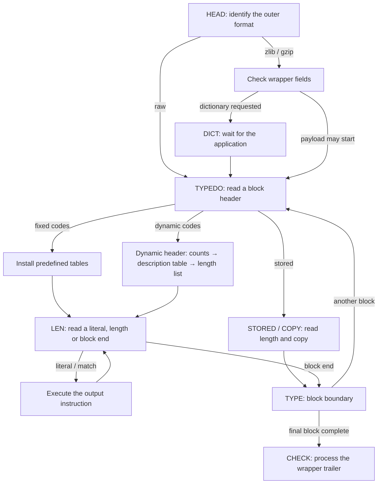
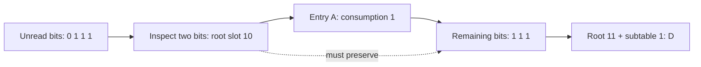
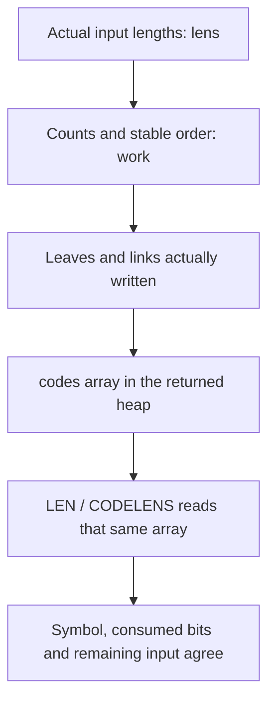

Decompression receives compressed bytes and must recover the original bytes. The compressed instructions have two main forms: a literal supplies one byte directly; a match says how many bytes to copy from a given distance behind the output position. `inflate` must first recognize these instructions before it can execute them. It identifies the outer format, reads the current block's type, then interprets its bits using the coding rules selected for that block.

Keep the five-byte raw DEFLATE stream `73 74 82 40 00` in view. It contains a final fixed-code block representing literals A and B followed by a length-6, distance-2 match. Its decoded result is `ABABABAB`. These are the instructions already selected in this particular encoding; the decoder does not search for matches again. This chapter follows actual dispatch until the instruction has been identified.

Three difficulties determine the design. Input arrives in whole bytes, but an instruction can finish between their bits. A dynamic block describes its own codes, so the decoder must validate that description before using it. And fast table lookup must return both the correct symbol and its exact bit consumption. We follow those dependencies: retain unread bits, recover code lengths, construct their lookup tables, then relate each lookup to the original input.

## The call entry and saved parsing position {#entry}

The application may have only part of the compressed stream, and room for only part of the answer. It therefore lends the decoder a readable input range and a writable output range for one call. The decoder must report its progress and retain unfinished parsing work when either range runs out. A stream record, `z_stream`, connects these temporary ranges to the decoder's persistent state.

In that record, `next_in` points to the next readable compressed byte and `avail_in` counts the available bytes. `next_out` points to the next writable output byte and `avail_out` counts the available room. A longer stream can span many such calls.

Parsing itself is a sequence of tasks: read a header, recover a code description, recognize an instruction, or execute it. The persistent field `state->mode` identifies the task that should run next. A partly read field also needs a small container for bits already fetched from input but not yet interpreted; its value and valid-bit count are saved as `hold` and `bits`.

After checking the stream and buffer pointers, `inflate` loads frequently used fields into local variables. `next` and `have` track unread input; `put` and `left` track writable output. Local `hold` and `bits` track the bit container. This avoids repeated access through the stream record inside the loop. Return processing saves these local positions and unfinished work for the next call.

One boundary needs special treatment. A caller can ask to stop between blocks using `Z_BLOCK` or `Z_TREES`; the saved stage `TYPE` marks that boundary. On the next call, the decoder must move beyond the already reported boundary and continue parsing. The entry changes `TYPE` to the continuation stage `TYPEDO` to avoid reporting the same boundary forever.

The [call entry in `inflate.c`](https://github.com/madler/zlib/blob/757f0527154291bcf6bfbd6396ecde6bedd2db95/inflate.c) then uses `LOAD()` to obtain the local fields, saves starting byte counts as `in` and `out`, and initializes the return value `ret` to success, `Z_OK`, before dispatching:

```c
state = (struct inflate_state FAR *)strm->state;
if (state->mode == TYPE) state->mode = TYPEDO;      /* skip check */
LOAD();
in = have;
out = left;
ret = Z_OK;
for (;;)
    switch (state->mode) {
```

Each following `case` is one stage of parsing. A stage may finish and enter another, or return when input or output is insufficient. A later call resumes the saved stage; it must not reinterpret a header that has already been consumed.

## Select the formats the decoder may read {#configuration}

The same DEFLATE payload can appear inside zlib or gzip, which add headers and check values around it, or arrive without either wrapper. Before parsing bytes, the decoder needs to know which outer forms to accept. It also needs bounded storage for previously produced bytes: a later match may refer to output from an earlier call. This retained byte range is its window. The initialization parameter `windowBits` combines the wrapper policy with a window-width setting; a width of `w` selects a retained capacity of `2^w` bytes.

Encoding-effort settings such as compression level, encoder workspace size (`memLevel`), and match-search strategy are not decoder arguments. Decoding follows the instructions already in the stream. The block types differ in how they carry those instructions: stored blocks carry bytes directly, fixed blocks use predefined Huffman codes, and dynamic blocks describe their own codes. A Huffman code assigns a variable-length bit pattern to each symbol so frequent symbols can take fewer bits. No complete code is the start of another code; this prefix rule lets the decoder know when a symbol ends.

The default build includes gzip decoding. `inflateInit` initializes with `windowBits = 15`. The common choices below use positive window widths 8 through 15, corresponding to retained capacities of 256 through 32768 bytes.

| Initialization argument | Allowed outer format | How window width is determined |
| --- | --- | --- |
| `8..15`, commonly `15` | zlib | Use the requested width; an accepted zlib header cannot declare a larger one |
| `0` | zlib | Read the width from the zlib header |
| `-15..-8`, commonly `-15` | Raw DEFLATE | Use the magnitude; no zlib or gzip header or trailer |
| `24..31`, commonly `31` | gzip | Subtract 16 from the argument |
| `40..47`, commonly `47` | Detect zlib or gzip | Subtract 32 from the argument |
| `16` or `32` | gzip only, or automatic detection, respectively | Start with width zero; the zlib branch obtains it from the header, while the gzip branch selects 15 |

The final row follows the selected source's parameter normalization and header handling. It does not make every integer from 16 through 47 valid. Arguments 17 through 23, for example, normalize to window widths 1 through 7 and are rejected. Raw `-8` is accepted by `inflate`; the compressor rejects its corresponding eight-bit raw window. The [`inflateInit2_` contract](/reference/functions/inflateInit2_.html) gives the full initialization interface and return cases.

Two distance conditions also need distinct meanings. Window capacity determines how much previously produced output survives across calls; output produced during the current call can also supply a match. The ordinary too-far-distance check asks whether the actual source bytes are available. A separate limit comes from the zlib header's declared window capacity, recorded internally as `dmax`. The build option `INFLATE_STRICT` additionally compares distances with that limit; it is absent from the default translation. The initialization argument therefore cannot be read as a comparison performed against every copy distance.

Build options change these paths. `NO_GZIP` removes gzip header and trailer decoding, so the gzip and detection rows above cannot be carried into that build. `BUILDFIXED` replaces pregenerated fixed tables with construction on first use. Without atomics, the tables must be initialized by a single-threaded fixed-block `inflate` call that returns before other threads enter decoding. `PKZIP_BUG_WORKAROUND` changes dynamic-alphabet and table-capacity bounds. The following execution uses the default build and identifies those differences where they matter.

Wrapper selection and validation settings also serve different jobs. `inflateValidate` can change the selected stream's validation setting; it neither turns zlib or gzip into raw data nor removes required wrapper fields. Dictionary supply, per-call buffers and flush requests are conditions of the calling protocol.

## Follow the wrapper into the current block {#dispatch}

The first parsing task is to identify or skip the outer header; the implementation names it `HEAD`. Raw decoding goes directly to block parsing. A zlib header carries the compression method, the window declaration and check bits chosen to make its two-byte value divisible by 31. Before trusting those settings, the parser checks that divisibility, that the method is DEFLATE, and that the declared window width is allowed. The default build recognizes gzip by its leading signature bytes, then processes its flags, time, optional extra field, name, comment and optional header check. Input can end in the middle of a name or extra field; the saved task and remaining count retain that exact continuation.

A preset dictionary is a byte sequence supplied separately to both compressor and decoder. It gives early matches a source before this stream has produced enough output of its own. If the zlib header requests one, the parser reads its four-byte identifier and enters the waiting task `DICT`. Without the dictionary it returns `Z_NEED_DICT`. The application must supply a dictionary with the matching check value before block parsing continues. This pause preserves work that can resume normally.



The branches are alternative block forms. A stored block bypasses Huffman lookup; a fixed block sends no new code-length description; a dynamic block first supplies its tables' description. The state machine can also respond to `Z_BLOCK` at a block boundary, or to `Z_TREES` after processing a block header. `Z_FINISH` requests completion or a blocked result; it cannot supply missing input.

## Retain the unread bits within each byte {#input}

Compressed input arrives in bytes, but the next field may need only a few bits. Fields also cross byte boundaries. The decoder keeps fetched but unused bits in the small integer container introduced at entry, rather than losing them after reading one field. The container value is `hold`; `bits` counts its valid positions. Pulling a byte advances the input pointer `next`, while its unused bits stay in this container. Byte acquisition and field consumption therefore describe different progress.

Store the next bit at the integer's lowest position. Suppose the three saved bits have reading order `0, 1, 1`. Then `hold = 6` and `bits = 3`. The ordinary binary spelling is `110`, read from the low bit at the right. The count matters: a valid zero bit is still input, even though it contributes nothing to the integer's numeric value.

A following five-bit field needs more than those three bits. If the next byte is `0xA5 = 165`, append it above the saved positions:

```text
Saved reading order: 0, 1, 1
New byte order:      1, 0, 1, 0, 0, 1, 0, 1
hold = 6 + (165 << 3) = 1326
bits = 3 + 8 = 11
```

No field has been consumed yet. The values and order of all eleven bits are preserved. The selected C's `PULLBYTE` performs exactly that operation:

```c
#define PULLBYTE() \
    do { \
        if (have == 0) goto inf_leave; \
        have--; \
        hold += (unsigned long)(*next++) << bits; \
        bits += 8; \
    } while (0)
```

`NEEDBITS(n)` repeats it while `bits < n`. It reads no byte when enough bits are already held. If input ends, it enters return processing with the saved bits and current mode. Here `n` counts bits required by the current field, not bytes to fetch at once.

Inspecting five bits and removing five bits are separate operations. `BITS(5)` yields `1326 & 31 = 14` without changing the state. `DROPBITS(5)` then leaves `hold = 41` and `bits = 6`. Those six bits still belong to subsequent input. At a byte boundary, `BYTEBITS()` removes only the low padding bits that the current format stage permits it to skip.

The container obeys `hold < 2^bits`: no bit above the valid part is set. This makes its low `bits` positions a precise representation of the saved input. The default 64-bit Linux translation uses a 64-bit `hold`, but each shift still needs the bound appropriate to its parsing step. Machine width cannot replace that local condition.

## Read the block header and choose its branch {#block-header}

Each DEFLATE block begins with a one-bit final-block flag and a two-bit type. For `73 74 82 40 00`, the first byte `0x73` has low-bit reading order `1, 1, 0`. The final flag is 1 and the type value is 1, so the parser installs the fixed tables.

The decoder recognizes a Huffman code by using its upcoming bits as a table index. A first, or root, table handles short codes directly; an entry for a longer prefix points to a smaller follow-up table. The root width is how many bits form that first index. This layout avoids walking one tree edge per input bit. Below we construct a small example to see exactly how it works.

The default build already contains the fixed-code tables. `inflate_fixed` selects root width 9 for literal/length codes and 5 for distance codes. It installs table addresses and index widths; it does not rebuild a tree from input.

Type 0 carries its bytes directly, so the decoder needs a byte count rather than symbol codes. It first discards the block-header padding to reach a byte boundary, then reads a 16-bit length and a second value with all sixteen bits inverted. For length 3 those values are `0003` and `fffc` in hexadecimal; the pair lets the decoder reject a damaged length field before trusting it. The payload is then copied in pieces bounded by available input, available output and the remaining length. This path needs no code table.

Type 2 enters a dynamic block's table description. Type 3 is reserved: the parser sets an error message and enters `BAD`. All of these choices occur before interpreting literals and distances.

## A dynamic block first describes its code lengths {#lengths}

A dynamic block chooses codes that suit its data, so it must first teach those codes to the decoder. Sending every bit pattern would be wasteful. Instead it sends one code length per possible symbol; a shared rule then recovers the bit patterns from lengths and symbol order. Length zero means that a symbol is unused. This ordered collection of possible symbols is called an alphabet.

The length list itself often contains repeated values and long runs of zeros. It is therefore compressed too: ordinary description symbols give one length, while repeat symbols describe many equal lengths at once. A small Huffman table decodes these descriptions. There are two layers here: first recover the lengths of the data codes, then build the tables that decode the actual data. No recursion is needed: the small description table's own lengths are sent directly as three-bit numbers.

The implementation gives these three tasks distinct saved stages: `TABLE` reads counts, `LENLENS` prepares the small description table, and `CODELENS` expands the length list. Each can pause for more input without restarting the preceding task.

The header first tells the decoder how much to recover: a literal/length symbol count, a distance symbol count, and a count of supplied entries in that small description alphabet. The implementation records them as `nlen`, `ndist` and `ncode`. Their fields occupy 5, 5 and 4 bits, with the format's minimum counts added afterward:

```c
NEEDBITS(14);
state->nlen = BITS(5) + 257;
DROPBITS(5);
state->ndist = BITS(5) + 1;
DROPBITS(5);
state->ncode = BITS(4) + 4;
DROPBITS(4);
```

The default path rejects descriptions exceeding 286 literal/length symbols or 30 distance symbols. `PKZIP_BUG_WORKAROUND` changes those admitted maxima; the default checks cannot describe that build.

The small description alphabet has 19 symbols: numbers 0 through 15 mean ordinary lengths, and 16 through 18 mean repeats. To construct its table, input gives a three-bit length for each of the first `ncode` entries in this fixed order:

```text
16, 17, 18, 0, 8, 7, 9, 6, 10, 5, 11, 4, 12, 3, 13, 2, 14, 1, 15
```

This fixed order places the three repeat symbols before ordinary lengths. Unspecified entries receive zero. The constructor is `inflate_table`; its alphabet-kind argument `CODES` selects these 19 description symbols. The parser requests a seven-bit root and constructs this small table. Its decoded symbols now fill a different array: the lengths of the literal/length codes followed immediately by the lengths of the distance codes.

| Length-description symbol | What it writes to the length array | Extra input bits |
| --- | --- | --- |
| `0..15` | Write this length once | None |
| `16` | Repeat the previous length 3 through 6 times | 2 bits; a previous length must exist |
| `17` | Write 3 through 10 zero lengths | 3 bits |
| `18` | Write 11 through 138 zero lengths | 7 bits |

Take a 24-slot fragment to isolate this expansion. The chosen description instructions are `3, 16, 17, 2, 18`. The repeat instructions carry extra values `1, 2, 2` respectively. Ordinary `3` writes one length of 3; `16` repeats that previous 3 another `3 + 1 = 4` times; `17` writes `3 + 2 = 5` zeros; ordinary `2` writes one length of 2; `18` writes `11 + 2 = 13` zeros. Five descriptions have generated 24 lengths. These numbers describe code lengths, not output bytes.

<div class="zl-demo-mount"><zlib-demo kind="lengths"><p>The 24-slot teaching fragment expands 3, then four more 3s, five zeros, one 2, and thirteen zeros. Repeat 16 requires an existing previous length. The complete requested run must fit before its first slot is written.</p></zlib-demo></div>

The scene isolates length-list expansion: it supplies recognized description symbols and their extra values, rather than parsing compressed bytes. Its extra-bit counter measures consumption of the 2-, 3- and 7-bit repeat fields, not bytes fetched into the bit container. A visible step is a reasoning step, not an API return. It is a length-list fragment, not a complete dynamic header: a real header describes at least 257 literal/length symbols and one distance symbol, and its resulting alphabets must also pass the code-construction checks below.

The two error examples explain why expansion needs checks before stores. If 18 requests thirteen zeros but only twelve slots remain, rejecting the entire run leaves the earlier eleven lengths intact. If 16 is the first description, there is no preceding value to repeat. In the [actual `CODELENS` branch](https://github.com/madler/zlib/blob/757f0527154291bcf6bfbd6396ecde6bedd2db95/inflate.c#L833-L891), this previous-value check precedes consumption of 16's extra bits, and the run-bound check precedes its write loop. The parser may already have fetched bytes holding those extra bits: it first ensures the description code and its extra field are available, consumes the description code, then checks for the previous value. Fetching and consuming remain distinct here too:

```c
if (state->have + copy > state->nlen + state->ndist) {
    strm->msg = (z_const char *)
        "invalid bit length repeat";
    state->mode = BAD;
    break;
}
while (copy--)
    state->lens[state->have++] = (unsigned short)len;
```

Here `state->have` counts lengths already written, `copy` is the requested run length, and `len` is its repeated value. This saved length count is distinct from the local `have` that counts unread input bytes. At a run's start, the check establishes `written + run ≤ total`; each store then extends the recovered prefix by exactly one copy while reducing the pending count. The previously written prefix stays unchanged. Symbol 16 additionally needs `written > 0` before reading its previous value. These are the relations needed to justify expansion, independent of whether the final lengths describe a usable code.

A repeat can cross the literal/length-to-distance boundary: the source fills one continuous length sequence, then separates its two parts at `nlen`. It must stop at the combined total, not prematurely at that internal boundary.

After recovering all lengths, the parser requires symbol 256 to have a nonzero length; it marks the end of a block. It then requests root width 9 for the `LENS` table and 6 for `DISTS`. The latter starts at the free position actually returned by the former. This sequence avoids transmitting a complete pointer-based tree: the stream carries lengths, and the decoder expands them into directly indexable tables.

## Expand lengths into root tables and subtables {#tables}

The lengths are now known, but decoding still needs a fast way to recognize their bit patterns. Canonical Huffman coding orders symbols by length and, within a length, by symbol number. Assigning consecutive codes in that order reconstructs the same patterns without transmitting tree pointers. The constructor lays those patterns out as root entries and follow-up subtables, so one or two array accesses can replace a sequence of one-bit tree decisions.

`inflate_table` receives these lengths, the alphabet kind, the requested root width, the writable table region and a temporary sorting array. It returns the width actually used, the next free table position and a result code. For nonempty codes, the requested width is clamped between the shortest and longest nonzero lengths. The caller must therefore use the returned width. The all-zero case takes a separate branch below.

First make the construction visible with four symbols and lengths `[1,2,3,3]`. Assign A the one-bit code `0`. Increment that code and append a zero when moving to the next length, giving B `10`; increment and extend again for C `110`; the next same-length code is D `111`. These are bit strings in reading order. Request a two-bit root. This teaching table isolates short-code replication and subtables; it is separate from the five-byte example's fixed table.

### Counts and stable symbol order {#table-order}

To assign consecutive codes, first find how many symbols belong to each length group. The input array is `lens`; the counters are `count`, with `count[l]` recording the number of length-`l` symbols. The constructor clears counts 0 through 15, then executes `count[lens[sym]]++`. The caller must establish that every supplied length is in 0 through 15; the helper does not first check that index itself.

Our nonzero counts are one one-bit symbol, one two-bit symbol and two three-bit symbols. The constructor tracks unoccupied prefix positions in `left`: start at 1, double when descending a level, then subtract that level's symbol count. Our example leaves `1, 1, 0`; three one-bit symbols would instead produce `-1` at the first level and cannot fit a binary prefix tree.

Next it computes the starting offset `offs` of each length group in the scratch array `work`, then inserts symbols in numeric order. The maximum supported length is 15, named `MAXBITS` in the loop:

```c
offs[1] = 0;
for (len = 1; len < MAXBITS; len++)
    offs[len + 1] = offs[len] + count[len];

/* sort symbols by length, by symbol order within each length */
for (sym = 0; sym < codes; sym++)
    if (lens[sym] != 0) work[offs[lens[sym]]++] = (unsigned short)sym;
```

For `[1,2,3,3]`, the groups start at offsets `0, 1, 2`, yielding A, B, C, D. If the original lengths are `[3,1,3,2]`, the result is B, D, A, C: ascending length, then numeric symbol order within a group. Counts and prefix sums replace comparison sorting. Stores increment `offs`, so its final values are no longer the original group starts. During table emission, `count` also changes to record remaining symbols.

### An entry specifies an action {#table-entry}

A table lookup must answer more than “which symbol?” A short code may occupy only part of the inspected index, and a long code may require another lookup. Each table cell therefore describes an action and the amount of input that action consumes. A final answer is a leaf entry; a pointer to further lookup is a link entry. The C structure `code` records these actions as three fields: `bits` counts consumption at this level, `op` selects the action, and `val` carries its direct value, numeric base or follow-up-table offset. The [entry definition in `inftrees.h`](https://github.com/madler/zlib/blob/757f0527154291bcf6bfbd6396ecde6bedd2db95/inftrees.h#L7-L49) is shared by the constructor and decoder.

| Entry action | Meaning of `op` | Meaning of `val` |
| --- | --- | --- |
| Literal, or direct `CODES` symbol | `0` | Byte value or length-description symbol |
| Length or distance | Flag 16 plus extra-bit count | A base value, extended by extra input bits |
| Subtable link | Nonzero and below 16; the subtable index width | Offset from the original table base |
| Block end | `96`, containing end and invalid-classification bits | Not emitted as a byte |
| Invalid code | Flag 64 without end flag 32 | Not used as a valid literal or match |

For example, length base 11 plus an extra-bit value of 1 gives length 12. Reserved codes also need the appropriate invalid entries. Consumers recognize the end flag before handling invalidity, so the end entry's combined flags are interpreted correctly.

### Replicate short codes and allocate subtables on demand {#table-fill}

A two-bit root has four entries. A needs only a zero first bit; either value of the second bit must still produce A. Integer indices `00` and `10` therefore both contain A and consume just one bit. B occupies `01`. C and D share root slot `11`, then use a one-bit subtable.

To write those indices, the constructor keeps the current code in reversed form, with its next input bit at the lowest position. That integer is `huff`; `len` is its complete length; `drop` counts bits already handled by the root. The current table has index width `curr` and starts at `next`. The prepared action is `here`.

The [constructor's fill loop](https://github.com/madler/zlib/blob/757f0527154291bcf6bfbd6396ecde6bedd2db95/inftrees.c#L213-L286) copies that action across indices sharing the low-bit prefix. Its stride `incr` depends on the unhandled code length. `fill` starts at the table size and walks down by that stride; `min` temporarily saves that size:

```c
incr = 1U << (len - drop);
fill = 1U << curr;
min = fill;                 /* save offset to next table */
do {
    fill -= incr;
    next[(huff >> drop) + fill] = here;
} while (fill != 0);
```

For A, `huff=0, len=1, drop=0, curr=2`. The stride is 2, filling index 2 and then index 0. The variable `min` at this point no longer means the shortest code length.

After filling a symbol, the constructor advances `huff` by incrementing from the high end of the current code toward the low end, matching the reversed representation. For A, B, C and D, its numeric values are `0, 1, 3, 7`, with lengths `1, 2, 3, 3`. The remaining `count` values identify when to move to the next length, so this reverse increment and the stable symbol order together reproduce the canonical sequence.

C and D have complete length three, sharing two root bits. One remaining bit distinguishes them. The root occupies offsets 0 through 3, and its subtable occupies offsets 4 and 5, so `used = 6`. To install the link, `mask` selects the low root bits of `huff`, producing the root index `low`; `*table` is the original table base, while `next` now points to the subtable:

```c
low = huff & mask;
(*table)[low].op = (unsigned char)curr;
(*table)[low].bits = (unsigned char)root;
(*table)[low].val = (unsigned short)(next - *table);
```

That link has `op=1`, `bits=2`, `val=4`. After entering the subtable, index 0 selects C and index 1 selects D. In general, remaining length counts determine sufficient subtable depth for the current prefix. The constructor need not reserve maximum depth for every prefix. A wider root resolves more symbols on its first access, while its initial storage grows as `2^root`.

## A lookup returns both a symbol and its consumption {#lookup}

Read the teaching message `AD`. Its four bits in reading order are `0, 1, 1, 1`. Stored low-bit first, they give `hold=14`, ordinarily written as binary `1110`.

| Root index | Table result | Consumption at this level |
| --- | --- | --- |
| `00` | A | 1 bit |
| `01` | B | 2 bits |
| `10` | A | 1 bit |
| `11` | Subtable at offset 4, width 1 | 2 bits |

The first low-two-bit lookup uses `10` and returns A, but drops only one bit, leaving `111`. The second lookup uses root slot `11`, then the last bit `1` selects D. The whole operation consumes four bits without charging any of D's bits to A.

<div class="zl-demo-mount"><zlib-demo kind="lookup"><p>The AD teaching message first returns A from its root lookup and consumes one bit. The remaining 111 selects root 11 and subtable entry 1 for D.</p></zlib-demo></div>

Ordinary `LEN` dispatch has another input-saving detail: it may inspect a table entry using low bits of the normalized `hold`, compare the entry's required consumption with the actual held count, and only then decide whether to pull a byte. It does not always force a full root-width refill. A's replicated entries ensure that even if the second bit has not arrived, that undetermined position cannot change the one-bit code's answer. Committing an entry still requires its consumed bits to exist. Following a subtable additionally requires enough bits to identify the leaf.

The table therefore carries more than symbol numbers. It combines recognition, extra-bit widths, consumption and control flow. A literal or length/distance sends the state machine toward byte output or match execution. An end marker returns it to the block boundary.

## Distinguish rejected codes from waiting for input {#errors}

When input is temporarily insufficient, preserve the mode and pulled bits so the application can provide more. When data violates the format, enter `BAD` and report `Z_DATA_ERROR` through the public call. Confusing the two would discard a parser state that should remain resumable.

The constructor also distinguishes three results: 0 for success, `-1` for an invalid set of lengths, and 1 for insufficient selected table capacity. The outer dynamic-header parser treats nonzero constructor results as errors. A refusal can follow partial writes to the sorting array or table storage, so the safety argument must account for the actual program memory after return, including those writes.

* All-zero lengths take an early branch that writes two one-bit invalid entries, returns root width 1, and advances the table pointer by two. A successful construction can therefore produce a table whose lookup rejects; it has not invented a valid symbol.
* A nonempty incomplete code is accepted only when its kind is not `CODES` and its maximum length is one. It then has exactly one one-bit symbol and an explicitly invalid other slot. A completeness argument cannot silently discard this source-admitted case.
* A dynamic block must contain an end-of-block symbol. An all-zero distance table and actually encountering a match requiring a distance are separate questions; the consumer's use of the table matters too.

Building tables also needs a storage bound: replicated short codes and subtables use more cells than there are symbols. For requested root widths 9 and 6, the default reservations cover 852 `LENS` entries and 592 `DISTS` entries, totaling 1444. These count table cells, not bytes or symbols; changing the requested widths can change the space needed. The constructor checks capacity when reserving the root and additional subtables. `PKZIP_BUG_WORKAROUND` uses 854 and 594, totaling 1448; the default numbers cannot be reused. The reviewed `CODES` call interface has stronger input premises: at most 19 symbols, lengths at most seven, and requested root width at least seven. It needs no subtable and at most 128 entries. The concrete Lean `capOf` used by the table statements is 128, 852 or 592 for the corresponding default kind; the larger workaround capacities describe a separate build configuration.

## Correctness joins bits, table contents and their consumer {#correctness}

To explain why the decoded symbol is correct, first identify one unconsumed bit sequence. In this explanatory equation, `lowBits` lists `hold`'s valid bits low-bit first, `byteBits` expands unread bytes in the same order, and `++` concatenates sequences.

```text
remaining input = lowBits(hold, bits) ++ byteBits(unread bytes)
```

Pulling `0xA5` only relocates part of that sequence. The old value is below `2^bits`. Shifting the new byte by `bits` places it in a separate range; under the machine-width bound, addition joins the ranges without changing the saved low bits. When reading a field, its format or table entry supplies a consumption count `n`, and precisely those `n` bits are removed. Dropping two bits for A in `AD` can remain a valid integer operation while deleting D's first bit.



### The preserved relation of the bit-reading loop {#correctness-bits}

The refill loop needs a relation that remains true before and after each iteration: unread bytes are still readable, their count is accurate, and the integer contains exactly its valid low bits. This is a loop invariant. The [Lean bit-operation statements](/reference/source/ZlibF/Proof/inflate.c.main.macros.html) name it `BitInv`: a readable input range, agreement between `have` and the unread byte count, and `hold < 2^bits`. Their `stream` function joins held bits with unread bytes. With a nonempty unread range under that invariant and `bits ≤ 56`, `PULLBYTE_succ` describes one real translated execution: append a byte, advance its pointer, reduce the available-byte count, and preserve `stream`.

`NEEDBITS_run` handles the actual refill loop under request bound `n ≤ 49`. Its invariant tracks how many bytes have been pulled, the increase in held-bit count, and preservation of the remaining sequence. Enough already-held bits cause no input read. Input exhaustion returns the saved partial reservoir. The shrinking shortage and finite available input supply stopping measures. `DROPBITS_inv` separately requires consumption no greater than the held count and less than 64, yielding the old sequence with exactly that prefix removed.

These premises explain why the code's counts cannot be freely substituted. Mathematical field completion still has to identify an available readable byte, justify pointer advancement and establish that each machine shift is defined.

### Construction produces the same table that decoding reads {#correctness-table}

The construction argument follows three relations through the actual writes. Counting connects array counts to supplied lengths. Sorting relates the written prefix of `work` to length and symbol order. Filling identifies the canonical prefixes represented by each replicated leaf and subtable link. Array bounds justify the accesses; content relations identify the symbols those accesses return.



The constructor must establish these contents for its real output array, rather than for a separately imagined correct table. The [`inflate_table_content` target](/reference/source/ZlibF/Spec/InflateTableContent.html) retains actual function execution, return classification and the permitted scratch/table modifications. It binds leaves and links to the array in the returned heap, meaning the program memory after that execution. Its [call premises](/reference/source/ZlibF/Proof/inftrees.c.main.html) require bounded lengths and alphabet sizes, enough writable table space and a separate sorting array. The internal construction environment comes from execution; the caller cannot supply an assumed correct table in place of running the constructor.

Those size premises distinguish the helper's inputs from this parser's inputs. The helper admits up to 288 literal/length symbols or 32 distance symbols, with lengths at most 15; reserved symbols must produce invalid entries. The default dynamic parser's earlier 286/30 limits are narrower. For `CODES`, the premises are the 19-symbol, seven-bit-length and at-least-seven-bit-root bounds derived above. The input and sorting arrays must cover every supplied symbol, the sorting array must be distinct from the input array, and the table region must be writable with the corresponding 128/852/592-entry capacity. These conditions justify the concrete accesses as well as the abstract counting argument.

### Preserve each statement's domain during composition {#correctness-domain}

A complete prefix code leaves no unused branch: the occupancy calculation introduced by `left` ends at zero. The [data-table theorem `inflate_table_complete_decoder_safe`](/reference/source/ZlibF/Proof/inftrees.c.content.data.html) requires this additional premise. It does not cover an all-zero table or the accepted incomplete one-symbol table. Its lookup conclusion stays tied to successful return, the actual array and returned width. The [description-table theorem `inflate_table_codes_decoder_safe`](/reference/source/ZlibF/Proof/inftrees.c.content.codes.html) instead works under the `CODES` constructor premises and supplies the table property used while recovering lengths in `CODELENS`.

Composition therefore follows the constructor's result cases: a valid leaf provides a symbol, a link selects its corresponding subtable, and an invalid entry selects the defined rejection path. An empty distance table has the appropriate parsing meaning only when no distance lookup is needed; requesting a distance through its invalid entries must fail. Swapping C's and D's leaves can preserve every address bound while changing decoded meaning.

<div class="zl-demo-mount"><zlib-demo kind="table-proof"><p>Readable cells and bounded links are separate from agreement with the intended symbols. The teaching scene displays those conditions separately.</p></zlib-demo></div>

The handoff uses the same returned state: the consumed input position, current table entry and mode that interprets it. A literal then extends output by one byte; a match enters its length-and-distance copy loop. Both use the exact consumption relation established here.
