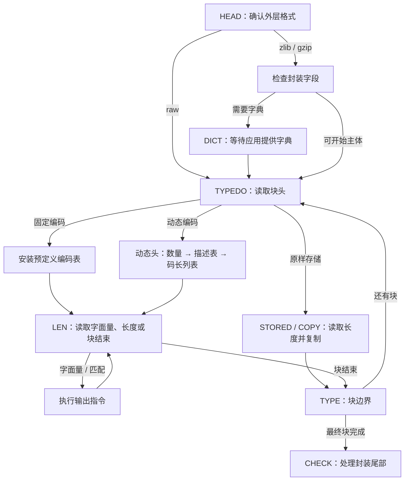
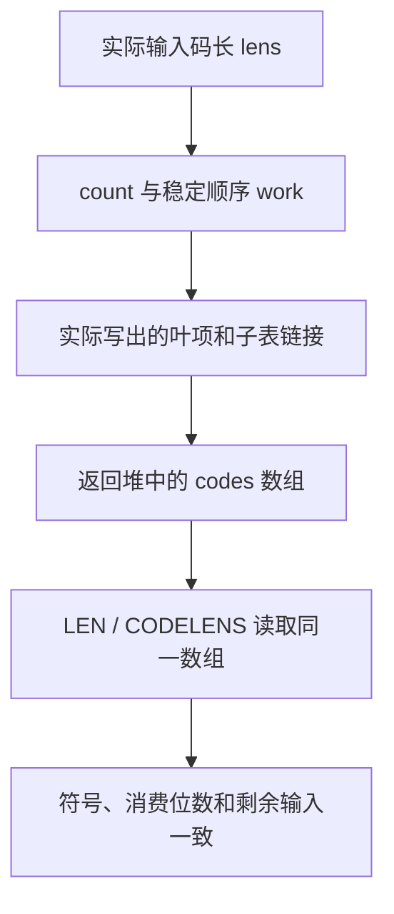

解压接收压缩字节，要恢复出原始字节。压缩指令主要有两类：字面量直接给出一个字节；匹配则指定从输出位置往回多远、再复制多少字节。`inflate` 必须先认出这些指令，才能执行它们。因此它先确定外层格式、读出当前块的类型，再按照这一块采用的编码规则解释其中的位。

沿用五字节裸 DEFLATE 流 `73 74 82 40 00`。它包含一个最终固定编码块，表示字面量 A、B，以及长度 6、距离 2 的匹配，恢复结果是 `ABABABAB`。这里的符号是这份具体编码已经选定的指令；解压器不会重新做匹配搜索。本章跟着实际状态机走到“已经读懂指令”的位置。

设计的难点有三个。输入按整字节到达，一条指令却可能结束在字节中间。动态块会描述自己采用的编码，解压器必须先检查这份描述，才能使用它。而快速查表不仅要认对符号，还要精确地消费属于它的位。下面按照这些依赖展开：保存未消费位，恢复码长，构造查找表，最后说明每次查询如何对应回原始输入。

## 调用入口与保存的解析位置 {#entry}

应用可能只拿到压缩流的一部分，也可能只给得出有限的输出空间。因此，每次调用都会暂借一段可读输入和一段可写输出给解压器。任何一段耗尽，解压器都必须交代本次进度，并保留尚未读完的工作。流记录 `z_stream` 把这两段临时缓冲区与长期保存的解码状态连在一起。

在这份记录中，`next_in` 指向下一个可读的压缩字节，`avail_in` 记录可读字节数；`next_out` 指向下一个可写输出字节，`avail_out` 记录剩余空间。一个较长的压缩流可以跨越多次这样的调用。

解析工作本身也分阶段：读取头部，恢复编码描述，认出指令，再执行指令。内部字段 `state->mode` 保存接下来要做哪项工作。尚未读完的字段还需要一个小容器，暂存已经从输入中取出、但没有解释完的位；容器的数值与有效位数分别保存在 `hold` 和 `bits` 中。

`inflate` 检查流状态和缓冲区指针后，把常用字段加载到局部变量。`next`、`have` 跟踪未读输入，`put`、`left` 跟踪可写输出，局部的 `hold`、`bits` 跟踪位容器。这样可以减少循环内通过流记录反复访问字段的开销；返回时，再把这些位置和未完成工作保存起来，供下一次调用接续。

块边界需要单独处理。调用者可以用 `Z_BLOCK` 或 `Z_TREES` 请求在两块之间暂停；保存的阶段 `TYPE` 标记这个边界。下一次调用必须跨过已经报告的边界，继续解析。入口先把 `TYPE` 改成接续阶段 `TYPEDO`，避免始终报告同一个边界。

[`inflate.c` 的调用入口](https://github.com/madler/zlib/blob/757f0527154291bcf6bfbd6396ecde6bedd2db95/inflate.c)随后用 `LOAD()` 取回局部字段，把起始字节数记为 `in`、`out`，把返回值 `ret` 初始化为成功值 `Z_OK`，再按当前任务分派：

```c
state = (struct inflate_state FAR *)strm->state;
if (state->mode == TYPE) state->mode = TYPEDO;      /* skip check */
LOAD();
in = have;
out = left;
ret = Z_OK;
for (;;)
    switch (state->mode) {
```

后面的每个 `case` 都是解析任务的一个阶段。一个阶段可能完成并进入下个阶段，也可能因输入或输出不足而返回。下次调用接着保存的阶段继续，不能重新解释已经消费过的头部。

## 先确定允许读取哪种格式 {#configuration}

同样的 DEFLATE 主体可以包在 zlib 或 gzip 里，由外层补上头部和校验值，也可以不带这两种封装。开始读字节前，解压器需要知道允许接受哪些外层格式。它还要用有限空间保留先前产生的字节，因为后面的匹配可能引用前一次调用的输出。这段保留区就是窗口。初始化参数 `windowBits` 同时选择封装规则和窗口位数；位数为 `w` 时，容量为 `2^w` 字节。

压缩级别、压缩端工作区大小 `memLevel`、匹配搜索策略，都属于生成编码时的取舍，不是解压参数。解压要服从流中已经写好的指令。块的区别在于怎样携带这些指令：原样存储块直接携带字节，固定编码块采用预定义的 Huffman 码，动态编码块描述自己使用的码。Huffman 码给每个符号分配长短不同的位串，让频繁出现的符号可以占更少的位。一个完整编码不能是另一个编码的开头；这个前缀规则让解码器知道符号在哪里结束。

默认构建包含 gzip 解码支持，`inflateInit` 等价于使用 `windowBits = 15` 的初始化。常用选择如下；正的窗口位数 8 到 15 对应 256 到 32768 字节的保留窗口容量。

| 初始化参数 | 允许的外层格式 | 窗口的确定方式 |
| --- | --- | --- |
| `8..15`，常用 `15` | zlib | 使用请求的窗口位数；接受的 zlib 头声明不能大于它 |
| `0` | zlib | 从 zlib 头取得窗口位数 |
| `-15..-8`，常用 `-15` | raw DEFLATE | 取参数绝对值；没有 zlib／gzip 头尾 |
| `24..31`，常用 `31` | gzip | 参数减去 16 |
| `40..47`，常用 `47` | 自动识别 zlib 或 gzip | 参数减去 32 |
| `16` 或 `32` | 分别为 gzip 或自动识别 | 窗口位数初始为零；zlib 分支从头取得，gzip 分支设为 15 |

最后一行来自选定源码的参数归一化和头部处理，不能把所有 16 到 47 的整数都视为合法值。例如 17 到 23 的归一化窗口位数只有 1 到 7，会被拒绝。`inflate` 接受 raw 的 `-8`；这与压缩端拒绝 raw 八位窗口的行为不同。[`inflateInit2_` 契约](/reference/functions/inflateInit2_.zh.html)给出完整初始化接口与返回情况。

这里还要区分两种距离条件。窗口大小决定跨调用能保留多少先前输出；当前调用刚产生的输出也可以成为匹配来源。通常的过远距离检查验证实际来源字节是否可用。另一项限制来自 zlib 头声明的窗口容量，内部记为 `dmax`。构建选项 `INFLATE_STRICT` 额外把距离与它比较；默认翻译没有启用这个选项。因此，不能把初始化参数简单解释成“每次复制都与这个数比较”。

编译配置会改变这些路径。`NO_GZIP` 移除 gzip 头尾解码，不能沿用上表的 gzip／自动识别入口。`BUILDFIXED` 把预生成的固定表改成首次使用时构造。原子操作不可用时，需要先在单线程中用固定块调用 `inflate` 并返回，再允许其他线程进入解码。`PKZIP_BUG_WORKAROUND` 改变动态字母表和表空间上界。下面先跟随默认构建，再在相应步骤说明这些差异。

初始化选择的格式与封装校验开关也要分开。`inflateValidate` 可以改变所选流的校验设置；这不会把 zlib 或 gzip 变成 raw，也不会移除必须读取的封装字段。字典供应、每次调用的缓冲区和刷新请求，则是调用过程中的条件。

## 从封装头走到当前块 {#dispatch}

第一个解析任务是识别外层头部，或者按配置跳过它；实现把这个任务称为 `HEAD`。raw 模式直接进入块解析。zlib 头携带压缩方法、窗口声明，以及专门选取的校验位，使这个两字节数值能够被 31 整除。解析器先检查整除关系、方法是否为 DEFLATE、窗口位数是否允许，再信任这些设置。默认构建通过开头的特征字节识别 gzip，再依次处理标志、时间、可选附加字段、名称、注释和可选头校验。输入可能恰好在某个名称或附加字段中间结束，保存的任务与剩余计数负责精确接续。

预设字典是压缩端和解压端事先另行获得的同一段字节。即使当前流还没有产生足够输出，开头的匹配也能引用它。若 zlib 头要求预设字典，解析器先读四字节字典标识，再进入等待任务 `DICT`。没有字典时返回 `Z_NEED_DICT`；应用提供校验值匹配的字典后，才继续解释块。这次暂停保存的是能够正常接续的工作。



这张图里的分支是不同块的选择。一个原样存储块不经过 Huffman 查表；固定块不发送新的码长描述；动态块才先读取编码表的描述。状态机还可以在块边界响应 `Z_BLOCK`，或在块头处理完后响应 `Z_TREES`。`Z_FINISH` 则要求以完成或阻塞结果返回，不会让缺少的输入凭空出现。

## 从字节中保留尚未读完的位 {#input}

压缩输入按字节到达，下一个字段却可能只需要几位，也可能跨过字节边界。解码器把已取入但尚未使用的位留在入口介绍的小整数容器里，读完一个字段也不丢掉余位。容器数值为 `hold`，有效位置数为 `bits`。取入字节会推进输入指针 `next`，尚未使用的位却仍留在容器中。因此，取字节和消费字段是两种不同进度。

把下一个要读的位放在整数最低位置。假设已有三位，读取顺序是 `0、1、1`，则 `hold = 6`，`bits = 3`。整数的通常二进制写法是 `110`，读取时从右边的低位开始。`bits` 很重要：有效的零位也是输入，不能只靠整数数值判断剩下几位。

若接下来要读五位，当前三位还不够。下一个输入字节为 `0xA5 = 165`，就把它接在现有三位之后：

```text
原来的读取顺序：0、1、1
新字节的顺序：  1、0、1、0、0、1、0、1
hold = 6 + (165 << 3) = 1326
bits = 3 + 8 = 11
```

此时尚未消费字段，十一位的内容和顺序都没变。选定 C 的 `PULLBYTE` 正是这个动作：

```c
#define PULLBYTE() \
    do { \
        if (have == 0) goto inf_leave; \
        have--; \
        hold += (unsigned long)(*next++) << bits; \
        bits += 8; \
    } while (0)
```

`NEEDBITS(n)` 在 `bits < n` 时重复执行它。已经有足够位就不再读字节；输入耗尽就进入返回处理，保留已经取入的位和当前模式。这里的 `n` 是当前字段需要的位数，不是要一次读入的字节数。

读出五位与移除五位是两个动作。`BITS(5)` 得到 `1326 & 31 = 14`，不改变状态；`DROPBITS(5)` 再得到 `hold = 41`、`bits = 6`。余下六位仍是后续输入。对齐到字节边界时，`BYTEBITS()` 只移除当前格式阶段允许跳过的低位填充。

容器满足 `hold < 2^bits`：有效部分上方没有置位。这让低 `bits` 位精确表示当前保存的输入。默认 64 位 Linux 翻译的 `hold` 为 64 位，仍要在每次移位前建立具体的位数界。机器字宽不能代替当前解析步骤的条件。

## 读取块头并选择解析分支 {#block-header}

每个 DEFLATE 块先给出一位最终块标志，再给出两位块类型。对于 `73 74 82 40 00`，首字节 `0x73` 的低三位依次是 `1、1、0`：最终块标志为 1，类型值为 1，所以安装固定表。

解码器把接下来的几位作为数组索引，查出对应的 Huffman 码。第一层称为根表，直接处理短码；需要更多位的前缀，则由表项指向更小的后续表。根宽度就是第一次索引用几位。这种布局省去了沿树逐位走一条边的工作。下面会构造一个小例子，具体展开这种布局。

默认构建已经生成好固定编码表。`inflate_fixed` 设置字面量／长度根宽度为 9，距离根宽度为 5。安装的是解码表的地址与查表宽度，不是在输入里重新建一棵树。

类型值为 0 时，块直接携带原文字节，解码器需要的是字节数量，不是符号编码。它先丢弃块头之后的填充位，到达字节边界，再读取 16 位长度，以及把这十六位全部取反后的另一个值。例如长度为 3 时，两者按十六进制写成 `0003` 与 `fffc`；这对数值让解码器在信任长度前，先拒绝损坏的长度字段。载荷随后按可用输入、可用输出和剩余长度三者的最小值复制；这里不需要码表。

类型值为 2 时，进入动态块的表描述。类型值为 3 是保留值，状态机设置错误信息并进入 `BAD`。这些判断都发生在解释字面量和距离之前。

## 动态块先描述自己的码长 {#lengths}

动态块可以选择适合本块数据的编码，因此必须先把这些编码告诉解码器。逐个发送完整位串太浪费；格式改为给每个可能的符号发送一个码长，再用双方约定的规则，从码长和符号顺序还原位串。码长为零表示不使用这个符号。这组按编号排列的可能符号，称为字母表。

码长列表本身也常有重复值和连续零，所以它也被压缩了：普通描述符号给出一个码长，重复符号一次描述多个相同码长。解码这些描述又需要一张小型 Huffman 表。这里有两层工作：先恢复数据编码的码长，再构造读取实际数据的表。它不会无限递归，因为小表自己的码长直接用三位数发送。

实现把这三项工作保存为不同阶段：`TABLE` 读取数量，`LENLENS` 准备小型描述表，`CODELENS` 展开码长列表。每一阶段都可以等待更多输入，而不重做前一阶段。

头部先告诉解码器需要恢复多少项：字面量／长度符号数、距离符号数，以及小型描述字母表里显式给出的项目数。实现分别记为 `nlen`、`ndist`、`ncode`。三个字段占 5、5、4 位，读出后再加上格式规定的最小数量：

```c
NEEDBITS(14);
state->nlen = BITS(5) + 257;
DROPBITS(5);
state->ndist = BITS(5) + 1;
DROPBITS(5);
state->ncode = BITS(4) + 4;
DROPBITS(4);
```

默认路径拒绝超过 286 个字面量／长度符号或 30 个距离符号的描述。开启 `PKZIP_BUG_WORKAROUND` 时允许的上界不同，不能用默认分支的检查解释那个构建。

小型描述字母表包含 19 个符号：0 到 15 表示普通码长，16 到 18 表示重复指令。为了构造它的表，输入按以下固定顺序，给前 `ncode` 个项目各发送一个三位码长：

```text
16, 17, 18, 0, 8, 7, 9, 6, 10, 5, 11, 4, 12, 3, 13, 2, 14, 1, 15
```

这个顺序先列三个重复符号，再列普通码长。未显式给出的项目填零。构造函数是 `inflate_table`，其中字母表类型参数 `CODES` 选择这 19 个描述符号。解析器请求七位根表，先建成这张小表。它解出的符号随后填入另一份数组：前面是字面量／长度编码的码长，紧接着是距离编码的码长。

| 码长描述符号 | 写入码长数组的内容 | 额外输入位 |
| --- | --- | --- |
| `0..15` | 写入这个码长一次 | 无 |
| `16` | 重复前一个码长 3 到 6 次 | 2 位；前面必须已有一个码长 |
| `17` | 连写 3 到 10 个零 | 3 位 |
| `18` | 连写 11 到 138 个零 | 7 位 |

用一个 24 格的片段单独观察展开。选定的描述指令为 `3、16、17、2、18`，三条重复指令的额外值依次是 `1、2、2`。普通 `3` 写一个码长 3；`16` 把前一个 3 再写 `3 + 1 = 4` 次；`17` 写 `3 + 2 = 5` 个零；普通 `2` 写一个码长 2；`18` 再写 `11 + 2 = 13` 个零。五条描述生成了 24 个码长。这些数值描述的是编码长度，不是解压输出字节。

<div class="zl-demo-mount"><zlib-demo kind="lengths"><p>这个 24 格教学片段依次展开为一个 3、再四个 3、五个零、一个 2、十三个零。指令 16 要求前面已有一个码长；每次重复的整段范围必须在第一次写入前通过检查。</p></zlib-demo></div>

图中单独观察码长列表的展开，直接给定已经识别的描述符号及其额外值，不解析压缩字节。额外位计数只统计对 2、3、7 位重复字段的消费量，不统计取入位容器的字节数。画面推进一步代表推理的一步，不是一次 API 返回。这是码长列表的片段，不是完整动态头：真实头部至少描述 257 个字面量／长度符号和一个距离符号，最终得到的字母表还要通过下面的构造检查。

两个错误情形说明为什么必须先检查、后写入。若 18 要求十三个零，却只剩十二格，应当拒绝整次重复，前面已经写好的十一个码长保持不变。若第一条描述就是 16，则根本没有前值可供重复。[实际 `CODELENS` 分支](https://github.com/madler/zlib/blob/757f0527154291bcf6bfbd6396ecde6bedd2db95/inflate.c#L833-L891)在消费 16 的额外位前检查前值，在进入写循环前检查整段范围。不过，装着额外位的字节可能已经取入：解析器先补足描述码及其额外字段，再消费描述码，然后检查前值。这里仍要区分取入与消费：

```c
if (state->have + copy > state->nlen + state->ndist) {
    strm->msg = (z_const char *)
        "invalid bit length repeat";
    state->mode = BAD;
    break;
}
while (copy--)
    state->lens[state->have++] = (unsigned short)len;
```

这里的 `state->have` 记录已经写好的码长数，`copy` 是本次要求的重复次数，`len` 是被重复的值。这个保存的码长计数，与记录未读输入字节数的局部变量 `have` 是两回事。重复开始时，检查先建立 `已写数量 + 本次数量 ≤ 总数`；随后每次存储恰好延长一格已恢复前缀，并减少待写数量，先前的前缀始终不变。指令 16 还必须先有 `已写数量 > 0`，才允许读取前一个值。这些关系保证展开动作正确；最终码长能否组成可用编码，则是下一层检查。

重复可以跨过字面量／长度与距离两段的交界，因为源码先填一份连续序列，再在 `nlen` 处分开使用。它必须停在两段总数处，不需要提前停在中间那条界线上。

全部码长恢复后，还要检查符号 256 的码长非零；它是块结束标记。然后请求根宽度 9 构造 `LENS` 表，请求根宽度 6 构造 `DISTS` 表。后一张表从前一张实际返回的空闲位置开始。这个先后顺序避免了单独存放完整树结构：传输的是码长，使用时把它们展开成可直接索引的表。

## 把码长展开成根表和子表 {#tables}

现在已经知道码长，还需要快速认出相应位串。规范 Huffman 编码先按码长排列符号，同一长度内按符号编号排列，再依次分配编码。这样双方无需传输树指针，也能还原出同一套位串。构造器把这些位串排成根表和后续子表，让一两次数组访问代替逐位选择树分支。

`inflate_table` 接收这些码长、字母表类型、请求根宽度、可写目标表区，以及一份用于排序的临时数组。它返回实际使用的宽度、下一个空闲表位置及返回码。非空编码的请求宽度会被夹到最短和最长非零码长之间，因此调用者必须使用返回宽度；全零码长另走下面介绍的分支。

先用四个符号、码长 `[1,2,3,3]` 看清构造过程。给 A 分配一位编码 `0`；先递增，再在进入下一码长时补一个零，得到 B 的 `10`；再递增并补零，得到 C 的 `110`；同码长的下一个编码是 D 的 `111`。这些位串按读取顺序书写。现在请求两位根表。这张教学表用于观察短码重复与子表，和五字节例子的固定表分开讨论。

### 计数和稳定排序 {#table-order}

依次分配编码前，先要知道每个码长组有多少符号。输入数组是 `lens`，计数数组是 `count`，其中 `count[l]` 记录码长为 `l` 的符号数量。构造器先清零 0 到 15 的计数，再执行 `count[lens[sym]]++`。调用者必须保证每个输入码长在 0 到 15 内；辅助函数不会先为这个索引补做检查。

本例的非零计数是：一位一个，两位一个，三位两个。构造器用 `left` 记录每层尚未占用的前缀位置：从 1 开始，每深入一层先乘 2，再减去该层符号数。本例得到 `1、1、0`；三个一位符号则会在第一层得到 `-1`，无法放进一棵二叉前缀树。

随后计算各码长在临时数组 `work` 中的起始偏移 `offs`，再按符号数值顺序填入。支持的最大码长为 15，在循环中名为 `MAXBITS`：

```c
offs[1] = 0;
for (len = 1; len < MAXBITS; len++)
    offs[len + 1] = offs[len] + count[len];

/* sort symbols by length, by symbol order within each length */
for (sym = 0; sym < codes; sym++)
    if (lens[sym] != 0) work[offs[lens[sym]]++] = (unsigned short)sym;
```

对 `[1,2,3,3]`，各组从偏移 `0、1、2` 开始，结果为 A、B、C、D。若原码长是 `[3,1,3,2]`，则得到 B、D、A、C：先按码长分组，同组仍按符号数值排列。这里用计数与前缀和替代比较排序。`offs` 在存储时不断递增，填完后的值已经不是最初的组起点；构造表时，`count` 也逐渐改为剩余数量。

### 表项表示要执行的动作 {#table-entry}

查表不能只回答“这是哪个符号”。短码可能只用掉索引的一部分位，长码则可能还需要下一次查询。因此，每个表单元都要同时描述下一步动作与消费量。给出最终答案的项称为叶项，指向后续查询的项称为链接。C 结构 `code` 用三个字段保存这些动作：`bits` 是本级消费位数，`op` 选择动作，`val` 携带直接值、数值基值或后续表偏移。构造器和解码器共用 [`inftrees.h` 中的表项定义](https://github.com/madler/zlib/blob/757f0527154291bcf6bfbd6396ecde6bedd2db95/inftrees.h#L7-L49)。

| 表项动作 | `op` 的含义 | `val` 的含义 |
| --- | --- | --- |
| 字面量，或 `CODES` 的直接符号 | `0` | 字节值或码长描述符号 |
| 长度／距离 | 标志 16 加额外位数 | 基值；再加额外输入位得到实际数值 |
| 子表链接 | 非零且小于 16，表示子表索引宽度 | 相对原表基址的偏移 |
| 块结束 | `96`，含结束与无效分类位 | 此时不作为字节输出 |
| 无效编码 | 含标志 64，没有结束标志 32 | 不作为有效字面量或匹配使用 |

例如长度基值 11 加一位额外值 1，得到长度 12。保留的编码也需要正确的无效表项。消费者先识别结束标志，再处理无效标志，才能正确解释同时含两者的结束表项。

### 短码重复与按需子表 {#table-fill}

根宽度为二，就有四项。A 只需读取一个零位，第二位无论是什么都应得到 A。因此整数索引 `00` 和 `10` 都填 A，且都只消费一位。B 占 `01`；C、D 共用根槽 `11`，再由一位子表区分。

为了写入这些索引，构造器反向保存当前编码，让下一个输入位位于整数最低位置。这个整数是 `huff`，完整码长是 `len`，已经由根表处理的位数为 `drop`。当前表的索引宽度为 `curr`，首项由 `next` 指向；准备写入的动作为 `here`。

构造器的[实际填充循环](https://github.com/madler/zlib/blob/757f0527154291bcf6bfbd6396ecde6bedd2db95/inftrees.c#L213-L286)把这个动作复制到低位前缀相同的索引处。步长 `incr` 由尚未处理的码长决定；`fill` 从当前表大小开始，每次减去这个步长，`min` 暂存该表大小：

```c
incr = 1U << (len - drop);
fill = 1U << curr;
min = fill;                 /* save offset to next table */
do {
    fill -= incr;
    next[(huff >> drop) + fill] = here;
} while (fill != 0);
```

A 的值为 `huff=0、len=1、drop=0、curr=2`，所以步长为 2，先填索引 2，再填索引 0。变量 `min` 此时已不表示最短码长。

填完一个符号后，构造器从当前码的高位一端向低位一端执行进位，使 `huff` 按反向表示递增。A、B、C、D 的数值依次是 `0、1、3、7`，对应码长 `1、2、3、3`。递减后的 `count` 决定何时进入下一码长；反向进位与稳定的符号顺序一起，还原同一套规范编码。

C、D 的完整码长为三，共享两个根位，剩下一位足以区分。根表占偏移 0 到 3，子表从偏移 4 开始，占 4、5 两项，`used = 6`。安装链接时，用掩码 `mask` 取出 `huff` 的根表低位，得到根索引 `low`；`*table` 是原始表基址，此时 `next` 已经指向子表：

```c
low = huff & mask;
(*table)[low].op = (unsigned char)curr;
(*table)[low].bits = (unsigned char)root;
(*table)[low].val = (unsigned short)(next - *table);
```

这里链接的 `op=1`、`bits=2`、`val=4`。进入子表后，索引 0 对应 C，1 对应 D。一般情况也按剩余码长的数量估算子表所需深度，给当前前缀分配足够空间，而不为每个前缀都保留最大深度。根表越宽，初次访问能解决的符号越多，但初始存储也按 `2^root` 增长。

## 查询得到符号，也得到精确消费量 {#lookup}

现在读教学消息 `AD`。按读取顺序，它的四位是 `0、1、1、1`；放在低位优先的整数里是 `hold=14`，通常写成二进制 `1110`。

| 根索引 | 表的结果 | 本级消费量 |
| --- | --- | --- |
| `00` | A | 1 位 |
| `01` | B | 2 位 |
| `10` | A | 1 位 |
| `11` | 子表偏移 4，宽度 1 | 2 位 |

第一次用低两位 `10` 查到 A，但只丢一位，留下 `111`。第二次根槽 `11` 指向子表，再用最后的一位 `1` 得到 D。整个过程消费四位，没有把属于 D 的位算进 A。

<div class="zl-demo-mount"><zlib-demo kind="lookup"><p>教学消息 AD 的根查询先得到 A，只消费一位；余下 111 再经根槽 11 和子表项 1 得到 D。</p></zlib-demo></div>

普通 `LEN` 分派还有一个节省读取的细节：它可以先用归一化 `hold` 的低位索引查看表项，比较表项需要的消费量与实际已有位数，再决定是否取入字节。不是每次都强行读满整个根宽度。A 的两个重复槽保证，即使第二位尚未到达，这个尚未确定的位置也不影响一位码的答案。要真正消费一个表项，则必须已经拥有它要求的位；需要子表时，还要取得足以确定叶项的位。

因此，表不是单纯的“符号数组”。它把识别动作、额外位宽、消费量和控制流放在一起。到达字面量或长度／距离后，状态机会转入写出字节或执行匹配的阶段；块结束则回到块边界。

## 拒绝编码与等待输入的区别 {#errors}

输入暂时不够时，保存模式和已取入位；应用可以继续提供输入。数据本身违反格式时，进入 `BAD`，由公开调用报告 `Z_DATA_ERROR`。把这两种情况混在一起，就会把可继续的解析状态错误地丢弃。

构造器还区分三类结果：成功为 0，无效码长集合为 `-1`，所选表空间不足为 `1`。外层动态头解析会把非零构造结果作为错误处理。错误返回可能发生在已经写过部分排序数组或表项之后，所以安全论证必须描述返回后的实际程序内存，包括这些部分写入。

* 所有码长为零时，构造器写入两个一位无效项，根宽度返回 1，并推进表指针两项。这样可以成功建立一张“查询就拒绝”的表；它没有制造一个有效符号。
* 非空而不完整的编码，仅在类型不是 `CODES` 且最大码长为一时通过。此时恰有一个一位符号，另一个槽明确无效。完整性检查不能静默排除这个被源码接受的情形。
* 动态块必须含有块结束符号。距离表全零与实际遇到一条需要距离的匹配，是两个不同问题；是否使用了那张表也属于消费过程。

构造表还需要存储上界：短码的重复槽和子表，使表项数可能大于符号数。对于请求根宽度 9、6，默认给 `LENS` 预留 852 项，给 `DISTS` 预留 592 项，合计 1444 项。这些单位是表单元，不是字节或符号数；改变请求宽度，也可能改变所需空间。构造器在预留根表和新增子表时检查容量。`PKZIP_BUG_WORKAROUND` 使用 854、594，合计 1448 项，不能混用默认数值。这里的 `CODES` 构造接口另有更强的输入前提：最多 19 个符号、码长最多七位、请求根宽度至少七，因此不需要子表，最多 128 项。表命题中具体的 Lean `capOf` 分别采用默认类型对应的 128、852 或 592；较大的兼容构建容量属于另一种构建配置。

## 正确性：位、表内容与消费者连在一起 {#correctness}

要解释解出的符号为什么正确，先固定同一条未消费位序列。以下等式中的 `lowBits` 按低位优先列出 `hold` 的有效位，`byteBits` 按同样顺序展开尚未读取的字节，`++` 表示连接；这是说明关系的记号。

```text
剩余输入 = lowBits(hold, bits) ++ byteBits(尚未读取的字节)
```

取入 `0xA5` 只改变这条序列存放的位置。原值小于 `2^bits`，新字节左移 `bits` 后，两部分占据不同位段；在机器宽度允许的条件下，相加恰好是连接，不会改变原有低位。读取字段时，表项或格式字段给出需要消费的位数 `n`，然后移除恰好 `n` 位。`AD` 的 A 若移除了两位，整数操作仍可能完全合法，却会删除 D 的首位。


### 读位循环的保持关系 {#correctness-bits}

取位循环需要一个每轮前后都成立的关系：未读字节仍可读取，计数准确，整数只包含有效低位。这就是循环不变量。[Lean 位操作命题](/reference/source/ZlibF/Proof/inflate.c.main.macros.html)把它记为 `BitInv`，具体包含可读输入区间、`have` 与剩余字节数的一致，以及 `hold < 2^bits`。其中的 `stream` 连接有效缓冲位与未读字节。`PULLBYTE_succ` 在这个不变量、未读区间非空和 `bits ≤ 56` 的前提下，说明一次真实翻译执行追加一个字节、推进指针、减少可用字节数，同时保持 `stream`。

`NEEDBITS_run` 处理的是实际取位循环，请求量前提为 `n ≤ 49`。循环不变量记录已经取入多少字节、位数增加了多少，以及剩余序列不变。若足够位已在缓冲中，执行不取新字节；若输入耗尽，返回保存的余位。逐轮减少的缺口和有限输入数量同时给出停止依据。`DROPBITS_inv` 另外要求消费量不大于已有位数且小于 64，得到消费后的序列恰为原序列去掉这个前缀。

这些条件也说明为什么代码中的位数不能随意替换。数学上“补足一个字段”成立，实际执行仍需指出正在读取哪个可用字节、指针怎样合法前进、机器移位为什么有定义。

### 构造器产生的就是随后读取的表 {#correctness-table}

表构造的论证沿写入过程保存三层关系。计数阶段把数组计数连接到输入码长；排序阶段说明 `work` 的已写前缀按码长和符号顺序排列；填表阶段说明每个重复叶项与子表链接对应哪段规范码。数组范围保证这些读取与写入合法，内容关系说明合法访问得到的是正确符号。



构造器必须为真正写出的数组建立这些内容关系，不能另外想象一张正确的表。[`inflate_table_content` 的目标](/reference/source/ZlibF/Spec/InflateTableContent.html)保留实际函数执行、返回分类、工作区与表区的修改范围，并把叶项和链接绑定到返回堆中的数组，也就是本次执行后的程序内存。它的[调用前提](/reference/source/ZlibF/Proof/inftrees.c.main.html)要求码长和符号数有界、目标表空间足够、排序数组独立。构造过程中使用的内部环境由执行结果给出，不能由调用者预先假设一张“内容正确的表”。

这些数量前提还区分了辅助函数与当前解析器的输入。辅助函数允许最多 288 个字面量／长度符号或 32 个距离符号，码长至多 15；保留符号必须生成无效项。默认动态解析器前面采用的 286／30 上界更窄。`CODES` 则采用上面说明的 19 符号、至多七位码长、至少七位请求根宽度。输入数组与排序数组都必须容纳全部符号，排序数组不能与输入数组是同一数组，目标表区必须可写，并具有相应的 128／852／592 项容量。这些条件同时支撑具体数组访问与抽象计数论证。

### 组合时保留各命题的定义域 {#correctness-domain}

完整前缀编码不留下空分支：前面 `left` 的占用计算最后恰好得到零。[数据表命题 `inflate_table_complete_decoder_safe`](/reference/source/ZlibF/Proof/inftrees.c.content.data.html)要求这个额外前提，因此不适用于全零表或被接受的单符号不完整表。它的查询结论要与成功返回、实际数组和返回宽度一起使用。[描述表命题 `inflate_table_codes_decoder_safe`](/reference/source/ZlibF/Proof/inftrees.c.content.codes.html)则采用 `CODES` 构造前提，给出恢复码长时 `CODELENS` 所需的表性质。

因此，组合论证要按构造结果分类：有效叶项给出符号，链接指向对应子表，无效项导向规定的拒绝路径。空距离表只在不需要读取距离时保持适当的解析含义；需要距离却遇到无效项时应报告错误。把 C 与 D 的叶项交换，所有地址仍可能在界内，但解码含义已经改变。

<div class="zl-demo-mount"><zlib-demo kind="table-proof"><p>表单元可读、链接不越界，与表项是否对应正确符号是不同关系。教学图把这些条件分开展示。</p></zlib-demo></div>

证明的交接点是同一个返回状态：当前输入消费到哪里、当前表项是什么、下一模式将怎样解释它。随后字面量扩展一个输出字节，匹配则进入长度和距离控制的复制循环；两者都使用这里建立的精确消费关系。
