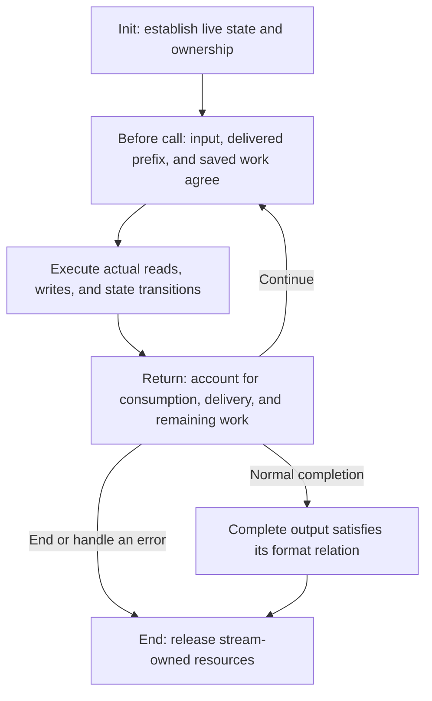

## One byte sequence, one round trip {#task}

An application wants to save eight bytes, `ABABABAB`, and recover them later. The important result is the recovered byte sequence: every byte must equal the original, in the same order. The compressed bytes in between can look entirely different.

The difficulty is that the two sides do different work. The compressor chooses a compact description; the decoder follows that description. Instructions need not align with stored bytes, one instruction can produce several bytes, and a call can stop halfway through it. To understand the implementation, we need to follow both the changing representation and the unfinished work.

The repeated `AB` gives us a small example. Write `A` and `B` directly, then describe the remaining six bytes as “go back two bytes and copy six times.” A directly written byte is a **literal**. The copying instruction is a **match**: its **distance** says how far back to read from the current output end; its **length** says how many bytes to add. After every copied byte, the output end moves forward.

<div class="zl-token-line"><span>Literal A</span><span>Literal B</span><b>Match · length 6 · distance 2</b></div>

These instructions are not yet bytes we can store. The two sides need a shared binary spelling and an end marker. **DEFLATE** defines those rules. It groups instructions into blocks; a block header selects the coding rule, and an end symbol finishes a coded block. Here we select the fixed codebook: both sides know its binary patterns in advance, so this block need not transmit a new codebook.

A byte holds eight binary digits, or **bits**. In this selected encoding, the block header uses 3 bits; `A` and `B` use 8 each; length 6 uses 7; distance 2 uses 5; and the end symbol uses 7. That is 38 bits, with two zero padding bits to complete the last byte. For compact notation, each hexadecimal digit represents four bits, so two digits name one byte. Written this way, the five stored bytes are `73 74 82 40 00`. The original `A` and `B` have hexadecimal values `41` and `42`; their codes in this compressed stream are different from those original byte values.

Follow the example below from instructions to stored bits and back to recovered bytes. **Next step** performs one operation; selecting a code highlights its bits, including those crossing byte boundaries. Selecting an output position shows the write that produced it. During copying, a dashed border marks the read source and a solid border marks the new write. The scene follows format operations; it does not count C calls or predict how far the implementation reads ahead.

<div class="zl-demo-mount"><zlib-demo kind="roundtrip"><p>Selected instructions: literal A, literal B, then length 6 at distance 2. A final fixed-code block writes 38 meaningful bits and two padding bits as 73 74 82 40 00. Decode A and B, then six copying steps to recover ABABABAB. With five output positions, pause after ABABA and retain three match bytes for the next call. Recognizing the end symbol completes the raw stream.</p></zlib-demo></div>

The highlighted bits show why a compressed byte is not an instruction: `A` begins after the three header bits and crosses a byte boundary. The output steps show another important difference: recovering the last `B` and recognizing the end symbol are separate operations. If only five output positions are available, the copy pauses after `ABABA`; the remaining `BAB` still belongs to the same match.

Look more closely at the copy. Its third step reads the `A` produced by its first step. Length can therefore exceed distance. Treating the original `AB` as a fixed source slice misses the rule: each copied byte extends the readable output. The independent format definition expresses exactly this growing-output rule in [`copyBack`](/reference/source/ZlibF/Spec/Format/Deflate.html).

This is a selected valid representation, not a prediction of the default compressor's decisions. The compressor must find candidates, decide when to commit them and compare coding costs. The following implementation stages develop those decisions. For now, we have one concrete answer that both sides can interpret.

## Library, payload, and wrapper {#formats}

`deflate` and `inflate` are zlib library functions whose saved state can continue across calls: this is what their streaming interface provides. The former accepts original bytes and produces compressed bytes. The latter interprets compressed bytes and produces the original data. Their core interchange format is **DEFLATE**, which defines how literals, length/distance matches, and blocks are represented as bits.

The encoded blocks are the **payload**: the part describing the data. A file or protocol may also need to identify settings and detect damaged content. A **wrapper** places that metadata around the payload. Raw DEFLATE has no wrapper; the zlib and gzip forms add different headers and trailers.

For damage detection, the sender computes a short check value from the original bytes. The receiver computes the same check over recovered bytes and compares it with the transmitted value. The zlib wrapper uses **Adler-32** for this check. Gzip uses **CRC-32**, and also stores the original length modulo `2^32`. These checks can detect corruption; they do not provide cryptographic authentication. The [wrapper format relations](/reference/source/ZlibF/Spec/Format/Wrapper.html) include the appropriate header and trailer conditions around the shared DEFLATE meaning.

<figure class="zl-layers">
<div><span>raw</span><b>DEFLATE payload</b></div>
<div><span>zlib</span><i>Header</i><b>DEFLATE payload</b><i>Adler-32</i></div>
<div><span>gzip</span><i>Header and optional fields</i><b>DEFLATE payload</b><i>CRC-32 · size</i></div>
<figcaption>The same kind of block coding sits inside three different framing choices.</figcaption>
</figure>

“Produced the last original byte” and “finished the entire stream” can therefore occur at different times. The decoder may still need an end-of-block code or wrapper trailer. With a damaged trailer, an application can receive output and then receive an error.

## A complete task through actual C calls {#example}

We now let the actual library choose the encoding. The program keeps three byte arrays: `source` holds the original, `packed` receives compressed data, and `restored` receives the decoded result. It uses the default zlib wrapper, so its intermediate bytes include metadata absent from the five-byte raw example.

Each engine needs an object that survives a call: it records the current byte ranges and points to private saved work. The C API calls this record `z_stream`; the program creates one named `encoder` and another named `decoder`. In each record, `next_in` points to readable input and `avail_in` gives its remaining byte count. Similarly, `next_out` points to writable space and `avail_out` gives its capacity. Initialization attaches private engine state to a record. The final End operation releases that state.

A processing request tells the encoder whether more original bytes will follow. Here `Z_FINISH` says none will: finish the encoding. The decoder uses the ordinary request `Z_NO_FLUSH`. Successful setup and cleanup return `Z_OK`; processing reports complete data with `Z_STREAM_END`. The encoder selects the default compression level with `Z_DEFAULT_COMPRESSION`.

The encoding destination has 64 bytes, enough for this example. The program checks that one processing call finishes each engine, then checks the recovered length and every recovered byte. The later five-byte destination example will deliberately force a pause. The [initialization contract](/reference/functions/deflateInit_.html) explains the default compressor setup; the [decoder initialization contract](/reference/functions/inflateInit_.html) establishes its separate state.

```c
#include <stdio.h>
#include <string.h>
#include <zlib.h>

int main(void) {
    unsigned char source[] = {'A','B','A','B','A','B','A','B'};
    unsigned char packed[64], restored[sizeof source];
    z_stream encoder = {0}, decoder = {0};

    if (deflateInit(&encoder, Z_DEFAULT_COMPRESSION) != Z_OK)
        return 1;
    encoder.next_in = source;
    encoder.avail_in = sizeof source;
    encoder.next_out = packed;
    encoder.avail_out = sizeof packed;
    int encoded = deflate(&encoder, Z_FINISH);
    unsigned packed_size = sizeof packed - encoder.avail_out;
    int encoder_end = deflateEnd(&encoder);
    if (encoded != Z_STREAM_END || encoder_end != Z_OK)
        return 1;

    if (inflateInit(&decoder) != Z_OK)
        return 1;
    decoder.next_in = packed;
    decoder.avail_in = packed_size;
    decoder.next_out = restored;
    decoder.avail_out = sizeof restored;
    int decoded = inflate(&decoder, Z_NO_FLUSH);
    unsigned restored_size = sizeof restored - decoder.avail_out;
    int decoder_end = inflateEnd(&decoder);
    if (decoded != Z_STREAM_END || decoder_end != Z_OK ||
        restored_size != sizeof source ||
        memcmp(source, restored, sizeof source) != 0)
        return 1;

    printf("%u -> %u -> %u bytes\n",
           (unsigned)sizeof source, packed_size, restored_size);
    return 0;
}
```

Build the program with `cc round-trip.c -lz -o round-trip`. The compiler and linker search paths must select the header and library from the same build. The chapter’s native example run of the selected source prints `8 -> 12 -> 8 bytes`: framing increases this tiny input’s size, while the round trip recovers the same data. The program checks recovered bytes against the input rather than fixing one compressed byte string. Compression level, strategy, and call timing can change the intermediate representation; the format determines the recovered result.

`encoder` and `decoder` are independent `z_stream` records. Their zero initialization selects the library's default allocator in this program. Initialization establishes private state. It consumes no input and delivers no compressed or decoded output. Even after a processing call returns `Z_STREAM_END`, private resources remain until the corresponding End operation. The code saves the processing result before cleanup, so a failed processing call cannot bypass release after a successful initialization.

`Z_FINISH` tells the compressor that this example has supplied all its input and needs the final block and wrapper trailer. The decoder uses `Z_NO_FLUSH` for ordinary decoding. Encoded end information identifies completion; the caller need not append another end instruction.

### Change the original and run the same round trip {#playground}

The eight-byte input above gives every line of code a definite object. Now replace `source` with your own content. The compressor processes bytes, so text first needs a character-to-byte convention. This page uses UTF-8, in which one character can occupy several bytes. In hexadecimal mode, each pair of digits directly specifies a byte, including values that are not text.

This page compiles the same zlib C sources into WebAssembly that runs in the browser. The actual [C calling program](static/examples/codec-playground.c) retains the initialization, compression, decoding, cleanup and byte-comparison sequence, while preparing enough room for the input length. Select “Run the C program” to execute a complete round trip. Then inspect the recorded return values and input/output availability for each actual call.

<div class="zl-demo-mount"><zlib-demo kind="playground"><p>A browser with JavaScript and WebAssembly can accept text or hexadecimal bytes and run compression and decoding from the same C sources. The program displays original, compressed and recovered bytes, then compares the full result byte for byte. Each input may contain up to 256 KiB.</p></zlib-demo></div>

Try empty input, then a long repeated passage. Header and trailer overhead can enlarge a short message, while repetitions can have a compact description. Whatever the intermediate size, the final check compares every recovered byte with the original. The fixed-code diagram above explains selected instructions; this compressor chooses a representation for your actual input. The [build record](static/examples/codec-playground-provenance.json) preserves its sources, patches and settings.

## Replace buffers, continue the task {#protocol}

A large input may arrive in pieces, and an application may have only a small destination array. It must be able to take a result, replace the available storage and continue the same task. The persistent stream record makes that possible. Its four range fields describe only the storage available **for this call**, not the size of the whole message:

| Field | Meaning in this call |
| --- | --- |
| `next_in` | The next readable input address. |
| `avail_in` | How many input bytes remain available there. |
| `next_out` | The next writable output address. |
| `avail_out` | How many output bytes remain available there. |

On return, the input pointer identifies the next byte not yet taken from the caller’s slice; the output pointer identifies the next unwritten destination position. Availability decreases by the actual taken or written amounts. Bits from an already taken input byte may still be held inside the decoder. Recording availability before and after the call gives its byte accounts. Here `stream` is the decoder record and `chunk` is the writable array supplied for this call:

```c
unsigned char chunk[5];
unsigned before = stream.avail_in;
stream.next_out = chunk;
stream.avail_out = sizeof chunk;
int result = inflate(&stream, Z_NO_FLUSH);
unsigned used = before - stream.avail_in;
unsigned made = sizeof chunk - stream.avail_out;
```

Both `used` and `made` count bytes, but they usually differ. One compressed symbol can produce many original bytes. Reading a compressed byte can also leave some of its bits buffered internally. On the compression side, original bytes can be accepted before their block encoding is delivered. Input consumption and output delivery are separate boundaries. The [stream API contract](/reference/docs/spec/api/streams.html) records both effects rather than treating them as one position.

A five-byte output array makes that distinction visible. This separate decoding example initializes raw mode with `inflateInit2(&stream, -15)`. For the selected raw DEFLATE stream `73 74 82 40 00`, the first call delivers `ABABA`, and the second delivers `BAB`. Those five encoded bytes describe the selected literals `A`, `B` and length-6/distance-2 match. They do not predict the default compressor's output.

<div class="zl-purpose-flow"><div><small>First call</small><code>ABABA</code><span>Output room runs out; three match bytes remain</span></div><b aria-hidden="true">→</b><div><small>Keep the same stream state</small><strong>The unfinished match survives</strong><span>The application retains the delivered prefix</span></div><b aria-hidden="true">→</b><div><small>Second call</small><code>BAB</code><span>The batches form ABABABAB</span></div></div>

Before the second call, the application can provide another writable array or reuse the old one after processing its contents. Private `state` survives. It stores the processing mode, held bits, and unfinished instruction; when copying crosses a return, a bounded history buffer called the window retains output bytes that may still be referenced. Reinitializing the decoder would lose this continuation.

A return can mean completion, a pause for more input or output room, or an error. Some streams also require previously agreed starting bytes, called a **preset dictionary**; the decoder can ask the application to supply them. The returned code distinguishes those situations so the application can choose its next action:

| Return code | What the application needs to determine |
| --- | --- |
| `Z_OK` | The call returned normally without reporting completion. Inspect actual consumption and delivery before deciding how to continue. |
| `Z_STREAM_END` | The data task is complete, including enabled wrapper validation. Resources still need End or permitted reuse. |
| `Z_BUF_ERROR` | Available conditions are insufficient, or requested completion was not reached. Inspect actual input/output effects, then supply what is missing. |
| `Z_NEED_DICT` | Zlib decoding requests a preset dictionary. Supply the matching dictionary before continuing. |
| `Z_DATA_ERROR`, `Z_MEM_ERROR`, `Z_STREAM_ERROR` | Check data, allocation, or call conditions respectively; handle the effects already performed and clean up according to the relevant contract. |

After a return, the application handles the `made` output bytes, preserves unread input, then continues, supplies missing conditions, or ends the task. A retry must address the blocking condition. If a `Z_NO_FLUSH` decoding call returns `Z_BUF_ERROR` without taking input or writing output, output room is available and no further input can be supplied, the application reports an incomplete stream instead of repeating the same call indefinitely. `avail_in == 0` does not report completion: the compressor may have accepted the input while retaining symbols, held bits, or pending bytes. Finishing compression uses `Z_FINISH` until `Z_STREAM_END`. End releases resources; it does not write the missing suffix for the caller.

## Configuration chooses paths and admitted input {#configuration}

Finding repeats requires keeping recent original bytes, called the **window**, and indexes that locate possible earlier matches. The window setting bounds that recent context. The memory setting sizes the search indexes and temporary symbol storage. The compression level controls how much work to spend searching; the strategy selects which kinds of patterns to emphasize.

The format fixes how to interpret an encoding, but does not prescribe which valid encoding the compressor must choose. To follow one implementation route, first choose its settings. This book uses the ordinary full library build. A compile-time alternative called `FASTEST` replaces the normal level choices with a different search configuration; it is outside this baseline. Its runtime settings are the common defaults: the DEFLATE method, default compression level, default strategy, window argument 15, memory level 8, and the default allocator. Under this build, the source normalizes `Z_DEFAULT_COMPRESSION` to level 6. Window argument 15 selects a 32 KiB window configuration; its array layout and actual search bounds are developed at refill and matching. The [compressor initialization parameters](/reference/functions/deflateInit2_.html) define their accepted ranges and normalization. These choices establish one ordinary compressor route to follow.

| Choice | Effect on compression | Decoding counterpart |
| --- | --- | --- |
| Wrapper | Select raw payload, zlib framing, or gzip framing. | Select which wrappers to admit; `inflateInit` reads zlib by default. |
| Level and strategy | Change search budgets, match decisions, and specialized processing routes. | Decoding has no compression-level or strategy parameter; it interprets the blocks and symbols actually sent. |
| Window argument | Affect searchable history and related storage. | Affect retained/referenced history and the zlib header’s window conditions. |
| Memory level | Size search indexes, symbol capacity, and pending storage. | Decoding has no corresponding memory-level argument. |
| Preset dictionary | Make some match sources available before ordinary input begins. | Supply the same dictionary context in the permitted mode and at the required time. |
| Flush request | Control boundaries, delivery, or completion. | Process input and return boundaries under the decoder's own request semantics. |

Preset dictionaries also have a wrapper boundary. Zlib framing can request an application dictionary by its identifier; gzip framing has no equivalent dictionary handshake. Dictionary configuration is more than another input buffer.

Keep three dimensions distinct. **Runtime settings** choose compression level, strategy, and framing. A `deflate` call itself receives the stream and a flush request; level, strategy and wrapper are already represented in its private state. **Buffer scheduling** determines how much input and output room one call has: the same default-configured decoder can consequently switch between ordinary and fast execution. **Build configuration** can change available interfaces, layouts, and algorithm branches. These dimensions are not one “fast/slow mode.”

A block can store original bytes directly, use a fixed codebook known to both sides, or transmit a newly chosen codebook. These are stored, fixed and dynamic blocks respectively. Default decoding must admit all three within its format domain. A compressor's choice for one input does not narrow the grammar accepted by the decoder. The exact window, strategy, and wrapper ranges will be developed where they change execution.

## The proof structure of one execution {#correctness}

The concrete example now gives us a proof problem. We need to explain why each change of representation preserves the same bytes, including at a pause. Give the round trip an independent goal. For the eight-byte input `ABABABAB`, completed compression must deliver an encoding that describes those bytes. Successful decoding must deliver exactly those bytes. Different valid encodings can satisfy that same goal. Relating each engine separately to an [independent format relation](/reference/docs/spec/format/model.html) is what connects them: the relation describes what the compressed bytes mean, without calling either implementation to define that meaning.

Before completion, output is often only a prefix. The relation must then include work saved privately. After the first five-byte return, the state must explain both facts: `ABABA` has been delivered, and the same match still determines three remaining bytes. The next call extends this output without restarting the instruction, omitting a byte, or redelivering the prefix.

For the five-position destination, the local argument is small enough to inspect directly. Number output positions from zero. Once the two literals exist, every copy at position `i` reads position `i - 2`. Both positions contain the same letter in this example:

| Write | Read | Byte | What remains after the write |
| --- | --- | --- | --- |
| Position 2 | Position 0 | `A` | Five match bytes |
| Position 3 | Position 1 | `B` | Four match bytes |
| Position 4 | Position 2 | `A` | Three match bytes; destination full |
| Position 5 | Position 3 | `B` | Two match bytes; new destination |

The pause must retain distance 2 and remaining length 3, and make `ABABA` available as the already-produced history. The next destination begins with `B`, not with a replay of `A` and `B`. This is the connection between the scene's visible equality check and the private state that the C implementation must preserve.



The loop in the diagram is a method of proof: induction over legal call sequences. Initialization establishes the relation. Each processing call derives a relation usable by its successor. At normal completion, saved state yields the complete format conclusion. Ownership follows the same returned heap through End. On an error path, the argument still accounts precisely for the bytes read, bytes written, and resources acquired; it need not invent a complete result for erroneous input.

The source statements separate execution guarantees from byte meaning. The [default decoder sequence memory contract](/reference/source/ZlibF/Proof/inflate.c.default-extended-memory-contract.html) derives the next call's execution, actual consumed/written ranges and allocation changes after its selected default initialization and permitted operations. Its setup uses zlib mode with a fifteen-bit window and the default allocator. It fixes the C data layout to LP64: pointers and `long` are 64 bits, while `int` is 32 bits. In that layout the initializer’s stream-size argument is 112 bytes; byte arrays must also fit the stated platform bounds. These premises make the interface size check and address arithmetic precise. It does not define the decoded-format conclusion. The [default compressor sequence theorem](/reference/source/ZlibF/Proof/deflate.c.engine.compression-protocol-history.html) derives an initialized execution boundary across legal buffer replacements, finish calls and new-input ordinary calls; its premises include successful default initialization allocations and positive output room for those processing steps. The complete byte-meaning argument must connect such concrete execution facts to the format relation above.

Memory safety and byte meaning meet here. Recovering the right text while writing one byte beyond its destination is still wrong. Staying inside the arrays while interpreting distance 2 as distance 1 is also wrong. Each input read, match search, output write, and copy will therefore be explained with both its range condition and the meaning it preserves.
