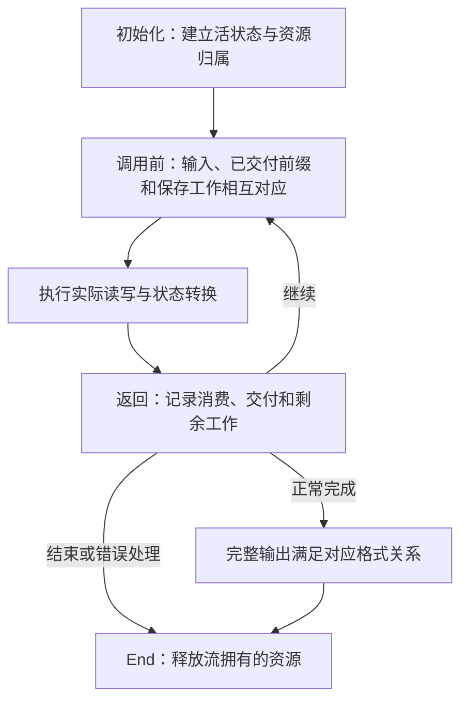

## 一段字节的一次往返 {#task}

应用要保存八个字节 `ABABABAB`，以后再恢复出来。最重要的结果是恢复的字节序列：每个字节都要与原文相同，顺序也相同。中间保存的压缩字节可以完全换一种样子。

困难在于，两端做的工作不同。压缩器选择紧凑的描述，解压器按描述恢复原文。指令不一定与存储字节对齐，一条指令可以产生多个字节，一次调用还可能在指令中途停下。要理解实现，就要同时跟住表示方式的变化，以及尚未完成的工作。

重复的 `AB` 给出了一个小例子。先直接写出 `A` 和 `B`，再把其余六字节描述为“回退两个字节，复制六次”。直接写出的单个字节叫**字面量**，复制指令叫**匹配**。匹配的**距离**表示从当前输出末尾往前数几个位置，**长度**表示一共要增加几个字节。每复制一个字节，输出末尾就向前推进一次。

<div class="zl-token-line"><span>字面量 A</span><span>字面量 B</span><b>匹配 · 长度 6 · 距离 2</b></div>

这些指令还不是能保存的字节。两端还需要约定它们的二进制写法，以及结束标记。**DEFLATE** 规定了这些规则。它把指令分成块，由块头选择编码规则，再由结束符结束一个编码块。本例选择固定码表：两端事先知道每条指令对应的二进制模式，不需要在这一块里再传一份新码表。

一个字节装八个二进制数位，也就是八个**比特**。在本例选定的编码中，块头占 3 位，`A`、`B` 各占 8 位，长度 6 占 7 位，距离 2 占 5 位，结束符占 7 位。合计 38 位，再补两个零位，凑满最后一个字节。为紧凑记下结果，用每个数位表示四比特的十六进制；两个数位就能表示一字节。这样记下，得到五个存储字节 `73 74 82 40 00`。原文 `A`、`B` 的十六进制值分别是 `41`、`42`；压缩流里写的是它们的编码，与原字节值不同。

下面沿同一个例子，从指令走到存储位，再恢复字节。**执行下一步**推进一次操作；点击一项编码，可以查看它占用的位，包括跨过字节边界的部分；点击一个输出位置，可以查看产生它的那次写入。复制时，虚线边框标出读取来源，实线边框标出刚写入的位置。图里跟踪的是格式操作，不计数 C 函数调用，也不预测实现会提前读入多少输入。

<div class="zl-demo-mount"><zlib-demo kind="roundtrip"><p>选定指令为字面量 A、字面量 B，以及长度 6／距离 2 的匹配。最终固定编码块用 38 个有效位和两个补齐位写成 73 74 82 40 00。解码 A、B，再逐字节复制六次，得到 ABABABAB。目标区只有五格时，在 ABABA 后暂停，同一匹配还剩三字节供下次调用继续；识别结束符后裸流完成。</p></zlib-demo></div>

高亮的位说明，压缩字节不是一条条指令：`A` 的编码接在三位块头后，跨过了字节边界。输出步骤则说明，恢复最后一个 `B` 和识别结束符是两次不同操作。如果目标区只有五格，复制会在 `ABABA` 后暂停；剩余的 `BAB` 仍属于同一条匹配。

再仔细看复制。第三步读到的 `A`，正是第一步刚产生的字节，所以长度可以大于距离。若只把最初的 `AB` 当作固定的来源切片，就漏掉了真正的规则：每复制一个字节，可读的输出就增长一个字节。独立格式定义中的 [`copyBack`](/reference/source/ZlibF/Spec/Format/Deflate.html) 正是按这条规则逐步扩大输出。

这是选定的一种合法表示，不是对默认压缩器决策的预测。压缩器还要找到候选、决定何时采用匹配，并比较编码成本。后面的实现阶段会展开这些决策。现在，我们先有了一份两端都能解释的具体答案。

## 库、载荷与封装 {#formats}

`deflate` 和 `inflate` 是 zlib 库提供的函数，可以保留状态并跨多次调用接续，这就是流式接口提供的能力。前者接受原文字节并产生压缩字节；后者解释压缩字节并产生原文。它们之间传递的核心格式就是前面的 DEFLATE，规定字面量、长度／距离匹配和块怎样表示为比特。

描述数据的编码块叫**载荷**。文件或通信协议还可能需要标识配置、发现内容损坏，所以会把额外信息放在载荷前后，形成**封装**。裸 DEFLATE 没有这层封装；zlib 和 gzip 则添加不同的头部与尾部。

为了发现损坏，发送端对原文字节计算一个短校验值；接收端对恢复出的字节重新计算，再与传来的值比较。zlib 封装用 **Adler-32** 计算这项校验，gzip 用 **CRC-32**，并保存原文长度模 `2^32`。这些校验可以发现损坏，不提供密码学认证。[封装格式关系](/reference/source/ZlibF/Spec/Format/Wrapper.html) 把相应头尾条件接到共同的 DEFLATE 含义上。

<figure class="zl-layers">
<div><span>raw</span><b>DEFLATE 载荷</b></div>
<div><span>zlib</span><i>头部</i><b>DEFLATE 载荷</b><i>Adler-32</i></div>
<div><span>gzip</span><i>头部与可选字段</i><b>DEFLATE 载荷</b><i>CRC-32 · 长度</i></div>
<figcaption>同一种块编码可以放进三种不同的封装选择中。</figcaption>
</figure>

所以，“已经得到最后一个原文字节”与“整个流已经完成”是两个时刻。解码器还可能需要读取块结束码和封装尾部。若尾部损坏，应用可能已经收到一段输出，随后才得到错误。

## 从实际 C 调用走完一次任务 {#example}

现在，让实际库自己选择编码。程序保留三个字节数组：`source` 是原文，`packed` 接收压缩数据，`restored` 接收恢复结果。它使用默认 zlib 封装，因此中间字节包含前面五字节裸流里没有的额外信息。

每个引擎都需要一个跨调用保留的对象，记录当前字节范围，并指向内部保存的工作。C 接口把这个记录叫作 `z_stream`，程序分别建立 `encoder` 和 `decoder`。每份记录中，`next_in` 指向可读输入，`avail_in` 给出剩余输入字节数；`next_out` 指向可写目标，`avail_out` 给出可用空间。初始化把私有引擎状态挂到记录上，最后的 End 操作释放这份状态。

处理请求告诉压缩器，后面是否还会有原文。本例的 `Z_FINISH` 表示没有更多原文了，应完成编码。解码器使用普通请求 `Z_NO_FLUSH`。建立和清理成功返回 `Z_OK`，处理完成则返回 `Z_STREAM_END`。压缩器用 `Z_DEFAULT_COMPRESSION` 选择默认压缩级别。

压缩目标有 64 字节，对本例足够。程序检查两端是否各用一次处理调用就完成，再检查恢复长度和每一个字节。后面的五字节目标会主动制造一次暂停。[压缩初始化约定](/reference/functions/deflateInit_.html) 说明默认设置，[解码初始化约定](/reference/functions/inflateInit_.html) 则建立另一份独立状态。

```c
#include <stdio.h>
#include <string.h>
#include <zlib.h>

int main(void) {
    unsigned char source[] = {'A','B','A','B','A','B','A','B'};
    unsigned char packed[64], restored[sizeof source];
    z_stream encoder = {0}, decoder = {0};

    if (deflateInit(&encoder, Z_DEFAULT_COMPRESSION) != Z_OK)
        return 1;
    encoder.next_in = source;
    encoder.avail_in = sizeof source;
    encoder.next_out = packed;
    encoder.avail_out = sizeof packed;
    int encoded = deflate(&encoder, Z_FINISH);
    unsigned packed_size = sizeof packed - encoder.avail_out;
    int encoder_end = deflateEnd(&encoder);
    if (encoded != Z_STREAM_END || encoder_end != Z_OK)
        return 1;

    if (inflateInit(&decoder) != Z_OK)
        return 1;
    decoder.next_in = packed;
    decoder.avail_in = packed_size;
    decoder.next_out = restored;
    decoder.avail_out = sizeof restored;
    int decoded = inflate(&decoder, Z_NO_FLUSH);
    unsigned restored_size = sizeof restored - decoder.avail_out;
    int decoder_end = inflateEnd(&decoder);
    if (decoded != Z_STREAM_END || decoder_end != Z_OK ||
        restored_size != sizeof source ||
        memcmp(source, restored, sizeof source) != 0)
        return 1;

    printf("%u -> %u -> %u bytes\n",
           (unsigned)sizeof source, packed_size, restored_size);
    return 0;
}
```

程序可用 `cc round-trip.c -lz -o round-trip` 构建。编译器和链接器的搜索路径应选中同一构建的头文件与库。本章用选定源码编译并运行的示例打印 `8 -> 12 -> 8 bytes`：小输入增加了封装成本，往返仍恢复同一份字节。程序逐字节比较原文与恢复结果，没有把某串压缩字节写死。压缩级别、策略和调用时机可以改变中间表示，格式规定恢复结果。

`encoder` 与 `decoder` 是两个独立的 `z_stream`。初始化为零让本例使用库的默认分配器。初始化建立内部状态，不消费输入，也不交付压缩或解压结果。处理返回 `Z_STREAM_END` 后，内部资源仍然存在，需要相应 End 操作释放。代码先保存处理结果，再执行清理，避免因为处理失败而跳过成功初始化后的释放。

`Z_FINISH` 要求压缩器完成最后一个块和封装尾部。解码器根据编码中的结束信息识别完成，不需要调用者再补一条结束指令。

### 更换原文，运行同一个往返 {#playground}

上面的八字节输入让每一行代码都有确定的对象。现在可以把 `source` 换成你自己的内容：压缩器处理的是字节，文字需要先按约定转换成字节。本页采用 UTF-8 编码，一个汉字会占多个字节；选择十六进制时，每两个数位直接指定一个字节，能表示文字以外的内容。

本页把同一份 zlib C 源码编译成浏览器可执行的 WebAssembly。实际的 [C 调用程序](static/examples/codec-playground.c) 保留初始化、压缩、解压、释放和逐字节比较的顺序，并根据输入长度准备足够空间。点击“运行 C 程序”执行一次完整往返；结果出现后，可以逐条查看这次真实调用的返回值和输入／输出余量。

<div class="zl-demo-mount"><zlib-demo kind="playground"><p>在启用 JavaScript 和 WebAssembly 的浏览器中，可以输入文本或十六进制字节，运行同一份 C 源码的压缩与解压。程序展示原文、压缩数据和恢复数据，并逐字节比较结果；单次输入上限为 256 KiB。</p></zlib-demo></div>

先试空输入，再试很长的重复片段。短消息可能因头尾开销而变大，长重复片段则可以用少量描述表示。无论中间大小怎样变化，最后检查的仍然是恢复字节是否与原文逐一相等。上方固定编码图解释一组选定指令；这里的压缩器会为你的实际输入自行选择表示。所用源码、补丁及构建参数保存在[构建记录](static/examples/codec-playground-provenance.json)中。

## 缓冲区可以换，任务必须接续 {#protocol}

大输入可能分批到达，应用也可能只有一小块目标数组。它需要取走一批结果，更换可用存储，再继续同一任务。跨调用保留的流记录让这件事成为可能。它的四个范围字段只描述**本次调用**能使用的存储，不表示整条消息有多大：

| 字段 | 本次调用中的含义 |
| --- | --- |
| `next_in` | 下一处可以读取的输入地址。 |
| `avail_in` | 从该地址起还可读取的字节数。 |
| `next_out` | 下一处可以写入的输出地址。 |
| `avail_out` | 从该地址起还可写入的字节数。 |

返回时，输入指针指向调用者切片中下一处尚未取入的字节，输出指针指向目标区下一处尚未写入的位置。可用量分别减去实际取入和写出的数量。已经取入的字节仍可能有位留在解码器内部。因此，记录调用前后的可用量，就能得到这一次按字节计算的输入与输出账目。下面的 `stream` 是解码器记录，`chunk` 是本轮交给它的可写数组：

```c
unsigned char chunk[5];
unsigned before = stream.avail_in;
stream.next_out = chunk;
stream.avail_out = sizeof chunk;
int result = inflate(&stream, Z_NO_FLUSH);
unsigned used = before - stream.avail_in;
unsigned made = sizeof chunk - stream.avail_out;
```

`used` 和 `made` 的单位都是字节，但通常不相等。一个压缩符号可以产生许多原文字节；一个压缩字节被取入后，其中一部分位还可能尚未消费，继续留在位缓冲里。压缩端还可以先接受原文，稍后才交付对应块的编码。输入消费和输出交付是两条独立边界，[流 API 约定](/reference/docs/spec/api/streams.html) 分别记录两者的效果，不把它们混成一个位置。

把解码输出数组改成五字节，就能看到这种区别。这个单独的例子用 `inflateInit2(&stream, -15)` 建立裸模式解码器。使用前面选定的裸流 `73 74 82 40 00` 时，第一次交付 `ABABA`，第二次交付 `BAB`。这五个压缩字节表示前面选定的 `A`、`B` 和长度 6／距离 2，与默认压缩程序产生的字节不必相同。

<div class="zl-purpose-flow"><div><small>第一次调用</small><code>ABABA</code><span>本轮空间用完，匹配还剩三字节</span></div><b aria-hidden="true">→</b><div><small>保存同一流状态</small><strong>未完成的匹配仍在</strong><span>应用保留已收到的前缀</span></div><b aria-hidden="true">→</b><div><small>第二次调用</small><code>BAB</code><span>接续后组成 ABABABAB</span></div></div>

第二次调用前，应用可以换一块可写数组，也可以在处理完上次输出后复用旧数组。内部状态对象则继续存在，保留上一次调用留下的进度。它保存处理模式、未消费的位和未完成指令；复制跨过返回边界时，一块容量有限的历史缓冲区会保留仍可引用的输出字节，这块缓冲区叫作窗口。重新初始化解码器会丢掉这份接续信息。

返回可能表示完成、等待更多输入或输出空间，也可能表示错误。有些流还依赖双方事先约定的起始字节，叫作**预设字典**，解码器可以要求应用提供它。返回码区分这些情况，帮助应用选择下一步：

| 返回码 | 应用需要判断的事情 |
| --- | --- |
| `Z_OK` | 本次返回正常，尚未报告完成。查看实际消费和交付数量后决定如何继续。 |
| `Z_STREAM_END` | 本次数据任务完成，包括当前启用的封装检查；资源仍需结束或按规则复用。 |
| `Z_BUF_ERROR` | 可用条件不足，或所请求的完成条件尚未达到。检查实际已读、已写字节，再补充条件。 |
| `Z_NEED_DICT` | zlib 解码请求预设字典，应用需要提供匹配的字典再继续。 |
| `Z_DATA_ERROR`、`Z_MEM_ERROR`、`Z_STREAM_ERROR` | 分别检查数据、分配或调用条件；按相应契约处理已经发生的效果并清理。 |

调用者在返回后处理 `made` 个输出字节，保留未消费输入，再决定继续、补充条件或结束。重试需要解除使本轮停下的条件。使用 `Z_NO_FLUSH` 解码时，如果返回 `Z_BUF_ERROR`、没有取入输入或写出输出，而且输出空间可用、再也没有输入可提供，应用应报告编码流不完整，不能无限重复同一次调用。不要把 `avail_in == 0` 当成完成：原文可能已被压缩器接收，却还以符号、暂存位或待交付字节的形式留在内部。完成压缩使用 `Z_FINISH` 并继续到 `Z_STREAM_END`；End 负责释放资源，不负责补写剩余数据。

## 配置决定分支和允许的输入 {#configuration}

搜索重复需要保存近期原文字节，这段保留范围叫作**窗口**；还需要索引，帮助找到可能匹配的较早位置。窗口设置限制近期上下文，内存设置决定搜索索引和临时符号存储的大小，压缩级别控制愿意花多少工作搜索，策略则选择偏重哪类模式。

格式规定怎样解释编码，不强求压缩器选择哪一种合法编码。要跟踪一条实现路线，先确定它的设置。本书采用普通完整库构建。一个叫作 `FASTEST` 的编译选项会改变普通级别对应的搜索配置，本书的基准路线不启用它。运行时采用常见默认参数：DEFLATE 方法、默认压缩级别、默认策略、窗口参数 15、内存级别 8，以及默认分配器。在这个构建下，源码把 `Z_DEFAULT_COMPRESSION` 归一化为级别 6。窗口参数 15 选择 32 KiB 窗口配置，具体布局和实际搜索界在补充输入与匹配阶段展开。[压缩初始化参数](/reference/functions/deflateInit2_.html) 给出这些设置的允许范围与归一化规则。这些选择先确定一条可以跟踪的普通压缩路线。

| 选择 | 压缩端改变什么 | 解压端如何对应 |
| --- | --- | --- |
| 封装 | 选择裸载荷、zlib 头尾或 gzip 头尾。 | 选择接受哪一种封装；`inflateInit` 默认读取 zlib。 |
| 压缩级别与策略 | 改变搜索预算、匹配决策和专用处理路线。 | 解压没有压缩级别或策略参数；它解释实际写入的块和符号。 |
| 窗口参数 | 影响允许搜索的范围及相关存储。 | 影响可保留、可引用的历史以及 zlib 头部中的窗口约束。 |
| 内存级别 | 改变搜索索引、符号容量和待交付存储的尺寸。 | 解压没有对应的内存级别参数。 |
| 预设字典 | 让部分匹配来源在正文数据开始之前就存在。 | 在约定的模式和时机提供相同字典上下文。 |
| 刷新请求 | 控制何时形成边界、交付数据或完成任务。 | 根据输入格式和所选请求处理自己的返回边界。 |

预设字典也有封装边界。zlib 封装可以通过字典标识请求应用提供字典；gzip 封装不提供同样的字典握手。字典配置不能只理解成额外的一块输入。

这里要区分三个维度。**运行时配置**选择压缩级别、策略和封装。一次 `deflate` 处理调用本身接收流和刷新请求；级别、策略及封装已经保存在它的私有状态中。**缓冲区安排**决定某一次调用有多少输入、输出空间；同一个默认解码器可以因此在普通路径与快速路径之间切换。**编译配置**则可以改变可用接口、布局和算法分支。它们不能混成一组“快／慢模式”。

一个块可以直接存放原文字节，可以使用双方已知的固定码表，也可以传输一份新选出的码表。这三种形式分别叫作原样存储块、固定编码块和动态编码块。默认解码配置必须接受其格式范围内的这三种块。压缩器为某一输入选择的路径，不会缩小解码器允许接收的语法。窗口、策略和封装的具体参数范围，会在它们改变执行路径的位置展开。

## 从一次运行得到证明结构 {#correctness}

具体例子现在给出了一个证明问题：为什么每次换一种表示，仍然保留相同字节，甚至在暂停时也如此。先给往返一个独立目标。设输入是八字节 `ABABABAB`，压缩端完成时，交付的编码应当描述这八字节；解压端正常完成时，交付的字节应当恰好等于它们。不同合法编码可以满足同一目标。证明两端分别符合[独立格式关系](/reference/docs/spec/format/model.html)，才能把它们接起来：这份关系直接描述压缩字节的含义，不靠调用任一实现来定义含义。

任务中途，当前输出往往只是一段前缀，此时的证明关系还要包含内部保存的工作。第一次五字节返回后的状态必须解释两件事：`ABABA` 已经交付，剩下三字节仍由同一条匹配决定。下一次调用只能扩展这份输出，不能重启指令、漏掉字节或重复交付。

五格目标区的局部论证很小，可以直接逐步检查。输出位置从零计数。两个字面量存在后，每次在位置 `i` 复制，都读取位置 `i - 2`；本例中这两个位置应是同一个字母：

| 写入位置 | 读取位置 | 字节 | 写完之后还剩什么 |
| --- | --- | --- | --- |
| 位置 2 | 位置 0 | `A` | 五个匹配字节 |
| 位置 3 | 位置 1 | `B` | 四个匹配字节 |
| 位置 4 | 位置 2 | `A` | 三个匹配字节；目标已满 |
| 位置 5 | 位置 3 | `B` | 两个匹配字节；换了新目标 |

暂停必须保留距离 2 和剩余长度 3，并让已经产生的 `ABABA` 继续作为可读历史。新目标的第一个字节应是 `B`，不能重放 `A`、`B`。这就把图里看得到的逐字节核对，接到了 C 实现必须保留的私有状态上。



图中的循环是一种证明方法：按合法调用序列归纳。初始化建立关系，每次处理从当前关系推出下一次可使用的关系；正常完成时，从保存状态中读出完整格式结论。资源归属沿同一个返回堆传递，直到 End。错误路径仍要准确解释已读、已写和已分配的部分，不要求错误输入产生虚构的完整结果。

源码命题把执行保证与字节含义分别表达。[默认解码器调用序列内存契约](/reference/source/ZlibF/Proof/inflate.c.default-extended-memory-contract.html) 从选定默认初始化及允许操作，推导下一次调用的执行、实际消费／写入范围和分配变化。其设置使用 zlib 模式、十五位窗口和默认分配器，并固定 C 数据布局为 LP64：指针和 `long` 是 64 位，`int` 是 32 位。在这个布局中，初始化的流结构尺寸参数是 112 字节；字节数组还要满足陈述中的平台大小界。这些前提让接口尺寸检查和地址计算有精确含义。该命题不定义解码格式结论。[默认压缩器调用序列命题](/reference/source/ZlibF/Proof/deflate.c.engine.compression-protocol-history.html) 则沿合法的缓冲区替换、完成调用和带新输入的普通调用，推导初始化得到的执行边界；其前提包含默认初始化分配成功，以及这些处理步骤有正输出空间。完整的字节含义论证，需要把这类具体执行事实接到前面的格式关系上。

内存安全与字节含义在这里相遇。恢复出了正确文本，却多写一个字节，仍然有错；没有越界，却把距离 2 读成距离 1，也仍然有错。后面的实现讲解会在每个读位、搜索、写入和复制位置，把范围条件与它保存的含义一起展开。
