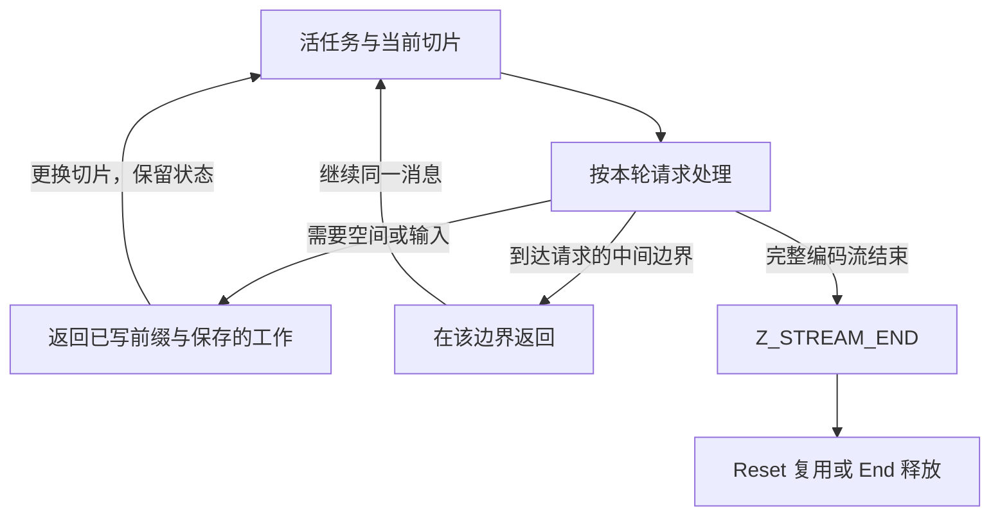
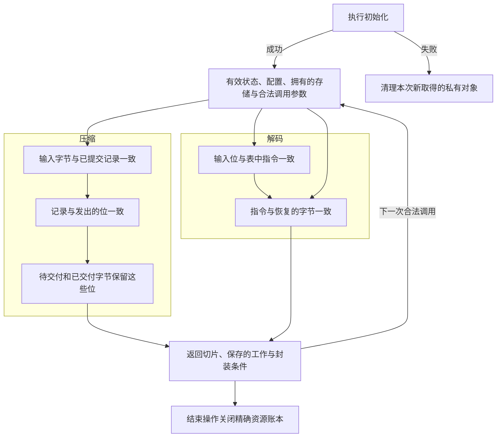

解码器已经交付四个字节，应用还需要消息的剩余部分。要安全地继续，保留已经收到的文字还不够：程序还要记住哪条指令没有执行完，以及这条指令接下来还能读取哪些存储。若应用想换一条消息，或者保存两种后续选择，就需要主动改变这份关系。

zlib 把应用持有的**任务记录**与编解码器的**私有工作存储**分开。任务记录叫作 `z_stream`，记录本轮允许编解码器使用的可读输入区和可写输出区，这种对应关系就是缓冲区绑定。记录后面连接着私有状态对象，用来记住解码进度，还可能拥有一块历史窗口，也就是容量有限、保留已产生字节供后续复制读取的缓冲区。输入、输出和可选头部对象仍归应用所有，编解码器只借用其中允许访问的范围。能更换什么、复制什么、释放什么，由这条边界决定。

这里有三处难点：已经交付的字节与尚未执行的工作不在同一时刻前进；复制私有状态，不会自动为应用生成两块输出缓冲区；分配错误还可能出现在已经写出字节之后。因此，调用协议必须说明每一步之后的真实状态，也包括这些部分完成的效果。

先用一个检查点把要求具体化。选定裸流 `73 74 82 40 00` 表示 `ABABABAB`。只给四个输出位置时，一次解码交付 `ABAB`，还保存着能继续产生 `ABAB` 的匹配。继续会完成同一个任务；Reset 要从一份新的完整编码开始；Copy 则保存相同位置，供两条独立后续路径使用。图中把应用的字节与库拥有的状态、窗口对象分别画开。

<div class="zl-demo-mount"><zlib-demo kind="checkpoint"><p>检查点上，应用已经取得 ABAB，解码器还剩四字节匹配。继续时先绑定新输出区。Reset 丢弃未完成指令，需要重新提供一条完整编码流。Copy 复制私有状态和历史，但调用者输出指针在重新绑定前仍然相同。结束一个副本后，另一个副本仍应能够继续。</p></zlib-demo></div>

## 建立任务与配置 {#init}

在处理字节前，编解码器需要保存进度的位置，还可能需要窗口、搜索索引或待交付存储。初始化取得这些私有存储，把它们连接到应用的任务记录；它不消费消息输入，也不产生压缩或解压字节。Lean 中的[初始化结果](/reference/source/ZlibF/Spec/Public/Initialisation.html)记录由此建立的字段和精确新增对象：选定压缩器布局取得五个私有对象，普通解码器起初取得一个状态对象。后面的调用从这个真实起点继续。

取得和释放存储的工作由分配器回调完成，也就是库或应用选择的函数。任务记录清零时，普通构建安装默认的一对函数。自定义分配和释放函数需要相互匹配，它们使用的应用上下文叫作 `opaque`，也要在流仍会使用它时保持有效。这组函数管理存储生命周期；更换输入切片不会更换分配器。

应用还要选择格式、历史容量和压缩策略。这里的 `method` 选择 DEFLATE；`windowBits` 合并表示封装请求和窗口尺度；`memLevel` 选择搜索索引、符号存储的容量，级别和策略则决定利用这些对象做哪些工作。配置在初始化或各自允许的后续操作中生效，不需要随每块数据重新提供。

几组控制在不同时间生效：

| 生效时刻 | 控制项 | 改变的内容 |
| --- | --- | --- |
| 初始化压缩器 | `method`、`windowBits`、`memLevel`、级别、策略、分配器 | 格式、窗口／索引／符号容量、搜索策略和资源行为。 |
| 初始化解码器 | `windowBits`、分配器 | 允许的封装、请求的历史窗口上限和资源行为。解码器不接收压缩器的压缩级别。 |
| 继续一个任务 | 输入／输出切片和边界请求 | 本轮可用的字节，以及请求的完成或停止边界。 |
| 主动改变活任务 | 搜索策略改变、字典、预置位、头部登记、Reset、Copy | 某项策略、上下文或后续执行方式；每项操作各有调用时机和存储要求。 |

在普通构建中，压缩级别 `Z_DEFAULT_COMPRESSION` 归一化为 6。`memLevel` 决定哈希和符号存储容量；级别和策略另行选择搜索路线与预算。容量也会改变候选分布和块边界。zlib 压缩器请求八位窗口时会被归一化为九位；裸模式和 gzip 拒绝八位这一情形。解码器的接纳规则不同：它有自己的带符号参数范围和从头部取得的设置。两端因此要按格式和有效窗口比较，不能只比较参数整数是否相等。

这些是选定构建内部的运行时控制。编译选项还会改变实现：`FASTEST` 把非零压缩级别改为 1；`Z_SOLO` 不提供普通默认分配器；`MAXSEG_64K` 使压缩器 Copy 返回 `Z_STREAM_ERROR`。本章示例使用普通默认布局和分配器。匹配与解码章节已经说明了相应的归一化设置怎样进入实际循环。

有用的初始化不变量要说明取得了哪些对象、写入了哪些字段，以及哪些字节具有算法含义。分配窗口只取得容量，不会使数组里的每个字节都成为有效匹配历史。活状态中的分配函数指针非空，也不自动说明它们就是模型中的默认函数。

## 分清接收输入与交付输出 {#buffers}

每次调用都向应用借用两段区域：一段可读输入，一段可写输出。每段区域需要当前位置和剩余字节数。任务记录把输入这一对叫作 `next_in`、`avail_in`，输出这一对叫作 `next_out`、`avail_out`。处理前先保存两个可用量。一次正常返回之后，它们的差值定位本轮实际取入和写出的前缀：

```text
input_taken    = old_avail_in  - new_avail_in
output_written = old_avail_out - new_avail_out
```

对压缩器，已经取入窗口的字节仍可能是尚未决定表示方式的预读输入。已经提交的字面量和匹配还可能等待选块。编码后的位可能留在位寄存器里，完整字节还可能留在待交付存储中。只有复制到调用者目标区的字节，才算本轮交付的输出。因此，输入切片耗尽不表示相应压缩结果已经到达应用。

完整压缩字节先排在内部交付队列里。游标 `pending_out` 指向下一个未交付字节，`pending` 计数仍在等待的字节；调用者记录的 `total_out` 累计已经交付的字节数。这里 `strm` 指向应用的流记录，`s` 指向私有压缩器状态。实际[待交付复制代码](https://github.com/madler/zlib/blob/757f0527154291bcf6bfbd6396ecde6bedd2db95/deflate.c#L969-L986)选择本轮字节数 `len`，同时受队列数据和调用者输出空间限制：

```c
zmemcpy(strm->next_out, s->pending_out, len);
strm->next_out  += len;
s->pending_out  += len;
strm->total_out += len;
strm->avail_out -= len;
s->pending      -= len;
```

调用者游标与待交付游标一起前进。更换输出缓冲区时，必须保留私有压缩器以及尚未交付的后缀。应用在复用输出存储前处理已写前缀，也要让尚未被取入的输入后缀继续可读。

对解码器，取入一个压缩字节后，它的一部分位还可能留在累加器中。本例检查点已经取入五个压缩字节中的四个，其中一位还保存在状态中，另一个压缩字节尚未读取。交付的输出前缀已经是原文字节。在 `ABAB` 检查点，更换四字节目标区会继续保存的匹配；重置则会丢弃它。应用可以重新绑定目标区，同时保持同一个任务。

错误返回保留按源码顺序发生的效果。`inflate` 尤其会先发布更新后的缓冲区指针，再可能因创建历史窗口失败而返回错误。此时新输出可以已经存在，正常末尾的总计数更新却被跳过。因此，返回的字节切片和总计数需要分开建立关系。调用者输出区始终由调用者拥有。

## 用刷新请求选择边界 {#flush}

处理同一条消息时，应用可能想积累更多输入、让接收者立即看见当前前缀、停在一个块，或者完成整条消息。本轮调用用 `flush` 参数携带这个请求。它不释放私有存储；压缩端选择写出怎样的边界，解码端则观察输入编码里已有的边界。

压缩端的 `Z_NO_FLUSH` 允许积累输入，以作出更好的块决策。`Z_BLOCK` 完成一个块，但不要求字节对齐，最多七个位可以继续暂存在寄存器中。`Z_PARTIAL_FLUSH` 追加一个空固定编码块，没有同步刷新的字节对齐承诺。`Z_SYNC_FLUSH` 发出对齐标记，让接收者能够取得此前已经提供的全部输入。`Z_FULL_FLUSH` 再丢弃压缩器之前的匹配历史。同步刷新和完全刷新都不宣告消息结束。

`Z_FINISH` 表示不再添加新的原文字节。保留本轮尚未读取的输入部分，并持续以 `Z_FINISH` 和更多输出空间调用，直到 `Z_STREAM_END`。这个结束码表示最后一个块及封装尾部已经交付；随后才由 End 释放资源。如果一个非最终刷新请求填满目标区，就保持同一刷新请求、提供更多空间，直到这次刷新完成；重新要求另一个标记是另一项操作。

解码器读取的是编码流已经选定的边界。它的 `Z_SYNC_FLUSH` 不插入标记，也不丢弃历史。`Z_BLOCK` 可以停在封装头或块边界；`Z_TREES` 还会在块描述结束、载荷尚未解码时返回。需要记录这些位置的应用，可以读取返回字段 `data_type`：它汇报未使用的输入位数，以及最终块、头部／块结束边界或块描述完成等标记。这能定位停在了哪一位，不表示消息已经完成。使用 `Z_FINISH` 时，如果本轮没有完成，原本普通的 `Z_OK` 返回会变为 `Z_BUF_ERROR`。保存的任务仍可在补充输入或输出空间后继续。



改变压缩策略本身也可能跨越一个边界。`deflateParams` 检查新级别和策略，必要时先用旧设置调用 `deflate` 的 `Z_BLOCK` 路径。如果旧块没有完成，就返回 `Z_BUF_ERROR`，级别和策略仍保留原值。已经消费的输入和产生的输出仍然可观察。应用要补充输出空间并重试；这次参数改变失败不会回滚已经发生的压缩工作。

`deflateTune` 控制更底层的搜索参数。它保存四个整数，其中三个转换为无符号字段，并不验证搜索预算是否合理。后续搜索论证若使用正的预算界，就需要明确给出并建立这些界。Params 改变级别，或普通压缩器 Reset，都会恢复该级别的标准调优值。

## 提供字典、预置位与头部上下文 {#dictionary}

字典让双方约定的字节提前成为匹配来源，不会把这些字节再次交付为消息输出。假设多条消息共享词汇 `AB`，压缩器只有在接收者也会提供相应历史时，才能引用这段词汇。

zlib 压缩应在开始压缩前安装字典。字典标识对应所给字典的校验和，可用窗口则保留合适的后缀。gzip 压缩没有预设字典路径。裸模式可以在合适的块边界安装字典，而且不能有待处理的预读输入。为了检查这个时机，源码用 `wrap` 记录封装（0 为裸模式、1 为 zlib、2 为 gzip），`status` 记录压缩阶段，`lookahead` 计数已接收、尚未决定表示的字节。`strstart` 是当前输入处理位置，`block_start` 是当前块的原文字节起点；没有预读字节且两者相同，表示该块没有积累原文字节。[安装前的检查](https://github.com/madler/zlib/blob/757f0527154291bcf6bfbd6396ecde6bedd2db95/deflate.c#L558-L573)拒绝其余时机：

```c
if (wrap == 2 || (wrap == 1 && s->status != INIT_STATE) || s->lookahead ||
    (wrap == 0 && (long)s->strstart != s->block_start))
    return Z_STREAM_ERROR;
```

加载字典时，压缩器暂时把字典绑定为输入，填充窗口和哈希，随后恢复调用者原有输入绑定。这个过程可以增加 `total_in`，但不会把字典作为消息输出发送。因此，在包含字典安装的调用历史里，不能直接把 `total_in` 当作消息原文长度。指针移动、已经接受的字典上下文和消息字节含义要分别记录。

zlib 解码器用 `Z_NEED_DICT` 请求字典。安装时检查所给标识，错误字典得到 `Z_DATA_ERROR`，可以再次尝试。裸模式允许在调用边界安装字典历史，不检查标识。安装会把字节复制进私有历史，不推进调用者的输入／输出指针或总计数；创建窗口时可能分配失败。非 NULL 的零长度裸字典，与源码直接拒绝的 NULL 字典指针，是不同情形。

预置位用于补回外层格式已经处理的位。`inflatePrime` 可以把 1 至 16 个低位追加在已有输入位上方，但总位数必须不超过 32；零位不改变状态，负数清空暂存位。`deflatePrime` 向待交付输出追加 0 至 16 个低位，可能先压紧已有待交付字节，再发现剩余空间不足。两个入口对无效位数使用不同返回码：解码端是 `Z_STREAM_ERROR`，压缩端是 `Z_BUF_ERROR`。普通裸流工作流在约定的起始时刻提供前缀；任意插入一些位，本身不能说明生成了合法 DEFLATE 消息。

gzip 元数据是借用存储。`deflateSetHeader` 保留头部记录以及可选额外字段、名称和注释输入，供发射及相关查询使用。完成头部不会自动撤销这些指针的登记。`inflateGetHeader` 则在解析前登记可写头部记录和有容量限制的接收目标。短目标只接收装得下的部分，字符串终止符也只有在能装下时才写入。Reset 清除登记，但不释放这些调用者对象。Copy 可以保留相同的借用指针，因此结束某个私有编解码器，不会结束调用者元数据的生命周期。

## 用重置复用容量 {#reset}

回到已经交付 `ABAB` 的解码器 A。要解码独立消息 B，普通 `inflateReset` 丢弃 A 的位进度和有效历史，然后由调用者绑定 B 的切片。它不擦除已经交付给应用的 `ABAB`，也不移动外部文件位置。

Reset 需要使旧匹配来源失效，又尽量保留已经取得的容量。三个私有字段把这个区别表达出来。`wsize` 是活跃环形窗口的大小，`whave` 是有效历史字节数，`wnext` 是下一个写入位置。初始化把原本请求的封装保存在 `reqwrap`，实际执行使用 `wrap`；恢复操作可能改变当前设置。下面的 `state` 指向私有解码器对象。[重置的结尾](https://github.com/madler/zlib/blob/757f0527154291bcf6bfbd6396ecde6bedd2db95/inflate.c#L125-L141)恢复请求，并使旧历史失效：

```c
state->wrap = state->reqwrap;
state->wsize = 0;
state->whave = 0;
state->wnext = 0;
return inflateResetKeep(strm);
```

旧分配区可以仍然存在，但有效字节数为零，意味着 B 不能用它的旧内容作为匹配来源。接着调用的 ResetKeep 清空暂存位并重新开始解析。这些重置不会替调用者更换输入和输出绑定。旧输入指针尤其可能已经停在一个块的中间；丢弃位进度和未完成指令后，新任务需要一份新的完整编码，重新绑定旧编码后缀不等于继续。ResetKeep 也会重新开始解析并清空位进度，保留窗口字节不表示保留半条旧指令。[重置的后置条件](/reference/source/ZlibF/Spec/Public/Lifecycle.html)因此分别描述模式、暂存位、窗口内容和调用者绑定。

| 操作 | 逻辑内容 | 容量与配置 |
| --- | --- | --- |
| `inflateResetKeep` | 重新开始进度，但保留可用窗口历史。 | 保留当前封装／窗口状态和分配区。 |
| `inflateReset` | 丢弃逻辑历史与保存的位进度。 | 恢复请求的封装／窗口，释放不兼容窗口，保留验证选择。 |
| `inflateReset2` | 丢弃进度，选择新的合法请求。 | 替换封装／窗口请求及验证设置，释放不兼容存储。 |
| `deflateResetKeep` | 丢弃待交付输出和未决定的预读输入，保留窗口／哈希历史及调优值。 | 保留压缩器分配区和所选配置。 |
| `deflateReset` | 以空匹配历史和当前级别的默认调优值开始。 | 保留分配区、封装、窗口、内存级别、压缩级别与策略。 |

两个 Keep 入口是未在公开头部文档中说明的公开符号，需要调用协议明确选择。保留下来的压缩历史可以让新引用指向重置前的字节；从空历史开始的接收者却没有那些字节。因此，物理存储复用与独立消息语义需要明确区分。

解码器 Reset 会恢复最近一次 `inflateValidate` 选择的验证方式，因为后者同时更新请求设置和当前设置。Reset2 建立新请求的验证设置。ResetKeep 保留当前封装，包括同步恢复操作改变过的封装状态。这些区别影响后续验证和允许接收的输入，不只是内存用量。

## 在同步标记处恢复解析 {#recovery}

重置开始另一个任务，恢复则尝试在输入受损后保留后面仍能解码的部分。`inflateSync` 搜索四个字节 `00 00 ff ff`，也就是空存储块结尾的标记。它先搜索位累加器保留的完整字节，再消费当前输入切片。标记的部分匹配留在状态中，下一次调用可以继续搜索。没有找到完整标记时返回 `Z_DATA_ERROR`；没有可搜索字节时返回 `Z_BUF_ERROR`。

找到标记后，从块边界重新开始解析，清空解码历史和暂存进度，保留累计输入／输出计数。若尚未读到封装头，恢复选择裸解码；否则关闭后续的校验和验证。它不会重建丢失的字节。全刷新协议在这里有用，是因为压缩器在该边界也丢弃了此前的匹配历史。同步刷新标记本身不会阻止后续匹配引用旧数据；偶然出现的标记字节也不能说明恢复后的后缀一定正确。

## 用独立私有存储复制检查点 {#copy}

在 A 的四字节检查点，成功 Copy 之后，A 与副本都能继续产生剩余 `ABAB`。已经交付的前缀仍归应用负责。在运行两条后续路径前，应用要提供合适的输出目标；复制调用者指针不会自动创造两块独立的调用者缓冲区。

只按字节复制状态记录并不够。动态字面量／长度表从来源的内嵌 `codes` 数组开头建立，距离表接在同一数组内。直接复制得到的指针仍指向 A 的存储，结束 A 就会使它失效。字面量／长度指针叫作 `lencode`，距离指针叫作 `distcode`，表构造游标叫作 `next`。选定源码的[已登记相等判断补丁](https://github.com/cla7aye15I4nd/zlib-f/blob/main/patches/0001-inflate-copy-pointer-equality.patch)通过相等判断识别内嵌数组起点，避免比较不同对象中指针的先后顺序。下面的 `state` 是来源私有对象，`copy` 是新取得的目标对象；代码保持距离表偏移，同时改变它所属的对象：

```c
if (state->lencode == state->codes) {
    copy->lencode = copy->codes;
    copy->distcode = copy->codes + (state->distcode - state->codes);
}
copy->next = copy->codes + (state->next - state->codes);
```

这个相等判断也覆盖重置建立的规范表指针。使用共享静态固定表时，这些指针继续共享固定表的生命周期。表构造游标 `next` 则始终需要重定位。解码器 Copy 取得新状态，并在来源有窗口时取得独立窗口。压缩器 Copy 则取得自己的状态、窗口、前驱、哈希头和待交付分配区，修复待交付游标及内嵌树描述符，并复制已经初始化的内容和保存的输入／编码进度。

目标必须是不同、可写且没有活编解码器的记录。复制失败时，清理本次新取得的目标对象，清空目标状态，同时保留来源检查点。成功的两个副本需要各自执行 End。调用者输入／输出和借用元数据仍由调用者负责。这些条件同时说明独立性和继续执行的含义：只有正确的私有指针、却没有保存的匹配，会丢失任务；保存的字段相同、指针却仍指向 A，又会丢失独立性。

证明不仅检查字段是否落在范围内，还跟踪这些字段如何建立。[表来源关系](/reference/source/ZlibF/Proof/inflate.c.default-origin-state.html)叫作 `DefaultOriginState`，记录字面量指针位于 `codes` 起点，或两个解码指针分别指向配对的固定表，同时记录默认头部状态的几种可能。初始化建立这些事实，真实的解码、重置、字典与控制操作保持它们。[成功复制的论证](/reference/source/ZlibF/Proof/inflate.c.copy-both-origin.html) `inflateCopy_actual_success_both_origin` 从返回的 `Z_OK` 推导所需分配确实成功，再为来源和目标建立状态关系。调用者不需要额外假设一个内部表指针来源契约。

## 按源码顺序记录分配与释放 {#allocation}

压缩器初始化成功时取得五个分配对象：状态、窗口、前驱、哈希头，以及待交付／符号存储。树数组内嵌在状态中；选定紧凑布局中的符号共享待交付分配区。普通解码器起初只取得状态。私有窗口可以延后到需要跨返回保留历史，或安装字典时再分配。

失败处理遵守真实请求顺序。压缩器的状态成功后，会先尝试全部四个缓冲区，再统一检查 NULL。前驱请求失败时，后面的哈希头和待交付请求仍可能成功。清理必须释放四个成功对象，包括发生在失败请求之后的成功对象。


失败分支先设置一个允许清理的状态，再调用 End。若第一次状态分配就失败，则不会请求后面的缓冲区。分配模型为每次尝试分别记录结果，因此一次请求失败，不能作为后续请求也都会失败的依据。清理移除活对象，但不会回退分配尝试计数或新鲜标识计数。解码器顺序又不同：它在验证窗口请求前分配状态。无效窗口请求因此可以先遇到分配失败；状态分配成功、随后参数被拒绝时，则会释放该状态。

延迟分配解码窗口是一项具有可见错误路径的优化。一次调用可以先写出 `ABAB`，发布缓冲区指针，再因取得下一次调用所需窗口失败而返回错误。已写前缀仍然存在。一次调用完成、也不需要保存历史的结束路径，则可以省掉这次窗口分配和复制。

End 关闭私有分配的生命周期。[压缩器 End 的结尾](https://github.com/madler/zlib/blob/757f0527154291bcf6bfbd6396ecde6bedd2db95/deflate.c#L1312-L1328)先释放缓冲区和状态，然后选择返回值：

```c
TRY_FREE(strm, strm->state->pending_buf);
TRY_FREE(strm, strm->state->head);
TRY_FREE(strm, strm->state->prev);
TRY_FREE(strm, strm->state->window);

ZFREE(strm, strm->state);
strm->state = Z_NULL;

return status == BUSY_STATE ? Z_DATA_ERROR : Z_OK;
```

`TRY_FREE` 跳过 NULL 缓冲区；`status` 是释放前保存的阶段。一个仍忙于压缩而被放弃的流，可以在释放私有存储之后返回 `Z_DATA_ERROR`。对合法活解码器，`inflateEnd` 释放可选私有窗口和状态，即使消息被放弃也返回 `Z_OK`。这两项操作都不会替应用补齐未交付的消息输出。原始输入／输出对象及借用头部对象继续归应用所有。

## 把驱动循环交给接口 {#callbacks}

原始输入和目标容量都已知时，可以使用完整缓冲区工具。它们建立临时流、运行并结束它，再把结果返回。它们的较宽长度类型可以超出 `avail_in` 与 `avail_out` 的宽度，因此内部循环把可以表示的片段逐批装入可用量字段，另行保留较宽的剩余长度。返回的输出长度描述已写前缀；带输入计数的解压工具还可以报告尾随数据从哪里开始。调用者不会得到一个可继续执行的活临时编解码器。

应用也可以把解码循环交给库，只提供一些函数，在库需要输入或准备交付输出时调用。这些应用提供的函数就叫作回调。裸解码器 `inflateBack` 使用这种安排，接收输入回调、输出回调，以及调用者提供的窗口；窗口同时承担历史和输出交付存储。`inflateBackInit` 接受 8 至 15 的窗口位数；调用者提供对应的 `2^windowBits` 个可写字节。解码循环位于 `infback.c`，并不在内部反复调用普通 `inflate`。输入回调按请求提供下一段可读字节；输出回调接收完整窗口或最终前缀，并报告是否接受了这次交付。已经接受的输出事件不会因后续回调失败而回滚。

输入片段在消费前必须保持可读。输出回调不能修改活跃输入片段或解码窗口。回调自己的状态只能在约定的保持条件内改变。初始化分配回调解码器的状态，却借用它的窗口；`inflateBackEnd` 释放该状态，窗口留给调用者处理。

终止还需要有限输入供应，或另一项明确的进展条件。让 `mu` 计数输入回调今后还能提供的字节数。一次供应 `n` 字节，就应使这份储备至少减少 `n`。[有限输入关系和位预算](/reference/source/ZlibF/Proof/infback.c.macros.html) `InFinite` 与 `phi` 把供应条件明确写出：

```text
暂存位数 + 8 × 当前片段字节数 + 8 × 未来输入字节数
```

未来输入储备只取决于输入回调拥有的字节对象；输出回调保持这些对象，因此不能补回已经支出的输入预算。装入字节只是把预算移入位累加器，消费字段才支出相应位数。模式转换还需要相应的递减秩，并把这个秩的界接到模型中的循环执行额度。如果回调可以一直供应没有最终块的数据，仅仅要求每次回调及时返回，还不能证明整个解码结束。[回调保持关系](/reference/source/ZlibF/Proof/infback.c.callbacks.html) `CbContract` 还规定回调只写入选定字节对象，不分配或释放对象；这些是它的精确前提。更广的公开回调协议需要明确说明自己允许的效果。

## 区分文件位置与解码位置 {#gzip}

访问文件还需要一个持久对象：句柄，用来在多次操作间保留文件位置、缓冲区和内部编解码器。gzip 文件接口把这个句柄叫作 `gzFile`。`gzread` 可以先读入比应用本轮要求的原文前缀更多的压缩数据。因此，描述符位置、已经缓冲的压缩输入和已经交付的原文位置，是三个不同数量。

例如，已经交付 `ABC` 后，要求从逻辑位置 3 前进到 5，可以直接消费缓冲中的 `DE`；若尚未缓冲，就记录需要通过读取和解码跳过的工作。向后定位可能需要回卷再解码。仅有一个压缩字节偏移，不能识别一个可以继续执行的解压状态。

gzip 读取还处理成员拼接和透明输入。普通 `inflate` 调用完成一个编码流后，文件读取器可以安排处理后续成员。`gzclose` 按契约释放句柄的缓冲区、编解码状态和文件资源。交给 `gzread` 的目标仍由应用拥有。

证明使用的外部世界在这里十分具体。[已经实现的文件世界](/reference/source/ZlibF/Zlib/gzfs.html)叫作 `Fs`，在堆之外表示普通文件和描述符位置；堆是模型中所有内存对象及其内容的清单。读取达到模型中的 EOF／错误，写入包含文件大小上限路径。管道、并发描述符变化和任意短读／错误安排，需要额外外部假设或模型。gzip 的格式化写入还会把可变个数的 C 参数转成字节；模型中已经表示好的参数列表，与机器 ABI 怎样传递这些参数，是两层不同条件。因此，文件证明同时说明堆的保持关系和文件世界前提。这是一条具体模型边界，与源码中的输入／输出记账分别表达。

## 推导状态有效性与资源账本 {#correctness}

现在，检查点对应的证明问题已经明确：继续 A 要保留剩余 `ABAB`；Reset 使旧字节不能供新消息使用；Copy 在新拥有的私有对象中保留同一任务；End 恰好移除这些私有对象。证明每一步都使用实际操作返回的同一份堆。

初始化定义域提供可写、尚未挂接活编解码器的流记录，合法参数存储、已表示的库全局数据、新鲜分配标识和相容的分配器字段。成功初始化建立活编解码器的不变量与分配集合；失败结果给出本次新取得对象的清理关系。Init 的前提不能先要求它初始化之后才应当建立的不变量。

本例需要两项不同承诺：其他调用者对象保留原内容，每个私有分配对象都保持存活，或在新增／释放时记账。[框架与分配账本定义](/reference/source/ZlibF/Spec/Public/Initialisation.html)把这两项承诺分别叫作 `Frame` 和 `LiveChange`。后一项写成：

```lean
def LiveChange (before after : Heap) (created removed : Nat → Prop) : Prop :=
  ∀ b, after.live b ↔ (before.live b ∧ ¬ removed b) ∨ created b
```

这里的 `b` 标识一个分配对象，不是字节偏移。压缩器 Init 成功时，新增集合包含五个不同对象，移除集合为空。Init 失败后，本次新取得的对象不能继续存活。End 的新增集合为空，移除集合恰好等于流拥有的对象。Copy 让目标的新对象出现，同时保持来源对象的内容和生命周期。

借用的缓冲区和头部不会因此变成编解码器拥有的对象。使用它们的调用分别提供可读／可写范围及分离条件。合法的缓冲区替换保持私有状态；下一次调用的参数关系再提供有效新切片和活跃元数据目标。只要相应指针仍被登记，`ActiveHeader` 关系就保持登记头部记录及其范围有效。

组合调用时，先从应用真正执行过的操作，推导私有状态关系。[解码器调用序列的构造](/reference/source/ZlibF/Proof/inflate.c.origin-history.html)叫作 `DefaultOriginHistory`：从成功的默认初始化开始，每一步记录真实参数、缓冲区替换以及返回的执行。对这些步骤作归纳，就能推导返回状态中的活存储、表指针来源和默认分配器。应用不需要在每次调用后自行断言内部不变量。字典查询虽不改变私有解码进度，仍可以写入它请求的调用者目标区。

这个构造有具体的平台和配置定义域：默认 zlib 初始化、十五位窗口、流结构尺寸参数 112（选定模型中流记录的字节数），以及模型中的默认分配器。每个已表示字节对象都小于 `2^63` 字节，替换缓冲区时保持这个条件；它限制的是单个内存对象。选定控制包括字典和查询；后续 Reset2 仍选择十五位。成功 Copy 使用不同的目标记录。Sync 步骤提供一次真实无故障返回的执行，因此归纳可以跨过这些恢复步骤保持状态，不会由此声称任意标记搜索都会终止。

然后把已经推导出的状态与下一轮合法借用切片，交给[解码器的下一次调用命题](/reference/source/ZlibF/Proof/inflate.c.origin-history-memory-contract.html)，即 `DefaultOriginHistory.next_memory_contract`。结论给出真实返回执行、消费输入、写出输出、返回模式、保持的调用者对象以及新增私有分配。在 `Z_OK`、`Z_STREAM_END`、`Z_DATA_ERROR`、`Z_BUF_ERROR` 这四种返回分支，总计数按切片长度推进；`Z_MEM_ERROR` 时，总计数保留入口值，输出切片却仍可包含新字节。返回 `Z_OK` 则意味着消费了输入或写出了输出，并且请求不是 `Z_FINISH`。驱动循环分别需要这些结论：内存条件允许调用，切片记账定位效果，推进条件排除成功却原地不动的迭代。把写出的字节连接到消息含义，还要用前面章节的位、表与匹配关系。

[默认压缩器调用序列命题](/reference/source/ZlibF/Proof/deflate.c.engine.compression-protocol-history.html) `default_init_compression_histories` 使用相同方法：从真实初始化出发，沿明确的调用序列保持执行边界。初始化要求五次分配成功、堆对象新鲜且唯一、库全局数据已表示、分配器字段为默认函数或空值、版本首字节满足陈述检查，以及流结构尺寸参数 112。序列允许合法缓冲区替换、具有正输出空间的 FINISH 步骤，以及结束前带新非空输入的 NO_FLUSH 步骤。这些前提说明结论支持哪一种驱动循环。字节到记录、记录到位的关系，再提供这个边界上的格式论证。

最后，[公开 End 目标](/reference/source/ZlibF/Spec/Public/Lifecycle.html)要求相应的活状态不变量：解码的 `Good` 或压缩的 `DGood`，并明确要求默认释放函数 `zfree = zcfree`。新鲜性已经包含在这些不变量中。End 随后清空状态链接，保持调用者对象，只移除拥有的私有对象集合。这就在该分配器定义域内关闭了资源账本，不需要假设任意自定义释放回调都会具有相同效果。

## 从局部关系到完整调用 {#composition}

前面几章给出同一次执行的不同事实。匹配说明一条记录表示哪些原文字节；编码把记录连接到发出的位；解码表构造和查询把位连接到指令；复制把指令连接到输出字节。状态有效性提供每一步实际运行所需的活存储和范围。

这些事实在返回边界与真实消费、写入的切片汇合。保存字段描述下一次调用剩下的工作，头尾检查把所选封装接到数据，资源账本则说明哪些私有对象继续存在，以及 End 移除哪些对象。



节点列出需要连接的关系，箭头把上一步的结论交给下一步的前提。在每次交接处，堆、配置、字节顺序和所有权都指向同一个返回状态。成功完成的分支给出格式与输出结论；暂停保留尚待处理的关系，拒绝和分配失败保留相应已发生的字节效果与资源账本。完整调用的论证沿这些实际控制分支展开。
