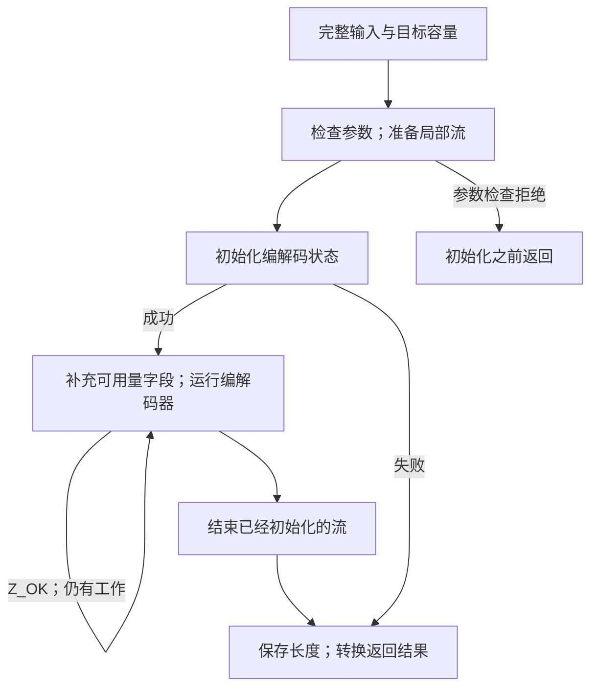

假设一条记录的八个字节 `ABABABAB` 已经全部在内存里。你要把完整压缩结果存入另一块内存，稍后还原，又不想在两次调用之间保存流对象。这时可以选择 `compress2_z` 和 `uncompress2_z`。前者接收完整源数据和可写目标区；后者接收完整的 **zlib 封装流**，目标容量由应用程序事先确定。它们返回后都不会留给调用者一个可以继续执行的编解码器。

## 压缩一条记录，再找到它的边界 {#example}

下面是针对固定版本头文件和库的完整应用程序，是教学代码，不是 zlib 源码节选。输入恰好八字节，不包含字符串结束符。压缩容量为 21，实际编码长度写回 `packed_len`。额外三个字节模拟外层记录的下一个字段。成功解码应还原八字节，并停在 `END` 之前。

```c
#include <string.h>
#include <zlib.h>

int main(void) {
    const unsigned char source[] = {'A','B','A','B','A','B','A','B'};
    unsigned char packed[24], restored[8];
    z_size_t packed_len = compressBound_z(sizeof source); /* 21 */
    int ret = compress2_z(packed, &packed_len, source, sizeof source,
                          Z_DEFAULT_COMPRESSION);
    if (ret != Z_OK) return 1;

    /* An enclosing record has three bytes after the zlib stream. */
    memcpy(packed + packed_len, "END", 3);
    z_size_t used = packed_len + 3, made = sizeof restored;
    ret = uncompress2_z(restored, &made, packed, &used);
    if (ret != Z_OK) return 1;
    return !(made == sizeof source && used == packed_len &&
             memcmp(restored, source, sizeof source) == 0 &&
             memcmp(packed + used, "END", 3) == 0);
}
```

三个数组分别承担不同工作：`source` 是原始记录，`packed` 保存压缩编码及后续字段，`restored` 接收解码结果。长度变量的单位都是字节，但调用前后含义会变化：`packed_len` 传入压缩容量、返回压缩大小；`used` 传入可用输入量、返回消费量；`made` 传入输出容量、返回产生量。

程序没有显式调用流结束函数，因为工具函数会结束自己创建的临时流。出错后直接返回，调用者的自动数组按普通 C 生命周期结束，不会遗留一个需要应用程序修复的库内流。例子特意让两个长度单元互相分离，也与输入、输出分离。长度单元就是 `used`、`made` 这样可由函数写回的变量。假如两个指针指向同一个变量，写回消费量就会覆盖输出容量或输出长度，两个结果无法分别保留；因此这些单元的分离是调用前提的一部分。

接下来沿这两次调用进入实现：容量为什么是 21，消费边界怎样计算，哪些失败可能已经产生输出。如果输入逐步到达，或者不知道解码后的大小，应选择[流式路线](/sample/interfaces.html)。[回调](/sample/callbacks.html)和 [gzip 句柄](/sample/gzip.html)解决其他 I/O 任务。

## 临时流 {#temporary-stream}

`compress2_z` 接收源字节、目标区、长度单元和压缩级别。进入时，`*destLen` 是可写容量；返回时，它通常记录已经产生的字节数。`Z_OK` 表示写出了一个完整的 **zlib 封装流**。`compress_z` 选择默认级别，普通名称 `compress` 和 `compress2` 则适配相应的 `uLong` 参数。



局部 `z_stream` 是 C 的自动存储。编解码器的内部状态另外分配，并在工具函数返回前释放。压缩失败时，调用者不会收到一个可以继续使用的半成品压缩器。如果需要自己控制继续执行，应选择流接口。

工具内部仍然可能有循环。整块缓冲区长度使用较宽的类型，`avail_in` 和 `avail_out` 却使用 `uInt`，在选定构建中是 32 位无符号整数，只记录当前片段的字节数量。工具把可以表示的片段填入可用量字段，另行保存较宽的剩余长度。因此，较大的输入不要求单个可用量字段容纳全部大小。循环需要在这些片段之间保持指针移动及消费、产生的准确计数。缓冲区工具的论证把分片循环的每一次指针更新、计数写回和错误清理连接起来，详见[缓冲区实现论证](/reference/docs/proof/buffers.html)。

例子中的八字节能放进一个 `uInt` 片段。该片段提供完毕后，较宽的 `sourceLen` 剩余量已经为零，所以下面这段真实的 [compress.c:60–65](https://github.com/madler/zlib/blob/757f0527154291bcf6bfbd6396ecde6bedd2db95/compress.c#L60-L65) 会选择 `Z_FINISH`：

```c
        err = deflate(&stream, sourceLen ? Z_NO_FLUSH : Z_FINISH);
    } while (err == Z_OK);

    *destLen = (z_size_t)(stream.next_out - dest);
    deflateEnd(&stream);
    return err == Z_STREAM_END ? Z_OK : err;
```

指针差写回后成为 `packed_len`；`deflateEnd` 释放内部状态；最后一行把编解码器的完成码转成工具函数的成功码。这段循环和清理说明，一次应用调用可以包含多次编解码调用，却不把继续执行的任务交给应用程序。

## 容量与整数位宽 {#capacity}

应用要预留多少目标空间？令 `n` 表示原始输入的字节数。`compressBound_z(n)` 在这个数量上增加编码开销的保守余量。下式的 `floor` 表示向下取整，`SIZE_MAX` 是大小类型 `z_size_t` 可以表示的最大数值，每一项的单位都是字节。默认缓冲区压缩器给出的数值是：

```text
min(SIZE_MAX, n + floor(n/4096) + floor(n/16384) + floor(n/33554432) + 13)
```

本例八字节对应的三个向下取整项都为零，结果为 `8 + 13 = 21`。24 字节数组为这 21 字节和后面的 `END` 预留了空间。调用者需要分配真实的可写存储，检查分配结果，再把容量填入长度单元。最终压缩长度可以显著小于上界。上界是在规定压缩配置下给出的容量保证，不是对编码器具体采用哪些匹配、哪一种块的预测。

在 `SIZE_MAX` 处饱和很重要：最大的输入值不应该让公式回绕成很小的结果。饱和后的数值也不意味着相应大小的缓冲区一定可以寻址。数值公式、调用者存储的存在，以及实际压缩结果放得下的结论，是三个需要分别回答的问题。[上界契约](/reference/functions/compressBound_z.html)说明了当前范围。

这些长度在 `_z` 形式中使用 `z_size_t`，在普通形式中使用 `uLong`。二者在选定的 LP64 构建中都是 64 位，但不能把这种巧合推广到所有平台。调用者要使用声明的长度类型，并避免在库看到数值之前就发生缩窄转换。已初始化压缩器采用其他封装或配置时，应查看 [deflateBound_z](/reference/functions/deflateBound_z.html)及其自己的条件。

## 消费量与部分结果 {#results}

`uncompress2_z` 使用两个长度单元：进入时分别表示可用输入和输出容量，初始化后的解码返回时则记录输入消费量和输出产生量。它解码第一个 zlib 流。若压缩流后面还有无关字节，成功解码会留下这些尾随输入，消费量可以指出它们的起点。`uncompress_z` 的源长度按值传入，因此不把这个边界返回给调用者。

工具函数把“尚未交给内部流的部分”与“当前片段里尚未用完的部分”分开计数。下面代码执行前，`len` 是尚未提供的输入字节数，`left` 是尚未提供的目标字节数。加上 `stream.avail_in`、`stream.avail_out`，才得到包含当前片段在内的全部未用量；从原始长度单元减去它们，就得到真实消费量与产生量。

边界计算就在 [uncompr.c:72–75](https://github.com/madler/zlib/blob/757f0527154291bcf6bfbd6396ecde6bedd2db95/uncompr.c#L72-L75)，以下逐字节选：

```c
    len += stream.avail_in;
    left += stream.avail_out;
    *sourceLen -= len;
    *destLen -= left;
```

`len` 合并尚未提供的输入与当前片段的未读后缀。本例后缀是 `END`，所以减去三个未用字节后，`used` 从 `packed_len + 3` 变为 `packed_len`。同样，减去未用目标空间得到 `made == 8`。代码计算真实的指针进展，不是搜索文本 `END`。

解码器不会根据压缩长度自动推算目标区的分配大小。很短的压缩输入也可能展开出很多数据。如果应用程序无法事先建立足够的目标容量，流接口可以让它有控制地接收连续输出块。

工具的结果转换也比“底层解码器报错了”更具体。完成时的 `Z_STREAM_END` 被转换为工具函数的成功码 `Z_OK`。字典请求被转换为 `Z_DATA_ERROR`，因为这一接口没有补充字典的步骤。输入耗尽而未能完成属于数据错误；输出容量耗尽则可能是 `Z_BUF_ERROR`。畸形、截断、无封装和 gzip 输入仍然属于这个只接收 zlib 流的便利解码器需要通过错误契约处理的情形。

把例子中的目标区改得小于八字节，同样的记账在失败时就很重要：已经写出的字节不会回滚。尤其是，解码器的分配失败可能发生在部分输出之后。成功初始化后，计数版本即使遇到这种较晚的失败，也会保存实际消费量和产生量。较早的参数拒绝或初始化失败则按规定保留传入的长度单元。[uncompress2_z 完整条目](/reference/functions/uncompress2_z.html)给出了检查顺序和零容量情形。

压缩工具写回长度的顺序不同。`compress2_z` 先检查一部分参数，再清零目标长度，然后初始化流。因此，错误级别和分配失败可能留下零长度，更早的参数拒绝则保留原值。普通 `compress2` 包装器在进入带检查的 `_z` 形式前，已经读取长度单元。一个入口允许为空的参数，不能直接推定在另一个入口也允许为空。应分别查看 [compress2_z](/reference/functions/compress2_z.html) 和 [compress2](/reference/functions/compress2.html)。

这些结果背后的生命周期规则很简单：成功初始化会产生一次结束义务，工具函数在返回前完成这项清理。调用者输入和无关存储保持不变，缓冲区及标量单元仍归调用者所有。长度单元要满足文档规定的分离条件；同时存在两个单元时，它们之间也需要分离。

## 库信息与接口类别 {#queries}

工具类别还包括几个小型查询。`zlibVersion` 返回借用的只读版本字符串，`zError` 返回结果码对应的借用只读文本；调用者不能修改或释放这些结果。选定契约把未知错误值映射为空文本。`zlibCompileFlags` 则报告类型大小及编译选项，其大小字段可以解释：一种长度转换为什么在某个 ABI 上可行，却不能自动视为可移植。

这些查询不创建压缩生命周期。它们与缓冲区工具一起列在[公开索引](/reference/api.html?group=utility)中。其余类别分别是压缩流、解压流、回调解码、校验和与 gzip 文件。这样的分类依据是应用程序需要管理的状态和协议，不必把全部入口挤进一张调用图。

这项记录任务的终点是：`restored` 保存八个字节，`used` 定位 `END`，临时编解码器已经释放。[缓冲区证明](/sample/interfaces-proof.html#buffers)沿内部循环、长度写回与清理，建立这三类观察之间的联系。输入来源或 I/O 控制方式改变时，再选择另一种[接口](/verification/interfaces.html#choices)：[回调解码](/sample/callbacks.html)主动索取裸 DEFLATE 片段，[gzip 句柄](/sample/gzip.html)管理文件。当前记录的解码不需要再经过它们。
