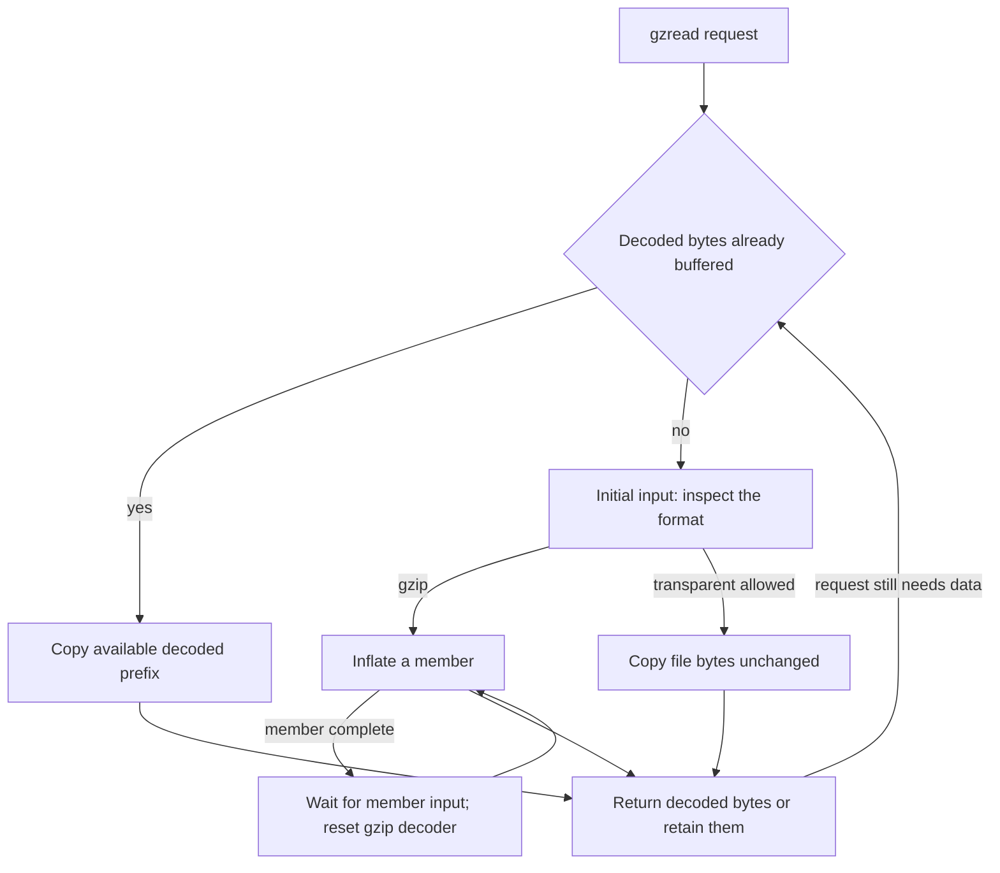
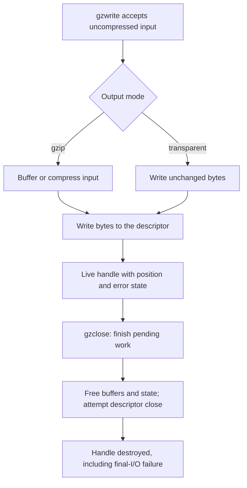

You have a file whose contents should appear to your application as ordinary bytes. It may be gzip-compressed, contain several concatenated gzip members, or be an uncompressed file. Choose the `gzFile` read interface to let zlib manage file reads, detection, buffering and decoding. Input is a path or descriptor; the output of `gzread` is uncompressed bytes in caller storage. Writing uses a separate write-mode handle and accepts uncompressed bytes for a gzip file.

The [wrapper mechanism](/sample/wrappers.html) still determines how encoded bytes become checked original data. A gzip handle adds file management around an ordinary internal stream: it refills compressed input, retains decoded bytes not yet requested, and tracks the position seen by the application. Compared with the [direct stream interface](/sample/interfaces.html), the caller supplies a file request rather than every codec buffer. This is one of the [interface choices](/verification/interfaces.html#choices), rather than another compression algorithm.

## Read a two-member file {#example}

Take a file containing `gzip("ABC")` followed immediately by `gzip("DEFG")`, with no separator. Each `gzip(...)` denotes a complete gzip member, including header and trailer. The logical output is seven bytes `ABCDEFG`. This complete teaching program reads a named blocking file in three-byte requests and writes the returned bytes to standard output. It checks the live handle's error before closing, then checks close itself.

```c
#include <stdio.h>
#include <zlib.h>

int main(int argc, char **argv) {
    if (argc != 2) return 1;
    gzFile file = gzopen(argv[1], "rb");
    if (file == NULL) return 1;
    int ok = gzbuffer(file, 16) == 0;
    unsigned char bytes[3];
    while (ok) {
        int n = gzread(file, bytes, sizeof bytes);
        if (n > 0) {
            if (fwrite(bytes, 1, (size_t)n, stdout) != (size_t)n)
                ok = 0;
            continue;
        }
        int code;
        const char *message = gzerror(file, &code);
        if (n < 0 || (code != Z_OK && code != Z_STREAM_END)) {
            fprintf(stderr, "%s\n", message);
            ok = 0;
        }
        break;
    }
    int closed = gzclose(file); /* file is no longer usable */
    return !(ok && closed == Z_OK);
}
```

On an ordinary successful run, the calls return `ABC`, `DEF`, `G`, then zero. The second request crosses the member boundary without an application reset. Reading a plain file containing `ABCDEFG` gives the same application bytes through the transparent path. These are two distinct input cases, not a rule that trailing bytes after a gzip member become transparent output.

A `gzFile` therefore manages more than a codec: descriptor ownership, unread compressed input, decoded output, logical position and error state. The following sections trace those responsibilities from opening to close. Their [proof obligations](/sample/interfaces-proof.html) require a file world as well as memory.

## Opening and lazy storage {#opening}

`gzopen` opens a path and creates handle state. `gzdopen` instead wraps an existing descriptor without duplicating it. A successful `gzdopen` transfers responsibility for closing that descriptor to the handle; pass a duplicate if another user must retain the original. Failure leaves descriptor ownership with the caller. The application must not independently move or close the descriptor while the handle owns it.

In the program, `gzbuffer(file, 16)` occurs immediately after opening because opening does no payload I/O. Buffer and codec allocation are deferred until first use or format inspection. The default requested buffer size is 8192 bytes. `gzbuffer` can change that request before buffers exist; its success does not guarantee that later allocation succeeds. It is already too late after an operation such as `gzdirect` has triggered allocation. “Query” is not necessarily synonymous with “no I/O.”

In the selected implementation, a reader uses an input buffer and a double-sized output buffer. A compressed writer uses a double-sized input buffer and an output buffer. Transparent writing does not need that codec output allocation. Each allocation and I/O path needs its failure-cleanup and ownership-transition result; see the [gzip implementation argument](/reference/docs/proof/gzip.html).

## Detection and read paths {#reading}

An ordinary reader can accept gzip or return uncompressed input transparently. Detection looks for a plausible four-byte gzip header, not just the first two magic bytes. Empty input is transparent; a forced-gzip mode has a different requirement. Short or temporarily unavailable input needs its own handling before the choice is settled.



Here `strm` is the handle's internal decoder stream. `next_in` points to its first unread compressed byte and `avail_in` counts readable bytes there; requiring more than three makes the four indexed reads possible. The handle's `how` field selects the reading route: `LOOK` means inspect the next member, `COPY` means transparent copying, and `GZIP` means decoding. Its `direct` flag records transparent mode; `junk` tracks the trailing-junk path.

The first member enters through this actual [gzread.c:158–166](https://github.com/madler/zlib/blob/757f0527154291bcf6bfbd6396ecde6bedd2db95/gzread.c#L158-L166) classifier:

```c
    if (strm->avail_in > 3 &&
            strm->next_in[0] == 31 && strm->next_in[1] == 139 &&
            strm->next_in[2] == 8 && strm->next_in[3] < 32) {
        inflateReset(strm);
        state->how = GZIP;
        state->junk = 0;
        state->direct = 0;
        return 0;
    }
```

The bytes checked are magic `1f 8b`, DEFLATE method `08`, and a flags byte with no reserved high bits. This chooses the gzip path; it does not validate the complete header or trailer. Plain `ABCDEFG` fails the classifier and enters `COPY` instead. For our second member, the earlier [lines 124–139](https://github.com/madler/zlib/blob/757f0527154291bcf6bfbd6396ecde6bedd2db95/gzread.c#L124-L139) take a different branch: wait for input if needed, reset `inflate`, and select `GZIP` directly. Preserve that distinction when reading the diagram.

The actual reader has three useful data paths: consume existing decoded bytes, copy transparent data directly into the caller's buffer, or inflate directly into a sufficiently large caller buffer. Direct paths avoid an extra copy through internal output storage. They also change which pointers can refer to caller memory, making lifetime reasoning more demanding.

Gzip members are concatenated in the logical output. If one member yields `ABC` and the next `DEFG`, the application reads `ABCDEFG`. A completed member returns to `LOOK`, but the subsequent-member branch is different from initial format detection: it waits for input when necessary, then resets the gzip decoder to attempt another member. It does not rerun the original four-byte classifier to choose transparent input. Ordinary reading has additional rules for trailing non-member bytes; it does not promise to pass arbitrary trailing junk through after gzip decoding. The [gzread contract](/reference/functions/gzread.html) and [format rules](/reference/docs/spec/api/gz-file.html) give the exact conditions.

`gzeof` records an attempted read beyond available data. It is not simply “the last byte was returned.” A zero result needs interpretation with `gzerror`: a complete end and truncated compressed data are different outcomes. Buffered bytes can remain deliverable before an existing error is reported. For item reads, `gzfread` returns complete item counts, while a final partial item can still have been consumed and written into the destination.

## Logical position and seeking {#position}

`gztell` reports the uncompressed logical position. `gzoffset` reports the compressed-file offset after accounting for buffered compressed input. Those numbers generally differ. Reading three decoded bytes can cause the handle to fetch many compressed bytes and even inspect later structures; neither buffer size nor compression ratio gives a fixed conversion between the positions.

Return to the program's two-member output `ABCDEFG`. After consuming `ABC`, logical position is 3. Requesting `gzseek(file, 5, SEEK_SET)` moves toward the location before `F`. A gzip reader may record a forward skip and perform its decompression during later I/O. The initial success of the seek therefore does not guarantee that the source actually contains enough valid data to fulfill that skip.

In this code, `pos` is the requested absolute position in uncompressed bytes. `offset` is the number of uncompressed bytes still to skip after any already-buffered output is used. Saving it in `state->skip` records work for a later read; it is not a compressed-file offset.

The actual seek implementation first consumes any usable buffered output, then records what remains in [`gzlib.c:426–438`](https://github.com/madler/zlib/blob/757f0527154291bcf6bfbd6396ecde6bedd2db95/gzlib.c#L426-L438):

```c
    state->skip = offset;
    return pos;
```

At logical position 3, a request for position 5 can consume buffered `DE`; any part not already buffered becomes `skip`. Both routes select the point before `F`. Returning `pos` reports the requested logical position while the remaining work may still be pending.

A backward compressed seek has another cost. Seeking from there to position 1 can require rewinding to the remembered file start and decoding forward again. There is no general compressed-byte offset for the second uncompressed byte that the library can calculate without decoding. A transparent reader can instead use a direct descriptor seek when permitted. Writing permits forward seeks by supplying zero bytes during later output, flush or close, and refuses backward seeks.

`SEEK_SET` measures the request from logical position zero; `SEEK_CUR` measures it from the current logical position. Those are the ordinary supported origins. `SEEK_END`, which would measure from the decoded end, is not supported. Position arithmetic must remain representable. Pushback can even create a negative logical position at the start. The [gzseek64 contract](/reference/functions/gzseek64.html) states the pushback and position-arithmetic conditions for that edge case. A successful seek request can leave deferred work, so a zero-length read or write is not a promise to execute it.

## Accepted writes and final cleanup {#writing}

Small writes can be copied into the handle's input buffer; larger ones can be compressed from caller storage directly. Transparent mode writes the bytes without gzip encoding. `gzwrite` normally reports accepted uncompressed bytes, not bytes safely delivered to a file. The handle can still contain input awaiting compression or compressed output awaiting a system write.



For a hard failure, a write can consume a prefix despite returning failure; zero is not always a safe offset from which to resend the whole request. A would-block stall can instead return a short accepted count, with its own retry protocol. Item writes likewise report complete items even when a partial item has been accepted. Read the specific [gzwrite](/reference/functions/gzwrite.html) or [gzfwrite](/reference/functions/gzfwrite.html) contract before deriving a retry loop.

The program reads `gzerror` before `gzclose` for a reason: check errors while the handle is live. `gzerror` returns text whose lifetime can end when a later operation replaces or clears the message. Writer close attempts pending zero fill and `Z_FINISH`, then releases storage and attempts descriptor close even if output failed. Reader close does not decode all remaining input to validate it. A close error does not keep a valid handle alive: do not retry close or ask `gzerror` through the destroyed handle.

A writer adds a finalization obligation that our read-only program does not have. The [actual writer-close body, gzwrite.c:715–734](https://github.com/madler/zlib/blob/757f0527154291bcf6bfbd6396ecde6bedd2db95/gzwrite.c#L715-L734), records zero-fill or finish failure and continues to free buffers, close the descriptor and free the handle. That ordering is why checking close is required after an apparently successful `gzwrite`, and why close cannot be retried through the same handle.

The two-member task ends when `ABC`, `DEF` and `G` have reached the application, its live error state has been checked, and close has destroyed the handle. [The file proof](/sample/interfaces-proof.html#files) must relate each returned prefix to buffered bytes, descriptor position and remaining resources. The public [gzip index](/reference/api.html?group=gz-file) gives the precise open, I/O, position, status and close contracts. The [external-I/O model](/reference/docs/design/external-io.html) defines the file behaviors represented by those formal arguments.
