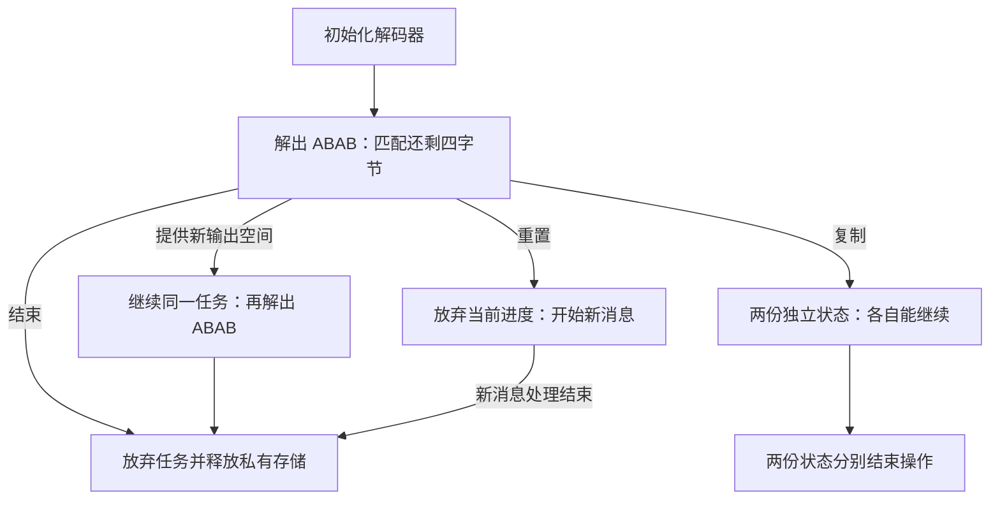

## 让算法拥有可用的状态 {#connection}

[流式调用](/verification/streaming.html)能够暂停后继续，是因为位缓冲、码表、未完成匹配和保留字节没有随着函数返回而消失。这些状态需要存储。初始化建立它们，调用持续使用它们，重置或复制改变任务的后续路线，结束操作最终释放它们。

沿用裸流 `73 74 82 40 00`，这次给四个输出位置。在第一次拿到 `ABAB` 时，匹配还剩四字节。应用现在有几种真正不同的选择：

图中的四字节检查点是五字节流式示例的一个变体。它让剩余结果也恰好是 `ABAB`。复制保存的是继续任务所需的状态，不会把已经交付的前缀重新输出。

## 先决定任务是否继续 {#operations}

更换缓冲区、重置和复制都可能保留某些内存，但含义不同。[状态操作](/sample/state-operations.html)从上面的检查点展开：普通重置让旧匹配字节失效；复制要保留当前进度，却把私有窗口和动态表放进独立存储。否则结束原流时，副本可能读到已经释放的表。

同一页再把这些操作接到两种外部上下文：预设字典提供尚未由输出产生的匹配来源，预置位和 gzip 元数据登记则与外层容器交接。它们都有自己的调用时机和借用存储要求，不能只按函数名归为“修改状态”。

## 继续执行所需的存储 {#allocation}

压缩器需要字节窗口、搜索索引和待发送存储，普通解码器则可以先只分配状态，等到需要跨调用保留输出时再分配窗口。[分配与释放](/sample/allocation.html)把这些用途对应到实际对象，随后展开失败路径。

一个具体例子是压缩器五次分配中的第三次失败：状态和窗口成功，前驱数组失败，后面的哈希头和待发送存储仍可能成功。清理必须释放四个成功对象。另一个例子来自解码：应用已经收到 `ABAB`，库随后才因保留窗口分配失败而返回 `Z_MEM_ERROR`。错误码既不保证“没有分配过”，也不保证“没有写出过字节”。

这也是优化与接口相遇的地方。延迟分配可以省掉一次窗口分配和复制；相应契约就必须准确说明，较晚失败时哪些数据已经交付、哪些资源仍可释放。

## 同时保持进度与所有权 {#guarantees}

[所有权与生命周期](/sample/ownership-proof.html)沿同一批对象展开证明思路。初始化要建立一个真实可用的流；每次合法调用要保持有效指针和允许写入范围；失败和结束操作要解释新增、保留、释放的每个对象。复制还必须同时保留相同进度和独立存储，只有其中一项正确都不够。

这里的证明关系并不替代算法内容：窗口有效，不等于它保存着正确的字节；表指针有效，也不等于它解出正确的符号。这两层分别接回[解码](/verification/decoding.html#guarantees)和[跨调用的正确性](/sample/stream-proof.html#continuation)。

使用入口的全部参数、返回和存储约定，可从[流 API](/reference/docs/spec/api/streams.html)进入。读取 `.gz` 文件时，[gzip 文件接口](/sample/gzip.html)还会在这些底层对象外管理文件缓冲和文件句柄。
