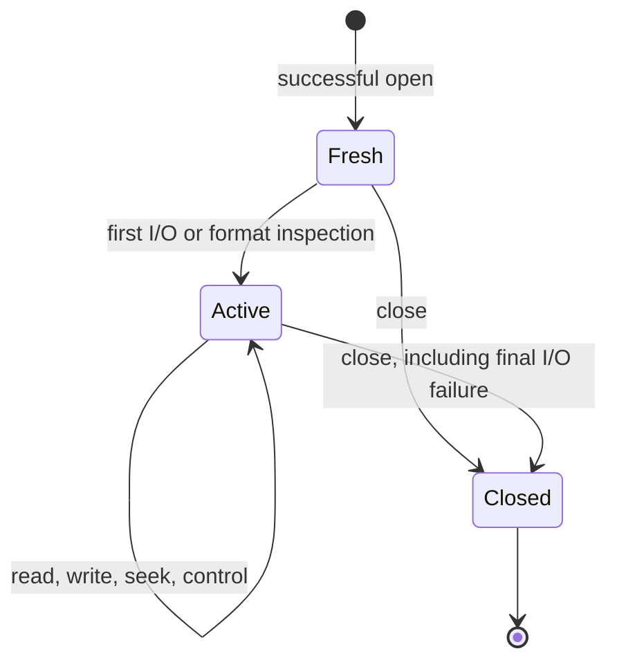

<!--
source: docs/api/gz-file.md
source-sha256: f74e6bb4fc4f09705278d33745a2ac5e2ca074f43845d12c94930cdb9d2c54cd
-->

# Gzip 文件

[API 手册](README.md) · [契约约定](contracts.md) · [流式压缩](deflate-stream.md) · [流式解压](inflate-stream.md)

使用 `gzFile` 句柄执行带缓冲的 gzip 文件 I/O。打开操作取得文件描述符和私有状态；
数据操作按需初始化缓冲区和编解码状态；即使最后的 I/O 失败，关闭操作也会释放句柄。
读取还可以接受透明模式下的未压缩输入。

| 任务 | 入口 |
| --- | --- |
| 打开或配置 | [打开路径](#gzopen)、[包装描述符](#gzdopen)、[缓冲区大小](#gzbuffer)、[压缩参数](#gzsetparams) |
| 读取 | [字节](#gzread)、[数据项](#gzfread)、[字符](#gzgetc)、[回推](#gzungetc)、[行](#gzgets) |
| 写入 | [字节](#gzwrite)、[数据项](#gzfwrite)、[字符](#gzputc)、[字符串](#gzputs)、[格式化文本](#gzprintf)、[刷新](#gzflush) |
| 定位 | [查找位置](#gzseek64)、[回到起点](#gzrewind)、[未压缩位置](#gztell64)、[文件偏移](#gzoffset64) |
| 检查或清除状态 | [EOF](#gzeof)、[透明模式](#gzdirect)、[错误](#gzerror)、[清除错误](#gzclearerr) |
| 关闭 | [任意模式](#gzclose)、[读取句柄](#gzclose_r)、[写入句柄](#gzclose_w) |

这些聚焦契约遵循固定版本的源码和 `zlib.h`。源码解释仍需由实现证明确认，即
**to confirm**。它们不声称完整 API 验证已经完成，也不缩小更广的
[已登记公开目标](../checking/goals.md)。证明状态和剩余工作见
[overview](../overview.md)。

## 句柄的共同条件

本页使用默认 x86_64 Linux 构建。`int` 和 `unsigned` 为 32 位。
`long`、`z_off_t`、`z_off64_t` 和 `z_size_t` 为 64 位。
大文件声明已启用。因此，普通入口和 `*64` 入口具有相同的偏移范围。
其他配置需要单独的契约。`gzopen_w` 仅适用于 Windows，在下文另行限定范围。

**Restricted domain**（受限定义域）指满足以下共同要求的通常用法：

- 非 NULL 句柄是活句柄，由成功的打开操作返回，并且尚未关闭。
  调用按顺序执行，调用者不修改其私有状态。
- 读取句柄或写入句柄具有该入口指定的访问模式。NULL 和模式错误的拒绝情况另行说明。
  失效指针或任意指针不在此定义域内；检查模式字段不能验证指针有效性。
- 缓冲区覆盖所请求的可读或可写范围，并与句柄拥有的内存分离。
  字符串具有可读的终止 NUL。调用者保留这些对象的所有权。
- 位置运算和所请求的范围能够由指定的 C 类型表示。
  下列契约仍包含明确的超大请求和乘法溢出拒绝情况。
- 描述符在关闭前归句柄所有。调用期间，没有其他操作改变它的数据或位置。
  操作系统失败和分配失败仍有可能发生；成功打开不保证后续 I/O 成功。

每个入口都标注定义域。“Full scalar range”（完整标量范围）仅适用于点名的标量参数，
仍受这些指针和生命周期要求约束。文档中的限制不能免除已知失败路径的义务。
尤其是部分读取错误，以及回推产生的负位置，仍属于未改变的公开目标需要覆盖的情况。

**Effects.** 读取、写入、打开、定位、控制和关闭操作都具有状态效果，
包括没有调用者输出缓冲区的操作。tell、offset 和 EOF 查询读取状态；
`gzerror` 还可能写入可选的错误码输出。`gzdirect` 可以读取文件并分配内存，因而具有状态效果。



**Format and buffering.** 打开时不进行载荷 I/O。缓冲区和编解码状态延迟分配，
默认请求的缓冲区大小为 8192 字节。分配可以在首次使用时失败，也可以在后续解压期间失败。
即使最后的 I/O 失败，关闭也会释放所拥有的分配。

普通读取句柄根据一个看似有效的四字节头部检测 gzip；否则原样返回输入。
空输入属于透明模式。若非阻塞输入在获得四字节前停滞，检测会等待。
gzip 成员的输出会拼接起来。尝试读取后续成员时，如果格式错误发生前没有产生输出，
则忽略尾随的非成员数据。`G` 要求 gzip；`T` 选择透明输出，不能用于读取。

**Read results.** 读取按消费的字节数推进未压缩位置，包括最后一个不完整数据项。
在报告已记录的错误之前，仍可先返回缓冲字节。`gzeof` 报告的是曾经尝试越过可用数据读取，
而不是仅仅交付了最后一个字节。`gzerror` 区分 EOF、损坏（`Z_DATA_ERROR`）、
截断（`Z_BUF_ERROR`）、分配失败（`Z_MEM_ERROR`）和系统失败（`Z_ERRNO`）。
零长度读取不消费输入，也不执行待处理的定位。

**Write results.** 成功表示句柄已经接受输入；数据仍可能留在缓冲区。
后续刷新或关闭仍可能失败。硬错误可能在消费一个前缀后返回失败；
返回值本身不总能作为重试偏移。非阻塞停滞则可以返回到目前为止消费的数量。

错误通常保持到被清除。已记录的 would-block 条件允许下一次数据 I/O 调用重试。
定位和回绕仍会拒绝这个已记录的 `Z_ERRNO`。构造错误消息本身也可能失败，
并把错误码替换为 `Z_MEM_ERROR`。`errno` 仅对相关的系统失败有意义，
不能作为每个失败 API 调用的一般解释。

源码位于 [gzlib.c](../../zlib/gzlib.c)、
[gzread.c](../../zlib/gzread.c)、[gzwrite.c](../../zlib/gzwrite.c)、
[gzclose.c](../../zlib/gzclose.c) 和 [zlib.h](../../zlib/zlib.h)。
抽象契约位于 [Api/Gz.lean](../../ZlibF/Spec/Api/Gz.lean)。
具体目标位于 [GzOpen](../../ZlibF/Spec/Public/GzOpen.lean)、
[GzRead](../../ZlibF/Spec/Public/GzRead.lean)、
[GzWrite](../../ZlibF/Spec/Public/GzWrite.lean)、
[GzControl](../../ZlibF/Spec/Public/GzControl.lean) 和
[GzClose](../../ZlibF/Spec/Public/GzClose.lean)。
翻译在 `ZlibF/Zlib/` 中保留相同的 C 名称。

## gzopen

```c
gzFile ZEXPORT gzopen(const char *path, const char *mode);
```

打开一个路径，用于读取、写入或追加。

**Domain:** 受限定义域：字符串和文件环境；模式解析包括无效字符串。
**Effect:** 具有状态效果的打开操作，并取得所有权。

**Pre:** 非 NULL 的 `path` 和 `mode` 是可读、以 NUL 终止的字符串。

**Post:** 非 NULL 结果拥有描述符、状态和复制的路径。
未压缩位置为零，错误已清除，缓冲区尚未分配。
读取会保存描述符的初始位置，用于回绕。写入会创建或截断文件；
追加则保留已有数据，并在写入时添加新成员。

**Errors and edges:** NULL 参数、分配失败、无效模式或操作系统打开失败均返回 NULL。
打开失败不留下任何拥有的分配或描述符。仅操作系统打开失败保证相关 `errno` 有意义。

最后出现的 `r`/`w`/`a`、级别数字和策略字母生效。`+` 被拒绝；没有访问字母也被拒绝。
数字 `0`–`9` 选择级别，`f`、`h`、`R`、`F` 选择策略。
最后出现的 `G`/`T` 生效：以 `T` 读取或以 `G` 写入均被拒绝。
`b` 和未知字母被忽略。`e`、`x`、`N` 在受支持时分别请求执行时关闭、独占创建和非阻塞模式；
`x` 对读取无效。打开不验证文件格式，也不分配 I/O 缓冲区。

## gzopen64

```c
gzFile ZEXPORT gzopen64(const char *path, const char *mode);
```

通过大文件入口打开。

**Domain:** 受限定义域，与 `gzopen` 相同。**Effect:** 具有状态效果的打开操作。

**Pre:** 满足 `gzopen` 的字符串和环境要求。

**Post:** 适用 `gzopen` 的契约，包括所有权、延迟分配和初始位置。
在本构建中，它的实现和偏移范围与 `gzopen` 一致。

**Errors and edges:** 同样适用 NULL、无效模式、分配和操作系统失败。
在公开头文件对该名称设置条件的构建中，需要启用相应的大文件声明。

## gzdopen

```c
gzFile ZEXPORT gzdopen(int fd, const char *mode);
```

包装已有描述符，不打开也不复制它。

**Domain:** 受限定义域：描述符使用；包含负描述符的拒绝情况。

**Effect:** 有状态的所有权转移，并可能改变描述符标志。

**Pre:** 通常成功要求 `fd` 已打开，且访问权限与模式匹配。
非 NULL 的 `mode` 满足 `gzopen` 的字符串要求。
句柄拥有该描述符期间，其他使用者不对它读取、写入、定位或关闭。

**Post:** 成功创建与 `gzopen` 相同的新状态，错误名称形式为 `<fd:N>`。
即使 `fd` 的位置不为零，未压缩位置也从零开始。关闭句柄会关闭 `fd`。
若原描述符必须保持打开，应传入其副本。

**Errors and edges:** 负 `fd`、无效/NULL 模式或分配失败返回 NULL，
描述符所有权仍归调用者。非负但已关闭或访问权限错误的描述符在此处不一定被拒绝；
后续 I/O 可能失败。`x` 不会对已有描述符执行独占创建或截断。
追加会尝试定位到末尾。`e`/`N` 尝试修改描述符标志；本入口不报告这些系统调用的失败。

## gzopen_w

```c
gzFile ZEXPORT gzopen_w(const wchar_t *path, const char *mode);
```

打开 Windows 宽字符路径。

**Domain:** 受限定义域：仅适用于 Windows `WIDECHAR` 构建，不在默认构建范围内。

**Effect:** 具有状态效果的打开操作。

**Pre:** 非 NULL 的 `path` 是可读、带终止符的宽字符串。
非 NULL 的 `mode` 满足 `gzopen` 的模式要求。Windows 文件环境可用。

**Post:** 使用宽路径打开，适用 `gzopen` 的生命周期、缓冲和模式契约。
诊断路径会转换到当前多字节区域设置；无法表示的名称可能变成空诊断名称。

**Errors and edges:** NULL、无效模式、分配失败和文件打开失败均返回 NULL。
Windows 和区域设置细节需单独确认，即 **to confirm**；
Linux 翻译和公开目标不确立此变体的行为。

## gzbuffer

```c
int ZEXPORT gzbuffer(gzFile file, unsigned size);
```

在缓冲区尚不存在时选择请求的缓冲区大小。

**Domain:** 受限定义域：活句柄；覆盖完整无符号 `size` 范围。

**Effect:** 有状态的缓冲配置，不分配缓冲区。

**Pre:** 活读取或写入句柄满足共同句柄要求。

**Post:** 缓冲区尚未分配且 `size < 2^31` 时，返回 0 并记录 `max(size, 8)`。
读取句柄随后需要一个输入缓冲区和一个两倍大小的输出缓冲区；
写入句柄需要一个两倍大小的输入缓冲区，以及 gzip 模式下的输出缓冲区。

**Errors and edges:** 对 NULL、缓冲区已分配、模式错误或 `size >= 2^31`，
返回 -1 且不改变请求。小尺寸被提升到八，而非二。
请求成功不保证后续分配成功。必须在 `gzdirect`、回推及普通 I/O 之前调用。

## gzsetparams

```c
int ZEXPORT gzsetparams(gzFile file, int level, int strategy);
```

为后续输入请求新的压缩级别和策略。

**Domain:** 受限定义域：gzip 写入句柄；通常级别为 -1 到 9，策略为
`Z_DEFAULT_STRATEGY` 到 `Z_FIXED`。**Effect:** 有状态的控制，并可能进行 I/O。

**Pre:** 活 gzip 写入句柄满足共同要求。透明写入句柄被拒绝。
已有硬错误通常会阻止此调用。

**Post:** 请求未改变时返回 `Z_OK`。新写入句柄记录请求，供延迟初始化使用。
活跃写入句柄先用旧参数处理待处理输入，再请求修改。待处理的定位可能写出零字节。

**Errors and edges:** NULL、读取句柄、透明写入句柄或待处理硬错误返回 `Z_STREAM_ERROR`。
定位/刷新失败返回已记录的错误。源码忽略 `deflateParams` 的返回值，
因此可能记录压缩器没有实际应用的参数后仍报告 `Z_OK`。
此行为需针对当前固定版本确认，即 **to confirm**，包括有效请求；
限制标量为有效值也不能消除它。此处并不一致地拒绝无效参数，
它们可能导致后续初始化失败被报告为 `Z_MEM_ERROR`。

## gzread

```c
int ZEXPORT gzread(gzFile file, voidp buf, unsigned len);
```

读取至多 `len` 个未压缩字节。

**Domain:** 受限定义域：读取句柄和目标；包含完整无符号 `len` 的拒绝范围。

**Effect:** 有状态的读取、目标写入，并可能分配内存。

**Pre:** 当 `len <= INT_MAX` 时，`buf` 按共同分离规则覆盖 `len` 个可写字节。
零范围不要求存在会被访问的字节。

**Post:** 正返回值 `n <= len` 给出接下来的 `n` 个字节，
并在执行待处理跳过后按 `n` 推进位置。格式、成员拼接、透明输入和延迟错误遵循共同读取规则。

**Errors and edges:** 对 NULL、错误模式、无法交付数据的硬错误或 `len > INT_MAX`，
返回 -1；超大请求记录 `Z_STREAM_ERROR`，除非需要保留更严重的错误。
EOF/截断且没有输出时返回零。零请求通常返回零，但已有错误/停滞状态仍可能导致 -1。
应检查 `gzerror`；截断是 `Z_BUF_ERROR`，不表示成功完成一个 gzip 成员。
后续错误不会抹去已经交付的字节。阻塞描述符可能等待内部读取填满。
非阻塞停滞可重试，不是 EOF。部分透明读取的恢复具有下文所列的已知
**to confirm** 注意事项；此处不作无条件安全声明。

## gzfread

```c
z_size_t ZEXPORT gzfread(voidp buf, z_size_t size, z_size_t nitems, gzFile file);
```

读取至多 `nitems` 个数据项，每项为 `size` 个未压缩字节。

**Domain:** 受限定义域：读取句柄/目标；覆盖完整标量尺寸，并拒绝溢出。

**Effect:** 有状态的读取和目标写入。

**Pre:** 乘积可表示时，`buf` 覆盖 `size * nitems` 个可写字节，满足共同分离规则。

**Post:** 返回读到的完整数据项数量。所有读到的字节都会被消费和写入，
包括未计入返回数量的最后一个不完整数据项。
适用共同读取行为以及 `gzread` 的恢复注意事项。

**Errors and edges:** `size` 或 `nitems` 为零时返回零，不消费输入。
乘积溢出时返回零并记录 `Z_STREAM_ERROR`，但保留先前的严重错误。
NULL、模式错误、EOF 和硬错误也可能返回零。
数据项数量不足时，需要用 `gzerror`/`gzeof` 区分原因；此处的总请求没有 `INT_MAX` 限制。

## gzgetc

```c
int ZEXPORT gzgetc(gzFile file);
```

读取一个未压缩字节，作为无符号值返回。

**Domain:** 受限定义域：读取句柄。**Effect:** 有状态的读取，并可能分配内存。

**Pre:** 满足共同读取句柄要求。

**Post:** 返回 0–255 范围内的值并消费一个字节，在待处理跳过之后将未压缩位置推进一。
它可以使用缓冲数据而不执行描述符 I/O。适用共同格式和延迟错误规则。

**Errors and edges:** 对 NULL、写入句柄、EOF 或无可用字节的错误，返回 -1。
`gzerror` 区分这些读取结果。字节 255 不是 EOF。
头文件可以提供修改同一句柄状态的宏快速路径；调用者不能把宏当作无状态查询。

## gzgetc_

```c
int ZEXPORT gzgetc_(gzFile file);
```

提供单字节读取的导出包装入口。

**Domain:** 受限定义域：读取句柄，与 `gzgetc` 相同。

**Effect:** 有状态的读取，并可能分配内存。

**Pre:** 满足 `gzgetc` 的句柄要求。

**Post:** 适用 `gzgetc` 的字节、位置、缓冲和格式契约。

**Errors and edges:** 对其 NULL/模式错误/EOF/错误情况返回 -1。
即使公开名称 `gzgetc` 展开为宏，这个包装入口也保有函数行为。

## gzungetc

```c
int ZEXPORT gzungetc(int c, gzFile file);
```

向读取句柄的未压缩输入回推一个字节。

**Domain:** 受限定义域：读取句柄；覆盖完整 `int c` 范围，包括拒绝负值。

**Effect:** 有状态的回推，可能检查输入、分配内存并跳过数据。

**Pre:** 满足共同读取句柄要求。打开后立即回推也被允许，因此逻辑位置可能变为负数。

**Post:** 成功时保存 `c` 的低八位，返回原始非负 `c`，将位置减一，并清除越过 EOF 标志。
回推字节按回推顺序的逆序读出。底层输入文件不被修改。

**Errors and edges:** 对 NULL、写入句柄、负 `c`、回推空间不足或设置/跳过失败，返回 -1。
在拒绝负 `c` 之前，可能已经执行初始检查和待处理跳过。
回推空间满时记录 `Z_DATA_ERROR`，除非需要保留严重错误。
已有分配空间时，读取错误后仍可能成功回推；它通常不清除该错误。
位置 -1 可以是成功状态，因此仅凭 tell 返回 -1 无法区分原因。
从这个状态定位仍有 **to confirm** 的源码注意事项；此处并不禁止该状态。

## gzgets

```c
char * ZEXPORT gzgets(gzFile file, char *buf, int len);
```

读取一段行内容，并用 NUL 终止。

**Domain:** 受限定义域：读取句柄/目标；包含完整 `int len` 的拒绝范围。

**Effect:** 有状态的读取和目标写入。

**Pre:** 对非 NULL 的 `buf` 和 `len > 0`，目标按共同分离规则覆盖 `len` 个可写字节。

**Post:** 返回 `buf`，其中包含至多 `len - 1` 个数据字节以及终止 NUL。
读到第一个换行后停止，换行包含在结果内；达到限制/EOF 时也停止。
消费的数据推进位置。输入中嵌入的 NUL 作为数据复制。

**Errors and edges:** NULL 句柄/缓冲区、模式错误或 `len < 1` 返回 NULL。
对更大的长度，EOF 且没有字节，或无法交付数据的错误，返回 NULL；
已经交付的前缀仍可能随已记录错误一同返回。
当 `len == 1` 时，其他条件被接受的调用不向 `buf` 复制任何输入字节，
并返回空字符串，即使已经 EOF 也是如此。待处理跳过先执行：
它可能消费输入、解压、分配、推进位置，或失败并返回 NULL。
适用共同的延迟错误和部分读取注意事项。

## gzwrite

```c
int ZEXPORT gzwrite(gzFile file, voidpc buf, unsigned len);
```

接受 `len` 个未压缩字节用于输出。

**Domain:** 受限定义域：写入句柄/源；包含完整无符号 `len` 的拒绝范围。

**Effect:** 有状态的写入、缓冲，并可能分配内存。

**Pre:** 当 `len <= INT_MAX` 时，`buf` 按共同分离规则覆盖 `len` 个可读字节。
选定的压缩参数有效。

**Post:** 通常返回 `len`，并在待处理补零定位之后，按接受的数量推进位置。
输出为 gzip，或者在 `T` 模式下为未改变的字节。
接受数据后仍可能把它留在缓冲区；仍然需要成功关闭。

**Errors and edges:** 对 NULL、读取句柄、硬错误、分配失败或系统写入失败，返回零。
`len > INT_MAX` 返回零并记录 `Z_DATA_ERROR`。
零请求不写入，也不执行待处理定位。硬失败即使返回零，也可能已消费一个前缀。
would-block 停滞可以返回少于请求的接受数量；处理停滞后重试未被接受的后缀。
仍适用共同的完成失败恢复注意事项。

## gzfwrite

```c
z_size_t ZEXPORT gzfwrite(voidpc buf, z_size_t size, z_size_t nitems, gzFile file);
```

接受至多 `nitems` 个数据项，每项为 `size` 个未压缩字节。

**Domain:** 受限定义域：写入句柄/源；覆盖完整标量尺寸，并拒绝溢出。

**Effect:** 有状态的写入和缓冲。

**Pre:** 乘积可表示时，`buf` 覆盖 `size * nitems` 个可读字节。
满足共同写入句柄要求和分离要求。

**Post:** 返回被接受的完整数据项数量。被接受的字节推进位置；
一个不完整数据项也可能被接受，但不计入返回数量。
输出格式和延迟 I/O 的含义与 `gzwrite` 相同。

**Errors and edges:** 任一因子为零时返回零，不执行数据 I/O 或待处理定位。
乘积溢出返回零并记录 `Z_STREAM_ERROR`。NULL、模式错误和硬失败也返回零。
不足的数据项数量可能隐藏已消费的不完整项，硬错误也可能隐藏已接受的前缀；
仅凭它无法计算安全的重试指针。应检查 `gzerror`。

## gzputc

```c
int ZEXPORT gzputc(gzFile file, int c);
```

接受 `c` 的低八位用于输出。

**Domain:** 受限定义域：写入句柄；覆盖完整 `int c` 范围。

**Effect:** 有状态的写入，并可能分配内存。

**Pre:** 满足共同写入句柄要求，压缩参数有效。

**Post:** 在执行待处理补零定位后，返回 `c & 0xff`，接受一个字节并将位置推进一。
该字节可以留在缓冲区。

**Errors and edges:** 对 NULL、读取句柄、待处理硬错误或分配/定位/写入失败，返回 -1。
负 `c` 被转换为字节，不按 EOF 处理。失败调用仍可能在待处理工作期间改变输出或位置。
应检查关闭结果，以发现延迟输出失败。

## gzputs

```c
int ZEXPORT gzputs(gzFile file, const char *s);
```

接受以 NUL 终止的字符串，但不包括其终止符。

**Domain:** 受限定义域：写入句柄和可读字符串。

**Effect:** 有状态的写入，并可能分配内存。

**Pre:** `s` 是可读、以 NUL 终止的字符串，与所拥有的状态分离。
满足共同写入句柄要求，压缩参数有效。

**Post:** 返回被接受的字节数，通常为 `strlen(s)`，不写出 NUL。
在待处理补零定位后，按被接受的字节数推进位置。
空字符串返回零，不执行数据 I/O。

**Errors and edges:** 对 NULL 句柄、读取句柄、硬错误、长于 `INT_MAX` 的字符串，
或报告零的非空写入，返回 -1。超大字符串记录 `Z_STREAM_ERROR`。
非阻塞停滞可能返回正的短计数。硬失败可能在返回 -1 前消费字节；
该计数不是通用重试偏移。NULL `s` 不在字符串定义域内。

## gzprintf

```c
int ZEXPORTVA gzprintf(gzFile file, const char *format, ...);
```

格式化参数，并接受结果字节用于输出。

**Domain:** 受限定义域：写入句柄，以及类型正确的 C 格式化参数。

**Effect:** 有状态的格式化写入、分配和格式化器效果。

**Pre:** `format` 是可读、带终止符的字符串。参数类型符合每个转换的要求；
被引用的对象有效。外部格式化遵循平台的 `vsnprintf` 语义。
所有 `%n` 目标均可写，满足相应分离要求，并属于允许的调用者可见效果。
压缩参数有效。

**Post:** 对所构造的参数列表，适用 `gzvprintf` 契约。
正结果计算被接受的格式化字节数，并推进未压缩位置。不输出终止 NUL。
格式化是对外部库的假设，不是 zlib 的定理。

**Errors and edges:** NULL、读取句柄或待处理硬错误返回 `Z_STREAM_ERROR`，而不是零。
空的或超大的格式化输出返回零。分配、待处理定位和 I/O 可以在格式化之前或之后失败；
参见 `gzvprintf`。默认每次调用的格式化字节数必须小于 8192，限制随 `gzbuffer` 改变。
非可变参数的旧式构建不在此契约范围内。

## gzvprintf

```c
int ZEXPORTVA gzvprintf(gzFile file, const char *format, va_list va);
```

格式化一个 `va_list`，并接受结果用于输出。

**Domain:** 受限定义域：写入句柄、有效参数列表和外部格式化。

**Effect:** 有状态的格式化写入，并可能产生格式化器的内存效果。

**Pre:** 满足 `gzprintf` 的格式、参数和分离要求。
`va` 已为这些参数初始化；其使用遵循平台的 `va_list` 生命周期和复制规则。

**Post:** 正结果是不包括终止 NUL 的被接受格式化字节数。
位置相应推进，数据仍可能留在缓冲区。格式化长度必须严格小于所配置的缓冲区大小。
之前待处理的定位可以在任何格式化输出被接受之前先输出零字节。

**Errors and edges:** NULL、模式错误或待处理硬错误返回 `Z_STREAM_ERROR`。
初始化、跳过或写入失败返回相应错误码。空输出、格式化器失败或输出放不下时返回零；
此零值不一定记录错误，之前的待处理 I/O 也可能已经发生。
若这次格式化调用必须重试，非阻塞停滞可以返回 `Z_BUF_ERROR`。
不能从负结果推断状态没有变化。没有安全有界格式化的构建可以提供拒绝桩函数，
或另行限定范围的不安全实现；两者都不属于此默认契约。

## gzflush

```c
int ZEXPORT gzflush(gzFile file, int flush);
```

使用请求的刷新模式处理缓冲输出。

**Domain:** 受限定义域：写入句柄；包含完整 `int flush` 的拒绝范围。

**Effect:** 有状态的输出，可能分配内存，并执行待处理补零。

**Pre:** 满足共同写入句柄要求，压缩参数有效。
通常刷新模式从 `Z_NO_FLUSH` 到 `Z_FINISH`。

**Post:** 请求工作成功时返回 `Z_OK`。`Z_SYNC_FLUSH` 使待处理数据可供读取者获得；
`Z_FINISH` 完成一个 gzip 成员。之后成功写入可以开始另一个成员。
`T` 写出缓冲字节，不附加 gzip 尾部。句柄仍然存活，仍须关闭。

**Errors and edges:** NULL、读取句柄、待处理硬错误，或 0–`Z_FINISH` 范围外的刷新值，
返回 `Z_STREAM_ERROR`。分配、定位补零和系统写入失败返回已记录的错误码。
有效写入句柄在验证 `flush` 之前先清除可重试错误，因此无效刷新不总是保持状态的拒绝。
失败的 `Z_FINISH` 不代表已完成成员；仅清除错误，不能据此把恢复视作新的输出。
参见下方注意事项。

## gzrewind

```c
int ZEXPORT gzrewind(gzFile file);
```

将读取句柄重置到所保存的描述符起点。

**Domain:** 受限定义域：读取句柄和描述符环境。

**Effect:** 有状态的定位和读取句柄重置。

**Pre:** 活读取句柄满足共同要求。成功要求其描述符可以定位。
`Z_OK` 和 `Z_BUF_ERROR` 允许此操作。

**Post:** 返回 0，将未压缩位置设为零，丢弃缓冲输入/输出和待处理跳过，
清除错误/EOF，并重新开始格式检查。已有缓冲区继续保持分配，归句柄所有。

**Errors and edges:** 对 NULL、写入句柄、已记录的严重错误或系统定位失败，返回 -1。
管道通常不能回绕。`gzdopen` 读取句柄回到其初始描述符偏移，
不一定是物理文件偏移零。它并非在所有模式下都可与 `gzseek(file, 0, SEEK_SET)` 互换。

## gzseek64

```c
z_off64_t ZEXPORT gzseek64(gzFile file, z_off64_t offset, int whence);
```

请求相对于起点或当前位置的未压缩位置。

**Domain:** 受限定义域：活读取/写入句柄；完整偏移范围需要源码范围检查，
包括回推产生的负位置。

**Effect:** 有状态的定位、缓冲区丢弃，并可能立即执行描述符 I/O。

**Pre:** 满足共同要求。通常起点选择为 `SEEK_SET` 和 `SEEK_CUR`。
`Z_OK` 和 `Z_BUF_ERROR` 允许此操作。

**Post:** 非负结果是请求的未压缩位置。透明读取句柄可以立即定位描述符。
gzip 读取句柄在需要时回绕，并把其余向前移动延迟到后续解压。
写入句柄允许向前移动，由后续输出、刷新或关闭补上零字节。
因此成功的请求仍可能在后续 I/O 期间失败。

**Errors and edges:** 对 NULL、无效起点（包括 `SEEK_END`）、硬错误、目标早于起点、
目标超出范围、写入句柄向后定位，或必需的回绕/系统定位失败，返回 -1。
定位可以立即消费缓冲字节。定位到输入 EOF 之后最初可能成功；
后续读取才发现实际末尾。读取越过 EOF 后，tell 不计入尚未完成的跳过。
负位置溢出检查仍为 **to confirm**；不会为了隐藏这个源码问题而排除起点之前的回推。
此文档契约不声称完整范围安全结果。

## gzseek

```c
z_off_t ZEXPORT gzseek(gzFile file, z_off_t offset, int whence);
```

通过普通偏移类型请求未压缩位置。

**Domain:** 受限定义域，与 `gzseek64` 相同。

**Effect:** 有状态的定位，并可能执行描述符 I/O。

**Pre:** 满足 `gzseek64` 的句柄、起点和环境要求。

**Post:** 适用 `gzseek64` 的位置、延迟跳过、补零和缓冲契约。
结果转换为 `z_off_t`。

**Errors and edges:** 适用相同的拒绝情况和负位置注意事项。
在较窄类型的构建中，结果超出 `z_off_t` 时返回 -1；
默认 LP64 构建的有符号 64 位范围与 `gzseek64` 相同。

## gztell64

```c
z_off64_t ZEXPORT gztell64(gzFile file);
```

查询当前逻辑未压缩位置。

**Domain:** 受限定义域：活读取/写入句柄。

**Effect:** 只读句柄查询；没有描述符 I/O。

**Pre:** 满足共同句柄要求，报告的和可以表示。

**Post:** 返回已消费/已接受的位置加上待处理的向前跳过，
但读取已经越过 EOF 后，不计入待处理跳过。不执行待处理定位或刷新。
句柄及其分配保持不变。

**Errors and edges:** NULL 或模式错误返回 -1。起点之前的回推可以让 -1 成为真实位置。
先前接受的超 EOF 定位可能在后续读取发现实际末尾之前就在此报告。
物理压缩文件偏移是另一个量，通过 `gzoffset64` 查询。

## gztell

```c
z_off_t ZEXPORT gztell(gzFile file);
```

使用 `z_off_t` 查询逻辑未压缩位置。

**Domain:** 受限定义域，与 `gztell64` 相同。

**Effect:** 只读句柄查询。

**Pre:** 满足 `gztell64` 的句柄和可表示性要求。

**Post:** 返回转换为 `z_off_t` 的 `gztell64` 结果，
不执行待处理工作，也不改变句柄。

**Errors and edges:** NULL/模式错误与位置 -1 的歧义和 `gztell64` 相同。
较窄类型的构建对无法表示的结果返回 -1；默认 LP64 构建不会发生这项额外的窄化。

## gzoffset64

```c
z_off64_t ZEXPORT gzoffset64(gzFile file);
```

查询底层物理文件偏移。

**Domain:** 受限定义域：活读取/写入句柄和描述符环境。

**Effect:** 只读句柄查询和系统位置查询；`errno` 可能改变。

**Pre:** 满足共同要求。成功时的偏移运算能够表示。

**Post:** 返回描述符当前位置，减去读取句柄持有的未使用压缩输入。
不刷新写入句柄的缓冲数据，也不执行待处理逻辑定位。不改变描述符位置。

**Errors and edges:** 对 NULL、模式错误或系统查询失败（包括不可定位的描述符），返回 -1。
它不同于未压缩位置。透明读取句柄的未读输出缓冲区不被减去，
所以结果可能领先于已经交付的字节。它包含 `gzdopen` 句柄初始偏移之前的已有前缀。

## gzoffset

```c
z_off_t ZEXPORT gzoffset(gzFile file);
```

使用 `z_off_t` 查询物理文件偏移。

**Domain:** 受限定义域，与 `gzoffset64` 相同。

**Effect:** 只读句柄查询和系统位置查询。

**Pre:** 满足 `gzoffset64` 的句柄、环境和运算要求。

**Post:** 将其物理偏移转换为 `z_off_t` 返回，采用相同的缓冲处理，且不移动描述符。

**Errors and edges:** 相同的 NULL、模式错误和系统查询失败均返回 -1。
在较窄类型的构建中，超出 `z_off_t` 的结果也返回 -1；默认构建的偏移范围没有这项窄化。

## gzeof

```c
int ZEXPORT gzeof(gzFile file);
```

查询读取句柄是否曾尝试越过可用数据读取。

**Domain:** 受限定义域：活句柄，包含 NULL 拒绝情况。

**Effect:** 只读句柄查询。

**Pre:** 非 NULL 句柄满足共同要求。

**Post:** 返回读取句柄的越过 EOF 标志；对写入句柄返回零。
不读取文件，不分配，不刷新，也不改变状态。

**Errors and edges:** NULL 返回零。消费最后一个字节不一定设置该标志。
零结果不能排除读取错误或非阻塞停滞。使用 `gzerror` 区分这些情况。
成功回推和清除错误会清除越过 EOF 标志；后续读取可以再次设置它。

## gzdirect

```c
int ZEXPORT gzdirect(gzFile file);
```

报告句柄是否正在使用透明数据。

**Domain:** 受限定义域：活读取/写入句柄。

**Effect:** 有状态的格式检查；可能分配、读取并记录错误。

**Pre:** 满足共同句柄要求。如需指定缓冲区大小，应先设置。

**Post:** 当结果模式为透明时恰好返回 1，否则返回零。
新的普通读取句柄可以检查输入来决定模式。写入句柄报告是否选用了 `T`。
检查可以把待处理跳过应用于新缓冲的透明字节；它不向调用者交付数据。

**Errors and edges:** NULL 返回零。普通空输入属于透明模式。
`G` 读取句柄报告零。格式检查可能因分配或 I/O 失败而记录错误；
返回的模式标志本身不报告该失败。非阻塞输入可能让检测保持未完成。
需要时应检查 `gzerror`。

## gzerror

```c
const char * ZEXPORT gzerror(gzFile file, int *errnum);
```

读取句柄当前的错误码和消息。

**Domain:** 受限定义域：活句柄，以及可选的可写错误码输出。

**Effect:** 只读句柄查询；提供 `errnum` 时写入 `*errnum`。

**Pre:** 非 NULL 的 `errnum` 指向可写 `int`，与所拥有的状态分离。
满足共同句柄要求。

**Post:** `errnum` 非 NULL 时保存当前错误码。返回借用的消息指针：
没有消息时为空字符串，`Z_MEM_ERROR` 时为静态 `"out of memory"`，
否则为所拥有的诊断字符串。不分配内存，句柄状态不变。

**Errors and edges:** NULL 句柄返回 NULL，不写入 `errnum`。
调用者不能释放或修改返回字符串。错误变化、`gzclearerr` 或关闭可能使所拥有的消息失效；
如需保留，应在此之前复制。关闭后不能执行此查询，包括最后关闭失败之后。

## gzclearerr

```c
void ZEXPORT gzclearerr(gzFile file);
```

清除已记录错误信息，并重新启用读取句柄的 EOF 检测。

**Domain:** 受限定义域：活句柄，包含 NULL 无操作。

**Effect:** 有状态的错误重置，并可能释放消息。

**Pre:** 非 NULL 句柄满足共同要求。

**Post:** 把错误设为 `Z_OK`，移除旧诊断消息。
对读取句柄，清除输入 EOF 和越过 EOF 标志。保留位置、待处理跳过、缓冲数据和编解码状态；
不读取或写入文件。

**Errors and edges:** NULL 是无操作。清除错误不会修复文件，也不保证重试成功。
它允许再次尝试读取正在增长的文件。借用消息可能失效。
完成失败后的恢复和先前部分读取后的恢复仍为 **to confirm**，本次重置不能解决它们。

## gzclose

```c
int ZEXPORT gzclose(gzFile file);
```

关闭读取句柄，或完成输出并关闭写入句柄。

**Domain:** 受限定义域：活句柄，恰好关闭一次。

**Effect:** 有状态的最终 I/O、释放和描述符关闭。

**Pre:** 满足共同句柄要求。此后不再用该句柄调用任何操作。

**Post:** 分派到 `gzclose_r` 或 `gzclose_w`。
有效句柄被销毁，其拥有的存储被释放，并尝试关闭其描述符。
关闭写入句柄还会尝试待处理补零，以及完成缓冲输出。

**Errors and edges:** NULL 返回 `Z_STREAM_ERROR`。适用下列与模式相关的结果。
最终 I/O 错误不会让有效句柄继续存活：不能重试关闭，也不能随后查询其错误。
模式错误的拒绝不同于有效写入句柄的最终处理失败；后者也可能在销毁句柄后报告 `Z_STREAM_ERROR`。

## gzclose_r

```c
int ZEXPORT gzclose_r(gzFile file);
```

释放读取句柄并关闭其描述符，不再执行解压。

**Domain:** 受限定义域：读取句柄；包含 NULL 和写入句柄的拒绝情况。

**Effect:** 有状态的释放和描述符关闭。

**Pre:** 活读取句柄满足共同要求，且恰好关闭一次。

**Post:** 结束已分配的 inflate 状态，释放所拥有的缓冲区/消息/路径及状态，
并尝试关闭描述符。即使描述符关闭失败，句柄也被销毁。

**Errors and edges:** 通常返回 `Z_OK`；若关闭时记录的错误为截断，则返回 `Z_BUF_ERROR`。
描述符关闭失败返回 `Z_ERRNO`，并优先于其他结果。
不返回其他早先读取错误：应在关闭前检查 `gzerror`。
NULL 或写入句柄返回 `Z_STREAM_ERROR`，不关闭或释放该写入句柄。
不会进行最后一次读取来验证尚未消费的输入。

## gzclose_w

```c
int ZEXPORT gzclose_w(gzFile file);
```

完成缓冲输出，释放写入句柄，并关闭其描述符。

**Domain:** 受限定义域：写入句柄；包含 NULL 和读取句柄的拒绝情况。

**Effect:** 有状态的输出，可能分配内存，并释放内存和关闭描述符。

**Pre:** 活写入句柄满足共同要求，且恰好关闭一次。

**Post:** 尝试待处理补零和 `Z_FINISH`，随后释放所拥有的编解码状态、
缓冲区/消息/路径及句柄，并尝试关闭描述符。即使输出失败也执行此清理。
未使用的 gzip 写入句柄通常发出一个空成员；未使用的透明写入句柄不发出载荷。

**Errors and edges:** 最终工作成功时返回 `Z_OK`。定位补零或完成失败返回相应错误，
包括 `Z_MEM_ERROR`、`Z_ERRNO` 或 `Z_STREAM_ERROR`；
描述符关闭失败以 `Z_ERRNO` 优先。最终工作成功时，不会自动返回较早的错误。
NULL 或读取句柄返回 `Z_STREAM_ERROR`，不销毁该读取句柄。
有效写入句柄即使结果是 `Z_STREAM_ERROR` 也会被销毁。
关闭成功不能解决下方完成失败恢复的注意事项。

## 范围和源码注意事项

文档中给出错误码，本身不能确立重试或恢复安全。
上面受影响的入口保留了关于部分读取错误、回推后的负位置、参数改变和完成失败的源码注意事项。
这些情况仍为 **to confirm**；本手册不会把它们排除在更广目标之外，也不确认新的上游缺陷。
当前证据和剩余工作记录在 [overview](../overview.md)。
按 [safety](../safety.md) 的指针和初始化规则，
初始或已耗尽的缓冲指针及其零偏移运算也仍为 **to confirm**。

差分测试提供翻译忠实性的证据，不是证明。私有辅助函数、旧式固定参数 `gzprintf`，
以及 Windows 错误字符串辅助函数，在此没有额外的公开入口。
函数条目之前已链接源码文件和具体目标。

[返回 API 手册](README.md) · [契约约定](contracts.md)
