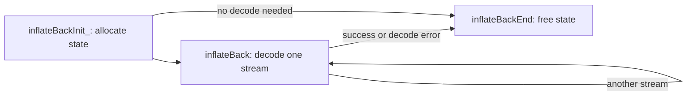

<!--
source: docs/api/inflate-back.md
source-sha256: 26c77c3853a8d02c5f9966fa7df0eedfe25e1138120b4bd3532fdc4943a976f2
-->

# 回调解压

[API 手册](README.md) · [流的共同规则](streams.md) · [流式解压](inflate-stream.md)

回调接口让调用者分块提供输入，并直接从窗口接收解压输出。
先用 [inflateBackInit_](#inflatebackinit_) 初始化，再用
[inflateBack](#inflateback) 解码，最后用 [inflateBackEnd](#inflatebackend) 释放状态。
整个过程中，窗口始终归调用者所有。

这些专项契约依据所固定的 [infback.c](../../zlib/infback.c) 和
[zlib.h](../../zlib/zlib.h)，针对默认 LP64 Linux 构建。对源码行为的解读仍需证明，标为 **to confirm**。
这些受限定义域不缩小 [Back.lean](../../ZlibF/Spec/Public/Back.lean) 或
[Sequences.lean](../../ZlibF/Spec/Public/Sequences.lean) 中更广的目标。
定义域和效果标签见[契约约定](contracts.md)；证明状态和剩余工作见
[overview](../overview.md)。

`inflateBack` 解码 raw DEFLATE。任何 zlib/gzip 头部、尾部和校验值都由调用者处理。
调用者拥有至少 `2^windowBits` 字节的可写窗口；该窗口同时也是输出缓冲区。
处理一般流时使用 15 位和 32768 字节；较小窗口可能拒绝包含合法长距离的流。



回调具有以下类型：

```c
typedef unsigned (*in_func)(void FAR *, z_const unsigned char FAR * FAR *);
typedef int (*out_func)(void FAR *, unsigned char FAR *, unsigned);
```

`in(in_desc, &buf)` 返回字节数，并设置 `buf`；返回零表示没有输入，此时忽略 `buf`。
`out(out_desc, buf, len)` 接收至多一个窗口的字节；返回零表示成功。
如果回调支持 NULL 值，描述符就可以是 NULL。

## inflateBackInit_

```c
int ZEXPORT inflateBackInit_(z_streamp strm, int windowBits, unsigned char FAR *window,
                             const char *version, int stream_size);
```

**Purpose.** 分配解码器状态，并关联调用者的窗口。
`inflateBackInit` 宏提供 `version` 和 `stream_size`。

**Domain.** 受限定义域：有效的调用者内存、非活动流和默认分配。

**Pre.** 非 NULL 的 `strm` 指向可写 `z_stream`，其中 `zalloc`、`zfree`
和 `opaque` 已初始化。使用 NULL 或默认的分配/释放函数对；不得覆盖仍然活跃的库状态。
非 NULL 的 `version` 的首字节可读。在初始化路径上，`window` 提供
`2^windowBits` 个可写字节，且与流分离。该切片必须保持存活，直至结束。

**Effects.** 可能初始化分配器字段和 `opaque`、清空 `msg`，并分配一个状态对象。
窗口仍归调用者所有；此处不分配、不清空、也不释放窗口。

**Post.** `Z_OK` 为 `inflateBack` 关联新的状态，且 `8 <= windowBits <= 15`。
输入/输出指针、可用量计数器、总计数、`adler` 和 `data_type` 保持不变。
只有选定的状态字段被初始化；应将此状态用于回调 API。

**Errors.** NULL 版本指针、不同的主版本首字节或错误的流大小，会在访问流之前返回
`Z_VERSION_ERROR`。NULL `strm`/`window` 或 8..15 之外的位数，返回
`Z_STREAM_ERROR`。分配失败返回 `Z_MEM_ERROR`：`msg` 和分配器默认值可能
已经改变，但保留原来的 `state` 字段。由于未分配状态，在这一非活动流定义域内，
初始化失败后不需要调用 end。

## inflateBack

```c
int ZEXPORT inflateBack(z_streamp strm, in_func in, void FAR *in_desc,
                        out_func out, void FAR *out_desc);
```

**Purpose.** 通过输入和输出回调，解码一个完整的 raw 流。

**Domain.** 受限定义域：活跃的回调解码器、有效且分离的切片，以及输入总量有限、
每次都会返回的回调协议。任意畸形输入字节也在定义域内。

**Pre.** 初始化成功，且尚未执行 end。流、状态和窗口保持存活。
初始化 `next_in`；NULL 表示立即请求回调输入，并忽略 `avail_in`。
否则需初始化 `avail_in`，并在 `next_in` 提供相应数量的可读字节。
初始输入切片和回调提供的输入切片均不得与窗口、流或私有状态重叠。
两个回调都不能是 NULL。每个回调都安全返回，且提供的输入总量有界。

回调只能读取提供给它们的输入/输出字节及其自己的有效对象。
它们可以更新、分配或释放自己的内存，但必须保持流、私有状态和窗口切片不变。
一个输入块必须保持可读且内容不变，直至下一次输入回调或函数返回；输出回调发生期间也一样。
输出回调最多读取窗口中的 `len` 个字节。
当实际使用的字节切片不重叠时，回调存储和窗口可以共享一次分配。
不允许并发或重入访问此流。

**Effects.** 为新流重置解码，消费输入，写入窗口，并调用回调。
完整窗口以及最后一个非空的部分窗口都会交给 `out`，即使发生错误也是如此。
因此，回调可能先观察到输出，之后才发生格式或输入失败。
库本身不分配也不释放任何内存；回调中的分配仍由调用者负责。

**Post.** `Z_STREAM_END` 表示完整 raw 流已解码，并且每次输出调用都成功。
各输出块拼接后得到该流的未压缩字节，不含预设字典。
`next_in`/`avail_in` 标识初始输入块或最后一个回调块中尚未读取的后缀。
输入耗尽后，它们为 NULL/零；否则指针按已消费字节数前移。
总计数、`adler` 和 `data_type` 保持不变；`next_out`/`avail_out` 不是这里的输出接口。
流保留其状态和窗口，可以再解码另一个独立流，也可以结束。

**Errors.** `Z_BUF_ERROR` 表示输入耗尽或输出回调返回非零；该函数从不返回 `Z_OK`。
对于 `Z_BUF_ERROR`，NULL `next_in` 表示输入耗尽；非 NULL 则表示输出失败。
`Z_DATA_ERROR` 表示 DEFLATE 畸形，并设置 `msg`。最后一次输出失败会把
`Z_STREAM_END` 改为 `Z_BUF_ERROR`；它不会替换已经选定的其他错误。
NULL `strm` 或 NULL 状态返回 `Z_STREAM_ERROR`，不调用回调。其他无效状态在
本定义域之外：普通 `inflateInit_` 创建的状态不是回调解码器。
解码错误后，end 仍会释放状态；再次调用则从一个新流开始。

## inflateBackEnd

```c
int ZEXPORT inflateBackEnd(z_streamp strm);
```

**Purpose.** 释放回调初始化所分配的状态。

**Domain.** 受限定义域：具有有效默认释放函数的活跃回调解码器，以及显式检查的
NULL 流、NULL 状态和 NULL 释放函数拒绝情形。

**Pre.** 对于清理路径，初始化成功，尚未执行 end，并且没有解码或回调正在运行。
流和关联状态仍然有效；保留匹配的 `zfree` 和 `opaque`。
成功解码后以及任何解码错误后，都允许清理。

**Effects.** 恰好释放内部状态，并清空 `state`。

**Post.** `Z_OK` 使 `state` 为 NULL。调用者的窗口及其他所有流字段保持不变。
调用者现在可以释放或复用其窗口；库从不释放它。

**Errors.** NULL `strm`、NULL 状态或 NULL `zfree` 返回 `Z_STREAM_ERROR`，不释放任何对象。
这些检查不会验证任意非 NULL 状态，也不会发现所有权使用错误。

[返回 API 手册](README.md) · [契约约定](contracts.md)
