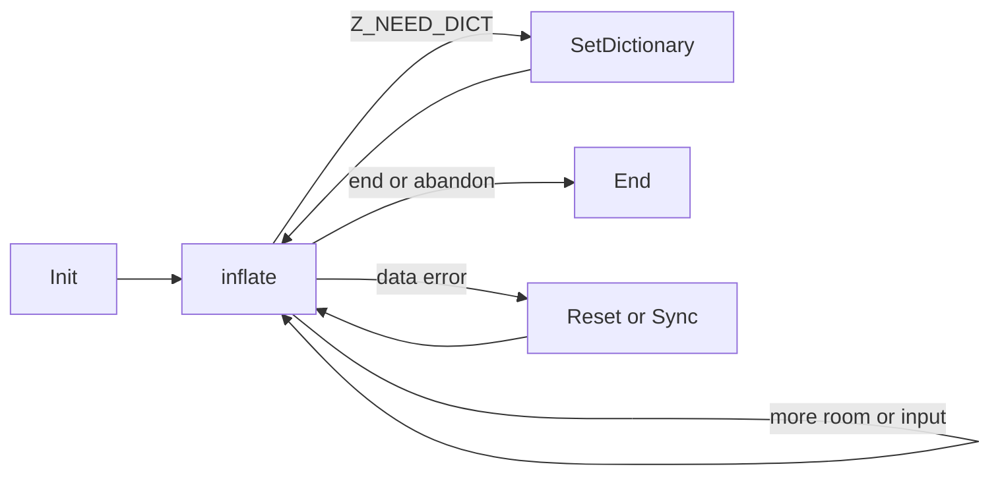

<!--
source: docs/api/inflate-stream.md
source-sha256: ecb722b5dd3a7c46a9b4a1b5201270fa95ee82397f2b5808eea5c18d69df850c
-->

# 流式解压

[API 手册](README.md) · [流的共同规则](streams.md) · [流式压缩](deflate-stream.md)

用 `inflate` 流分块解码输入，同时控制输出空间。在初始化时选择 zlib、
gzip 或 raw DEFLATE，然后继续提供输入或空间，直到完成、请求字典或出错。
这些结果出现后，都可以用 end 释放解码器。
整缓冲区的 zlib 解码见 [uncompress](utility.md#uncompress2_z)。

| 任务 | 接口 |
| --- | --- |
| 启动或复用 | [初始化](#inflateinit_)、[配置初始化](#inflateinit2_)、[重置](#inflatereset)、[新配置](#inflatereset2)、[保留历史](#inflateresetkeep) |
| 解码或提供元数据 | [Inflate](#inflate)、[设置字典](#inflatesetdictionary)、[读取历史](#inflategetdictionary)、[gzip 头部](#inflategetheader) |
| 恢复或查询 | [同步搜索](#inflatesync)、[同步点](#inflatesyncpoint)、[位置标记](#inflatemark)、[表使用量](#inflatecodesused) |
| 调整或分支 | [预填位](#inflateprime)、[校验](#inflatevalidate)、[距离选项](#inflateundermine)、[复制](#inflatecopy) |
| 释放存储 | [结束](#inflateend) |

这些专项契约依据固定版本的 `inflate.c` 和 `zlib.h`，针对默认 LP64 Linux
构建，其中启用 gzip，未启用可选的无效距离或严格距离模式。
对源码行为的解读仍需证明，标为 **to confirm**。更广的[已登记公开目标](../checking/goals.md)
保留各自的定义域。术语见[契约约定](contracts.md)，证明状态和剩余工作见
[overview](../overview.md)。

## 共同条件

下面所有契约都具有**受限定义域（Restricted domain）**。仅有 C 指针类型，并不能
提供这里所需的存储、生命周期或调用历史。

- **活跃流**已成功初始化或复制，尚未结束，保留库拥有的状态，并且不存在并发调用。
  使用默认分配器和释放函数。Init 接收可写、尚未活跃的流；其分配器字段设为
  NULL 或默认函数。
- 可读或可写区间在整个调用期间都具有声明的容量。调用者区间与流及流拥有的存储
  分离。输入和输出区间不重叠。字典目标、已登记的头部记录及其目标缓冲区彼此
  分离，也与流分离。使用已登记头部存储的调用，还要求该存储与输入/输出区间
  分离。这些是专项契约明确施加的定义域限制。
- 流对象和缓冲区归调用者所有。状态和可选窗口归库所有。调用只改变其流、
  拥有的存储、声明的输出区间，以及任何已登记的头部目标。它从不释放调用者缓冲区。
- 除非查询或复制契约另有说明，被**流检查**拒绝时返回 `Z_STREAM_ERROR`，不作修改。
  这涵盖 NULL 和可安全读取、但被检查拒绝的记录；不涵盖悬空或任意指针。
  检查要求具有分配器、状态、状态的反向流指针，以及有效模式。
- 计数器使用 C 无符号整数的位宽并按其规则回绕。任何契约都不假设分配成功。
  解码、字典或分配错误之后，仍然可以结束流。



## inflateResetKeep

```c
int ZEXPORT inflateResetKeep(z_streamp strm);
```

重新开始解码，同时保留历史。这是一个未公开文档化的入口。

**Domain.** 受限定义域：任意模式中的活跃流。

**Effects.** 修改状态，不分配也不释放。

**Pre.** 满足共同的活跃流条件。调用者明确希望旧窗口仍可供下一个流使用。

**Post.** 返回 `Z_OK`。清除总计数、消息、`data_type`、缓冲位、已设置字典状态
和头部登记。以当前封装重新开始头部/块解码，保留窗口及其历史。
对于有封装的流，接受 zlib 时 `adler` 为 1，否则为 0；raw 模式保留 `adler` 不变。

**Edges.** 不恢复被恢复操作改变的封装设置。流检查失败时不作修改。
要丢弃历史，使用 `inflateReset`。

## inflateReset

```c
int ZEXPORT inflateReset(z_streamp strm);
```

用现有配置开始一个新的独立压缩流。

**Domain.** 受限定义域：活跃流，包括已经完成或失败的流。

**Effects.** 修改状态，并可能释放窗口；从不分配。

**Pre.** 满足共同的活跃流条件。

**Post.** 返回 `Z_OK`。恢复所请求的封装和窗口大小，丢弃历史，然后执行
`inflateResetKeep` 所描述的重置。输入/输出指针和可用量计数保持不变。
同样大小的窗口可以保持已分配；不兼容的窗口被释放。

**Edges.** 清除头部登记。保留 `inflateValidate` 选择的校验设置，同时撤销
恢复操作造成的临时封装改变。流检查失败时不作修改。

## inflateReset2

```c
int ZEXPORT inflateReset2(z_streamp strm, int windowBits);
```

重置，并选择新的封装和最大窗口大小。

**Domain.** 受限定义域：活跃流及每一个有符号 `windowBits` 值。

**Effects.** 修改状态，并可能释放窗口；从不分配。

**Pre.** 满足共同的活跃流条件。旧的解码过程将被放弃。

**Post.** 对于接受的值，返回 `Z_OK`，其效果相当于使用新请求执行 `inflateReset`。
接受的值及其含义列于 `inflateInit2_`。新封装请求会启用校验。

**Edges.** 无效值在任何修改前返回 `Z_STREAM_ERROR`。改变请求大小会释放
不兼容的窗口。即使大小不变，待处理的头部登记和历史也会被丢弃。

## inflateInit2_

```c
int ZEXPORT inflateInit2_(z_streamp strm, int windowBits, const char *version, int stream_size);
```

创建具有指定封装和窗口的解码器。

**Domain.** 受限定义域：新的可写流存储、默认分配器，以及 NULL 或可读的
版本指针；所有有符号标量参数均在范围内。

**Effects.** 分配状态。

**Pre.** 流尚未活跃。分配器字段符合共同约定。
只要求版本的首字节可读；不会检查整个字符串。

**Post.** 返回 `Z_OK` 时，流成为活跃流，总计数为零，消息为 NULL，
`data_type` 为零，没有窗口、历史、缓冲位或头部登记。
封装的 `adler` 在 zlib/自动检测模式下从 1 开始，在仅 gzip 模式下从 0 开始；
raw 模式保留原值。缓冲区指针和可用量计数保持不变。

接受的 `windowBits` 值如下：

| 值 | 解码器请求 |
| --- | --- |
| -15 到 -8 | Raw DEFLATE，窗口位数为该值的绝对值 |
| 0；8 到 15 | Zlib；0 表示由头部选择大小，否则为该最大值 |
| 16；24 到 31 | 仅 gzip；16 使用默认大小，否则为该值减 16 |
| 32；40 到 47 | 检测 zlib/gzip；32 使用头部/默认大小，否则为该值减 32 |

**Errors.** NULL 版本、错误的版本首字节或错误的 `stream_size` 会在检查 `strm`
之前返回 `Z_VERSION_ERROR`，不作修改。否则，NULL `strm` 返回 `Z_STREAM_ERROR`。
窗口参数检查之前就会尝试分配状态。分配失败返回 `Z_MEM_ERROR`，保留原来的
`state` 字段，清空消息，并按需要安装默认回调。
成功分配之后，若窗口参数无效，则返回 `Z_STREAM_ERROR`，释放该状态并把
`state` 设为 NULL。任何失败的初始化都不会保留新的分配。
只有成功初始化后才需要调用 `inflateEnd`；窗口可能由后续调用分配。

## inflateInit_

```c
int ZEXPORT inflateInit_(z_streamp strm, const char *version, int stream_size);
```

创建最大窗口为 32 KiB 的 zlib 解码器。

**Domain.** 受限定义域：与 `inflateInit2_` 相同的存储、版本和分配器定义域。

**Effects.** 分配状态。

**Pre.** 满足 `inflateInit2_` 的前置条件。

**Post.** 精确等同于 `inflateInit2_(strm, 15, version, stream_size)`。
成功后接受窗口不超过 32 KiB 的 zlib 流，并拥有一个状态分配。

**Errors.** 与 `inflateInit2_` 相同的版本、NULL 流和分配失败及清理行为。
后续解码不会把 gzip 和 raw 字节接受为 zlib。

## inflatePrime

```c
int ZEXPORT inflatePrime(z_streamp strm, int bits, int value);
```

在下一个输入字节之前提供若干位，或清除缓冲位。

**Domain.** 受限定义域：首次解码前，或处于已报告块/头部边界上的活跃 raw 流；
涵盖每一个有符号 `bits` 和 `value`。

**Effects.** 只修改状态。

**Pre.** 满足共同的活跃流条件及指定的预填调用顺序。

**Post.** 零位数返回 `Z_OK`，不作修改。负位数清空位缓冲。
对于 1 到 16 位、且 32 位缓冲区能容纳的请求，返回 `Z_OK`，把 `value`
的低 `bits` 位追加在已有位之上。这些位先于 `next_in`。

**Errors.** 超过 16 位、位缓冲空间不足或流检查失败时，返回 `Z_STREAM_ERROR`，
不作修改。不更新 `data_type`。C 实现不强制检查 raw 流或调用顺序限制。

## inflate

```c
int ZEXPORT inflate(z_streamp strm, int flush);
```

消费压缩字节并写入解码字节，在调用之间保留状态。

**Domain.** 受限定义域：具有共同缓冲区/头部生命周期条件的活跃流；
任意压缩字节、输入/输出分块，以及有符号 `flush` 值均在范围内。

**Effects.** 修改流、输出和已登记的头部存储；可能分配历史窗口。

**Pre.** `next_in` 描述 `avail_in` 个可读字节，只有在该计数为零时才可以为 NULL。
即使 `avail_out` 为零，`next_out` 也不能为 NULL；它描述相应数量的可写字节。
已登记的头部及其缓冲区保持可写。
调用可以继续提供输入/空间、提供请求的字典，或接在成功重置/恢复之后。
在终止/错误状态重复调用的行为见下文。

**Post.** 在声明的范围内读写。指针按已消费/产生的字节数前移，可用量计数相应减少。
在从 init/reset 开始的普通执行中，若选定格式有效且字典正确，累计输出是解码数据的
前缀，并在 `Z_STREAM_END` 时与解码数据相等。
畸形字节也在定义域内：检测到的格式错误，或已启用的校验值/长度错误，返回
`Z_DATA_ERROR`，此前可能已产生输出。仅有输入不完整时需要更多输入；
不要求将其报告为数据错误。

| 结果 | 含义与下一步操作 |
| --- | --- |
| `Z_OK` | 输入或输出取得进展；继续提供可用输入/空间 |
| `Z_STREAM_END` | 完成一个流/成员，包括已启用的尾部检查；尾随输入仍被保留 |
| `Z_NEED_DICT` | 需要 zlib 字典；`adler` 是其标识符；设置该字典 |
| `Z_BUF_ERROR` | 没有进展，或 `Z_FINISH` 未能完成；提供输入/空间 |
| `Z_DATA_ERROR` | 检测到畸形数据；重置、恢复或结束 |
| `Z_MEM_ERROR` | 窗口分配失败；重置或结束 |
| `Z_STREAM_ERROR` | 流/缓冲区检查失败，或恢复搜索尚未完成 |

**Accounting.** 正常返回，包括数据错误和缓冲错误，会按已消费/产生字节数更新
总计数，并更新已启用的输出校验值。`Z_NEED_DICT` 计入已消费的头部字节，
并让 `adler` 保持为字典标识符。
较晚发生的窗口分配失败可能在消费输入、写入输出之后发生：指针/计数已经反映
这些操作，但会跳过正常的最终总计数/校验值/`data_type` 记账。
不得把 `Z_MEM_ERROR` 当成输出未改变的结果。

**Edges.** 允许零输入或零输出空间。`Z_BLOCK` 在头部或块边界停止；
`Z_TREES` 还会在块描述之后停止。`Z_FINISH` 会把原本的 `Z_OK` 改为
`Z_BUF_ERROR`。其他有符号 flush 值也被接受，行为与 `Z_NO_FLUSH` 相同。
正常返回时，`data_type` 记录未使用位数，并在最后一个块加 64、
在头部/块边界加 128、在块头部之后加 256。
数据错误和内存错误具有持续性；已完成的流会重复返回 `Z_STREAM_END`。

**Ownership.** 新窗口存储归流所有，并继续可用于 reset/end，包括出错之后。
一次调用即可完成的 `Z_FINISH` 可能不需要窗口。拼接的 gzip 成员要求在成员之间重置。
错误消息是借用的静态字符串。缓冲区检查和流检查拒绝时不作修改。

## inflateEnd

```c
int ZEXPORT inflateEnd(z_streamp strm);
```

释放解码器存储，包括放弃解码或解码失败的情形。

**Domain.** 受限定义域：所有模式中的活跃流，包括分配/数据错误之后。

**Effects.** 修改流，并释放拥有的存储。

**Pre.** 满足共同的活跃流条件。

**Post.** 返回 `Z_OK`，恰好各释放一次可选窗口和状态，并将 `state` 设为 NULL。
其他流字段和调用者缓冲区保持不变。它不分配任何对象，使用默认释放函数时
不可能返回 `Z_MEM_ERROR`。

**Edges.** 不要求流已完成，也不把未完成数据报告为错误。
流检查失败时，包括流已经结束的情形，返回 `Z_STREAM_ERROR`，不释放任何对象。
再次使用前需要重新初始化。

## inflateGetDictionary

```c
int ZEXPORT inflateGetDictionary(z_streamp strm, Bytef *dictionary, uInt *dictLength);
```

读取保留的滑动历史，最早的字节在前。

**Domain.** 受限定义域：活跃流，以及可选的可写字典目标和长度目标。

**Effects.** 观察状态，只写入这些目标。

**Pre.** 非 NULL 字典目标具有容纳所保留历史的空间；32768 字节始终足够。
非 NULL `dictLength` 指向可写 `uInt` 存储。

**Post.** 返回 `Z_OK`。若 `dictionary` 非 NULL 则复制历史；
若 `dictLength` 非 NULL 则存储历史大小。不分配也不释放，流保持不变。

**Edges.** 两个目标都可以分别为 NULL。新的历史为空。
即使流已经产生输出，若其在未分配窗口的情况下完成，历史仍可能为空。
流检查失败时不写入任何目标。

## inflateSetDictionary

```c
int ZEXPORT inflateSetDictionary(z_streamp strm, const Bytef *dictionary, uInt dictLength);
```

安装或补充可用于向后匹配的字节。

**Domain.** 受限定义域：在 `Z_NEED_DICT` 后等待的活跃 zlib 流，或
位于任意调用边界的活跃 raw 流。

**Effects.** 修改历史，并可能分配其窗口。

**Pre.** `dictionary` 非 NULL，并描述 `dictLength` 个可读字节，即使长度为零也一样。
要得到正确输出，该字典需与压缩器的字典匹配。

**Post.** 保留“旧历史随后接新字典”这一序列的最后一个窗口大小的后缀后，返回 `Z_OK`。
会用提供的整个字典检查 zlib 标识符。调用者字节被复制，不会保留其指针，也不会释放它们。

**Errors.** 错误的 zlib 标识符返回 `Z_DATA_ERROR`，不作修改；可以尝试另一个字典。
NULL 字典、流检查失败，或有封装的流不在等待字典时，返回 `Z_STREAM_ERROR`。
分配失败返回 `Z_MEM_ERROR`，并让流进入内存错误模式，但仍可结束。

**Edges.** Gzip 没有预设字典路径。Raw 模式没有标识符检查；错误字典可能产生
错误输出，或在后面引发错误。接受长度为零的 raw 字典。
不推进输入/输出指针，也不增加总计数。

## inflateGetHeader

```c
int ZEXPORT inflateGetHeader(z_streamp strm, gz_headerp head);
```

为下一个 gzip 头部登记调用者存储。

**Domain.** 受限定义域：init/reset 之后、解码之前，具有 gzip 能力的活跃流。

**Effects.** 登记借用存储，并写入 `head->done`。

**Pre.** `head` 非 NULL 且可写。其 `extra`、`name`、`comment` 指针为 NULL，
或分别具有可写容量 `extra_max`、`name_max`、`comm_max`。
所有已登记存储必须保持有效，直至头部解析结束或请求被清除。
头部记录及其目标缓冲区彼此分离，也与流及其拥有的存储、以及使用它们的调用中的
输入/输出区间分离。

**Post.** 返回 `Z_OK`，保留该指针，并把 `done` 设为 0。
之后的 `inflate` 调用填充标量字段和缓冲区可容纳的前缀。
存在额外字段时，`extra_len` 为实际长度；不存在时，`extra` 变为 NULL，而
`extra_len` 保持不变。名称/注释只有在终止符能够放入时才会有终止符。
缺少的可选字段会把对应指针设为 NULL。完成后将 `done` 设为 1；
自动检测到 zlib 时则设为 -1。

**Edges.** 不分配，也不转移所有权。Reset 清除登记。
流检查失败或请求不具备 gzip 支持时，返回 `Z_STREAM_ERROR`，不作修改。
已被接受的请求若传入 NULL `head`，则在本契约之外，C 会对其解引用；
这不是一个干净返回错误的情形。

## inflateSync

```c
int ZEXPORT inflateSync(z_streamp strm);
```

在损坏输入之后搜索可能的 full-flush 边界。

**Domain.** 受限定义域：数据错误后或恢复搜索期间的活跃流，且输入可读。

**Effects.** 消费输入、修改状态，并可能释放窗口。

**Pre.** `next_in` 和 `avail_in` 描述可读区间。不使用输出。

**Post.** 先搜索已缓冲的整字节，再搜索输入中的 `00 00 ff ff`，
并在调用之间保留部分匹配。输入指针/计数和 `total_in` 按所搜索的输入前移。
不产生输出，`total_out` 保持不变。
**Results.** `Z_OK` 表示找到该模式：重置历史和头部登记，保留总计数，
可从后续块继续解码。若尚未读取过头部，恢复使用 raw 模式；否则禁用尾部校验。
仍然未知的窗口大小变为 15。`Z_DATA_ERROR` 表示继续搜索；
在该搜索期间，普通 `inflate` 返回 `Z_STREAM_ERROR`。

**Edges.** 没有输入且缓冲位不足八位时，返回 `Z_BUF_ERROR`，不作修改。
流检查失败时不作修改。找到的模式不一定是真正的 flush 点；即使是
sync-flush 边界，也可能需要更早的历史。恢复不保证得到有效后缀，
也不保证恢复校验值检查。不分配。

## inflateSyncPoint

```c
int ZEXPORT inflateSyncPoint(z_streamp strm);
```

检查接下来是否正在等待 stored 块的长度字节。

**Domain.** 受限定义域：任意模式中的活跃流。

**Effects.** 只读查询。

**Pre.** 满足共同的活跃流条件。

**Post.** 当且仅当正在等待 stored 块长度、且位缓冲为空时返回 1，否则返回 0。
不分配、不释放，也不作修改。

**Edges.** 流检查失败时返回 `Z_STREAM_ERROR`。应检查 `== 1`，因为负错误码
在 C 中也被当作真。它不搜索标记。

## inflateCopy

```c
int ZEXPORT inflateCopy(z_streamp dest, z_streamp source);
```

创建可从源流位置继续执行的解码器。

**Domain.** 受限定义域：活跃源流，以及与源不同、可写但尚未活跃的目标。

**Effects.** 分配独立状态；若源流具有窗口，还分配窗口。

**Pre.** 源流满足共同条件。目标不与源或源拥有的存储重叠。
共享的输入/输出指针和头部指针保留各自的调用者生命周期；
使用两个流前，应为它们提供分离的可写目标。

**Post.** `Z_OK` 复制解码位置、历史和流字段。
两个流分别拥有独立的状态/窗口，且都必须结束。源流保持不变。
调用者缓冲区指针、消息以及任何已登记的头部指针都被共享，而非深复制。
不消费也不产生任何调用者数据。

**Errors.** NULL `dest` 返回 `Z_STREAM_ERROR`。对于其他拒绝情形，
非 NULL `dest` 的 `state` 被清空，除此之外保持不变。
分配失败返回 `Z_MEM_ERROR`，并释放本次尝试所做的全部分配。
源流保持不变。

**Edges.** 明确排除自复制：C 会覆盖原来的状态指针，因此其所有权后果
仍标为 **to confirm**，并非一次干净拒绝。

## inflateUndermine

```c
int ZEXPORT inflateUndermine(z_streamp strm, int subvert);
```

请求可选的宽松距离模式。这是一个未公开文档化的入口。

**Domain.** 受限定义域：活跃流及每一个有符号 `subvert` 值。

**Effects.** 只修改状态。

**Pre.** 满足共同的活跃流条件。

**Post.** 默认构建中，无论 `subvert` 为何值，都返回 `Z_DATA_ERROR`，
并启用正常的距离检查。不分配也不释放。

**Edges.** 这一返回不会使解码器进入数据错误模式。
流检查失败时返回 `Z_STREAM_ERROR`，不作修改。
可选的宽松构建不在本页范围内。

## inflateValidate

```c
int ZEXPORT inflateValidate(z_streamp strm, int check);
```

启用或禁用封装校验值和 gzip 长度校验。

**Domain.** 受限定义域：解码之前的活跃流，以及每一个有符号 `check` 值。

**Effects.** 只修改配置。

**Pre.** 满足共同的活跃流条件和指定调用顺序。

**Post.** 返回 `Z_OK`。零表示禁用检查；非零表示对有封装的流启用检查。
同时改变当前设置和所请求的设置。Raw 流仍为 raw。
不分配、不释放，也不访问缓冲区。

**Edges.** 禁用检查会允许原本有错误的尾部，并且不维护输出校验值。
`inflateReset` 保留这一选择；`inflateReset2` 替换它。
流检查失败时返回 `Z_STREAM_ERROR`，不作修改。

## inflateMark

```c
long ZEXPORT inflateMark(z_streamp strm);
```

报告当前编码位置，供建立索引使用。

**Domain.** 受限定义域：任意模式中的活跃流。

**Effects.** 只读查询。

**Pre.** 满足共同的活跃流条件。

**Post.** 返回 `back * 65536 + progress`：`back` 是回到当前码的位数，
在码之间、头部或 stored 块中则为 -1。`progress` 是 stored 块的剩余字节数、
已产生的匹配字节数，或其他情况下的零。不作修改，也不分配或释放。

**Edges.** 流检查失败时返回 -65536。有效流也可能出现该值，
所以它本身不能识别错误。

## inflateCodesUsed

```c
unsigned long ZEXPORT inflateCodesUsed(z_streamp strm);
```

报告目前使用的解码表条目数。这是一个未公开文档化的入口。

**Domain.** 受限定义域：任意模式中的活跃流。

**Effects.** 只读查询。

**Pre.** 满足共同的活跃流条件。

**Post.** 返回从内嵌表区域的起点到下一个空闲条目的条目数，范围为 0 到 1444。
新建/重置的流返回零。Fixed 块使用静态表，不一定改变这一计数。
不作修改，也不分配或释放。

**Edges.** 流检查失败时返回 `(unsigned long)-1`，即无符号最大值。

[返回 API 手册](README.md) · [契约约定](contracts.md)
