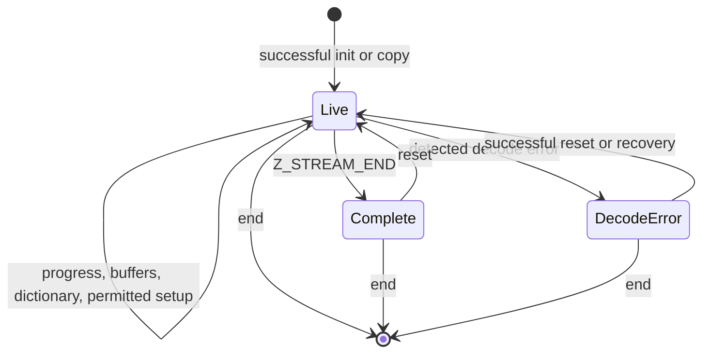

<!--
source: docs/api/streams.md
source-sha256: 83363dfd65e0e573bba94d4370a3f30a40fb7f54b73f071190a3ce04d75464d9
-->

# 流的共同规则

[API 手册](README.md) · [怎样阅读契约](contracts.md)

流在多次调用之间保留压缩或解压状态。
调用者提供缓冲区；库在缓冲区中推进，并保留下一次调用所需的历史。
成功初始化开始一个生命周期，只有对应的 end 函数释放状态后，这个生命周期才结束。
成功复制会开始第二个生命周期，并产生独立的 end 义务。

本页汇总各函数条目共有的缓冲区、所有权和调用顺序规则。
它采用默认 LP64 Linux 构建和默认分配器。
对固定版本 C 源码和 `zlib.h` 的解读仍有待证明**确认（to confirm）**。
这些限定范围的契约不改变范围更广的[已登记公开目标](../checking/goals.md)。

## 相关函数页面

精确的可接受参数、返回值和错误效果，请阅读单个条目：

| 手册 | 范围 |
| --- | --- |
| [流式解压](inflate-stream.md) | 初始化、解码、重置、字典、头部、恢复、复制、结束 |
| [流式压缩](deflate-stream.md) | 初始化、编码、flush、调优、上界、复制、结束 |
| [回调解码](inflate-back.md) | 调用者窗口和输入/输出回调 |
| [缓冲区工具和库信息](utility.md) | 整缓冲区操作、上界、版本、标志和错误 |
| [校验值](checksums.md) | Adler-32、CRC-32 和合并 |
| [Gzip 文件](gz-file.md) | 文件句柄、I/O、定位和关闭 |

## 流的存储和所有权

调用者拥有 `z_stream` 及其缓冲区。库拥有 `state` 及其分配的存储。
`next_in`/`avail_in` 描述未读输入；`next_out`/`avail_out` 描述输出空间。
库更新总量、`msg`、`data_type` 和 `adler`。
计数器按 C 无符号整数宽度回绕；本构建中的 `uLong` 为 64 位。
调用者不改动库拥有的状态和库字段，除非函数契约明确允许修改。

| 主题 | 共同义务 |
| --- | --- |
| 初始化（`A-stream-init`） | Init 接收可写、当前不处于活跃生命周期的流存储，并已设置 `zalloc`、`zfree`、`opaque`；本范围内使用 NULL/默认回调。只有成功初始化才建立具有非 NULL `state` 的活流。版本和参数拒绝遵循函数手册。 |
| 输入（`A-stream-in`） | 当调用使用输入时，`next_in` 覆盖 `avail_in` 个可读字节；只有计数为零时才允许 NULL。 |
| 输出（`A-stream-out`） | 当调用使用输出时，`next_out` 覆盖 `avail_out` 个可写字节。`inflate` 和 `deflate` 即使在空间为零时也要求非 NULL 的 `next_out`；其手册说明推进/拒绝行为。 |
| 分离（`A-stream-disjoint`） | 限定范围的契约要求调用者区间与库拥有的存储及流分离；输入/输出区间不重叠。手册会明确说明额外的字典/头部别名限制。这不意味着每种被排除的重叠都会造成 C 未定义行为。 |
| 生命周期和顺序（`A-stream-single`） | 同一流上的调用按顺序执行；在每次可能访问调用者存储的调用中，该存储均保持有效。 |
| 结束（`A-stream-end`） | 成功 end 释放状态。继续处理流之前需要重新初始化。对已结束记录的、文档规定且经过检查的拒绝，与允许的活流调用是两回事。 |
| 推进记账（`A-stream-progress`） | 消费/产生字节会将对应指针前移相同数量，并将其可用计数减少相同数量。总量遵循每个函数的记账规则，包括下文的延迟内存错误例外。 |
| 释放和复制（`A-stream-dealloc`） | End 对库拥有的每项分配恰好释放一次，且从不释放调用者缓冲区。Copy 创建独立拥有的状态；借用的调用者指针不会被深复制。 |
| 所有权平衡（`A-leak-free`） | 失败的 init/copy 释放本次尝试所做的分配。End 移除流拥有的块；无关的活块保留。整个生命周期完成后，分配和释放效果平衡。 |

调用只修改流、流拥有的存储，以及契约点名的调用者目标区。
输入字节和无关堆对象受 frame 条件保护。
头部注册会跨调用借用调用者存储，不转移所有权。
压缩头部在被保留期间应保持可读；解压头部在解析可能访问它们期间应保持可写。
Reset 放弃旧数据流，并按照手册说明保留可复用的分配。
ResetKeep 刻意保留历史，因此具有独立契约。

## 解码和错误

| 主题 | 义务 |
| --- | --- |
| 封装和窗口（`A-wbits-range`） | 使用 [inflateInit2_](inflate-stream.md#inflateinit2_) 和 [deflateInit2_](deflate-stream.md#deflateinit2_) 中精确的可接受值及封装含义。Inflate 包含头部/默认大小请求 0、16 和 32；单个区间不足以描述。拒绝顺序重要，因为 inflate 可能在拒绝该值之前尝试分配。 |
| 解码推进（`A-inflate-progress`） | 在缓冲区有效时消费输入并产生解码字节，直到因格式/模式、缓冲区、请求的边界、完成或错误而停止。普通有效执行中的输出是解码前缀，并在 `Z_STREAM_END` 时完整；尾随输入保留。 |
| 畸形输入（`A-inflate-err-data`） | 任意压缩字节，包括畸形数据，仍在解码器定义域内。检测到的格式错误或已启用的完整性检查失败会返回 `Z_DATA_ERROR`，且不产生故障。不完整或尚未被检测出的畸形前缀不必立即返回该码；不承诺固定的检测延迟。 |
| 解码错误清理（`A-inflate-no-leak`） | 活流上的错误保留库拥有的存储，以便执行手册允许的重置/恢复/结束。发生数据错误或窗口分配失败后，`inflateEnd` 仍然安全。 |
| 头部目标区（`A-header-fill`） | 已注册的 gzip 缓冲区最多分别接收 `extra_max`、`name_max`、`comm_max` 个字节。只有空间足够时才写入名称/注释终止符。`done` 从 0 开始，在 gzip 头部完成时变为 1，或在检测到 zlib 时变为 -1。见 [inflateGetHeader](inflate-stream.md#inflategetheader)。 |

`Z_BUF_ERROR` 可以表示没有推进，也可以表示 `Z_FINISH` 尚未完成；
提供更多输入/空间后可能可以继续。
`Z_NEED_DICT` 请求匹配的 zlib 字典。
`inflateSync` 是独立的恢复搜索，不保证找到的字节模式就是合法后缀的起点。
窗口分配可能在已经消费输入并写入输出之后才失败。
此时指针和可用计数反映已经完成的推进，但正常的最终总量/校验值记账会被跳过。
`Z_MEM_ERROR` 不意味着输出保持不变。

## 压缩和 flush

| 主题 | 义务 |
| --- | --- |
| 压缩级别（`A-deflate-level`） | 在本构建中，-1 选择 6；级别 0 使用存储。在普通策略下，级别 1..3 使用快速匹配，4..9 使用惰性匹配。仅 Huffman 和游程策略选择各自的路径。 |
| 策略（`A-deflate-strategy`） | 策略为 0 默认、1 过滤、2 仅 Huffman、3 游程、4 固定编码。其输出细节仍受[格式契约](../format/README.md)约束。 |
| Flush（`A-deflate-flush`） | `Z_NO_FLUSH` 把块发射时机交给压缩器。`Z_BLOCK` 完成一个块但不作字节填充；`Z_PARTIAL_FLUSH` 添加一个空固定编码块；`Z_SYNC_FLUSH` 发射一个对齐的空存储块。`Z_FULL_FLUSH` 还在 flush 完成后丢弃匹配历史。`Z_FINISH` 完成流。 |
| 编码错误清理（`A-deflate-no-leak`） | 活流上的错误返回使其分配仍可由 `deflateEnd` 释放。即使 End 用 `Z_DATA_ERROR` 报告放弃了忙状态数据，它仍会释放这些分配；该状态不是泄漏。 |
| 容量上界（`A-deflate-bound`） | 容量保证要求满足下述调用安排及[上界契约](deflate-stream.md#deflatebound_z)，包括配置、头部、字典、调优、priming 和可表示性条件。它与数值公式的等式是不同的性质。 |

如果 deflate 的 flush 填满输出，需使用相同的 flush 和更多空间继续，直到完成。
对于 sync/full flush，标记开始写入时提供大于六字节的空间，可以避免重复标记。
第一次 `Z_FINISH` 之后不再提供新输入；继续以 `Z_FINISH` 重试，直到完成/错误。
在 `Z_STREAM_END` 之后，普通公开协议允许重置或结束。
Zlib 字典设置先于压缩；raw 模式下替换字典要求已完成的块边界，而不只是任意调用边界。
头部设置和参数修改遵循各自手册。

若要获得一次调用的上界保证，应在初始化及任何头部/字典设置之后、压缩之前查询。
保持该配置不变。
将全部 `n` 个输入字节及至少等于所返回上界的输出空间提供给第一次 `deflate(Z_FINISH)`；
这两个大小都必须能由可用计数字段表示，并且描述真实缓冲区。
总输出保证还覆盖只使用 `Z_NO_FLUSH`、最后使用 `Z_FINISH` 的干净调用安排。
其他 flush 安排可能超过该上界。
饱和上界不能证明存在该大小的缓冲区。
极端的 gzip extra 长度也需要谨慎：C 先以 unsigned-int 宽度计算 `2 + extra_len`，
然后才加到上界上，因此该加法可能回绕。
限定范围契约中的 16 位头部范围，既不能解决范围更广的已登记数值目标，也不能支持不受限的输出容量声明。

## 流的生命周期

序列义务（`A-sequence`）要求：满足各自 Pre 和调用顺序规则的调用，
保持流不变量、无故障终止、以 frame 条件保护无关存储，并交代所有权。
该图概括普通生命周期；完成过程、内存错误、恢复和高级操作以各手册为准。
Init 建立不变量；被调用函数的契约是需要证明的定理义务，不是假设。
每次成功的 init/copy 都产生独立的 end 义务。
不满足限定范围 Pre 的调用不在该契约内，并不自动意味着其 C 行为未定义。
自定义分配器不在本页范围内。
证明状态和剩余工作见[概览](../overview.md)。
