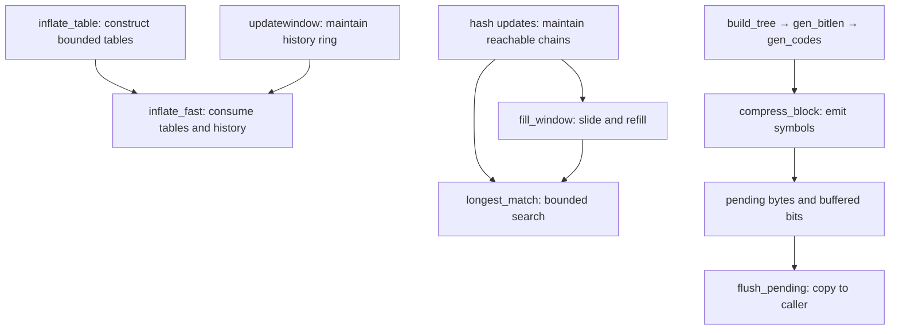

<!--
source: docs/design/internal-contracts.md
source-sha256: 281190aa7fe6e925a810abed51d16e9200662066c36e0ef9ca3f74bf4ea175e5
-->

# 内部调用处的义务

这些是默认构建辅助函数的文档契约。它们解释调用者必须建立什么，
以及辅助函数的执行证明必须给出什么。下文所有对 C 的解读仍 **to confirm**；
表格本身不是证明，也不是可以假定的被调函数契约。
执行证明见[证明指南](../proof/README.md)，状态见[概览](../overview.md)。

内部前置条件可以强于公开入口的前置条件。实际调用者必须从初始化建立的不变量和当前执行状态导出它。
它不能变成公开调用的隐藏限制。特别地，小内存级别、任意的新整数内容和已文档化的错误情形，
仍然是公开调用者需要承担的义务。

## 怎样阅读条目

每个稳定的 `I-*` 标识指明一项义务。`Pre` 描述辅助函数的定义域。
`Post` 描述结果。`Effects` 限制允许的读取或写入。
中间事实必须在指定阶段成立，且先于 C 将同一字段复用于其他用途。

每个条目还要求共同内存事实：被引用的存储仍然存活、表示正确且位于边界内；
写入目标可写；`memcpy` 区间彼此分离；指针字段使用前已经写过。
每个辅助函数证明都必须建立终止、无故障，以及其效果范围之外存储的 frame。
这些义务讨论的是翻译后的函数体，包括对更底层、已证明辅助函数的调用。

箭头表示证明依赖和所维护的数据，不是完整的 C 调用图。

## 构造解码表：`inflate_table`

用途：构建 canonical 解码表。
`inflate_table(type, lens, codes, &table, &bits, work)`；`base` 是入口处的 `*table`。

| 部分 / ID | 契约 |
| --- | --- |
| Pre `I-it-pre-lens` | `lens[0..codes)` 可读，长度在 `0..15` 内。对于 `CODES`，长度至多为 7，请求的 `*bits` 至少为 7。 |
| Pre `I-it-pre-codes` | `type` 是 `CODES`、`LENS` 或 `DISTS`；`codes` 分别至多为 19、288 或 32。 |
| Pre `I-it-pre-work` | `work[0..codes)` 是可写的临时区，与其他参数分离。 |
| Pre `I-it-pre-table` | `table`/`bits` 是可写单元；`base` 对于 `CODES`/`LENS`/`DISTS` 分别容纳 128/852/592 个表项，并与其他参数分离。 |
| Post `I-it-ret` | 成功返回 0，长度无效返回 -1，`LENS`/`DISTS` 因容量拒绝时返回 1。空编码通过写入无效表项而成功。 |
| Effects `I-it-writes` | 只改变临时区、指针/位宽单元，以及容量内的表项。成功构造 `[base, base + used)`；错误可能留下部分写入。 |
| Post `I-it-advance` | 成功时，`*table = base + used`，`*bits` 是实际根表位宽。 |
| Post `I-it-complete` | 成功会写入每个构造出的表项，包括允许的单符号编码所需的一个无效表项，或空编码所需的两个无效表项。 |
| Post `I-it-links` | 成功结果中的每个根表链接及其整个子表都在 `[base, base + used)` 内。 |
| Post `I-it-canonical` | 成功结果按 [canonical 分配](../format/README.md)解码，保留符号带有无效标记。 |
| Post `I-it-term` | 在所述定义域内，调用会结束。 |

## 带余量解码：`inflate_fast`

用途：解码，直到空间不足、块结束或数据无效。

| 部分 / ID | 契约 |
| --- | --- |
| Pre `I-if-pre-room` | 模式是 `LEN`；`avail_in ≥ 6`、`avail_out ≥ 258`、`start ≥ avail_out`。`next_out - (start - avail_out)` 是外层 `inflate` 调用此前输出的可读起点，且位于同一对象中。输入与输出分离。 |
| Pre `I-if-pre-bits` | `bits < 8`；`hold` 恰好包含那些已缓冲的低位，没有其他置位。 |
| Pre `I-if-pre-tables` | `lencode`/`distcode` 及根表位宽满足成功构造的表项/链接规则，包括固定表。 |
| Pre `I-if-pre-window` | `whave ≤ wsize`；`wsize = 0` 蕴含 `whave = wnext = 0`；否则 `wnext < wsize`，且 `window` 容纳 `wsize` 个字节。有效历史有 `whave` 个字节；`sane` 已设置。 |
| Effects `I-if-reads` | 字节读取使用入口输入、同一外层调用的先前输出，或有效窗口历史；表读取保持在解码表内。 |
| Effects `I-if-writes` | 只写入口输出、流的游标/计数/`msg`，以及状态的 `hold`/`bits`/`mode`；不分配。 |
| Post `I-if-post` | 游标/计数记录已消费输入和已产生输出。未使用的完整输入字节会退回；`bits < 8`。模式是 `LEN`、`TYPE` 或 `BAD`；`BAD` 可能消费无效符号的一部分。 |
| Post `I-if-dist` | 若距离超过外层 `inflate` 调用已经产生的字节数加 `whave`，则在复制该匹配前设置 `BAD`。 |

## 保持解码器历史：`updatewindow`

用途：将 `[end - copy, end)` 追加到历史，包括字典数据。

| 部分 / ID | 契约 |
| --- | --- |
| Pre `I-uw-pre` | `[end - copy, end)` 可读，并与目标窗口分离。`wbits` 在已配置的 inflate 范围内。已有窗口具有 `2^wbits` 个可写字节。环形缓冲区未使用（`wsize = 0`），或者满足 `wsize = 2^wbits`、`whave ≤ wsize`、`wnext < wsize` 及 `whave < wsize → wnext = whave`。 |
| Effects `I-uw-alloc` | 仅在窗口缺失时分配。分配失败返回 1，否则返回 0。只写窗口存储/字段和分配器状态；失败保持已有历史。 |
| Post `I-uw-inv` | 返回 0 时，`wsize = 2^wbits`、`whave ≤ wsize`、`wnext < wsize`，且 `whave < wsize → wnext = whave`。 |
| Post `I-uw-content` | 成功保留旧历史与输入拼接后至多 `wsize` 字节的后缀；`whave` 为其长度，环形顺序结束于 `wnext`。 |

## 补充与滑动：`fill_window`、`slide_hash`、`read_buf`

用途：补充预读数据，并维护窗口/哈希位置。

| 部分 / ID | 契约 |
| --- | --- |
| Pre `I-fw-pre` | `fill_window` 满足 `lookahead < MIN_LOOKAHEAD`、`window_size = 2*w_size`、`strstart + lookahead ≤ window_size` 和 `insert ≤ strstart`。窗口、哈希尺寸/掩码、高水位、搜索设置和位置范围满足已配置的 deflate 状态，包括 `I-hc-inv`。输入有长度为 `avail_in` 的可读视图。 |
| Post `I-fw-post-room` | `fill_window` 留下 `strstart ≤ window_size - MIN_LOOKAHEAD`。 |
| Post `I-fw-post-lookahead` | 它留下 `lookahead ≥ MIN_LOOKAHEAD` 或 `avail_in = 0`。新读入字节按顺序扩展当前预读区。 |
| Effects `I-fw-slide` | 滑动将窗口上部的有效字节向下移动 `w_size`，按 C 算术调整位置/`insert`，并调用 `slide_hash`。其他写入涉及输入/校验和记账、哈希和高水位填充。 |
| Pre / Post `I-sh-total` | `slide_hash` 要求正的 `hash_size` 和 `w_size`，以及可写的 `head[0..hash_size)`/`prev[0..w_size)`。每个表项在 `m ≥ w_size` 时变为 `m - w_size`，否则变为 `NIL`；它设置 `slid = 1`。不可达的 `prev` 值不必已经初始化。 |
| Pre / Post `I-rb-copy` | `read_buf` 需要一个能容纳 `n = min(avail_in, size)` 字节的可写目标，且与输入分离。它返回 `n`，复制该前缀，推进 `next_in`、减少 `avail_in`、增加 `total_in`，并为当前封装更新 Adler-32/CRC-32。`n = 0` 时不改变任何内容。 |

## 搜索有效哈希链：`longest_match`

用途：在预算内搜索更早的哈希链位置。

| 部分 / ID | 契约 |
| --- | --- |
| Pre / Post `I-hc-inv` | `INSERT_STRING`、`slide_hash`、`CLEAR_HASH`、`fill_window` 和 `deflateSetDictionary` 维护如下关系：头指向已插入位置，可达的 `prev[p mod w_size]` 槽位已经写入 `NIL` 或更小的同哈希位置。位置与当前窗口/预读区一致。 |
| Pre `I-lm-pre` | `cur_match` 是当前字符串哈希的非零头，`cur_match < strstart`，距离至多为 `MAX_DIST`。`I-hc-inv` 成立；`strstart ≤ window_size - MIN_LOOKAHEAD`、`1 ≤ prev_length ≤ MAX_MATCH`，且配置的搜索设置在任何缩减之后仍给出正的链预算。 |
| Effects `I-lm-reads` | 读取窗口直至并包括 `strstart + MAX_MATCH`，可能越过预读区，并读取已写入的可达 `prev` 槽位。只改变 `match_start`；不能用填充内容来论证无效匹配。 |
| Post `I-lm-ret` | 返回值至多为 `min(MAX_MATCH, lookahead)`。发现改进时设置有效的 `match_start`；否则可能保留被 lookahead 截断后的 `prev_length`，而不给出新的 `match_start` 保证。 |
| Post `I-lm-term` | 在链预算内结束；遍历到的非零位置严格递减。不保证全局最大值。 |

## 构造并发射 Huffman 树：`trees.c`

用途：构造有界 Huffman 编码并发射一个块。

| 部分 / ID | 契约 |
| --- | --- |
| Pre `I-bt-pre` | `build_tree` 接收一个描述器，分别描述 286/30/19 个字面量-长度/距离/位长度叶子，以及已设置的频率和用于内部结点/堆/深度的空间。强制添加叶子修复后的频率和能用相应字段表示。 |
| Effects `I-bt-heap` | 堆索引保持小于 573；结点保持在各自的树中。写入包括：描述器最大值、结点、堆/深度、位计数和成本。 |
| Intermediate `I-bt-forest` | 在长度/编码覆盖父结点/频率字段之前，结点构成正频率符号上的满二叉树，必要时强制添加叶子以达到两个。父结点频率等于子结点频率之和。 |
| Pre / Post `I-gb-len` | 给定这棵树、有序堆和描述器，`gen_bitlen` 将活跃叶子的长度写为 `1..max_length`（15 或 7）内的值，Kraft 和为 1，并写入计数和成本。 |
| Post `I-gb-count` | `bl_count[l]` 统计长度为 `l` 的活跃叶子；`bl_count[0] = 0`。 |
| Pre / Post `I-gc-code` | `gen_codes` 需要截至 `max_code` 的长度在 `0..15` 内，并具有匹配的完整编码计数。它只写正长度的编码字段：按符号顺序排列、位反转后的 canonical 码字。 |
| Pre / Effects `I-cb-reads` | `compress_block` 要求 `sym_buf[0..sym_next)` 中有完整的三字节符号、有效的字面量/匹配范围、带可用编码的匹配树，以及 pending/位缓冲区空间。它按顺序读取符号，发射编码/额外位，随后发射 `END_BLOCK`。 |
| Post `I-cb-pending` | 在符号 `k`（从 0 开始）之后，`pending < lit_bufsize + 3*(k+1)`。整个发射过程中也必须保持未读符号。这个界必须证明，不能作为调用者提供的假设。 |
| Pre / Post `I-tf-choice` | `_tr_flush_block` 要求有效的块符号/频率、`last` 在 `0..1` 内、pending 容量，以及在选择 stored 块时满足 `stored_len ≤ 65535` 且 `buf[0..stored_len)` 可读。若 `buf != NULL` 且 `stored_len + 4 ≤ opt_lenb`，选择 stored；否则若 `static_lenb = opt_lenb`，选择 fixed；否则选择 dynamic。`opt_lenb` 是较小的舍入后压缩大小，但 `Z_FIXED` 会优先选择 fixed。它重置块记账，并在 `last` 为真时对齐比特。 |

默认[共享缓冲区界](../proof/trees.md)必须覆盖每个公开内存级别；不能变成调用者的隐藏限制。

## 排出待输出数据：`flush_pending` 与位写入函数

用途：收集已缓冲的位，并把 pending 字节复制到输出。

| 部分 / ID | 契约 |
| --- | --- |
| Pre / Post `I-fp-inv` | `pending_out` 位于 pending 分配中，且 `pending_out + pending ≤ pending_buf + pending_buf_size`。写入函数还需要实际写入偏移处的空间；仅有这个区间条件并不充分。 |
| Pre / Post `I-fp-copy` | `flush_pending` 要求长度为 `avail_out` 的可写输出，并与 pending 存储分离；位缓冲区状态有效，且有空间执行 `_tr_flush_bits`。它先刷新已缓冲的完整字节，再复制 `n = min(pending, avail_out)`，推进两个游标、增加 `total_out`，并从两个计数中减去 `n`。非零复制清空 pending 后，`pending_out = pending_buf`。只改变 pending/位字段、流输出字段和复制的输出字节。 |
| Pre / Post `I-pb-room` | `put_byte` 和 `put_short` 分别要求其 pending 偏移处有一/两个可写字节。`send_bits` 要求 `1 ≤ length ≤ 16`、值能容纳于该长度、有效的 `bi_valid`/`bi_buf`，以及可能写入短字所需的空间。它们追加字节/位，不检查容量。调用者必须建立空间条件；`I-cb-pending` 必须保护共享缓冲区中的未读符号。 |

[翻译规则](translation.md)解释这些义务所指的操作。
[API 模型](api-model.md)解释字节历史与具体堆效果的区别。

[设计指南](README.md) · [文档首页](../README.md)
