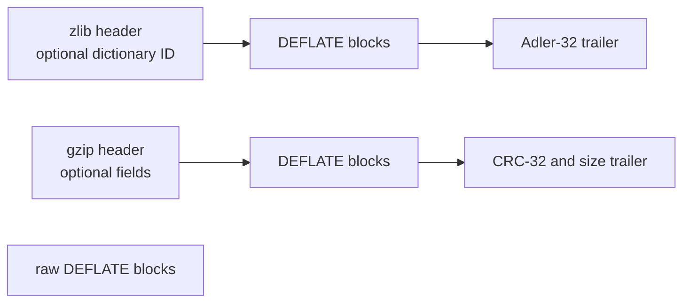

<!--
source: docs/format/README.md
source-sha256: cd80fdf1f27acfbcfa8937149fd99bb41b9df6ece663d714307b336d66052fc1
-->

# 数据格式

[文档首页](../README.md) · [API 指南](../api/README.md) · [Lean 模型](model.md)

DEFLATE 描述压缩字节。zlib 和 gzip 格式在这些字节外添加头部和校验值。
本指南解释 `inflate` 必须解释、`deflate` 必须产生的数据。
这里陈述的是证明义务，并不声称实现已经满足它们。
已接受的结果和剩余工作记录在 [overview](../overview.md)。

先阅读格式层次和位序，再阅读块与符号规则。封装部分解释字典和校验值。
[模型参考](model.md) 把这些规则映射到 Lean。
缓冲区管理、返回码和合法调用序列属于[流 API](../api/streams.md)。

格式来源分别是 DEFLATE 的 [RFC 1951](https://www.rfc-editor.org/rfc/rfc1951.html)、
zlib 的 [RFC 1950](https://www.rfc-editor.org/rfc/rfc1950.html)，以及
gzip 的 [RFC 1952](https://www.rfc-editor.org/rfc/rfc1952.html)。
下面的规则明确保留 zlib 接受的变体和限制。`F-*` 名称标识规格和证明文档使用的义务。

## 格式层次与流边界



Raw DEFLATE 没有封装校验值或字典标识符。一个 zlib 流有一个 DEFLATE 载荷。
一个 gzip 成员有一个 DEFLATE 载荷；gzip 文件可以拼接多个成员。
`windowBits` 选择 API 读取或写入哪一层。

完整流在最后一个块及其封装尾部（若有）之后结束。最后一个 DEFLATE 字节中未使用的位
可以取任意值。额外字节属于独立尾部。精确流关系要求该尾部为空；前缀关系则记录它。
即使调用者缓冲区仍有字节，`inflate` 调用也可能到达 `Z_STREAM_END`。
这并不意味着那些字节属于已经完成的流。

## 位与块

每个字节从最低有效位位置向上依次填入位。普通数值字段（包括额外位数值）先放最低有效位。
Huffman 码则在同一字节位置序列中，先放码字的最高有效位。

`F-bit-order`：解码器把字节追加到位缓冲的高端，从低端消费位。
要恢复一个 `l` 位 Huffman 码的 canonical 数值，应反转接下来 `l` 个缓冲低位。
这种反转适用于 Huffman 码，不适用于普通字段。

每个块以一个 `BFINAL` 位和一个两位的 `BTYPE` 数值开始。
`BFINAL = 1` 标记最后一个块。否则，后面立即接另一个块；块边界不一定是字节边界。

| `BTYPE` | 块体 |
| --- | --- |
| 0 | Stored 原始字节 |
| 1 | 使用固定 Huffman 码编码的符号 |
| 2 | 编码描述，随后是用这些动态 Huffman 码编码的符号 |
| 3 | 无效 |

`F-block-type-3`：拒绝块类型 3（`invalid block type`）。

### Stored 块

Stored 块先跳到下一个字节边界。跳过的位可以取任意值。
然后包含小端 16 位字段 `LEN` 和 `NLEN`，再后面恰好是 `LEN` 个未压缩字节。

`F-stored-complement`：`NLEN = 65535 - LEN`。
不匹配时拒绝（`invalid stored block lengths`）。允许零长度 stored 块。

## Canonical Huffman 码

编码描述为每个符号给出一个码长。零码长表示未使用。
对于字面量/长度字母表和距离字母表，非零码长至多为 15。
Canonical code 由这些码长和符号顺序确定，无须传输其比特模式。

令 `count[l]` 统计码长为 `l` 的符号数。每种长度的第一个码字是：

```text
code_start[1] = 0
code_start[l] = (code_start[l - 1] + count[l - 1]) * 2    for l >= 2
```

对于固定长度 `l`，按符号递增顺序，从 `code_start[l]` 开始分配连续数值。
每个数值恰好用 `l` 位写出。

`F-code-fits`：`code_start[l] + count[l] ≤ 2^l` 对 1 到 15 的每个 `l` 都成立。
等价地，所有已使用符号的 `2^(-length)` 之和至多为 1。
超过这个值称为过度订阅。

`F-code-complete`：该和等于 1 时，编码完整；小于 1 时，编码不完整。
zlib 的建表器采用以下接受规则：

| 码长集合 | 接受情况 |
| --- | --- |
| 过度订阅 | 拒绝 |
| 完整 | 接受 |
| 不完整，且恰好只有一个已使用符号，码长为 1 | 字面量/长度编码和距离编码接受；码长编码拒绝 |
| 所有码长为零 | 作为空表接受；任何解码符号的尝试都会失败 |
| 其他不完整集合 | 拒绝 |

接受空表不等于接受无法解码的块。动态字面量/长度表还必须包含块结束符号。
空距离表可以用于没有匹配的块。空码长表无法解出后面所需的码长。
距离的单符号例外在 RFC 中有描述；zlib 也允许字面量/长度编码使用这一例外。

### 固定编码

`F-fixed-lengths`：固定块使用以下字面量/长度码长：

| 符号 | 码长 |
| --- | --- |
| 0–143 | 8 |
| 144–255 | 9 |
| 256–279 | 7 |
| 280–287 | 8 |

全部 32 个距离符号的码长均为 5。表中包含保留符号：解码字面量/长度 286 或 287，
或距离 30 或 31，均为错误（`invalid literal/length code` 或 `invalid distance code`）。
它们存在于固定表中，并不表示允许使用。

### 动态编码

动态块描述三套编码：码长编码、字面量/长度编码，以及距离编码。
紧接块头部，依次读取：

1. 5 位 `HLIT`：字面量/长度字母表有 `HLIT + 257` 个条目。
2. 5 位 `HDIST`：距离字母表有 `HDIST + 1` 个条目。
3. 4 位 `HCLEN`：后面有 `HCLEN + 4` 个码长条目。
4. 每个条目为 3 位，按以下符号顺序排列：
   `16 17 18 0 8 7 9 6 10 5 11 4 12 3 13 2 14 1 15`。
   未发送的码长条目为零，因此这套编码的码长至多为 7。
5. 用该码长编码解出的字面量/长度和距离码长合并列表。

合并列表先包含全部字面量/长度条目，再包含全部距离条目。
码长符号按以下规则展开：

| 符号 | 展开 |
| --- | --- |
| 0–15 | 一个具有该码长的条目 |
| 16 | 将前一码长重复 `3 + x` 次；读取 2 个额外位作为 `x` |
| 17 | 追加 `3 + x` 个零；读取 3 个额外位 |
| 18 | 追加 `11 + x` 个零；读取 7 个额外位 |

`F-dynamic-limits`：zlib 要求 `HLIT + 257 ≤ 286` 且 `HDIST + 1 ≤ 30`。
字段可以表示更大的计数；zlib 会拒绝这些值（`too many length or distance symbols`）。

`F-dynamic-repeat`：符号 16 需要一个在前条目。
任何重复都不得超过合并条目总数（`invalid bit length repeat`）。
重复可以跨越两个字母表的边界。

`F-dynamic-eob`：字面量/长度符号 256 必须具有非零码长
（`invalid code -- missing end-of-block`）。

`F-dynamic-valid`：三套编码都必须满足上面的相应接受规则。
失败时分别报告 `invalid code lengths set`、`invalid literal/lengths set`
或 `invalid distances set`。

## 字面量、匹配与历史

Huffman 块内的一个字面量/长度符号具有以下三种含义之一：

| 符号 | 含义 |
| --- | --- |
| 0–255 | 将该字节追加到输出 |
| 256 | 结束当前块 |
| 257–285 | 读取长度额外位、一个距离符号及距离额外位，然后复制匹配 |

对每个表项，将额外位的数值加到基值上。额外位采用普通的最低有效位先行顺序。

`F-length-table`：

| 符号 | 额外位数 | 按符号顺序排列的长度范围 |
| --- | --- | --- |
| 257–264 | 0 | 3, 4, 5, 6, 7, 8, 9, 10 |
| 265–268 | 1 | 11–12, 13–14, 15–16, 17–18 |
| 269–272 | 2 | 19–22, 23–26, 27–30, 31–34 |
| 273–276 | 3 | 35–42, 43–50, 51–58, 59–66 |
| 277–280 | 4 | 67–82, 83–98, 99–114, 115–130 |
| 281–284 | 5 | 131–162, 163–194, 195–226, 227–257；见下方例外 |
| 285 | 0 | 258 |

`F-length-284`：zlib 还接受符号 284 配合额外值 31，表示长度 258。
RFC 的表把长度 258 分配给符号 285，并将这一组合留作未使用。
格式模型保留 zlib 接受的组合。一次有记录的真实库检查，先使用一个字面量 `a`，
再使用符号 284、额外值 31 和距离 1，得到 259 个字节。
这是忠实性的证据，不是对翻译后解码器的证明。

`F-distance-table`：

| 符号 | 额外位数 | 按符号顺序排列的距离范围 |
| --- | --- | --- |
| 0–3 | 0 | 1, 2, 3, 4 |
| 4, 5 | 1 | 5–6, 7–8 |
| 6, 7 | 2 | 9–12, 13–16 |
| 8, 9 | 3 | 17–24, 25–32 |
| 10, 11 | 4 | 33–48, 49–64 |
| 12, 13 | 5 | 65–96, 97–128 |
| 14, 15 | 6 | 129–192, 193–256 |
| 16, 17 | 7 | 257–384, 385–512 |
| 18, 19 | 8 | 513–768, 769–1024 |
| 20, 21 | 9 | 1025–1536, 1537–2048 |
| 22, 23 | 10 | 2049–3072, 3073–4096 |
| 24, 25 | 11 | 4097–6144, 6145–8192 |
| 26, 27 | 12 | 8193–12288, 12289–16384 |
| 28, 29 | 13 | 16385–24576, 24577–32768 |

`F-match-copy`：长度为 `L`、距离为 `D` 的匹配，从向前 `D` 个字节的位置逐字节复制。
每个字节在下一次复制之前就加入历史。因此 `L` 可以超过 `D`：
距离 1 会将最近一个字节重复 `L` 次。
预设字典在该历史中位于输出之前，本身不是输出。

`F-distance-bound`：匹配必须具有足够的在前历史。
声明式模型使用 `D ≤ length(dictionary ++ output_so_far)`；距离表还要求 `D ≤ 32768`。
执行中的解码器需要能够在保存的窗口或当前调用的输出中取得被引用字节。
不可用的距离报告为 `invalid distance too far back`。

对于配置较小窗口的情形，这些是不同条件。默认 C 路径可以在当前输出缓冲区内
向前复制更远的字节，超出保存窗口在调用之间能够保留的范围。
`INFLATE_STRICT` 增加了对 zlib 头部所声明上限的检查。
这些条件跨输出缓冲区边界的完整精化仍是 **to confirm**；不能把格式关系描述成
保证每一种缓冲区切分都接受同一个流。
见[模型选择](model.md#model-choices-and-boundaries)和 [inflate API](../api/inflate-stream.md)。

## zlib 封装

字段按以下顺序出现：

| 字段 | 编码与规则 |
| --- | --- |
| `CMF` | 一个字节：低四位 `CM = 8`；高四位 `CINFO ≤ 7` 声明窗口大小 `2^(CINFO + 8)` |
| `FLG` | 一个字节：`(CMF * 256 + FLG) mod 31 = 0`；第 5 位是 `FDICT`；第 6–7 位是建议性的 `FLEVEL` |
| `DICTID` | 仅在有 `FDICT` 时出现：整个预设字典的四字节大端 Adler-32 |
| 载荷 | DEFLATE 块，在忽略填充后结束于字节边界 |
| `ADLER32` | 未压缩输出的四字节大端 Adler-32 |

`F-zlib-header`：头部检查、方法和窗口字段必须有效。
相应错误是 `incorrect header check`、`unknown compression method` 和 `invalid window size`。
API 还会根据所配置的上限检查声明窗口。

存在 `FDICT` 时，调用者提供 Adler-32 与 `DICTID` 匹配的字典。
只有字典最后 `2^(CINFO + 8)` 个字节可用作初始历史。
校验值仍然覆盖提供的整个字典。未设置 `FDICT` 时，忽略格式关系中的字典参数。
空字典的标识符为 1。

`F-zlib-check`：尾部必须等于仅由输出字节计算的 Adler-32。
不匹配报告为 `incorrect data check`。字典不参与该校验值。
`Z_NEED_DICT` 的返回及随后的字典调用属于 [API 行为](../api/inflate-stream.md)。

## gzip 封装

以下字段描述一个成员：

| 字段 | 编码与规则 |
| --- | --- |
| `ID1`, `ID2`, `CM` | 字节 31、139、8 |
| `FLG` | 一个字节：第 0 位 `FTEXT`、第 1 位 `FHCRC`、第 2 位 `FEXTRA`、第 3 位 `FNAME`、第 4 位 `FCOMMENT`；第 5–7 位必须为零 |
| `MTIME`, `XFL`, `OS` | 四字节小端时间，随后分别用一个字节表示额外标志和操作系统 |
| 额外字段 | 有 `FEXTRA` 时：两字节小端长度，随后是相应数量的字节 |
| 名称 | 有 `FNAME` 时：以零终止的字节串 |
| 注释 | 有 `FCOMMENT` 时：以零终止的字节串 |
| 头部 CRC | 有 `FHCRC` 时：所有在前头部字节的 CRC-32 的低 16 位，以小端表示 |
| 载荷 | DEFLATE 块，在忽略填充后结束于字节边界 |
| `CRC32` | 未压缩输出的四字节小端 CRC-32 |
| `ISIZE` | 对 `2^32` 取模的输出长度，以四字节小端表示 |

可选字段按表中顺序出现。`FTEXT`、`MTIME`、`XFL` 和 `OS` 不改变解码。
保留标志会被拒绝（`unknown header flags set`）。Gzip 不提供预设字典标识符。

`F-gzip-check`：尾部 CRC 和大小必须匹配。
CRC 错误是 `incorrect data check`；大小错误是 `incorrect length check`。
可选的头部 CRC 单独检查。
读取多个成员、透明输入和文件错误属于 [gzip 文件 API](../api/gz-file.md)。

## 校验值的数学定义

Adler-32 从 `s1 = 1` 和 `s2 = 0` 开始。对每个字节 `b`，按以下顺序更新：

```text
s1 = (s1 + b) mod 65521
s2 = (s2 + s1) mod 65521
adler = s2 * 65536 + s1
```

空序列的 Adler-32 为 1。`F-adler-incremental`：从一段数据的校验值开始，
继续计算下一段，等于计算两段拼接后的校验值。

CRC-32 使用反射多项式 `0xEDB88320`。其内部寄存器从 `0xFFFFFFFF` 开始。
每个字节按最低有效位先行处理，然后把最终寄存器与 `0xFFFFFFFF` 异或。
空序列的 CRC-32 为 0。`F-crc-incremental`：从已经公布的校验值继续处理另一段，
也等于一次计算整个拼接序列。
[校验值 API](../api/checksums.md) 规定初始化、更新和组合调用。

## 压缩器必须建立什么

`F-deflate-valid`：收集一个通过 `Z_FINISH` 完成的压缩序列的输出。
它必须是所选格式层的有效流，并且用匹配字典解码后必须恰好得到输入。
这是对完整流的往返要求，包括封装和校验值。

`F-deflate-matches`：发出的匹配长度为 3–258，距离为 1 到
`w_size - 262`，其中 `w_size` 是压缩器窗口大小。
该距离界是 zlib 的算法选择，比格式允许的最大值 32768 更强。

`F-deflate-flush`：完成 `Z_SYNC_FLUSH` 或 `Z_FULL_FLUSH` 会发出一串完整块，
并以空 stored 块结束。此时解码器能够产生截至该次 flush 所提供的全部输入。
输出空间不足的调用者必须继续调用，直至 flush 完成；单次调用不一定发出该边界。
[deflate API](../api/deflate-stream.md) 描述这一协议，以及 full flush 额外执行的历史重置。

这些义务不固定压缩字节的选择。不同的有效编码器可以为相同输入选择不同的块、
编码和匹配。它们必须保留输入，并满足格式、安全和 API 要求。
