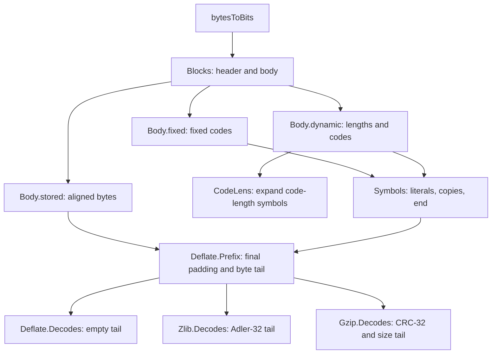

<!--
source: docs/format/model.md
source-sha256: 2986f41d1dd87b71c9106a86c01570bdff67bb2b562cc784a813b24631d04d8e
-->

# Lean 中的格式模型

[文档首页](../README.md) · [数据格式](README.md) · [API 指南](../api/README.md)

格式模型描述压缩字节如何确定未压缩字节。它没有堆或指针。
它是需要被精化的规格，不是流式 API 的实现。
规则见[格式指南](README.md)，调用、缓冲区和返回值见 [API 模型](../design/api-model.md)。
已接受的结果和剩余工作记录在 [overview](../overview.md)。

总入口模块是 [`ZlibF/Spec/Format.lean`](../../ZlibF/Spec/Format.lean)。
Token 扩展单独导入。下列定义位于命名空间 `ZlibF.Spec`，
但局部 token 关系位于 `ZlibF.Spec.Token`。

## 模块对应表

| 模块 | 使用的概念 |
| --- | --- |
| [`Bits.lean`](../../ZlibF/Spec/Format/Bits.lean) | 字节到位的顺序、数值读取器、大端和小端字节编码 |
| [`Checksum.lean`](../../ZlibF/Spec/Format/Checksum.lean) | 逐字节 Adler-32 和 CRC-32、更新函数与追加定律 |
| [`Huffman.lean`](../../ZlibF/Spec/Format/Huffman.lean) | Canonical code、接受的码长集合、固定编码、长度和距离表 |
| [`Deflate.lean`](../../ZlibF/Spec/Format/Deflate.lean) | 符号和块关系、raw 前缀关系与精确流关系 |
| [`Wrapper.lean`](../../ZlibF/Spec/Format/Wrapper.lean) | Zlib 和 gzip 头部、尾部及精确流关系 |
| [`Token.lean`](../../ZlibF/Spec/Format/Token.lean) | 单 token 解码与拒绝，以及将它们连接到块文法的义务 |
| [`Examples.lean`](../../ZlibF/Spec/Format/Examples.lean) | 具体的接受与拒绝示例 |

## 从字节到输出

`readBits`、`readBytes` 和 `decodeSym` 等读取器，返回 `none`，
或返回一个数值与剩余位组成的对。关系构造器要求相应的读取器等式成立。
无效块类型或保留的长度/距离符号都没有对应构造器。

`Symbols L D dict h inp rest out` 从历史 `h` 开始，使用字面量/长度码长 `L`
和距离码长 `D`，并在块结束符号处结束。它把 `inp` 消费到 `rest`，留下输出 `out`。
`copyBack` 在读取下一个字节之前，先追加当前复制的字节，
因此重叠匹配具有通常的逐字节含义。

`Blocks dict h inp rest out` 组合各个块体，直到一个 `BFINAL = 1` 的块。
块文法使用由完整输入字节导出的位。在这一入口条件下，`inp.length % 8`
是距离下一个字节边界还剩的位数；stored 块体丢弃这些位。

各公开格式关系的区别，在于最后一个块之后的要求：

| 关系 | 含义 |
| --- | --- |
| `Deflate.Prefix dict stream tail out` | 从 `stream` 起点解码块；忽略最后字节的填充；要求剩余字节等于 `tail` |
| `Deflate.Decodes dict stream out` | 同一关系，但 `tail = []` |
| `Zlib.Decodes dict stream out` | 恰好一个 zlib 流，具有已检查头部、可选字典 ID 和 Adler-32 尾部 |
| `Gzip.Decodes stream out` | 恰好一个 gzip 成员，具有可选头部 CRC，以及 CRC-32/大小尾部 |

封装把所要求的尾部字节作为 `Deflate.Prefix` 的 tail。
它们仍然描述精确流：尾部之后的字节被排除。
关于 `Z_STREAM_END` 之后剩余输入的 API 定理，需要单独的已消费前缀陈述。

## 规则对应表

`F-*` 规则定义于[格式指南](README.md)。本表定位其形式化对应物，
不作任何实现正确性的声明。

| 规则 | 定义或义务 |
| --- | --- |
| `F-bit-order` | `byteBits`、`bytesToBits`、`readBits`、`natToBitsMSB` |
| `F-block-type-3` | `Body` 没有类型 3 的构造器 |
| `F-stored-complement` | `Body.stored`：`nlen = 65535 - len` |
| `F-code-fits` | `count`、`codeStart`、`codeOf`、`Fits` |
| `F-code-complete` | `Complete`、`CodeKind`、`Acceptable` |
| `F-fixed-lengths` | `fixedLitLens`、`fixedDistLens`、`Body.fixed`；`Symbols.copy` 限制长度和距离符号 |
| `F-dynamic-limits` | `DynamicCountsOK`，由 `Body.dynamic` 要求 |
| `F-dynamic-repeat` | `CodeLens.rep16`、`.rep17`、`.rep18`；在前条目和总计数前提 |
| `F-dynamic-eob` | `HasEndOfBlock`，由 `Body.dynamic` 要求 |
| `F-dynamic-valid` | `Acceptable .codeLength`、`.litLen`、`.dist`，由 `Body.dynamic` 要求 |
| 动态头部顺序 | `Body.dynamic`、`clOrder`、`readCodeLenLens` |
| `F-length-table`、`F-length-284` | `lengthBases`、`lengthExtras`、`Symbols.copy`；基值 227 加额外值 31 仍为 258 |
| `F-distance-table` | `distBases`、`distExtras`、`Symbols.copy` |
| `F-match-copy` | `copyBack` |
| `F-distance-bound` | `Symbols.copy` 要求距离至多为 `(dict ++ h).length` |
| 块顺序与终结性 | `Blocks.more`、`Blocks.last` |
| `F-zlib-header` | `Zlib.HeaderOK`、`Zlib.windowSize`、`Zlib.Decodes` |
| `F-zlib-check` | `Zlib.Decodes` 要求 tail 为 `be32 (adler32 out).toNat` |
| Gzip 头部 | `Gzip.header`、`Gzip.Decodes` 中的头部约束 |
| `F-gzip-check` | `Gzip.Decodes` 要求 tail 为 `le32 (crc32 out).toNat ++ le32 (out.length % 2^32)` |
| `F-adler-incremental` | `adler32Update`、`adler32Update_append` |
| `F-crc-incremental` | `crc32Update`、`crc32Update_append` |
| `F-deflate-valid` | `Deflate.Valid`、`Zlib.Valid`、`Zlib.ValidWith`、`Gzip.Valid` |
| `F-deflate-matches` | 压缩器义务；格式文法中没有额外限制 |
| `F-deflate-flush` | 流序列义务；一次已完成的 flush 不是一个完整的最终流 |

`Valid` 谓词调换了 `Decodes` 的强调方向：压缩参数必须解码为所给输入。
它们不选定某一种编码。`Zlib.ValidWith` 提供预设字典；
列出的其他 `Valid` 谓词不使用字典。

## 模型选择与边界

**历史与小窗口。** `Symbols.copy` 使用完整的 `dict ++ h` 历史，
而不是显式的已保存窗口状态。距离表把引用限制在 32768。
zlib 头部的窗口字段限制初始字典后缀，但不会向 `Symbols.copy` 添加距离前提。
这样明确保留了现有模型选择：默认解码可以使用当前调用中超出小保存窗口的输出，
而后续调用可能无法再取得这些字节。C 中还有单独的 `INFLATE_STRICT` 检查。
对所有配置窗口和输出缓冲区边界的精化仍是 **to confirm**。
仅有声明式关系，不能建立每一种切分下的操作接受性。

**字典。** 存在 `FDICT` 时，`Zlib.Decodes dict` 检查提供的整个字典的 Adler-32，
但只把其最后 `Zlib.windowSize cmf` 个字节传给 DEFLATE 关系。
不存在 `FDICT` 时，传入 `[]` 并忽略 `dict`。
Adler-32 为 1 的字典可能为空。
Raw `Deflate.Decodes` 直接接收其字典历史。Gzip 从空历史开始。

**表的接受规则。** `Acceptable` 对三类编码都允许全零码长集合。
这种集合没有可解码符号。唯一的已使用符号码长为 1 的情形，
只对字面量/长度类别和距离类别允许。
`HasEndOfBlock` 单独排除了空的动态字面量/长度编码。
无论表被接受，还是局部 token 成功，都不能推出整个块有效。

**填充。** Stored 块对齐和最后字节填充会丢弃一些位，不要求它们为零。
额外的完整字节由显式 tail 处理，不属于填充。

**Gzip 元数据。** `Gzip.Decodes` 要求四个 `MTIME` 字节、为零的保留标志位、
小于 `2^16` 的额外字段长度，以及所选名称或注释中没有内嵌零字节。
除此以外，`FTEXT`、`MTIME`、`XFL` 和 `OS` 不受约束。
对应标志未设置的可选字段见证不贡献字节；空见证可以满足它们的约束。
一个关系覆盖一个成员，不覆盖整个拼接的 gzip 文件。

**局部解码。** `Token.Step` 描述一个字面量、匹配或块结束，
不假设后续输入有效。`Token.Rejected` 描述不可逆的无效编码或历史不可用情形。
目标 `step_composes_symbols`、`symbols_exposes_step` 和 `rejected_has_no_symbols`
把这些局部关系连接到原有的 `Symbols` 文法。
这一边界避免把未来能够有效完成，作为 API 调用已经返回的输出的前提。

## 哪些内容不属于格式关系

| 问题 | 规格边界 |
| --- | --- |
| 错误码、诊断字符串、`Z_NEED_DICT` 和字典调用顺序 | [Inflate API](../api/inflate-stream.md) |
| 缓冲区大小、部分输入、封装自动检测、预填和恢复 | [流 API](../api/streams.md)和 [API 模型](../design/api-model.md) |
| 压缩匹配选择、flush 完成和输出界限 | [Deflate API](../api/deflate-stream.md) |
| 拼接成员、透明读取和文件错误 | [Gzip 文件 API](../api/gz-file.md) |
| 校验值组合入口 | [校验值 API](../api/checksums.md) |
| 解码表分配和 `ENOUGH` 容量界限 | [表证明指南](../proof/inftrees.md) |
| 翻译后实现的内存安全、所有权和终止 | [安全要求](../safety.md)和[证明方法](../proof/method.md) |

`Examples.lean` 为规格提供具体的正例和反例检查。
其证明使用内核求值，以及关系构造器或反演。
这些示例帮助审查定义；它们不能建立定义与每一个 RFC 情形或翻译后实现的对应关系。
差分测试同样提供忠实性的证据，不是证明。
实现精化的接受状态见 [overview](../overview.md)。
