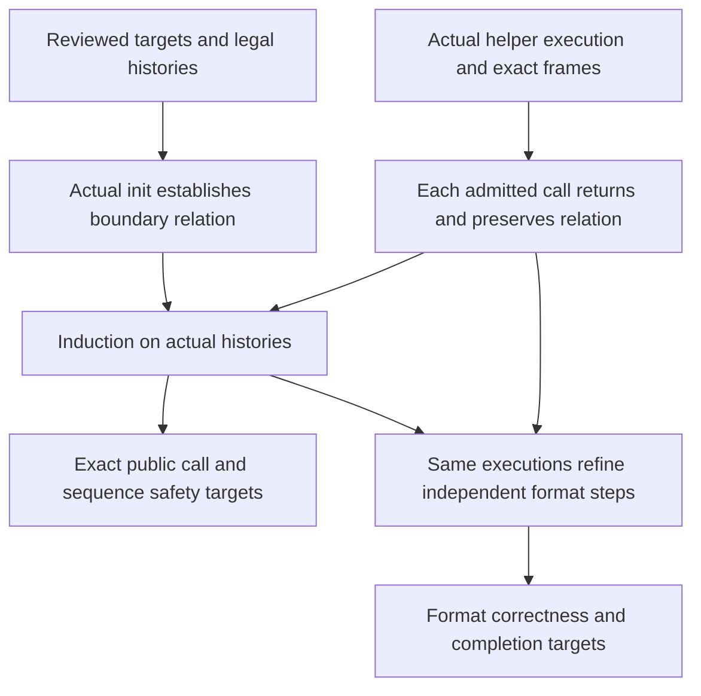

<!--
source: docs/proof/stream-composition.md
source-sha256: 780c0d86ba1b885140cec4a7dc8fc3fea8803972532f1386204a0370ef8c9845
-->

# 两个流引擎的证明架构

这是一套带有初步局部实现步骤的证明架构。显式的平台字节对象前提及其快速路径入口连接位于独立的 Lean 模块中。`Goal.inflate` 现在显式声明该平台前提；其结论、其他公开目标、翻译和运行时规则均未改变。有序工作和当前阻塞项只记录在[概览](../overview.md#stream-proof-route)中。

主要目标是 [`Streams.lean`](../../ZlibF/Spec/Public/Streams.lean) 中的 `Goal.inflate` 和 `Goal.deflate`。它们声明执行会返回、表示保持、计数、框架条件和所有权。它们本身不声明完整的格式结果。[`Sequences.lean`](../../ZlibF/Spec/Public/Sequences.lean) 中独立的 `Goal.inflate_sequence` 和 `Goal.deflate_sequence` 增加格式正确性和完成性。这四项义务都属于预期结果。

## 该架构的证据与限制

下面的结构在公开验证开发中有先例。本项目阅读了这些来源，但没有重新构建或独立审计它们。它们提供方法论证据，不是对这些固定目标的证明。

| 来源 | 相关证据与范围 |
| --- | --- |
| [直接 C 验证契约](https://github.com/genproof/zlib-full-auto-proofs-public/blob/37189f4964f99ba879a0a5fc6aa9d55754f29dea/CONTRACT.md) | 验证对象是一个带补丁的发布版本，包含配置变更和源码惯用写法修改。其主张排除终止性，并记录了尚未完成的充分性实例化。它不是此处选定源码的接受证据。 |
| [模式不变量](https://github.com/genproof/zlib-full-auto-proofs-public/blob/37189f4964f99ba879a0a5fc6aa9d55754f29dea/src/proof/inflate/Inv.v)、[加强的不变量](https://github.com/genproof/zlib-full-auto-proofs-public/blob/37189f4964f99ba879a0a5fc6aa9d55754f29dea/src/proof/inflate/Inv3.v)、[分支组装](https://github.com/genproof/zlib-full-auto-proofs-public/blob/37189f4964f99ba879a0a5fc6aa9d55754f29dea/src/proof/za/inflate/CasesAllZ.v) | 直接 C 证明区分机器良构性、内存表示、表覆盖和各个分支。分支证明沿贯穿执行路径逆向组合。其不变量修订也说明，为什么一个看似合理的全局条款必须对照 sync 和 reset 检查。 |
| [缓冲区对应](https://github.com/kim-em/lean-zip/blob/2f7a63f38195bc667a926881b55d10c9f8a88eeb/Zip/Spec/InflateBufCorrect.lean)、[产出正确性](https://github.com/kim-em/lean-zip/blob/2f7a63f38195bc667a926881b55d10c9f8a88eeb/Zip/Spec/InflateProductionCorrect.lean) | 具体的位缓冲关系支持逐操作对应、循环归纳，以及最终到独立格式的连接。其实现是另一个解码器。其[声明的限制](https://github.com/kim-em/lean-zip/blob/2f7a63f38195bc667a926881b55d10c9f8a88eeb/README.md#known-limitations)排除了流式 API。 |
| [已验证格式与解析器构造](https://arxiv.org/html/1609.01220v1#S5) | 论文利用前缀唯一性和可判定性组合关系式解析器。它验证一个新实现，而不是原始 C 引擎及其内存生命周期。 |
| [表安全定理](https://github.com/Certora/zlib-inflate-table-fv/blob/main/fv/InflateTableSafety.lean) | 该定理涉及表构造。它不建立周围公开流状态机的性质。 |

这些来源支持这种分解，而不是支持所有必要不变量都已成立的主张。尚未完成的局部义务和对实现就绪程度的判断见[概览](../overview.md#inflate-route-readiness)。

## 依赖方向

组织单位是实际执行上被保持的关系。辅助证明数量不是朝公开目标推进程度的度量。

对于每种流，用 `J h r g` 表示拟议的边界关系。这里 `g` 是逻辑历史，不是另一个实现或被调用函数契约。下面是示意性的证明义务，不是已有定理：

| 义务 | 所需论证 |
| --- | --- |
| 成功初始化建立 J | 在每条成功的参数和分配路径上使用实际初始化写入。 |
| 更换缓冲区保持 J | 精确使用当前的 `Rebuffer` 关系。任何借用内存的前提都需要依据。 |
| 从 J 开始的操作返回并建立 J | 证明实际调用，包括所有允许的错误返回、其框架条件和分配账本。由 J 和当前参数提供它的局部前提。 |
| 复制传递 J | 重定位所拥有的引用并复制逻辑历史。分别证明源保持和每种失败清理。 |
| 可达性蕴含 J 存在 | 使用前述执行定理，对 `StreamReachable` 的构造器归纳。 |
| 结束操作释放所有权 | 使用同一个边界关系和精确的活块计数。 |

操作证明不能要求之后由历史引理才会建立的公开目标。它可以要求 J，而 J 的初始化和保持是另外需要证明的义务。`StreamReachable.step` 中记录先前成功执行的等式是关于该次执行的证据。它不允许假设该执行的规格，也不允许省略下一次调用会返回的证明。被拒绝的调用在正常返回时也会成为可达历史。

两个复制构造器只记录成功的目标历史。它们不完成分配失败清理或源保持。这些仍然属于具体的复制论证。

## 检查各部分能够组合

扩展分支证明之前，记录它精确的输入和输出关系。生产者的结论必须在同一个堆和寄存器上蕴含消费者的前提。两个定理名称都存在是不够的。

对于 inflate，这种组合具有六个固定接口。表中名称是示意性的，不是库中已经实现的声明。

| 接口 | 义务 |
| --- | --- |
| 初始化 | 实际成功初始化建立持久安全关系。无效参数和分配失败退出各自保留精确且独立的清理契约。 |
| 入口 | 实际入口检查和 LOAD 后，持久关系与当前公开参数建立 `L(mode, heap, IL, history)`。 |
| 分派 | 对于每个允许的模式，实际执行要么在下一个分派点建立 L，要么建立精确的退出关系。贯穿执行的被调用函数由其已证明的执行结果组合。 |
| 终止 | 每次继续分派都使一个有界秩递减。每个嵌套循环都有自己的界，且低于实际 fuel 限制。 |
| 退出 | 每种退出类型证明精确的返回、计数、框架条件、所有权，以及恢复后的持久关系。直接返回和 `inf_leave` 具有不同义务。 |
| 历史 | 每个允许的辅助操作、成功复制构造器和缓冲区更换都保持持久关系。复制拒绝和清理具有独立的全定义性义务。归纳随后在公开调用处提供该关系。 |

这些接口合起来为公开调用目标提供充分的证明提纲。它们必须用已证明的执行引理实例化，不能保留为假设的库契约。格式精化和完成性在同一批执行上增加各自的关系和进展论证。

一种有用的终止设计跟踪剩余未读比特、输出空间，以及静默控制转换的秩。快速路径的字节回退必须保持未读比特计数。静默转换图不能存在未计入的环。这是一种要对照所有分支检查的设计，不是已经证明的秩，也不是任意选择 fuel 常数的理由。

表的生产者也需要两个不同结论。安全性要求有界的根表/子表访问和有效的叶子形状。功能精化还要求这些表项描述独立的 canonical code。码长可接受或写入足迹安全，都不能单独蕴含消费者需要的任一种完整结论。

### inflate 的模式接口

下面是基于源码的接口设计，需要通过初始化和保持证明来 **to confirm**。这些事实在相应模式到达对应访问时适用。它们不是新的公开假设。每一行还都携带共同的堆所有权、游标范围、持有比特关系和精确的允许写入。

| 模式或源码组 | 读取时需要的事实 | 建立它们的转换或操作 |
| --- | --- | --- |
| HEAD | 封装的可选情况；测试头部前持有足够比特；安全选择窗口大小。Raw 入口有不同分支。 | 成功初始化或 reset；sync 的精确恢复效果。 |
| FLAGS, TIME, OS, EXLEN | 所请求位宽有效、已经解析的封装上下文和允许的头部记录写入。 | 前一个封装阶段和实际位操作。 |
| EXTRA, NAME, COMMENT, HCRC | 当前字段进度和调用者容量；实际前缀上的头部校验；缓冲区耗尽保持解析位置。 | 前一个头部阶段、较早调用和当前借用内存协议。 |
| DICTID, DICT | 已解析的字典标识；精确的需要字典和字典接受状态。拒绝不会产生输出。 | 头部解析、字典安装和 reset。 |
| TYPE, TYPEDO | 最后块标志和边界语义；固定表安装或经过检查的动态/存储块选择。 | 初始化、raw HEAD、完成的复制/符号块、reset 或恢复。 |
| STORED | 字节对齐；四字节长度/补码检查；成功时安装的长度至多 65535，且没有持有比特。 | 块类型选择和实际头部读取。 |
| COPY_, COPY | 剩余存储字节；有界的输入/输出视图；所需不重叠条件；精确消费和产生的前缀。 | 成功的 STORED 或前一次部分复制。 |
| TABLE | 后续使用数组前已有十四个头部比特，以及经过检查的字面量/距离计数。 | 动态块选择。 |
| LENLENS | `have ≤ ncode ≤ 19`；按源码所选顺序初始化的三位长度值。成功构造会安装码长表关系。 | TABLE 和较早的 LENLENS 迭代或调用。 |
| CODELENS | `have ≤ nlen + ndist`；有效码长表；重复符号 16 之前已初始化的前一个长度；写入前证明重复次数装得下。成功的构造器会安装两张数据表关系。 | LENLENS、实际重复处理和实际表调用。 |
| LEN_, LEN | 有效的字面量/长度表和距离表、叶子/链接边界及编码含义；进展，以及选择快速分支守卫时所需的每个快速调用前提。 | 固定表安装、成功的 CODELENS 或前一个符号。 |
| LENEXT | 长度基值和至多五个额外比特；最终长度至多 258；经过检查的 `back` 计数。 | 实际有效的长度叶子。 |
| DIST | 有效距离查找和有界根表/子表位数；正长度和经过检查的 `back`。 | LENEXT 和实际查找操作。 |
| DISTEXT | 正距离基值、至多十三个额外比特，以及至多 32768 的最终距离。 | 实际有效的距离叶子。 |
| MATCH | 正的剩余长度；写入前有输出空间；来源是已产生前缀或经过检查的保留历史。逐字节复制也覆盖重叠。 | DISTEXT 和前一次部分匹配。 |
| LIT | 字面量值和写入前的输出空间；精确增加一个字节的历史。 | 实际的字面量叶子。 |
| CHECK, LENGTH | 实际输出上的封装校验/长度；区分已经提交的总量与源码对局部 `out` 计数器的重新赋值。 | 最后块完成和较早的部分尾部调用。 |
| DONE, BAD, MEM, SYNC | 精确的终结/错误效果和退出类型。保持清理所需性质，而不要求已经放弃的解析/表数据在语义上仍可使用。 | 成功完成、检测到数据错误、分配失败或恢复。 |

贯穿执行链内部的组装顺序从尾部开始：MATCH 支持 DISTEXT，然后是 DIST 和 LENEXT，再到慢速 LEN 分支。类似的链是 COPY 先于 COPY_ 再先于 STORED，CODELENS 先于 LENLENS 再先于 TABLE，以及 DONE 先于 LENGTH 再先于 CHECK。这些是证明依赖。翻译后的源码顺序保持不变。

分派循环闭合链之间的环。其不变量必须在调用返回后继续保留任何待完成匹配、存储块复制或表构造工作。有限见证不能建立这种全称闭合性。

## 不同执行点上的关系

J 包含安全与所有权部分，以及语义历史部分。两者指向同一个堆、状态记录和实际执行。公开的 `Good` 和 `DGood` 定义保持固定。辅助关系补充它们缺少的前提；它不暗中加强公开允许域。

每个条款都在需要它的访问或转换处得到依据。没有建立执行的更大合取式只会转移缺口。逻辑历史始于实际初始化事件，并随观察到的调用效果改变。不能重新选择历史来假设期望的格式结果。

API 边界关系不同于函数内部不变量。在 inflate 中，`LOAD` 把游标和位状态传送到 `IL`。分派期间，当前值位于这些寄存器中。堆字段可能仍然保留入口值。因此，分派点上的关系依赖上下文、堆、寄存器和逻辑历史。它不能在对应的 `RESTORE` 写入前要求寄存器/堆相等。

在 deflate 中，初始化构造、普通流处理、块构造和块发射具有不同义务。部分分配的状态不能满足 `DGood`。发射状态需要未读符号边界，而 API 返回需要有效的 pending 输出区间。这些关系之间的每个蕴含都在实际建立它的源码位置证明。

幽灵历史记录接受的输入、发射的输出、支持比特、字典上下文、封装/校验状态和待完成工作。它包含逻辑值，而不是与调用者旧缓冲区永久相等的关系。更换缓冲区可以替换或释放那些缓冲区。Reset 和恢复具有显式的历史效果。Copy 共享逻辑历史，同时分配独立的私有存储。调用序列格式结果使用它们现有的精确数据轨迹域；安全性覆盖更广的操作历史。更广的功能覆盖必须明确声明，不能归因于一个普通数据阶段。

## Inflate 关系

第一个表条款具有具体的 Lean 接口：[`DataTableInvariant`](../../ZlibF/Spec/InflateTableInvariant.lean)。它受保留数据表的模式守卫约束。因此，成功初始化在 HEAD 建立该条款，而不声称尚未构造的表有效。实际的固定表 TYPEDO 分支在 LEN_ 建立它。调用者更换缓冲区时，利用私有状态和静态框架条件传递同一条款；不需要与已丢弃的调用者缓冲区相等。

后续 DISTS 构造器写入与 LENS 相同的 code 数组。其实际写入框架保留第一张表返回的范围，而不是要求整个底层数组不变。对应的执行定理在同一个返回堆上保留表安全性、读取范围和精确查询结果。生成第一张表的构造器必须建立安全性和范围输入。它们当前的证据和状态见[概览](../overview.md#checked-table-clause-composition)。

Inflate 的 J 在 `Good` 可提供的事实之外，增加了受当前模式守卫约束的事实。它不要求所有旧字段或表单元在每个模式中都有意义。

| 部分 | 事实的含义和来源 |
| --- | --- |
| 存储 | 状态/窗口所有权、数组范围、静态内容和已写入指针字段来自初始化和实际写入。 |
| 模式 | 每个实际到达的访问都具有所需计数、位宽或已初始化前缀事实。COPY 有剩余存储字节；CODELENS 有有界计数和已初始化长度；MATCH 有具备依据的待完成复制。 |
| 表 | 构造阶段只有已经建立的已初始化范围。安装后的阶段具有实际选中堆数组的根表/子表覆盖、叶子标志、位宽和编码含义。 |
| 比特 | 支持比特和持有的预读具有不同角色。补充、丢弃、快速路径回退和预置位在各自实际源码位置保持该关系。 |
| 历史 | 窗口内容是按时间顺序保留的历史。字典上下文和输出彼此区分。匹配也可以使用当前调用的输出前缀。 |
| 封装 | 解析位置、校验值、头部写入和所需字典检查遵循实际产生的字节和模式。 |

`inflate_table` 必须在其返回堆上产生已安装表关系。数组层的 canonical 覆盖本身不能做到这一点。选中的快速分支随后必须从同一张表、当前缓冲区和环形历史导出现有快速解码器的前提。即使某个开发里程碑先覆盖慢速解码，快速执行也仍是公开翻译的一部分。

入口/退出证明把 J 与分派关系连接起来。它包含提前返回、局部头部数组的生命周期、`inf_leave`、计数器写回，以及较晚发生的窗口分配失败。特别地，输出和游标变化可以发生在 `Z_MEM_ERROR` 之前，而已存储的总量仍保留旧值。成功和失败退出不能共用一个虚构的状态不变后置条件。

终止性使用实际分派点之间的进展。输入消费、输出产生、剩余复制/表工作，以及有界的静默模式变化，都是组合度量的候选项。单独的模式编号不会递减：块和符号会重新访问模式。每个翻译循环也需要低于各自 fuel 上限的数值界。数学轨迹有限是更弱的结论。

## Deflate 关系

初始化论证为已分配块和到目前为止已写入的字段使用一个构造关系。它覆盖全部五次分配、任意旧整数内容和每种允许的分配 oracle。状态分配成功后，源码会先尝试全部四次缓冲区分配，再检查它们的合并结果。清理必须解释每个已获得的块，包括较早缓冲区分配失败之后发生的分配。

`DGood` 已经包含树不变量。应用一个假设 `DGood` 的 reset 定理，不能为新状态建立 `DGood`。已有 `resetKeep_run'` 使用 `DLive` 和 `TreesBase`，而 `tr_init_spec` 从 `TreesBase` 建立 `TreesInvAt`。它们与 `lm_init_run` 一起为构造提供具体起点；其剩余前提仍须从实际初始化写入导出。

| 部分 | 事实的含义和来源 |
| --- | --- |
| 窗口 | 真实输入和保留历史满足窗口界。滑动改变表示所用的坐标。有符号 `block_start` 可以为负。 |
| 链 | 用实际的 `head`、`prev` 和窗口数组实例化已有 `HashChains`。通过插入、滑动、字典替换和 reset 导出其 `top` 与 `lim`。 |
| 匹配 | 选中的字面量或匹配精确消费相应输入。慢速策略还跟踪推迟的字面量和前一个匹配。 |
| 符号 | 存储的三元组保持原始值、允许域和频率贡献。这些事实一直保留到各个三元组被读取。 |
| 发射 | Pending 字节、位缓冲内容、未读符号、树描述和块成本在同一次执行上保持一致。 |
| 头部/状态 | 在经过审查的调用者协议下，头部进度和状态蕴含所需的当前借用存储及索引界。 |

`HashChains`、`chains_insert`、`chains_slide` 和 `chain_ok_of_chains` 已存在于 [`deflate.c.engine.chains.lean`](../../ZlibF/Proof/deflate.c.engine.chains.lean)。它们是有用的数学关系和蕴含。它们还不是对所有可达引擎状态的证明。类似地，`longest_match_ok` 在 `LMEnv` 下提供一个实际执行定理；调用者必须建立该环境。搜索终止还必须覆盖通过 `deflateTune` 允许的值，不能假设没有依据的正链预算。

### 共享输出缓冲区是核心依赖

F9 是发射过程的时间性性质。每次写入时，输出都保持在未读符号字节之前；最后一个符号之后，结束码和对齐仍装得进分配空间。仅有分配容量界是不够的。

证明使用实际前缀位成本、当前缓冲位数和下一次写入的精确位宽。一个三元组只有在它的三次源读取都完成后才算已消费。树描述必须在第一次此类读取之前装得下。只有最终刷新才能使用全部已消费符号释放的空间。

入口界 H0 必须从每个真实调用者推出，包括头部、恢复的 pending 输出和参数变更。它不是公开假设。之后，从这项前缀计数中满足已有的发送符号所需十五位空间前提。动态块选择比较总尺寸；它不能单独证明每个前缀都不会追上未读区。此处使用的任何频率/成本引理都必须来自实际构造的树，并覆盖内存级别 1 到 9。小内存级别属于最初的公开允许域。

块编码论证不要求最优压缩或可能的最长匹配。它要求每个选中的符号重现已接受输入，而且实际编码比特能解码为那些符号。这样，策略正确性就归结为产生有效符号。F9 或完成性使用的成本性质仍然需要各自精确的证明。

## 复用与接受

相关存储不变时，已有精确执行等式和框架条件可以传递新增条款。发生变化的条款需要有针对性的保持证明。一个未改变、基于 `Good` 的函数定理本身不能建立 J，但也不需要将它丢弃或机械重写。

存储块和仅字面量压缩是有用的组合里程碑。它们的限制属于内部定理陈述。它们不完成不受限制的公开目标。辅助声明遵循现有按源码文件组织的证明结构。不依赖堆的历史和成本论证属于数学层。该架构不需要新的运行时或验证框架。

每个有用里程碑都要指出建立其前提的调用者，以及下一位使用其结论的消费者。新的不变量定义即使放在证明模块中也属于语义材料；它们需要现有审查和锁定流程。公开结果仍然要求精确目标登记、直接翻译变异、公理门槛，以及具名提交上的全部四项 CI 检查。抽象模型结果支持最后的精化步骤，但不能替代它。
