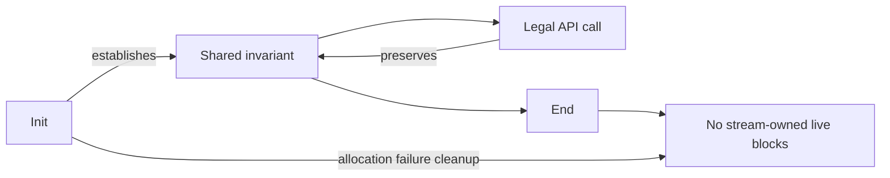

<!--
source: docs/safety.md
source-sha256: 8f2192306368520a9494aa5b5825241524bae90963e8d96d4b3f719766083ced
-->

# 安全声明与调用者义务

目标是让 `zlib.h` 允许的每次调用都避开未定义行为、能够返回，并保持内存所有权。
这是目标，不是所有函数都已证明的声明。[Overview](overview.md) 记录已检查状态与剩余工作。
[证明方法](proof/method.md) 解释这些义务怎样成为 Lean 定理。
[信任基础](trusted-base.md) 说明，模型结果适用于 C 之前，哪些地方还需要独立论证。

## 1. 函数定理必须陈述什么

对于每个允许的调用者状态和参数，翻译后的函数都不产生故障地返回。
它保持共同的表示不变量，只改动允许的内存，并交代每一次分配和释放。错误返回也包括在内。

| 条款 | 必需的结论 |
| --- | --- |
| 无故障 | 执行有结果，而不是 `Fault.ub` 或 `Fault.outOfFuel`。 |
| 保持 | 下一次合法调用仍能使用相同的表示不变量。 |
| Frame | 调用足迹之外的内存不变。 |
| 所有权 | 流拥有的活块严格按分配和释放的要求变化。 |

初始化必须从允许的调用者状态建立不变量。被调用函数的契约是关于该函数的已证明定理，
不能通过假设它成立来完成调用者的证明。顶层定理还需要具体见证。
无论是一个见证，还是一个不可能满足的不变量，都不能替代对所有允许参数的覆盖。

无泄漏涉及整个生命周期。初始化成功后，所分配的内存继续归流所有。
End 恰好释放一次每个自有块。初始化失败则释放其分配的全部内存。
End 或初始化失败后的活块集合，等于初始化前的活块集合。复制和部分失败路径也需要相同的核算。
操作失败后必须留下这样的状态：文档规定的恢复或结束操作仍然安全。

## 2. 调用与序列

序列安全属于目标。只有在初始化建立不变量、且每个允许的转换都保持它之后，才能通过归纳推出序列安全。
这包括重置、字典、预置位、复制、恢复和结束。一组彼此孤立的函数引理还不够。

终止意味着每个循环都在其 fuel 界限之前完成。运行时使用 `2^64` 次迭代；
耗尽它是单独的故障。在这里，终止和泄漏都属于安全义务，虽然两者本身都不是 C 未定义行为的实例。

## 3. 故障、未定义行为与模型缺口

下面的标识符命名安全义务。运行时故障可以检测许多违反行为。
但仅凭它们不能建立 C 安全性：本节以及 [trusted-base.md 第 2 项](trusted-base.md#2-runtime-and-object-schema)
中的例外仍然属于论证的一部分。

| ID | 义务 | 重要的主要原因 |
| --- | --- | --- |
| U1 | 不在对象范围之外读写 | 缓冲区索引和表访问需要边界。 |
| U2 | 指针算术留在对象内或恰好越过末尾一个位置 | 偏移更新和回引用复制需要存活且有界的指针。 |
| U3 | 不解引用空指针 | 流、状态、窗口和头部访问需要相应的活指针。 |
| U4 | 不在释放后使用，也不重复释放 | 所有权必须贯穿复制、失败和结束。 |
| U5 | 不无效使用未初始化数据 | 垃圾值不能变为未经检查的索引或地址；指针字段需要先写后读的论证。 |
| U6 | 不发生有符号溢出 | 计数器、位置和转换需要明确的范围检查。 |
| U7 | 不发生无效移位 | 位数必须非负，并小于操作数提升后的位宽。 |
| U8 | 不写只读对象 | 静态数据和不可变字节块必须保持不变。 |
| U9 | 不进行重叠的 `memcpy` | 复制需要互不相交的区间；重叠复制使用 `memmove`。 |
| U10 | 访问遵守 C 的类型与对齐要求 | 对象堆没有记录的一般字节视图、类型标签或完整 ABI 布局。CRC 字读取需要独立审查。 |
| U11 | 每次调用都终止 | 循环度量必须排除 fuel 耗尽。 |
| U12 | 不泄漏内存 | 每个出口都必须保持所有权或执行精确清理。 |

翻译中的无符号算术会回绕。有符号算术和移位由翻译中的操作检查，
而不是由计算 monad 自动检查。`Ptr.add` 允许 `NULL + 0`。
`Ptr.diff` 拒绝空操作数，而压缩器的 `ptrDiff` 辅助函数对两个空指针返回零。
这些是模型选择，不是对应 C 表达式具有有定义语义的证据。

### 未初始化内存

新整数单元包含来自 `Heap.garbage` 的任意值。定理必须对每个垃圾值函数成立。
在一次执行中，模型为每个单元指定一个固定值；重复读取结果相同。
它不表示每次读取都重新取得一个未指定值。证明不得用这种一致性来论证 C 行为。
字节复制也会复制这些值，包括垃圾值。

这对 `slide_hash` 很重要，因为它访问未清除的 `prev` 条目；也对 `longest_match` 很重要，
因为它比较真实输入数据之外的字节。源码注释解释了预期的结果与这些内容无关。
这种解读仍需相关执行证明确认，标为 **to confirm**。
仅对任意值量化，不能证明输出独立性，也不能证明哈希链遍历只到达写入了真实位置的条目。

模型中的新指针字段为 NULL。这弱于跟踪未初始化指针：与 NULL 比较、复制和 `free(NULL)`
可以成功，而不检测缺失的写入。因此，每次读取指针字段，都需要此前写入的证据。
两个状态初始化翻译明确将分配的状态记录清零。这并不初始化所有调用者记录或自动流记录。
压缩器的自动流起初具有任意整数字段和模型空指针；它的字段写入必须遵循 C。

### 对象表示

声明的记录数组长度需要 `WellFormed` 和 `Heap.RecordsWellFormed` 假设。
静态长度需要 `Statics.WellFormed`，而值必须与翻译后的 C 表匹配。
Lean 的 `Array` 类型不强制其 C 长度。分配需要 `Fresh`，以及有效的跨表块身份规则。
模型没有初始化位或分配来源标签。只读标志覆盖字节块和已表示的静态对象，而非所有有类型对象。

指针相等使用对象身份和偏移。不同对象比较不等，比较悬空指针也不产生故障。
在 C 不保证这些结果的地方，证明不得依赖它们。CRC 地址辅助函数只表示地址的低三位。
堆字节块保留起点对齐约定。静态和嵌入式字节对象具有任意且稳定的起点余数。
这不是一般的 ABI、有效类型或标量别名模型；这些限制仍记录在[偏差](deviations.md)中。

## 4. 调用者义务

公开定理必须明确写出这些义务，并区分两类情况：需要干净错误返回的无效参数，
以及处于 C API 定义域之外的输入。

| ID | 义务或范围 |
| --- | --- |
| A1 | 非空流参数指向一个活的 `z_stream`；初始化前按要求设置分配器字段。文档规定为拒绝的空指针情况仍在覆盖范围内。 |
| A2 | 调用者提供操作所需的可读输入区间和可写输出区间。 |
| A3 | 缓冲区分离遵循入口的明确前置条件。归因于 `zlib.h` 的通用分离要求仍为 **to confirm**；更强的限制应放进[偏差](deviations.md)。 |
| A4 | 同一流上的调用不并发。 |
| A5 | 初始目标使用默认分配器。它的分配失败仍在范围内。 |
| A6 | 排除结束或关闭后的使用；文档规定的重新初始化开始新的生命周期。 |
| A7 | 每个标量值都要分类为：文档规定的正常用法、文档规定的拒绝，或明确的调用者限制。不能悄悄省略无效值来避开错误路径检查。 |

## 5. 其他性质

还要求功能正确性，见[格式](format/README.md)和 [API 契约](api/README.md)。
畸形输入仍属于安全定义域；错误返回不能掩盖故障。
自定义分配器和其他上游配置，在初始默认 x86_64 Linux/LP64 静态构建目标之后处理。
编译器与操作系统正确性、性能、栈边界，以及针对解压炸弹的资源限制，不在模型内。
[信任基础](trusted-base.md)记录这些边界。
