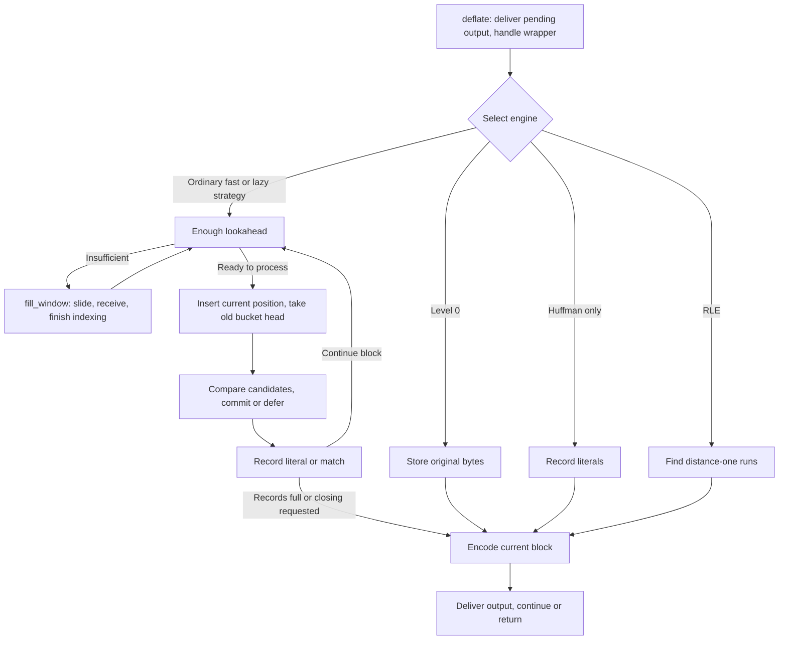
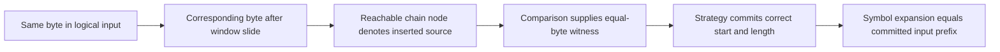

A compressor first chooses a representation for the original bytes. It can submit the byte at the current position as a literal, or describe a repeated passage by a backward distance and a copy length. That choice affects compression ratio, while the represented input must stay the same.

This chapter follows one `deflate` call as far as symbol records. We enter the actual strategy loop before opening its window, index and byte comparisons. Our search example has the history `ABCQABCR`, followed by the current input `ABCQABCX`. The nearer source matches three bytes; the older source matches seven. A separate legal 512-byte window configuration gives concrete addresses for array sliding.

## Entering the strategy loop from a public call {#dispatch}

The caller supplies this call's input through `next_in` and `avail_in`, and space for compressed bytes through `next_out` and `avail_out`. `deflate` checks the call state, delivers existing pending bytes and handles the selected wrapper's header. When it reaches payload processing, it chooses a compression engine. These four consecutive lines come from `deflate.c`: `s` points to internal state, `flush` is the request, and `bstate` receives the engine's internal result.

```c
bstate = s->level == 0 ? deflate_stored(s, flush) :
         s->strategy == Z_HUFFMAN_ONLY ? deflate_huff(s, flush) :
         s->strategy == Z_RLE ? deflate_rle(s, flush) :
         (*(configuration_table[s->level].func))(s, flush);
```

Branch order matters. Level 0 selects stored bytes first. At nonzero levels, `Z_HUFFMAN_ONLY` generates literals, and `Z_RLE` specializes in repetitions at distance one. Other strategies use the fast or lazy engine selected by the level table. Each produces representations admitted by DEFLATE.



The ordinary loop repeatedly prepares input, finds candidates, decides and records symbols. A full record buffer invokes the block encoder. Exhausted caller output can return control to the outer function. `need_more`, `block_done`, `finish_started` and `finish_done` are internal results; the outer function uses them to update state, handle a flush or trailer and return public results such as `Z_OK` or `Z_STREAM_END`. One return from `deflate` therefore does not correspond to one complete block.

## Configuration changes the execution path {#configuration}

Fix the ordinary build for this chapter: `FASTEST` is disabled, and match comparison uses the bytewise branch. With `deflateInit`, `Z_DEFAULT_COMPRESSION` normalizes to level 6, the default window exponent is 15, `memLevel` is 8, and the strategy is `Z_DEFAULT_STRATEGY`. The table below describes those source settings. After tuning, the saved field values determine the search.

| Parameter | What it changes directly | Effect on execution |
| --- | --- | --- |
| `level` | Engine and search thresholds | 0 uses stored bytes; 1–3 use `deflate_fast`; 4–9 use `deflate_slow`. |
| `strategy` | Match policy or block-coding restriction | `Z_HUFFMAN_ONLY` bypasses matching; `Z_RLE` uses distance one; `Z_FILTERED` adjusts short-match decisions in the lazy engine; `Z_FIXED` retains matching and excludes dynamic block selection; stored blocks remain possible. |
| `windowBits` | Wrapper and window scale | Changes retained bytes and search distance; the wrapper also selects headers, trailers and checksums. |
| `memLevel` | Hash buckets and symbol-buffer size | More buckets usually separate candidates better; larger record capacity can accumulate more symbols. Both use memory. |
| `flush` | Whether to wait for more input, close a block or finish the stream | Changes when the loop may wait and how it commits the input tail. |

The ordinary build accepts levels 0–9 and the default-level value; the method must be `Z_DEFLATED`. The selected default build accepts `memLevel` 1–9. Positive `windowBits` 8–15 choose the zlib wrapper, −9 through −15 choose raw DEFLATE, and 25–31 choose gzip. Zlib's 8 normalizes to 9; raw −8 and gzip 24 are rejected. The ordinary compressor window scale in this chapter is consequently 512–32768 bytes. These gzip parameter ranges assume the default gzip-enabled build; defining `NO_GZIP` removes gzip wrapper creation.

The worked runs start without a preset dictionary. When a stream is initialized with one, its retained suffix supplies initial match history rather than being emitted as a new prefix of the decompressed message. The corresponding content relation starts with that dictionary context and compares only newly expanded bytes with the committed original input.

`deflateParams` can change level and strategy on a live stream. If the strategy or engine class changes after processing has started, it first runs the existing work with `Z_BLOCK`; if old input or block work cannot be cleared, it returns `Z_BUF_ERROR`. Configuration cannot simply be replaced in the middle of an arbitrary record. `deflateTune` writes the four search parameters, replacing the level table's values. It converts three parameters to `uInt` and stores `nice_length` in a signed field; exact execution reasoning uses those machine values.

Compile-time choices also change the algorithm. `FASTEST` normalizes every nonzero level to 1, uses simplified matching and omits ordinary predecessor-chain maintenance. `UNALIGNED_OK` selects two-byte probes and comparisons, with requirements on short-integer width, addresses and access rules. Those branches have their own conditions; the C comparison below is the ordinary bytewise branch.

## The window retains candidate source bytes {#window}

Return to `ABCQABCX` after `ABCQABCR`. Finding the length-7, distance-8 match requires the earlier `ABCQ` to remain readable. Since input can grow indefinitely, the retained range must be bounded. A sliding window keeps recent bytes available to later references.

First see the purpose with a smaller teaching input, `0123ABCDABCDwxyz`, after `0123ABCD` has been processed. The second `ABCD` can refer four bytes back to the first. The animation reduces retention to eight bytes. It illustrates a logical recent suffix, not a legal zlib window parameter.

<div class="zl-demo-mount"><zlib-demo kind="window"><p>The second ABCD uses distance 4 and length 4. The latest eight bytes become ABCDABCD, then ABCDwxyz after wxyz. Bytes outside retention cannot supply a new reference.</p></zlib-demo></div>

The actual compressor reduces copying by allocating one contiguous `2W`-byte array. `W` is the configured scale stored in `w_size`. The array holds both processed history and received input whose representation has not yet been decided. Byte comparisons advance through contiguous array positions.

`strstart` is the array index of the current processing position. `lookahead` counts real loaded bytes starting there. The real data ends at `strstart + lookahead`; free space follows it. Array indices change during a slide, while a byte's logical position in the entire input stays fixed.

```text
window, capacity 2W
[ processed bytes ][ received, unprocessed bytes ][ room for more input ]
                   ^ strstart                    ^ strstart + lookahead
```

A DEFLATE match copies at least 3 and at most 258 bytes, named `MIN_MATCH` and `MAX_MATCH` in the source. Before deciding, the strategy normally prepares enough lookahead for a maximum match and for indexing following three-byte strings. This target, `MIN_LOOKAHEAD`, is `258 + 3 + 1 = 262`. At end of input or on a flush, the loop also handles a shorter tail.

Ordinary search reserves room for those reads, so its maximum backward search distance is `W - 262`, named `MAX_DIST(s)`. Default W=32768 gives 32506 bytes. The DEFLATE format still permits distance 32768; this is the compressor's search limit. A byte can physically remain in the array while already falling outside the permitted candidate range.

## Refilling input and sliding in batches {#refill}

`fill_window` first computes free tail space: `more = window_size - strstart - lookahead`. Ordinary `window_size` is `2W`. Near the array end, when `strstart ≥ 2W - 262`, it moves the retained upper region to low addresses before receiving more input.

Take legal W=512, `strstart=800` and `lookahead=100`. Real data ends at index 900, leaving 124 free bytes. The slide threshold is 762, so the 388 bytes in `[512,900)` move to `[0,388)`. The current start becomes 288, with lookahead still 100. Candidate 700 becomes 188, retaining distance 100: `800−700 = 288−188`.

The actual C changes bytes and positions together. `wsize` is a local copy of W; signed `block_start` identifies the current block's original-byte start:

```c
zmemcpy(s->window, s->window + wsize, (unsigned)wsize - more);
s->match_start -= wsize;
s->strstart    -= wsize; /* we now have strstart >= MAX_DIST */
s->block_start -= (long) wsize;
```

The code then limits deferred insertion, calls `slide_hash` to translate saved head and predecessor positions, and increases the free-space count. `block_start` may become negative: the original beginning of the current block can have left the array. Choosing a stored block later therefore also requires its original byte range to remain readable.

With space available, input is appended after existing data. `read_buf` receives the call's input and a capacity bound and returns the number actually copied, `n`:

```c
n = read_buf(s->strm, s->window + s->strstart + s->lookahead, more);
s->lookahead += n;
```

It reads at most `min(avail_in, more)` bytes, advances the caller's input pointer and updates consumption and the selected wrapper checksum. `lookahead` grows only by the actual count. Receiving bytes and committing them to symbols are distinct events: the former advances `next_in`, while the latter depends on the strategy.

The loop tries to obtain 262 bytes while caller input remains. Under `Z_NO_FLUSH`, insufficient lookahead may return `need_more` and wait. The last one or two positions may lack a complete three-byte key; `insert` retains that deferred indexing work until more bytes arrive.

A separate boundary protects speculative comparisons. Fast comparison can inspect bytes after real input, while still inside the allocated array. `high_water` marks the initialized prefix. The source clears up to 258 bytes beyond real data as needed, capped by allocation size. This makes locations readable without making the zeros new input. The returned match length remains capped by `lookahead`.

## Three-byte hashing and candidate chains {#hash}

Keeping bytes does not make it cheap to compare every earlier start. Zlib hashes the next three bytes into a bucket and visits earlier positions in that bucket. Equal three-byte strings share a bucket; collisions also put different contents together. A bucket supplies candidates, not a byte-equality result.

Default `memLevel=8` gives 32768 buckets: `hash_bits=15`, with `hash_mask=32767`. Each new byte shifts the running hash by five, XORs the byte, and retains the low fifteen bits:

```text
h := ((h << hash_shift) XOR next_byte) AND hash_mask
```

Reading A, B and C changes the hash from 0 to 65, 2146 and 3075. Adding D gives 36, also obtained by hashing B, C and D from zero. Repeated shifts remove the older byte's contribution through the mask, letting `ABC` advance to `BCD` without recalculating the whole key.

The head table `head` holds the newest position in each bucket. The predecessor table `prev` gives an inserted position's earlier same-bucket candidate. Inserting p first takes the old head as the candidate and predecessor, then publishes p as the new head. The ordinary macro preserves that order:

```c
#define INSERT_STRING(s, str, match_head) \
   (UPDATE_HASH(s, s->ins_h, s->window[(str) + (MIN_MATCH-1)]), \
    match_head = s->prev[(str) & s->w_mask] = s->head[s->ins_h], \
    s->head[s->ins_h] = (Pos)(str))
```

`str` is the inserted position, `ins_h` the running hash and `match_head` the old bucket head. Searching from that old head avoids using the current position as its own source. Zero is the `NIL` sentinel, not an ordinary candidate.

`prev` has only W slots, selected by `p & (W−1)`, equivalent to p modulo W. At W=512, positions 100 and 612 reuse slot 100; their distance 512 exceeds this configuration's 250-byte search bound. This circular reuse belongs to the **predecessor table**. Compared bytes remain in the contiguous `2W` array.

`slide_hash` applies `m ≥ W ? m−W : 0` to saved head and predecessor values. Sliding W preserves slot numbers while changing saved positions. Initialization clears heads; predecessor slots are written as positions are inserted. A never-used slot cannot be treated as an initialized chain node.

## Comparing real bytes within a budget {#search}

With history `ABCQABCR` and current `ABCQABCX`, the nearest candidate at distance 4 matches `ABC` and fails at R/Q. The older candidate at distance 8 matches `ABCQABC` and fails at R/X. Thus length 3/distance 4 and length 7/distance 8 can both be legal choices. The seven-byte comparison crosses the earliest four-character fragment through one contiguous array; candidates are starts, not separately stored words.

<div class="zl-demo-mount"><zlib-demo kind="search"><p>The nearest candidate matches three bytes. Following one predecessor can find seven. A one-candidate budget stops before the longer source is visited.</p></zlib-demo></div>

The animation labels the earliest fragment with logical offset zero. Actual head tables reserve zero as a sentinel. Increasing all example positions by one preserves every distance and comparison. The scenario illustrates a budget decision; actual bucket chains depend on real insertion history.

Ordinary `longest_match` follows the old head toward earlier predecessor positions. `prev_length` supplies the length baseline to beat, and `best_len` tracks the best length. A candidate that improves it must agree at the start and around the current best end. Four cheap probes can reject many candidates first:

```c
if (match[best_len]     != scan_end  ||
    match[best_len - 1] != scan_end1 ||
    *match              != *scan     ||
    *++match            != scan[1])      continue;
```

`scan` points at current input, and `match` at the candidate. `scan_end1` and `scan_end` cache current bytes at `best_len−1` and `best_len`. Passing the probes still requires comparison of the middle. With equal hash keys and equal first two bytes, the selected hash parameters imply equality of the third byte. The later short-circuit condition expands eight comparisons per loop test, reducing control overhead.

This ties checking frequency to reserved space. Real input length is not rechecked after each comparison, so the array needs the readable margin established earlier; the final length is then capped at real `lookahead`. Only `len > best_len` updates `match_start` and the best length. Without an improvement, the old `match_start` does not become a new witness for the current position.

Search need not exhaust every candidate. `max_chain_length` bounds visits for ordinary positive budgets. `nice_match` is a sufficient length for early stopping. If the previous match reaches `good_match`, ordinary search quarters the chain budget. Some level-table settings are below; lengths are bytes:

| Level | Engine | `good_match` | Lazy/insertion threshold | `nice_match` | Chain budget |
| --- | --- | --- | --- | --- | --- |
| 1 | Fast | 4, not reached by the default fast-path baseline | 4 | 8 | 4 |
| 6 | Lazy | 8 | 16 | 128 | 128 |
| 9 | Lazy | 32 | 258 | 258 | 4096 |

At level 6, ordinary search allows up to 128 candidates, reduced to 32 when the previous match reaches eight bytes. A candidate of at least 128 bytes allows early stopping; the input tail also caps that threshold at available input. Higher levels spend more comparison work. The name `longest_match` does not promise the globally longest source in the entire window.

All table budgets are positive. Values written by `deflateTune`, including zero or a negative integer converted to an unsigned field, require the actual control flow: this is a `do...while` that compares before decrementing. Zero does not mean “visit no candidate”; unsigned zero can wrap when the decrement condition is reached. Strictly descending predecessor positions still limit the reachable chain, but the default table's time-budget interpretation does not directly apply to those values.

## Fast commitment and lazy decisions {#lazy}

`deflate_fast` immediately accepts a useful current match. It inserts intermediate starts along shorter matches, but can skip them for a long match and restart hashing near the new position. This reduces current work and the candidates available to later searches. For levels 1–3, the shared threshold field is therefore an insertion-length bound, rather than a threshold for searching the next position.

`deflate_slow` retains one decision. Suppose history contains `XABZ` and `ABCDEFGH`, and current input is `XABCDEFGQ`. Position S finds `XAB` of length 3, while S+1 can match `ABCDEFG` of length 7. Assume search reaches those sources, and the following position finds no better improvement:

| Iteration start | Comparison and decision | Committed records |
| --- | --- | --- |
| S | Find length 3, defer, advance one byte | Nothing yet for S |
| S+1 | Length 7 improves on the previous 3 | Record literal X, retain the seven-byte candidate |
| S+2 | New result does not improve on seven | Record the match starting at S+1, advance to S+8 |

`match_available` marks a deferred position; `prev_length` and `prev_match` retain the previous position's length and source. The actual tally for the third row is:

```c
_tr_tally_dist(s, s->strstart - 1 - s->prev_match,
               s->prev_length - MIN_MATCH, bflush);
```

Distance starts at `strstart−1`, because the committed match belongs to the previous position. Subtracting 3 converts its length to the stored offset; `bflush` reports a full symbol area. Accepting it consumes only `prev_length−1` more lookahead bytes because one has already been crossed. The insertion loop also stops before starts lacking three real bytes.

Expansion gives X, ABCDEFG and Q: the same nine input bytes. Lazy choice can improve compression, while actual bit cost also depends on distance codes, symbol frequencies and block headers. `max_lazy_match` lets a sufficiently long previous match avoid the next search. `Z_FILTERED` rejects some short matches; `TOO_FAR` can reject distant three-byte matches. These policies change selection quality, not decoding rules.

## Committed symbols and input accounting {#symbols}

Only after commitment does the encoder receive a stable record. In the default layout without `LIT_MEM`, each record uses three bytes: a two-byte distance followed by a literal value or length offset. Distance zero identifies a literal; a nonzero distance and length offset identify a match. Length 6/distance 2 stores distance 2 and offset 3, not six repeated letters.

Tallying also updates frequencies in the literal/length and distance trees. A six-byte match increments one length-code frequency and one distance-code frequency; it does not count its restored bytes as six literals. `sym_next` advances according to the layout. At `sym_end`, the strategy requests block encoding. `memLevel` changes record capacity too, and can consequently change block boundaries.

There are now three distinct kinds of progress: input copied from the caller, positions advanced by the strategy, and input committed to symbol records. Lazy matching shows why their boundaries need not coincide. The byte encoder receives the last kind: committed symbols and frequencies. Huffman coding and block choice can change the bit representation while preserving symbol order and meaning.

## Correctness from a moving array to original input {#correctness}

The promise is visible in the example: whether search chooses length 3/distance 4 or length 7/distance 8, expanding committed symbols must produce exactly the committed original-input prefix. The execution argument maintains byte identity, meaningful chains and the correct commitment start, rather than checking only final counts.



### Sliding preserves addresses and contents together {#proof-window}

For the dictionary-free run, let L be the logical input position represented by array index zero. Array position i must hold input byte L+i. After sliding W, the new base is L+W, and new index i holds old index i+W. The identity is `(L+W)+i = L+(i+W)`. Candidate 700 becoming 188 in the example preserves its logical identity and distance.

The shape bound `strstart + lookahead ≤ 2W` proves that real data fits, without specifying its contents. Under W≥512, that shape bound and the slide condition, `slide_copy` supplies arithmetic facts for an in-bounds copy of the correct length with nonoverlapping source and destination. The content relation says the copy retains the same input. `read_buf_ok` connects actual reads, pointer movement and accounting to the returned heap; guard-byte initialization leaves logical input unchanged.

The cited read theorem handles a nonzero copy and requires readable source, writable destination, valid disjoint ranges, and stream/state pointers to the corresponding heap objects. Its gzip checksum branch uses the fixed CRC-table relation; the zlib one-byte update conclusion carries the Adler high-half bound below 65521. Those are concrete call-site facts derived from initialization and saved state. Zero-byte input has its corresponding branch.

### Meaningful chains follow reachability {#proof-chains}

`HashChains` constrains reachable nodes whose slots still belong to them. Such a node was inserted, has three real input bytes with the bucket's hash, and points strictly backward. Parameter `top` describes insertion progress; `top ≤ p+W` identifies an unreused slot. Clearing bucket heads at initialization prevents search from following never-written predecessor slots.

The insertion proof separates the new node from old reachable nodes. Its saved old head is earlier. For an old node, reusing a slot must leave every still-needed link intact. Sliding uniformly subtracts W from retained positions, preserves slot remainders, and moves bytes by the same offset. Mathematical relations `chains_insert` and `chains_slide` and heap-execution statements `INSERT_STRING_ok` and `slide_hash_ok` address those respective layers.

### Search results carry match witnesses {#proof-search}

Lean's `GoodMatch` makes the content of a useful match explicit. `wa` is the window array, `ss` the current start, `ws` the scale W, `m` the source and `len` the length:

```lean
def GoodMatch (wa : Array UInt8) (ss ws m len : Nat) : Prop :=
  m < ss ∧ ss - m ≤ ws - 262 ∧ len ≤ 258 ∧
    ∀ j, j < len → bfn wa (m + j) = bfn wa (ss + j)
```

It requires an earlier source, admitted distance, bounded length and equality of every byte in the interval. Cheap probes can reject candidates without establishing that final universal equality. `firstMis_spec` and the inner execution statement connect the eight expanded comparisons to the first mismatch. Hash parameters and the first two equal bytes justify the omitted third-byte comparison.

`longest_match_ok` uses `LMEnv`: actual window and predecessor heap blocks, power-of-two W within 512–32768, mask W−1, room for comparison, a legal earlier initial candidate, and descending/content facts for reachable chain nodes. Its result names an internal best length `best`, returns `min(best, lookahead)`, changes only `match_start` and distinguishes two outcomes:

- No improvement over `prev_length`, with the old `match_start` retained.
- Strict improvement, with the new `match_start` supplying a `GoodMatch` witness.

That distinction determines which relation the strategy can use. Retaining an older match requires its earlier-state witness; an old field cannot simply be treated as a new match at the current position. Strictly descending candidate positions also prove termination. `lm_loop_ok` uses `cur_match.toNat` as its measure, without assuming that unsigned budgets never wrap from zero.

### Deferred positions and committed prefixes advance together {#proof-symbols}

The strategy invariant joins search to input by recording the committed prefix, at most one deferred byte, and remaining lookahead separately. For `XABCDEFGQ`, committing X extends the prefix by one byte; accepting the retained seven-byte match adds ABCDEFG. At iteration S+2, the record must begin at S+1. The C expression `strstart−1` preserves that correspondence.

Expansion still works when match length exceeds distance. Let S be the copy start, d its positive distance and j the step. Step j reads S+j−d. When j<d, the source is earlier history; otherwise it is the byte produced at step j−d. Since j−d<j, induction supplies that byte's meaning. Access bounds and equal-byte witnesses together let the new record continue to represent the correct input prefix.

For one record, `tr_tally_spec` states the three stored bytes, the exact frequency updates and preservation outside that record, under valid arguments and sufficient room. `tallyCalls_preserves` composes a capacity-bounded sequence of those actual calls and retains `TreesInvAt`, the end-marker frequency, the code-length tree and the exact record cursor. At each call site, the strategy supplies the length 3–258, positive distance and input relation; the per-record result supplies the storage correspondence used by block emission.

<details class="bk-source-notes"><summary>Source and statements</summary>
<ul>
<li>C: pinned <a href="https://github.com/madler/zlib/blob/757f0527154291bcf6bfbd6396ecde6bedd2db95/deflate.c">deflate.c</a> contains initialization, dispatch, <code>fill_window</code>, ordinary <code>longest_match</code> and the fast/lazy loops; <a href="https://github.com/madler/zlib/blob/757f0527154291bcf6bfbd6396ecde6bedd2db95/deflate.h">deflate.h</a> defines distance bounds and record layout.</li>
<li><a href="/reference/source/ZlibF/Proof/deflate.c.engine.window.html">Window arithmetic</a>, <a href="/reference/source/ZlibF/Proof/deflate.c.engine.chains.html">chain relations</a> and <a href="/reference/source/ZlibF/Proof/deflate.c.engine.macros.html">actual insertion</a> state the range, reachability and heap-operation conditions.</li>
<li><a href="/reference/source/ZlibF/Proof/deflate.c.engine.lmbody.html">Search environment and invariant</a>, <a href="/reference/source/ZlibF/Proof/deflate.c.engine.lmmain.html">search execution</a> , <a href="/reference/source/ZlibF/Proof/trees.c.tally.html#L327">single-record execution</a> and <a href="/reference/source/ZlibF/Proof/trees.c.tally-support.html">tally calls</a> retain the exact statements.</li>
<li>Configuration and call rules: <a href="/reference/functions/deflateInit2_.html">deflateInit2_</a>, <a href="/reference/functions/deflateParams.html">deflateParams</a> and <a href="/reference/functions/deflateTune.html">deflateTune</a>.</li>
</ul>
</details>
