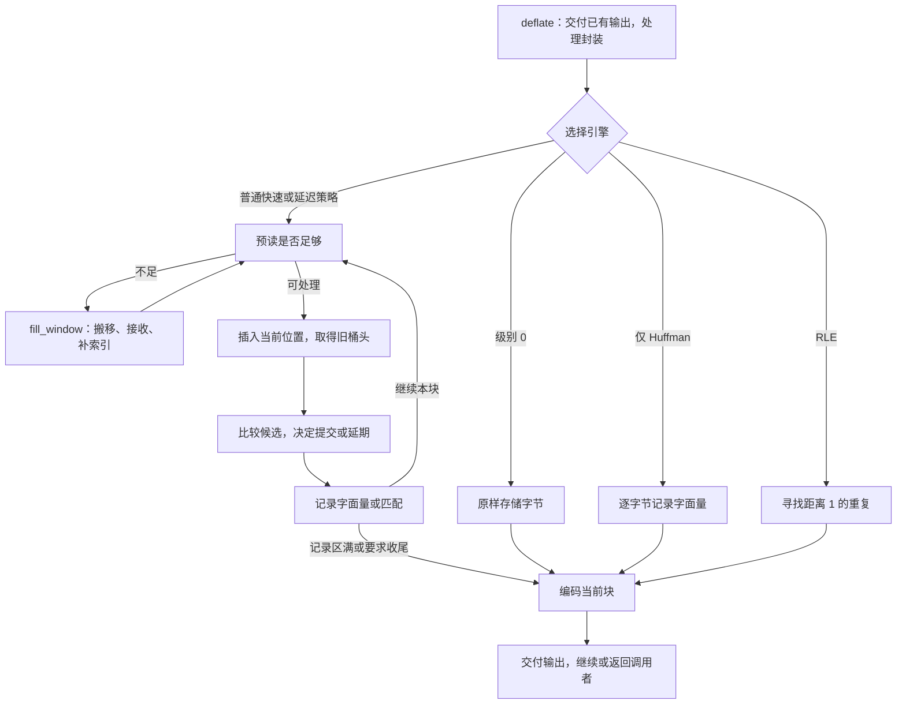

压缩器收到原文后，要先选择一种表示：当前位置的字节直接作为字面量，还是用“回退距离、复制长度”表示一段重复。这个决定会影响压缩率，却必须始终保留同一份原文。

本章沿一次 `deflate` 调用走到符号记录：先找到实际执行的策略循环，再进入它需要的窗口、索引和字节比较。例子中的历史为 `ABCQABCR`，当前输入接着是 `ABCQABCX`。较近的来源只能匹配三个字节，较远的来源能匹配七个字节。它足以说明搜索与选择的区别；窗口搬移则另外用合法的 512 字节配置算出具体地址变化。

## 从公开调用进入策略循环 {#dispatch}

调用者通过 `next_in` 和 `avail_in` 交出本轮输入，通过 `next_out` 和 `avail_out` 提供接收压缩字节的空间。`deflate` 先检查调用状态，交付已有待发送字节，并按所选封装处理头部。到了处理载荷的位置，它才选择压缩引擎。下面是 `deflate.c` 中连续的四行；`s` 指向内部状态，`flush` 是本轮请求，`bstate` 接收引擎的内部执行结果：

```c
bstate = s->level == 0 ? deflate_stored(s, flush) :
         s->strategy == Z_HUFFMAN_ONLY ? deflate_huff(s, flush) :
         s->strategy == Z_RLE ? deflate_rle(s, flush) :
         (*(configuration_table[s->level].func))(s, flush);
```

分支顺序有意义。级别 0 先选择原样存储；非零级别下，`Z_HUFFMAN_ONLY` 只生成字面量，`Z_RLE` 专门寻找距离为 1 的重复。其余策略使用级别表中的快速或延迟匹配引擎。它们产生的都是 DEFLATE 格式允许的表示。



普通策略的循环反复完成“准备输入—寻找候选—作出决定—记录符号”。记录区满时，它调用块编码器；调用者输出空间用完时，控制可以返回外层。`need_more`、`block_done`、`finish_started`、`finish_done` 是这层内部结果；外层据此更新状态、处理刷新或尾部，并返回公开的 `Z_OK` 或 `Z_STREAM_END`。所以，一次 `deflate` 返回并不对应一个完整压缩块。

## 配置如何改变这条路径 {#configuration}

先固定本章的普通构建：没有启用 `FASTEST`，匹配比较使用逐字节分支。调用 `deflateInit` 时，默认压缩级别 `Z_DEFAULT_COMPRESSION` 被归一化为 6；默认窗口指数为 15，`memLevel` 为 8，策略为 `Z_DEFAULT_STRATEGY`。本章的配置表描述这组源码设置，调参后要使用实际保存的字段值。

| 参数 | 直接改变什么 | 对执行的影响 |
| --- | --- | --- |
| `level` | 引擎及搜索阈值 | 0 使用原样存储；1–3 使用 `deflate_fast`；4–9 使用 `deflate_slow`。 |
| `strategy` | 候选选择或块编码限制 | `Z_HUFFMAN_ONLY` 绕过匹配；`Z_RLE` 使用距离 1；`Z_FILTERED` 在延迟引擎中调整短匹配取舍；`Z_FIXED` 保留匹配搜索并排除动态块，仍然可以选择原样存储块。 |
| `windowBits` | 封装及窗口尺度 | 影响保留的字节数和可搜索距离；封装还决定头尾与校验方式。 |
| `memLevel` | 哈希桶与符号缓冲区大小 | 桶更多通常减少碰撞，记录区更大容许积累更多符号；内存占用也增加。 |
| `flush` | 本轮是否继续等待输入、是否结束块或流 | 改变循环可以等待的时机，以及如何把尾部输入提交出去。 |

普通构建接受级别 0–9，另接受默认级别值；方法参数必须为 `Z_DEFLATED`。所选默认构建接受 `memLevel` 1–9。`windowBits` 的正值 8–15 选择 zlib 封装，负值 −9 到 −15 选择 raw DEFLATE，25–31 选择 gzip。zlib 的 8 会归一化为 9；raw 的 −8 和 gzip 的 24 被拒绝。因此，本章普通压缩窗口的实际尺度是 512 到 32768 字节。上述 gzip 参数范围以默认启用 gzip 的构建为前提；定义 `NO_GZIP` 会移除 gzip 封装的生成支持。

本章运行例子没有设置预设字典。流若以字典初始化，字典保留的后缀会提供初始匹配来源，而不会作为解压消息的新前缀被直接发出。对应内容关系以该字典上下文为起点，只把新展开的字节与已经提交的原始输入比较。

`deflateParams` 可以在活流中更改级别和策略。策略改变或引擎类别改变、且流已开始处理时，它先用 `Z_BLOCK` 处理现有工作；若旧输入或块工作未能清空，就返回 `Z_BUF_ERROR`。配置不是任意一条记录中间可直接替换的常量。`deflateTune` 则写入四个搜索参数，不能再用级别表的默认数值解释后续搜索。它把三个参数转换为 `uInt`，把 `nice_length` 保存为有符号量；精确执行论证要读取这些真实机器值。

编译配置也会改变算法。`FASTEST` 将非零级别归一化为 1，采用简化匹配实现，并省去普通前驱链维护。`UNALIGNED_OK` 选择两字节探测与比较分支，同时带来短整数宽度、地址和访问规则的条件。这些分支分别说明使用条件；本章下面的 C 比较片段属于普通逐字节分支。

## 窗口保存候选需要的字节 {#window}

回到 `ABCQABCR` 后面的 `ABCQABCX`。当前位置必须还能读取较早的 `ABCQ`，才能发现长度 7、距离 8 的匹配。输入可以持续增长，因此保留范围必须有限。滑动窗口保存近期字节，供后续位置引用。

先用一个更小的教学场景看这个目的：输入是 `0123ABCDABCDwxyz`，已经处理了 `0123ABCD`。第二组 `ABCD` 可以引用四字节之前的第一组。保留上限在动画中缩成八字节；它只表示逻辑上的近期后缀，并非一个合法的 zlib 窗口参数。

<div class="zl-demo-mount"><zlib-demo kind="window"><p>第二组 ABCD 引用距离 4、长度 4。处理后最近八字节是 ABCDABCD；再处理 wxyz 后是 ABCDwxyz。退出保留范围的旧字节不再成为新引用的来源。</p></zlib-demo></div>

真实压缩器为了减少搬移，分配的是一个连续的 `2W` 字节数组。`W` 是配置尺度，存于 `w_size`；数组里同时放历史和已经接收、尚未处理的新输入。字节比较直接沿数组中的连续位置前进。

`strstart` 是当前处理位置的数组下标，`lookahead` 是从这里起真实装入的待处理字节数。于是当前数据末尾为 `strstart + lookahead`，后面才是空闲空间。数组下标会在搬移后改变；一个字节在整条输入中的逻辑位置不变。

```text
window，容量 2W
[ 已处理的字节 ][ 已接收、待处理的字节 ][ 可补充输入的空闲区 ]
               ^ strstart             ^ strstart + lookahead
```

一条 DEFLATE 匹配最少复制 3 字节，最多复制 258 字节。源码把它们命名为 `MIN_MATCH` 和 `MAX_MATCH`。策略希望作决定前准备足够预读，既能比较最长匹配，又有余量为后续位置建立三字节索引。这个预读目标叫 `MIN_LOOKAHEAD`，值为 `258 + 3 + 1 = 262`。输入结束或刷新时，循环仍然要处理不足 262 字节的尾部。

普通搜索还为这些读取预留空间，因此实际最大搜索距离为 `W - 262`，源码名为 `MAX_DIST(s)`。默认 W=32768 给出 32506 字节。DEFLATE 格式允许的距离上限仍为 32768；这里是压缩器寻找来源的限制。物理上还在数组里的字节，也可能已超出本轮搜索范围。

## 补充输入与成批搬移 {#refill}

`fill_window` 先求数组尾部的空闲字节数：`more = window_size - strstart - lookahead`。普通布局的 `window_size` 为 `2W`。接近数组末端，即 `strstart ≥ 2W - 262` 时，它把仍需保留的上半部分搬到低地址，再继续装入输入。

取合法的 W=512，令 `strstart=800`、`lookahead=100`。真实数据占到下标 900，空闲量是 124。滑动阈值为 762，于是把 `[512,900)` 中的 388 字节搬到 `[0,388)`。当前起点变为 288，预读量仍是 100。原候选 700 变为 188，距离仍是 100：`800−700 = 288−188`。

下面的实际 C 同时更新字节和位置。`wsize` 是 W 的局部副本；`block_start` 是当前块原始输入的起点，使用有符号类型：

```c
zmemcpy(s->window, s->window + wsize, (unsigned)wsize - more);
s->match_start -= wsize;
s->strstart    -= wsize; /* we now have strstart >= MAX_DIST */
s->block_start -= (long) wsize;
```

代码随后限制延期插入量，调用 `slide_hash` 平移头表与前驱表中的位置，再增加空闲计数。`block_start` 可以变成负数：当前块的原始开头可能已经离开数组。后续选择原样存储块时，便需要检查原始区间是否仍可读取。

有了空间，读取位置放在现有数据末尾。`read_buf` 接收本轮输入与容量上限，返回实际复制的字节数 `n`：

```c
n = read_buf(s->strm, s->window + s->strstart + s->lookahead, more);
s->lookahead += n;
```

它至多读取 `min(avail_in, more)` 个字节，推进调用者的输入指针，更新消费计数以及相应封装的校验和。`lookahead` 只增加实际读到的数量。接收输入与把输入提交成符号是两个时刻：前者推进 `next_in`，后者由策略决定。

循环在调用者仍有输入时尽量补足 262 字节；`Z_NO_FLUSH` 下预读不足，可以返回 `need_more`，等待更多输入。尾部的一两个字节暂时没有完整三字节键，`insert` 保存这些延期索引工作，新字节到达后再补上。

还有一个独立边界：快速比较可能查看真实数据末尾之后、但仍在分配区内的字节。`high_water` 记录已经初始化的前缀末尾；源码按需在真实数据后清零最多 258 字节，限制在分配范围内。它只让这些位置可读取，没有把零变成新的输入。最后返回的匹配长度仍受 `lookahead` 限制。

## 三字节哈希与候选链 {#hash}

保存字节以后，逐一比较窗口中每个旧起点仍然很贵。zlib 先把当前位置的三个字节映射到一个桶，只查找同桶的旧位置。同样的三字节串一定进入同桶；碰撞也会让不同内容进入同桶，所以桶给出的是候选，不能代替字节比较。

默认 `memLevel=8` 产生 32768 个桶：`hash_bits=15`，掩码 `hash_mask=32767`。每接入一个字节，已有哈希左移五位、与字节异或，再保留低十五位：

```text
h := ((h << hash_shift) XOR next_byte) AND hash_mask
```

连续读取 A、B、C 时，哈希从 0 变成 65、2146、3075；再接 D 得到 36，也就是从零计算 B、C、D 的结果。较早字节的贡献被连续移位推出掩码，因此从 `ABC` 移到 `BCD` 不必重算整个键。

头表 `head` 保存每个桶最新的位置。前驱表 `prev` 为已插入位置保存较早的同桶位置。插入位置 p 时，先取旧桶头作为候选和前驱，再把桶头改成 p。普通宏保留了这个顺序：

```c
#define INSERT_STRING(s, str, match_head) \
   (UPDATE_HASH(s, s->ins_h, s->window[(str) + (MIN_MATCH-1)]), \
    match_head = s->prev[(str) & s->w_mask] = s->head[s->ins_h], \
    s->head[s->ins_h] = (Pos)(str))
```

这里 `str` 是插入位置，`ins_h` 是滚动哈希，`match_head` 接收旧桶头。搜索从旧桶头开始，避免把当前位置当成自己的来源。零是 `NIL` 哨兵，不作为普通候选。

`prev` 只有 W 个槽位，使用 `p & (W−1)` 取槽，等价于 p 对 W 取模。W=512 时，位置 100 与 612 复用槽位 100；两位置相隔 512，已经超过该配置的 250 字节搜索界。这个循环复用发生在**前驱表**，字节比较使用的仍是连续 `2W` 数组。

`slide_hash` 对头表和前驱值执行 `m ≥ W ? m−W : 0`。滑动 W 不改变槽位编号，却改变槽位里保存的位置。头表在初始化时清零；前驱槽位随着插入写入，不能把每个从未使用的槽位都当成已初始化链结点。

## 在预算内比较真正的字节 {#search}

在 `ABCQABCR` 与后续 `ABCQABCX` 的场景中，距离 4 的最近候选匹配 `ABC`，到第四字节 R/Q 时失败。距离 8 的较早候选匹配 `ABCQABC`，到第八字节 R/X 时失败。因此两条合法选择是长度 3／距离 4 和长度 7／距离 8。七字节比较沿同一数组越过了最早的四字符片段，候选并不是单独保存的词。

<div class="zl-demo-mount"><zlib-demo kind="search"><p>最近候选给出三个相同字节，沿下一条前驱链接可找到七个。访问预算为一时，搜索在较长候选之前停止。</p></zlib-demo></div>

动画用逻辑偏移零标记最早片段；真实头表用零作哨兵。将例子中的所有位置统一加一，距离和比较结果不变。这个选择场景说明预算的作用，具体桶链仍由真实插入历史决定。

普通 `longest_match` 从旧桶头沿前驱链向更早位置走。`prev_length` 给出需要超越的长度基线，`best_len` 保存当前最好长度。要超越基线，候选在开头和基线末端都必须相等；四次便宜探测可以先排除许多候选：

```c
if (match[best_len]     != scan_end  ||
    match[best_len - 1] != scan_end1 ||
    *match              != *scan     ||
    *++match            != scan[1])      continue;
```

`scan` 指当前输入起点，`match` 指候选；`scan_end1` 与 `scan_end` 缓存当前输入在 `best_len−1` 和 `best_len` 的字节。探测通过后，仍要比较中间内容。前两个字节已相同、哈希键又相同时，所选哈希参数可以推出第三字节相同；随后一次短路条件展开八次比较，减少逐字节循环的控制开销。

这个优化把检查频率和空间余量联系起来：它不是每比较一个字节都重新检查真实输入长度，所以窗口需要前面的可读余量；比较得到的长度最后还要截到真实 `lookahead`。源码只在 `len > best_len` 时更新 `match_start` 和最佳长度。没有改善基线时，旧的 `match_start` 不会自动成为当前位置的新匹配见证。

搜索也不要求穷尽所有候选。`max_chain_length` 限制访问数量；`nice_match` 给出“已足够长，可以停止”的阈值；前一个匹配达到 `good_match` 时，普通搜索把链预算缩为四分之一。级别表中的部分设置如下，长度单位为字节：

| 级别 | 引擎 | `good_match` | 延迟／插入阈值 | `nice_match` | 链预算 |
| --- | --- | --- | --- | --- | --- |
| 1 | 快速 | 4，默认快路基线不会达到此阈值 | 4 | 8 | 4 |
| 6 | 延迟 | 8 | 16 | 128 | 128 |
| 9 | 延迟 | 32 | 258 | 258 | 4096 |

级别 6 的普通搜索最多按预算检查 128 个候选；前一个匹配已达 8 字节时缩为 32。找到至少 128 字节的候选可提前停止，输入尾部还会把这个停止阈值截到现有输入长度。高压缩级别愿意花更多比较时间；函数名 `longest_match` 并不承诺找到整个窗口中全局最长的来源。

表中的预算都是正数。`deflateTune` 写入零或把负整数转换成无符号字段时，还要按实际控制流解释：这是先执行候选比较、再递减预算的 `do...while`。零不是“一个候选也不检查”；在走到递减条件时，无符号零可以回绕。前驱位置持续下降仍能限制可访问的链，但默认表中的时间预算解释不能直接套在这些值上。

## 快速提交与延迟决策 {#lazy}

`deflate_fast` 立即采用当前位置的有用匹配。较短匹配经过的中间位置也插入哈希表；匹配较长时，可以跳过这些插入，并在新位置附近重新准备哈希。它减少当前工作，也减少后面能访问的候选。级别 1–3 里的公共阈值字段因此用作插入长度限制，而非下一位置的延迟搜索限制。

`deflate_slow` 多保留一个决定。设历史中存在 `XABZ` 和 `ABCDEFGH`，当前输入为 `XABCDEFGQ`。在位置 S 发现长度 3 的 `XAB`，下一位置 S+1 却能匹配长度 7 的 `ABCDEFG`。假设搜索到达这些来源，且再下一位置没有更好的改进：

| 本轮起点 | 比较与选择 | 记录结果 |
| --- | --- | --- |
| S | 找到长度 3，暂缓决定，前进一个字节 | 暂不记录 S |
| S+1 | 长度 7 优于上一步的 3 | 记录字面量 X，保存七字节候选 |
| S+2 | 新结果不优于七字节候选 | 记录从 S+1 开始的匹配，前进到 S+8 |

`match_available` 表示有一个延期位置，`prev_length` 和 `prev_match` 保留前一位置的长度与来源。第三行的实际记录调用如下：

```c
_tr_tally_dist(s, s->strstart - 1 - s->prev_match,
               s->prev_length - MIN_MATCH, bflush);
```

距离从 `strstart−1` 计算，因为要提交的是上一位置的匹配。长度减去 3 后成为存储偏移；`bflush` 表示符号区是否已满。接受旧匹配后只再消费 `prev_length−1` 个预读字节，因为其中一个已经在前一步越过。插入循环也只处理仍有三个真实字节的起点。

最终展开是 X、ABCDEFG、Q，仍是原来的九个字节。延迟选择可能提高压缩率，但最终位数还取决于距离编码、符号频率和块头成本。`max_lazy_match` 让足够长的旧匹配省去下一次搜索；`Z_FILTERED` 会放弃部分短匹配，`TOO_FAR` 启发式也可能放弃距离很远的三字节匹配。这些都改变选择质量，不改变解压规则。

## 提交符号与输入记账 {#symbols}

策略提交之后，编码器才得到稳定记录。在默认、未启用 `LIT_MEM` 的布局中，每条记录占三字节：两字节距离，再加一个字面量值或长度偏移。距离零表示字面量；非零距离配合长度偏移表示匹配。长度 6、距离 2 会保存距离 2 和偏移 3，而不是保存六个重复字母。

记录操作同时更新字面量／长度树和距离树的频率。一次六字节匹配增加一个长度码和一个距离码的次数；它不会为那六个恢复字节各增加一次字面量计数。`sym_next` 按记录布局前进，达到 `sym_end` 时，策略要求编码当前块。`memLevel` 也改变这个记录容量，因而可以改变块边界。

到这里有三种不同的“已处理”：调用者输入已被复制到窗口，策略可能已经越过某个位置，符号记录已经承诺一段输入。延迟匹配说明这三者并不总在同一点。字节编码器接收的是最后一类：已经提交的符号序列与其频率。后续 Huffman 编码和块选择可以换一种位表示，却必须保留这些符号的顺序与含义。

## 正确性：从移动的数组到原输入 {#correctness}

本章的承诺可以直接在例子里检查：不管预算找到长度 3／距离 4，还是找到长度 7／距离 8，展开已提交符号都应恰好得到原输入的已提交前缀。证明要沿真实执行维持字节身份、链的意义和提交起点，不能只检查最终计数。


### 搬移同时保持地址与内容 {#proof-window}

对没有预设字典的运行，把数组下标零对应的逻辑输入位置记为 L。数组位置 i 保存的应是输入位置 L+i 的字节。滑动 W 之后，新基准为 L+W，新位置 i 保存旧位置 i+W 的字节，依据是 `(L+W)+i = L+(i+W)`。在具体例子里，候选 700 变为 188，逻辑位置和距离一起保持。

数值界 `strstart + lookahead ≤ 2W` 说明真实数据装得下，却没有说明存了正确字节。`slide_copy` 在 W≥512、这个形状界及滑动条件下给出复制范围在界内、长度正确、源目标不重叠的算术结论；窗口内容关系说明复制后还是同一段输入。`read_buf_ok` 再把实际读取、指针推进及记账接到返回堆，清零保护尾部的操作则保持逻辑输入不变。

这里引用的读取命题处理非零复制量，要求源可读、目标可写、两端范围合法且不重叠，流和状态指向相应堆对象。gzip 校验分支还使用固定 CRC 表关系；zlib 的单字节更新结论带有 Adler 高半部小于 65521 的条件。这些是调用点要从初始化和保存状态取得的具体事实，零字节读取另有对应分支。

### 链的有效性来自可达性 {#proof-chains}

`HashChains` 只要求搜索可达且槽位尚属该位置的结点有意义：它已被插入，三个字节属于真实输入并具有对应哈希，前驱严格更早。参数 `top` 表示插入进度，`top ≤ p+W` 区分尚未复用的槽位。初始化清空桶头就能让搜索避开从未写入的前驱槽位。

插入证明分新结点与旧可达结点两种情况。新结点保存的旧桶头在它之前；对旧结点，需要证明复用的槽位没有破坏仍然需要的链接。滑动时，位置统一减 W，槽位取模结果不变，字节内容也按同一偏移移动。数学关系 `chains_insert`、`chains_slide` 与实际读取和存储命题 `INSERT_STRING_ok`、`slide_hash_ok` 分别承担这两层工作。

### 搜索返回值带着匹配见证 {#proof-search}

Lean 中的 `GoodMatch` 把“有用匹配”的内容写得很明确。`wa` 是窗口字节数组，`ss` 是当前起点，`ws` 是 W，`m` 是来源，`len` 是长度：

```lean
def GoodMatch (wa : Array UInt8) (ss ws m len : Nat) : Prop :=
  m < ss ∧ ss - m ≤ ws - 262 ∧ len ≤ 258 ∧
    ∀ j, j < len → bfn wa (m + j) = bfn wa (ss + j)
```

它同时要求来源更早、距离允许、长度有界，以及区间中每一个字节相等。便宜探测只能排除候选，不能直接建立最后那个逐字节结论。八次展开比较由 `firstMis_spec` 和内层执行命题连接到首次不相等位置；哈希参数与头两个字节相等则为省去的第三字节比较提供依据。

`longest_match_ok` 的前提 `LMEnv` 指定实际窗口和前驱堆块、W 为 512–32768 内的二次幂、掩码 W−1、比较所需空间、合法的初始较早候选，以及可达链的下降和字节关系。它的结论把内部最佳长度记为 `best`，返回 `min(best, lookahead)`，只改变 `match_start`，并明确分开两个结果：

- 没有改善 `prev_length`，保留旧 `match_start`。
- 有严格改善，新 `match_start` 给出 `GoodMatch` 见证。

这一区分决定策略能使用哪一条关系：保留旧匹配时，需要前一状态的见证，不能把旧字段当作当前位置新找到的匹配。循环终止还可由严格下降的候选位置证明；`lm_loop_ok` 使用 `cur_match.toNat` 作为度量，无须假定无符号预算永远不会从零回绕。

### 延期位置与提交前缀一起归纳 {#proof-symbols}

策略的不变量再把搜索结果接回输入：它分别记录已提交前缀、最多一个延期字节和剩余预读输入。对 `XABCDEFGQ`，提交 X 让前缀增长一个字节，提交保存的七字节匹配再增长 `ABCDEFG`。在 S+2 这轮，记录必须从 S+1 而非 S+2 开始；C 中的 `strstart−1` 正是在维持这条对应。

若匹配长度大于距离，展开仍然逐字节成立。设复制起点为 S，距离为正数 d，第 j 步读取 S+j−d。j<d 时来源属于既有历史；j≥d 时来源是此前第 j−d 步产生的字节。因为 j−d<j，可以对复制步骤归纳。内存访问界与字节相等见证一起，让新记录继续表示正确的输入前缀。

对单条记录，`tr_tally_spec` 在参数合法且空间足够时，给出三个存储字节、精确频率更新，以及记录区间之外的保持。`tallyCalls_preserves` 组合容量有界的一串真实记录调用，保持 `TreesInvAt`、结束符频率和码长树，并给出精确的记录游标。每个调用点由策略提供长度 3–258、正距离及输入关系，再由单条记录结果提供块发射所需的存储对应。

<details class="bk-source-notes"><summary>源码与命题</summary>
<ul>
<li>C：固定版本 <a href="https://github.com/madler/zlib/blob/757f0527154291bcf6bfbd6396ecde6bedd2db95/deflate.c">deflate.c</a> 的初始化、策略分派、<code>fill_window</code>、普通 <code>longest_match</code> 与快速／延迟循环；<a href="https://github.com/madler/zlib/blob/757f0527154291bcf6bfbd6396ecde6bedd2db95/deflate.h">deflate.h</a> 定义距离界和记录布局。</li>
<li><a href="/reference/source/ZlibF/Proof/deflate.c.engine.window.html">窗口算术</a>、<a href="/reference/source/ZlibF/Proof/deflate.c.engine.chains.html">链关系</a>、<a href="/reference/source/ZlibF/Proof/deflate.c.engine.macros.html">实际插入</a>分别给出区间、可达性和堆操作的条件。</li>
<li><a href="/reference/source/ZlibF/Proof/deflate.c.engine.lmbody.html">搜索环境与不变量</a>、<a href="/reference/source/ZlibF/Proof/deflate.c.engine.lmmain.html">搜索执行命题</a>、<a href="/reference/source/ZlibF/Proof/trees.c.tally.html#L327">单条记录执行</a>和<a href="/reference/source/ZlibF/Proof/trees.c.tally-support.html">记录调用命题</a>保留精确陈述。</li>
<li>配置与调用规则：<a href="/reference/functions/deflateInit2_.html">deflateInit2_</a>、<a href="/reference/functions/deflateParams.html">deflateParams</a>、<a href="/reference/functions/deflateTune.html">deflateTune</a>。</li>
</ul>
</details>
