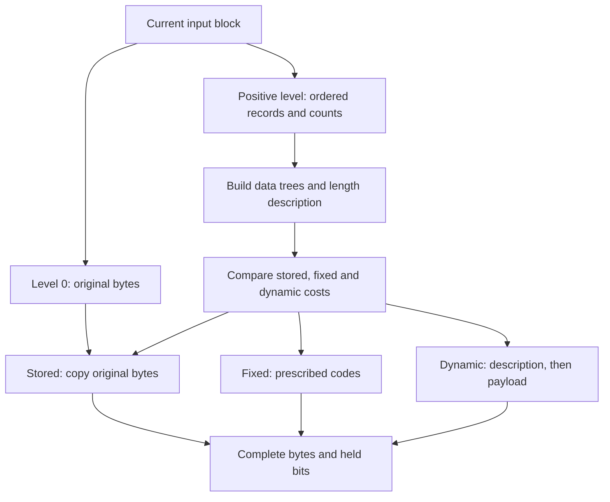
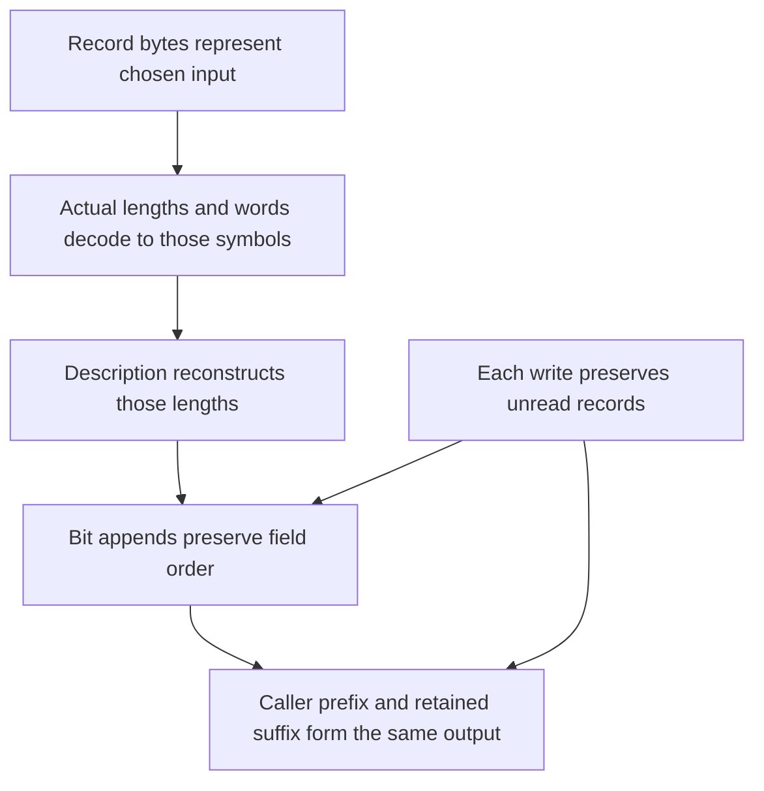

A match decision is still an instruction in the compressor's memory. The application needs bytes that another program can decode. Follow that conversion through `trees.c`: retain the chosen records, prepare coding candidates, choose a block form, read the records into a bit writer, and deliver the resulting bytes. A block boundary can occur because record storage fills, the caller requests a flush, or the stream finishes.

We will use two small calculations. The selected records `A`, `B`, length 6/distance 2 explain a complete fixed block for `ABABABAB`. A separate four-symbol frequency table makes Huffman construction visible. These examples answer different questions; the selected records do not predict which matches or block form a default compression call chooses.

## Records preserve the compressor's decisions {#records}

A record has to preserve order. Counts alone could say that A occurred twice, but could not distinguish `AAB` from `ABA`. In the ordinary build without `LIT_MEM`, each literal or match occupies three bytes. The first two store the backward distance, low byte first. Distance zero marks a literal; the last byte then contains that literal. For a match, the last byte contains the length minus 3. Allowed lengths 3–258 therefore fit as offsets 0–255.

| Chosen instruction | Three record bytes, hexadecimal | Bytes produced when expanded |
| --- | --- | --- |
| Literal A | `00 00 41` | `A` |
| Literal B | `00 00 42` | `B` |
| Length 6, distance 2 | `02 00 03` | `ABABAB` |

There are three records, nine record bytes, and eight represented input bytes. None of those counts is the eventual compressed size. The match's six bytes are produced by the decoder's copying rule rather than stored in the record.

`_tr_tally` saves a record. Here `sym_buf` points to the record view, `sym_next` is its next free byte offset, `dist` is zero or the match distance, and `lc` is the literal byte or length offset. The packed-layout stores are:

```c
    s->sym_buf[s->sym_next++] = (uch)dist;
    s->sym_buf[s->sym_next++] = (uch)(dist >> 8);
    s->sym_buf[s->sym_next++] = (uch)lc;
```

Release builds also use inline tally macros with this representation. When the record cursor reaches `sym_end`, the strategy loop closes the block before accepting another record. The `LIT_MEM` build uses separate distance and literal/length views; the three-byte cursor arithmetic in this chapter belongs to the packed layout.

## Frequency tables describe coding work {#frequencies}

The same tally operation updates two coding alphabets. A literal increments its literal/length symbol. A match increments a length-group symbol and a distance-group symbol. It does not increment the frequency of each byte the match will later copy. Length and distance groups may also need extra numeric bits to identify the exact value within a group. Those extra bits contribute cost without becoming additional Huffman symbols.

The literal/length alphabet has 286 constructible symbols: bytes 0–255, end-of-block 256, and length symbols 257–285. The distance alphabet has 30 constructible symbols. Block initialization gives the end marker a frequency of one, so a block can terminate even when there are no data records. Its cost must be counted along with the data.

When a positive-level block closes, `_tr_flush_block` builds the literal/length and distance trees, then the smaller tree describing their lengths. It also computes the fixed-code cost. Constructing this dynamic candidate does not commit the stream to using it.



The branches have different prerequisites. A stored block needs the original byte range still available. Fixed output needs no transmitted tree description. Dynamic output must transmit the very lengths used for its payload.

## Array operations construct the coding tree {#tree}

Use frequencies `A:8, B:4, C:2, D:2` for one abstract alphabet. This is 16 symbol occurrences, not a recount of the eight-byte example. Start with four leaf subtrees. Repeatedly merge the two lightest:

| Round | Subtrees selected | New subtree | Remaining roots |
| --- | --- | --- | --- |
| 1 | C:2, D:2 | CD:4 | B:4, CD:4, A:8 |
| 2 | B:4, CD:4 | BCD:8 | A:8, BCD:8 |
| 3 | A:8, BCD:8 | Root:16 | Root:16 |

Following parent links now gives lengths `1,2,3,3`. Their payload cost is `8×1 + 4×2 + 2×3 + 2×3 = 28` bits, against 32 for four two-bit words. A dynamic block still has to pay its description cost.

The implementation reuses arrays in `deflate_state`. A tree descriptor selects its node array, alphabet size, extra-bit table and length limit. Original symbols occupy node numbers below the alphabet size; parent numbers begin at that size. The heap contains **node numbers**, not node objects. Queue slots `2k` and `2k+1` are children of queue slot k for heap maintenance. They are not the Huffman children of the node named by `heap[k]`.

`build_tree` first scans the alphabet. Positive-frequency leaves enter the queue with subtree height zero; unused leaves receive length zero. If there are fewer than two live leaves, preparation adds artificial frequency-one leaves and compensates the cost counters. This avoids a zero-bit code while keeping artificial counts separate from observed symbols.

The queue compares frequency first, then subtree height, named `depth` in C. It prefers the shallower subtree at equal frequency; it does not impose a complete symbol-number ordering on ties. In round two, B has height zero and CD height one, so B is selected first. This height is distinct from the final distance of a leaf below the root.

`pqdownheap` repairs queue order by holding one displaced node number locally and moving the smaller child up until that node can be placed. Initial bottom-up heapification avoids sorting the entire queue after each merge. A merge removes one minimum, reads the next minimum at the root, then replaces that root with the new parent. The core parent stores are:

```c
        tree[node].Freq = tree[n].Freq + tree[m].Freq;
        s->depth[node] = (uch)((s->depth[n] >= s->depth[m] ?
                                s->depth[n] : s->depth[m]) + 1);
        tree[n].Dad = tree[m].Dad = (ush)node;
```

Here n and m name the selected subtrees and `node` names their parent. The first example merge stores frequency 4, height 1, and parent links from both C and D.

The queue array also retains removed nodes at its high end. If K is the number of prepared leaves and t merges have completed, the active queue has `K−t` roots while the retained region has `2t` removed node numbers. `heap_max` moves down by two per round. The final root is stored before that region, so forward traversal meets parents before descendants. This saves a recursive tree traversal in the length pass.

`HEAP_SIZE` is 573, based on twice the largest alphabet size plus one. The active and retained regions must stay separate inside that capacity. Nodes also reuse fields: `Freq` later becomes `Code`, and `Dad` becomes `Len`. Frequency and parent/length fields are 16-bit; `depth` is an unsigned byte. Those widths matter to frequency sums, heights and the order in which old meanings can be overwritten.

## Length repair keeps the codes decodable {#lengths}

The tree supplies initial depths, but DEFLATE permits at most 15 bits for literal/length and distance codes and 7 for the code-length alphabet. `gen_bitlen` walks retained nodes parent-first, reads the parent's assigned length, adds one, and clamps to the descriptor's limit. Leaves update the length histogram `bl_count`; internal nodes do not. Costs include code widths and extra numeric bits.

Clamping is only the first step. To see why, use a teaching limit of 3 and frequencies `8,4,2,1,1`. Their unrestricted lengths are `1,2,3,4,4`. A code of length b occupies a share `2^-b` of binary code space. These shares sum to one. Clamping gives `1,2,3,3,3`, whose shares sum to `9/8`: each individual length fits the limit, but the whole set cannot be a prefix code.

The source counts overflow while traversing nodes. It includes internal nodes whose parent-derived length exceeds the limit, not merely overlong leaves. It repairs the histogram before reassigning individual leaf lengths. With `bits` naming the largest occupied length below the limit, the actual updates are:

```c
        s->bl_count[bits]--;
        s->bl_count[bits + 1] += 2;
        s->bl_count[max_length]--;
        overflow -= 2;
```

Splitting one length-b code into two length-(b+1) codes preserves occupied space and adds one leaf. Removing one maximum-length code restores the leaf count and removes `2^-L` of space, where L is the limit. In the teaching example, one length-2 code becomes two length-3 codes, and a length-3 entry is removed. The result is one length-1 and four length-3 codes: `1/2 + 4/8 = 1`.

The reverse retained-node scan assigns the longest classes first, skipping internal nodes. The repaired lengths are `1,3,3,3,3`; their payload cost rises from 30 to 32 bits. The source corrects `opt_len` for each reassigned leaf, so block selection uses the repaired cost. Enforcing a format limit can cost bits. Preserving the symbol identities and the repaired histogram is more important than merely assigning every leaf a number no larger than L.

## Canonical words and the transmitted description {#canonical}

The decoder receives lengths, not this in-memory tree. Canonical coding makes lengths and symbol order sufficient to reconstruct words. For the four-symbol lengths `1,2,3,3`, shorter lengths come first and equal-length codes follow symbol number:

| Symbol | Length | Canonical word | Low-first stored integer, hex |
| --- | --- | --- | --- |
| A | 1 | `0` | `0` |
| B | 2 | `10` | `1` |
| C | 3 | `110` | `3` |
| D | 3 | `111` | `7` |

`gen_codes` derives the first word of each width from the number of preceding-width words:

```c
        code = (code + bl_count[bits - 1]) << 1;
        next_code[bits] = (ush)code;
```

The starts are 0, `(0+1)×2=2`, and `(2+1)×2=6`. Walking symbols in order takes and increments the next word of the symbol's width. `bi_reverse` reverses exactly that width before storing it. C's canonical integer 6 is binary `110`; reversing three bits stores integer 3, `011`. Taking its low bits first sends `110`. The width is part of the value: treating 3 as only two bits would lose a bit.

<div class="zl-demo-mount"><zlib-demo kind="huffman"><p>Lengths 1,2,3,3 occupy all code space. Changing B to length 1 oversubscribes it. Zero denotes an unused symbol.</p></zlib-demo></div>

### Two passes encode repeated lengths {#description}

A dynamic header itself has repetition to exploit: many symbols are absent, and neighboring symbols often have equal lengths. Its 19-symbol code-length alphabet includes direct lengths 0–15 and three run instructions:

| Instruction | Expansion | Extra field |
| --- | --- | --- |
| 16 | Repeat the preceding length 3–6 times | 2 bits, count minus 3 |
| 17 | Produce 3–10 zeros | 3 bits, count minus 3 |
| 18 | Produce 11–138 zeros | 7 bits, count minus 11 |

For example, `3, 16(extra=0), 17(extra=7), 2, 18(extra=0)` expands to four 3s, ten zeros, one 2 and eleven zeros. Instruction 16 needs an existing previous length; zero-run instructions do not.

`scan_tree` walks the lengths and counts the instructions that this run logic will use. `build_bl_tree` builds their code tree. `send_tree` repeats the run decisions to emit actual words and extras. This saves storing a second instruction array. Both passes track the previous length, next length, run count and thresholds. The guard length `0xffff` at `max_code+1` ends the last run; it must never become a 19-symbol alphabet index.

The receiver needs the small tree before reading the runs. Its lengths are sent as raw three-bit numbers in this order:

```text
16,17,18,0,8,7,9,6,10,5,11,4,12,3,13,2,14,1,15
```

An unused tail can be omitted, but at least four entries are announced. `send_all_trees` writes the numbers of data-tree lengths and announced small-tree lengths as offsets from their minima:

```c
    send_bits(s, lcodes - 257, 5);
    send_bits(s, dcodes - 1,   5);
    send_bits(s, blcodes - 4,  4);
```

These fields are HLIT, HDIST and HCLEN. The transmitted sequence includes zero lengths inside its announced ranges. There is a finite decoding order: the raw three-bit values define the small tree; that tree decodes the run instructions; the runs reconstruct data-tree lengths; those lengths define payload codes. `build_bl_tree` adds all these description costs to the dynamic candidate before selection.

## Block selection compares complete candidates {#blocks}

The original byte length of the block is `stored_len`. `opt_len` counts dynamic payload and description bits; `static_len` counts the same records with fixed codes. Both contain the end marker and exclude the three-bit block header. `_tr_flush_block` makes byte-rounded candidates:

```c
        opt_lenb = (s->opt_len + 3 + 7) >> 3;
        static_lenb = (s->static_len + 3 + 7) >> 3;
```

Three adds the header; seven rounds up. For a positive level, a fixed candidate wins a tie with dynamic coding. `Z_FIXED` also replaces the dynamic candidate with the fixed cost. The source then tests stored output **before** the fixed/dynamic emission branch: it can choose stored when `stored_len + 4 <= opt_lenb` and the raw source pointer is nonnull. Four accounts for the two 16-bit length fields; the stored writer separately performs the header and byte alignment. Therefore `Z_FIXED` can still produce stored blocks.

| Choice | What is written | Relevant condition |
| --- | --- | --- |
| Stored | Header, byte alignment, length/complement, original bytes | Original bytes remain available and the stored comparison wins |
| Fixed | Header, records encoded with prescribed codes, end marker | Fixed candidate wins or `Z_FIXED` requests it, after stored selection |
| Dynamic | Header, length description, records encoded with new codes, end marker | Its complete cost wins the comparison |

At level 0, the stored strategy and forced stored accounting avoid this positive-level tree work. Other strategies change the records and frequencies reaching this stage: `Z_HUFFMAN_ONLY` supplies literals, `Z_RLE` generates only distance-one matches, and `Z_FILTERED` changes short-match decisions in the lazy engine. Their output still uses the block representation rules. Compile-time `FORCE_STORED` and `FORCE_STATIC` modify selection; they are separate build configurations. `LIT_MEM` modifies record storage. None should be silently treated as the packed default path.

The stored length and complement each occupy 16 bits, so one stored payload is at most 65535 bytes. Level-zero `deflate_stored` caps direct-copy blocks with `MAX_STORED`; positive-level stored selection also uses the window and block-start relations to justify the original range and its length.

For the selected `A`, `B`, length 6/distance 2 records, a final fixed block has these fields:

| Field | Width in bits | Writer integer, hex |
| --- | --- | --- |
| Final/fixed header | 3 | `03` |
| A | 8 | `8e` |
| B | 8 | `4e` |
| Length 6, symbol 260 | 7 | `10` |
| Distance 2, symbol 1 | 5 | `10` |
| End marker, symbol 256 | 7 | `00` |

Length 6 has saved offset 3; `_length_code[3]+257` gives symbol 260. Distance 2 is reduced by one before distance-group lookup and gives symbol 1. Neither group needs extra bits. The fixed literal/length ranges use widths 8 for symbols 0–143, 9 for 144–255, 7 for 256–279 and 8 for 280–287; 286 and 287 remain reserved. Distance codes have width 5. The total is 38 meaningful bits, aligned to five bytes. An initially aligned stored block for the same eight bytes would occupy thirteen bytes.

## The writer joins fields without gaps {#bits}

Numeric fields arrive low bit first. Huffman words arrive in canonical word order, with their high bit first. Reversed words let one low-first writer serve both. For A, canonical `01110001` is stored as integer `0x8e`; reading that integer from bit zero upward gives the canonical arrival order.

The writer holds bits in a 16-bit register. `bi_buf` contains them, and `bi_valid` counts the meaningful low bits. Appending a field ORs its low bits into the first unused position. If old count r plus new width l exceeds 16, the low word becomes two pending bytes and the remaining bits start a new register. The release macro's overflow branch is:

```c
  if (s->bi_valid > (int)Buf_size - len) {\
    int val = (int)value;\
    s->bi_buf |= (ush)val << s->bi_valid;\
    put_short(s, s->bi_buf);\
    s->bi_buf = (ush)val >> (Buf_size - s->bi_valid);\
    s->bi_valid += len - Buf_size;\
```

`Buf_size` is 16; `len` is the new field width. The condition is strict. Exactly 16 bits stay in the register until a later overflowing append or flush. This staging reduces writes for short fields without inserting padding between them.

| After operation | Register, hex | Valid bits | Newly pending bytes, hex |
| --- | --- | --- | --- |
| Header | `0003` | 3 | — |
| A | `0473` | 11 | — |
| B | `0002` | 3 | `73 74` |
| Length | `0082` | 10 | — |
| Distance | `4082` | 15 | — |
| End marker | `0000` | 6 | `82 40` |
| Final alignment | `0000` | 0 | `00` |

For B, 11 old bits meet eight new bits. The combined low word is `0x7473`, emitted low byte first as `73 74`; three bits remain. The end marker similarly crosses from 15 to 22 bits. Final alignment pads the remaining six bits to one byte. The complete constructed raw stream is `73 74 82 40 00`, which decodes to `ABABABAB`.

<div class="zl-demo-mount"><zlib-demo kind="writer"><p>Append six selected fields. Watch B cross the 16-bit boundary, the end marker emit the next word, and final alignment produce the fifth byte.</p></zlib-demo></div>

`bi_flush` emits complete bytes and retains any partial byte. `bi_windup` closes the partial byte, emits one or two bytes as needed, clears the register and records the last byte's meaningful-bit count in `bi_used`. A block boundary need not be byte aligned; a final block must finish its last byte.

## Pending bytes become caller output {#pending}

Encoding and delivery have separate storage. `pending` counts complete internal bytes not yet delivered; `pending_out` points to the first of them. The application supplies `next_out` and `avail_out`, its writable cursor and remaining capacity. `flush_pending` first calls `_tr_flush_bits` to move complete register bytes into pending storage. It then copies the smaller of pending bytes and available caller space:

```c
    zmemcpy(strm->next_out, s->pending_out, len);
    strm->next_out  += len;
    s->pending_out  += len;
    strm->total_out += len;
    strm->avail_out -= len;
    s->pending      -= len;
```

After delivering the first two bytes of our stream, the caller has `73 74`; `pending_out` has advanced two bytes and the pending count is three. The next copy must deliver `82 40 00`. Replacing the caller buffer does not require re-encoding those bytes. Once pending becomes empty, its cursor can return to the allocation base.

The call can therefore accept input without immediately delivering every encoded bit. It can also deliver pending bytes without accepting new input. The two public counters describe different events. `deflatePending` exposes pending-byte and held-bit counts when an application needs that distinction.

Level zero also has a path that reduces copying. When the stored strategy’s block-size and flush conditions hold and output space fits the header and selected payload, `deflate_stored` sends the header through pending storage, then copies existing window bytes or new caller input directly to `next_out`. New input still passes through `read_buf` for consumption and checksum updates, and the window is maintained for a possible later switch back to matching. The pending relation above therefore describes fixed/dynamic emission and buffered delivery; direct stored payload copies have their corresponding cursor, range and accounting relations.

## Shared storage requires read-before-write ordering {#storage}

The record view and pending output view share one allocation in the packed layout. Let B be `lit_bufsize`, the record-capacity scale set by `memLevel`: `B = 1 << (memLevel+6)`. With the default `MAX_MEM_LEVEL=9`, memory levels 1–9 give B from 128 to 32768; a smaller compile-time limit narrows that range. At the default memory level 8, B is 16384. The allocation has `4B` bytes; records begin at offset B and use at most `3(B−1)` bytes. This is separate from the LZ77 window size selected by `windowBits`.

```c
    s->sym_buf = s->pending_buf + s->lit_bufsize;
    s->sym_end = (s->lit_bufsize - 1) * 3;
```

No second record allocation is made by these assignments. Before emission, the first B bytes are headroom. Reading a whole record releases three more bytes for reuse. `compress_block` advances its record cursor `sx` through all three bytes before emitting any fields for that record:

```c
            dist = s->sym_buf[sx++] & 0xff;
            dist += (unsigned)(s->sym_buf[sx++] & 0xff) << 8;
            lc = s->sym_buf[sx++];
```

For the match, the read leaves distance 2 and length offset 3 in locals. Subsequent writes may reuse that record's space, but must preserve the next unread one.

A record occupies 24 storage bits. A fixed match can require up to 31 output bits: eight length-code bits, five length extras, five distance-code bits and thirteen distance extras. Output can grow faster than records are released. The initial B-byte headroom pays for that difference; it does not justify arbitrary emission order.


## Flush requests control block and stream boundaries {#flush}

The strategy loop returns a block state to `deflate`. The public flush request then determines how that boundary is published:

| Request | Consequence at this layer |
| --- | --- |
| `Z_NO_FLUSH` | Continue accumulating work; a full record buffer can still force a block |
| `Z_BLOCK` | End the current block without requiring byte alignment or a new wrapper |
| `Z_PARTIAL_FLUSH` | Send one empty fixed block for decoder lookahead; up to seven bits may remain held |
| `Z_SYNC_FLUSH` | Finish this portion with an empty stored block and byte alignment; keep match history |
| `Z_FULL_FLUSH` | Add that aligned marker and clear match-bucket heads; keep the stream and its allocations |
| `Z_FINISH` | Emit the final block, finish its byte and complete the selected wrapper trailer |

These requests are not interchangeable buffering hints. `Z_FULL_FLUSH` does not open a new zlib/gzip member. `Z_BLOCK` need not make the latest partial byte immediately available. For flushes whose output does not fit, the caller supplies more output space and repeats the same request. For a nonfinishing flush, a normal return with nonzero `avail_out` indicates that all its output has been taken; `Z_FINISH` instead completes with `Z_STREAM_END`. Duplicate flushes without new progress can produce `Z_BUF_ERROR`; the implementation ranks flush strength rather than comparing only their integer values.

For `Z_FINISH`, finishing the DEFLATE block and delivering the wrapper trailer are distinct steps. Zlib appends Adler-32 in its trailer; gzip appends CRC-32 and the input length modulo `2^32`. Raw mode has no wrapper trailer. The source changes the sign of `wrap` after producing the trailer so a later call delivers the remainder without writing it twice. Pending bytes can therefore make an otherwise finished call return `Z_OK`; `Z_STREAM_END` indicates completion of this stream protocol. `Z_TREES` is an inflate request, not an accepted deflate flush request.

## Correctness follows the same objects {#correctness}

The argument follows the transformation just performed. Record expansion must equal the committed input; actual stored code words must represent the same symbols; emitted fields must concatenate exactly; writes must preserve unread records; delivery must preserve the undelivered suffix. Each step uses the heap returned by the previous step.



### Record meaning and tree identity {#record-proof}

For a literal, expansion adds its byte. For a match, expansion reads from already expanded history one byte at a time. The distance stays fixed while history grows. The saved offset must reconstruct the selected length, and frequency updates must count that same symbol. `tr_tally_spec` states the translated stores and counts under `TreesInvAt`, three bytes of record room, and the literal/match domain. Its match domain admits positive distances through 32768; the preceding search supplies its stronger implementation distance bound.

During Huffman construction, interpret queue entries as roots of a forest. Their leaf sets are disjoint and their union is the prepared alphabet. Merging two actual roots under a fresh parent preserves that union. This excludes an in-bounds but semantically wrong tree that retains C twice and omits D. Heap order additionally identifies the lightest roots; membership alone does not supply a frequency-cost estimate.

The counts `K−t` active and `2t` retained justify region separation and the next parent number. Retained order establishes parent-before-child access when `Dad` becomes `Len`. The interpretation of the two unions must change at the same point as the actual stores. Natural-number weight calculations also require machine frequency sums and byte-sized heights to satisfy their bounds.

### Repair and canonical decoding {#code-proof}

A full binary tree has Kraft sum one. Consider a subtree rooted at depth L with a leaves. Clamping its leaves to L adds `(a−1)×2^-L` to occupied space. The full subtree has `2a−2` nodes below its root, all counted by the overflow pass. Summing the disjoint depth-L subtrees gives:

```text
clamped_Kraft = 1 + (overflow / 2) × 2^-L
```

One repair preserves the leaf count, removes `2^-L` of occupied space and subtracts two overflow units. This explains the source's update, including the internal-node contributions. Its downward search also needs a shorter occupied class while overflow remains; the alphabet bound and full-tree relation supply that existence argument. The reverse assignment must visit every leaf exactly once.

The histogram must agree with actual array lengths before `gen_codes` can turn its arithmetic into a decoding statement. Reversing exactly the assigned width then yields this useful result: decoding the stored bits for a used symbol followed by **any suffix** returns that symbol and the same suffix. For C followed by B, `110 ++ 10` decodes C and leaves `10`; it does not consume B's first bit.

`build_tree_decodable_initialized` states this symbol-level result for actual constructor execution. Its premises include the selected embedded arrays through `DeflateState.WellFormed`, static tables through `TreesStatic`, and descriptor pointers and bit state through `TreesRun0`. The symbol-level claim concerns symbols with nonzero frequency in the selected tree on entry; artificial leaves added during preparation are handled separately from those observed symbols. The dynamic-header argument additionally relates `scan_tree` and `send_tree` to one run decomposition, including the guard, repeat counts and announced totals. `send_tree_emit` requires `max_code≤285`, a readable guard cell after the last symbol, actual symbol lengths at most 15, and a length view agreeing with the stored array. Instructions actually used also need fitted words and explicit total bit room. The 15-bit restriction does not apply to the `0xffff` guard.

### Exact appends through register changes {#bit-proof}

Describe a fresh local emission state by complete pending bytes followed by the held low bits:

```text
outBits = byte_bits(pending_buf[0 .. pending))
          ++ low_bits(bi_buf, bi_valid)
```

Both operations list low bits first; `++` denotes concatenation. One writer call must append exactly its requested field to this sequence. The B step illustrates the equality: the old 11 held bits plus B's eight bits become 16 pending bits followed by three held bits, with the same 19-bit order.

`send_bits_spec` requires a valid `TreesInvAt` state, width 0–15, a value fitting that width after the stated cast, and enough total bit room. It gives successful execution, the returned invariant, exact append, at most two newly written bytes, and preservation outside the written interval. The invariant includes `bi_valid` between 0 and 16 and no stray high register bits. `EmitState.step` composes these actual execution results on their returned heaps; a proved helper is applied with its premises established at that call.

### Every prefix must preserve unread records {#prefix-proof}

Let q be the number of complete records read and B the record-start offset. The unread suffix starts at `R(q)=B+3q`. Let P be the next free output offset, measured from the same allocation base during a fresh emission phase. Actual write intervals must avoid the unread suffix. A convenient sufficient boundary is `P<R(q)` while records remain; equality at a half-open interval boundary is not itself an overwrite. The source's debug assertion uses a strict bound, but the release build has no runtime check enforcing it.

The following deliberately small teaching allocation uses B=8 and capacity 32, below the implementation's permitted B. Compare a plan that emits expensive prefixes with one that spreads output across records. It isolates an ordering issue rather than representing a zlib failure.

<div class="zl-demo-mount"><zlib-demo kind="overlay"><p>Reading one record moves the unread boundary. A front-loaded output plan can overwrite that boundary even when its final size fits. Compare every prefix, not only the final total.</p></zlib-demo></div>

Once a write destroys an unread record, later cheap output cannot recover it. The corrupted distance could also spoil a later table lookup. Stored blocks have a different lifetime: after stored selection they copy original bytes and no longer consume the symbol records. Their source, copying and capacity conditions take over.

For fixed output, with no pending bytes on entry and at most seven held bits, a conservative prefix estimate is:

```text
P(q) ≤ (7 + 3 + 31q) / 8 + 1
```

The numerator counts bits: entry bits, header and worst-case symbol fields. Reading q records releases `3q` bytes, while their output allowance grows by `31q/8`. Separation follows if `(7/8)q+9/4<B`. With `q≤B−1`, it suffices that `B>11`; the permitted packed layout starts at 128. Header emission before record zero, writes within a record, the end code and final alignment need their corresponding entry/capacity bounds too.

Dynamic output pays its description before the first record and may put costly symbols early. A whole-block cost below the fixed candidate does not bound those prefixes. The needed estimate relates the actual constructed lengths to actual frequencies, then adds description costs, extra bits and writer rounding. Kraft validity alone specifies code space, not the placement of expensive symbols. This connects the tree and array arguments to the shared-memory boundary.

### Delivery preserves the encoded suffix {#delivery-proof}

Finally include the caller's collected prefix. It, the region beginning at `pending_out`, and the held bits must describe the same encoded stream prefix. Delivering `len` bytes advances both byte cursors and reduces both available caller space and undelivered internal bytes by that same amount. For our five-byte stream, delivering two bytes leaves precisely the three-byte suffix.

After partial delivery, `pending` is a count rather than an allocation-base offset. The cursor and returned state belong in the relation; a later block cannot simply assume fresh emission conditions while previous bytes remain pending. This is the boundary connecting block correctness to the public call sequence and its selected flush/wrapper protocol.

<details class="bk-evidence"><summary>Source and formal statements</summary>
<p>The C walk follows pinned <code>trees.c</code>: tally (1094–1119), construction (631–701), length repair (534–616), canonical assignment (200–229), description (709–853), block selection (997–1088), and packed record reads (908–938). <code>deflate.c</code> supplies allocation layout (463–521), pending delivery (969–986), direct stored-payload copies (1699–1782), and flush/trailer control (1231–1307).</p>
<p>The corresponding derivations are available in the <a href="/reference/docs/proof/trees.html">tree implementation argument</a>. Exact local statements include <a href="/reference/source/ZlibF/Proof/trees.c.tally.html#L327"><code>tr_tally_spec</code></a>, <a href="/reference/source/ZlibF/Proof/trees.c.build.format.html#L370"><code>build_tree_decodable_initialized</code></a>, <a href="/reference/source/ZlibF/Proof/trees.c.send-tree.html#L529"><code>send_tree_emit</code></a>, <a href="/reference/source/ZlibF/Proof/trees.c.bits.html#L411"><code>send_bits_spec</code></a>, and <a href="/reference/source/ZlibF/Proof/trees.c.emit-state.html#L34"><code>EmitState.step</code></a>. The independent raw-format meaning is <a href="/reference/docs/spec/format/README.html">the DEFLATE relation</a>.</p>
</details>
