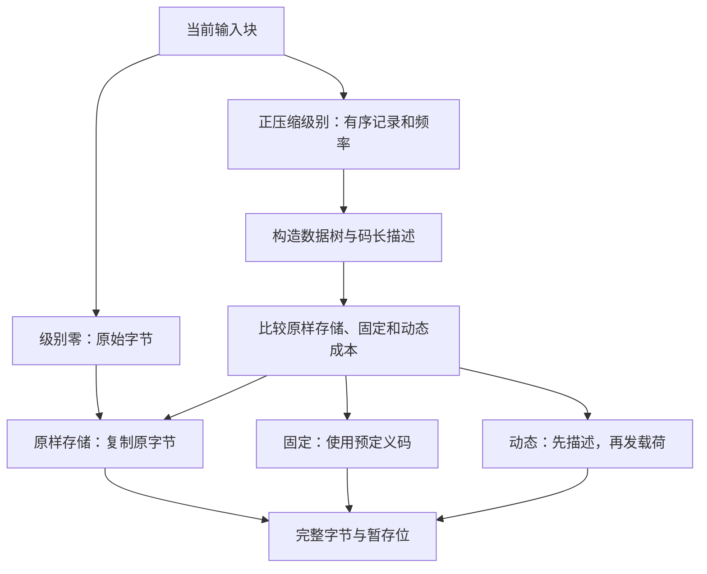
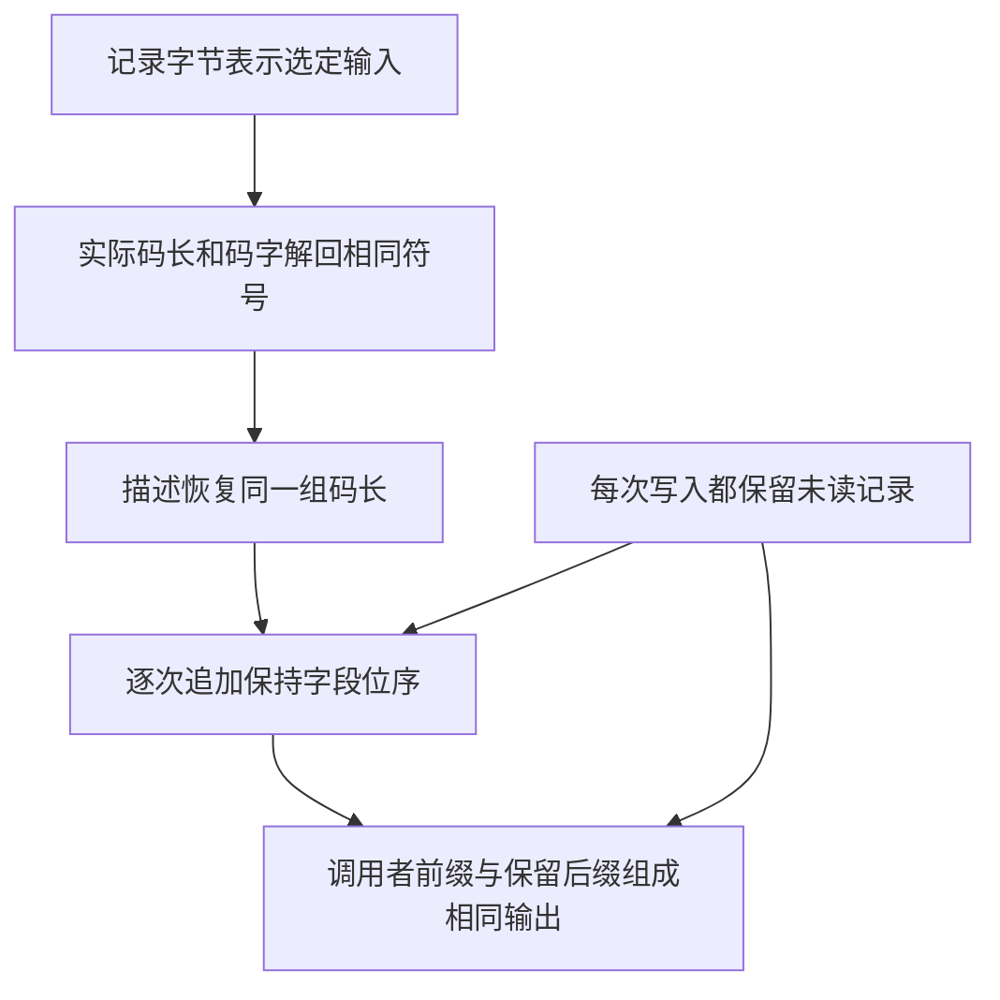

匹配决策留下的仍然是压缩器内存中的指令。应用程序需要的是另一端可以解码的字节。本章沿 `trees.c` 完成这次转换：保留选定记录，准备编码候选，选择块形式，再读取记录、追加比特，最后交付完整字节。记录存储用满、调用者要求刷新或整个流结束，都可能触发块边界。

下面使用两组小计算。选定的 `A`、`B`、长度 6／距离 2，展示 `ABABABAB` 的一个完整固定块；另一组四符号频率展示 Huffman 构造。两组例子各有用途，选定记录并不预言默认压缩调用会选择哪些匹配或块形式。

## 记录保留压缩器的选择 {#records}

记录必须保留顺序。频率只能说明 A 出现两次，不能区分 `AAB` 和 `ABA`。在没有启用 `LIT_MEM` 的普通构建中，一个字面量或匹配占三个字节。前两个按低字节在前保存回退距离。距离零表示字面量，此时第三字节就是原字节。匹配的第三字节保存长度减 3；格式允许的长度 3–258 因而映射为一个字节可表示的偏移 0–255。

| 选定指令 | 三个记录字节，十六进制 | 展开后产生的字节 |
| --- | --- | --- |
| 字面量 A | `00 00 41` | `A` |
| 字面量 B | `00 00 42` | `B` |
| 长度 6，距离 2 | `02 00 03` | `ABABAB` |

这里有三条记录、九个记录字节、八个被表示的输入字节。它们都不是最终压缩大小。匹配的六个字节由解码器按复制规则产生，并未直接存进记录。

`_tr_tally` 保存记录。`sym_buf` 指向记录视图，`sym_next` 是下一个空闲字节的偏移，`dist` 是零或匹配距离，`lc` 是字面量字节或刚才的长度偏移。紧凑布局中的三个写入是：

```c
    s->sym_buf[s->sym_next++] = (uch)dist;
    s->sym_buf[s->sym_next++] = (uch)(dist >> 8);
    s->sym_buf[s->sym_next++] = (uch)lc;
```

发布构建也使用采用同一表示的内联记录宏。记录游标达到 `sym_end` 时，策略循环先结束这一块，再接收下一条记录。`LIT_MEM` 构建则分别保存距离和字面量／长度；本章的三字节游标运算属于紧凑布局。

## 频率表记录接下来的编码工作 {#frequencies}

同一次记录操作更新两套编码字母表。字面量增加对应的字面量／长度符号频率；匹配增加一个长度组符号和一个距离组符号的频率。它不会为匹配将来复制出的每个字节分别计数字面量。长度组和距离组还可能需要额外数值位，在一组范围内指出精确值。这些位会增加成本，却不成为额外的 Huffman 符号。

字面量／长度字母表可构造 286 个符号：字节 0–255、块结束符 256，以及长度符号 257–285。距离字母表可构造 30 个符号。块初始化把结束符频率设为一，因此没有数据记录的块也能结束；它的编码成本需要和数据一起计算。

正压缩级别的块关闭时，`_tr_flush_block` 先构造字面量／长度树和距离树，再构造描述它们码长的小树。同时计算固定编码的成本。准备动态候选，并不等于已经决定采用动态块。



各分支需要的输入不同。原样存储需要原字节区间仍然可读；固定块无需发送编码描述；动态块则必须发送与实际载荷编码相同的码长。

## 数组操作构造编码树 {#tree}

用 `A:8、B:4、C:2、D:2` 表示一套抽象字母表的频率。这里有十六次符号出现，不是在重新统计八字节例子的原始字符。初始时每片叶子各自成树，每轮合并最轻的两棵子树：

| 轮次 | 选中的子树 | 新子树 | 剩余根 |
| --- | --- | --- | --- |
| 1 | C:2、D:2 | CD:4 | B:4、CD:4、A:8 |
| 2 | B:4、CD:4 | BCD:8 | A:8、BCD:8 |
| 3 | A:8、BCD:8 | 根:16 | 根:16 |

沿父节点指针数到根，得到码长 `1、2、3、3`。载荷成本是 `8×1 + 4×2 + 2×3 + 2×3 = 28` 位，比四个二位编码的 32 位少。动态块还要支付描述这些码长的成本。

实现复用 `deflate_state` 中的数组。树描述符选定节点数组、字母表大小、额外位表和最大码长。原始符号的节点编号小于字母表大小，父节点编号从该大小开始。堆中保存的是**节点编号**，而非单独分配的节点对象。堆槽 k 的子槽 `2k` 和 `2k+1` 服务于优先队列维护；它们不是节点 `heap[k]` 在 Huffman 树中的两个孩子。

`build_tree` 先扫描字母表。正频率叶子进入队列，子树高度初始化为零；未使用的叶子获得零码长。若活叶子不足两片，准备循环加入频率为一的人造叶子，并补偿成本计数。这避开零位编码，同时把人造频率与真实符号计数区分开。

队列先比较频率，同频率时比较 C 中称作 `depth` 的子树高度，偏好更浅的子树。它不会为所有平局规定符号编号顺序。第二轮中 B 的高度为零，CD 高度为一，因此先选 B。这个高度描述已构造子树，与叶子最终距根的深度不同。

`pqdownheap` 把待放回的节点编号暂存在局部变量中，每次把较小的孩子上移，直到可以放入该编号。自底向上的初始建堆避免每轮重新排序整个队列。每次合并取出一个最小项，此时堆根就是第二个最小项，再用新父节点替换这个根。核心写入如下：

```c
        tree[node].Freq = tree[n].Freq + tree[m].Freq;
        s->depth[node] = (uch)((s->depth[n] >= s->depth[m] ?
                                s->depth[n] : s->depth[m]) + 1);
        tree[n].Dad = tree[m].Dad = (ush)node;
```

n 和 m 是选中的子树编号，`node` 是新父节点。例子的第一次合并写入频率 4、高度 1，并让 C 和 D 都指向这个父节点。

堆数组的高地址端还保留已经移出的节点。设准备后有 K 片叶子，已经完成 t 次合并，则活队列有 `K−t` 个根，保留区有 `2t` 个移出编号。`heap_max` 每轮向下移动两个位置。最终根放在这个保留区之前，因此正向遍历会先遇到父节点，再遇到后代。下一遍计算码长时就省掉一次递归遍历。

`HEAP_SIZE` 是 573，来自最大字母表大小的两倍再加一。活队列和保留区既要在这个容量内，也要彼此分离。节点字段同样被复用：`Freq` 随后变成 `Code`，`Dad` 变成 `Len`。频率与父节点／码长字段都是十六位，`depth` 是无符号字节。这些位宽影响频率求和、子树高度，以及旧含义何时可以被覆盖。

## 码长修复保持可解码性 {#lengths}

树给出了初始深度，但 DEFLATE 限制字面量／长度码和距离码最多十五位，码长字母表最多七位。`gen_bitlen` 按父节点在前的保留顺序遍历，取父节点的已分配码长加一，再限制到描述符给出的上限。叶子更新码长直方图 `bl_count`，内部节点不更新。成本同时计入码字宽度和额外数值位。

限制每个数值只是第一步。用教学上限 3 和频率 `8、4、2、1、1` 看它的必要性。原树码长是 `1、2、3、4、4`。一个长度 b 的码占据二进制编码空间的 `2^-b`；这些份额之和是一。直接截短成 `1、2、3、3、3` 后，和变为 `9/8`：每个长度都不大于三，却无法同时放进一棵前缀码树。

源码在遍历节点时计算溢出数。这个数包含父节点推导出的长度超过上限的内部节点，不只是过长的叶子。它先修复直方图，再给每片叶子重新分配长度。`bits` 表示上限之下最深的非空长度类时，实际更新是：

```c
        s->bl_count[bits]--;
        s->bl_count[bits + 1] += 2;
        s->bl_count[max_length]--;
        overflow -= 2;
```

把一个长度 b 的码拆成两个长度 b+1 的码，保持占据的空间，并增加一片叶子；再移除一个最大长度码，恢复叶子总数，同时减少 `2^-L` 的空间，其中 L 为上限。教学例子里，把一个二位码改成两个三位码，再移除一个三位项，得到一个一位码和四个三位码：`1/2 + 4/8 = 1`。

接着反向扫描保留节点，先分配最长的长度类，并跳过内部节点。修复后的码长是 `1、3、3、3、3`，载荷成本从三十位增到三十二位。源码对每片重新分配的叶子修正 `opt_len`，因此块选择使用修复后的成本。满足格式上限可能需要增加比特；需要同时保住符号身份和修复后的直方图。

## 规范码与发送给接收者的描述 {#canonical}

解码器收到码长，不会收到压缩器内存中的树。规范编码让码长和符号顺序足以重建码字。对于四符号码长 `1、2、3、3`，先排短码，相同长度按符号编号分配：

| 符号 | 长度 | 规范码字 | 供低位优先写入的整数，十六进制 |
| --- | --- | --- | --- |
| A | 1 | `0` | `0` |
| B | 2 | `10` | `1` |
| C | 3 | `110` | `3` |
| D | 3 | `111` | `7` |

`gen_codes` 根据前一长度的码字数，算出每种长度的起始码：

```c
        code = (code + bl_count[bits - 1]) << 1;
        next_code[bits] = (ush)code;
```

各起始值是 0、`(0+1)×2=2`、`(2+1)×2=6`。随后按符号编号遍历，取出并递增对应长度的下一个码字。`bi_reverse` 在保存前恰好反转该码长的位。符号 C 的规范码整数 6 是二进制 `110`，反转三位保存成整数 3，即 `011`；从低位读取它时发出 `110`。位宽也是值的一部分：若把 3 只当作两位，就会少发一位。

<div class="zl-demo-mount"><zlib-demo kind="huffman"><p>码长 1、2、3、3 占满编码空间。把 B 改为一位会超额占用空间。零表示未使用的符号。</p></zlib-demo></div>

### 两遍处理压缩重复码长 {#description}

动态头部本身也有重复：很多符号没有使用，相邻符号码长也经常相同。十九符号的码长字母表包含直接长度 0–15，以及三种重复指令：

| 指令 | 展开含义 | 额外字段 |
| --- | --- | --- |
| 16 | 重复前一个长度 3–6 次 | 两位，次数减 3 |
| 17 | 产生 3–10 个零 | 三位，次数减 3 |
| 18 | 产生 11–138 个零 | 七位，次数减 11 |

例如 `3、16(额外值=0)、17(额外值=7)、2、18(额外值=0)` 展开为四个 3、十个零、一个 2 和十一个零。指令 16 需要此前已有长度，两个零重复指令则不需要。

`scan_tree` 先遍历码长，统计这套连续段规则会使用的指令。`build_bl_tree` 为这些指令构造编码树；`send_tree` 再运行对应的连续段决策，实际发送码字和额外位。这样省去第二个指令数组。两遍都追踪前一个长度、下一个长度、当前连续次数和阈值。位于 `max_code+1` 的哨兵长度 `0xffff` 用来结束最后一段，不能进入十九符号字母表的索引。

接收者需要先得到这棵小树，才能读取重复指令。小树的码长按以下顺序，以原始三位数值发送：

```text
16,17,18,0,8,7,9,6,10,5,11,4,12,3,13,2,14,1,15
```

未使用的尾部可以省略，但至少声明四项。`send_all_trees` 把两套数据树的码长数量、小树已声明的码长数量，分别减去允许的最小值后发送：

```c
    send_bits(s, lcodes - 257, 5);
    send_bits(s, dcodes - 1,   5);
    send_bits(s, blcodes - 4,  4);
```

这三个字段是 HLIT、HDIST 和 HCLEN。声明范围内的零码长也占一项。解码依赖是有限的：原始三位数值定义小树，小树解出重复指令，指令恢复数据树码长，数据树码长确定载荷编码。`build_bl_tree` 把这些描述成本全部加进动态候选，然后才能选块。

## 块选择比较完整候选 {#blocks}

`stored_len` 是这一块的原始字节数。`opt_len` 统计动态载荷及描述的位数，`static_len` 统计同一批记录使用固定码时的位数。两者都包含块结束符，不包含三位块头。`_tr_flush_block` 计算按字节向上取整的候选：

```c
        opt_lenb = (s->opt_len + 3 + 7) >> 3;
        static_lenb = (s->static_len + 3 + 7) >> 3;
```

加三计入块头，加七实现向上取整。正压缩级别中，固定候选在与动态候选平局时胜出；`Z_FIXED` 也把动态候选替换为固定成本。随后，源码在固定／动态发射分支**之前**检查原样存储：若 `stored_len + 4 <= opt_lenb`，且原字节指针非空，就可以选原样块。四计入两个十六位长度字段，原样块写入器另外处理块头和字节对齐。因此，`Z_FIXED` 仍然可以产生原样存储块。

| 选择 | 实际写入内容 | 相关条件 |
| --- | --- | --- |
| 原样存储 | 块头、字节对齐、长度及其反码、原字节 | 原字节仍然可用，而且原样成本比较胜出 |
| 固定 | 块头、以预定义码编码的记录、结束符 | 原样分支之后，固定候选胜出或由 `Z_FIXED` 请求 |
| 动态 | 块头、码长描述、以新码编码的记录、结束符 | 包括描述的完整成本胜出 |

级别零的原样策略和强制原样成本跳过这套正级别树构造。其他策略则改变送到此处的记录与频率：`Z_HUFFMAN_ONLY` 提供字面量，`Z_RLE` 只产生距离一的匹配，`Z_FILTERED` 在延迟引擎中改变短匹配决策。它们仍遵循块表示规则。编译期的 `FORCE_STORED` 和 `FORCE_STATIC` 改变选择，属于另外的构建配置；`LIT_MEM` 改变记录布局，需要分别阅读相应分支。

原样块的长度与反码字段各占十六位，因此单块载荷最多 65535 字节。级别零的 `deflate_stored` 用 `MAX_STORED` 限制直接复制块；正级别选择原样块时，还要由窗口与块起点关系保证原字节区间及其长度合法。

对选定的 `A`、`B`、长度 6／距离 2，最终固定块包含以下字段：

| 字段 | 位宽 | 写入器整数，十六进制 |
| --- | --- | --- |
| 最终／固定块头 | 3 | `03` |
| A | 8 | `8e` |
| B | 8 | `4e` |
| 长度 6，符号 260 | 7 | `10` |
| 距离 2，符号 1 | 5 | `10` |
| 块结束，符号 256 | 7 | `00` |

长度 6 的记录偏移为 3，`_length_code[3]+257` 得到符号 260；距离 2 在分组查询前减一，得到距离符号 1。两个组都不需要额外位。固定字面量／长度码在符号 0–143、144–255、256–279、280–287 的宽度依次是 8、9、7、8，最后两个符号 286 和 287 保留不用。固定距离码宽度是五。总共三十八个有效位，对齐后为五字节。同样八个原字节从已对齐位置以原样块保存时，需要十三字节。

## 位写入器把字段无缝连接 {#bits}

数值字段按低位优先到达；Huffman 码字则按规范码字的高位优先顺序到达。事先反转码字，让同一个低位优先写入器处理两者。A 的规范码是 `01110001`，保存成整数 `0x8e`，从该整数第零位向上读取，就得到规范到达顺序。

写入器先把位留在一个十六位寄存器中。`bi_buf` 是内容，`bi_valid` 是低端有效位数。追加字段时，把它的低位移动到第一个空闲位置，再按位或到寄存器中。旧位数 r 加新宽度 l 超过十六时，低字成为两个待交付字节，剩下的位开始新的寄存器内容。发布宏的溢出分支如下：

```c
  if (s->bi_valid > (int)Buf_size - len) {\
    int val = (int)value;\
    s->bi_buf |= (ush)val << s->bi_valid;\
    put_short(s, s->bi_buf);\
    s->bi_buf = (ush)val >> (Buf_size - s->bi_valid);\
    s->bi_valid += len - Buf_size;\
```

`Buf_size` 为十六，`len` 是新字段宽度。条件使用严格大于号：恰好十六位时仍留在寄存器中，直到后来一次溢出追加或刷新才写出。这个暂存过程减少短字段的写入次数，也不会在字段之间插入填充位。

| 操作之后 | 寄存器，十六进制 | 有效位数 | 新增待交付字节，十六进制 |
| --- | --- | --- | --- |
| 块头 | `0003` | 3 | — |
| A | `0473` | 11 | — |
| B | `0002` | 3 | `73 74` |
| 长度 | `0082` | 10 | — |
| 距离 | `4082` | 15 | — |
| 结束符 | `0000` | 6 | `82 40` |
| 最终对齐 | `0000` | 0 | `00` |

追加 B 时，十一位旧内容遇到八位新内容。合并后的低字是 `0x7473`，低字节在前写出 `73 74`，留下三位。结束符同样把十五位推进到二十二位；最终对齐把剩余六位补成一个字节。完整构造出的裸流是 `73 74 82 40 00`，可以解出 `ABABABAB`。

<div class="zl-demo-mount"><zlib-demo kind="writer"><p>依次追加六个选定字段。观察 B 跨过十六位边界，结束符发出下一字，最终对齐产生第五个字节。</p></zlib-demo></div>

`bi_flush` 只发出完整字节，保留不足一个字节的部分。`bi_windup` 则结束这个部分，按需写出一或两个字节，清空寄存器，并在 `bi_used` 中记录最后一个字节的有效位数。普通块边界不一定按字节对齐，最终块需要把最后一字节完成。

## 待交付字节进入调用者输出 {#pending}

编码与交付有各自的存储。`pending` 统计尚未交付的内部完整字节，`pending_out` 指向其中第一个。应用提供 `next_out` 和 `avail_out`，分别是写入游标和剩余可写容量。`flush_pending` 先调用 `_tr_flush_bits`，把寄存器中的完整字节移进待交付区，再取待交付数与调用者空间中的较小值，复制这段前缀：

```c
    zmemcpy(strm->next_out, s->pending_out, len);
    strm->next_out  += len;
    s->pending_out  += len;
    strm->total_out += len;
    strm->avail_out -= len;
    s->pending      -= len;
```

交付例子的前两个字节后，调用者拿到 `73 74`，内部 `pending_out` 前进两字节，待交付数变为三。下一次复制必须给出 `82 40 00`。更换调用者缓冲区不需要重新编码这些字节；待交付数归零后，内部游标才可以回到分配区起点。

因此，调用可以接收输入，却不立刻交出所有已经编码的位；也可以不接收新输入，只交付已有的待发送字节。两个公开计数器描述不同事件。应用需要区分时，可以用 `deflatePending` 查询待交付字节数和暂存位数。

级别零还有减少复制的专门路径。满足原样策略的块大小与刷新条件，且输出空间能容纳块头和选定载荷时，`deflate_stored` 先经待交付区写出块头，再把已有窗口字节或新的调用者输入直接复制到 `next_out`。新输入仍由 `read_buf` 更新消费量和校验值，并维护以后可能切回匹配策略所需的窗口内容。因此，上面的待交付关系描述固定／动态发射及缓冲交付；原样策略的直接载荷复制另有对应的游标、范围和记账关系。

## 共享存储要求先读后写 {#storage}

紧凑布局的记录视图与待交付视图共用一块分配区。令 B 为 `lit_bufsize`，它是由 `memLevel` 设置的记录容量尺度：`B = 1 << (memLevel+6)`。默认 `MAX_MEM_LEVEL=9` 时，内存级别 1–9 对应 B 为 128–32768；更小的编译期上限会收窄范围。默认内存级别八给出 B=16384。整个分配区有 `4B` 字节，记录从偏移 B 开始，最多占 `3(B−1)` 字节。这与 `windowBits` 选择的 LZ77 窗口大小是两个参数。

```c
    s->sym_buf = s->pending_buf + s->lit_bufsize;
    s->sym_end = (s->lit_bufsize - 1) * 3;
```

这两行没有另行分配记录数组。发射前，前 B 字节提供余量；每读完一条记录，又释放三个字节供复用。`compress_block` 会先让记录游标 `sx` 走完三个字节，再发出该记录的任何字段：

```c
            dist = s->sym_buf[sx++] & 0xff;
            dist += (unsigned)(s->sym_buf[sx++] & 0xff) << 8;
            lc = s->sym_buf[sx++];
```

读完匹配后，距离 2 和长度偏移 3 已保存在局部变量中。此后的写入可以复用该记录的位置，仍必须保留下一个未读记录。

一个记录占二十四个存储位，而固定匹配最多可能发出三十一位：八位长度码、五位长度额外值、五位距离码、十三位距离额外值。因此，输出增长可能快于记录空间的释放。最初的 B 字节余量用来支付这个差额，它不能支持任意顺序的写入。


## 刷新请求决定块与流的边界 {#flush}

策略循环把块状态返回给 `deflate`，公开刷新请求再决定怎样发布这个边界：

| 请求 | 这一层的效果 |
| --- | --- |
| `Z_NO_FLUSH` | 继续累积工作，记录缓冲区用满时仍会强制出块 |
| `Z_BLOCK` | 结束当前块，不要求字节对齐，也不建立新封装 |
| `Z_PARTIAL_FLUSH` | 发送一个空固定块，为解码器提供预读余量，最多仍有七位暂存 |
| `Z_SYNC_FLUSH` | 用空原样块结束这一段并按字节对齐，保留可回引的历史 |
| `Z_FULL_FLUSH` | 添加同样的对齐标记，清空匹配桶头，保留流和分配区 |
| `Z_FINISH` | 发出最终块、完成最后一字节，并完成选定封装的尾部 |

这些请求有不同的格式含义。`Z_FULL_FLUSH` 不会打开一个新的 zlib／gzip 成员，`Z_BLOCK` 也不保证最新的部分字节立刻可取。刷新输出装不下时，调用者补充输出空间，重复同一请求。对非结束刷新，正常返回且 `avail_out` 非零说明本次刷新输出已全部取走；`Z_FINISH` 则以 `Z_STREAM_END` 为完成信号。没有新进展的重复刷新可能得到 `Z_BUF_ERROR`；实现用刷新强度排序，而非只比较它们的整数编号。

对于 `Z_FINISH`，结束 DEFLATE 块和交付封装尾部是两步。zlib 尾部包含 Adler-32；gzip 尾部包含 CRC-32 和模 `2^32` 的输入长度；裸模式没有封装尾部。源码在产生尾部后改变 `wrap` 的符号，因此下一次调用交付剩余字节时，不会重复写尾部。于是内部编码已经结束，调用仍可能因待交付字节而返回 `Z_OK`；`Z_STREAM_END` 表示这套流协议已经完成。`Z_TREES` 是解压请求，不是 `deflate` 接受的刷新请求。

## 正确性沿同一批对象展开 {#correctness}

论证沿着刚才的转换前进：记录展开为已提交输入；实际存储码字表示相同符号；字段恰好连接成位序列；写入保留未读记录；交付保留尚未交付的后缀。每一步都使用上一步实际返回的堆。



### 记录含义与树的叶子身份 {#record-proof}

字面量展开增加一个字节，匹配则从已经展开的内容逐字节读取。距离不变，作为来源的内容持续增长。保存的偏移需要还原选定长度，频率更新也需要计入同一个符号。`tr_tally_spec` 在 `TreesInvAt`、三字节记录空间及字面量／匹配定义域下，描述翻译后的真实写入和计数。它的匹配定义域允许正距离直到 32768；此前的搜索建立更强的实现距离界。

构造 Huffman 树时，把队列项解释为森林的根。各子树叶子集合互不相交，合起来恰好是准备后的字母表。把两个真实队列根连到新父节点，保持这个并集。这就排除了索引都合法，却保留 C 两次并漏掉 D 的错误树。堆序还说明选中了最轻的根；仅有成员关系，不能给出频率成本估计。

`K−t` 个活项和 `2t` 个保留项说明两区域分离，以及下一个父节点编号合法。保留顺序保证把 `Dad` 改写成 `Len` 时先访问父节点。两个联合字段的解释要与实际写入同时切换。把频率和高度解释为自然数时，还需要建立机器求和与字节高度的范围。

### 修复与规范解码 {#code-proof}

满二叉树的 Kraft 和是一。考虑深度 L 处一棵有 a 片叶子的子树，把这些叶子都限制到 L，会额外占用 `(a−1)×2^-L` 的空间。该满子树在根以下有 `2a−2` 个节点，全部被溢出遍历计数。把深度 L 处互不相交的子树加起来，得到：

```text
限制后的 Kraft 和 = 1 + (overflow / 2) × 2^-L
```

一次修复保持叶子总数，移除 `2^-L` 的占用空间，并减去两个溢出单位。这说明实际更新为何这样写，也解释内部节点的贡献。溢出仍为正时，向下搜索还需要找到较短的非空长度类；字母表大小界与满树关系提供这个存在性依据。反向分配则必须恰好访问每片叶子一次。

直方图需要与实际数组码长一致，`gen_codes` 的算术才有解码含义。随后恰好反转指定宽度，得到一个适合逐符号组合的结论：任意已使用符号的存储位后接**任意后缀**，解码都返回该符号，并原样留下后缀。例如 C 后接 B 时，`110 ++ 10` 解出 C 后应留下 `10`，不能多消费 B 的首位。

`build_tree_decodable_initialized` 为真实构造器执行给出这个逐符号结论。前提包括由 `DeflateState.WellFormed` 规定的嵌入数组、由 `TreesStatic` 规定的静态表，以及由 `TreesRun0` 规定的描述符指针和位状态。逐符号结论针对所选树在调用入口频率非零的符号；准备过程中补入的人造叶子与这些实际符号分开处理。动态头部还要把 `scan_tree` 和 `send_tree` 连接到同一份连续段分解，包括哨兵、重复次数及声明总量。`send_tree_emit` 要求 `max_code≤285`，在最后符号之后仍有可读的哨兵单元，实际符号码长不超过十五位，且长度视图与真实数组一致。实际使用的指令还必须具有匹配位宽的码字，并有明确的总位空间；十五位限制不套在值为 `0xffff` 的哨兵上。

### 寄存器变化保持精确追加 {#bit-proof}

对一次新开始的局部发射，把输出表示成完整待交付字节加上寄存器低端有效位：

```text
outBits = byte_bits(pending_buf[0 .. pending))
          ++ low_bits(bi_buf, bi_valid)
```

两个取位操作都按低位在前列出内容，`++` 表示连接。一次写入必须在这个序列末尾恰好追加请求字段。B 的步骤展示了该等式：十一位旧内容加八位 B，变成十六个待交付位和三个暂存位，仍是同样的十九位顺序。

`send_bits_spec` 要求有效的 `TreesInvAt` 状态、0–15 的位宽、经过规定转换后仍能放进该宽度的值，以及足够的总位空间。它给出成功执行、返回状态中的不变量、精确追加、最多两个新增字节，以及写入区间外的字节保持。不变量包括 `bi_valid` 在 0–16 之间，并且寄存器有效位以上没有杂散位。`EmitState.step` 在真实返回堆上组合这些执行结果；应用已经证明的辅助函数时，在调用点建立它的前提。

### 每个前缀都要保留未读记录 {#prefix-proof}

令 q 为已经完整读取的记录数，B 为记录区起点，则未读后缀从 `R(q)=B+3q` 开始。令 P 为一次新发射阶段中相对于同一分配区起点的下一个空闲输出偏移。实际写入区间必须避开未读后缀。记录仍未读完时，`P<R(q)` 是一个方便的充分界；半开区间端点相等，本身不意味着发生覆盖。源码的调试断言使用严格界，发布构建没有执行这个运行时检查。

下面刻意采用教学用的小分配区：B=8，总容量 32，低于实现允许的 B。比较前缀很昂贵的写法与把输出分散到各记录的写法，可以单独观察顺序问题；它不表示 zlib 在这种不存在的配置上发生了故障。

<div class="zl-demo-mount"><zlib-demo kind="overlay"><p>读取记录会移动未读边界。过早写出大量字节，即使最终总量装得下，也可能覆盖该边界。需要比较每个前缀，而非只比较最终总量。</p></zlib-demo></div>

某次写入一旦破坏未读记录，后面的廉价输出就不能把原值恢复回来。损坏的距离还可能导致后续表查询出错。原样存储块有不同的生命周期：选中之后，它复制原字节，不再消费符号记录；此后需要满足该分支的源区间、复制和容量条件。

对于入口没有待交付字节、最多暂存七位的固定块，一个保守前缀估计是：

```text
P(q) ≤ (7 + 3 + 31q) / 8 + 1
```

分子计数的是位：入口余位、块头和最坏符号字段。读取 q 条记录释放 `3q` 字节，输出额度却按 `31q/8` 增长。当 `(7/8)q+9/4<B` 时，两条边界保持分离。再用 `q≤B−1`，只需 `B>11`；允许的紧凑布局从 128 开始。记录零之前的块头、单条记录内部的写入、结束符和最终对齐，也分别需要对应入口条件与容量界。

动态块在第一条记录之前支付描述成本，也可能把昂贵符号放在前面。完整块成本小于固定候选，并不能限制这些前缀。所需估计把实际构造的码长与真实频率联系起来，再加上描述、额外位和写入器取整。Kraft 合法性只约束编码空间，不说明昂贵符号的排列位置。这正是树构造与数组存储证明相接的地方。

### 交付保持编码后缀 {#delivery-proof}

最后把调用者已经收集的前缀也纳入关系。它、从 `pending_out` 开始的内部区域，以及暂存位，需要描述同一份已编码流前缀。交付 `len` 字节，同时推进两边游标，并把可用调用者空间和内部未交付字节数都减去同样的量。在五字节例子中，交出两字节后应恰好留下三字节后缀。

部分交付后，`pending` 是数量，不再自动等于从分配区起点量起的偏移。游标和实际返回状态都必须进入关系；上一块字节还在等待交付时，下一块不能直接假设刚开始发射的条件。这条边界把块正确性接到公开调用序列及其选定的刷新和封装协议。

<details class="bk-evidence"><summary>源码与形式化陈述</summary>
<p>上述 C 执行依次对应所选源码的 <code>trees.c</code>：记录（1094–1119）、树构造（631–701）、码长修复（534–616）、规范编号（200–229）、描述（709–853）、块选择（997–1088），以及紧凑记录读取（908–938）。<code>deflate.c</code> 提供分配布局（463–521）、待交付复制（969–986）、原样载荷直接复制（1699–1782）和刷新／尾部控制（1231–1307）。</p>
<p>完整推导见<a href="/reference/docs/proof/trees.html">树实现论证</a>。精确局部陈述包括 <a href="/reference/source/ZlibF/Proof/trees.c.tally.html#L327"><code>tr_tally_spec</code></a>、<a href="/reference/source/ZlibF/Proof/trees.c.build.format.html#L370"><code>build_tree_decodable_initialized</code></a>、<a href="/reference/source/ZlibF/Proof/trees.c.send-tree.html#L529"><code>send_tree_emit</code></a>、<a href="/reference/source/ZlibF/Proof/trees.c.bits.html#L411"><code>send_bits_spec</code></a> 和 <a href="/reference/source/ZlibF/Proof/trees.c.emit-state.html#L34"><code>EmitState.step</code></a>。独立的裸流含义由 <a href="/reference/docs/spec/format/README.html">DEFLATE 格式关系</a>规定。</p>
</details>
