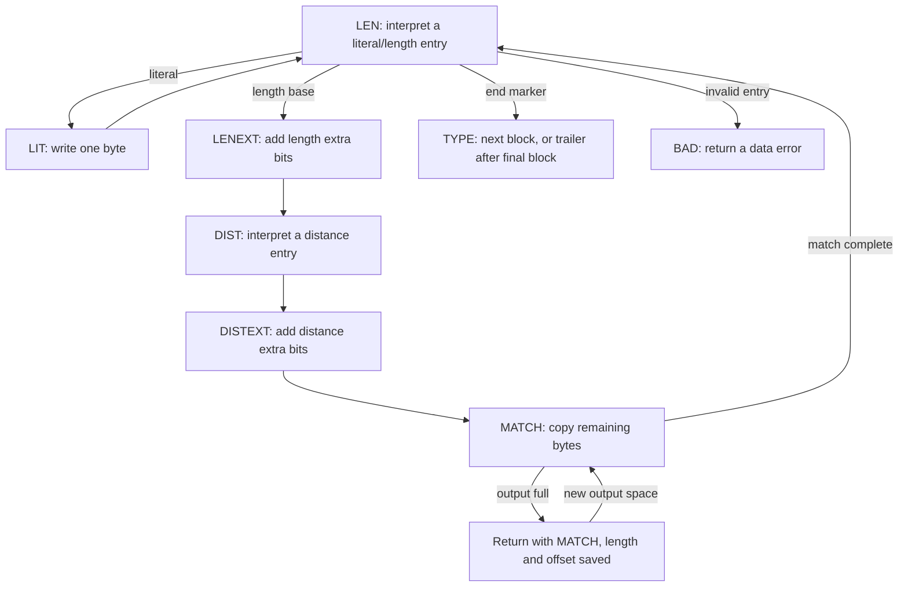
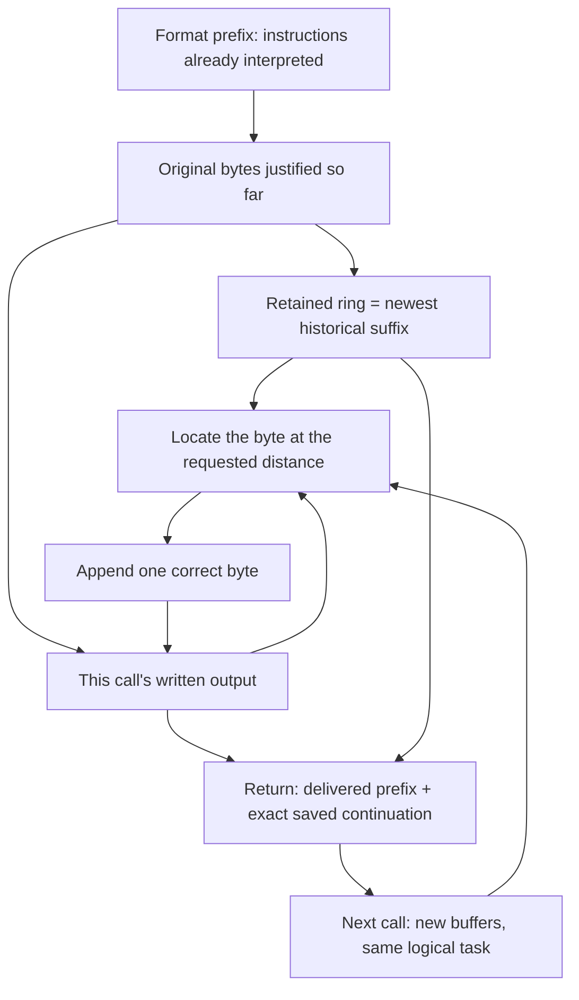

The tables now tell the decoder what a code means. The next job is to execute that meaning: write one literal, expand a length/distance instruction, or finish the block. These operations produce the bytes the application asked to recover. A single instruction can produce more bytes than this call has room for, so execution also has to leave an exact place to continue.

Follow the selected raw stream `73 74 82 40 00`. Its instructions are A, B, length six at distance two, then end of block. The result is `ABABABAB`. This is the hand-selected encoding introduced earlier; the account concerns how `inflate` executes it, without making a prediction about a compressor's choices.

## From a table entry to the next operation {#dispatch}

`inflate` runs a `for (;;)` loop around a `switch` on `state->mode`. The mode names identify **work to resume**. `LEN` means that the next literal/length instruction has not yet been read; `MATCH` means that its length and distance have already been obtained and bytes remain to copy. Confusing those modes would reread an instruction or lose part of its output.

The ordinary route passes through the following cases. The literal/length and distance tables come from the preceding chapter.



In `LEN`, the C first ensures enough buffered bits for the selected table entry, follows a subtable link when required, and removes precisely the entry's code bits. It puts `here.val` into `state->length`. The operation field then gives that value its role: for a literal it is a byte; for a match it is a length base. `LENEXT` adds the selected extra bits. `DIST` and `DISTEXT` perform the corresponding distance calculation and save it as `state->offset`.

A block-end marker changes to `TYPE`, not directly to a completed stream. The `last` bit determines whether to read another block or proceed to final alignment and wrapper checks. Invalid length or distance symbols choose `BAD`. Lack of input during extra-bit reading returns with the mode and the available bits preserved.

## A literal needs one writable position {#literals}

At the outer call, the application supplies `next_out` and `avail_out`: a writable starting pointer and a byte count. The decoder loads these into the local pointer `put` and remaining count `left`. The source's entire literal case is small:

```c
case LIT:
    if (left == 0) goto inf_leave;
    *put++ = (unsigned char)(state->length);
    left--;
    state->mode = LEN;
    break;
```

For A, the stored value is 65. With room, it becomes the next output byte, `put` advances by one, and `left` falls by one. Without room, the return keeps `LIT` and the saved byte. The next call writes that byte; it does not decode the literal again. B follows the same route, leaving the prefix `AB`.

The private state and the temporary output area have different lifetimes. The stream state survives returns. The application can consume and reuse a delivered output slice under the buffer contract. A later match must therefore locate its source either in this call's output or in the decoder's own retained history.

## A match extends the output while reading it {#copy}

The instruction length six, distance two means: repeatedly read the byte two positions behind the current end and append it. The distance stays two while both source and destination move.

| Copy step | Byte read | Prefix after the write |
| --- | --- | --- |
| 1 | A from the earlier literal | `ABA` |
| 2 | B from the earlier literal | `ABAB` |
| 3 | A written at step 1 | `ABABA` |
| 4 | B written at step 2 | `ABABAB` |
| 5 | A written at step 3 | `ABABABA` |
| 6 | B written at step 4 | `ABABABAB` |

The third read is already a read of newly produced data. An unchanged snapshot of the original two-byte source cannot supply the six-byte result. The implementation must retain the forward byte-by-byte order even when it groups several assignments into a loop body.

In the ordinary `MATCH` case, `state->length` is the number of match bytes still owed. The implementation chooses a source and an initial copy count, limits that count by output room, and performs this actual tail:

```c
if (copy > left) copy = left;
left -= copy;
state->length -= copy;
do {
    *put++ = *from++;
} while (--copy);
if (state->length == 0) state->mode = LEN;
```

`copy` is positive on entry to this `do` loop. The case has already tested `left != 0`, the match has positive remaining length, and a window segment is bounded by a positive source span. Subtracting the count before the loop records how much work will remain after those writes. In the direct-output arm, `from` can advance into the output just written. A change from window storage to output performs a new source selection; a pointer does not walk from one allocation into the other. Returning to `LEN` is justified only when the remaining match length reaches zero.

## Current output and saved history {#window}

The decoder's saved window is a circular byte array. Its capacity is `wsize`, the number of valid retained bytes is `whave`, and `wnext` is the index where a new retained byte would be written. Capacity does not imply that every slot contains usable history. This ring is different from the compressor's continuous `2W` array and its occasional sliding moves.

The ordinary decoder saves the output capacity at the start of this call as `out`; `left` is the space still unused. Thus `out - left` counts bytes produced **in this call**. If the match distance is no greater than that count, `put - offset` lies in the current output. Otherwise, the distance reaches before the call's output start, and the excess must come from the ring.

Here is the source choice in the ordinary case, reduced to its actual direct-output arm:

```c
else {                              /* copy from output */
    from = put - state->offset;
    copy = state->length;
}
```

The window arm first computes the excess distance. If it exceeds `whave` while `sane` is set, the decoder selects `BAD`: there are not enough historical bytes. Otherwise it locates the chronological source around `wnext`, limits the copy to a contiguous segment, and returns to the same case if more match bytes remain. The next segment can come from the ring's start or from the new output.

Consider an eight-cell teaching ring whose physical cells contain `ABCDEFGH`, with `wnext = 3` and all eight cells valid. Chronological history is `DEFGHABC`. This call has produced `DE`, and the next instruction asks for length six, distance six:

| Quantity | Value | Meaning |
| --- | ---: | --- |
| Current-call output | 2 bytes | `DE` already lies in the caller's current output slice. |
| Excess distance | `6 - 2 = 4` | The first four source bytes must come from retained history. |
| First physical source index | `8 + 3 - 4 = 7` | Cell 7 contains H. |

Read H from cell 7, wrap, and read ABC from cells 0–2. The remaining two bytes come from current output, DE. The instruction contributes `HABCDE`, leaving current output `DEHABCDE`. A distance remains a logical backward distance even though its physical source changes twice.

Eight cells make the indexing visible; they are not an admitted initialization window size. With the normal source configuration, reset establishes `sane = 1`. This rejects unavailable history in both ordinary and fast copying. The optional `INFLATE_STRICT` build adds a separate comparison with `dmax`, the maximum distance derived from the zlib header. That additional header-limit check and the available-history check are different conditions.

Window configuration also changes what survives a return. A full 32 KiB retained window can preserve the format's largest history suffix. A smaller configured window retains less; bytes already in the current output may still satisfy a long distance, while the same distance after rebuffering may no longer have enough retained history. A preset dictionary contributes past bytes without counting as new output. For a zlib dictionary request, its Adler identifier is checked before the dictionary is installed; raw mode has no header identifier to perform that handshake.

`inflateUndermine` is not a default escape from these checks. Without `INFLATE_ALLOW_INVALID_DISTANCE_TOOFAR_ARRR`, it keeps `sane = 1` and returns `Z_DATA_ERROR`. The specially enabled build has separate zero-fill behavior for missing history. Its semantics must be stated explicitly rather than silently treated as ordinary DEFLATE repetition.

## A full output buffer pauses the same instruction {#suspension}

Give the selected five-byte raw stream all at once, but only five output positions. The actual small-buffer example returns as follows:

| Call | Compressed bytes consumed | Original bytes delivered | Return |
| --- | ---: | --- | --- |
| 1 | 4 | `ABABA` | `Z_OK` |
| 2 | 1 | `BAB` | `Z_STREAM_END` |

The first two bytes are literals; the next three are the beginning of the six-byte match. At the first return, the saved state is `MATCH`, remaining length three, distance two. The decoder also retains the required suffix of `ABABA` in its own window. The application can now deliver those five bytes and reuse the output storage.

The second call first reads B and A from retained history. Its third byte reads the B just written in the new output. It completes the saved match before returning to `LEN` to read the end marker. The compressed instruction was decoded once, even though its output crossed two calls.

<div class="zl-demo-mount"><zlib-demo kind="stream"><p>The first output slice contains ABABA and leaves three match bytes at distance two. The next slice receives BAB, continuing that same saved MATCH operation.</p></zlib-demo></div>

`updatewindow` retains the most recent suffix when a return needs history. If this call produced at least a window's capacity, it copies only the newest full window. Otherwise it appends the shorter new suffix, splitting the memory copy at the ring boundary when necessary. Initial window allocation is delayed until this retained history is needed. A one-call finish can therefore avoid an otherwise unnecessary window allocation and copy; that optimization is controlled by the actual return condition, not by the assumption that every stream fits one call.

The same pause principle applies before a literal write, midway through extra bits, and during header or trailer fields. Saved modes distinguish these jobs. Replacing input must preserve the unconsumed suffix; replacing output provides new writable space while the decoder owns the historical bytes it still needs.

## Fast decoding checks room for a whole instruction {#fast}

The ordinary path has now explained both a complete match and a return in its middle. `inflate_fast` performs the same instruction work under stronger entry conditions, reducing repeated input/output tests inside the loop. The main loop checks those conditions at `LEN`:

```c
case LEN:
    if (have >= 6 && left >= 258 && bits < 8) {
        RESTORE();
        inflate_fast(strm, out);
        LOAD();
```

This is an excerpt ending inside the real branch. `have` counts unread input bytes, `left` writable output bytes, and `bits` held but unconsumed input bits. Six bytes cover the refill requirements for one length/distance instruction; 258 positions cover the longest match. Fewer than eight held bits make exact whole-byte backtracking possible at exit. Installed tables must also have the bounded shape and meanings needed by their consumers.

The five-byte, five-output-slot example above cannot enter this branch. More generally, a default build still chooses between the paths at run time: the current mode, offered input/output space, and retained bits determine entry. With insufficient margins, the ordinary state machine continues to support the same admitted small-buffer calls.

Inside the helper, the names `in` and `out` are **pointers**, unlike the main function's saved count named `out`. The helper receives that saved count as its argument `start`. Its setup is:

```c
in = strm->next_in;
last = in + (strm->avail_in - 5);
out = strm->next_out;
beg = out - (start - strm->avail_out);
end = out + (strm->avail_out - 257);
```

`beg` recovers the start of the outer call's output, including bytes written before entering the helper. `in < last` means at least six input bytes remain; `out < end` means at least 258 output positions remain. The body starts as a `do` loop, so the caller must establish the margins for its first iteration. Later iterations test `in < last && out < end`.

The refill bound depends on residual bits, not on adding each refill site's independent maximum. Earlier pulls can leave enough bits to reduce what a later site needs. The branch-level proof tracks that shared bit balance, which excludes the impossible combination that a naive independent sum would count as seven input bytes.

The direct-output match loop is unrolled into three ordered assignments:

```c
from = out - dist;          /* copy direct from output */
do {                        /* minimum length is three */
    *out++ = *from++;
    *out++ = *from++;
    *out++ = *from++;
    len -= 3;
} while (len > 2);
```

A one- or two-byte tail follows when required. The first body is safe because DEFLATE match lengths start at three. With distance one or two, later assignments can read earlier assignments' output, exactly as the ordinary byte loop does. Window segments have separate positive counters and cases for an unwrapped suffix, a wrapped suffix, and transition into current output. The optimization groups operations; it keeps their dependency order.

Literal/length and distance lookups can follow a link into a subtable. The table relations bound that chain. An invalid entry or too-far distance selects `BAD`; block end selects `TYPE`; falling below the next-iteration margins leaves mode `LEN`. The helper then restores an exact boundary for the outer state machine.

## Return unused bytes and publish exact cursors {#restore}

The fast loop can read beyond the bits needed by its last instruction. Before returning, it puts unused **whole bytes** back into the caller's unread range. This is the actual epilogue:

```c
len = bits >> 3;
in -= len;
bits -= len << 3;
hold &= (1U << bits) - 1;
```

Here `len` has been reused for a whole-byte count, not a match length. If 19 bits remain, two bytes return to the input range and three bits stay in the reservoir. The entry condition `bits < 8` ensures those returned whole bytes were read by this helper. Masking `hold` removes their duplicate representation, leaving exactly the residual low bits.

The helper writes back pointers, availability, `hold` and `bits`; the main loop's `LOAD` reads that returned state. At a normal API return, `RESTORE` similarly publishes local `put/left`, `next/have`, and `hold/bits`. These fields describe work already performed, including reads or writes made before a pause or error.

For a single call, compute effects from the offered and returned availability values:

```text
consumed = avail_in_before  - avail_in_after
produced = avail_out_before - avail_out_after
```

The input/output pointers advance by those amounts. Input bytes pulled into `hold` can count as consumed even if some of their bits remain to interpret. The returned input range and held bits together describe the exact continuation.

The common `inf_leave` path restores pointers **before** it may allocate a history window. Its first part is:

```c
inf_leave:
    RESTORE();
    if (state->wsize || (out != strm->avail_out && state->mode < BAD &&
            (state->mode < CHECK || flush != Z_FINISH)))
        if (updatewindow(strm, strm->next_out, out - strm->avail_out)) {
            state->mode = MEM;
            return Z_MEM_ERROR;
        }
```

The additions to `total_in`, `total_out` and `state->total`, and the remaining output-checksum update, occur after this excerpt. A delayed window allocation can fail after output was written and the cursors restored. That exit returns `Z_MEM_ERROR` before those later updates. Returned output slices and total counters therefore need separate relations; an error does not imply that no bytes were written. The later resource chapter follows the objects that remain to clean up.

`Z_OK` means the call has not returned a complete stream. `Z_BUF_ERROR` can indicate no progress, or a `Z_FINISH` request that has not completed. The C changes `Z_OK` to `Z_BUF_ERROR` when neither input was consumed nor output produced, or when that unfinished call requested `Z_FINISH`. Supplying the same blocked ranges repeatedly cannot create missing input or output space. `Z_BLOCK` and `Z_TREES` additionally request earlier structural stopping points. Those stops still use the same cursor and saved-state accounting.

## End of a block and end of a wrapped stream {#wrappers}

After the final block's end marker, the decoder reaches the trailer path. Raw mode completes after the prescribed final alignment. A zlib stream additionally checks Adler-32; a gzip member checks CRC-32 and its uncompressed size modulo `2^32`. Header and trailer bytes belong to compressed input, not to the original-byte output.

Use a stored block for `ABC` to expose the wrapper boundaries. The selected raw body is `01 03 00 fc ff 41 42 43`; add zlib header `78 01` and trailer `01 8d 00 c7`. Cut input immediately after C. All three original bytes have reached the application, yet `CHECK` still needs four input bytes. Supplying a mismatching complete trailer returns a data error when validation is enabled; supplying none leaves a task waiting for input. The decoder cannot retract bytes delivered earlier.

The C's `CHECK` case updates the produced-byte account before comparing the trailer. It then sets the local output baseline to `left`, so the common return does not add those same bytes a second time. Gzip's following `LENGTH` case compares its size field with `state->total & 0xffffffff`. Only after these required fields does `DONE` return `Z_STREAM_END`. Input after the completed stream or member can remain unread; finishing one gzip member does not automatically consume a concatenated member.

The initialization's wrapper choice decides which headers are admitted. `inflateValidate` changes the validation bit for the active and requested wrapper settings. Disabling validation can permit incorrect checksum/size fields, but does not turn their bytes into DEFLATE payload or disable table and history-access checks. Raw mode has no wrapper check to enable. Dictionary requests likewise belong to the stream context: a pending zlib dictionary handshake must be resolved before ordinary decoding can continue.

## Correctness across copying, optimization and return {#correctness}

Three representations now meet: the format's decoded prefix, the bytes already delivered to the application, and the private state needed to continue. A correct loop step has to preserve their relationship, including when a source changes from ring storage to current output.



### The byte copied at each step {#byte-proof}

Let `d` be the positive distance, `L` the requested length, and `j < L` the number of match bytes already written. For a match that passed the source check, `d` is no greater than the available logical history length. Before step `j`, the logical history contains the dictionary and every output byte justified so far. If `j < d`, this step reads from history present before the match. Otherwise it reads byte `j-d` produced by this same match. Since `d > 0`, `j-d < j`: induction already gives that earlier byte's meaning. Appending it establishes the claim for `j+1`.

The physical proof adds a mapping from chronological history to ring indices, and from current-call output to its live caller allocation. For the eight-cell example, that mapping explains why cell 7, cells 0–2 and current output positions 0–1 implement one contiguous logical source. The copy counter decreases by the number written, establishing termination of each copying segment. Writable room, readable source spans, initialized bytes and unrelated memory must all be retained in the execution relation.

The actual [`copyMatch_run`](/reference/source/ZlibF/Proof/inffast.c.match.html#L100) states successful copying or the too-far-distance result. Its premises include a valid fast-decoder environment, context agreement, positive distance, match length at least three, sufficient output room, and the current output position. Its conclusion identifies the resulting byte array and output pointer, while retaining the helper's input and bit state. The statement's normal-history premise is consistent with default `sane = 1`; it is not a theorem about arbitrary zero-fill builds.

### The optimization preserves the same instruction {#fast-proof}

For ordinary and fast routes, the proof relates the bits supporting a decoded instruction to the exact table entries read and the bytes written. Bounds alone cannot identify the right symbol. Likewise, checking a table's meaning does not justify reading outside its allocated regions. The consumer uses the table contents, widths and heap produced by construction.

The source statement [`actual_body_refines_token`](/reference/source/ZlibF/Proof/inffast.c.body-token.html#L685) connects one actual fast body to a token, block end or rejected token. [`inflate_fast_safe`](/reference/source/ZlibF/Proof/inffast.c.final.html#L257) covers the helper's safety, termination, frame, normalization and writeback goal. Their roles differ: instruction meaning must accompany the memory and exit properties when composing the whole route. At every entry, the actual guard establishes the six-byte, 258-byte and held-bit margins. The stream invariant supplies the table-content and retained-history relations; the numeric guard alone cannot establish them.

For fast exit, define the remaining input bits as the valid low bits of `hold` followed by the unread input bytes expanded in reading order. Backtracking two whole bytes from a 19-bit reservoir changes where these bits live; it does not change their sequence. Keeping only three low held bits avoids representing the returned bytes twice. That equality connects the helper's returned state to the next ordinary lookup.

### A return preserves both work and storage {#return-proof}

At a suspension inside our match, the output prefix is `ABABA`, the remaining length is three, and the distance is two. The ring relation identifies the retained B and A needed by the next call. Rebinding output changes the allowed destination allocation, not the logical result already delivered. In the next call, copying B, A and the newly written B extends that same prefix by `BAB`.

The relation separately records the actual output slice, published cursors, totals and checks. This separation covers the late `updatewindow` allocation failure: restored pointers identify written bytes even when the common total/checksum tail has not executed. The return code also records the right completion, waiting or error outcome. Validating a trailer connects the accumulated check to exactly the recovered original-byte sequence.

A completion statement has stronger premises than preservation of a prefix. The definition [`InflateCompletes`](/reference/source/ZlibF/Spec/Public/Sequences.html#L128) requires an actual single-dictionary data history that has not yet returned `Z_STREAM_END`, a valid remaining source, `Good` saved state outside failed/recovery modes, any dictionary request resolved, valid input/output and header storage, no allocation failure, and enough output room. It also uses `FullWindow`, which is defined on the normalized wrapper and window width. Width 15 means 32 KiB; its initialization arguments are `-15` for raw, `15` for zlib, `31` for gzip, and `47` for automatic detection. Normalized zero settings are also admitted: `0` obtains a width-15 zlib declaration, `16` selects gzip width 15, and `32` selects the appropriate zlib or gzip case. A header-derived zlib window must announce 15. Raw mode has no zero-width form. These are the conditions for the stated completion guarantee; a smaller retained window cannot silently receive that same guarantee.

Under these premises and an admitted completion flush, the target is an actual `Z_STREAM_END` result and the exact remaining decoded suffix. For our two-call example, three free positions hold `BAB`, but they work together with the correct remaining input, history bytes and saved mode. The proof's invariant brings those facts to each actual return boundary. Mode changes that read no input and write no output additionally need a decreasing control rank, so the decoder cannot change modes forever without progressing or returning.

<details class="bk-evidence"><summary>Source and exact statements</summary>
<p>The implementation excerpts follow <a href="https://github.com/madler/zlib/blob/757f0527154291bcf6bfbd6396ecde6bedd2db95/inflate.c#L923-L1171">inflate.c: LEN through the common return</a> and <a href="https://github.com/madler/zlib/blob/757f0527154291bcf6bfbd6396ecde6bedd2db95/inffast.c#L50-L310">inffast.c: setup, copying and writeback</a>. Configuration-dependent distance and validation behavior is in <a href="https://github.com/madler/zlib/blob/757f0527154291bcf6bfbd6396ecde6bedd2db95/inflate.c#L1396-L1424">inflateUndermine / inflateValidate</a>. The <a href="/reference/docs/proof/inflate.html">decoder argument</a> and <a href="/reference/docs/proof/inffast.html">fast-helper argument</a> give the formal relationships; public parameter and result cases are in <a href="/reference/functions/inflate.html">inflate</a>.</p>
</details>
