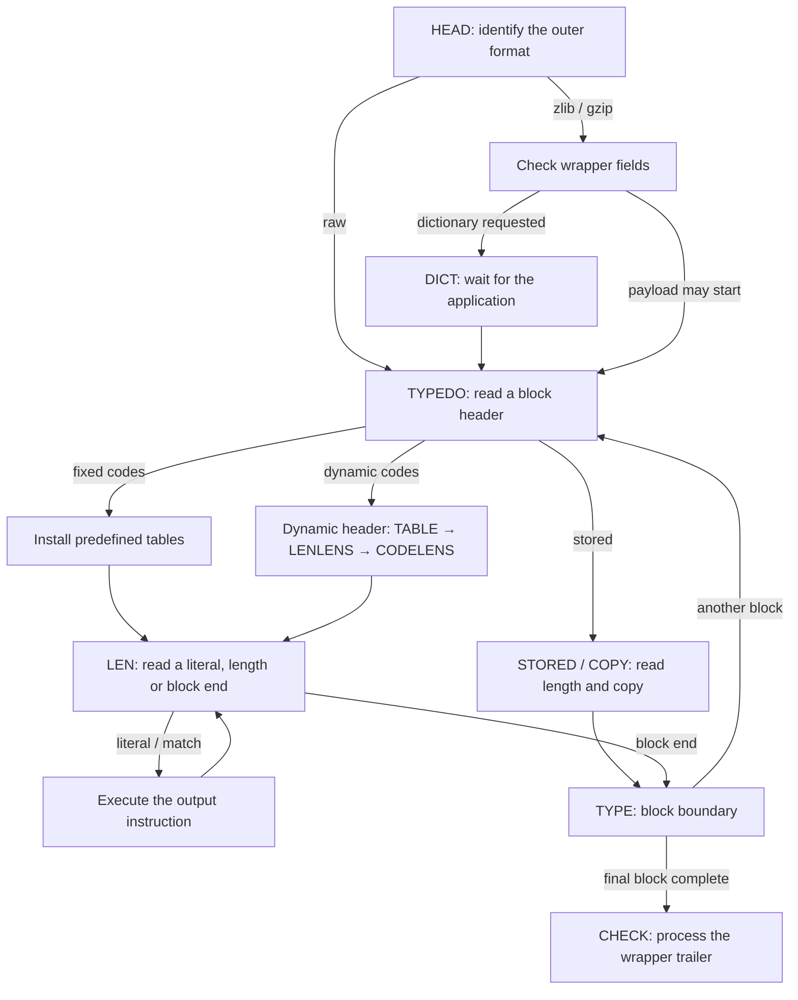
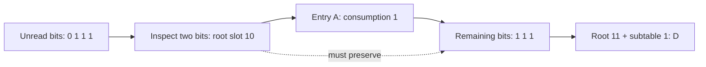
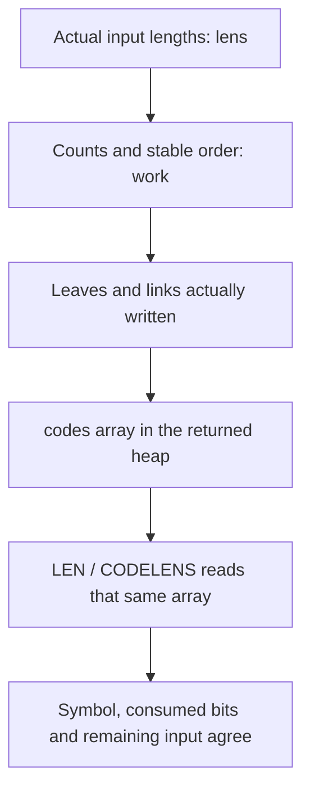

The compressor has arranged literals, matches and block headers into bytes. `inflate` recovers their meaning in the opposite direction: identify the wrapper, read a block type, prepare that block's code tables, then determine whether the next bits describe a byte, a match, or the end of the block.

Keep the five-byte raw DEFLATE stream `73 74 82 40 00` in view. It contains a final fixed-code block representing literals A and B followed by a length-6, distance-2 match. Its decoded result is `ABABABAB`. These are the instructions already selected in this particular encoding; the decoder does not search for matches again. This chapter follows actual dispatch until the instruction has been identified.

## The call entry and saved parsing position {#entry}

The application supplies compressed input in the range beginning at `next_in`; `avail_in` counts its remaining bytes. `next_out` and `avail_out` describe the output range. These are the buffers available for this call, while a longer stream can span many calls.

The internal `state->mode` records the parsing stage. After checking the stream and buffer pointers, `inflate` loads frequently used fields into locals: `next` and `have` describe unread input, `put` and `left` describe writable output, and `hold` and `bits` describe bits already pulled but not yet consumed. Saved fields support continuation; locals support the current loop. Actual progress is written back when the function returns.

The entry uses these actual statements:

```c
state = (struct inflate_state FAR *)strm->state;
if (state->mode == TYPE) state->mode = TYPEDO;      /* skip check */
LOAD();
in = have;
out = left;
ret = Z_OK;
for (;;)
    switch (state->mode) {
```

Each following `case` is one stage of parsing. A stage may finish and enter another, or return when input or output is insufficient. A later call resumes the saved stage; it must not reinterpret a header that has already been consumed.

`TYPE` and `TYPEDO` distinguish a reported block boundary from its continuation. A caller using `Z_BLOCK` or `Z_TREES` can stop at `TYPE`. On reentry, the initial conversion to `TYPEDO` crosses that already reported boundary. Otherwise, the same state could keep returning at the boundary without starting the next block.

## Select the formats the decoder may read {#configuration}

The same DEFLATE payload can appear inside zlib, gzip, or another container. The initialization parameter `windowBits` selects both the wrapper policy and retained-window capacity. `inflate` has no compression-level, `memLevel`, or matching-strategy argument: decoding must handle the stored, fixed-code and dynamic-code blocks actually present in its input.

The default build includes gzip decoding. `inflateInit` initializes with `windowBits = 15`. The common choices below use positive window widths 8 through 15, corresponding to retained capacities of 256 through 32768 bytes.

| Initialization argument | Allowed outer format | How window width is determined |
| --- | --- | --- |
| `8..15`, commonly `15` | zlib | Use the requested width; an accepted zlib header cannot declare a larger one |
| `0` | zlib | Read the width from the zlib header |
| `-15..-8`, commonly `-15` | Raw DEFLATE | Use the magnitude; no zlib or gzip header or trailer |
| `24..31`, commonly `31` | gzip | Subtract 16 from the argument |
| `40..47`, commonly `47` | Detect zlib or gzip | Subtract 32 from the argument |
| `16` or `32` | gzip only, or automatic detection, respectively | Start with width zero; the zlib branch obtains it from the header, while the gzip branch selects 15 |

The final row follows the selected source's parameter normalization and header handling. It does not make every integer from 16 through 47 valid. Arguments 17 through 23, for example, normalize to window widths 1 through 7 and are rejected. Raw `-8` is accepted by `inflate`; the compressor rejects its corresponding eight-bit raw window.

Two distance conditions also need distinct meanings. Window capacity determines how much history survives across calls; output produced during the current call can also supply a match. The ordinary too-far-distance check asks whether the actual source is available. The build option `INFLATE_STRICT` adds a check against the zlib header's advertised `dmax`; that option is absent from the default translation. The window argument therefore cannot be read as a comparison performed against every copy distance.

Build options change these paths. `NO_GZIP` removes gzip header and trailer decoding, so the gzip and detection rows above cannot be carried into that build. `BUILDFIXED` replaces pregenerated fixed tables with construction on first use. Without atomics, the tables must be initialized by a single-threaded fixed-block `inflate` call that returns before other threads enter decoding. `PKZIP_BUG_WORKAROUND` changes dynamic-alphabet and table-capacity bounds. The following execution uses the default build and identifies those differences where they matter.

Wrapper selection and validation settings also serve different jobs. `inflateValidate` can change the selected stream's validation setting; it neither turns zlib or gzip into raw data nor removes required wrapper fields. Dictionary supply, per-call buffers and flush requests are conditions of the calling protocol.

## Follow the wrapper into the current block {#dispatch}

Initialization selects `HEAD`. Raw decoding goes directly to block parsing; zlib and gzip first check their headers. Zlib checks the header's modulo-31 relation, compression method and advertised window. The default build can recognize the gzip magic bytes and visit the flags, time, optional extra field, name, comment and optional header-check stages. Input can end in the middle of a name or extra field; the saved mode and remaining count retain that exact continuation.

If the zlib header requests a preset dictionary, the parser reads its four-byte identifier and enters `DICT`. Without the dictionary it returns `Z_NEED_DICT`. The application must provide a matching dictionary before block parsing continues. This pause is part of the calling protocol; it is neither damaged input nor an already decoded match.



The branches are alternative block forms. A stored block bypasses Huffman lookup; a fixed block sends no new code-length description; a dynamic block first supplies its tables' description. The state machine can also respond to `Z_BLOCK` at a block boundary, or to `Z_TREES` after processing a block header. `Z_FINISH` requests completion or a blocked result; it cannot supply missing input.

## Retain the unread bits within each byte {#input}

Block headers, lengths and codes have different widths. A field can start midway through a byte, so the input pointer and the bit-consumption position describe different progress. Pulling a byte advances `next`, while some of its bits can remain in `hold`.

Store the next bit at the integer's lowest position. Suppose the three saved bits have reading order `0, 1, 1`. Then `hold = 6` and `bits = 3`. The ordinary binary spelling is `110`, read from the low bit at the right. The count matters: a valid zero bit is still input, even though it contributes nothing to the integer's numeric value.

A following five-bit field needs more than those three bits. If the next byte is `0xA5 = 165`, append it above the saved positions:

```text
Saved reading order: 0, 1, 1
New byte order:      1, 0, 1, 0, 0, 1, 0, 1
hold = 6 + (165 << 3) = 1326
bits = 3 + 8 = 11
```

No field has been consumed yet. The values and order of all eleven bits are preserved. The selected C's `PULLBYTE` performs exactly that operation:

```c
#define PULLBYTE() \
    do { \
        if (have == 0) goto inf_leave; \
        have--; \
        hold += (unsigned long)(*next++) << bits; \
        bits += 8; \
    } while (0)
```

`NEEDBITS(n)` repeats it while `bits < n`. It reads no byte when enough bits are already held. If input ends, it enters return processing with the saved bits and current mode. Here `n` counts bits required by the current field, not bytes to fetch at once.

Inspecting five bits and removing five bits are separate operations. `BITS(5)` yields `1326 & 31 = 14` without changing the state. `DROPBITS(5)` then leaves `hold = 41` and `bits = 6`. Those six bits still belong to subsequent input. At a byte boundary, `BYTEBITS()` removes only the low padding bits that the current format stage permits it to skip.

The reservoir's normalization relation is `hold < 2^bits`: no bit above the valid part is set. The default LP64 translation uses a 64-bit `hold`, but each shift still needs the bound appropriate to its parsing step. Machine width cannot replace that local condition.

## Read the block header and choose its branch {#block-header}

Each DEFLATE block begins with a one-bit final-block flag and a two-bit type. For `73 74 82 40 00`, the first byte `0x73` has low-bit reading order `1, 1, 0`. The final flag is 1 and the type value is 1, so the parser installs the fixed tables.

The default build already contains these tables. `inflate_fixed` selects root width 9 for literal/length codes and 5 for distance codes. It installs table addresses and index widths; it does not rebuild a tree from input.

Type 0 first aligns to a byte boundary, then reads a 16-bit length and its bitwise complement. A mismatch is an error. The payload is copied in pieces bounded by available input, available output and the remaining length. This path needs no code table.

Type 2 enters a dynamic block's table description. Type 3 is reserved: the parser sets an error message and enters `BAD`. All of these choices occur before interpreting literals and distances.

## A dynamic block first describes its code lengths {#lengths}

A dynamic block cannot make the decoder guess its codes. It first supplies three counts: literal/length symbols, distance symbols, and explicitly supplied code-length-alphabet entries. The actual parsing is:

```c
NEEDBITS(14);
state->nlen = BITS(5) + 257;
DROPBITS(5);
state->ndist = BITS(5) + 1;
DROPBITS(5);
state->ncode = BITS(4) + 4;
DROPBITS(4);
```

The default path rejects descriptions exceeding 286 literal/length symbols or 30 distance symbols. `PKZIP_BUG_WORKAROUND` changes those admitted maxima; the default checks cannot describe that build.

The parser next constructs a table for reading code lengths. Its alphabet contains 19 symbols. Input gives a three-bit length for each of the first `ncode` entries, but their order is a fixed permutation rather than ascending symbol order:

```text
16, 17, 18, 0, 8, 7, 9, 6, 10, 5, 11, 4, 12, 3, 13, 2, 14, 1, 15
```

Unspecified entries receive zero. The state machine requests root width 7 and calls `inflate_table(CODES, ...)`. Symbols decoded through that table fill the actual literal/length and distance length arrays:

| Length-description symbol | What it writes to the length array | Extra input bits |
| --- | --- | --- |
| `0..15` | Write this length once | None |
| `16` | Repeat the previous length 3 through 6 times | 2 bits; a previous length must exist |
| `17` | Write 3 through 10 zero lengths | 3 bits |
| `18` | Write 11 through 138 zero lengths | 7 bits |

Every repetition checks the remaining space. A valid repeat symbol must not overrun the described array. A repeat can cross the literal/length-to-distance boundary: the source first fills one continuous sequence, then uses `nlen` to separate its two parts.

After recovering all lengths, the parser requires symbol 256 to have a nonzero length; it marks the end of a block. It then requests root width 9 for the `LENS` table and 6 for `DISTS`. The latter starts at the free position actually returned by the former. This sequence avoids transmitting a complete pointer-based tree: the stream carries lengths, and the decoder expands them into directly indexable tables.

## Expand lengths into root tables and subtables {#tables}

`inflate_table` receives the lengths, alphabet kind, requested root width, table region and scratch region. It returns an actual root width, an advanced table pointer and a result code. A zero length means that a symbol is unused. For a nonempty code, the requested width is clamped between the shortest and longest nonzero lengths, so the caller must use the returned width. The empty-code return is handled separately below.

First make the construction visible with four symbols: `A=0`, `B=10`, `C=110`, `D=111`, requesting a two-bit root. This teaching table isolates short-code replication and subtables. It is neither the five-byte example's fixed table nor a complete DEFLATE block.

### Counts and stable symbol order {#table-order}

`lens` holds each symbol's length; `count[l]` counts entries of length `l`. The constructor clears counts 0 through 15, then executes `count[lens[sym]]++`. The caller must establish that every supplied length is in 0 through 15; the helper does not first check that index itself.

Our nonzero counts are one one-bit symbol, one two-bit symbol and two three-bit symbols. The constructor tracks unoccupied prefix positions in `left`: start at 1, double when descending a level, then subtract that level's symbol count. Our example leaves `1, 1, 0`; three one-bit symbols would instead produce `-1` at the first level and cannot fit a binary prefix tree.

Next it computes the starting offset `offs` of each length group in the scratch array `work`, then inserts symbols in numeric order:

```c
offs[1] = 0;
for (len = 1; len < MAXBITS; len++)
    offs[len + 1] = offs[len] + count[len];

/* sort symbols by length, by symbol order within each length */
for (sym = 0; sym < codes; sym++)
    if (lens[sym] != 0) work[offs[lens[sym]]++] = (unsigned short)sym;
```

For `[1,2,3,3]`, the groups start at offsets `0, 1, 2`, yielding A, B, C, D. If the original lengths are `[3,1,3,2]`, the result is B, D, A, C: ascending length, then numeric symbol order within a group. Counts and prefix sums replace comparison sorting. Stores increment `offs`, so its final values are no longer the original group starts. During table emission, `count` also changes to record remaining symbols.

### An entry specifies an action {#table-entry}

Each `code` entry has `bits`, `op` and `val`. `bits` counts the bits consumed at this table level; `op` chooses an action; `val` supplies a direct value, base value, or subtable offset.

| Entry action | Meaning of `op` | Meaning of `val` |
| --- | --- | --- |
| Literal, or direct `CODES` symbol | `0` | Byte value or length-description symbol |
| Length or distance | Flag 16 plus extra-bit count | A base value, extended by extra input bits |
| Subtable link | Nonzero and below 16; the subtable index width | Offset from the original table base |
| Block end | `96`, containing end and invalid-classification bits | Not emitted as a byte |
| Invalid code | Flag 64 without end flag 32 | Not used as a valid literal or match |

For example, length base 11 plus an extra-bit value of 1 gives length 12. Reserved codes also need the appropriate invalid entries. Consumers recognize the end flag before handling invalidity, so the end entry's combined flags are interpreted correctly.

### Replicate short codes and allocate subtables on demand {#table-fill}

A two-bit root has four entries. A needs only a zero first bit; either value of the second bit must still produce A. Integer indices `00` and `10` therefore both contain A and consume just one bit. B occupies `01`. C and D share root slot `11`, then use a one-bit subtable.

The actual fill loop copies one prepared entry across all indices with the same low-bit prefix:

```c
incr = 1U << (len - drop);
fill = 1U << curr;
min = fill;                 /* save offset to next table */
do {
    fill -= incr;
    next[(huff >> drop) + fill] = here;
} while (fill != 0);
```

Connect the names to our example. `huff` is the reversed canonical code, with the next input bit at its lowest position; `len` is the complete code length; `drop` counts bits already accounted for by the root; `curr` is the current table's index width; `next` points to its first entry. A has `huff=0, len=1, drop=0, curr=2`. The stride is 2, filling index 2 and then index 0. Here `min` temporarily saves the current table size; it no longer means the shortest code length.

After filling a symbol, the constructor advances `huff` by incrementing from the high end of the current code toward the low end, matching the reversed representation. For A, B, C and D, its numeric values are `0, 1, 3, 7`, with lengths `1, 2, 3, 3`. The remaining `count` values identify when to move to the next length, so this reverse increment and the stable symbol order together reproduce the canonical sequence.

C and D have complete length three, sharing two root bits. One remaining bit distinguishes them. The root occupies offsets 0 through 3, and its subtable occupies offsets 4 and 5, so `used = 6`. The link in root slot 3 is installed with:

```c
low = huff & mask;
(*table)[low].op = (unsigned char)curr;
(*table)[low].bits = (unsigned char)root;
(*table)[low].val = (unsigned short)(next - *table);
```

That link has `op=1`, `bits=2`, `val=4`. After entering the subtable, index 0 selects C and index 1 selects D. In general, remaining length counts determine sufficient subtable depth for the current prefix. The constructor need not reserve maximum depth for every prefix. A wider root resolves more symbols on its first access, while its initial storage grows as `2^root`.

## A lookup returns both a symbol and its consumption {#lookup}

Read the teaching message `AD`. Its four bits in reading order are `0, 1, 1, 1`. Stored low-bit first, they give `hold=14`, ordinarily written as binary `1110`.

| Root index | Table result | Consumption at this level |
| --- | --- | --- |
| `00` | A | 1 bit |
| `01` | B | 2 bits |
| `10` | A | 1 bit |
| `11` | Subtable at offset 4, width 1 | 2 bits |

The first low-two-bit lookup uses `10` and returns A, but drops only one bit, leaving `111`. The second lookup uses root slot `11`, then the last bit `1` selects D. The whole operation consumes four bits without charging any of D's bits to A.

<div class="zl-demo-mount"><zlib-demo kind="lookup"><p>The AD teaching message first returns A from its root lookup and consumes one bit. The remaining 111 selects root 11 and subtable entry 1 for D.</p></zlib-demo></div>

Ordinary `LEN` dispatch has another input-saving detail: it may inspect a table entry using low bits of the normalized `hold`, compare the entry's required consumption with the actual held count, and only then decide whether to pull a byte. It does not always force a full root-width refill. A's replicated entries ensure that even if the second bit has not arrived, that undetermined position cannot change the one-bit code's answer. Committing an entry still requires its consumed bits to exist. Following a subtable additionally requires enough bits to identify the leaf.

The table therefore carries more than symbol numbers. It combines recognition, extra-bit widths, consumption and control flow. A literal or length/distance sends the state machine toward byte output or match execution. An end marker returns it to the block boundary.

## Distinguish rejected codes from waiting for input {#errors}

When input is temporarily insufficient, preserve the mode and pulled bits so the application can provide more. When data violates the format, enter `BAD` and report `Z_DATA_ERROR` through the public call. Confusing the two would discard a parser state that should remain resumable.

The constructor also distinguishes three results: 0 for success, `-1` for an invalid set of lengths, and 1 for insufficient selected table capacity. The outer dynamic-header parser treats nonzero constructor results as errors. A refusal can follow partial writes to scratch or table storage, so the safety relation must describe the heap actually returned.

* All-zero lengths take an early branch that writes two one-bit invalid entries, returns root width 1, and advances the table pointer by two. A successful construction can therefore produce a table whose lookup rejects; it has not invented a valid symbol.
* A nonempty incomplete code is accepted only when its kind is not `CODES` and its maximum length is one. It then has exactly one one-bit symbol and an explicitly invalid other slot. A completeness argument cannot silently discard this source-admitted case.
* A dynamic block must contain an end-of-block symbol. An all-zero distance table and actually encountering a match requiring a distance are separate questions; the consumer's use of the table matters too.

The default dynamic-table reservation is 852 entries for `LENS` and 592 for `DISTS`, totaling 1444. These count entries, not bytes or symbols, and are paired with requested root widths 9 and 6. The constructor checks capacity when reserving the root and additional subtables. `PKZIP_BUG_WORKAROUND` uses 854 and 594, totaling 1448; the default numbers cannot be reused. The reviewed `CODES` call interface has stronger input premises: at most 19 symbols, lengths at most seven, and requested root width at least seven. It needs no subtable and at most 128 entries. The concrete Lean `capOf` used by the table statements is 128, 852 or 592 for the corresponding default kind; the larger workaround capacities describe a separate build configuration.

## Correctness joins bits, table contents and their consumer {#correctness}

To explain why the decoded symbol is correct, first identify one unconsumed bit sequence. In this explanatory equation, `lowBits` lists `hold`'s valid bits low-bit first, `byteBits` expands unread bytes in the same order, and `++` concatenates sequences.

```text
remaining input = lowBits(hold, bits) ++ byteBits(unread bytes)
```

Pulling `0xA5` only relocates part of that sequence. The old value is below `2^bits`. Shifting the new byte by `bits` places it in a separate range; under the machine-width bound, addition joins the ranges without changing the saved low bits. When reading a field, its format or table entry supplies a consumption count `n`, and precisely those `n` bits are removed. Dropping two bits for A in `AD` can remain a valid integer operation while deleting D's first bit.



### The preserved relation of the bit-reading loop {#correctness-bits}

The actual Lean definition `BitInv` records a readable input range, agreement between `have` and the unread byte count, and `hold < 2^bits`. `stream` joins held bits with unread bytes. With a nonempty unread range under that invariant and `bits ≤ 56`, `PULLBYTE_succ` describes one real translated execution: append a byte, advance its pointer, reduce the available-byte count, and preserve `stream`.

`NEEDBITS_run` handles the actual refill loop under request bound `n ≤ 49`. Its invariant tracks how many bytes have been pulled, the increase in held-bit count, and preservation of the remaining sequence. Enough already-held bits cause no input read. Input exhaustion returns the saved partial reservoir. The shrinking shortage and finite available input supply stopping measures. `DROPBITS_inv` separately requires consumption no greater than the held count and less than 64, yielding the old sequence with exactly that prefix removed.

These premises explain why the code's counts cannot be freely substituted. Mathematical field completion still has to identify a live readable byte, justify pointer advancement and establish that each machine shift is defined.

### Construction produces the same table that decoding reads {#correctness-table}

The construction argument follows three relations through the actual writes. Counting connects array counts to supplied lengths. Sorting relates the written prefix of `work` to length and symbol order. Filling identifies the canonical prefixes represented by each replicated leaf and subtable link. Array bounds justify the accesses; content relations identify the symbols those accesses return.



The `inflate_table_content` target retains actual function execution, return classification and the permitted scratch/table modifications. It binds leaves and links to the array in the returned heap. Its call premises include length bounds, alphabet-size bounds, available table space and an independent scratch region. The internal construction environment comes from execution; the caller cannot supply an assumed correct table in place of running the constructor.

### Preserve each statement's domain during composition {#correctness-domain}

`inflate_table_complete_decoder_safe` has an additional complete-alphabet premise: code occupancy fills the binary code space exactly. That premise does not describe an all-zero table or the accepted incomplete one-symbol table. Its safe-lookup conclusion must be carried with successful return, the actual array and returned width. `inflate_table_codes_decoder_safe` instead works under the `CODES` constructor premises and supplies the table property used at `CODELENS`.

Composition therefore follows the constructor's result cases: a valid leaf provides a symbol, a link selects its corresponding subtable, and an invalid entry selects the defined rejection path. An empty distance table has the appropriate parsing meaning only when no distance lookup is needed; requesting a distance through its invalid entries must fail. Swapping C's and D's leaves can preserve every address bound while changing decoded meaning.

<div class="zl-demo-mount"><zlib-demo kind="table-proof"><p>Readable cells and bounded links are separate from agreement with the intended symbols. The teaching scene displays those conditions separately.</p></zlib-demo></div>

The handoff uses the same returned state: the consumed input position, current table entry and mode that interprets it. A literal then extends output by one byte; a match enters its length-and-distance copy loop. Both use the exact consumption relation established here.

<details class="bk-evidence"><summary>Implementation and theorem sources</summary>
<p>Control flow, parameter normalization and bit operations come from the pinned <a href="https://github.com/madler/zlib/blob/757f0527154291bcf6bfbd6396ecde6bedd2db95/inflate.c">inflate.c</a>. Entry meanings, construction loops and configuration constants are in <a href="https://github.com/madler/zlib/blob/757f0527154291bcf6bfbd6396ecde6bedd2db95/inftrees.c">inftrees.c</a> and <a href="https://github.com/madler/zlib/blob/757f0527154291bcf6bfbd6396ecde6bedd2db95/inftrees.h">inftrees.h</a>.</p>
<p>Exact bit relations and premises are in the <a href="/reference/source/ZlibF/Proof/inflate.c.main.macros.html">bit-operation statements</a>. Constructor premises are in <a href="/reference/source/ZlibF/Proof/inftrees.c.main.html">table-construction execution</a>, returned contents in <a href="/reference/source/ZlibF/Spec/InflateTableContent.html">TableContent</a>, and consumer connections in the <a href="/reference/source/ZlibF/Proof/inftrees.c.content.codes.html">code-length interface</a> and <a href="/reference/source/ZlibF/Proof/inftrees.c.content.data.html">data-table interface</a>. The complete <a href="/reference/functions/inflateInit2_.html">inflateInit2_ contract</a> retains parameters and error cases.</p>
</details>
