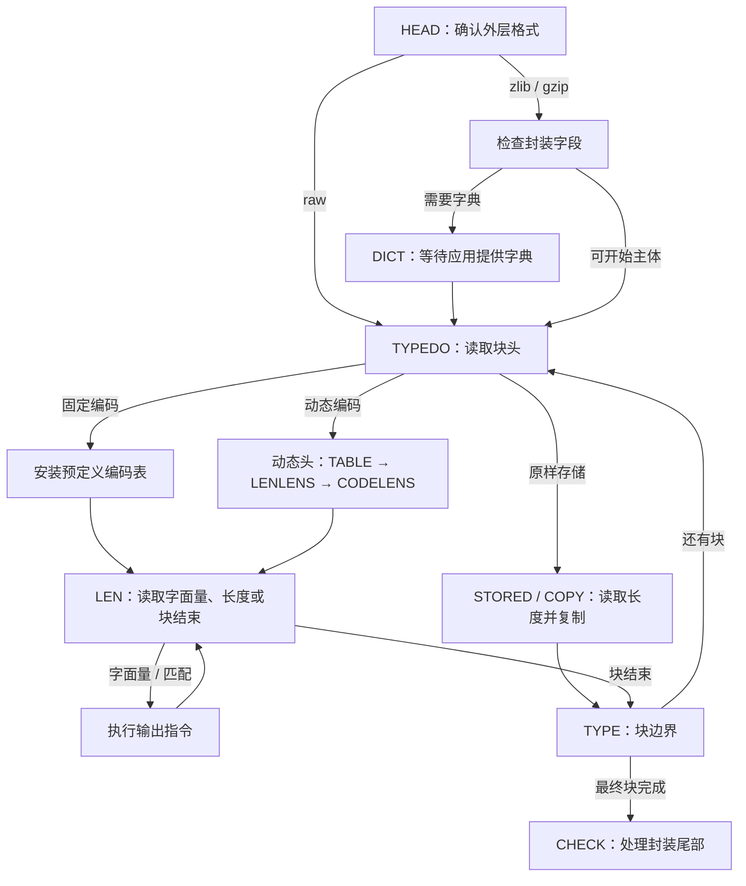
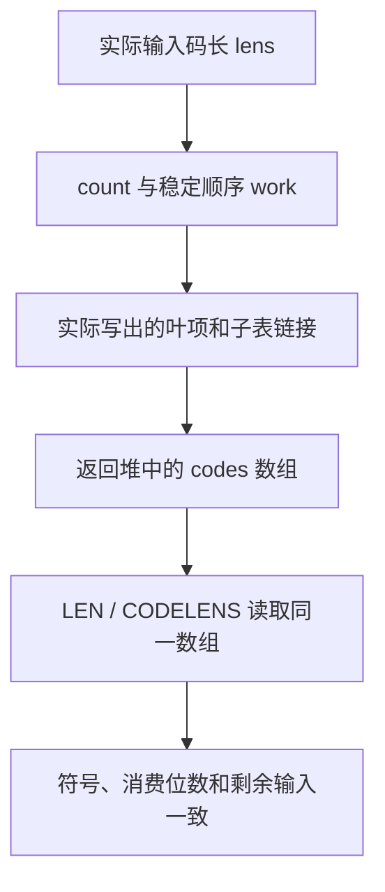

压缩端已经把字面量、匹配和块头排成一串字节。`inflate` 要沿相反方向恢复它们：先确定外层格式，读出块类型，准备本块的编码表，然后才能知道下一段比特表示一个字节、一条匹配，还是块结束。

沿用五字节裸 DEFLATE 流 `73 74 82 40 00`。它包含一个最终固定编码块，表示字面量 A、B，以及长度 6、距离 2 的匹配，恢复结果是 `ABABABAB`。这里的符号是这份具体编码已经选定的指令；解压器不会重新做匹配搜索。本章跟着实际状态机走到“已经读懂指令”的位置。

## 调用入口与保存的解析位置 {#entry}

应用把当前压缩输入放在 `next_in` 开始的区间，`avail_in` 是该区间剩余字节数。输出区间由 `next_out` 和 `avail_out` 描述。它们只是本次可用的缓冲区；一个较长的压缩流可以跨越多次调用。

解析到哪里由内部 `state->mode` 保存。`inflate` 先检查流状态和缓冲区指针，然后把常用字段加载到局部变量：`next`、`have` 对应本轮未读输入，`put`、`left` 对应本轮可写输出，`hold`、`bits` 对应已经取入、尚未消费的位。保存在状态里的字段与局部变量各有用途：局部变量服务于当前循环，返回时再把实际进度写回。

入口里的实际语句是：

```c
state = (struct inflate_state FAR *)strm->state;
if (state->mode == TYPE) state->mode = TYPEDO;      /* skip check */
LOAD();
in = have;
out = left;
ret = Z_OK;
for (;;)
    switch (state->mode) {
```

后面的每个 `case` 都是解析任务的一个阶段。一个阶段可能完成并进入下个阶段，也可能因输入或输出不足而返回。下次调用接着保存的阶段继续，不能重新解释已经消费过的头部。

`TYPE` 与 `TYPEDO` 的区别用于块边界返回。调用者请求 `Z_BLOCK` 或 `Z_TREES` 时，可以在 `TYPE` 暂停；下一次进入函数先改成 `TYPEDO`，就能跨过这个已经报告的边界。否则，相同状态会在边界反复返回，始终不开始下一块。

## 先确定允许读取哪种格式 {#configuration}

同样的 DEFLATE 载荷可以放在 zlib、gzip 或其他外层格式里。初始化参数 `windowBits` 同时选择可识别的封装和保留窗口大小。`inflate` 没有压缩级别、`memLevel` 或匹配策略参数：解码必须处理输入实际采用的原样存储、固定编码和动态编码块。

默认构建包含 gzip 解码支持，`inflateInit` 等价于使用 `windowBits = 15` 的初始化。常用选择如下；正的窗口位数 8 到 15 对应 256 到 32768 字节的保留窗口容量。

| 初始化参数 | 允许的外层格式 | 窗口的确定方式 |
| --- | --- | --- |
| `8..15`，常用 `15` | zlib | 使用请求的窗口位数；接受的 zlib 头声明不能大于它 |
| `0` | zlib | 从 zlib 头取得窗口位数 |
| `-15..-8`，常用 `-15` | raw DEFLATE | 取参数绝对值；没有 zlib／gzip 头尾 |
| `24..31`，常用 `31` | gzip | 参数减去 16 |
| `40..47`，常用 `47` | 自动识别 zlib 或 gzip | 参数减去 32 |
| `16` 或 `32` | 分别为 gzip 或自动识别 | 窗口位数初始为零；zlib 分支从头取得，gzip 分支设为 15 |

最后一行来自选定源码的参数归一化和头部处理，不能把所有 16 到 47 的整数都视为合法值。例如 17 到 23 的归一化窗口位数只有 1 到 7，会被拒绝。`inflate` 接受 raw 的 `-8`；这与压缩端拒绝 raw 八位窗口的行为不同。

这里还要区分两种距离条件。窗口大小决定跨调用能保留多少历史字节；当前调用刚产生的输出也可以成为匹配来源。通常的过远距离检查验证实际来源是否可用。构建选项 `INFLATE_STRICT` 额外启用 zlib 头声明的 `dmax` 检查；默认翻译没有启用这个选项。因此，不能把窗口参数简单解释成“每次复制都与这个数比较”。

编译配置会改变这些路径。`NO_GZIP` 移除 gzip 头尾解码，不能沿用上表的 gzip／自动识别入口。`BUILDFIXED` 把预生成的固定表改成首次使用时构造。原子操作不可用时，需要先在单线程中用固定块调用 `inflate` 并返回，再允许其他线程进入解码。`PKZIP_BUG_WORKAROUND` 改变动态字母表和表空间上界。下面先跟随默认构建，再在相应步骤说明这些差异。

初始化选择的格式与封装校验开关也要分开。`inflateValidate` 可以改变所选流的校验设置；这不会把 zlib 或 gzip 变成 raw，也不会移除必须读取的封装字段。字典供应、每次调用的缓冲区和刷新请求，则是调用过程中的条件。

## 从封装头走到当前块 {#dispatch}

初始化把模式设为 `HEAD`。raw 模式直接进入块解析；zlib 和 gzip 先检查自己的头部。zlib 需要校验头部的模 31 关系、压缩方法和窗口声明。默认构建允许识别 gzip 的魔数，然后经过标志、时间、可选附加字段、名称、注释和可选头校验阶段。输入可能恰好在某个名称或附加字段中间结束，模式与剩余计数负责接续。

若 zlib 头要求预设字典，状态机先读四字节字典标识，再进入 `DICT`。没有字典时返回 `Z_NEED_DICT`；应用提供匹配的字典后，才继续解释块。这是一个有明确调用协议的暂停，不是损坏数据，也不是已经产生了一条匹配。



这张图里的分支是不同块的选择。一个原样存储块不经过 Huffman 查表；固定块不发送新的码长描述；动态块才先读取编码表的描述。状态机还可以在块边界响应 `Z_BLOCK`，或在块头处理完后响应 `Z_TREES`。`Z_FINISH` 则要求以完成或阻塞结果返回，不会让缺少的输入凭空出现。

## 从字节中保留尚未读完的位 {#input}

块头、码长和编码的宽度各不相同。下一个字段可能从一个字节的中间开始，因此输入指针与位消费位置并不相同。取入一个字节会推进 `next`，但其中一部分位可以继续留在 `hold` 中。

把下一个要读的位放在整数最低位置。假设已有三位，读取顺序是 `0、1、1`，则 `hold = 6`，`bits = 3`。整数的通常二进制写法是 `110`，读取时从右边的低位开始。`bits` 很重要：有效的零位也是输入，不能只靠整数数值判断剩下几位。

若接下来要读五位，当前三位还不够。下一个输入字节为 `0xA5 = 165`，就把它接在现有三位之后：

```text
原来的读取顺序：0、1、1
新字节的顺序：  1、0、1、0、0、1、0、1
hold = 6 + (165 << 3) = 1326
bits = 3 + 8 = 11
```

此时尚未消费字段，十一位的内容和顺序都没变。选定 C 的 `PULLBYTE` 正是这个动作：

```c
#define PULLBYTE() \
    do { \
        if (have == 0) goto inf_leave; \
        have--; \
        hold += (unsigned long)(*next++) << bits; \
        bits += 8; \
    } while (0)
```

`NEEDBITS(n)` 在 `bits < n` 时重复执行它。已经有足够位就不再读字节；输入耗尽就进入返回处理，保留已经取入的位和当前模式。这里的 `n` 是当前字段需要的位数，不是要一次读入的字节数。

读出五位与移除五位是两个动作。`BITS(5)` 得到 `1326 & 31 = 14`，不改变状态；`DROPBITS(5)` 再得到 `hold = 41`、`bits = 6`。余下六位仍是后续输入。对齐到字节边界时，`BYTEBITS()` 只移除当前格式阶段允许跳过的低位填充。

位缓冲满足的归一化关系是 `hold < 2^bits`：有效部分上方没有置位。默认 LP64 翻译的 `hold` 为 64 位，仍要在每次移位前建立具体的位数界。机器字宽不能代替当前解析步骤的条件。

## 读取块头并选择解析分支 {#block-header}

每个 DEFLATE 块先给出一位最终块标志，再给出两位块类型。对于 `73 74 82 40 00`，首字节 `0x73` 的低三位依次是 `1、1、0`：最终块标志为 1，类型值为 1，所以安装固定表。

固定表在默认构建中已经生成好。`inflate_fixed` 设置字面量／长度根宽度为 9，距离根宽度为 5。安装的是解码表的地址与查表宽度，不是在输入里重新建一棵树。

类型值为 0 时，先按格式对齐到字节边界，再读 16 位长度和它的逐位补码。两者不匹配就报错。载荷随后按可用输入、可用输出和剩余长度三者的最小值复制；这里不需要码表。

类型值为 2 时，进入动态块的表描述。类型值为 3 是保留值，状态机设置错误信息并进入 `BAD`。这些判断都发生在解释字面量和距离之前。

## 动态块先描述自己的码长 {#lengths}

动态块不能让解码器猜编码。它先给出三组数量：字面量／长度符号数、距离符号数、码长字母表中显式给出的项目数。实际解析为：

```c
NEEDBITS(14);
state->nlen = BITS(5) + 257;
DROPBITS(5);
state->ndist = BITS(5) + 1;
DROPBITS(5);
state->ncode = BITS(4) + 4;
DROPBITS(4);
```

默认路径拒绝超过 286 个字面量／长度符号或 30 个距离符号的描述。开启 `PKZIP_BUG_WORKAROUND` 时允许的上界不同，不能用默认分支的检查解释那个构建。

接下来先建立一张“读取码长的表”。它的字母表有 19 个符号。输入用三位直接给出前 `ncode` 个项目的码长，但项目的顺序不是 0、1、2 递增，而是固定排列：

```text
16, 17, 18, 0, 8, 7, 9, 6, 10, 5, 11, 4, 12, 3, 13, 2, 14, 1, 15
```

未显式给出的项目填零。状态机请求根宽度 7，调用 `inflate_table(CODES, ...)`。这张表解出的符号用于填满真正的字面量／长度和距离码长数组：

| 码长描述符号 | 写入码长数组的内容 | 额外输入位 |
| --- | --- | --- |
| `0..15` | 写入这个码长一次 | 无 |
| `16` | 重复前一个码长 3 到 6 次 | 2 位；前面必须已有一个码长 |
| `17` | 连写 3 到 10 个零 | 3 位 |
| `18` | 连写 11 到 138 个零 | 7 位 |

每次重复前都检查剩余空间，不能让一个合法的重复符号越过这次描述的末尾。重复可以跨过字面量／长度与距离两段的交界，因为源码先填一份连续的码长序列，再按 `nlen` 分开使用。

全部码长恢复后，还要检查符号 256 的码长非零；它是块结束标记。然后请求根宽度 9 构造 `LENS` 表，请求根宽度 6 构造 `DISTS` 表。后一张表从前一张实际返回的空闲位置开始。这个先后顺序避免了单独存放完整树结构：传输的是码长，使用时把它们展开成可直接索引的表。

## 把码长展开成根表和子表 {#tables}

`inflate_table` 接收码长数组、字母表类型、请求的根宽度、目标表区和临时工作区。它返回实际根宽度、推进后的表指针及返回码。码长零表示该符号不使用。非空编码的请求宽度会被夹到最短和最长非零码长之间，所以调用者要使用返回宽度；全零码长的返回稍后单独处理。

先用四个符号看清构造过程：`A=0`、`B=10`、`C=110`、`D=111`，请求根宽度为二。这是一张教学表，用来展开短码重复和子表；它不是五字节例子的固定表，也不是一个完整 DEFLATE 块。

### 计数和稳定排序 {#table-order}

`lens` 保存每个符号的码长，`count[l]` 统计长度为 `l` 的项目数。构造器先清零 0 到 15 的计数，再执行 `count[lens[sym]]++`。调用者必须保证每个输入码长在 0 到 15 内；辅助函数不会先为这个索引补做检查。

本例的非零计数是：一位一个，两位一个，三位两个。构造器用 `left` 记录每层尚未占用的前缀位置：从 1 开始，每深入一层先乘 2，再减去该层符号数。本例得到 `1、1、0`；三个一位符号则会在第一层得到 `-1`，无法放进一棵二叉前缀树。

随后计算各码长在临时数组 `work` 中的起始偏移 `offs`，再按符号数值顺序填入：

```c
offs[1] = 0;
for (len = 1; len < MAXBITS; len++)
    offs[len + 1] = offs[len] + count[len];

/* sort symbols by length, by symbol order within each length */
for (sym = 0; sym < codes; sym++)
    if (lens[sym] != 0) work[offs[lens[sym]]++] = (unsigned short)sym;
```

对 `[1,2,3,3]`，各组从偏移 `0、1、2` 开始，结果为 A、B、C、D。若原码长是 `[3,1,3,2]`，则得到 B、D、A、C：先按码长分组，同组仍按符号数值排列。这里用计数与前缀和替代比较排序。`offs` 在存储时不断递增，填完后的值已经不是最初的组起点；构造表时，`count` 也逐渐改为剩余数量。

### 表项表示要执行的动作 {#table-entry}

每项 `code` 包含 `bits`、`op`、`val` 三个字段。`bits` 是本级需要消费的位数；`op` 选择动作；`val` 提供直接值、基值或子表偏移。

| 表项动作 | `op` 的含义 | `val` 的含义 |
| --- | --- | --- |
| 字面量，或 `CODES` 的直接符号 | `0` | 字节值或码长描述符号 |
| 长度／距离 | 标志 16 加额外位数 | 基值；再加额外输入位得到实际数值 |
| 子表链接 | 非零且小于 16，表示子表索引宽度 | 相对原表基址的偏移 |
| 块结束 | `96`，含结束与无效分类位 | 此时不作为字节输出 |
| 无效编码 | 含标志 64，没有结束标志 32 | 不作为有效字面量或匹配使用 |

例如长度基值 11 加一位额外值 1，得到长度 12。保留的编码也需要正确的无效表项。消费者先识别结束标志，再处理无效标志，才能正确解释同时含两者的结束表项。

### 短码重复与按需子表 {#table-fill}

根宽度为二，就有四项。A 只需读取一个零位，第二位无论是什么都应得到 A。因此整数索引 `00` 和 `10` 都填 A，且都只消费一位。B 占 `01`；C、D 共用根槽 `11`，再由一位子表区分。

实际填充循环按固定低位前缀的步长复制同一个表项：

```c
incr = 1U << (len - drop);
fill = 1U << curr;
min = fill;                 /* save offset to next table */
do {
    fill -= incr;
    next[(huff >> drop) + fill] = here;
} while (fill != 0);
```

先把名字接回本例：`huff` 是当前反向表示的规范码，下一输入位在最低位置；`len` 是完整码长；`drop` 是已计入根表的位数；`curr` 是当前表的索引宽度；`next` 指向当前表首项。A 的值为 `huff=0、len=1、drop=0、curr=2`，所以步长为 2，先填索引 2，再填索引 0。变量 `min` 此时临时保存当前表大小，已不表示最短码长。

填完一个符号后，构造器从当前码的高位一端向低位一端执行进位，使 `huff` 按反向表示递增。A、B、C、D 的数值依次是 `0、1、3、7`，对应码长 `1、2、3、3`。递减后的 `count` 决定何时进入下一码长；反向进位与稳定的符号顺序一起，还原同一套规范编码。

C、D 的完整码长为三，共享两个根位，剩下一位足以区分。根表占偏移 0 到 3，子表从偏移 4 开始，占 4、5 两项，`used = 6`。根槽 3 的链接被写成：

```c
low = huff & mask;
(*table)[low].op = (unsigned char)curr;
(*table)[low].bits = (unsigned char)root;
(*table)[low].val = (unsigned short)(next - *table);
```

这里链接的 `op=1`、`bits=2`、`val=4`。进入子表后，索引 0 对应 C，1 对应 D。一般情况也按剩余码长的数量估算子表所需深度，给当前前缀分配足够空间，而不为每个前缀都保留最大深度。根表越宽，初次访问能解决的符号越多，但初始存储也按 `2^root` 增长。

## 查询得到符号，也得到精确消费量 {#lookup}

现在读教学消息 `AD`。按读取顺序，它的四位是 `0、1、1、1`；放在低位优先的整数里是 `hold=14`，通常写成二进制 `1110`。

| 根索引 | 表的结果 | 本级消费量 |
| --- | --- | --- |
| `00` | A | 1 位 |
| `01` | B | 2 位 |
| `10` | A | 1 位 |
| `11` | 子表偏移 4，宽度 1 | 2 位 |

第一次用低两位 `10` 查到 A，但只丢一位，留下 `111`。第二次根槽 `11` 指向子表，再用最后的一位 `1` 得到 D。整个过程消费四位，没有把属于 D 的位算进 A。

<div class="zl-demo-mount"><zlib-demo kind="lookup"><p>教学消息 AD 的根查询先得到 A，只消费一位；余下 111 再经根槽 11 和子表项 1 得到 D。</p></zlib-demo></div>

普通 `LEN` 分派还有一个节省读取的细节：它可以先用归一化 `hold` 的低位索引查看表项，比较表项需要的消费量与实际已有位数，再决定是否取入字节。不是每次都强行读满整个根宽度。A 的两个重复槽保证，即使第二位尚未到达，这个尚未确定的位置也不影响一位码的答案。要真正消费一个表项，则必须已经拥有它要求的位；需要子表时，还要取得足以确定叶项的位。

因此，表不是单纯的“符号数组”。它把识别动作、额外位宽、消费量和控制流放在一起。到达字面量或长度／距离后，状态机会转入写出字节或执行匹配的阶段；块结束则回到块边界。

## 拒绝编码与等待输入的区别 {#errors}

输入暂时不够时，保存模式和已取入位；应用可以继续提供输入。数据本身违反格式时，进入 `BAD`，由公开调用报告 `Z_DATA_ERROR`。把这两种情况混在一起，就会把可继续的解析状态错误地丢弃。

构造器还区分三类结果：成功为 0，无效码长集合为 `-1`，所选表空间不足为 `1`。外层动态头解析会把非零构造结果作为错误处理。错误返回可能发生在已经写过部分工作区或表项之后，所以安全关系也要描述实际返回的堆。

* 所有码长为零时，构造器写入两个一位无效项，根宽度返回 1，并推进表指针两项。这样可以成功建立一张“查询就拒绝”的表；它没有制造一个有效符号。
* 非空而不完整的编码，仅在类型不是 `CODES` 且最大码长为一时通过。此时恰有一个一位符号，另一个槽明确无效。完整性检查不能静默排除这个被源码接受的情形。
* 动态块必须含有块结束符号。距离表全零与实际遇到一条需要距离的匹配，是两个不同问题；是否使用了那张表也属于消费过程。

默认动态表为 `LENS` 预留 852 项，为 `DISTS` 预留 592 项，合计 1444 项。这些单位是表项，不是字节或符号数；它们与请求根宽度 9、6 配套。构造器在预留根表和新增子表时检查容量。`PKZIP_BUG_WORKAROUND` 使用 854、594，合计 1448 项，不能混用默认数值。这里的 `CODES` 构造接口另有更强的输入前提：最多 19 个符号、码长最多七位、请求根宽度至少七，因此不需要子表，最多 128 项。表命题中具体的 Lean `capOf` 分别采用默认类型对应的 128、852 或 592；较大的兼容构建容量属于另一种构建配置。

## 正确性：位、表内容与消费者连在一起 {#correctness}

要解释解出的符号为什么正确，先固定同一条未消费位序列。以下等式中的 `lowBits` 按低位优先列出 `hold` 的有效位，`byteBits` 按同样顺序展开尚未读取的字节，`++` 表示连接；这是说明关系的记号。

```text
剩余输入 = lowBits(hold, bits) ++ byteBits(尚未读取的字节)
```

取入 `0xA5` 只改变这条序列存放的位置。原值小于 `2^bits`，新字节左移 `bits` 后，两部分占据不同位段；在机器宽度允许的条件下，相加恰好是连接，不会改变原有低位。读取字段时，表项或格式字段给出需要消费的位数 `n`，然后移除恰好 `n` 位。`AD` 的 A 若移除了两位，整数操作仍可能完全合法，却会删除 D 的首位。


### 读位循环的保持关系 {#correctness-bits}

实际 Lean 定义 `BitInv` 同时记录可读输入区间、`have` 与剩余字节数的一致，以及 `hold < 2^bits`。`stream` 把有效缓冲位与未读字节连接起来。`PULLBYTE_succ` 在这个不变量、未读区间非空和 `bits ≤ 56` 的前提下，说明一次真实翻译执行追加一个字节、推进指针、减少可用字节数，同时保持 `stream`。

`NEEDBITS_run` 处理的是实际取位循环，请求量前提为 `n ≤ 49`。循环不变量记录已经取入多少字节、位数增加了多少，以及剩余序列不变。若足够位已在缓冲中，执行不取新字节；若输入耗尽，返回保存的余位。逐轮减少的缺口和有限输入数量同时给出停止依据。`DROPBITS_inv` 另外要求消费量不大于已有位数且小于 64，得到消费后的序列恰为原序列去掉这个前缀。

这些条件也说明为什么代码中的位数不能随意替换。数学上“补足一个字段”成立，实际执行仍需指出正在读取哪个活字节、指针怎样合法前进、机器移位为什么有定义。

### 构造器产生的就是随后读取的表 {#correctness-table}

表构造的论证沿写入过程保存三层关系。计数阶段把数组计数连接到输入码长；排序阶段说明 `work` 的已写前缀按码长和符号顺序排列；填表阶段说明每个重复叶项与子表链接对应哪段规范码。数组范围保证这些读取与写入合法，内容关系说明合法访问得到的是正确符号。



`inflate_table_content` 的目标保留实际函数执行、返回分类、工作区与表区的修改范围，并把叶项和链接绑定到返回堆中的数组。它的调用前提包括码长界、各字母表的符号数界、可用表空间及独立的工作区。构造过程中使用的内部环境由执行结果给出，不能预先由调用者假设一张“内容正确的表”。

### 组合时保留各命题的定义域 {#correctness-domain}

`inflate_table_complete_decoder_safe` 有额外的完整字母表前提：所有码的占用恰好填满二叉编码空间。这个条件不适用于全零表或被接受的单符号不完整表。它给出的可安全查表性质，要与精确的成功返回、实际数组和返回宽度一起使用。`inflate_table_codes_decoder_safe` 则针对 `CODES` 的构造前提，连接到 `CODELENS` 所用的表性质。

因此，组合论证要按构造结果分类：有效叶项给出符号，链接指向对应子表，无效项导向规定的拒绝路径。空距离表只在不需要读取距离时保持适当的解析含义；需要距离却遇到无效项时应报告错误。把 C 与 D 的叶项交换，所有地址仍可能在界内，但解码含义已经改变。

<div class="zl-demo-mount"><zlib-demo kind="table-proof"><p>表单元可读、链接不越界，与表项是否对应正确符号是不同关系。教学图把这些条件分开展示。</p></zlib-demo></div>

证明的交接点是同一个返回状态：当前输入消费到哪里、当前表项是什么、下一模式将怎样解释它。随后字面量扩展一个输出字节，匹配则进入长度和距离控制的复制循环；两者都使用这里建立的精确消费关系。

<details class="bk-evidence"><summary>实现与命题依据</summary>
<p>控制流、参数归一化和位操作取自固定版本的 <a href="https://github.com/madler/zlib/blob/757f0527154291bcf6bfbd6396ecde6bedd2db95/inflate.c">inflate.c</a>；表项、构造循环与配置常量见 <a href="https://github.com/madler/zlib/blob/757f0527154291bcf6bfbd6396ecde6bedd2db95/inftrees.c">inftrees.c</a> 和 <a href="https://github.com/madler/zlib/blob/757f0527154291bcf6bfbd6396ecde6bedd2db95/inftrees.h">inftrees.h</a>。</p>
<p>精确位关系与前提见 <a href="/reference/source/ZlibF/Proof/inflate.c.main.macros.html">位操作命题</a>；构造器前提见 <a href="/reference/source/ZlibF/Proof/inftrees.c.main.html">表构造执行</a>；返回内容见 <a href="/reference/source/ZlibF/Spec/InflateTableContent.html">TableContent</a>；消费者连接分别见 <a href="/reference/source/ZlibF/Proof/inftrees.c.content.codes.html">码长表接口</a> 与 <a href="/reference/source/ZlibF/Proof/inftrees.c.content.data.html">数据表接口</a>。<a href="/reference/functions/inflateInit2_.html">inflateInit2_ 完整契约</a>保留全部参数与错误路径。</p>
</details>
