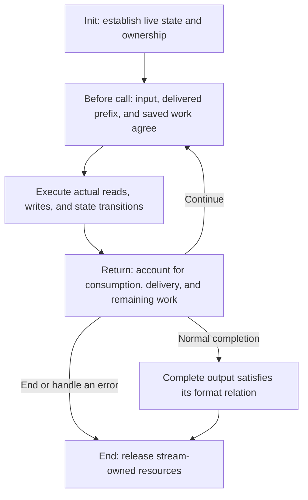

## One byte sequence, one round trip {#task}

An application has eight bytes: `ABABABAB`. It wants to store them as compressed data and let another program recover them. The two programs agree on a format. They need not share memory or use the same buffer sizes.

First separate the two jobs. The compressor chooses a representation of its input. It can represent a byte directly, or find repetition and describe a passage as “go back this far in the existing output, then copy this many bytes.” The decoder receives a representation that has already been chosen. It interprets instructions and recovers bytes; it does not search for worthwhile compression opportunities again.

For example, emit literal `A`, then literal `B`, then a match of distance 2 and length 6. The result is eight bytes. Distance tells each copy step how far back from the current output end to read. Length tells the instruction how many bytes to add in total.

<div class="zl-token-line"><span>Literal A</span><span>Literal B</span><b>Match · length 6 · distance 2</b></div>

<div class="zl-demo-mount"><zlib-demo kind="copy"><p>Start with AB, then copy six bytes at distance 2 to obtain ABABABAB. The third copy reads the A just written by the first copy.</p></zlib-demo></div>

Each copied byte extends readable history. The first step reads `A`, the second reads `B`, and the third reads the `A` produced by the first. Length can therefore exceed distance. Treating the original two bytes as an unchanging source slice cannot explain this copy.

These are selected symbols for explaining instruction meaning. The actual compressor must still decide how to search, when to commit a match, and whether that representation is worth coding. A short input need not become smaller: headers, end markers, and integrity fields also occupy space.

## Library, payload, and wrapper {#formats}

`deflate` and `inflate` are streaming functions provided by the zlib library. The former accepts original bytes and produces compressed bytes. The latter interprets compressed bytes and produces the original data. Their core interchange format is **DEFLATE**, which defines how literals, length/distance matches, and blocks are represented as bits.

The DEFLATE payload can stand alone or appear inside different wrappers:

<figure class="zl-layers">
<div><span>raw</span><b>DEFLATE payload</b></div>
<div><span>zlib</span><i>Header</i><b>DEFLATE payload</b><i>Adler-32</i></div>
<div><span>gzip</span><i>Header and optional fields</i><b>DEFLATE payload</b><i>CRC-32 · size</i></div>
<figcaption>The three forms share block coding. The wrapper determines which bytes surround that payload.</figcaption>
</figure>

The zlib trailer contains the original data's Adler-32. The gzip trailer contains its CRC-32 and length modulo `2^32`. A receiver updates the relevant checksum over recovered bytes and compares it at the trailer. These checks help detect damage; they do not provide cryptographic authentication.

“Produced the last original byte” and “finished the entire stream” can therefore occur at different times. The decoder may still need an end-of-block code or wrapper trailer. With a damaged trailer, an application can receive output and then receive an error.

## A complete task through actual C calls {#example}

This is a complete program. It compresses eight input bytes into `packed` using the default zlib wrapper, then recovers them into `restored`. Both ranges are small. The example supplies 64 bytes for the encoding and checks that each engine finishes in one processing call. The batched example below deliberately provides less output space.

```c
#include <stdio.h>
#include <string.h>
#include <zlib.h>

int main(void) {
    unsigned char source[] = {'A','B','A','B','A','B','A','B'};
    unsigned char packed[64], restored[sizeof source];
    z_stream encoder = {0}, decoder = {0};

    if (deflateInit(&encoder, Z_DEFAULT_COMPRESSION) != Z_OK)
        return 1;
    encoder.next_in = source;
    encoder.avail_in = sizeof source;
    encoder.next_out = packed;
    encoder.avail_out = sizeof packed;
    int encoded = deflate(&encoder, Z_FINISH);
    unsigned packed_size = sizeof packed - encoder.avail_out;
    int encoder_end = deflateEnd(&encoder);
    if (encoded != Z_STREAM_END || encoder_end != Z_OK)
        return 1;

    if (inflateInit(&decoder) != Z_OK)
        return 1;
    decoder.next_in = packed;
    decoder.avail_in = packed_size;
    decoder.next_out = restored;
    decoder.avail_out = sizeof restored;
    int decoded = inflate(&decoder, Z_NO_FLUSH);
    unsigned restored_size = sizeof restored - decoder.avail_out;
    int decoder_end = inflateEnd(&decoder);
    if (decoded != Z_STREAM_END || decoder_end != Z_OK ||
        restored_size != sizeof source ||
        memcmp(source, restored, sizeof source) != 0)
        return 1;

    printf("%u -> %u -> %u bytes\n",
           (unsigned)sizeof source, packed_size, restored_size);
    return 0;
}
```

Build the program with `cc round-trip.c -lz -o round-trip`. The compiler and linker search paths must select the header and library from the same build. The chapter’s native example run of the selected source prints `8 -> 12 -> 8 bytes`: framing increases this tiny input’s size, while the round trip recovers the same data. The program checks recovered bytes against the input rather than fixing one compressed byte string. Compression level, strategy, and call timing can change the intermediate representation; the format determines the recovered result.

`encoder` and `decoder` are independent `z_stream` records. Their zero initialization selects the library's default allocator in this program. Initialization establishes private state. It consumes no input and delivers no compressed or decoded output. Even after a processing call returns `Z_STREAM_END`, private resources remain until the corresponding End operation. The code saves the processing result before cleanup, so a failed processing call cannot bypass release after a successful initialization.

`Z_FINISH` tells the compressor that this example has supplied all its input and needs the final block and wrapper trailer. The decoder uses `Z_NO_FLUSH` for ordinary decoding. Encoded end information identifies completion; the caller need not append another end instruction.

## Replace buffers, continue the task {#protocol}

Four `z_stream` fields define the ranges accessible in each call:

| Field | Meaning in this call |
| --- | --- |
| `next_in` | The next readable input address. |
| `avail_in` | How many input bytes remain available there. |
| `next_out` | The next writable output address. |
| `avail_out` | How many output bytes remain available there. |

On return, the input pointer identifies the next byte not yet taken from the caller’s slice; the output pointer identifies the next unwritten destination position. Availability decreases by the actual taken or written amounts. Bits from an already taken input byte may still be held inside the decoder. Recording availability before and after the call gives its byte accounts. Here `stream` is the decoder record and `chunk` is the writable array supplied for this call:

```c
unsigned char chunk[5];
unsigned before = stream.avail_in;
stream.next_out = chunk;
stream.avail_out = sizeof chunk;
int result = inflate(&stream, Z_NO_FLUSH);
unsigned used = before - stream.avail_in;
unsigned made = sizeof chunk - stream.avail_out;
```

Both `used` and `made` count bytes, but they usually differ. One compressed symbol can produce many original bytes. Reading a compressed byte can also leave some of its bits buffered internally. On the compression side, original bytes can be accepted before their block encoding is delivered. Input consumption and output delivery are separate boundaries.

A five-byte output array makes that distinction visible. This separate decoding example initializes raw mode with `inflateInit2(&stream, -15)`. For the selected raw DEFLATE stream `73 74 82 40 00`, the first call delivers `ABABA`, and the second delivers `BAB`. Those five encoded bytes describe the selected literals `A`, `B` and length-6/distance-2 match. They do not predict the default compressor's output.

<div class="zl-purpose-flow"><div><small>First call</small><code>ABABA</code><span>Output room runs out; three match bytes remain</span></div><b aria-hidden="true">→</b><div><small>Keep the same stream state</small><strong>The unfinished match survives</strong><span>The application retains the delivered prefix</span></div><b aria-hidden="true">→</b><div><small>Second call</small><code>BAB</code><span>The batches form ABABABAB</span></div></div>

Before the second call, the application can provide another writable array or reuse the old one after processing its contents. Private `state` survives. It stores the processing mode, held bits, and unfinished instruction; when copying across calls needs it, the window retains bytes that may still be referenced. Reinitializing the decoder would lose this continuation.

Return codes distinguish the next actions:

| Return code | What the application needs to determine |
| --- | --- |
| `Z_OK` | The call returned normally without reporting completion. Inspect actual consumption and delivery before deciding how to continue. |
| `Z_STREAM_END` | The data task is complete, including enabled wrapper validation. Resources still need End or permitted reuse. |
| `Z_BUF_ERROR` | Available conditions are insufficient, or requested completion was not reached. Inspect actual input/output effects, then supply what is missing. |
| `Z_NEED_DICT` | Zlib decoding requests a preset dictionary. Supply the matching dictionary before continuing. |
| `Z_DATA_ERROR`, `Z_MEM_ERROR`, `Z_STREAM_ERROR` | Check data, allocation, or call conditions respectively; handle the effects already performed and clean up according to the relevant contract. |

After a return, the application handles the `made` output bytes, preserves unread input, then continues, supplies missing conditions, or ends the task. A retry must address the blocking condition. If a `Z_NO_FLUSH` decoding call returns `Z_BUF_ERROR` without taking input or writing output, output room is available and no further input can be supplied, the application reports an incomplete stream instead of repeating the same call indefinitely. `avail_in == 0` does not report completion: the compressor may have accepted the input while retaining symbols, held bits, or pending bytes. Finishing compression uses `Z_FINISH` until `Z_STREAM_END`. End releases resources; it does not write the missing suffix for the caller.

## Configuration chooses paths and admitted input {#configuration}

The main path uses the default full library build, without alternatives such as `FASTEST`. Its runtime settings are the common defaults: the DEFLATE method, default compression level, default strategy, window argument 15, memory level 8, and the default allocator. Under this build, the source normalizes `Z_DEFAULT_COMPRESSION` to level 6. Window argument 15 selects a 32 KiB window configuration; its array layout and actual search bounds are developed at refill and matching. These choices establish one ordinary compressor route to follow.

| Choice | Effect on compression | Decoding counterpart |
| --- | --- | --- |
| Wrapper | Select raw payload, zlib framing, or gzip framing. | Select which wrappers to admit; `inflateInit` reads zlib by default. |
| Level and strategy | Change search budgets, match decisions, and specialized processing routes. | Decoding has no compression-level or strategy parameter; it interprets the blocks and symbols actually sent. |
| Window argument | Affect searchable history and related storage. | Affect retained/referenced history and the header's window conditions. |
| Memory level | Size search indexes, symbol capacity, and pending storage. | Decoding has no corresponding memory-level argument. |
| Preset dictionary | Make some match sources available before ordinary input begins. | Supply the same dictionary context in the permitted mode and at the required time. |
| Flush request | Control boundaries, delivery, or completion. | Process input and return boundaries under the decoder's own request semantics. |

Preset dictionaries also have a wrapper boundary. Zlib framing can request an application dictionary by its identifier; gzip framing has no equivalent dictionary handshake. Dictionary configuration is more than another input buffer.

Keep three dimensions distinct. **Runtime settings** choose compression level, strategy, and framing. A `deflate` call itself receives the stream and a flush request; level, strategy and wrapper are already represented in its private state. **Buffer scheduling** determines how much input and output room one call has: the same default-configured decoder can consequently switch between ordinary and fast execution. **Build configuration** can change available interfaces, layouts, and algorithm branches. These dimensions are not one “fast/slow mode.”

Default decoding must still admit stored, fixed, and dynamic blocks within its format domain. A compressor's choice for one input does not narrow the grammar accepted by the decoder. The exact window, strategy, and wrapper ranges will be developed where they change execution.

## The proof structure of one execution {#correctness}

Give the round trip an independent goal. For the eight-byte input `ABABABAB`, completed compression must deliver an encoding that describes those bytes. Successful decoding must deliver exactly those bytes. Different valid encodings can satisfy that same goal. Relating each engine separately to an independent format relation is what connects them.

Before completion, output is often only a prefix. The relation must then include work saved privately. After the first five-byte return, the state must explain both facts: `ABABA` has been delivered, and the same match still determines three remaining bytes. The next call extends this output without restarting the instruction, omitting a byte, or redelivering the prefix.



The loop in the diagram corresponds to induction over legal call sequences. Initialization establishes the relation. Each processing call derives a relation usable by its successor. At normal completion, saved state yields the complete format conclusion. Ownership follows the same returned heap through End. On an error path, the argument still accounts precisely for the bytes read, bytes written, and resources acquired; it need not invent a complete result for erroneous input.

Memory safety and byte meaning meet here. Recovering the right text while writing one byte beyond its destination is still wrong. Staying inside the arrays while interpreting distance 2 as distance 1 is also wrong. Each input read, match search, output write, and copy will therefore be explained with both its range condition and the meaning it preserves.

<details class="bk-source-note"><summary>Source and precise contracts</summary><p>The initialization macros and stream fields are in the pinned <code>zlib.h</code>; initialization and processing entries are in <code>deflate.c</code> and <code>inflate.c</code>. <a href="/reference/docs/spec/api/streams.html">Stream API contracts</a> define call boundaries; <a href="/reference/docs/spec/input-configurations.html">input configurations</a> distinguish default and wider parameter domains; the <a href="/reference/docs/spec/format/model.html">independent format relations</a> define compressed-byte meaning.</p></details>
