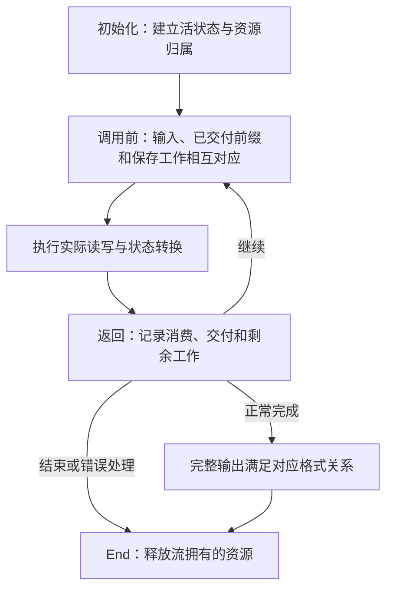

## 一段字节的一次往返 {#task}

应用程序手里有八个字节：`ABABABAB`。它要把这些内容保存成压缩数据，再交给另一个程序恢复。两端需要约定的是压缩格式；它们不需要共享内存，也不需要使用相同的缓冲区大小。

先把压缩和解压各自的工作分开。压缩器选择一种表示输入的方式。它可以直接表示单个字节，也可以发现重复，把一段内容换成“从已有输出回退多少字节，再复制多少字节”。解压器收到的表示已经选定；它解释指令，恢复字节，不再搜索哪里值得压缩。

例如，先输出字面量 `A` 和 `B`，再执行“距离 2、长度 6”的匹配，就能得到八个字节。距离说明每一步从当前输出末尾向前数几个位置；长度说明这条指令一共增加几个字节。

<div class="zl-token-line"><span>字面量 A</span><span>字面量 B</span><b>匹配 · 长度 6 · 距离 2</b></div>

<div class="zl-demo-mount"><zlib-demo kind="copy"><p>先输出 AB，再按距离 2 逐字节复制六次，得到 ABABABAB。第三次复制读取的是第一次复制刚写出的 A。</p></zlib-demo></div>

这里的复制会逐步扩大可读历史。第一次读 `A`，第二次读 `B`，第三次读第一次刚写出的 `A`。因此，长度可以大于距离；把最初的两字节当成一个不变的源切片，无法解释这次复制。

这是我们选来解释指令含义的一组符号。实际压缩器还要决定怎样搜索、什么时候提交匹配，以及这种表示是否值得编码。短输入并不保证压缩后更短；头部、结束标记和校验信息也需要空间。

## 库、载荷与封装 {#formats}

`deflate` 和 `inflate` 是 zlib 库提供的流式函数。前者接受原文字节并产生压缩字节；后者解释压缩字节并产生原文。它们之间传递的核心格式叫 **DEFLATE**，规定了字面量、长度／距离匹配和块怎样表示为比特。

DEFLATE 载荷可以独立使用，也可以放入不同封装：

<figure class="zl-layers">
<div><span>raw</span><b>DEFLATE 载荷</b></div>
<div><span>zlib</span><i>头部</i><b>DEFLATE 载荷</b><i>Adler-32</i></div>
<div><span>gzip</span><i>头部与可选字段</i><b>DEFLATE 载荷</b><i>CRC-32 · 长度</i></div>
<figcaption>三种形式共享块编码。封装决定载荷前后还要解释哪些字节。</figcaption>
</figure>

zlib 封装的尾部保存原文的 Adler-32；gzip 保存原文的 CRC-32 和长度模 `2^32`。接收端对恢复出的字节更新相应校验值，在尾部比较。校验帮助发现损坏，不提供密码学认证。

所以，“已经得到最后一个原文字节”与“整个流已经完成”是两个时刻。解码器还可能需要读取块结束码和封装尾部。若尾部损坏，应用可能已经收到一段输出，随后才得到错误。

## 从实际 C 调用走完一次任务 {#example}

下面是一个完整程序。它用默认 zlib 封装把八字节输入压缩到 `packed`，再恢复到 `restored`。输入和输出都很小，本例为压缩结果提供 64 字节空间，并检查两端是否在一次处理调用中完成。后面的分批例子会主动缩小输出空间。

```c
#include <stdio.h>
#include <string.h>
#include <zlib.h>

int main(void) {
    unsigned char source[] = {'A','B','A','B','A','B','A','B'};
    unsigned char packed[64], restored[sizeof source];
    z_stream encoder = {0}, decoder = {0};

    if (deflateInit(&encoder, Z_DEFAULT_COMPRESSION) != Z_OK)
        return 1;
    encoder.next_in = source;
    encoder.avail_in = sizeof source;
    encoder.next_out = packed;
    encoder.avail_out = sizeof packed;
    int encoded = deflate(&encoder, Z_FINISH);
    unsigned packed_size = sizeof packed - encoder.avail_out;
    int encoder_end = deflateEnd(&encoder);
    if (encoded != Z_STREAM_END || encoder_end != Z_OK)
        return 1;

    if (inflateInit(&decoder) != Z_OK)
        return 1;
    decoder.next_in = packed;
    decoder.avail_in = packed_size;
    decoder.next_out = restored;
    decoder.avail_out = sizeof restored;
    int decoded = inflate(&decoder, Z_NO_FLUSH);
    unsigned restored_size = sizeof restored - decoder.avail_out;
    int decoder_end = inflateEnd(&decoder);
    if (decoded != Z_STREAM_END || decoder_end != Z_OK ||
        restored_size != sizeof source ||
        memcmp(source, restored, sizeof source) != 0)
        return 1;

    printf("%u -> %u -> %u bytes\n",
           (unsigned)sizeof source, packed_size, restored_size);
    return 0;
}
```

程序可用 `cc round-trip.c -lz -o round-trip` 构建。编译器和链接器的搜索路径应选中同一构建的头文件与库。本章用固定源码编译并运行的示例打印 `8 -> 12 -> 8 bytes`：这个小输入增加了封装成本，往返仍恢复同一份字节。程序检查恢复的八字节与输入逐字节相等，不把某一串压缩字节写死。压缩级别、策略和调用时机可能改变中间表示；格式规定恢复结果。

`encoder` 与 `decoder` 是两个独立的 `z_stream`。初始化为零让本例使用库的默认分配器。初始化建立内部状态，不消费输入，也不交付压缩或解压结果。处理调用结束后，即使返回 `Z_STREAM_END`，内部资源仍然存在；随后调用相应的 End 释放它们。这里也先保存处理结果，再执行清理，避免因为处理失败而跳过成功初始化后的释放。

`Z_FINISH` 告诉压缩器，本例的全部输入已经交出，需要完成最后一个块和封装尾部。解码器用 `Z_NO_FLUSH` 正常解释输入；它根据编码中的结束信息识别完成，不需要调用者再补一条结束指令。

## 缓冲区可以换，任务必须接续 {#protocol}

`z_stream` 的四个字段定义每次调用可访问的范围：

| 字段 | 本次调用中的含义 |
| --- | --- |
| `next_in` | 下一处可以读取的输入地址。 |
| `avail_in` | 从该地址起还可读取的字节数。 |
| `next_out` | 下一处可以写入的输出地址。 |
| `avail_out` | 从该地址起还可写入的字节数。 |

返回时，输入指针指向调用者切片中下一处尚未取入的字节，输出指针指向目标区下一处尚未写入的位置。可用量分别减去实际取入和写出的数量。已经取入的字节仍可能有位留在解码器内部。因此，记录调用前后的可用量，就能得到这一次按字节计算的输入与输出账目。下面的 `stream` 是解码器记录，`chunk` 是本轮交给它的可写数组：

```c
unsigned char chunk[5];
unsigned before = stream.avail_in;
stream.next_out = chunk;
stream.avail_out = sizeof chunk;
int result = inflate(&stream, Z_NO_FLUSH);
unsigned used = before - stream.avail_in;
unsigned made = sizeof chunk - stream.avail_out;
```

`used` 和 `made` 的单位都是字节，但通常不相等。一个压缩符号可以产生许多原文字节；一个压缩字节被取入后，其中一部分位还可能尚未消费，继续留在位缓冲里。压缩端还可以先接受原文，稍后才交付对应块的编码。输入消费和输出交付是两条独立边界。

把解码输出数组改成五字节，就能看到这种区别。这个单独的解码例子用 `inflateInit2(&stream, -15)` 建立裸模式解码器。使用选定的裸 DEFLATE 流 `73 74 82 40 00` 时，第一次交付 `ABABA`，第二次交付 `BAB`。这五个压缩字节编码的正是前面选定的 `A`、`B` 和长度 6／距离 2；它们不是对默认压缩器输出的预测。

<div class="zl-purpose-flow"><div><small>第一次调用</small><code>ABABA</code><span>本轮空间用完，匹配还剩三字节</span></div><b aria-hidden="true">→</b><div><small>保存同一流状态</small><strong>未完成的匹配仍在</strong><span>应用保留已收到的前缀</span></div><b aria-hidden="true">→</b><div><small>第二次调用</small><code>BAB</code><span>接续后组成 ABABABAB</span></div></div>

第二次调用前，应用可以换一块可写数组，也可以在处理完上次输出后复用旧数组。内部状态对象则继续存在，保留上一次调用留下的进度。它保存处理模式、未消费的位和未完成指令；在跨调用复制需要时，窗口保留仍会被引用的字节。重新初始化解码器会丢掉这份接续信息。

返回码说明还可以采取什么操作：

| 返回码 | 应用需要判断的事情 |
| --- | --- |
| `Z_OK` | 本次返回正常，尚未报告完成。查看实际消费和交付数量后决定如何继续。 |
| `Z_STREAM_END` | 本次数据任务完成，包括当前启用的封装检查；资源仍需结束或按规则复用。 |
| `Z_BUF_ERROR` | 可用条件不足，或所请求的完成条件尚未达到。检查实际已读、已写字节，再补充条件。 |
| `Z_NEED_DICT` | zlib 解码请求预设字典，应用需要提供匹配的字典再继续。 |
| `Z_DATA_ERROR`、`Z_MEM_ERROR`、`Z_STREAM_ERROR` | 分别检查数据、分配或调用条件；按相应契约处理已经发生的效果并清理。 |

调用者在返回后处理 `made` 个输出字节，保留未消费输入，再决定继续、补充条件或结束。重试需要解除使本轮停下的条件。使用 `Z_NO_FLUSH` 解码时，如果返回 `Z_BUF_ERROR`、没有取入输入或写出输出，而且输出空间可用、再也没有输入可提供，应用应报告编码流不完整，不能无限重复同一次调用。不要把 `avail_in == 0` 当成完成：原文可能已被压缩器接收，却还以符号、暂存位或待交付字节的形式留在内部。完成压缩使用 `Z_FINISH` 并继续到 `Z_STREAM_END`；End 负责释放资源，不负责补写剩余数据。

## 配置决定分支和允许的输入 {#configuration}

后面的实现主线采用默认完整库构建，不启用 `FASTEST` 等替代分支。运行时采用常见默认参数：DEFLATE 方法、默认压缩级别、默认策略、窗口参数 15、内存级别 8，以及默认分配器。在这个构建下，源码把 `Z_DEFAULT_COMPRESSION` 归一化为级别 6。窗口参数 15 选择 32 KiB 窗口配置；具体数组布局和实际搜索界在补充输入与匹配阶段展开。这些值先确定一条可跟踪的普通压缩路线。

| 选择 | 压缩端改变什么 | 解压端如何对应 |
| --- | --- | --- |
| 封装 | 选择裸载荷、zlib 头尾或 gzip 头尾。 | 选择接受哪一种封装；`inflateInit` 默认读取 zlib。 |
| 压缩级别与策略 | 改变搜索预算、匹配决策和专用处理路线。 | 解压没有压缩级别或策略参数；它解释实际写入的块和符号。 |
| 窗口参数 | 影响允许搜索的范围及相关存储。 | 影响可保留、可引用的历史以及头部中的窗口约束。 |
| 内存级别 | 改变搜索索引、符号容量和待交付存储的尺寸。 | 解压没有对应的内存级别参数。 |
| 预设字典 | 让部分匹配来源在正文数据开始之前就存在。 | 在约定的模式和时机提供相同字典上下文。 |
| 刷新请求 | 控制何时形成边界、交付数据或完成任务。 | 根据输入格式和所选请求处理自己的返回边界。 |

预设字典也有封装边界。zlib 封装可以通过字典标识请求应用提供字典；gzip 封装不提供同样的字典握手。字典配置不能只理解成额外的一块输入。

这里要区分三个维度。**运行时配置**选择压缩级别、策略和封装。一次 `deflate` 处理调用本身接收流和刷新请求；级别、策略及封装已经保存在它的私有状态中。**缓冲区安排**决定某一次调用有多少输入、输出空间；同一个默认解码器可以因此在普通路径与快速路径之间切换。**编译配置**则可以改变可用接口、布局和算法分支。它们不能混成一组“快／慢模式”。

默认解码配置也必须接受其格式范围内的原样存储块、固定编码块和动态编码块。压缩器为某一输入选择的路径，不会缩小解码器允许接收的语法。窗口、策略和封装的具体参数范围，会在它们改变执行路径的位置展开。

## 从一次运行得到证明结构 {#correctness}

先给这次往返一个独立目标。设输入是八字节 `ABABABAB`：压缩端完成时，交付的编码应当描述这八字节；解压端正常完成时，交付的字节应当恰好等于它们。不同的合法编码可以满足同一个目标。证明压缩器与解压器分别符合独立格式关系，才能把两端接起来。

任务进行过程中，当前输出往往只是一段前缀。此时的证明关系还要包含内部保存的工作。对五字节输出例子，第一次返回后的状态必须解释两件事：`ABABA` 已经交付，剩下的三字节仍由同一条匹配决定。下一次调用扩展这份输出，而不能重新开始指令、漏掉一字节或重复交付前缀。



图中的循环对应按合法调用序列归纳。初始化建立关系；每次处理从当前关系推出下一次可使用的关系；正常完成时，从保存状态中读出完整格式结论。资源归属沿同一个返回堆传递，直到 End。若处理返回错误，论证仍要准确解释已读、已写和已分配的部分，不要求错误输入产生一个虚构的完整结果。

内存安全与字节含义在这里相遇。恢复出了正确文本，却多写了一个字节，仍然有错。没有越界，却把距离 2 读成距离 1，也仍然有错。后面的实现讲解会在每个读位、搜索、写入和复制位置，把范围条件与它保存的含义一起展开。

<details class="bk-source-note"><summary>源码与精确约定</summary><p>初始化宏和流字段来自固定版本的 <code>zlib.h</code>；初始化与处理入口分别位于 <code>deflate.c</code>、<code>inflate.c</code>。<a href="/reference/docs/spec/api/streams.html">流 API 约定</a>定义调用边界，<a href="/reference/docs/spec/input-configurations.html">配置范围</a>区分默认与更宽的参数域，<a href="/reference/docs/spec/format/model.html">独立格式关系</a>定义压缩数据的字节含义。</p></details>
