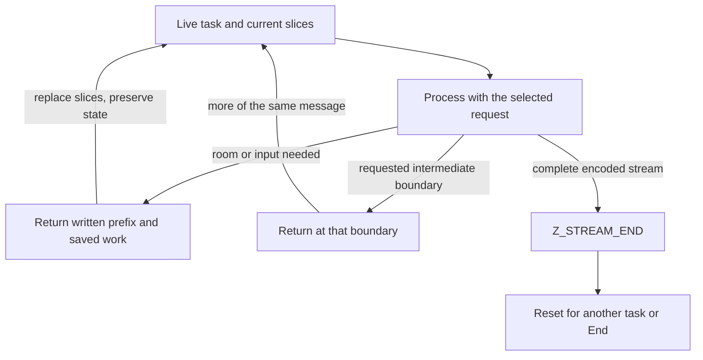
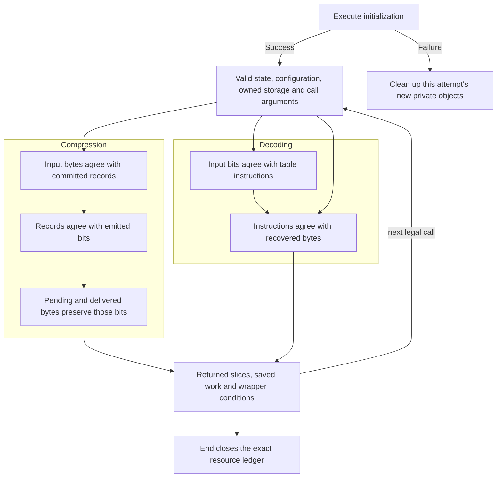

A return from `deflate` or `inflate` leaves two things behind: bytes the application can use and state that determines the next operation. Earlier chapters followed those bytes through matching, coding and decoding. We now follow the same task across buffer replacement, parameter changes, failure and cleanup.

Keep one checkpoint in mind. The raw teaching stream `73 74 82 40 00` represents `ABABABAB`. Give its decoder four output positions. After delivering `ABAB`, it can retain a match with four bytes left. Continuing, resetting and copying this checkpoint have three different meanings, even when all three reuse existing memory.

## Establish the task and its configuration {#init}

The application owns the `z_stream` record. Initialization attaches private codec state to it; ordinary initialization does not consume message input or produce compressed output. A zero-initialized record asks the ordinary library build to install its default allocator and deallocator. Applications supplying their own callbacks must keep a compatible pair and the associated `opaque` context valid for the stream's lifetime.

These controls act at different moments:

| Moment | Controls | What changes |
| --- | --- | --- |
| Initialize a compressor | `method`, `windowBits`, `memLevel`, level, strategy, allocator | Accepted format, window/index/symbol capacities, search policy and resource behavior. |
| Initialize a decoder | `windowBits`, allocator | Admitted wrappers, requested history-window limit and resource behavior. The decoder does not receive the encoder's compression level. |
| Continue an existing task | Input/output slices and `flush` | Which bytes are available now and which completion or stopping boundary is requested. |
| Deliberately change a live task | Params, Tune, dictionaries, primed bits, header registration, Reset or Copy | A particular policy, context or continuation; each operation has its own timing and storage requirements. |

For the ordinary build, compressor level `Z_DEFAULT_COMPRESSION` becomes 6. `memLevel` determines hash/symbol capacities; level, strategy and Tune select search policy and budgets. Capacity can still change candidate distributions and block boundaries. A zlib compressor request of eight window bits becomes nine; raw and gzip reject that eight-bit case. Decoder admission is different: it has its own accepted signed requests and header-derived settings. A compressor configuration and a decoder admission request should therefore be compared by format and effective window, not by integer equality.

These are runtime controls within a selected build. Compile-time choices also matter. `FASTEST` changes nonzero compression levels to 1; `Z_SOLO` does not supply the ordinary default allocator; `MAXSEG_64K` makes compressor Copy return `Z_STREAM_ERROR`. The examples here use the ordinary default layout and allocator. The matching and decoding chapters explain how the corresponding normalized settings enter their loops.

A useful initialization invariant says exactly which objects were obtained, which fields were written, and which bytes are meaningful. Allocating a window creates capacity. It does not turn every byte of that allocation into valid match history. Similarly, non-NULL allocator pointers alone do not establish that they are the modeled default functions.

## Separate input acceptance from output delivery {#buffers}

Before a call, `next_in` and `avail_in` describe a readable input slice; `next_out` and `avail_out` describe a writable destination slice. Save the two availability counts. After a normal returning call, their differences locate the actual consumed and written prefixes:

```text
input_taken    = old_avail_in  - new_avail_in
output_written = old_avail_out - new_avail_out
```

For compression, input taken into the window can still be uncommitted lookahead. Committed literals and matches can still await a block decision. Encoded bits can still be held in the bit register, and complete bytes can still wait in pending storage. Only bytes copied into the caller's destination contribute to this call's delivered output. Thus an empty input slice does not mean its compressed result has already reached the application.

The compressor's actual delivery operation makes the boundary visible. Here `len` is the byte count bounded by pending data and this call's available output room:

```c
zmemcpy(strm->next_out, s->pending_out, len);
strm->next_out  += len;
s->pending_out  += len;
strm->total_out += len;
strm->avail_out -= len;
s->pending      -= len;
```

The caller cursor and pending cursor advance together. Replacing the output buffer must preserve the private compressor and its remaining pending suffix. The application processes the written prefix before reusing that storage. It also retains the unread input suffix until the codec has taken it.

For decompression, a byte taken from the compressed input may still have unused bits in the accumulator. The output prefix is already uncompressed data. At the `ABAB` checkpoint, replacing the four-byte destination continues the saved match; resetting would discard it. The application can bind another destination without changing the task.

Error returns retain effects in source order. In particular, `inflate` first publishes its updated buffer pointers and can then fail to allocate a history window. New output can be present even though its normal final total-counter updates were skipped. The returned slice and the counters therefore need separate relations. The caller's output buffers remain caller objects throughout.

## Request a boundary with flush {#flush}

`flush` is an instruction to the current call. It does not free the stream, and its interpretation differs between compression and decoding.

For the compressor, `Z_NO_FLUSH` permits accumulation for better block decisions. `Z_BLOCK` completes a block without requiring byte alignment; up to seven bits can remain held. `Z_PARTIAL_FLUSH` appends an empty fixed-code block without the byte-alignment promise of a sync flush. `Z_SYNC_FLUSH` emits an aligned marker so a receiver can obtain all input supplied so far. `Z_FULL_FLUSH` adds the same kind of boundary and discards the compressor's preceding match history. Neither sync nor full flush declares the message finished.

`Z_FINISH` declares that no more source bytes will be added. Keep the unread part of the already supplied slice and continue with `Z_FINISH` and more output room until `Z_STREAM_END`. The returned end code means the final block and wrapper trailer have been delivered. End then releases resources. If a nonfinal flush fills the destination, continue that same flush request with more room until it is complete; repeatedly requesting another marker is a different operation.

The decoder reads boundaries chosen by the encoded stream. Its `Z_SYNC_FLUSH` does not insert a marker or discard history. `Z_BLOCK` can stop at a wrapper-header or block boundary. `Z_TREES` additionally stops after a block description, before its payload. These stopping modes expose bit-boundary information through `data_type`; their return does not imply message completion. With `Z_FINISH`, failure to finish in this call turns an otherwise ordinary `Z_OK` result into `Z_BUF_ERROR`. The saved task can still be continued with additional input or output space.



Changing compression policy can itself cross a boundary. `deflateParams` checks the new level and strategy and, when necessary, calls `deflate` with `Z_BLOCK` under the old settings. If the old block cannot be completed, it returns `Z_BUF_ERROR` with the old policy still selected. Input consumption and output already produced remain observable. More output room and a retry are needed; the failed policy change is not a rollback of compression work.

`deflateTune` is a lower-level control. It stores its four integer arguments, converting three to unsigned fields; it does not validate a sensible search budget. If a later search argument uses positive budget bounds, those bounds must be stated and established. A changed level through Params, or ordinary compressor Reset, restores that level's standard tuning.

## Supply a dictionary, bits or header context {#dictionary}

A dictionary makes agreed bytes available as match sources before those bytes would otherwise have appeared in this task. It is not output to be delivered again. Suppose messages share the vocabulary `AB`. The compressor can reference it only when the receiver will provide corresponding history.

For zlib compression, install the dictionary before compression starts. The dictionary identifier records the checksum of the supplied dictionary, while the usable window retains an appropriate suffix. Gzip compression has no preset-dictionary path. Raw compression admits dictionary installation at suitable block boundaries, with no pending lookahead. The actual guard expresses these timing distinctions:

```c
if (wrap == 2 || (wrap == 1 && s->status != INIT_STATE) || s->lookahead ||
    (wrap == 0 && (long)s->strstart != s->block_start))
    return Z_STREAM_ERROR;
```

Dictionary loading temporarily binds the dictionary as compressor input, populates the window and hash, then restores the caller's input binding. It can increase `total_in` without sending the dictionary as message output. In a history containing dictionary installation, `total_in` therefore cannot simply be read as message-payload length. Pointer movement, accepted dictionary context and message-byte meaning need separate accounts.

A zlib decoder requests the dictionary with `Z_NEED_DICT`. Installation checks the supplied identifier; a wrong dictionary gives `Z_DATA_ERROR` and permits another attempt. Raw decoding can install dictionary history at call boundaries without an identifier check. Installation copies the bytes into private history, leaves the caller's input/output pointers and totals unchanged, and can fail while allocating the window. A non-NULL zero-length raw dictionary is a distinct case from a NULL dictionary pointer, which the source rejects.

Priming supplies bits already handled by an enclosing format. `inflatePrime` appends 1–16 low bits above held input bits when the combined count fits 32; zero is a no-op, and a negative count clears the held bits. `deflatePrime` appends 0–16 low bits to pending output. It can compact existing pending bytes before discovering insufficient space. Invalid count requests return different codes in the two APIs: decoder priming uses `Z_STREAM_ERROR`, compressor priming uses `Z_BUF_ERROR`. In ordinary raw-stream use, supply the prefix at the documented start point; inserting arbitrary bits does not by itself establish a valid DEFLATE message.

Gzip metadata is borrowed storage. `deflateSetHeader` retains a header and its optional extra/name/comment inputs for emission and queries that inspect it. Finishing the header does not unregister those pointers. `inflateGetHeader` registers a writable header record and bounded capture destinations before parsing. Short destinations capture only what fits; a string terminator appears only when it fits. Reset clears registration without freeing these caller objects. Copies can retain the same borrowed pointers, so ending one private codec does not end the caller's metadata lifetime.

## Reuse capacity with Reset {#reset}

Return to decoder A after `ABAB`. To decode independent message B, ordinary `inflateReset` discards A's bit progress and valid history, then the caller binds B's slices. It does not erase the `ABAB` already delivered to the application, or reposition an external file.

Three fields explain the distinction between clearing history and freeing memory. `wsize` is the active ring size, `whave` is the number of valid history bytes and `wnext` is the next write position. The reset tail is:

```c
state->wrap = state->reqwrap;
state->wsize = 0;
state->whave = 0;
state->wnext = 0;
return inflateResetKeep(strm);
```

The old allocation may remain, but zero valid bytes means B cannot use its old contents as match sources. The called ResetKeep clears held bits and restarts parsing. Neither reset replaces the input/output bindings for the caller.

| Operation | Logical contents | Capacity and configuration |
| --- | --- | --- |
| `inflateResetKeep` | Restarts progress while retaining usable window history. | Keeps current wrapper/window state and allocated storage. |
| `inflateReset` | Discards logical history and saved bit progress. | Restores requested wrapper/window, frees an incompatible window, preserves the validation choice. |
| `inflateReset2` | Discards progress and selects another accepted request. | Replaces wrapper/window request and validation setting; frees incompatible storage. |
| `deflateResetKeep` | Discards pending output and undecided lookahead, while retaining window/hash history and tuning. | Keeps compressor allocations and selected configuration. |
| `deflateReset` | Starts with empty match history and default tuning for the current level. | Keeps allocations, wrapper, window, memory level, level and strategy. |

The Keep entries are undocumented public symbols and need deliberate protocol design. Retained compressor history can produce a new reference to bytes from before the reset. A receiver starting with empty history would not have those bytes. Physical storage reuse and independent-message semantics must therefore be distinguished explicitly.

Decoder Reset restores the validation choice last selected by `inflateValidate`, since that operation updates the requested as well as current setting. Reset2 establishes the validation setting of its new request. ResetKeep retains the current wrapper, including wrapper changes made by synchronization recovery. These differences affect later validation and accepted input, not just memory consumption.

## Resume at a synchronization marker {#recovery}

Reset starts another task. Recovery instead tries to keep a later decodable part of the current input after damage. `inflateSync` searches for the four bytes `00 00 ff ff`, the marker ending an empty stored block. It first searches whole bytes retained in the bit accumulator, then consumes the current input slice. A partial marker match remains in the state so another call can continue the search. No complete marker gives `Z_DATA_ERROR`; no searchable bytes gives `Z_BUF_ERROR`.

Finding the marker restarts parsing at a block boundary, clears decoding history and held progress, and preserves the accumulated input/output totals. If no wrapper header was read, recovery selects raw decoding; otherwise it disables checksum validation for the remainder. It does not reconstruct the lost bytes. The full-flush protocol is useful here because the compressor discards preceding match history at that boundary. A sync-flush marker alone does not stop later matches from referring to earlier data; an incidental marker pattern is not enough to establish a correct recovered suffix.

## Copy a checkpoint with independent private storage {#copy}

At A's four-byte checkpoint, successful Copy lets A and its copy each continue with the remaining `ABAB`. The prefix already delivered remains the application's responsibility. Before running both continuations, the application supplies appropriate output destinations; copied caller pointers do not create two separate caller buffers.

A bytewise state-record copy is insufficient. The dynamic literal/length table begins at the source's embedded `codes` array; its distance table follows within that array. A copied pointer would still name A's storage, so ending A would invalidate it. The selected source, including its registered Copy patch, recognizes the array base by equality and relocates the distance table by its offset:

```c
if (state->lencode == state->codes) {
    copy->lencode = copy->codes;
    copy->distcode = copy->codes + (state->distcode - state->codes);
}
copy->next = copy->codes + (state->next - state->codes);
```

The equality also covers the canonical table pointers installed by reset. When decoding uses shared static fixed tables, those pointers keep their shared lifetime. The construction cursor `next` is always relocated. Decoder Copy obtains a new state and, if the source has a window, a separate window. Compressor Copy obtains its own state/window/predecessor/head/pending allocations and repairs pending cursors and embedded tree descriptors. It copies initialized content, including the saved input/encoding progress.

Use a distinct writable destination that owns no live codec. A failed copy releases newly obtained destination objects and clears destination state, while retaining the source checkpoint. Successful copies require separate End calls. Caller I/O and borrowed metadata remain caller responsibilities. These conditions explain both independence and continuation: correct private pointers without the saved match would lose the task; identical saved fields with pointers into A would lose independence.

The proof tracks where these fields came from as well as whether they lie within bounds. `DefaultOriginState` records that the literal pointer is at `codes` or that both decoding pointers name the paired fixed tables, together with the default header-state alternatives. Initialization establishes these facts. Actual decoding, reset, dictionary and control operations preserve them. For a successful Copy, `inflateCopy_actual_success_both_origin` derives the required allocation successes from the returned `Z_OK`, then establishes the state relation for both source and destination. The caller does not have to assume an internal table-origin contract.

## Account for allocation and release in source order {#allocation}

Successful compressor initialization obtains five allocations: state, window, predecessors, hash heads and pending/symbol storage. The tree arrays are embedded in the state; symbols share pending storage in the selected packed layout. An ordinary decoder initially obtains only its state. Its private window can be allocated later when history must survive a return or a dictionary is installed.

Failure handling follows the actual request schedule. After compressor state succeeds, the source attempts all four buffers before the combined NULL test. If the predecessor request fails, later head and pending requests can still succeed. Cleanup must release all four successful objects, including the successes after that failure.


The failure branch sets a cleanup-compatible state and invokes End. If the first state allocation fails, buffer requests do not occur. The allocation model records a separate outcome for each attempt, so one failed request cannot justify assuming that all later requests fail. Cleanup removes live objects but does not rewind allocation-attempt or fresh-identity counters. The decoder has another ordering: it allocates state before validating the window request. A request with invalid window bits can therefore encounter allocation failure first; a successful state allocation followed by parameter rejection releases that state.

The delayed decoder window is an optimization with a visible error path. A call can first write `ABAB`, publish its buffer pointers, then fail to obtain the window needed for the next call. The written prefix remains. A one-call finish that does not need retained history can avoid that window allocation and copying work entirely.

End closes the private allocation lifetime. The compressor tail first releases buffers and state, then chooses its result:

```c
TRY_FREE(strm, strm->state->pending_buf);
TRY_FREE(strm, strm->state->head);
TRY_FREE(strm, strm->state->prev);
TRY_FREE(strm, strm->state->window);

ZFREE(strm, strm->state);
strm->state = Z_NULL;

return status == BUSY_STATE ? Z_DATA_ERROR : Z_OK;
```

`TRY_FREE` skips NULL buffers. `status` was saved before release. A busy abandoned compressor can thus return `Z_DATA_ERROR` after releasing its private storage. `inflateEnd` releases its optional private window and state and returns `Z_OK` for a valid live decoder even when the message was abandoned. Neither operation completes pending message output. The original input/output objects and borrowed header objects stay with the application.

## Let an interface own the driving loop {#callbacks}

Whole-buffer utilities are suitable when the original input and destination capacity are already known. They create a temporary stream, run it and end it before returning. Their wide lengths can exceed the width of `avail_in` and `avail_out`, so the internal loop supplies representable chunks and separately tracks the wider remainder. The returned output length describes the written prefix; the input-counting decompressor can also report where trailing data begins. There is no live temporary codec left for the caller to resume.

Callback decoding reverses control. `inflateBack` decodes raw DEFLATE with an input callback and output callback, using the caller's window as its history and output-delivery storage. `inflateBackInit` accepts window-bit arguments 8 through 15; the caller supplies the corresponding `2^windowBits` writable bytes. Its decoder loop lives in `infback.c`; it does not repeatedly call ordinary `inflate`. An input callback supplies the next readable chunk when requested. An output callback receives a full window or final prefix and reports whether it accepted that event. Already accepted output events are not rolled back by a later callback failure.

The input chunk must remain readable until consumed. An output callback cannot modify that active input or the decoder's window. Callback-owned state can change only within the stated preservation rules. Initialization allocates the callback decoder's state but borrows its window; `inflateBackEnd` frees that state and leaves the window for its caller.

Termination also needs a finite input supply or another explicit progress condition. Let `mu` count bytes the input callback can still provide. Supplying `n` bytes reduces that reserve by at least `n`. In the internal proof, the budget is:

```text
held bits + 8 × current-chunk bytes + 8 × future-input bytes
```

The future-input reserve depends only on the input callback's own byte blocks. The output callback preserves those blocks, so it cannot replenish spent input budget. Loading a byte merely moves budget into the bit accumulator. Consuming a field spends bits. Mode transitions also need a decreasing rank, bounded by the loop execution allowance in the model. Every callback returning promptly is not enough if it can keep supplying nonfinal blocks forever. The local `CbContract` additionally gives callbacks selected writable byte blocks and excludes callback allocation/free; those are its precise premises. The broader public callback protocol needs its own permitted effects stated explicitly.

## Keep file position and decoded position distinct {#gzip}

A `gzFile` handle retains buffers and an internal codec across file operations. `gzread` can read compressed bytes ahead of the uncompressed prefix requested by the application. Consequently, descriptor position, buffered compressed input and delivered uncompressed position are different quantities.

For example, after delivering `ABC`, a request to seek forward from logical position 3 to 5 can consume buffered `DE`; if those bytes are not buffered, the handle records work to skip by reading and decoding. Seeking backward can require rewinding and decoding again. A compressed byte offset alone does not identify a resumable decompressor state.

Gzip reading also handles member concatenation and the transparent-input case. An ordinary `inflate` call finishes one encoded stream; a file reader can arrange another member afterward. `gzclose` releases the handle's buffers, codec state and file resource under its contract. The application still owns the destination passed to `gzread`.

The proof's external world matters here. The implemented `Fs` model represents regular files and descriptor positions beside the object heap. Reads reach represented EOF/errors, and writes include a file-size-limit path. Pipes, concurrent descriptor changes, arbitrary short-read/error schedules and the full C variadic ABI require additional external assumptions or models. Therefore a file proof states both its heap preservation and its file-world premises. This is a concrete model boundary, independent of the code's input/output accounting.

## Derive state validity and the resource ledger {#correctness}

The checkpoint now supplies a precise proof problem. Continuing A preserves the remaining `ABAB`; Reset makes old bytes unavailable to a new message; Copy preserves the saved task in newly owned private objects; End removes precisely those private objects. The proof uses the same heap returned by each actual operation.

The initialization domain supplies a writable stream record with no live codec attached, valid argument storage, represented library globals, fresh allocation identities and compatible allocator fields. Successful initialization establishes the live codec invariant and allocation set. Failure gives the cleanup relation for objects acquired by that attempt. It must not require the post-initialization invariant as an unexplained premise of Init.

Two relations separate the obligations. `Frame` preserves existing objects outside permitted writes. `LiveChange` accounts for exactly which allocation identities become live or disappear:

```lean
def LiveChange (before after : Heap) (created removed : Nat → Prop) : Prop :=
  ∀ b, after.live b ↔ (before.live b ∧ ¬ removed b) ∨ created b
```

Here `b` identifies an allocation, not a byte offset. For successful compressor Init, the created set contains its five distinct objects and the removed set is empty. For failed Init, no newly acquired object remains live. For End, the created set is empty and the removed set is exactly the stream's owned objects. For Copy, new destination objects appear while source objects retain their contents and lifetime.

Borrowed buffers and headers are not promoted to codec-owned objects. Their readable/writable ranges and separation conditions are supplied at the calls that use them. A legal buffer replacement preserves private state; the next call's argument relation supplies valid new slices and any active metadata destinations. The `ActiveHeader` relation keeps the registered header record and its ranges valid while those pointers remain registered.

The actual proof statements expose these domains. Here “read-only” refers to codec state; a dictionary query can still write its requested caller buffer:

| Statement | Premises and conclusion used here |
| --- | --- |
| `deflate_end_public`, `inflate_end_public` | Their public End goals require `Good` or `DGood` (including freshness) and the default release function `zfree = zcfree`; they give the source return code, cleared state, frame and exact removed set. |
| `DefaultExtendedHistory.next_memory_contract` | Successful default zlib decoder initialization with fifteen window bits and stream-size argument 112, the default allocator, and the selected LP64 condition that every represented byte object has fewer than `2^63` bytes; buffer replacement preserves that condition. Controls include dictionaries and read-only queries, while Reset2 selects fifteen bits. It derives actual next-call memory/accounting effects and the retained state relation. This history relation excludes recovery and Copy. |
| `DefaultOriginHistory.next_memory_contract` | The same selected default initialization and platform domain, plus actual fault-free Sync executions and successful Copies to a distinct destination record. The history derives table/header origins, state validity and the default allocator, then gives the next `inflate` call's actual execution, accounting, returned modes, frame and allocation ledger. Sync transitions record a returning execution; they are not a totality theorem for arbitrary recovery input. The conclusion is a memory contract, not a decoded-format conclusion. |
| `default_init_compression_histories` | Actual default compressor Init with all five allocation requests succeeding, fresh/unique heap and represented library globals, default-or-NULL allocator fields, the stated version-byte premise, and stream-size argument 112. Then permitted rebuffering and FINISH steps or new-nonempty-input NO_FLUSH steps before finishing, with positive output room. It preserves the initialized execution boundary throughout that sequence. |

For both decoder sequence theorems, the memory-error return retains the entry total counters while the actual output slice can record written bytes. That distinction is present in its statement, not repaired by assuming a transactional error. The sequence records also contain actual execution equations. They do not supply an assumed specification of every internal helper.

<details class="zl-deep"><summary>Source and formal statements</summary>
<p><a href="https://github.com/madler/zlib/blob/757f0527154291bcf6bfbd6396ecde6bedd2db95/deflate.c#L387-L858">State operations and allocation in the pinned C</a> · <a href="https://github.com/madler/zlib/blob/757f0527154291bcf6bfbd6396ecde6bedd2db95/inflate.c#L100-L245">decoder Reset and Init</a> · <a href="https://github.com/madler/zlib/blob/757f0527154291bcf6bfbd6396ecde6bedd2db95/inflate.c#L1274-L1328">synchronization recovery</a> · <a href="https://github.com/madler/zlib/blob/757f0527154291bcf6bfbd6396ecde6bedd2db95/inflate.c#L1346-L1395">decoder Copy</a> with <a href="https://github.com/cla7aye15I4nd/zlib-f/blob/main/patches/0001-inflate-copy-pointer-equality.patch">the selected pointer-equality patch</a> · <a href="https://github.com/madler/zlib/blob/757f0527154291bcf6bfbd6396ecde6bedd2db95/deflate.c#L969-L986">pending delivery and End</a> / <a href="https://github.com/madler/zlib/blob/757f0527154291bcf6bfbd6396ecde6bedd2db95/deflate.c#L1312-L1328">release tail</a>.</p><p><a href="/reference/source/ZlibF/Spec/Public/Initialisation.html">Frame and allocation ledger</a> · <a href="/reference/source/ZlibF/Spec/Public/History.html">actual-call and buffer relations</a> · <a href="/reference/source/ZlibF/Proof/inflate.c.default-extended-memory-contract.html">default decoder sequence theorem</a> · <a href="/reference/source/ZlibF/Proof/inflate.c.origin-history-memory-contract.html">decoder sequence with recovery and Copy</a> · <a href="/reference/source/ZlibF/Proof/inflate.c.copy-both-origin.html">source and destination state after Copy</a> · <a href="/reference/source/ZlibF/Proof/deflate.c.engine.compression-protocol-history.html">default compressor sequence theorem</a>.</p>
</details>

## Compose local relations into a complete call {#composition}

The preceding chapters provide different facts about the same execution. Matching identifies which original bytes a record represents. Encoding relates those records to emitted bits. Decode-table construction and lookup connect bits to instructions. Copying connects instructions to output bytes. State validity supplies the live storage and ranges that let each step run.

At a return boundary, those facts meet the actual consumed and written slices. Saved fields describe the work left for the next call. Header and trailer checks connect the chosen wrapper to that data. The resource ledger explains which private objects remain and what End removes.



The nodes name relations to connect; arrows pass a conclusion into the premises of the next argument. At each handoff, the heap, configuration, byte order and ownership refer to the same returned state. A successful completion branch yields its format and output conclusion. A pause retains the remaining-work relation; refusals and allocation failures retain their actual byte effects and resource ledger. The complete-call argument follows those actual control branches.
